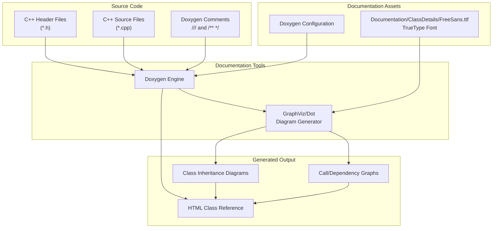
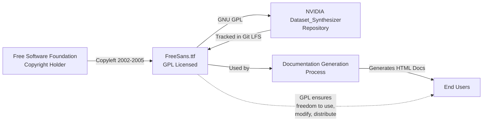
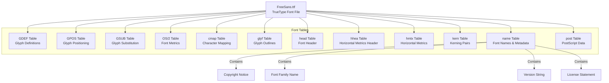

<!-- source: DeepWiki mcp.deepwiki.com · repo NVIDIA/Dataset_Synthesizer · page 8.2 Documentation Resources · fetched 2026-10-26 -->

# Documentation Resources

<details>
<summary>Relevant source files</summary>

The following files were used as context for generating this wiki page:

- [Documentation/ClassDetails/FreeSans.ttf](Documentation/ClassDetails/FreeSans.ttf)

</details>


This page documents the assets and resources used for generating and rendering the project's class documentation and API reference materials. These resources support the automated documentation generation pipeline that creates the HTML reference documentation from source code.

For information about utility components used at runtime within the Unreal Engine plugin, see [Coordinate Visualization](#8.1).

---

## Overview

The NVIDIA Dataset_Synthesizer repository includes dedicated documentation assets to ensure consistent rendering of generated API documentation. These assets are located in the `Documentation/ClassDetails/` directory and are used by documentation generation tools to produce the project's class reference materials.

**Sources:** [Documentation/ClassDetails/FreeSans.ttf:1-1]()

---

## FreeSans Font Asset

### Font File Location

The primary documentation resource is the FreeSans TrueType font, located at:

```
Documentation/ClassDetails/FreeSans.ttf
```

This font file is a binary TrueType font (`.ttf`) tracked in the repository via Git LFS (see [Git LFS Configuration](#2.2) for details on binary asset management).

### Font Characteristics

| Property | Value |
|----------|-------|
| **Font Family** | FreeSans |
| **Font Weight** | Medium |
| **Font Format** | TrueType (.ttf) |
| **Version** | Revision 1.76 |
| **Character Set** | Extended Latin, Cyrillic, Greek, Hebrew, and more |
| **Tool Version** | FontForge 1.0 |
| **Build Date** | January 26, 2006 |

The font supports a comprehensive character set including:
- Basic Latin alphabet (uppercase and lowercase)
- Extended Latin characters with diacriticals
- Cyrillic script
- Greek alphabet
- Hebrew characters
- Mathematical symbols and operators
- Common punctuation and typographic symbols

**Sources:** [Documentation/ClassDetails/FreeSans.ttf:1-75]()

---

## Documentation Generation Pipeline

The following diagram illustrates how the FreeSans font integrates into the documentation generation workflow:

**Diagram: Documentation Generation Architecture**



**Sources:** [Documentation/ClassDetails/FreeSans.ttf:1-1]()

### Font Usage in Documentation

The FreeSans font is primarily used by GraphViz (the graph visualization tool) when generating:

1. **Class Inheritance Diagrams** - Visual representations of C++ class hierarchies (e.g., `AActor` → `ADRSceneManager`)
2. **Call Graphs** - Function call dependency visualizations
3. **Collaboration Diagrams** - Component relationship diagrams
4. **Include Dependency Graphs** - Header file inclusion trees

These diagrams appear in the generated HTML documentation for classes like:
- `FDomainRandomizationDNNModule` (see [DomainRandomizationDNN Module](#3.1))
- `INVSceneCapturerModule` (see [NVSceneCapturer Module](#3.2))
- `ADRSceneManager` (see [Scene Manager](#4.1))
- `UNVSceneCaptureComponent2D` (see [Scene Capture Component](#5.2))

---

## Licensing Information

### GNU General Public License

The FreeSans font is released under the **GNU General Public License (GPL)**, ensuring it remains free software.

| License Property | Details |
|------------------|---------|
| **License Type** | GNU General Public License |
| **Copyright Holder** | Free Software Foundation |
| **Copyright Years** | 2002, 2003, 2005 |
| **License Statement** | "The use of this font is granted subject to GNU General Public License." |
| **Official License URL** | http://www.gnu.org/copyleft/gpl.html |
| **License Model** | Copyleft |

**Diagram: Font License and Distribution Chain**



**Sources:** [Documentation/ClassDetails/FreeSans.ttf:1-75]()

### Copyleft Implications

The GPL copyleft license for FreeSans means:

- ✓ **Free to use** for any purpose, including commercial projects
- ✓ **Free to modify** the font if needed
- ✓ **Free to distribute** copies of the font
- ✓ **Source available** - font source files can be obtained from the Free Software Foundation
- ⚠ **Derivative works** must also be licensed under GPL
- ⚠ **License text** must be preserved when redistributing

Since this font is used only during documentation generation (build-time tool) and not embedded in runtime binaries, it does not impose licensing restrictions on the Dataset_Synthesizer plugin itself or applications built with it.

**Sources:** [Documentation/ClassDetails/FreeSans.ttf:1-75]()

---

## Font Metadata Structure

The TrueType font file contains structured metadata tables that define its characteristics:

**Diagram: TrueType Font Table Structure**



**Sources:** [Documentation/ClassDetails/FreeSans.ttf:1-75]()

### Key Metadata Entries

From the font's `name` table, the following metadata is embedded:

```
Font Family:        FreeSans
Font Subfamily:     Medium
Full Name:          Free Sans
Version:            Version $Revision: 1.76 $
Copyright:          Copyleft 2002, 2003, 2005 Free Software Foundation.
License:            The use of this font is granted subject to GNU General Public License.
License URL:        http://www.gnu.org/copyleft/gpl.html
Font Designer:      (FontForge 1.0)
Sample Text:        The quick brown fox jumps over the lazy dog.
```

**Sources:** [Documentation/ClassDetails/FreeSans.ttf:1-75]()

---

## Repository Integration

### Git LFS Tracking

The FreeSans.ttf file is tracked using Git Large File Storage (LFS) to avoid bloating the repository with binary data. The `.gitattributes` file contains the pattern:

```
*.ttf filter=lfs diff=lfs merge=lfs -text
```

This ensures that TrueType font files are automatically handled by LFS when committed to the repository.

For more information on binary asset management, see [Git LFS Configuration](#2.2).

**Sources:** [Documentation/ClassDetails/FreeSans.ttf:1-1]()

---

## Summary

The `FreeSans.ttf` font serves as a key documentation resource for the NVIDIA Dataset_Synthesizer project:

| Aspect | Description |
|--------|-------------|
| **Primary Use** | Text rendering in generated class diagrams and documentation graphics |
| **Tool Integration** | Used by GraphViz/Dot during Doxygen documentation generation |
| **Storage** | Tracked via Git LFS as a binary asset |
| **License** | GNU General Public License (copyleft) |
| **Impact** | Build-time only; does not affect runtime licensing of the plugin |

This font ensures consistent, readable typography across all generated API documentation while maintaining compliance with free software licensing principles.

**Sources:** [Documentation/ClassDetails/FreeSans.ttf:1-75]()