# Page: Overview

# Overview

<details>
<summary>Relevant source files</summary>

The following files were used as context for generating this wiki page:

- [Documentation/ClassDetails/NDDSIntro.png](Documentation/ClassDetails/NDDSIntro.png)
- [Documentation/ClassDetails/_domain_randomization_d_n_n_module_8h_source.html](Documentation/ClassDetails/_domain_randomization_d_n_n_module_8h_source.html)
- [Documentation/ClassDetails/_n_v_scene_capturer_module_8h_source.html](Documentation/ClassDetails/_n_v_scene_capturer_module_8h_source.html)

</details>


## Purpose and Scope

NVIDIA DeepLearning Dataset Synthesizer (NDDS) is an Unreal Engine plugin system designed to generate synthetic training datasets for deep learning applications. This overview introduces the system's architecture, core modules, and workflow. For detailed information about specific subsystems, see:

- Repository setup and Git LFS configuration: [Getting Started](#2)
- Domain randomization implementation: [Domain Randomization System](#4)
- Scene capture and annotation: [Scene Capture & Annotation](#5)
- Data export pipeline: [Data Export](#7)

**Sources:** [Documentation/ClassDetails/NDDSIntro.png]()

## What is NDDS?

NDDS is a modular Unreal Engine plugin architecture that procedurally generates diverse, annotated synthetic scenes for training deep neural networks. The system combines domain randomization techniques with automated scene capture and annotation to produce datasets containing:

- RGB images with configurable camera intrinsics
- Bounding box annotations (2D and 3D cuboids)
- Segmentation masks (class-level and instance-level)
- JSON metadata files containing object poses, camera parameters, and annotations

The system addresses the challenge of acquiring large-scale labeled training data by synthesizing photorealistic scenes with automatic ground-truth generation.

**Sources:** Repository overview from cluster analysis

## System Architecture

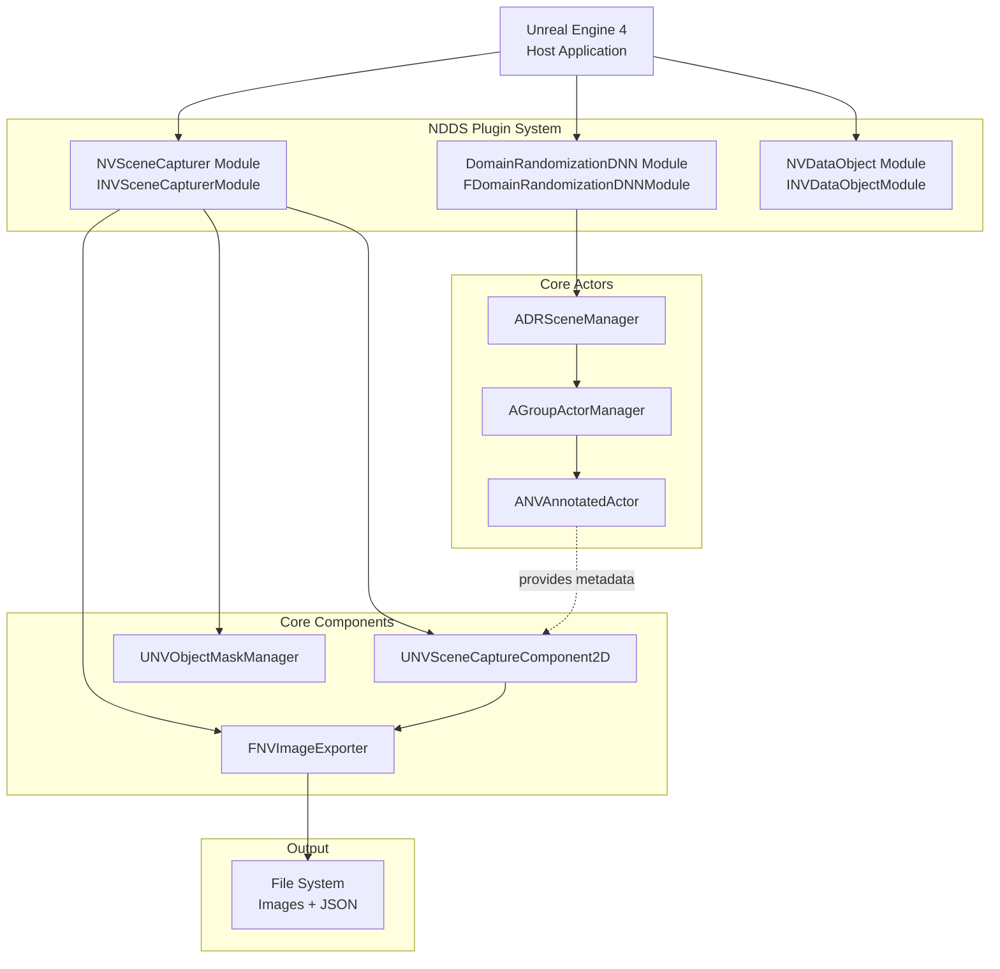

NDDS consists of three primary plugin modules that extend Unreal Engine:

| Module | Primary Class | Responsibility |
|--------|--------------|----------------|
| **DomainRandomizationDNN** | `FDomainRandomizationDNNModule` | Scene orchestration, actor spawning, property randomization |
| **NVSceneCapturer** | `INVSceneCapturerModule` | Scene capture, annotation generation, segmentation masking |
| **NVDataObject** | `INVDataObjectModule` | Data-driven configuration via JSON serialization |

**Sources:** 
- [Documentation/ClassDetails/_domain_randomization_d_n_n_module_8h_source.html:17]()
- [Documentation/ClassDetails/_n_v_scene_capturer_module_8h_source.html:18]()
- High-level architecture diagram (Diagram 1)

## Primary Workflow

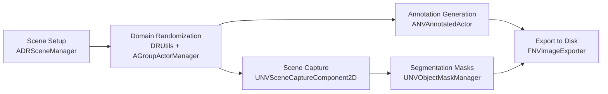

The NDDS workflow progresses through six stages:

1. **Scene Setup**: `ADRSceneManager` initializes the scene environment and spawns actor managers
2. **Domain Randomization**: `AGroupActorManager` spawns actors and applies randomization to transforms, materials, meshes, and colors
3. **Scene Capture**: `UNVSceneCaptureComponent2D` renders the scene to texture buffers with configured camera intrinsics
4. **Annotation Generation**: `ANVAnnotatedActor` instances compute oriented bounding boxes using PCA-based algorithms
5. **Segmentation Masking**: `UNVObjectMaskManager` generates class-level (stencil) or instance-level (vertex color) segmentation masks
6. **Export to Disk**: `FNVImageExporter` asynchronously compresses and writes images and JSON annotations to the file system

**Sources:** High-level architecture diagram (Diagram 2, Diagram 3)

## Key Code Entities

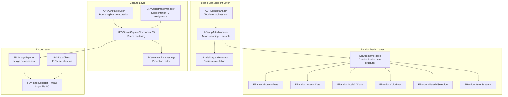

The table below maps system concepts to concrete code entities developers will encounter:

| Concept | Code Entity | Location Pattern |
|---------|-------------|------------------|
| Scene orchestration | `ADRSceneManager` | Actor class managing randomization workflow |
| Actor group spawning | `AGroupActorManager` | Actor class managing collections of objects |
| Spatial positioning | `USpatialLayoutGenerator` | Component for calculating spawn positions |
| Transform randomization | `FRandomRotationData`, `FRandomLocationData`, `FRandomScale3DData` | Data structures in `DRUtils.h` |
| Appearance randomization | `FRandomColorData`, `FRandomMaterialSelection` | Data structures in `DRUtils.h` |
| Asset variation | `FRandomAssetStreamer` | Circular buffer for mesh streaming |
| Scene rendering | `UNVSceneCaptureComponent2D` | Component for capturing rendered frames |
| Object annotation | `ANVAnnotatedActor` | Actor class with cuboid computation |
| Segmentation masking | `UNVObjectMaskManager` | Manager for stencil/vertex-color IDs |
| Camera configuration | `FCameraIntrinsicSettings` | Data structure for focal length, principal point |
| Image export | `FNVImageExporter` | Main exporter class with PNG/JPEG compression |
| Async file writing | `FNVImageExporter_Thread` | Background thread preventing frame drops |
| JSON serialization | `UNVDataObject`, `UNVDataObjectAsset` | Data-driven configuration system |

**Sources:**
- High-level architecture diagram (Diagram 4, Diagram 5)
- [Documentation/ClassDetails/_domain_randomization_d_n_n_module_8h_source.html:17-24]()
- [Documentation/ClassDetails/_n_v_scene_capturer_module_8h_source.html:18-24]()

## Module Responsibilities

### DomainRandomizationDNN Module

The **DomainRandomizationDNN** module (`FDomainRandomizationDNNModule`) implements the scene setup and randomization pipeline. This module is responsible for:

- Managing scene lifecycle through `ADRSceneManager` and `ANVSceneManager` classes
- Spawning and destroying actors via `AGroupActorManager` instances
- Applying randomization to object properties using `DRUtils` data structures
- Supporting both one-time and repetitive spawning workflows (controlled by `SpawnDuration`)

For detailed documentation, see [DomainRandomizationDNN Module](#3.1) and [Domain Randomization System](#4).

**Sources:** 
- [Documentation/ClassDetails/_domain_randomization_d_n_n_module_8h_source.html:17-24]()
- High-level architecture diagram (Diagram 1)

### NVSceneCapturer Module

The **NVSceneCapturer** module (`INVSceneCapturerModule`) handles scene capture, annotation, and export. This module provides:

- 2D scene capture through `UNVSceneCaptureComponent2D` with configurable render targets
- Bounding box computation in `ANVAnnotatedActor` using PCA-based oriented bounding boxes
- Segmentation mask generation via `UNVObjectMaskManager` (stencil for classes, vertex color for instances)
- Asynchronous image export through `FNVImageExporter` and `FNVImageExporter_Thread`
- Camera intrinsic calculations in `FCameraIntrinsicSettings`

For detailed documentation, see [NVSceneCapturer Module](#3.2) and [Scene Capture & Annotation](#5).

**Sources:**
- [Documentation/ClassDetails/_n_v_scene_capturer_module_8h_source.html:18-24]()
- High-level architecture diagram (Diagram 1)

### NVDataObject Module

The **NVDataObject** module (`INVDataObjectModule`) provides a data-driven configuration system supporting:

- JSON serialization/deserialization via `UNVDataObject` and `UNVDataObjectAsset`
- Polymorphic object creation through `LogicHandlerClassType`
- Interface-based configuration via `INVDataObjectOwner`

This enables external configuration of actors, components, and scene parameters without code modification.

For detailed documentation, see [NVDataObject Module](#3.3) and [Data Object Serialization](#7.2).

**Sources:** High-level architecture diagram (Diagram 5)

## Data Flow Architecture

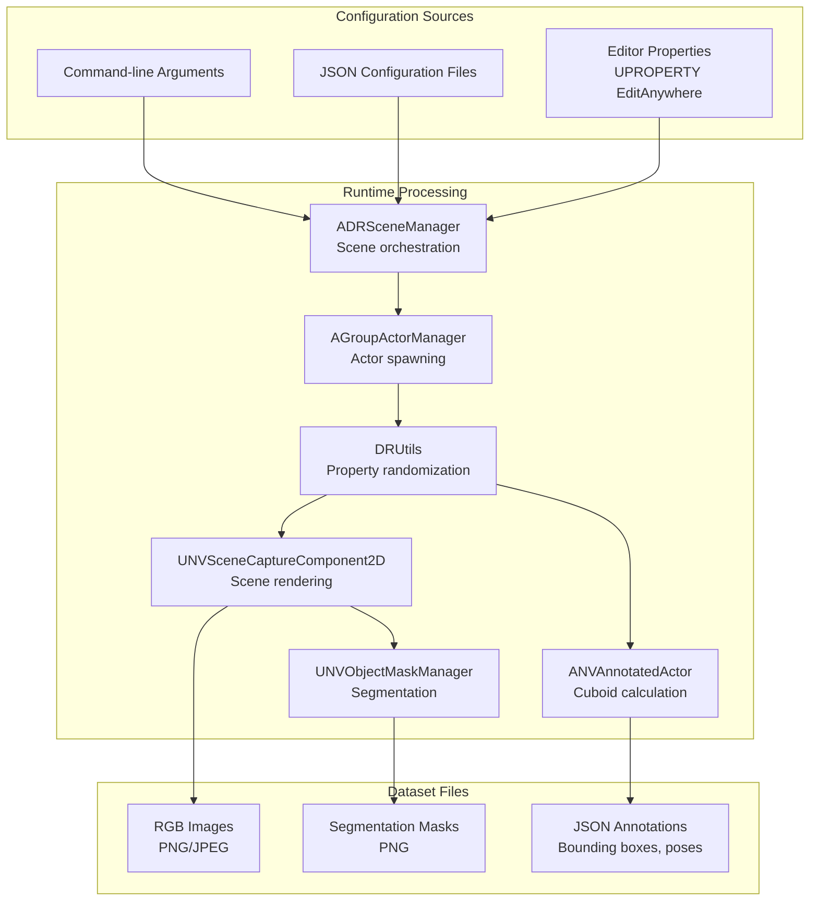

The system accepts configuration from three sources (command-line arguments, JSON files, and Unreal Editor properties), processes scenes through randomization and capture stages, and exports three types of output files:

1. **RGB Images**: Compressed PNG (Z_BEST_SPEED) or JPEG (configurable quality) images
2. **Segmentation Masks**: PNG images with class IDs (stencil-based) or instance IDs (vertex-color-based)
3. **JSON Annotations**: Metadata files containing bounding boxes, object classes, camera parameters, and transformation matrices

**Sources:** High-level architecture diagram (Diagram 3, Diagram 5)

## Design Patterns

NDDS employs several design patterns for modularity and extensibility:

| Pattern | Implementation | Purpose |
|---------|---------------|---------|
| **Factory** | `UCameraSettingsFactoryBase`, `UCameraSettingFactory_HFOV` | Create camera settings from different specifications |
| **Manager** | `ADRSceneManager`, `AGroupActorManager`, `UNVObjectMaskManager` | Coordinate lifecycle and state of related objects |
| **Component-based** | `UNVSceneCaptureComponent2D`, `UNVCoordinateComponent` | Attach functionality to actors via Unreal's component system |
| **Data-driven** | `UNVDataObject`, `INVDataObjectOwner` | Configure behavior through external data instead of code |
| **Async processing** | `FNVImageExporter_Thread` | Prevent blocking the game thread during file I/O |
| **Circular buffer** | `FRandomAssetStreamer` | Efficiently manage large asset libraries without memory bloat |

**Sources:** High-level architecture diagram (Diagram 5)

## Version Control Strategy

NDDS uses Git with Git Large File Storage (Git LFS) to manage the repository:

- **Git-tracked**: Source code (C++, C#, Python), configuration files (JSON, XML, INI), project files (.uproject, .uplugin), documentation
- **Git LFS-tracked**: Unreal assets (.uasset, .umap), 3D models (.fbx, .obj, .stl), binaries (.dll, .exe, .so), media files (.mp4, .pdf)
- **Ignored**: Build artifacts (Intermediate/), cached data (DerivedDataCache/), user settings (Saved/), IDE configurations (.vs/, .vscode/)

This strategy keeps the repository fast while supporting large binary asset libraries required for diverse dataset generation.

For setup instructions, see [Git LFS Configuration](#2.2).

**Sources:** 
- `.gitattributes` file
- `.gitignore` file
- High-level architecture diagram (Diagram 6)

## Next Steps

To understand how to set up and use NDDS:

- [Getting Started](#2): Repository structure and initial setup
- [Architecture Overview](#3): Deep dive into the three plugin modules
- [Domain Randomization System](#4): How scenes are randomized
- [Scene Capture & Annotation](#5): How annotations are generated
- [Segmentation & Masking](#6): How segmentation masks are created
- [Data Export](#7): How datasets are written to disk

---

# Page: Getting Started

# Getting Started

<details>
<summary>Relevant source files</summary>

The following files were used as context for generating this wiki page:

- [.gitattributes](.gitattributes)
- [.gitignore](.gitignore)

</details>


This guide covers the initial setup and configuration required to work with the NVIDIA Dataset_Synthesizer repository. It explains how to clone the repository, configure Git Large File Storage (LFS) for binary assets, and understand the basic project structure. For detailed information about the repository organization, see [Repository Structure](#2.1). For in-depth Git LFS configuration details, see [Git LFS Configuration](#2.2).

## Purpose and Prerequisites

The Dataset_Synthesizer is an Unreal Engine plugin system that requires proper version control setup to handle both source code and large binary assets (meshes, textures, pre-built binaries). This page guides you through:

- Cloning the repository with Git LFS support
- Understanding which files are tracked by Git vs Git LFS
- Verifying your local setup
- Initial repository structure orientation

### Prerequisites

Before proceeding, ensure you have:

- **Git** (version 2.x or later) with **Git LFS extension** installed
- **Unreal Engine** (compatible version as specified in the `.uproject` file)
- Sufficient disk space for binary assets (meshes, textures, videos)

## Repository Layout

The repository follows Unreal Engine project conventions with custom plugin modules organized under `UEModules/Plugins/`.

```mermaid
graph TB
    Root["Repository Root"]
    
    Root --> UEModules["UEModules/"]
    Root --> Engine["Engine/<br/>(Unreal Engine)"]
    Root --> Intermediate["Intermediate/<br/>(ignored)"]
    Root --> Saved["Saved/<br/>(ignored)"]
    Root --> NVCapturedData["NVCapturedData/<br/>(ignored)"]
    
    UEModules --> Plugins["Plugins/"]
    
    Plugins --> DRModule["DomainRandomizationDNN/"]
    Plugins --> SCModule["NVSceneCapturer/"]
    Plugins --> DOModule["NVDataObject/"]
    
    DRModule --> DRSource["Source/DomainRandomizationDNN/"]
    SCModule --> SCSource["Source/NVSceneCapturer/"]
    DOModule --> DOSource["Source/NVDataObject/"]
    
    DRSource --> DRPublic["Public/<br/>(header files)"]
    DRSource --> DRPrivate["Private/<br/>(implementation files)"]
    
    SCSource --> SCPublic["Public/<br/>(header files)"]
    SCSource --> SCPrivate["Private/<br/>(implementation files)"]
    
    DOSource --> DOPublic["Public/<br/>(header files)"]
    DOSource --> DOPrivate["Private/<br/>(implementation files)"]
    
    Root --> GitFiles[".gitattributes<br/>.gitignore<br/>.uproject"]
```

**Sources:** [.gitignore:164-176]()

## Version Control Strategy

The repository uses a hybrid approach combining standard Git for source code and Git LFS for large binary assets. This ensures fast clone operations while supporting the large asset libraries required for synthetic dataset generation.

### File Categorization

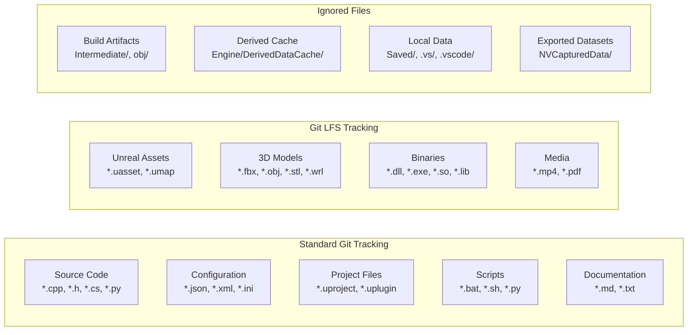

**Sources:** [.gitattributes:1-14](), [.gitignore:16-181]()

## Initial Setup Workflow

The following diagram shows the complete workflow for setting up the repository on a new machine:

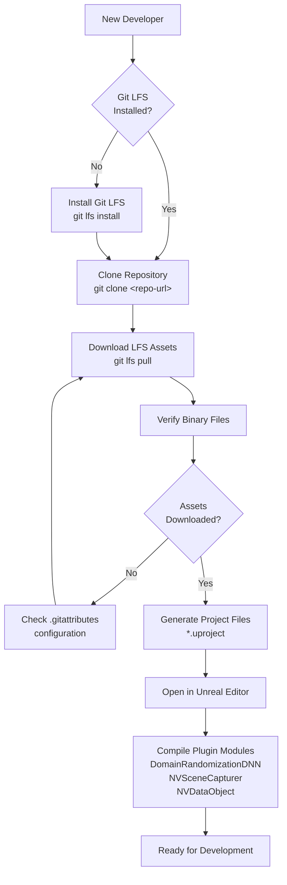

**Sources:** [.gitattributes:1-14](), [.gitignore:1-181]()

### Step-by-Step Instructions

#### 1. Install Git LFS

If not already installed, configure Git LFS globally:

```bash
git lfs install
```

Verify installation:

```bash
git lfs version
```

#### 2. Clone the Repository

Clone the repository using standard Git commands. Git LFS will automatically detect LFS-tracked files based on [.gitattributes:1-14]():

```bash
git clone https://github.com/NVIDIA/Dataset_Synthesizer
cd Dataset_Synthesizer
```

#### 3. Verify LFS Assets

Ensure binary assets were downloaded correctly. Git LFS should have automatically pulled assets during clone. Verify by checking file sizes:

```bash
git lfs ls-files
```

This should list all LFS-tracked files (`.uasset`, `.umap`, `.fbx`, `.dll`, `.exe`, etc.).

If assets weren't pulled, manually fetch them:

```bash
git lfs pull
```

#### 4. Verify File Tracking

The following table shows which file types are tracked by which system:

| File Extension | Tracking Method | Purpose | Configuration |
|----------------|-----------------|---------|---------------|
| `.cpp`, `.h`, `.cs` | Standard Git | Source code | [.gitignore:20-49]() |
| `.json`, `.xml`, `.ini` | Standard Git | Configuration | [.gitignore:74-89]() |
| `.uproject`, `.uplugin` | Standard Git | Project definitions | [.gitignore:80-81]() |
| `.uasset`, `.umap` | Git LFS | Unreal Engine assets | [.gitattributes:1-2]() |
| `.fbx`, `.obj`, `.stl` | Git LFS | 3D models | [.gitattributes:3-6]() |
| `.dll`, `.exe`, `.so` | Git LFS | Binaries | [.gitattributes:10-11]() |
| `.mp4`, `.pdf` | Git LFS | Media files | [.gitattributes:13-14]() |

**Sources:** [.gitattributes:1-14](), [.gitignore:20-89]()

## Ignored Files and Directories

Several directories are excluded from version control to prevent tracking generated or user-specific files:

### Build Artifacts

- `Intermediate/` - Temporary build outputs ([.gitignore:164]())
- `obj/` - Object files ([.gitignore:165]())
- `Engine/DerivedDataCache/` - Cached derived data ([.gitignore:161]())

### User-Specific Files

- `Saved/` - User preferences and local saves ([.gitignore:168]())
- `.vs/`, `.vscode/` - IDE configurations ([.gitignore:179-180]())
- `.DS_Store` - macOS metadata ([.gitignore:173]())

### Exported Data

- `NVCapturedData/` - Exported synthetic datasets ([.gitignore:176]())

This directory is where captured images and annotations are saved during dataset generation. It should remain untracked as datasets can be very large.

**Sources:** [.gitignore:160-180]()

## Special Binaries

The repository includes specific pre-built binaries required for cross-platform functionality, which are exceptions to the ignore rules:

### Mono Runtime (Mac)

For running `GitDependencies.exe` on macOS, the following Mono binaries are explicitly tracked via Git LFS:

- `Engine/Binaries/ThirdParty/Mono/Mac/bin/*` ([.gitignore:134]())
- `Engine/Binaries/ThirdParty/Mono/Mac/lib/libMonoPosixHelper.dylib` ([.gitignore:137]())
- Mono assemblies in `Engine/Binaries/ThirdParty/Mono/Mac/lib/mono/` ([.gitignore:138-144]())

### GitDependencies

- `Engine/Binaries/DotNET/GitDependencies.exe` ([.gitignore:150]())
- `Engine/Binaries/DotNET/GitDependencies.exe.config` ([.gitignore:151]())

These binaries enable the Unreal Engine dependency management system to function across platforms.

**Sources:** [.gitignore:133-151]()

## Next Steps

After successfully setting up the repository:

1. **Understand the Architecture** - See [Architecture Overview](#3) for details on the three plugin modules
2. **Explore Repository Structure** - See [Repository Structure](#2.1) for detailed directory organization
3. **Configure Git LFS** - See [Git LFS Configuration](#2.2) for advanced LFS settings
4. **Build and Run** - Generate Unreal Engine project files and compile the plugins
5. **Create Scenes** - Use `ADRSceneManager` to set up randomized scenes (see [Scene Manager](#4.1))
6. **Capture Data** - Use `UNVSceneCaptureComponent2D` to export datasets (see [Scene Capture Component](#5.2))

## Troubleshooting

### LFS Assets Not Downloaded

If binary files appear as text pointers (small files containing LFS metadata):

```bash
git lfs pull
```

Verify LFS configuration:

```bash
cat .gitattributes
```

### Large Clone Time

Initial clone may take time due to binary assets. To reduce download size:

```bash
# Clone without LFS assets
GIT_LFS_SKIP_SMUDGE=1 git clone <repo-url>

# Selectively pull only required assets
git lfs pull --include="path/to/specific/assets"
```

### Platform-Specific Issues

- **Windows**: Ensure long path support is enabled (`git config --system core.longpaths true`)
- **Mac**: Verify Mono binaries are executable ([.gitignore:134-144]())
- **Linux**: Check file permissions for `.so` libraries ([.gitattributes:9]())

**Sources:** [.gitattributes:1-14](), [.gitignore:133-151]()

---

# Page: Repository Structure

# Repository Structure

<details>
<summary>Relevant source files</summary>

The following files were used as context for generating this wiki page:

- [.gitignore](.gitignore)
- [Documentation/ClassDetails/_domain_randomization_d_n_n_module_8h_source.html](Documentation/ClassDetails/_domain_randomization_d_n_n_module_8h_source.html)

</details>


This page documents the physical organization of the NVIDIA Dataset_Synthesizer repository, explaining how the codebase is structured within the Unreal Engine plugin framework. For information about Git LFS configuration and binary asset management, see [Git LFS Configuration](#2.2). For architectural details about how the modules interact at runtime, see [Architecture Overview](#3).

## Overview

The Dataset_Synthesizer follows Unreal Engine's standard plugin architecture, with all custom functionality organized as plugin modules under the `UEModules/Plugins/` directory. The repository contains three primary plugin modules that implement synthetic dataset generation capabilities, along with supporting configuration files, documentation, and binary assets managed through Git LFS.

## Directory Structure

The repository follows a hierarchical organization based on Unreal Engine conventions:

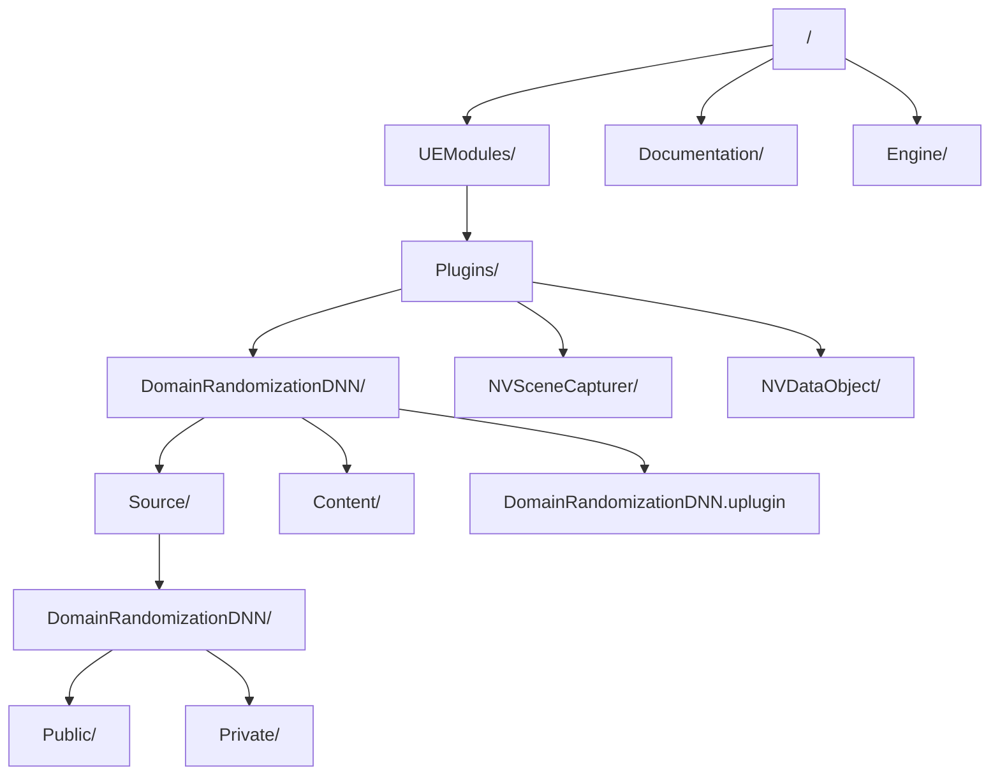

**Sources:** [Documentation/ClassDetails/_domain_randomization_d_n_n_module_8h_source.html:124]()

### Top-Level Directories

| Directory | Purpose | Git Tracking |
|-----------|---------|--------------|
| `UEModules/Plugins/` | Custom NDDS plugin modules | Yes (source code) |
| `Documentation/` | Generated class documentation (Doxygen HTML) | Yes |
| `Engine/Binaries/ThirdParty/Mono/` | Mono runtime binaries for Mac | Git LFS |
| `Engine/Binaries/DotNET/` | GitDependencies.exe and config | Yes |
| `Intermediate/` | Build artifacts and temporary files | Ignored |
| `Saved/` | User-specific settings and logs | Ignored |
| `DerivedDataCache/` | Unreal Engine cached data | Ignored |
| `NVCapturedData/` | Exported dataset output | Ignored |

**Sources:** [.gitignore:1-181]()

## Plugin Module Organization

Each plugin module follows Unreal Engine's standard structure with a `.uplugin` descriptor file, source code directories, and optional content assets.

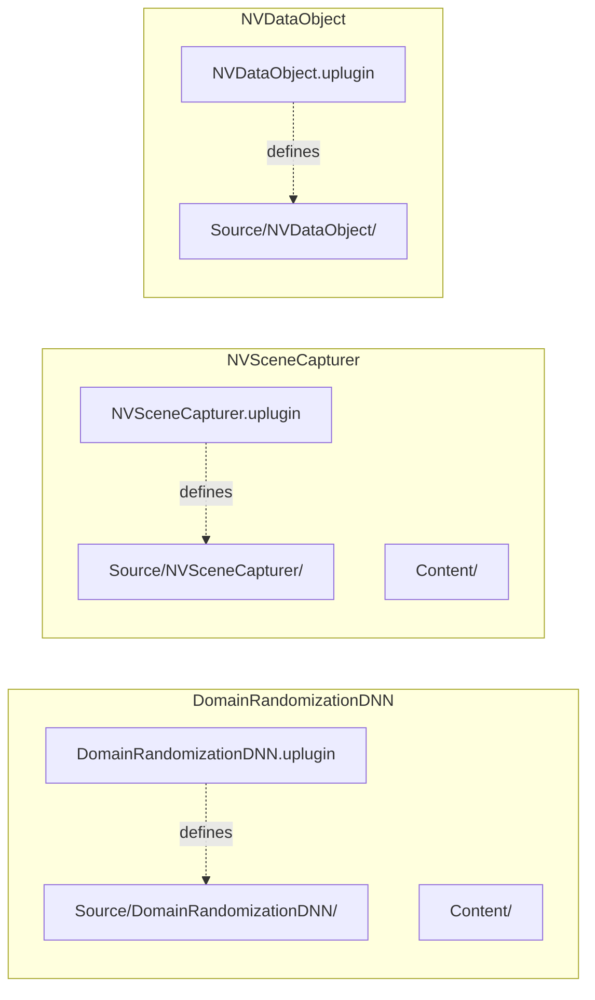

### DomainRandomizationDNN Module

Located at `UEModules/Plugins/DomainRandomizationDNN/`, this module implements scene randomization and actor spawning.

**Directory Structure:**
```
DomainRandomizationDNN/
├── DomainRandomizationDNN.uplugin    # Plugin descriptor
├── Source/
│   └── DomainRandomizationDNN/
│       ├── Public/                    # Public header files
│       │   ├── DomainRandomizationDNNModule.h
│       │   ├── DomainRandomizationDNNPCH.h
│       │   ├── DRUtils.h
│       │   ├── DRSceneManager.h
│       │   └── GroupActorManager.h
│       └── Private/                   # Implementation files
│           ├── DomainRandomizationDNNModule.cpp
│           ├── DRUtils.cpp
│           └── ...
└── Content/                           # Blueprint assets (if any)
```

**Key Classes:**
- `FDomainRandomizationDNNModule`: Module initialization and shutdown
- `ADRSceneManager`: Scene orchestration and lifecycle management
- `AGroupActorManager`: Actor spawning and destruction
- `DRUtils`: Randomization data structures and utilities

**Sources:** [Documentation/ClassDetails/_domain_randomization_d_n_n_module_8h_source.html:124]()

### NVSceneCapturer Module

Located at `UEModules/Plugins/NVSceneCapturer/`, this module handles scene capture, annotation, and image export.

**Directory Structure:**
```
NVSceneCapturer/
├── NVSceneCapturer.uplugin           # Plugin descriptor
├── Source/
│   └── NVSceneCapturer/
│       ├── Public/
│       │   ├── NVSceneCapturerModule.h
│       │   ├── NVSceneCaptureComponent2D.h
│       │   ├── NVAnnotatedActor.h
│       │   ├── NVObjectMaskManager.h
│       │   ├── NVImageExporter.h
│       │   └── NVCoordinateComponent.h
│       └── Private/
│           └── ...
└── Content/
```

**Key Classes:**
- `INVSceneCapturerModule`: Module interface
- `UNVSceneCaptureComponent2D`: 2D scene capture component
- `ANVAnnotatedActor`: Annotated actor with cuboid data
- `UNVObjectMaskManager`: Segmentation mask management
- `FNVImageExporter`: Image compression and export
- `UNVCoordinateComponent`: Coordinate axis visualization

**Sources:** High-level architecture diagrams (Diagram 1, Diagram 3)

### NVDataObject Module

Located at `UEModules/Plugins/NVDataObject/`, this module provides data-driven configuration through JSON serialization.

**Directory Structure:**
```
NVDataObject/
├── NVDataObject.uplugin              # Plugin descriptor
└── Source/
    └── NVDataObject/
        ├── Public/
        │   ├── NVDataObjectModule.h
        │   ├── NVDataObject.h
        │   └── NVDataObjectAsset.h
        └── Private/
            └── ...
```

**Key Classes:**
- `INVDataObjectModule`: Module interface
- `UNVDataObject`: Data definition base class
- `UNVDataObjectAsset`: Serializable asset wrapper
- `INVDataObjectOwner`: Interface for data-driven objects

**Sources:** High-level architecture diagrams (Diagram 1, Diagram 5)

## Source File Organization

Each plugin module separates headers into `Public/` and `Private/` directories following Unreal Engine conventions.

### Public Headers

Public headers are located in `Source/<ModuleName>/Public/` and are accessible to other modules. They define:
- Module interfaces (inheriting from `IModuleInterface`)
- Actor classes (inheriting from `AActor`)
- Component classes (inheriting from `UActorComponent`)
- Data structures (`USTRUCT` declarations)
- Public API functions

**Example:** The `FDomainRandomizationDNNModule` class is declared in [UEModules/Plugins/DomainRandomizationDNN/Source/DomainRandomizationDNN/Public/DomainRandomizationDNNModule.h:17-24]()

### Private Implementation

Private implementation files are located in `Source/<ModuleName>/Private/` and contain:
- `.cpp` implementation files
- Internal helper classes
- Module-specific utility functions

### Precompiled Headers

Each module includes a precompiled header (PCH) file for faster compilation:
- `DomainRandomizationDNNPCH.h` for DomainRandomizationDNN module
- Included at the top of the module header file via `#include "DomainRandomizationDNNPCH.h"` ([Documentation/ClassDetails/_domain_randomization_d_n_n_module_8h_source.html:13]())

**Sources:** [Documentation/ClassDetails/_domain_randomization_d_n_n_module_8h_source.html:1-132]()

## File Type Organization

The repository tracks specific file types while ignoring build artifacts and user-specific configurations.

### Tracked Source Files

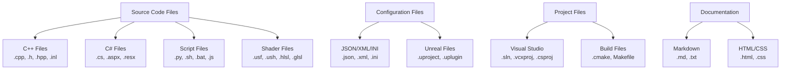

**Tracked File Extensions:**
- **C/C++:** `.c`, `.cpp`, `.h`, `.hpp`, `.inl`, `.inc` ([.gitignore:20-36]())
- **C#:** `.cs`, `.aspx`, `.resx` ([.gitignore:46-49]())
- **Shaders:** `.usf`, `.ush`, `.hlsl`, `.glsl` ([.gitignore:52-55]())
- **Scripts:** `.py`, `.sh`, `.bat`, `.js` ([.gitignore:67-72]())
- **Configuration:** `.json`, `.xml`, `.ini`, `.uproject`, `.uplugin` ([.gitignore:75-90]())
- **Documentation:** `.md`, `.txt`, `.html`, `.pdf` ([.gitignore:58-62]())

**Sources:** [.gitignore:20-90]()

### Ignored Files and Directories

The following are excluded from version control to prevent repository bloat and conflicts:

| Pattern | Reason | Line Reference |
|---------|--------|----------------|
| `Intermediate/` | Build artifacts | [.gitignore:164]() |
| `obj/` | C# build outputs | [.gitignore:165]() |
| `Saved/` | User settings, logs | [.gitignore:168]() |
| `DerivedDataCache/` | Unreal Engine cache | [.gitignore:161]() |
| `NVCapturedData/` | Exported dataset files | [.gitignore:176]() |
| `.vs/`, `.vscode/` | IDE configurations | [.gitignore:179-180]() |
| `*.sln` (root level) | Generated solution files | [.gitignore:122]() |
| `*~` | Unix backup files | [.gitignore:119]() |

**Sources:** [.gitignore:119-180]()

## Binary Assets and Git LFS

Large binary files are managed through Git Large File Storage (LFS) to keep the repository performant. For detailed Git LFS configuration, see [Git LFS Configuration](#2.2).

### LFS-Tracked Assets

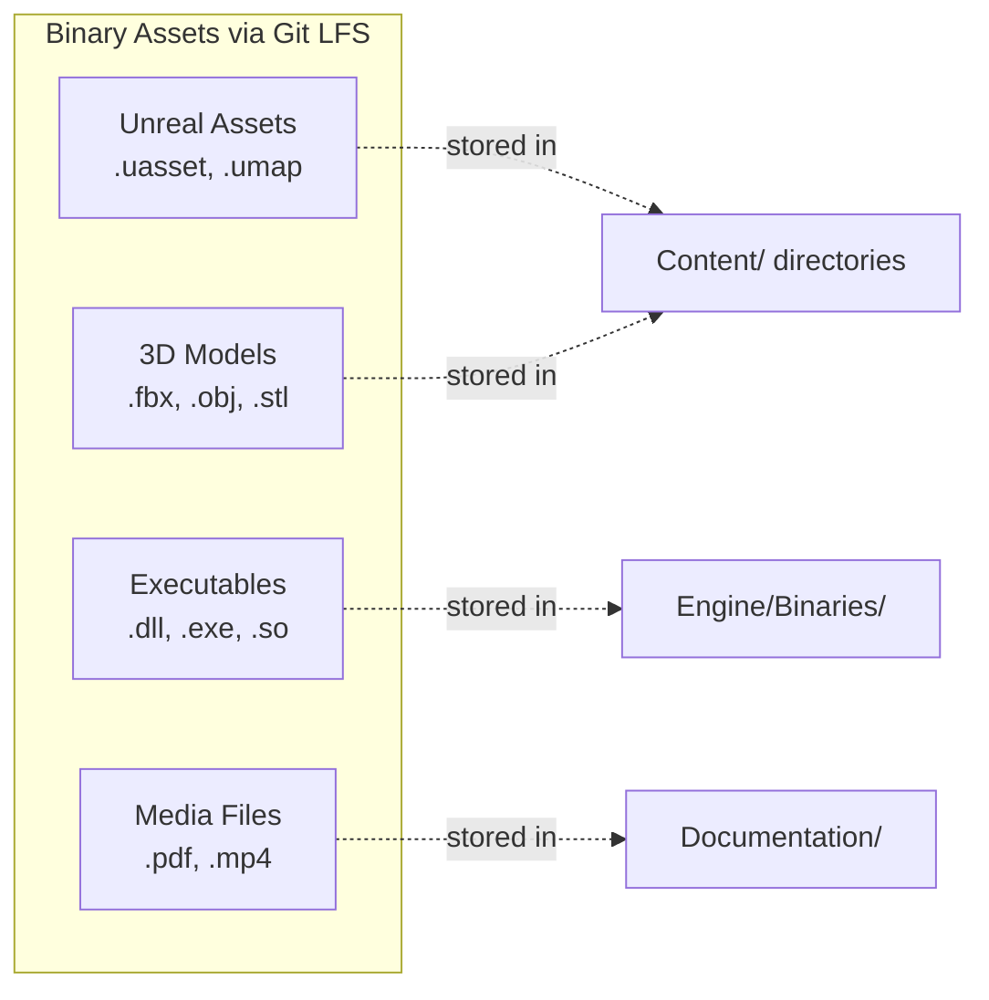

**Tracked via LFS:**
- **Unreal Engine assets:** `.uasset`, `.umap` ([.gitignore:82-83]())
- **3D models:** `.fbx`, `.obj`, `.stl`
- **Binaries:** Mono runtime libraries ([.gitignore:134-144]()), `GitDependencies.exe` ([.gitignore:150-151]())
- **Media:** `.pdf`, `.mp4` ([.gitignore:62-64]())

**Sources:** [.gitignore:82-83](), [.gitignore:134-151]()

## Special Binary Exceptions

The `.gitignore` file explicitly allows specific Mono runtime binaries required for cross-platform operation:

**Mac Mono Binaries** (Engine/Binaries/ThirdParty/Mono/Mac/):
- `/bin/*` - Mono executables
- `/etc/mono/config` - Mono configuration
- `/etc/mono/4.5/machine.config` - Framework configuration
- `/lib/libMonoPosixHelper.dylib` - POSIX helper library
- `/lib/mono/4.5/mscorlib.dll` - Core library
- Various GAC assemblies (`Mono.Posix.dll`, `System.dll`, etc.)

**GitDependencies Tool** (Engine/Binaries/DotNET/):
- `GitDependencies.exe` - Dependency management tool
- `GitDependencies.exe.config` - Configuration file

The automatically created `/Engine/Binaries/ThirdParty/Mono/Mac/bin/mono` symlink is explicitly ignored ([.gitignore:147]()).

**Sources:** [.gitignore:133-151]()

## Data Export Structure

The system exports generated datasets to the `NVCapturedData/` directory, which is excluded from version control to prevent committing large generated files.

**Typical Export Structure:**
```
NVCapturedData/
├── <capture_session_name>/
│   ├── rgb/                    # Color images
│   │   ├── 000000.png
│   │   ├── 000001.png
│   │   └── ...
│   ├── depth/                  # Depth images
│   ├── segmentation/           # Segmentation masks
│   └── annotations/            # JSON annotation files
│       ├── 000000.json
│       ├── 000001.json
│       └── ...
```

The `FNVImageExporter` and `FNVImageExporter_Thread` classes handle writing to this directory structure asynchronously to prevent frame drops during capture.

**Sources:** [.gitignore:176](), High-level architecture diagrams (Diagram 3)

## Module Dependencies

The three plugin modules have interdependencies that affect build order and module loading:

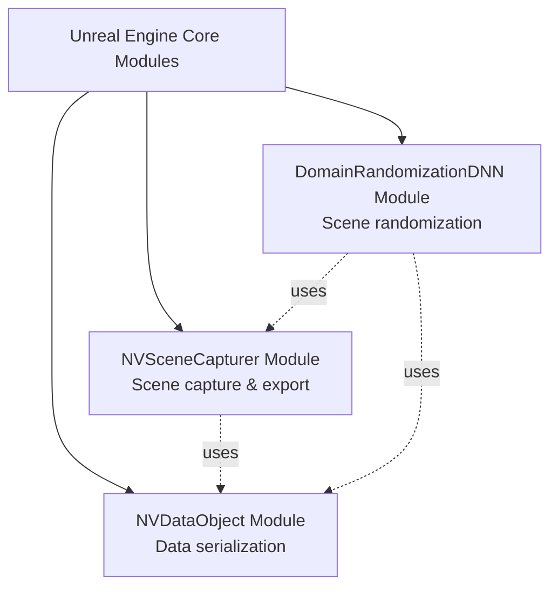

**Dependency Flow:**
1. `NVDataObject` - Base module with no NDDS dependencies
2. `NVSceneCapturer` - Depends on `NVDataObject` for configuration
3. `DomainRandomizationDNN` - Depends on both other modules for scene capture and data-driven configuration

The `.uplugin` descriptor files specify these dependencies to ensure correct module initialization order.

**Sources:** High-level architecture diagrams (Diagram 1, Diagram 5)

## Build System Integration

The repository integrates with Unreal Engine's build system through:

**Project Files:**
- `.uproject` - Unreal Engine project descriptor
- `.uplugin` - Plugin descriptor files for each module
- `.Build.cs` - Unreal Build Tool configuration (one per module)

**Generated Files (Ignored):**
- `.sln` - Visual Studio solution (generated from `.uproject`)
- `.vcxproj` - Visual Studio project files (generated per module)
- `Makefile` - Build scripts for Unix platforms (root level ignored per [.gitignore:124]())

**Intermediate Build Outputs:**
- `Intermediate/Build/` - Compiled object files
- `Binaries/` - Built plugin DLLs/shared libraries (platform-specific)

The Unreal Build Tool (UBT) processes the `.Build.cs` files to generate platform-specific project files and orchestrate compilation.

**Sources:** [.gitignore:93-109](), [.gitignore:122-124]()

---

# Page: Git LFS Configuration

# Git LFS Configuration

<details>
<summary>Relevant source files</summary>

The following files were used as context for generating this wiki page:

- [.gitattributes](.gitattributes)
- [.gitignore](.gitignore)

</details>


## Purpose and Scope

This page documents the Git Large File Storage (LFS) configuration for the NVIDIA Dataset_Synthesizer repository. It explains which binary assets are managed by Git LFS, which files are tracked in standard Git, and which files are excluded from version control entirely.

For information about the overall repository structure and plugin organization, see [Repository Structure](#2.1).

## Overview

The repository uses Git LFS to efficiently manage large binary files that would otherwise bloat the Git repository and slow down clone operations. Without LFS, cloning a repository containing gigabytes of 3D models, compiled binaries, and Unreal Engine assets would be impractical.

Git LFS stores large file contents on a separate server while keeping lightweight pointer files in the Git repository. When files matching LFS patterns are committed, Git LFS intercepts the operation and uploads the file contents to the LFS server, replacing the working directory file with a small text pointer.

**Sources:** [.gitattributes:1-15]()

## File Tracking Strategy

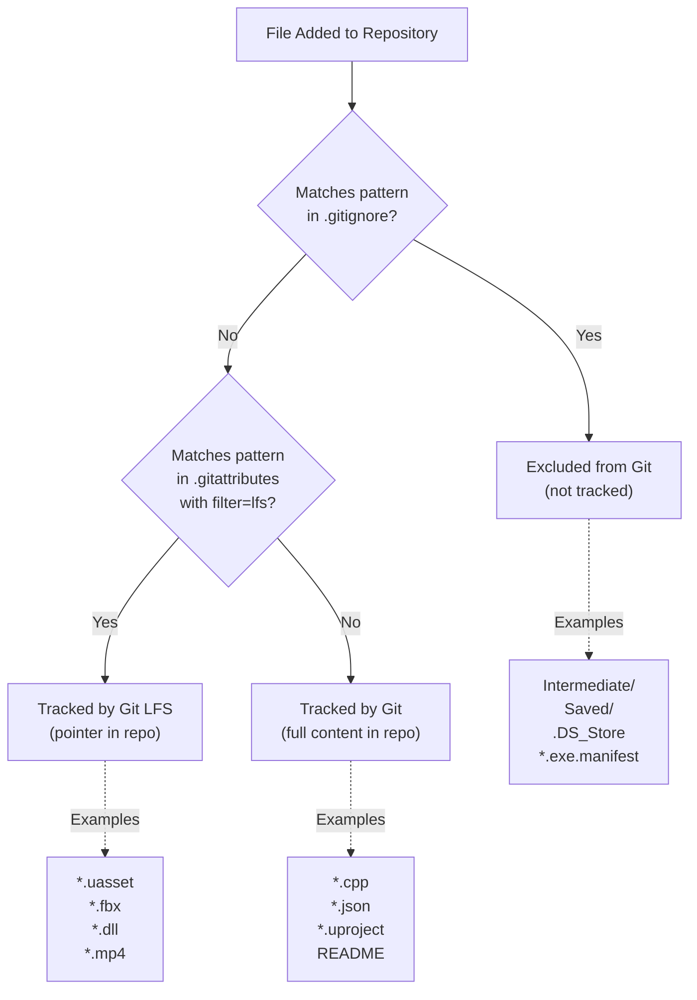

**Sources:** [.gitignore:1-181](), [.gitattributes:1-15]()

## LFS-Tracked File Categories

The [.gitattributes:1-15]() file configures Git LFS to manage the following file types:

### Unreal Engine Assets

| Extension | Type | Purpose |
|-----------|------|---------|
| `.uasset` | Unreal Asset | Actor blueprints, materials, textures, static meshes |
| `.umap` | Unreal Map | Level files containing scene layouts |

These are the native Unreal Engine binary formats. Every actor, material, and level in the `UEModules/Plugins/` directory uses these formats.

### 3D Model Formats

| Extension | Type | Purpose |
|-----------|------|---------|
| `.fbx` | Autodesk FBX | Interchange format for meshes with materials and animations |
| `.stl` | Stereolithography | CAD format for simple triangle meshes |
| `.obj` | Wavefront OBJ | Simple mesh format with optional materials |
| `.wrl` | VRML | Virtual Reality Modeling Language format |

These formats are used by the domain randomization system (see [Domain Randomization System](#4)) to provide mesh variation for synthetic dataset generation.

### Binary Libraries and Executables

| Extension | Type | Platform | Purpose |
|-----------|------|----------|---------|
| `.a` | Static Library | Unix/Linux | Compiled code archives |
| `.lib` | Static Library | Windows | Compiled code archives |
| `.so` | Shared Library | Unix/Linux | Dynamic libraries |
| `.dll` | Dynamic Library | Windows | Dynamic libraries |
| `.exe` | Executable | Windows | Binary executables |
| `.pdb` | Program Database | Windows | Debug symbol files |

These are used for third-party dependencies, including the Mono runtime required by `GitDependencies.exe`.

### Media Files

| Extension | Type | Purpose |
|-----------|------|---------|
| `.mp4` | Video | Documentation and example videos |
| `.pdf` | Document | Documentation and reference materials |

**Sources:** [.gitattributes:1-15]()

## Git Ignore Strategy

The [.gitignore:16-181]() file uses a "deny-all, allow-specific" approach:

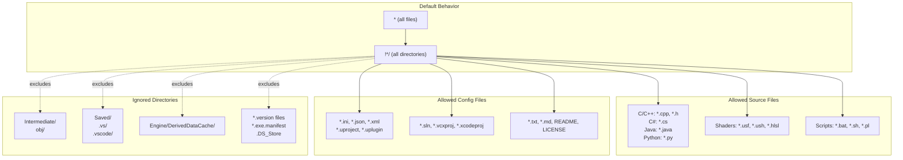

### Key Ignored Paths

The following directories and files are excluded from version control:

**Build Artifacts:**
- `Intermediate/` - Unreal Engine intermediate build files
- `obj/` - C# and C++ object files
- `/Engine/DerivedDataCache/` - Cached shader and texture data

**User-Specific Data:**
- `Saved/` - User preferences, logs, crash reports
- `.vs/` and `.vscode/` - IDE configuration
- `.DS_Store` - macOS folder metadata
- `LocalBuilds/` - Local build outputs

**Generated Files:**
- `*.exe.manifest` and `*.vshost.exe.manifest` - Visual Studio host manifests
- `*.version` files in `/Engine/Binaries/` - Auto-generated version tracking
- `NVCapturedData/` - Exported dataset files (see [Data Export](#7))

**Sources:** [.gitignore:16-181]()

## Special Exceptions for Dependencies

The `.gitignore` file includes explicit exceptions for platform-specific binaries required to run `GitDependencies.exe`, which manages additional dependencies not included in the repository.

### Mono Runtime (macOS)

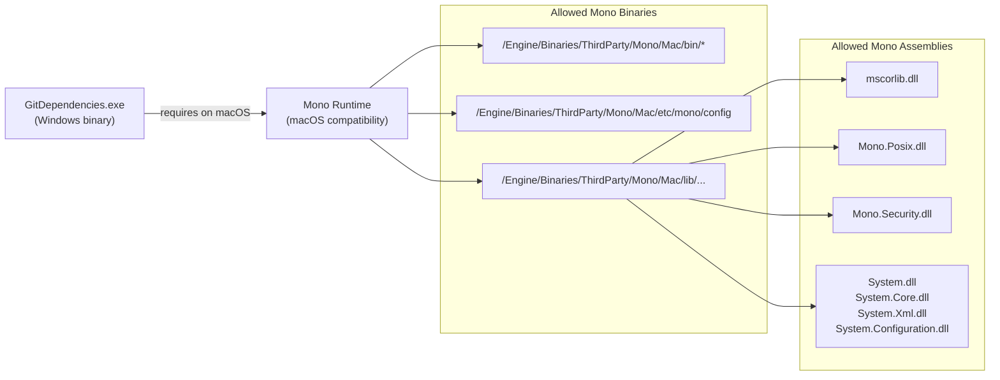

**Key Exceptions:**

The following paths are explicitly allowed in [.gitignore:133-148]():

- `/Engine/Binaries/ThirdParty/Mono/Mac/bin/*` - Mono executable binaries
- `/Engine/Binaries/ThirdParty/Mono/Mac/etc/mono/config` - Mono configuration
- `/Engine/Binaries/ThirdParty/Mono/Mac/etc/mono/4.5/machine.config` - Machine-level configuration
- `/Engine/Binaries/ThirdParty/Mono/Mac/lib/libMonoPosixHelper.dylib` - POSIX helper library
- `/Engine/Binaries/ThirdParty/Mono/Mac/lib/mono/4.5/mscorlib.dll` - Core runtime library
- GAC (Global Assembly Cache) assemblies for `Mono.Posix`, `Mono.Security`, `System`, and related DLLs

### GitDependencies Executable

The following Windows executables are allowed in [.gitignore:149-151]():

- `/Engine/Binaries/DotNET/GitDependencies.exe` - Dependency management tool
- `/Engine/Binaries/DotNET/GitDependencies.exe.config` - Configuration for GitDependencies

**Note:** The symbolic link `/Engine/Binaries/ThirdParty/Mono/Mac/bin/mono` is explicitly ignored in [.gitignore:146-147]() as it's auto-generated.

**Sources:** [.gitignore:133-151]()

## Repository Size Management

The combination of Git LFS and strategic `.gitignore` patterns keeps the repository efficient:

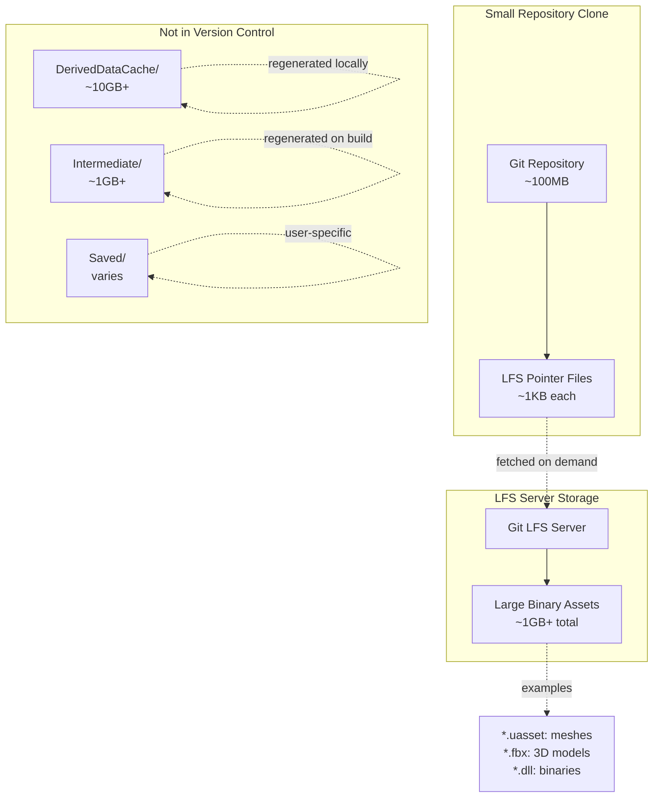

| Category | Storage Location | Typical Size | Versioned |
|----------|------------------|--------------|-----------|
| Source code (C++, C#, Python) | Git repository | ~50MB | Yes |
| Configuration files (JSON, XML, INI) | Git repository | ~10MB | Yes |
| LFS pointer files | Git repository | ~1MB | Yes |
| Binary assets (meshes, textures) | LFS server | ~1GB+ | Via LFS |
| Compiled binaries (DLLs, EXEs) | LFS server | ~500MB | Via LFS |
| Derived data cache | Local only | ~10GB+ | No |
| Build intermediates | Local only | ~1GB+ | No |
| Captured datasets | Local only | ~100GB+ | No |

**Sources:** [.gitignore:160-176](), [.gitattributes:1-15]()

## Workflow Implications

### Initial Clone

When cloning the repository, Git LFS automatically downloads pointer files but not the full binary assets. To fetch all LFS objects:

```bash
git lfs fetch --all
git lfs checkout
```

### Adding New Assets

When adding files that match LFS patterns in `.gitattributes`, Git LFS automatically handles them:

```bash
git add Content/NewMesh.fbx  # Automatically tracked via LFS
git commit -m "Add new mesh for randomization"
```

### Captured Dataset Export

The `NVCapturedData/` directory is ignored in [.gitignore:175-176](), preventing accidentally committing large generated datasets. Exported images and annotations (see [Data Export](#7)) are intended for local storage or separate archival.

**Sources:** [.gitignore:175-176]()

## Summary Table

| File Pattern | Tracking Method | Location | Reason |
|-------------|----------------|----------|--------|
| `*.cpp`, `*.h`, `*.cs` | Standard Git | Repository | Source code, text-diffable |
| `*.json`, `*.ini`, `*.xml` | Standard Git | Repository | Configuration, text-diffable |
| `*.uproject`, `*.uplugin` | Standard Git | Repository | Project definitions |
| `*.uasset`, `*.umap` | Git LFS | LFS server | Large binary Unreal assets |
| `*.fbx`, `*.obj`, `*.stl` | Git LFS | LFS server | 3D model files |
| `*.dll`, `*.exe`, `*.so` | Git LFS | LFS server | Binary executables and libraries |
| `*.mp4`, `*.pdf` | Git LFS | LFS server | Media and documentation |
| `Intermediate/*` | Ignored | Local only | Build artifacts, regenerable |
| `Saved/*` | Ignored | Local only | User settings and logs |
| `NVCapturedData/*` | Ignored | Local only | Exported datasets |
| `.vs/*`, `.vscode/*` | Ignored | Local only | IDE-specific settings |

**Sources:** [.gitattributes:1-15](), [.gitignore:1-181]()

---

# Page: Architecture Overview

# Architecture Overview

<details>
<summary>Relevant source files</summary>

The following files were used as context for generating this wiki page:

- [Documentation/ClassDetails/_domain_randomization_d_n_n_module_8h_source.html](Documentation/ClassDetails/_domain_randomization_d_n_n_module_8h_source.html)
- [Documentation/ClassDetails/_n_v_data_object_module_8h_source.html](Documentation/ClassDetails/_n_v_data_object_module_8h_source.html)
- [Documentation/ClassDetails/_n_v_scene_capturer_module_8h_source.html](Documentation/ClassDetails/_n_v_scene_capturer_module_8h_source.html)

</details>


## Purpose and Scope

This document describes the high-level architecture of the NVIDIA Dataset_Synthesizer (NDDS), focusing on the three core Unreal Engine plugin modules and their interaction patterns. The architecture is designed to separate concerns between scene randomization, capture/annotation, and data-driven configuration.

For detailed information about each module's internal structure and components, see:
- DomainRandomizationDNN Module: [3.1](#3.1)
- NVSceneCapturer Module: [3.2](#3.2)  
- NVDataObject Module: [3.3](#3.3)

For information about the complete domain randomization workflow, see [4](#4). For scene capture and data export pipelines, see [5](#5) and [7](#7).

---

## Plugin Module Structure

NDDS is implemented as three Unreal Engine plugin modules, each residing in the `UEModules/Plugins/` directory structure. All modules implement the `IModuleInterface` contract, providing `StartupModule()` and `ShutdownModule()` lifecycle methods.

### Module Organization Diagram

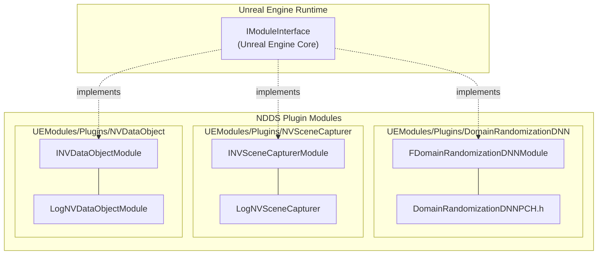

**Sources:**
- [Documentation/ClassDetails/_domain_randomization_d_n_n_module_8h_source.html:17]()
- [Documentation/ClassDetails/_n_v_scene_capturer_module_8h_source.html:18]()
- [Documentation/ClassDetails/_n_v_data_object_module_8h_source.html:18]()

---

## Module Responsibilities

Each module has distinct responsibilities in the synthetic dataset generation pipeline:

| Module | Class Name | Primary Responsibility | Key Components |
|--------|-----------|----------------------|----------------|
| **DomainRandomizationDNN** | `FDomainRandomizationDNNModule` | Scene setup, actor spawning, and randomization of object properties | `ADRSceneManager`, `AGroupActorManager`, `DRUtils` randomization structs |
| **NVSceneCapturer** | `INVSceneCapturerModule` | Scene capture, object annotation, segmentation masking, and image export | `UNVSceneCaptureComponent2D`, `ANVAnnotatedActor`, `UNVObjectMaskManager`, `FNVImageExporter` |
| **NVDataObject** | `INVDataObjectModule` | Data-driven object configuration via JSON serialization/deserialization | `UNVDataObject`, `UNVDataObjectAsset`, `INVDataObjectOwner` interface |

**Sources:**
- [Documentation/ClassDetails/_domain_randomization_d_n_n_module_8h_source.html:17-24]()
- [Documentation/ClassDetails/_n_v_scene_capturer_module_8h_source.html:18-24]()
- [Documentation/ClassDetails/_n_v_data_object_module_8h_source.html:18-24]()

---

## Inter-Module Dependencies and Data Flow

The three modules work together to create a complete synthetic dataset generation pipeline. The following diagram illustrates the runtime dependencies and data flow between modules:

### Module Interaction Diagram

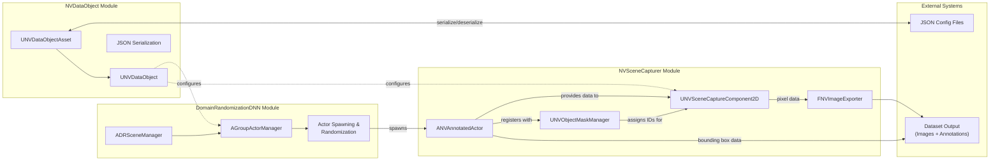

**Sources:**
- [Documentation/ClassDetails/_domain_randomization_d_n_n_module_8h_source.html:13-15]()
- [Documentation/ClassDetails/_n_v_scene_capturer_module_8h_source.html:13-14]()
- [Documentation/ClassDetails/_n_v_data_object_module_8h_source.html:13-14]()

---

## Module Lifecycle and Initialization

All three modules follow the standard Unreal Engine plugin lifecycle pattern:

### Initialization Sequence

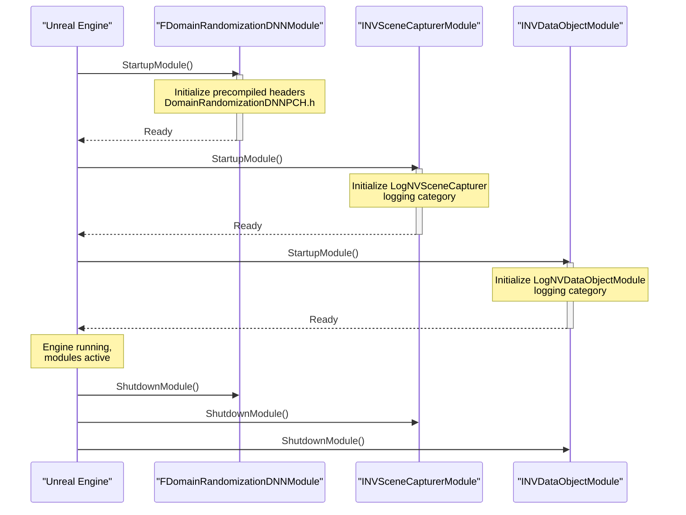

### Module Interface Implementation

Each module implements the `IModuleInterface` contract defined by Unreal Engine:

| Method | Purpose |
|--------|---------|
| `StartupModule()` | Called when the module is loaded; initializes module-specific resources (logging categories, precompiled headers, etc.) |
| `ShutdownModule()` | Called when the module is unloaded; performs cleanup of module resources |

**Sources:**
- [Documentation/ClassDetails/_domain_randomization_d_n_n_module_8h_source.html:21-23]()
- [Documentation/ClassDetails/_n_v_scene_capturer_module_8h_source.html:21-23]()
- [Documentation/ClassDetails/_n_v_data_object_module_8h_source.html:21-23]()

---

## Logging Infrastructure

The NVSceneCapturer and NVDataObject modules declare dedicated logging categories for runtime diagnostics:

| Module | Log Category | Declaration |
|--------|-------------|-------------|
| NVSceneCapturer | `LogNVSceneCapturer` | `DECLARE_LOG_CATEGORY_EXTERN(LogNVSceneCapturer, Log, All)` |
| NVDataObject | `LogNVDataObjectModule` | `DECLARE_LOG_CATEGORY_EXTERN(LogNVDataObjectModule, Log, All)` |

These logging categories enable module-specific log filtering and verbosity control during development and debugging.

**Sources:**
- [Documentation/ClassDetails/_n_v_scene_capturer_module_8h_source.html:16]()
- [Documentation/ClassDetails/_n_v_data_object_module_8h_source.html:16]()

---

## Precompiled Header Strategy

The DomainRandomizationDNN module uses a precompiled header file to optimize compilation times:

```cpp
#include "DomainRandomizationDNNPCH.h"
```

This header ([Documentation/ClassDetails/_domain_randomization_d_n_n_module_8h_source.html:13]()) centralizes common includes used throughout the module, reducing redundant parsing during compilation. The NVSceneCapturer and NVDataObject modules rely on `CoreMinimal.h` instead.

**Sources:**
- [Documentation/ClassDetails/_domain_randomization_d_n_n_module_8h_source.html:13]()
- [Documentation/ClassDetails/_n_v_scene_capturer_module_8h_source.html:13]()
- [Documentation/ClassDetails/_n_v_data_object_module_8h_source.html:13]()

---

## Module Directory Structure

Each module follows the standard Unreal Engine plugin directory layout:

```
UEModules/Plugins/
├── DomainRandomizationDNN/
│   └── Source/
│       └── DomainRandomizationDNN/
│           ├── Public/
│           │   └── DomainRandomizationDNNModule.h
│           └── Private/
├── NVSceneCapturer/
│   └── Source/
│       └── NVSceneCapturer/
│           ├── public/
│           │   └── NVSceneCapturerModule.h
│           └── private/
└── NVDataObject/
    └── Source/
        └── NVDataObject/
            ├── public/
            │   └── NVDataObjectModule.h
            └── private/
```

**Sources:**
- [Documentation/ClassDetails/_domain_randomization_d_n_n_module_8h_source.html:124]()
- [Documentation/ClassDetails/_n_v_scene_capturer_module_8h_source.html:123]()
- [Documentation/ClassDetails/_n_v_data_object_module_8h_source.html:123]()

---

## Design Principles

The modular architecture follows several key design principles:

1. **Separation of Concerns**: Each module has a single, well-defined responsibility (randomization, capture, or data management)

2. **Loose Coupling**: Modules interact through Unreal Engine's standard mechanisms (actors, components, interfaces) rather than direct dependencies

3. **Extensibility**: Each module can be extended independently without affecting other modules

4. **Unreal Engine Integration**: All modules implement standard Unreal Engine patterns (`IModuleInterface`, `AActor`, `UActorComponent`, etc.)

5. **Logging and Diagnostics**: Dedicated logging categories enable module-specific debugging and monitoring

For detailed information about how these modules work together to implement specific workflows, see the Domain Randomization System ([4](#4)) and Scene Capture & Annotation ([5](#5)) sections.

**Sources:**
- [Documentation/ClassDetails/_domain_randomization_d_n_n_module_8h_source.html:17-24]()
- [Documentation/ClassDetails/_n_v_scene_capturer_module_8h_source.html:18-24]()
- [Documentation/ClassDetails/_n_v_data_object_module_8h_source.html:18-24]()

---

# Page: DomainRandomizationDNN Module

# DomainRandomizationDNN Module

<details>
<summary>Relevant source files</summary>

The following files were used as context for generating this wiki page:

- [Documentation/ClassDetails/_domain_randomization_d_n_n_module_8h_source.html](Documentation/ClassDetails/_domain_randomization_d_n_n_module_8h_source.html)
- [Documentation/ClassDetails/_domain_randomization_d_n_n_p_c_h_8h_source.html](Documentation/ClassDetails/_domain_randomization_d_n_n_p_c_h_8h_source.html)

</details>


## Purpose and Scope

The DomainRandomizationDNN module is one of three primary Unreal Engine plugin modules in the NDDS system. It provides the core domain randomization functionality for generating diverse synthetic training datasets. This module is responsible for scene orchestration, actor spawning and management, and randomization of object properties including transforms, appearance, and geometry.

For details on the scene capture and annotation system, see [NVSceneCapturer Module](#3.2). For information on data-driven configuration, see [NVDataObject Module](#3.3). For detailed coverage of specific domain randomization workflows and utilities, see [Domain Randomization System](#4).

## Module Architecture

The DomainRandomizationDNN module follows Unreal Engine's standard plugin architecture, implementing the `IModuleInterface` to integrate with the engine's module loading system.

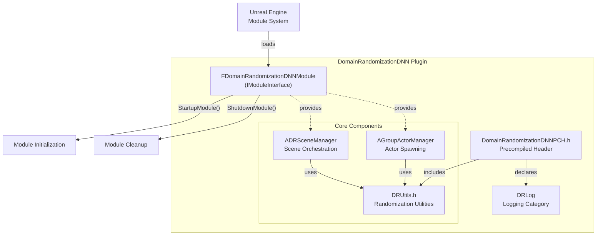

**Sources:**
- [Documentation/ClassDetails/_domain_randomization_d_n_n_module_8h_source.html:17-24]()
- [Documentation/ClassDetails/_domain_randomization_d_n_n_p_c_h_8h_source.html:11-20]()

## Module Class: FDomainRandomizationDNNModule

The `FDomainRandomizationDNNModule` class serves as the entry point for the DomainRandomizationDNN plugin. It inherits from Unreal Engine's `IModuleInterface` and implements the required lifecycle methods.

| Member | Type | Description |
|--------|------|-------------|
| `StartupModule()` | virtual void | Called when the module is loaded; performs initialization |
| `ShutdownModule()` | virtual void | Called when the module is unloaded; performs cleanup |

The module class is declared at [Documentation/ClassDetails/_domain_randomization_d_n_n_module_8h_source.html:17-24]() and located in the file path:

```
UEModules/Plugins/DomainRandomizationDNN/Source/DomainRandomizationDNN/Public/DomainRandomizationDNNModule.h
```

### Module Lifecycle

```mermaid
sequenceDiagram
    participant Engine as "Unreal Engine"
    participant Module as "FDomainRandomizationDNNModule"
    participant Systems as "Randomization Systems"
    
    Engine->>Module: Load Plugin
    Engine->>Module: StartupModule()
    activate Module
    Module->>Systems: Initialize Randomization Systems
    Module-->>Engine: Ready
    deactivate Module
    
    Note over Engine,Systems: Runtime Operation
    
    Engine->>Module: ShutdownModule()
    activate Module
    Module->>Systems: Cleanup Resources
    Module-->>Engine: Complete
    deactivate Module
```

**Sources:**
- [Documentation/ClassDetails/_domain_randomization_d_n_n_module_8h_source.html:17-24]()

## Precompiled Header: DomainRandomizationDNNPCH.h

The precompiled header file centralizes frequently-used include files to improve compilation performance. It is referenced by the module class at [Documentation/ClassDetails/_domain_randomization_d_n_n_module_8h_source.html:13]().

### Included Dependencies

The PCH includes the following Unreal Engine core headers:

| Header | Purpose |
|--------|---------|
| `CoreUObject.h` | Unreal Object System (UObject) |
| `Core.h` | Core engine functionality |
| `CoreMisc.h` | Core miscellaneous utilities |
| `Engine.h` | Main engine classes and systems |
| `EngineUtils.h` | Engine utility functions and iterators |

Additionally, it includes `DRUtils.h`, which contains all domain randomization data structures and utilities (detailed in [Randomization Utilities](#4.3)).

### Logging Configuration

The PCH declares the module's logging category:

```cpp
DECLARE_LOG_CATEGORY_EXTERN(DRLog, Log, All);
```

This `DRLog` category is used throughout the module for diagnostic output and debugging. The category is configured with default verbosity level `Log` and maximum compile-time verbosity `All`.

**File Location:**
```
UEModules/Plugins/DomainRandomizationDNN/Source/DomainRandomizationDNN/Public/DomainRandomizationDNNPCH.h
```

**Sources:**
- [Documentation/ClassDetails/_domain_randomization_d_n_n_p_c_h_8h_source.html:13-20]()

## Core Responsibilities

The DomainRandomizationDNN module provides the following core functionality:

### 1. Scene Management

The module provides scene orchestration through `ADRSceneManager` (detailed in [Scene Manager](#4.1)), which coordinates the overall domain randomization workflow. This includes:

- Scene setup and configuration
- Management of training vs. noise/distractor actors
- Command-line argument parsing for automated workflows
- Scene lifecycle management

### 2. Actor Spawning

The module manages actor spawning and group management through `AGroupActorManager` (detailed in [Actor Spawning](#4.2)), which handles:

- Template-based actor instantiation
- Spatial layout generation
- Repetitive spawning with configurable timers
- Actor destruction and resource management

### 3. Randomization Utilities

The module provides comprehensive randomization capabilities through data structures defined in `DRUtils.h` (detailed in [Randomization Utilities](#4.3)):

- **Transform Randomization**: Rotation, location, and scale variations
- **Appearance Randomization**: Color and material modifications
- **Asset Streaming**: Dynamic mesh loading from large libraries

```mermaid
graph LR
    Module["DomainRandomizationDNN<br/>Module"]
    
    subgraph "Scene Layer"
        SceneMgr["ADRSceneManager"]
    end
    
    subgraph "Spawning Layer"
        GroupMgr["AGroupActorManager"]
        LayoutGen["USpatialLayoutGenerator"]
    end
    
    subgraph "Randomization Layer"
        Transform["Transform<br/>Randomization"]
        Appearance["Appearance<br/>Randomization"]
        Assets["Asset<br/>Streaming"]
    end
    
    Module -->|"provides"| SceneMgr
    Module -->|"provides"| GroupMgr
    
    SceneMgr -->|"manages"| GroupMgr
    GroupMgr -->|"uses"| LayoutGen
    
    GroupMgr -->|"applies"| Transform
    GroupMgr -->|"applies"| Appearance
    GroupMgr -->|"applies"| Assets
```

**Sources:**
- [Documentation/ClassDetails/_domain_randomization_d_n_n_p_c_h_8h_source.html:18]()

## Integration with Other Modules

The DomainRandomizationDNN module works in concert with the other NDDS modules to create a complete synthetic dataset generation pipeline.

### Module Dependencies

```mermaid
graph TB
    DR["DomainRandomizationDNN<br/>Module"]
    SC["NVSceneCapturer<br/>Module"]
    DO["NVDataObject<br/>Module"]
    
    subgraph "DomainRandomizationDNN Provides"
        DRScene["ADRSceneManager<br/>Scene Setup"]
        DRActors["Randomized Actors<br/>in Scene"]
    end
    
    subgraph "NVSceneCapturer Consumes"
        SCCapture["UNVSceneCaptureComponent2D<br/>Captures Scene"]
        SCAnnot["ANVAnnotatedActor<br/>Annotation Data"]
    end
    
    subgraph "NVDataObject Provides"
        DOConfig["UNVDataObject<br/>Configuration Data"]
    end
    
    DR -->|"creates"| DRScene
    DRScene -->|"spawns"| DRActors
    
    DRActors -.->|"captured by"| SCCapture
    DRActors -.->|"annotated as"| SCAnnot
    
    DOConfig -.->|"configures"| DRScene
    
    DR -.->|"works with"| SC
    DR -.->|"configured by"| DO
```

### Data Flow

The typical data flow in a domain randomization session:

1. **Configuration Phase**: `NVDataObject` module provides configuration data (if used)
2. **Setup Phase**: `FDomainRandomizationDNNModule` initializes, `ADRSceneManager` sets up scene
3. **Spawning Phase**: `AGroupActorManager` spawns actors with randomized properties
4. **Capture Phase**: `NVSceneCapturer` module captures the randomized scene
5. **Repetition**: If configured, actors are destroyed and respawned with new randomization

**Sources:**
- [Documentation/ClassDetails/_domain_randomization_d_n_n_module_8h_source.html:17-24]()
- [Documentation/ClassDetails/_domain_randomization_d_n_n_p_c_h_8h_source.html:13-20]()

## File Structure

The DomainRandomizationDNN module is organized in the standard Unreal Engine plugin structure:

```
UEModules/Plugins/DomainRandomizationDNN/
└── Source/
    └── DomainRandomizationDNN/
        ├── Public/
        │   ├── DomainRandomizationDNNModule.h      (Module interface)
        │   ├── DomainRandomizationDNNPCH.h        (Precompiled header)
        │   ├── DRUtils.h                          (Randomization utilities)
        │   ├── DRSceneManager.h                   (Scene orchestration)
        │   └── GroupActorManager.h                (Actor spawning)
        └── Private/
            └── (Implementation files)
```

The `Public/` directory contains headers exposed to other modules and user code, while `Private/` contains implementation details.

**Sources:**
- [Documentation/ClassDetails/_domain_randomization_d_n_n_module_8h_source.html:124]()
- [Documentation/ClassDetails/_domain_randomization_d_n_n_p_c_h_8h_source.html:118]()

---

# Page: NVSceneCapturer Module

# NVSceneCapturer Module

<details>
<summary>Relevant source files</summary>

The following files were used as context for generating this wiki page:

- [Documentation/ClassDetails/_n_v_scene_capture_component2_d_8h_source.html](Documentation/ClassDetails/_n_v_scene_capture_component2_d_8h_source.html)
- [Documentation/ClassDetails/_n_v_scene_capturer_module_8h_source.html](Documentation/ClassDetails/_n_v_scene_capturer_module_8h_source.html)

</details>


## Purpose and Scope

The **NVSceneCapturer Module** is one of the three primary plugin modules in NDDS, responsible for capturing rendered scenes, annotating objects with metadata, generating segmentation masks, and exporting the resulting datasets to the file system. This module transforms randomized 3D scenes created by the DomainRandomizationDNN module into structured datasets suitable for training deep learning models.

This document provides an architectural overview of the module, its core components, and how it integrates with other NDDS modules. For detailed information about specific subsystems:
- Scene capture implementation details: see [Scene Capture Component](#5.2)
- Annotation and bounding box calculation: see [Annotated Actors](#5.1)
- Segmentation mask generation: see [Segmentation & Masking](#6)
- Image export and compression: see [Image Export System](#7.1)

**Sources:** [Documentation/ClassDetails/_n_v_scene_capturer_module_8h_source.html:1-24]()

---

## Module Definition

The module is defined as an Unreal Engine plugin implementing the `IModuleInterface` standard interface pattern.

```mermaid
classDiagram
    class IModuleInterface {
        <<Unreal Engine Interface>>
    }
    
    class INVSceneCapturerModule {
        +void StartupModule()
        +void ShutdownModule()
    }
    
    IModuleInterface <|-- INVSceneCapturerModule
```

**Module Interface: INVSceneCapturerModule**

| Member Function | Purpose |
|----------------|---------|
| `StartupModule()` | Initializes the module when the plugin is loaded by Unreal Engine |
| `ShutdownModule()` | Cleans up module resources when the plugin is unloaded |

The module is registered with Unreal Engine's module management system and can be accessed via `FModuleManager::LoadModuleChecked<INVSceneCapturerModule>("NVSceneCapturer")`.

**Sources:** [Documentation/ClassDetails/_n_v_scene_capturer_module_8h_source.html:18-24]()

---

## Module Architecture

The NVSceneCapturer module contains several interconnected subsystems organized around capturing, annotating, and exporting scene data.

```mermaid
graph TB
    subgraph "NVSceneCapturer Module"
        Module["INVSceneCapturerModule<br/>Module Interface"]
        
        subgraph "Capture System"
            SceneComp["UNVSceneCaptureComponent2D<br/>Scene Capture Component"]
            TextureReader["FNVTextureRenderTargetReader<br/>Async Pixel Readback"]
            RenderTarget["UTextureRenderTarget2D<br/>Render Target Texture"]
        end
        
        subgraph "Annotation System"
            AnnotActor["ANVAnnotatedActor<br/>Annotatable Objects"]
            CoordComp["UNVCoordinateComponent<br/>Coordinate Visualization"]
            CuboidData["FNVCuboidData<br/>Bounding Box Data"]
        end
        
        subgraph "Segmentation System"
            MaskMgr["UNVObjectMaskManager<br/>Mask Manager Base"]
            StencilMask["UNVObjectMaskManager_Stencil<br/>Class Segmentation"]
            VertexMask["UNVObjectMaskManager_VertexColor<br/>Instance Segmentation"]
        end
        
        subgraph "Export System"
            ImgExporter["FNVImageExporter<br/>Image Compression"]
            ExportThread["FNVImageExporter_Thread<br/>Async File Writer"]
        end
        
        subgraph "Configuration"
            CamSettings["FCameraIntrinsicSettings<br/>Camera Parameters"]
            CamFactory["UCameraSettingsFactoryBase<br/>Factory Pattern"]
        end
    end
    
    Module --> SceneComp
    Module --> AnnotActor
    Module --> MaskMgr
    
    SceneComp --> RenderTarget
    SceneComp --> TextureReader
    SceneComp --> CamSettings
    
    AnnotActor --> CoordComp
    AnnotActor --> CuboidData
    
    MaskMgr --> StencilMask
    MaskMgr --> VertexMask
    
    TextureReader --> ImgExporter
    ImgExporter --> ExportThread
    
    CamFactory --> CamSettings
```

**Sources:** [Documentation/ClassDetails/_n_v_scene_capturer_module_8h_source.html:1-24](), [Documentation/ClassDetails/_n_v_scene_capture_component2_d_8h_source.html:28-114]()

---

## Core Components

The module provides several key classes organized by functionality:

### Capture Components

| Class | File Path | Purpose |
|-------|-----------|---------|
| `UNVSceneCaptureComponent2D` | [UEModules/Plugins/NVSceneCapturer/Source/NVSceneCapturer/public/NVSceneCaptureComponent2D.h:28]() | Extends `USceneCaptureComponent2D` to capture scenes to render targets and read back pixel data asynchronously |
| `FNVTextureRenderTargetReader` | Referenced in [UEModules/Plugins/NVSceneCapturer/Source/NVSceneCapturer/public/NVSceneCaptureComponent2D.h:112]() | Handles asynchronous readback of pixel data from render targets |
| `FNVTexturePixelData` | Referenced in [UEModules/Plugins/NVSceneCapturer/Source/NVSceneCapturer/public/NVSceneCaptureComponent2D.h:34]() | Struct containing captured pixel data and metadata |

### Annotation Components

| Class | File Path | Purpose |
|-------|-----------|---------|
| `ANVAnnotatedActor` | Referenced in architecture diagrams | Actor subclass that can be annotated with bounding boxes and segmentation IDs |
| `UNVCoordinateComponent` | Referenced in architecture diagrams | Visualizes coordinate axes for debugging PCA-based orientation |
| `FNVCuboidData` | Referenced in architecture diagrams | Stores oriented bounding box (OBB) data calculated via PCA |

### Segmentation Components

| Class | File Path | Purpose |
|-------|-----------|---------|
| `UNVObjectMaskManager` | Referenced in architecture diagrams | Base class for managing segmentation ID assignment |
| `UNVObjectMaskManager_Stencil` | Referenced in architecture diagrams | Implements class-level segmentation using stencil buffer (8-bit) |
| `UNVObjectMaskManager_VertexColor` | Referenced in architecture diagrams | Implements instance-level segmentation using vertex colors (32-bit) |

### Export Components

| Class | File Path | Purpose |
|-------|-----------|---------|
| `FNVImageExporter` | Referenced in architecture diagrams | Compresses images to PNG or JPEG format |
| `FNVImageExporter_Thread` | Referenced in architecture diagrams | Asynchronously writes compressed images to disk |

### Configuration Components

| Class | File Path | Purpose |
|-------|-----------|---------|
| `FCameraIntrinsicSettings` | Referenced in architecture diagrams | Stores camera intrinsic parameters (focal length, principal point) |
| `UCameraSettingsFactoryBase` | Referenced in architecture diagrams | Abstract factory for creating camera settings from different specifications |

**Sources:** [Documentation/ClassDetails/_n_v_scene_capture_component2_d_8h_source.html:28-114]()

---

## Scene Capture Pipeline

The primary workflow of the module follows a multi-stage pipeline from scene setup to file export.

```mermaid
flowchart LR
    subgraph "Input"
        Scene["Randomized Scene<br/>from DomainRandomizationDNN"]
    end
    
    subgraph "Capture Stage"
        Render["UNVSceneCaptureComponent2D<br/>CaptureSceneToTexture()"]
        RT["UTextureRenderTarget2D<br/>Render Target"]
        Readback["FNVTextureRenderTargetReader<br/>Async Pixel Readback"]
    end
    
    subgraph "Annotation Stage"
        CalcBBox["ANVAnnotatedActor<br/>GetCuboidData()"]
        CalcMask["UNVObjectMaskManager<br/>Assign Segmentation IDs"]
        Metadata["FNVTexturePixelData<br/>+ Bounding Box JSON"]
    end
    
    subgraph "Export Stage"
        Compress["FNVImageExporter<br/>Compress to PNG/JPEG"]
        AsyncWrite["FNVImageExporter_Thread<br/>Write to File System"]
        Output["Dataset Files<br/>Images + JSON"]
    end
    
    Scene --> Render
    Render --> RT
    RT --> Readback
    Readback --> CalcBBox
    Readback --> CalcMask
    CalcBBox --> Metadata
    CalcMask --> Metadata
    Metadata --> Compress
    Compress --> AsyncWrite
    AsyncWrite --> Output
```

**Sources:** [Documentation/ClassDetails/_n_v_scene_capture_component2_d_8h_source.html:59-87]()

---

## UNVSceneCaptureComponent2D: Primary Capture Interface

The `UNVSceneCaptureComponent2D` class is the central interface for scene capture functionality.

### Key Properties

| Property | Type | Purpose |
|----------|------|---------|
| `TextureTargetSize` | `FNVImageSize` | Resolution of the render target (width × height) |
| `TextureTargetFormat` | `ETextureRenderTargetFormat` | Pixel format of the render target |
| `OverrideTexturePixelFormat` | `EPixelFormat` | Optional override for pixel format |
| `bIgnoreReadbackAlpha` | `bool` | If true, set alpha to 1.0 instead of reading from render target |

**Sources:** [Documentation/ClassDetails/_n_v_scene_capture_component2_d_8h_source.html:95-110]()

### Key Methods

```mermaid
classDiagram
    class UNVSceneCaptureComponent2D {
        +CaptureSceneToPixelsData(OnFinishedCallback)
        +BuildProjectionMatrix(RenderTargetSize, ProjectionType, FOV, OrthoWidth) FMatrix
        +BuildViewProjectionMatrix(ViewTransform, RenderTargetSize, ...) FMatrix
        +GetProjectionMatrix() FMatrix
        +StartCapturing()
        +StopCapturing()
        -CaptureSceneToTexture()
        -ReadPixelsDataFromTexture(OnFinishedCallback)
        -ShouldCaptureCurrentFrame() bool
        -ShouldReadbackPixelsData() bool
    }
```

| Method | Return Type | Purpose |
|--------|-------------|---------|
| `CaptureSceneToPixelsData(Callback)` | `void` | Captures scene to render target and asynchronously reads pixel data, then invokes callback |
| `BuildProjectionMatrix(...)` | `FMatrix` | Constructs camera projection matrix from FOV, aspect ratio, and projection type |
| `GetProjectionMatrix()` | `FMatrix` | Returns the current projection matrix for this capture component |
| `StartCapturing()` | `void` | Begins continuous capture (Blueprint callable) |
| `StopCapturing()` | `void` | Stops continuous capture (Blueprint callable) |

**Sources:** [Documentation/ClassDetails/_n_v_scene_capture_component2_d_8h_source.html:43-67]()

### Asynchronous Capture Workflow

The component uses a callback-based asynchronous pattern to avoid blocking the game thread during pixel readback:

```mermaid
sequenceDiagram
    participant Client
    participant Component as UNVSceneCaptureComponent2D
    participant RT as Render Target
    participant Reader as FNVTextureRenderTargetReader
    participant Callback

    Client->>Component: CaptureSceneToPixelsData(Callback)
    Component->>Component: CaptureSceneToTexture()
    Component->>RT: Schedule render command
    RT-->>RT: Render scene to texture
    Component->>Reader: ReadPixelsDataFromTexture(Callback)
    Reader->>RT: Enqueue async readback
    
    Note over RT,Reader: GPU renders and copies pixels<br/>asynchronously
    
    RT-->>Reader: Pixel data ready
    Reader->>Callback: OnFinishedCaptureScenePixelsData(PixelData)
    Callback-->>Client: Process pixel data
```

**Callback Signature:**
```cpp
typedef TFunction<void(const FNVTexturePixelData&)> OnFinishedCaptureScenePixelsDataCallback;
```

This pattern ensures the game thread remains responsive while GPU operations complete in the background.

**Sources:** [Documentation/ClassDetails/_n_v_scene_capture_component2_d_8h_source.html:32-87](), [Documentation/ClassDetails/_n_v_scene_capture_component2_d_8h_source.html:112-113]()

---

## Integration with Other Modules

The NVSceneCapturer module integrates with the other NDDS modules to form a complete dataset generation pipeline.

```mermaid
graph TB
    subgraph "DomainRandomizationDNN Module"
        SceneMgr["ADRSceneManager<br/>Scene Orchestrator"]
        GroupMgr["AGroupActorManager<br/>Actor Spawner"]
        DRUtils["DRUtils<br/>Randomization Functions"]
    end
    
    subgraph "NVSceneCapturer Module"
        SceneComp["UNVSceneCaptureComponent2D<br/>Capture Component"]
        AnnotActor["ANVAnnotatedActor<br/>Annotatable Actors"]
        MaskMgr["UNVObjectMaskManager<br/>Segmentation Manager"]
        Exporter["FNVImageExporter<br/>Image Exporter"]
    end
    
    subgraph "NVDataObject Module"
        DataObj["UNVDataObject<br/>Configuration Data"]
        DataAsset["UNVDataObjectAsset<br/>JSON Serialization"]
    end
    
    subgraph "File System"
        Images["PNG/JPEG Images"]
        JSON["JSON Annotations"]
    end
    
    SceneMgr --> GroupMgr
    GroupMgr --> DRUtils
    GroupMgr -->|spawns| AnnotActor
    
    AnnotActor -.->|provides metadata to| SceneComp
    AnnotActor -.->|registers with| MaskMgr
    
    SceneComp --> Exporter
    MaskMgr -.->|configures| SceneComp
    
    DataObj -.->|configures| SceneMgr
    DataObj -.->|configures| SceneComp
    DataAsset -.->|serializes| DataObj
    
    Exporter --> Images
    AnnotActor -.->|exports metadata| JSON
```

### Module Dependencies

| Module | Relationship | Purpose |
|--------|--------------|---------|
| **DomainRandomizationDNN** | Upstream Producer | Provides randomized scenes with `ANVAnnotatedActor` instances to capture |
| **NVDataObject** | Configuration Provider | Supplies data-driven configuration via `UNVDataObject` serialization |
| **Unreal Engine Core** | Platform | Provides rendering, component system, and file I/O infrastructure |

**Sources:** [Documentation/ClassDetails/_n_v_scene_capturer_module_8h_source.html:1-24]()

---

## Logging

The module defines a dedicated log category for debugging and diagnostics:

```cpp
DECLARE_LOG_CATEGORY_EXTERN(LogNVSceneCapturer, Log, All)
```

Component-specific log categories:
- `LogNVSceneCapturerComponent2D` - For `UNVSceneCaptureComponent2D` operations

These log categories can be used with standard Unreal Engine logging macros (`UE_LOG`) to output diagnostic information during scene capture, annotation, and export operations.

**Sources:** [Documentation/ClassDetails/_n_v_scene_capturer_module_8h_source.html:16](), [Documentation/ClassDetails/_n_v_scene_capture_component2_d_8h_source.html:19]()

---

## Summary

The **NVSceneCapturer Module** serves as the dataset generation backend for NDDS, providing:

1. **Scene Capture**: `UNVSceneCaptureComponent2D` captures rendered scenes to textures with configurable resolution and pixel formats
2. **Asynchronous Readback**: `FNVTextureRenderTargetReader` enables non-blocking pixel data extraction
3. **Object Annotation**: `ANVAnnotatedActor` provides bounding box metadata via PCA-based cuboid calculation
4. **Segmentation**: `UNVObjectMaskManager` assigns class and instance IDs for mask generation
5. **Export**: `FNVImageExporter` compresses and writes images asynchronously to prevent frame drops

The module integrates seamlessly with `DomainRandomizationDNN` (for scene randomization) and `NVDataObject` (for data-driven configuration), forming a complete pipeline from randomized 3D scenes to structured training datasets.

For implementation details of specific subsystems, refer to the dedicated pages listed in the Purpose and Scope section above.

**Sources:** [Documentation/ClassDetails/_n_v_scene_capturer_module_8h_source.html:1-24](), [Documentation/ClassDetails/_n_v_scene_capture_component2_d_8h_source.html:1-114]()

---

# Page: NVDataObject Module

# NVDataObject Module

<details>
<summary>Relevant source files</summary>

The following files were used as context for generating this wiki page:

- [Documentation/ClassDetails/_n_v_data_object_8h_source.html](Documentation/ClassDetails/_n_v_data_object_8h_source.html)
- [Documentation/ClassDetails/_n_v_data_object_module_8h_source.html](Documentation/ClassDetails/_n_v_data_object_module_8h_source.html)

</details>


The NVDataObject module provides a data-driven configuration system for NDDS, enabling objects to be defined, serialized, and deserialized using JSON. This module implements a pattern where runtime objects can be created from JSON configuration files, allowing flexible scene composition and parameter management without code changes.

For information about how this module integrates with scene capture and annotation workflows, see [NVSceneCapturer Module](#3.2). For details on how this module is used in domain randomization configurations, see [Scene Manager (ADRSceneManager)](#4.1).

---

## Module Overview

The NVDataObject module is one of the three core plugin modules in NDDS, responsible for providing JSON-based configuration and data-driven object instantiation.

### Module Interface

The module implements the standard Unreal Engine plugin interface through `INVDataObjectModule`:

[UEModules/Plugins/NVDataObject/Source/NVDataObject/public/NVDataObjectModule.h:18-24]()

**Key Responsibilities:**
- Module initialization and shutdown
- Registration with Unreal Engine's module system
- Logging via `LogNVDataObjectModule` log category

**Sources:** `Documentation/ClassDetails/_n_v_data_object_module_8h_source.html`

---

## Core Classes

The module defines three primary classes and one interface that work together to provide data-driven configuration:

```mermaid
classDiagram
    class UObject {
        <<Unreal Engine>>
    }
    
    class UInterface {
        <<Unreal Engine>>
    }
    
    class UNVDataObjectAsset {
        +UNVDataObject* DataObject
        +SerializeToJsonFile()
        +DeserializeFromJsonFile()
        +DeserializeFromJsonString()
        +CreateObjectFromDefinitionData()
        +IsAsset() bool
    }
    
    class UNVDataObject {
        +TSubclassOf~UObject~ LogicHandlerClassType
        +SerializeToJsonFile()
        +DeserializeFromJsonFile()
        +DeserializeFromJsonString()
        +CreateObjectFromDefinitionData()
    }
    
    class UNVDataObjectOwner {
        <<Interface>>
    }
    
    class INVDataObjectOwner {
        +SetDataObject()
        +GetDataObject()
    }
    
    UObject <|-- UNVDataObjectAsset
    UObject <|-- UNVDataObject
    UInterface <|-- UNVDataObjectOwner
    UNVDataObjectOwner <|.. INVDataObjectOwner
    
    UNVDataObjectAsset "1" *-- "1" UNVDataObject : contains
    INVDataObjectOwner ..> UNVDataObjectAsset : uses
```

**Sources:** `Documentation/ClassDetails/_n_v_data_object_8h_source.html`

---

## Class Details

### UNVDataObjectAsset

`UNVDataObjectAsset` is the primary serializable container that wraps `UNVDataObject` instances for JSON import/export.

[UEModules/Plugins/NVDataObject/Source/NVDataObject/public/NVDataObject.h:22-55]()

| Property/Method | Description |
|----------------|-------------|
| `DataObject` | The wrapped `UNVDataObject` instance containing definition data |
| `SerializeToJsonFile()` | Static method to export data object to JSON file |
| `DeserializeFromJsonFile()` | Static method to import data object from JSON file |
| `DeserializeFromJsonString()` | Static method to import data object from JSON string |
| `CreateObjectFromDefinitionData()` | Static factory method to create runtime objects from definition data |
| `IsAsset()` | Returns `true`, marking this as an Unreal asset that can be saved |
| `AssetImportData` | Editor-only metadata tracking import source (line 50) |

**UPROPERTY Specifiers:**
- `EditAnywhere, SimpleDisplay` on `DataObject` - Allows editing in Unreal Editor's details panel
- `VisibleAnywhere, Instanced, AdvancedDisplay` on `AssetImportData` - Shows import metadata in advanced view

**Sources:** `Documentation/ClassDetails/_n_v_data_object_8h_source.html:22-55`

---

### UNVDataObject

`UNVDataObject` contains the actual definition data and the logic handler class type for polymorphic object creation.

[UEModules/Plugins/NVDataObject/Source/NVDataObject/public/NVDataObject.h:58-76]()

| Property/Method | Description |
|----------------|-------------|
| `LogicHandlerClassType` | `TSubclassOf<UObject>` specifying the runtime class to instantiate |
| Serialization methods | Identical static methods to `UNVDataObjectAsset` for JSON operations |
| `Serialize()` | Overrides Unreal's serialization for custom binary/text format handling |

**UCLASS Specifiers:**
- `DefaultToInstanced` - New instances created by default in editor
- `editinlinenew` - Allows inline editing in property details panel

**Key Design Pattern:**
The `LogicHandlerClassType` property at [line 75]() enables data-driven polymorphism. A JSON file can specify which UObject-derived class to instantiate, allowing different object types to be created from the same data structure.

**Sources:** `Documentation/ClassDetails/_n_v_data_object_8h_source.html:58-76`

---

### INVDataObjectOwner Interface

This interface allows objects to declare that they can be configured by `UNVDataObjectAsset` instances.

[UEModules/Plugins/NVDataObject/Source/NVDataObject/public/NVDataObject.h:79-91]()

**Interface Methods:**
- `SetDataObject(UNVDataObjectAsset* NewDataObject)` - Assigns configuration data to the implementing object
- `GetDataObject() const` - Retrieves the current configuration data

**Implementation Pattern:**
Classes implementing this interface can be dynamically configured at runtime or in the editor by assigning a `UNVDataObjectAsset`. This enables scene managers and actors to have their behavior defined by external JSON files.

**Sources:** `Documentation/ClassDetails/_n_v_data_object_8h_source.html:79-91`

---

## JSON Serialization System

The module provides a complete bidirectional JSON serialization system for data objects.

```mermaid
flowchart LR
    subgraph "File System"
        JSONFile["JSON Configuration File"]
    end
    
    subgraph "NVDataObject Module"
        Asset["UNVDataObjectAsset"]
        Data["UNVDataObject"]
        LogicClass["LogicHandlerClassType"]
    end
    
    subgraph "Runtime System"
        RuntimeObj["UObject Instance"]
    end
    
    JSONFile -->|"DeserializeFromJsonFile()"| Asset
    Asset -->|"SerializeToJsonFile()"| JSONFile
    Asset --> Data
    Data --> LogicClass
    Asset -->|"CreateObjectFromDefinitionData()"| RuntimeObj
    LogicClass -.->|"class reference"| RuntimeObj
```

### Serialization Methods

Both `UNVDataObjectAsset` and `UNVDataObject` provide identical static serialization methods:

**Export to JSON:**
```cpp
static bool SerializeToJsonFile(const UNVDataObject* DataObject, const FString& OutputFilePath);
```
[Lines 29, 65]()

**Import from JSON File:**
```cpp
static UNVDataObjectAsset* DeserializeFromJsonFile(const FString& SourceFilePath, 
                                                    UObject* InParent, 
                                                    FName InName, 
                                                    EObjectFlags Flags);
```
[Lines 30, 66]()

**Import from JSON String:**
```cpp
static UNVDataObjectAsset* DeserializeFromJsonString(const FString& SourceJsonString,
                                                      UObject* InParent,
                                                      FName InName, 
                                                      EObjectFlags Flags);
```
[Lines 31, 67]()

### Custom Serialization Override

Both classes override Unreal's `Serialize()` method at [lines 34, 70]() to handle custom binary or text format serialization when saving/loading through Unreal's asset system.

**Sources:** `Documentation/ClassDetails/_n_v_data_object_8h_source.html:29-34,65-70`

---

## Object Creation Pattern

The module implements a factory pattern for creating runtime objects from definition data.

```mermaid
flowchart TB
    DefData["UNVDataObjectAsset<br/>(Definition Data)"]
    Factory["CreateObjectFromDefinitionData()"]
    LogicType["LogicHandlerClassType<br/>TSubclassOf&lt;UObject&gt;"]
    NewObj["Runtime UObject Instance"]
    
    DefData --> Factory
    DefData --> LogicType
    LogicType --> Factory
    Factory --> NewObj
    
    NewObj -.->|"if implements"| Owner["INVDataObjectOwner"]
    DefData -.->|"SetDataObject()"| Owner
```

### Factory Method

```cpp
static UObject* CreateObjectFromDefinitionData(UNVDataObjectAsset* DefinitionDataObj);
```
[Lines 32, 68]()

**Creation Process:**
1. Retrieves the `LogicHandlerClassType` from the definition data
2. Instantiates a new UObject of that class type
3. If the new object implements `INVDataObjectOwner`, assigns the definition data to it
4. Returns the configured object instance

This pattern enables JSON files to specify not just configuration parameters, but also which class should be instantiated to handle those parameters.

**Sources:** `Documentation/ClassDetails/_n_v_data_object_8h_source.html:32,68,75`

---

## Data Object Ownership Pattern

Objects that implement `INVDataObjectOwner` can receive and store configuration data.

```mermaid
sequenceDiagram
    participant JSON as JSON File
    participant Asset as UNVDataObjectAsset
    participant Owner as Object implementing<br/>INVDataObjectOwner
    participant Runtime as Runtime Logic
    
    JSON->>Asset: DeserializeFromJsonFile()
    Asset->>Asset: Parse JSON to properties
    Asset->>Owner: SetDataObject(Asset)
    Owner->>Owner: Store configuration
    Runtime->>Owner: GetDataObject()
    Owner->>Runtime: Return UNVDataObjectAsset
    Runtime->>Asset: Read configuration values
```

### Interface Implementation Requirements

Any class implementing `INVDataObjectOwner` must provide:

1. **SetDataObject()** - Store the configuration data
   ```cpp
   virtual void SetDataObject(UNVDataObjectAsset* NewDataObject) = 0;
   ```
   [Line 89]()

2. **GetDataObject()** - Retrieve the stored configuration
   ```cpp
   virtual const UNVDataObjectAsset* GetDataObject() const = 0;
   ```
   [Line 90]()

**Usage Example:**
Scene managers and actor spawners can implement this interface to receive their spawn configurations, randomization parameters, or behavior definitions from external JSON files.

**Sources:** `Documentation/ClassDetails/_n_v_data_object_8h_source.html:84-91`

---

## Integration with NDDS System

The NVDataObject module integrates with other NDDS modules to enable data-driven workflows.

```mermaid
graph TB
    subgraph "Configuration Sources"
        EditorUI["Unreal Editor UI"]
        JSONFiles["JSON Configuration Files"]
        Runtime["Runtime String Data"]
    end
    
    subgraph "NVDataObject Module"
        DataAsset["UNVDataObjectAsset"]
        DataObj["UNVDataObject"]
        OwnerInterface["INVDataObjectOwner"]
    end
    
    subgraph "Domain Randomization"
        SceneMgr["ADRSceneManager"]
        GroupMgr["AGroupActorManager"]
    end
    
    subgraph "Scene Capture"
        CaptureComp["UNVSceneCaptureComponent2D"]
        AnnotActor["ANVAnnotatedActor"]
    end
    
    EditorUI -->|"Edit properties"| DataAsset
    JSONFiles -->|"DeserializeFromJsonFile()"| DataAsset
    Runtime -->|"DeserializeFromJsonString()"| DataAsset
    
    DataAsset --> DataObj
    
    OwnerInterface -.->|"implemented by"| SceneMgr
    OwnerInterface -.->|"implemented by"| GroupMgr
    OwnerInterface -.->|"may implement"| CaptureComp
    OwnerInterface -.->|"may implement"| AnnotActor
    
    DataAsset -.->|"SetDataObject()"| OwnerInterface
```

### Common Integration Scenarios

| Scenario | Description |
|----------|-------------|
| **Scene Configuration** | `ADRSceneManager` can implement `INVDataObjectOwner` to load scene setup from JSON |
| **Actor Templates** | `AGroupActorManager` can use data objects to define actor spawning templates |
| **Capture Settings** | Camera capture components can be configured via data objects for batch processing |
| **Annotation Rules** | Annotation actors can load class IDs and metadata from JSON definitions |

### File System Organization

The module's location in the repository structure:

```
UEModules/
└── Plugins/
    └── NVDataObject/
        ├── NVDataObject.uplugin
        └── Source/
            └── NVDataObject/
                ├── private/          # Implementation files
                └── public/           # Public headers
                    ├── NVDataObjectModule.h
                    └── NVDataObject.h
```

**Sources:** `Documentation/ClassDetails/_n_v_data_object_8h_source.html:192-197`, `Documentation/ClassDetails/_n_v_data_object_module_8h_source.html:122-127`

---

## Logging

The module provides two log categories for debugging and monitoring:

| Log Category | Scope | Declaration |
|--------------|-------|-------------|
| `LogNVDataObjectModule` | Module-level operations (startup, shutdown) | [NVDataObjectModule.h:16]() |
| `LogNVDataObject` | Data object operations (serialization, creation) | [NVDataObject.h:18]() |

Both are declared with `DECLARE_LOG_CATEGORY_EXTERN` allowing verbose logging of all data object operations.

**Sources:** `Documentation/ClassDetails/_n_v_data_object_module_8h_source.html:16`, `Documentation/ClassDetails/_n_v_data_object_8h_source.html:18`

---

## Summary

The NVDataObject module provides the foundation for data-driven configuration in NDDS through:

- **JSON Serialization** - Bidirectional conversion between C++ objects and JSON files
- **Polymorphic Creation** - Factory pattern using `LogicHandlerClassType` to instantiate runtime objects
- **Interface Pattern** - `INVDataObjectOwner` for consistent data object integration
- **Asset Management** - Full Unreal Editor integration with `UNVDataObjectAsset`

This enables NDDS users to define complex scene configurations, randomization parameters, and capture settings in external JSON files, facilitating automated batch processing and experiment management without code recompilation.

---

# Page: Domain Randomization System

# Domain Randomization System

<details>
<summary>Relevant source files</summary>

The following files were used as context for generating this wiki page:

- [Documentation/ClassDetails/_d_r_scene_manager_8h_source.html](Documentation/ClassDetails/_d_r_scene_manager_8h_source.html)
- [Documentation/ClassDetails/_d_r_utils_8h_source.html](Documentation/ClassDetails/_d_r_utils_8h_source.html)
- [Documentation/ClassDetails/_group_actor_manager_8h_source.html](Documentation/ClassDetails/_group_actor_manager_8h_source.html)

</details>


## Purpose and Scope

The Domain Randomization System orchestrates the creation and randomization of synthetic scenes for deep learning dataset generation. It manages the entire lifecycle from scene setup through repetitive actor spawning, applying randomization to object transforms, appearances, and geometries. This system forms the core of the DomainRandomizationDNN module.

For details on how randomized scenes are captured and exported, see [Scene Capture & Annotation](#5). For module-level initialization and organization, see [DomainRandomizationDNN Module](#3.1).

**Sources:** [Documentation/ClassDetails/_d_r_scene_manager_8h_source.html:1-161](), [Documentation/ClassDetails/_group_actor_manager_8h_source.html:1-227](), [Documentation/ClassDetails/_d_r_utils_8h_source.html:1-509]()

---

## System Architecture

The Domain Randomization System consists of three primary components organized in a hierarchical structure:

```mermaid
graph TB
    subgraph "Domain Randomization System"
        SceneMgr["ADRSceneManager<br/>(Scene Orchestrator)"]
        GroupMgr["AGroupActorManager<br/>(Training Actors)"]
        NoiseMgr["AGroupActorManager<br/>(Noise/Distractor Actors)"]
        
        subgraph "Randomization Data Structures"
            RotData["FRandomRotationData"]
            LocData["FRandomLocationData"]
            ScaleData["FRandomScale3DData"]
            ColorData["FRandomColorData"]
            MatData["FRandomMaterialSelection"]
            AssetData["FRandomAssetStreamer"]
        end
        
        subgraph "Support Systems"
            LayoutGen["USpatialLayoutGenerator"]
            TemplateConfig["FNVActorTemplateConfig"]
        end
    end
    
    SceneMgr -->|"manages (line 44)"| GroupMgr
    SceneMgr -->|"manages (line 47)"| NoiseMgr
    GroupMgr -->|"uses (line 84)"| LayoutGen
    GroupMgr -->|"spawns from"| TemplateConfig
    
    GroupMgr -.->|"applies randomization"| RotData
    GroupMgr -.->|"applies randomization"| LocData
    GroupMgr -.->|"applies randomization"| ScaleData
    GroupMgr -.->|"applies randomization"| ColorData
    GroupMgr -.->|"applies randomization"| MatData
    GroupMgr -.->|"applies randomization"| AssetData
```

**Component Responsibilities:**

| Component | File Location | Primary Responsibility |
|-----------|--------------|------------------------|
| `ADRSceneManager` | [DRSceneManager.h:24]() | Top-level orchestration, manages training and noise actor groups |
| `AGroupActorManager` | [GroupActorManager.h:40]() | Spawns and manages groups of actors with spatial layout |
| `FRandomRotationData` | [DRUtils.h:19]() | Generates random rotations (cone-based or per-axis) |
| `FRandomLocationData` | [DRUtils.h:69]() | Generates random positions (per-axis ranges) |
| `FRandomScale3DData` | [DRUtils.h:116]() | Generates random scales (uniform or per-axis) |
| `FRandomColorData` | [DRUtils.h:179]() | Generates random colors (HSV/RGB strategies) |
| `FRandomMaterialSelection` | [DRUtils.h:246]() | Selects materials to randomize (by index or slot name) |
| `FRandomAssetStreamer` | [DRUtils.h:303]() | Manages large asset libraries with circular buffer pattern |

**Sources:** [Documentation/ClassDetails/_d_r_scene_manager_8h_source.html:24-52](), [Documentation/ClassDetails/_group_actor_manager_8h_source.html:40-118](), [Documentation/ClassDetails/_d_r_utils_8h_source.html:19-385]()

---

## Complete Randomization Workflow

The Domain Randomization System follows a repeating workflow pattern that continuously generates diverse synthetic scenes:

```mermaid
flowchart TB
    Start["Scene Initialization<br/>BeginPlay()"]
    
    subgraph Setup["Scene Setup Phase"]
        SceneSetup["ADRSceneManager::SetupSceneInternal()<br/>(line 35)"]
        CmdLine["UpdateSettingsFromCommandLine()<br/>(line 34)"]
    end
    
    subgraph Spawning["Actor Spawning Phase"]
        SpawnCheck{"AGroupActorManager::ShouldSpawnRepeatively()<br/>(line 57)"}
        SpawnActors["SpawnActors() or SpawnTemplateActors()<br/>(lines 47-48)"]
        CreateActor["CreateActorFromTemplate()<br/>(line 59)"]
        Layout["USpatialLayoutGenerator<br/>calculates positions"]
    end
    
    subgraph Randomization["Randomization Phase"]
        ApplyRot["Apply FRandomRotationData<br/>GetRandomRotation()"]
        ApplyLoc["Apply FRandomLocationData<br/>GetRandomLocation()"]
        ApplyScale["Apply FRandomScale3DData<br/>GetRandomScale3D()"]
        ApplyColor["Apply FRandomColorData<br/>GetRandomColor()"]
        ApplyMat["Apply FRandomMaterialSelection<br/>GetAffectMaterialIndexes()"]
        ApplyAsset["Apply FRandomAssetStreamer<br/>GetNextAsset()"]
    end
    
    subgraph Lifecycle["Actor Lifecycle"]
        CountDown["Tick(): CountdownUntilNextSpawn<br/>(line 102)"]
        Destroy["DestroyManagedActors()<br/>(line 117)"]
    end
    
    Ready["Annotated Scene<br/>Ready for Capture"]
    
    Start --> Setup
    Setup --> SceneSetup
    SceneSetup --> CmdLine
    CmdLine --> Spawning
    
    Spawning --> SpawnCheck
    SpawnCheck -->|"SpawnDuration > 0<br/>(line 93)"| SpawnActors
    SpawnCheck -->|"SpawnDuration <= 0"| SpawnActors
    SpawnActors --> Layout
    Layout --> CreateActor
    CreateActor --> Randomization
    
    Randomization --> ApplyRot
    ApplyRot --> ApplyLoc
    ApplyLoc --> ApplyScale
    ApplyScale --> ApplyColor
    ApplyColor --> ApplyMat
    ApplyMat --> ApplyAsset
    
    ApplyAsset --> Ready
    Ready --> Lifecycle
    
    Lifecycle --> CountDown
    CountDown -->|"SpawnDuration > 0"| Destroy
    Destroy --> SpawnActors
    CountDown -->|"SpawnDuration <= 0"| End["One-Time Setup<br/>Complete"]
```

**Workflow Phases:**

1. **Setup Phase**: `ADRSceneManager` initializes, loading configuration from command-line arguments or editor properties
2. **Spawning Phase**: `AGroupActorManager` creates actors using `FNVActorTemplateConfig` definitions and `USpatialLayoutGenerator` for positioning
3. **Randomization Phase**: Apply randomization data structures to transform, appearance, and geometry properties
4. **Lifecycle Phase**: If `SpawnDuration > 0`, actors are destroyed and respawned after the countdown expires, creating continuous variation

**Sources:** [Documentation/ClassDetails/_d_r_scene_manager_8h_source.html:32-35](), [Documentation/ClassDetails/_group_actor_manager_8h_source.html:47-118]()

---

## Key Component Overview

### ADRSceneManager - Scene Orchestration

`ADRSceneManager` inherits from `ANVSceneManager` and serves as the top-level orchestrator for the domain randomization workflow.

```mermaid
classDiagram
    class ANVSceneManager {
        <<base class>>
    }
    
    class ADRSceneManager {
        +AGroupActorManager* GroupActorManager
        +AGroupActorManager* NoiseActorManager
        +bool bIsReady
        #PostLoad()
        #BeginPlay()
        #UpdateSettingsFromCommandLine()
        #SetupSceneInternal()
        #PostEditChangeProperty()
    }
    
    class AGroupActorManager {
        +bool bAutoActive
        +TArray~TSubclassOf~AActor~~ ActorClassesToSpawn
        +TArray~UStaticMesh*~ OverrideActorMeshes
        +FInt32Interval CountPerActor
        +FInt32Interval TotalNumberOfActorsToSpawn
        +USpatialLayoutGenerator* LayoutGenerator
        +AVolume* RandomLocationVolume
        +float SpawnDuration
        +SpawnActors()
        +DestroyManagedActors()
    }
    
    ANVSceneManager <|-- ADRSceneManager
    ADRSceneManager "1" --> "1" AGroupActorManager : GroupActorManager
    ADRSceneManager "1" --> "1" AGroupActorManager : NoiseActorManager
```

**Key Properties:**

- **`GroupActorManager`** ([line 44]()): Manages training/target actors that should be annotated and captured
- **`NoiseActorManager`** ([line 47]()): Manages distractor/noise actors for background variation
- **`bIsReady`** ([line 51]()): Transient flag indicating scene setup completion

For detailed documentation, see [Scene Manager (ADRSceneManager)](#4.1).

**Sources:** [Documentation/ClassDetails/_d_r_scene_manager_8h_source.html:24-52]()

---

### AGroupActorManager - Actor Spawning

`AGroupActorManager` handles the spawning, spatial layout, and lifecycle management of actor groups.

**Core Configuration Properties:**

| Property | Type | Purpose |
|----------|------|---------|
| `ActorClassesToSpawn` | `TArray<TSubclassOf<AActor>>` | List of actor classes to instantiate |
| `OverrideActorMeshes` | `TArray<UStaticMesh*>` | Optional mesh overrides for visual variation |
| `CountPerActor` | `FInt32Interval` | Number of instances per actor class |
| `TotalNumberOfActorsToSpawn` | `FInt32Interval` | Total actor count (alternative to CountPerActor) |
| `LayoutGenerator` | `USpatialLayoutGenerator*` | Calculates spatial positions for actors |
| `RandomLocationVolume` | `AVolume*` | Optional bounding volume for placement |
| `SpawnDuration` | `float` | Repetition interval (≤0 = one-time spawn) |

**Spawning Methods:**

- **`SpawnActors()`** ([line 47]()): Spawns actors from `ActorClassesToSpawn` list
- **`SpawnTemplateActors()`** ([line 48]()): Spawns actors from `FNVActorTemplateConfig` templates
- **`CreateActorFromTemplate()`** ([line 59]()): Creates individual actor from template and transform

For detailed documentation, see [Actor Spawning (AGroupActorManager)](#4.2).

**Sources:** [Documentation/ClassDetails/_group_actor_manager_8h_source.html:40-118]()

---

## Randomization Data Structures

The Domain Randomization System uses six specialized structures to control different aspects of randomization. Each structure provides methods to generate random values within configurable constraints.

### Transform Randomization Structures

```mermaid
graph LR
    subgraph "Transform Randomization"
        Rot["FRandomRotationData<br/>(DRUtils.h:19)"]
        Loc["FRandomLocationData<br/>(DRUtils.h:69)"]
        Scale["FRandomScale3DData<br/>(DRUtils.h:116)"]
    end
    
    subgraph "Rotation Options"
        RotCone["bRandomizeRotationInACone<br/>RandomConeHalfAngle"]
        RotAxes["bRandomizePitch/Roll/Yaw<br/>PitchRange, RollRange, YawRange"]
    end
    
    subgraph "Location Options"
        LocAxes["bRandomizeXAxis/YAxis/ZAxis<br/>XAxisRange, YAxisRange, ZAxisRange"]
    end
    
    subgraph "Scale Options"
        ScaleUniform["bUniformScale<br/>UniformScaleRange"]
        ScaleAxes["bRandomizeXAxis/YAxis/ZAxis<br/>XAxisRange, YAxisRange, ZAxisRange"]
    end
    
    Rot --> RotCone
    Rot --> RotAxes
    Loc --> LocAxes
    Scale --> ScaleUniform
    Scale --> ScaleAxes
```

**FRandomRotationData** ([DRUtils.h:19-66]()):

- **Cone Mode**: Generates rotation within a cone angle (`bRandomizeRotationInACone`, `RandomConeHalfAngle`)
- **Per-Axis Mode**: Independent randomization for pitch/roll/yaw with `FFloatInterval` ranges
- **Methods**: `GetRandomRotation()`, `GetRandomRotationRelative()`, `ShouldRandomized()`

**FRandomLocationData** ([DRUtils.h:69-113]()):

- **Per-Axis Ranges**: Independent X/Y/Z position randomization with `FFloatInterval` ranges
- **World/Local Space**: `GetRandomLocation()` vs `GetRandomLocationInLocalSpace()`
- **Relative Offsets**: `GetRandomLocationRelative()` for offset-based randomization

**FRandomScale3DData** ([DRUtils.h:116-167]()):

- **Uniform Scaling**: All axes use same scale value (`bUniformScale`, `UniformScaleRange`)
- **Non-Uniform Scaling**: Independent per-axis scaling with minimum value clamped at 0.001
- **Method**: `GetRandomScale3D()`

For detailed documentation, see [Transform Randomization](#4.3.1).

**Sources:** [Documentation/ClassDetails/_d_r_utils_8h_source.html:19-167]()

---

### Appearance Randomization Structures

```mermaid
graph TB
    subgraph "Appearance Randomization"
        Color["FRandomColorData<br/>(DRUtils.h:179)"]
        Mat["FRandomMaterialSelection<br/>(DRUtils.h:246)"]
    end
    
    subgraph "Color Randomization Types"
        ColorAll["RandomizeAllColor<br/>GetRandomAnyColor()"]
        ColorRange["RandomizeBetweenTwoColors<br/>GetRandomColorInRange()"]
        ColorAround["RandomizeAroundAColor<br/>GetRandomColorAround()"]
    end
    
    subgraph "Material Selection Types"
        MatAll["ModifyAllMaterials"]
        MatIndex["ModifyMaterialsInIndexesList<br/>MaterialIndexes"]
        MatSlot["ModifyMaterialInSlotNamesList<br/>MaterialSlotNames"]
    end
    
    Color --> ColorAll
    Color --> ColorRange
    Color --> ColorAround
    Mat --> MatAll
    Mat --> MatIndex
    Mat --> MatSlot
```

**FRandomColorData** ([DRUtils.h:179-227]()):

Supports three randomization strategies via `ERandomColorType` enum:

1. **`RandomizeAllColor`**: Fully random color across entire RGB/HSV space
2. **`RandomizeBetweenTwoColors`**: Interpolate between `FirstColor` and `SecondColor` (optionally in HSV space via `bRandomizeInHSV`)
3. **`RandomizeAroundAColor`**: Randomize within HSV delta around `MainColor` (`MaxHueChange`, `MaxSaturationChange`, `MaxValueChange`)

**FRandomMaterialSelection** ([DRUtils.h:246-278]()):

Specifies which materials in a mesh to modify via `EMaterialSelectionType` enum:

1. **`ModifyAllMaterials`**: Affect all material slots
2. **`ModifyMaterialsInIndexesList`**: Affect materials at specific indices (`MaterialIndexes` array)
3. **`ModifyMaterialInSlotNamesList`**: Affect materials with specific slot names (`MaterialSlotNames` array)

**Key Method**: `GetAffectMaterialIndexes()` ([line 258]()) returns array of material indices to modify

For detailed documentation, see [Appearance Randomization](#4.3.2).

**Sources:** [Documentation/ClassDetails/_d_r_utils_8h_source.html:169-278]()

---

### Asset Streaming Structure

**FRandomAssetStreamer** ([DRUtils.h:303-385]()) manages large asset libraries (e.g., thousands of meshes) using a circular buffer pattern to avoid loading all assets into memory simultaneously.

```mermaid
stateDiagram-v2
    [*] --> Init : Init(AssetDirectories, AssetClass)
    Init --> Scanning : ScanPath()
    Scanning --> Ready : AllAssetReferences populated
    
    Ready --> Loading : LoadNextBatch()
    Loading --> Loaded : OnAssetBatchLoaded()
    
    Loaded --> Using : GetNextAsset()
    Using --> CheckUnused : increment LastUsedAssetIndex
    
    CheckUnused --> Loading : UnusedAssetCount < threshold
    CheckUnused --> Using : sufficient assets loaded
```

**Key Properties:**

- **`AssetDirectories`** ([line 354]()): Array of directory paths to scan for assets
- **`ManagedAssetClass`** ([line 358]()): UClass type filter for assets (e.g., `UStaticMesh`)
- **`AllAssetReferences`** ([line 362]()): Complete list of asset soft references discovered during scan
- **`LoadedAssetReferences`** ([line 366]()): Circular buffer of currently loaded assets
- **`LoadingAssetReferences`** ([line 370]()): Assets currently being asynchronously loaded

**Key Methods:**

- **`Init()`** ([line 314]()): Initialize with asset directories and class filter
- **`ScanPath()`** ([line 315]()): Scan directories and populate `AllAssetReferences`
- **`GetNextAsset<AssetClassType>()`** ([line 321-327]()): Retrieve next asset, triggering batch loading if needed
- **`LoadNextBatch()`** ([line 332]()): Asynchronously load next batch of assets into circular buffer
- **`IsLoadingAssets()`** ([line 329]()): Check if async loading is in progress

**Circular Buffer Pattern:**

1. **Initialization**: Scan directories to build reference list
2. **Batch Loading**: Load subset of assets asynchronously into `LoadedAssetReferences`
3. **Usage**: Retrieve assets sequentially via `GetNextAsset()`
4. **Streaming**: When approaching buffer exhaustion, trigger next batch load
5. **Circular Wrap**: `LastUsedAssetIndex` wraps around to reuse loaded assets

For detailed documentation, see [Asset Streaming](#4.3.3).

**Sources:** [Documentation/ClassDetails/_d_r_utils_8h_source.html:301-385]()

---

## Helper Utilities

### DRUtils Namespace

The `DRUtils` namespace ([DRUtils.h:292-299]()) provides utility functions for working with actor components:

- **`GetFirstValidMeshComponent(AActor*)`** ([line 295]()): Returns first valid mesh component in an actor
- **`GetValidChildMeshComponents(AActor*)`** ([line 298]()): Returns array of all valid child mesh components

### FRandUtils Structure

`FRandUtils` ([DRUtils.h:281-289]()) provides Gaussian random number generation:

- **`RandGaussian(float mean, float variance)`** ([line 286]()): Generate single Gaussian random value
- **`RandGaussian2D(float mean, float variance)`** ([line 287]()): Generate 2D Gaussian random vector

**Sources:** [Documentation/ClassDetails/_d_r_utils_8h_source.html:281-299]()

---

## Configuration Sources

The Domain Randomization System supports multiple configuration input methods:

| Configuration Source | Used By | Method |
|---------------------|---------|--------|
| Command-line arguments | `ADRSceneManager` | `UpdateSettingsFromCommandLine()` ([line 34]()) |
| Editor properties (`UPROPERTY(EditAnywhere)`) | All components | Direct property editing in Unreal Editor |
| Runtime modification | All components | `PostEditChangeProperty()` ([line 38]()) |

**Editor-Only Features:**

- **Proxy Meshes**: `AGroupActorManager` displays proxy meshes in editor to visualize actor placement ([lines 109-113]())
- **Property Validation**: `PostEditChangeProperty()` callbacks ensure configuration consistency

**Sources:** [Documentation/ClassDetails/_d_r_scene_manager_8h_source.html:34-39](), [Documentation/ClassDetails/_group_actor_manager_8h_source.html:104-115]()

---

## Related Systems

- For detailed scene manager documentation, see [Scene Manager (ADRSceneManager)](#4.1)
- For actor spawning details, see [Actor Spawning (AGroupActorManager)](#4.2)
- For randomization structure details, see [Randomization Utilities](#4.3)
- For scene capture and annotation, see [Scene Capture & Annotation](#5)
- For module initialization, see [DomainRandomizationDNN Module](#3.1)

---

# Page: Scene Manager (ADRSceneManager)

# Scene Manager (ADRSceneManager)

<details>
<summary>Relevant source files</summary>

The following files were used as context for generating this wiki page:

- [Documentation/ClassDetails/_d_r_scene_manager_8h_source.html](Documentation/ClassDetails/_d_r_scene_manager_8h_source.html)

</details>


## Purpose and Scope

`ADRSceneManager` is the top-level orchestrator for the domain randomization workflow in the NDDS system. It manages the scene setup, coordinates actor spawning, and handles lifecycle events during synthetic dataset generation. This class serves as the primary entry point for configuring and controlling randomized scene generation.

For details on the actor spawning mechanism managed by this class, see [Actor Spawning (AGroupActorManager)](#4.2). For the randomization utilities applied to spawned actors, see [Randomization Utilities](#4.3).

**Sources:** [Documentation/ClassDetails/_d_r_scene_manager_8h_source.html:1-161]()

---

## Class Hierarchy

`ADRSceneManager` inherits from `ANVSceneManager`, which provides base scene management functionality from the NVSceneCapturer module. This inheritance structure separates domain randomization concerns (handled by `ADRSceneManager`) from general scene capture concerns (handled by `ANVSceneManager`).

```mermaid
classDiagram
    class AActor {
        <<Unreal Engine>>
    }
    
    class ANVSceneManager {
        +SetupSceneInternal()
        +UpdateSettingsFromCommandLine()
    }
    
    class ADRSceneManager {
        +AGroupActorManager* GroupActorManager
        +AGroupActorManager* NoiseActorManager
        +bool bIsReady
        +PostLoad()
        +BeginPlay()
        +UpdateSettingsFromCommandLine()
        +SetupSceneInternal()
        +PostEditChangeProperty()
    }
    
    class AGroupActorManager {
        +SpawnActors()
        +DestroyManagedActors()
    }
    
    AActor <|-- ANVSceneManager
    ANVSceneManager <|-- ADRSceneManager
    ADRSceneManager "1" --> "2" AGroupActorManager : manages
```

**Diagram: Class Hierarchy and Relationships**

The class hierarchy establishes clear separation of concerns:
- `AActor` provides Unreal Engine base functionality
- `ANVSceneManager` provides scene capture integration
- `ADRSceneManager` adds domain randomization orchestration

**Sources:** [Documentation/ClassDetails/_d_r_scene_manager_8h_source.html:22-52]()

---

## Core Components

`ADRSceneManager` manages two distinct actor groups through separate `AGroupActorManager` instances. This dual-manager design enables independent control over primary training objects and background noise/distractor objects.

### Manager Properties

| Property | Type | Purpose | UPROPERTY Flags |
|----------|------|---------|----------------|
| `GroupActorManager` | `AGroupActorManager*` | Manages primary training actors that will be annotated and exported | `EditInstanceOnly` |
| `NoiseActorManager` | `AGroupActorManager*` | Manages noise/distractor actors that add visual diversity without annotation | `EditInstanceOnly` |
| `bIsReady` | `bool` | Internal state flag indicating scene setup completion | `Transient` |

**Sources:** [Documentation/ClassDetails/_d_r_scene_manager_8h_source.html:41-52]()

### Training vs Noise Actor Managers

The two-manager design pattern provides functional separation:

**GroupActorManager (Training Actors)**:
- Primary objects of interest for dataset generation
- Fully annotated with bounding boxes and segmentation masks
- Exported in JSON annotations
- Subject to comprehensive randomization

**NoiseActorManager (Distractor Actors)**:
- Background clutter and environmental objects
- Provide visual diversity to improve model robustness
- Not included in annotations or exports
- Can use simpler or more aggressive randomization

This separation enables fine-grained control over scene composition. Training actors receive precise annotation while noise actors provide realistic visual context without complicating the annotation pipeline.

```mermaid
graph TB
    ADRSceneManager["ADRSceneManager"]
    
    subgraph "Training Pipeline"
        GAM["GroupActorManager<br/>(Training Actors)"]
        TrainingActors["Spawned Training Actors"]
        Annotate["Annotation System"]
        Export["Dataset Export"]
    end
    
    subgraph "Noise Pipeline"
        NAM["NoiseActorManager<br/>(Distractor Actors)"]
        NoiseActors["Spawned Noise Actors"]
        VisualDiv["Visual Diversity Only"]
    end
    
    ADRSceneManager --> GAM
    ADRSceneManager --> NAM
    
    GAM --> TrainingActors
    TrainingActors --> Annotate
    Annotate --> Export
    
    NAM --> NoiseActors
    NoiseActors --> VisualDiv
```

**Diagram: Dual Manager Architecture**

**Sources:** [Documentation/ClassDetails/_d_r_scene_manager_8h_source.html:42-47]()

---

## Lifecycle Management

`ADRSceneManager` overrides several Unreal Engine lifecycle methods to orchestrate scene setup at appropriate times. Understanding this lifecycle is critical for proper scene configuration and integration.

### Lifecycle Methods

| Method | When Called | Purpose |
|--------|-------------|---------|
| Constructor | Object instantiation | Initialize object with default values via `FObjectInitializer` |
| `PostLoad()` | After actor deserialized from disk | Restore state after level load |
| `BeginPlay()` | When gameplay begins | Trigger initial scene setup and actor spawning |
| `UpdateSettingsFromCommandLine()` | During initialization | Parse and apply command-line configuration overrides |
| `SetupSceneInternal()` | After settings configured | Execute scene setup including actor manager initialization |
| `PostEditChangeProperty()` | Editor property changed | React to property changes in Unreal Editor (editor-only) |

**Sources:** [Documentation/ClassDetails/_d_r_scene_manager_8h_source.html:29-39]()

### Lifecycle Flow Diagram

```mermaid
sequenceDiagram
    participant UE as "Unreal Engine"
    participant DRSM as "ADRSceneManager"
    participant GAM as "GroupActorManager"
    participant NAM as "NoiseActorManager"
    
    UE->>DRSM: Constructor()
    Note over DRSM: Initialize defaults
    
    UE->>DRSM: PostLoad()
    Note over DRSM: Restore after level load
    
    UE->>DRSM: BeginPlay()
    DRSM->>DRSM: UpdateSettingsFromCommandLine()
    Note over DRSM: Parse command-line args
    
    DRSM->>DRSM: SetupSceneInternal()
    Note over DRSM: Setup scene configuration
    
    DRSM->>GAM: Initialize training actors
    GAM->>GAM: SpawnActors()
    
    DRSM->>NAM: Initialize noise actors
    NAM->>NAM: SpawnActors()
    
    DRSM->>DRSM: Set bIsReady = true
```

**Diagram: Scene Manager Lifecycle Sequence**

The lifecycle ensures proper initialization order:
1. Constructor establishes default state
2. `PostLoad()` handles deserialization
3. `BeginPlay()` triggers the setup sequence
4. `UpdateSettingsFromCommandLine()` applies runtime configuration
5. `SetupSceneInternal()` performs actual scene setup
6. Actor managers spawn and configure actors
7. `bIsReady` flag indicates completion

**Sources:** [Documentation/ClassDetails/_d_r_scene_manager_8h_source.html:32-35]()

---

## Configuration Mechanisms

`ADRSceneManager` supports multiple configuration pathways to enable both interactive editor-based workflows and automated command-line batch processing.

### Editor Configuration

The `EditInstanceOnly` UPROPERTY flags on `GroupActorManager` and `NoiseActorManager` enable per-instance configuration in the Unreal Editor. Users can:
- Place an `ADRSceneManager` actor in a level
- Assign specific `AGroupActorManager` instances through the Details panel
- Configure each manager's spawning parameters independently
- Preview and iterate on scene configurations interactively

**Sources:** [Documentation/ClassDetails/_d_r_scene_manager_8h_source.html:43-47]()

### Command-Line Configuration

The `UpdateSettingsFromCommandLine()` virtual method enables runtime configuration overrides via command-line arguments. This is essential for:
- Batch dataset generation with varying parameters
- CI/CD pipeline integration
- Automated testing with different scene configurations
- Headless rendering workflows

This method is called early in the `BeginPlay()` lifecycle, ensuring command-line settings take precedence over editor defaults.

**Sources:** [Documentation/ClassDetails/_d_r_scene_manager_8h_source.html:34]()

### Editor-Only Reactive Updates

```cpp
#if WITH_EDITORONLY_DATA
    virtual void PostEditChangeProperty(struct FPropertyChangedEvent& PropertyChangedEvent) override;
#endif //WITH_EDITORONLY_DATA
```

The `PostEditChangeProperty()` method (compiled only in editor builds) responds to property changes in real-time. This enables immediate feedback when adjusting scene parameters during development.

**Sources:** [Documentation/ClassDetails/_d_r_scene_manager_8h_source.html:37-39]()

### Configuration Priority

The configuration system follows this precedence order (highest to lowest):
1. Command-line arguments (`UpdateSettingsFromCommandLine()`)
2. Editor property changes (`PostEditChangeProperty()`)
3. Serialized level data (`PostLoad()`)
4. Constructor defaults

---

## Integration with Scene Capture

While `ADRSceneManager` focuses on scene setup and actor management, it integrates with the broader scene capture system through its `ANVSceneManager` base class. The typical workflow:

1. `ADRSceneManager` spawns and randomizes actors
2. Actor managers apply transforms, materials, and mesh variations
3. Scene reaches steady state (`bIsReady = true`)
4. `ANVSceneManager` base class coordinates scene capture
5. Capture components render the scene
6. Annotation system processes actor metadata
7. Export system writes images and JSON files

For details on the capture process, see [Scene Capture Component](#5.2). For annotation specifics, see [Annotated Actors](#5.1).

**Sources:** [Documentation/ClassDetails/_d_r_scene_manager_8h_source.html:15]()

---

## File Location and Module Organization

`ADRSceneManager` is defined in the DomainRandomizationDNN plugin module:

**File Path:**
```
UEModules/Plugins/DomainRandomizationDNN/Source/DomainRandomizationDNN/Public/DRSceneManager.h
```

**Module:** `DOMAINRANDOMIZATIONDNN_API` export macro indicates this class is part of the DomainRandomizationDNN module, making it available to other modules that depend on it.

**Dependencies:**
- `GameFramework/Actor.h` - Unreal Engine actor base class
- `DomainRandomizationDNNPCH.h` - Module precompiled header
- `NVSceneManager.h` - Parent class from NVSceneCapturer module
- `DRSceneManager.generated.h` - Unreal Header Tool generated code

**Sources:** [Documentation/ClassDetails/_d_r_scene_manager_8h_source.html:13-16](), [Documentation/ClassDetails/_d_r_scene_manager_8h_source.html:152-154]()

---

## Summary

`ADRSceneManager` serves as the domain randomization orchestrator, managing dual actor pipelines for training and noise objects. Key characteristics:

- **Inheritance**: Extends `ANVSceneManager` for capture integration
- **Dual Management**: Separate managers for training and distractor actors
- **Lifecycle Control**: Orchestrates setup through Unreal Engine lifecycle methods
- **Flexible Configuration**: Supports editor, command-line, and programmatic configuration
- **State Management**: Tracks readiness through `bIsReady` flag

The class provides a clean separation between scene randomization (its responsibility) and scene capture (handled by base class), enabling modular and maintainable synthetic dataset generation pipelines.

---

# Page: Actor Spawning (AGroupActorManager)

# Actor Spawning (AGroupActorManager)

<details>
<summary>Relevant source files</summary>

The following files were used as context for generating this wiki page:

- [Documentation/ClassDetails/_group_actor_manager_8h_source.html](Documentation/ClassDetails/_group_actor_manager_8h_source.html)

</details>


This page documents the `AGroupActorManager` class, which is responsible for spawning and managing groups of actors in the scene with configurable spatial layouts, mesh randomization, and repetitive spawning capabilities. This manager is orchestrated by `ADRSceneManager` (see [Scene Manager (ADRSceneManager)](#4.1)) and applies randomization utilities (see [Randomization Utilities](#4.3)) to the spawned actors.

For information about the spatial layout algorithms used to position spawned actors, see the `USpatialLayoutGenerator` system referenced throughout this document.

**Sources:** [Documentation/ClassDetails/_group_actor_manager_8h_source.html:36-40]()

---

## Overview

The `AGroupActorManager` is an `AActor`-derived class that manages the lifecycle of groups of actors within a scene. It provides two primary modes of operation:

1. **One-time spawning**: Actors are spawned once during `BeginPlay()` and persist throughout the scene
2. **Repetitive spawning**: Actors are repeatedly spawned and destroyed at regular intervals defined by `SpawnDuration`

The manager supports two spawning strategies:
- **Template-based spawning**: Uses `FNVActorTemplateConfig` to define actor class and mesh combinations
- **Class-based spawning**: Uses lists of actor classes with optional mesh overrides

```mermaid
graph TB
    subgraph "AGroupActorManager Lifecycle"
        BeginPlay["BeginPlay()"]
        CheckActive{"bAutoActive?"}
        SpawnActors["SpawnActors()"]
        Tick["Tick(DeltaTime)"]
        CheckRepeat{"ShouldSpawnRepeatively()?"}
        UpdateTimer["CountdownUntilNextSpawn -= DeltaTime"]
        CheckTimer{"CountdownUntilNextSpawn <= 0?"}
        Destroy["DestroyManagedActors()"]
        Respawn["SpawnActors()"]
    end
    
    BeginPlay --> CheckActive
    CheckActive -->|"true"| SpawnActors
    CheckActive -->|"false"| Tick
    SpawnActors --> Tick
    Tick --> CheckRepeat
    CheckRepeat -->|"false"| Tick
    CheckRepeat -->|"true"| UpdateTimer
    UpdateTimer --> CheckTimer
    CheckTimer -->|"false"| Tick
    CheckTimer -->|"true"| Destroy
    Destroy --> Respawn
    Respawn --> Tick
```

**Sources:** [Documentation/ClassDetails/_group_actor_manager_8h_source.html:45-118]()

---

## Actor Template Configuration

The `FNVActorTemplateConfig` struct defines the configuration for spawning individual actor instances. It specifies both the actor class to instantiate and an optional mesh override.

### FNVActorTemplateConfig Structure

| Property | Type | Description |
|----------|------|-------------|
| `ActorClass` | `TSubclassOf<AActor>` | The class to be used to spawn the new actor |
| `ActorOverrideMesh` | `UStaticMesh*` | The mesh to be used by the new actor |

```mermaid
classDiagram
    class FNVActorTemplateConfig {
        +TSubclassOf~AActor~ ActorClass
        +UStaticMesh* ActorOverrideMesh
    }
    
    class AGroupActorManager {
        +CreateActorFromTemplate(FNVActorTemplateConfig, FTransform)
    }
    
    AGroupActorManager --> FNVActorTemplateConfig : uses
```

The `CreateActorFromTemplate()` method uses this configuration to instantiate actors with the specified class and mesh at a given transform.

**Sources:** [Documentation/ClassDetails/_group_actor_manager_8h_source.html:19-34](), [Documentation/ClassDetails/_group_actor_manager_8h_source.html:59]()

---

## Spawning Configuration Properties

The `AGroupActorManager` exposes several `UPROPERTY` fields that control spawning behavior. These can be configured in the Unreal Editor or through code.

### Configuration Properties Table

| Property | Type | Category | Description |
|----------|------|----------|-------------|
| `bAutoActive` | `bool` | GroupActorManager | If `true`, spawns actors automatically during `BeginPlay()` |
| `ActorClassesToSpawn` | `TArray<TSubclassOf<AActor>>` | GroupActorManager | List of actor classes to spawn and manage |
| `OverrideActorMeshes` | `TArray<UStaticMesh*>` | GroupActorManager | List of meshes to use for managed actors; if populated, only the first class in `ActorClassesToSpawn` is used |
| `CountPerActor` | `FInt32Interval` | GroupActorManager | Number of instances to spawn per actor class (randomized within interval) |
| `TotalNumberOfActorsToSpawn` | `FInt32Interval` | GroupActorManager | Total number of actors to spawn across all classes (randomized within interval) |
| `LayoutGenerator` | `USpatialLayoutGenerator*` | GroupActorManager | The spatial layout algorithm used to determine actor positions |
| `RandomLocationVolume` | `AVolume*` | - | Volume within which managed actors can be randomly positioned |
| `SpawnDuration` | `float` | GroupActorManager | Time interval between spawning cycles; if ≤ 0, actors are spawned only once |

### Transient Runtime State

| Property | Type | Description |
|----------|------|-------------|
| `ManagedActors` | `TArray<AActor*>` | Runtime list of currently active managed actors |
| `TemplateActors` | `TArray<AActor*>` | Runtime list of template-based actors |
| `CountdownUntilNextSpawn` | `float` | Timer countdown for repetitive spawning |

**Sources:** [Documentation/ClassDetails/_group_actor_manager_8h_source.html:62-103]()

---

## Spawning Workflow

The actor spawning process follows a structured workflow that combines configuration, spatial layout generation, and actor instantiation.

```mermaid
flowchart TD
    Start["SpawnActors() Called"]
    
    CheckTemplates{"TemplateActors.Num() > 0?"}
    
    TemplateSpawn["SpawnTemplateActors()"]
    
    CalcCount["Calculate Total Actor Count<br/>from CountPerActor or<br/>TotalNumberOfActorsToSpawn"]
    
    LayoutGen["LayoutGenerator->GenerateTransforms()"]
    
    IterateClasses["Iterate ActorClassesToSpawn"]
    
    CheckMeshes{"OverrideActorMeshes.Num() > 0?"}
    
    UseMeshes["Use First ActorClass<br/>with OverrideActorMeshes"]
    UseClasses["Use ActorClass<br/>as configured"]
    
    CreateTemplate["Build FNVActorTemplateConfig"]
    
    SpawnInstance["CreateActorFromTemplate(<br/>ActorTemplate, Transform)"]
    
    AddToManaged["Add to ManagedActors"]
    
    ResetTimer["CountdownUntilNextSpawn = SpawnDuration"]
    
    End["Spawning Complete"]
    
    Start --> CheckTemplates
    CheckTemplates -->|"true"| TemplateSpawn
    CheckTemplates -->|"false"| CalcCount
    TemplateSpawn --> End
    
    CalcCount --> LayoutGen
    LayoutGen --> IterateClasses
    IterateClasses --> CheckMeshes
    
    CheckMeshes -->|"true"| UseMeshes
    CheckMeshes -->|"false"| UseClasses
    
    UseMeshes --> CreateTemplate
    UseClasses --> CreateTemplate
    
    CreateTemplate --> SpawnInstance
    SpawnInstance --> AddToManaged
    AddToManaged --> IterateClasses
    
    IterateClasses -->|"All Spawned"| ResetTimer
    ResetTimer --> End
```

### Key Methods

#### SpawnActors()

The primary method for spawning actors. It delegates to `SpawnTemplateActors()` if template actors exist, otherwise proceeds with class-based spawning using the `LayoutGenerator` to determine positions.

#### CreateActorFromTemplate()

Instantiates a single actor from an `FNVActorTemplateConfig` at a specified `FTransform`. This method handles:
- Actor class instantiation
- Mesh override application
- Transform assignment

**Sources:** [Documentation/ClassDetails/_group_actor_manager_8h_source.html:47-48](), [Documentation/ClassDetails/_group_actor_manager_8h_source.html:59]()

---

## Repetitive Spawning System

The repetitive spawning mechanism enables continuous regeneration of scene content for dataset diversity. This is controlled by the `SpawnDuration` property and managed through the `Tick()` method.

```mermaid
graph LR
    subgraph "Repetitive Spawn Timing"
        A["SpawnActors()"]
        B["Set CountdownUntilNextSpawn = SpawnDuration"]
        C["Tick(DeltaTime)"]
        D["Decrement CountdownUntilNextSpawn"]
        E{"CountdownUntilNextSpawn <= 0?"}
        F["DestroyManagedActors()"]
        G["SpawnActors()"]
    end
    
    A --> B
    B --> C
    C --> D
    D --> E
    E -->|"No"| C
    E -->|"Yes"| F
    F --> G
    G --> B
```

### Spawning Modes

| SpawnDuration Value | Behavior |
|---------------------|----------|
| `≤ 0` | **One-time spawning**: Actors spawn once and persist |
| `> 0` | **Repetitive spawning**: Actors respawn every `SpawnDuration` seconds |

### Implementation Details

The `ShouldSpawnRepeatively()` method returns `true` when `SpawnDuration > 0`, enabling the timer-based spawning loop in `Tick()`.

During each spawn cycle:
1. `DestroyManagedActors()` removes all actors in the `ManagedActors` array
2. `SpawnActors()` creates a new set of actors with potentially different configurations (due to randomization in layout, mesh selection, etc.)
3. `CountdownUntilNextSpawn` is reset to `SpawnDuration`

**Sources:** [Documentation/ClassDetails/_group_actor_manager_8h_source.html:55](), [Documentation/ClassDetails/_group_actor_manager_8h_source.html:57](), [Documentation/ClassDetails/_group_actor_manager_8h_source.html:90-93](), [Documentation/ClassDetails/_group_actor_manager_8h_source.html:102](), [Documentation/ClassDetails/_group_actor_manager_8h_source.html:117]()

---

## Spatial Layout Integration

The `AGroupActorManager` delegates spatial positioning to the `USpatialLayoutGenerator` component, which calculates `FTransform` arrays for actor placement.

```mermaid
classDiagram
    class AGroupActorManager {
        +USpatialLayoutGenerator* LayoutGenerator
        +AVolume* RandomLocationVolume
        +SpawnActors()
    }
    
    class USpatialLayoutGenerator {
        <<abstract>>
        +GenerateTransforms(Count, Volume) TArray~FTransform~
    }
    
    class ConcreteLayoutGenerators {
        Grid Layout
        Random Layout
        Circular Layout
        Custom Layouts
    }
    
    AGroupActorManager --> USpatialLayoutGenerator : delegates to
    USpatialLayoutGenerator <|-- ConcreteLayoutGenerators : implements
```

### Layout Generation Process

1. `AGroupActorManager` determines the total number of actors to spawn
2. Calls `LayoutGenerator->GenerateTransforms(ActorCount, RandomLocationVolume)`
3. `USpatialLayoutGenerator` returns an array of `FTransform` objects
4. Each transform is used with `CreateActorFromTemplate()` to instantiate actors

The `RandomLocationVolume` property provides spatial bounds for layout algorithms that require bounded regions.

**Sources:** [Documentation/ClassDetails/_group_actor_manager_8h_source.html:84](), [Documentation/ClassDetails/_group_actor_manager_8h_source.html:87-88]()

---

## Class and Mesh Selection Strategies

The `AGroupActorManager` supports two distinct strategies for determining which actor classes and meshes to spawn.

### Strategy 1: Class-Based Spawning

When `OverrideActorMeshes` is empty, each class in `ActorClassesToSpawn` is instantiated with its default mesh configuration.

```mermaid
graph LR
    ClassList["ActorClassesToSpawn<br/>[ClassA, ClassB, ClassC]"]
    CountCalc["CountPerActor<br/>(e.g., 2-5 instances)"]
    SpawnA["Spawn 3x ClassA<br/>(default mesh)"]
    SpawnB["Spawn 4x ClassB<br/>(default mesh)"]
    SpawnC["Spawn 2x ClassC<br/>(default mesh)"]
    
    ClassList --> CountCalc
    CountCalc --> SpawnA
    CountCalc --> SpawnB
    CountCalc --> SpawnC
```

### Strategy 2: Mesh-Based Spawning

When `OverrideActorMeshes` contains meshes, only the **first** class from `ActorClassesToSpawn` is used, but each instance receives a different mesh from the `OverrideActorMeshes` array.

```mermaid
graph LR
    FirstClass["ActorClassesToSpawn[0]<br/>(Single Class)"]
    MeshList["OverrideActorMeshes<br/>[MeshA, MeshB, MeshC, MeshD]"]
    Spawn1["Spawn with MeshA"]
    Spawn2["Spawn with MeshB"]
    Spawn3["Spawn with MeshC"]
    Spawn4["Spawn with MeshD"]
    
    FirstClass --> Spawn1
    FirstClass --> Spawn2
    FirstClass --> Spawn3
    FirstClass --> Spawn4
    
    MeshList --> Spawn1
    MeshList --> Spawn2
    MeshList --> Spawn3
    MeshList --> Spawn4
```

**Note:** The comment on [Documentation/ClassDetails/_group_actor_manager_8h_source.html:70-72]() states: "If there are meshes in this list, the system will only use the first class in" (text appears truncated but implies the first class in `ActorClassesToSpawn`).

**Sources:** [Documentation/ClassDetails/_group_actor_manager_8h_source.html:65-72]()

---

## Actor Count Calculation

The system provides two mechanisms for controlling how many actors are spawned:

### Count Per Actor

The `CountPerActor` property (`FInt32Interval`) specifies how many instances to create **per actor class**. For example:
- `CountPerActor = [2, 5]`
- 3 actor classes in `ActorClassesToSpawn`
- Total spawned: 3 classes × (2-5 random instances each) = 6-15 actors total

### Total Number Override

The `TotalNumberOfActorsToSpawn` property (`FInt32Interval`) overrides per-class counting and specifies the **absolute total** number of actors to spawn across all classes.

```mermaid
graph TD
    Start["Calculate Actor Count"]
    CheckTotal{"TotalNumberOfActorsToSpawn<br/>configured?"}
    UseTotal["Count = Random value from<br/>TotalNumberOfActorsToSpawn interval"]
    CalcPerClass["For each class:<br/>Count = Random value from<br/>CountPerActor interval"]
    Sum["Total = Sum of all per-class counts"]
    End["Use Count for spawning"]
    
    Start --> CheckTotal
    CheckTotal -->|"Yes"| UseTotal
    CheckTotal -->|"No"| CalcPerClass
    CalcPerClass --> Sum
    UseTotal --> End
    Sum --> End
```

**Sources:** [Documentation/ClassDetails/_group_actor_manager_8h_source.html:74-80]()

---

## Editor-Only Features

The `AGroupActorManager` includes editor-specific functionality to visualize actor placement before runtime.

### Proxy Mesh Visualization

When running in the Unreal Editor (`WITH_EDITORONLY_DATA`), the manager maintains a collection of `UStaticMeshComponent` objects that preview where actors will spawn.

| Method | Purpose |
|--------|---------|
| `UpdateProxyMeshes()` | Regenerates proxy mesh components based on current configuration |
| `UpdateProxyMeshesVisibility()` | Controls the visibility of proxy meshes in the editor viewport |
| `PostEditChangeProperty()` | Called when properties are modified in the editor; triggers proxy mesh updates |
| `AddReferencedObjects()` | Ensures proxy mesh components are properly tracked by Unreal's garbage collection |

```mermaid
graph LR
    Editor["Unreal Editor"]
    PropChange["PostEditChangeProperty()"]
    UpdateProxy["UpdateProxyMeshes()"]
    ProxyMeshes["ProxyMeshComponents<br/>(TArray of UStaticMeshComponent)"]
    Viewport["Editor Viewport<br/>Visual Preview"]
    
    Editor --> PropChange
    PropChange --> UpdateProxy
    UpdateProxy --> ProxyMeshes
    ProxyMeshes --> Viewport
```

These proxy meshes are **not** present at runtime and serve purely as design-time visualization aids.

**Sources:** [Documentation/ClassDetails/_group_actor_manager_8h_source.html:104-115]()

---

## Lifecycle Methods

The `AGroupActorManager` overrides several `AActor` lifecycle methods to manage spawning and cleanup:

| Method | Purpose |
|--------|---------|
| `BeginPlay()` | Spawns initial actors if `bAutoActive` is `true` |
| `Tick(float DeltaTime)` | Updates spawn timer for repetitive spawning |
| `BeginDestroy()` | Cleanup before object destruction |
| `PostLoad()` | Called after object is loaded from disk |

The `DestroyManagedActors()` method iterates through the `ManagedActors` array and destroys each actor, clearing the array for the next spawn cycle.

**Sources:** [Documentation/ClassDetails/_group_actor_manager_8h_source.html:51-55](), [Documentation/ClassDetails/_group_actor_manager_8h_source.html:117]()

---

## Integration with ADRSceneManager

The `AGroupActorManager` is typically managed by `ADRSceneManager` (see [Scene Manager (ADRSceneManager)](#4.1)), which maintains separate instances for training objects and noise/distractor objects:

```mermaid
graph TD
    SceneMgr["ADRSceneManager"]
    TrainingMgr["GroupActorManager<br/>(Training Objects)"]
    NoiseMgr["GroupActorManager<br/>(Noise Objects)"]
    TrainingActors["Training Actor Instances"]
    NoiseActors["Distractor Actor Instances"]
    
    SceneMgr --> TrainingMgr
    SceneMgr --> NoiseMgr
    TrainingMgr --> TrainingActors
    NoiseMgr --> NoiseActors
```

This separation allows different spawning configurations for primary dataset objects versus background/distractor elements.

**Sources:** Based on context from high-level architecture diagrams

---

## Summary

The `AGroupActorManager` provides a flexible system for spawning and managing groups of actors with the following key capabilities:

- **Template-based or class-based** actor spawning
- **Mesh override** support for visual randomization
- **Spatial layout integration** via `USpatialLayoutGenerator`
- **Repetitive spawning** with configurable intervals
- **Editor visualization** through proxy meshes
- **Flexible count control** via per-class or total count intervals

This system forms the foundation of the domain randomization workflow, creating diverse scene configurations that are subsequently randomized by the utilities described in [Randomization Utilities](#4.3) and captured by the systems described in [Scene Capture & Annotation](#5).

**Sources:** [Documentation/ClassDetails/_group_actor_manager_8h_source.html:1-227]()

---

# Page: Randomization Utilities

# Randomization Utilities

<details>
<summary>Relevant source files</summary>

The following files were used as context for generating this wiki page:

- [Documentation/ClassDetails/_d_r_utils_8h_source.html](Documentation/ClassDetails/_d_r_utils_8h_source.html)

</details>


This page documents the randomization utility data structures defined in `DRUtils.h`. These utilities provide configurable randomization constraints for object transforms, appearance, and asset streaming. They are primarily used by `AGroupActorManager` during actor spawning to create diverse synthetic scenes.

For information about how these utilities are applied during scene setup, see [Scene Manager](#4.1) and [Actor Spawning](#4.2). For detailed documentation on each randomization category, see the subsections:
- [Transform Randomization](#4.3.1) for rotation, location, and scale
- [Appearance Randomization](#4.3.2) for colors and materials
- [Asset Streaming](#4.3.3) for managing large mesh libraries

## Core Randomization Structures

The `DRUtils.h` header defines six primary randomization data structures, each exposed as `USTRUCT(BlueprintType)` for use in Unreal Engine's editor and Blueprint systems.

```mermaid
graph TB
    subgraph "Transform Randomization"
        FRandomRotationData["FRandomRotationData<br/>Rotation Constraints"]
        FRandomLocationData["FRandomLocationData<br/>Position Constraints"]
        FRandomScale3DData["FRandomScale3DData<br/>Scale Constraints"]
    end
    
    subgraph "Appearance Randomization"
        FRandomColorData["FRandomColorData<br/>Color Strategies"]
        FRandomMaterialSelection["FRandomMaterialSelection<br/>Material Selection"]
    end
    
    subgraph "Asset Management"
        FRandomAssetStreamer["FRandomAssetStreamer<br/>Circular Asset Buffer"]
    end
    
    subgraph "Support Utilities"
        FRandUtils["FRandUtils<br/>Gaussian Random"]
        DRUtils["DRUtils namespace<br/>Mesh Component Helpers"]
    end
    
    FRandomRotationData -.used by.-> AGroupActorManager["AGroupActorManager<br/>Actor Spawning"]
    FRandomLocationData -.used by.-> AGroupActorManager
    FRandomScale3DData -.used by.-> AGroupActorManager
    FRandomColorData -.used by.-> AGroupActorManager
    FRandomMaterialSelection -.used by.-> AGroupActorManager
    FRandomAssetStreamer -.used by.-> AGroupActorManager
    
    FRandUtils -.provides.-> FRandomRotationData
    DRUtils -.provides.-> FRandomMaterialSelection
```

**Sources:** [Documentation/ClassDetails/_d_r_utils_8h_source.html:19-395]()

## Structure Categories

### Transform Randomization Structures

Three structures control geometric transformations applied to spawned actors:

| Structure | Purpose | Key Features |
|-----------|---------|--------------|
| `FRandomRotationData` | Rotation constraints | Cone-based or per-axis angle ranges (pitch/roll/yaw) |
| `FRandomLocationData` | Position constraints | Per-axis world-space position ranges (X/Y/Z) |
| `FRandomScale3DData` | Scale constraints | Uniform scale or per-axis scale ranges |

Each structure provides:
- A `ShouldRandomized()` method to check if any randomization is enabled
- One or more `GetRandom*()` methods to generate randomized values
- `UPROPERTY(EditAnywhere)` fields for editor configuration

**Sources:** [Documentation/ClassDetails/_d_r_utils_8h_source.html:19-167]()

### Appearance Randomization Structures

Two structures control visual appearance variations:

| Structure | Purpose | Configuration |
|-----------|---------|---------------|
| `FRandomColorData` | Color randomization | Three modes: random any color, interpolate between two colors (RGB or HSV), or vary around a base color |
| `FRandomMaterialSelection` | Material slot selection | Three modes: all materials, specific indices, or named slots |

**`FRandomColorData`** supports three randomization types via the `ERandomColorType` enum:
- `RandomizeAllColor` - Any random color
- `RandomizeBetweenTwoColors` - Interpolate between two specified colors
- `RandomizeAroundAColor` - Vary HSV components around a base color

**`FRandomMaterialSelection`** supports three selection types via the `EMaterialSelectionType` enum:
- `ModifyAllMaterials` - Affect all materials on the mesh
- `ModifyMaterialsInIndexesList` - Affect materials at specific indices
- `ModifyMaterialInSlotNamesList` - Affect materials with specific slot names

**Sources:** [Documentation/ClassDetails/_d_r_utils_8h_source.html:169-278]()

### Asset Streaming Structure

The `FRandomAssetStreamer` manages large asset libraries using a circular buffer pattern to prevent memory exhaustion.

```mermaid
graph LR
    Init["Init()<br/>Scan Asset Directories"] --> ScanPath["ScanPath()<br/>Build AllAssetReferences"]
    ScanPath --> LoadBatch["LoadNextBatch()<br/>Async Load Subset"]
    LoadBatch --> GetNext["GetNextAssetReference()<br/>Return from Queue"]
    GetNext --> CheckUnused{Unused Assets<br/>Below Threshold?}
    CheckUnused -->|Yes| LoadBatch
    CheckUnused -->|No| GetNext
    
    subgraph "Internal State"
        AllAssetReferences["AllAssetReferences<br/>All Asset Paths"]
        LoadedAssetReferences["LoadedAssetReferences<br/>Circular Queue"]
        LoadingAssetReferences["LoadingAssetReferences<br/>Async Loading"]
        LastUsedAssetIndex["LastUsedAssetIndex<br/>Queue Position"]
    end
```

**Key properties:**
- `AllAssetReferences` - Complete list of assets found in specified directories
- `LoadedAssetReferences` - Circular queue of currently loaded assets
- `LoadingAssetReferences` - Assets currently being streamed in asynchronously
- `LastUsedAssetIndex` / `LastLoadedAssetIndex` - Track position in circular queue

**Sources:** [Documentation/ClassDetails/_d_r_utils_8h_source.html:303-385]()

## Supporting Utilities

### FRandUtils

A utility struct providing Gaussian (normal) distribution random number generation:
- `RandGaussian(mean, variance)` - Returns a float from Gaussian distribution
- `RandGaussian2D(mean, variance)` - Returns a 2D vector from Gaussian distribution

**Sources:** [Documentation/ClassDetails/_d_r_utils_8h_source.html:281-289]()

### DRUtils Namespace

Provides helper functions for mesh component access:
- `GetFirstValidMeshComponent(AActor*)` - Returns the first valid mesh component in an actor
- `GetValidChildMeshComponents(AActor*)` - Returns all valid mesh components in an actor

These helpers are used by material randomization systems to locate target mesh components.

**Sources:** [Documentation/ClassDetails/_d_r_utils_8h_source.html:292-299]()

## Data Structure Design Pattern

All randomization structures follow a consistent design pattern:

```mermaid
graph TB
    EditorProps["UPROPERTY(EditAnywhere)<br/>Configuration Fields"] --> ConditionalToggles["InlineEditConditionToggle<br/>Boolean Flags"]
    ConditionalToggles --> ConditionalFields["EditCondition Metadata<br/>Dependent Fields"]
    
    ConditionalFields --> ShouldRandomized["ShouldRandomized()<br/>Check if Enabled"]
    ConditionalFields --> GetRandom["GetRandom*()<br/>Generate Values"]
    
    ShouldRandomized -.used by.-> AGroupActorManager["AGroupActorManager<br/>Conditional Application"]
    GetRandom -.called by.-> AGroupActorManager
```

This pattern provides:
1. **Editor Integration** - All fields are `UPROPERTY(EditAnywhere)` for inspector visibility
2. **Conditional Display** - Boolean flags with `InlineEditConditionToggle` show/hide dependent fields
3. **Runtime Query** - `ShouldRandomized()` checks if any randomization is enabled
4. **Value Generation** - `GetRandom*()` methods produce random values from constraints

**Sources:** [Documentation/ClassDetails/_d_r_utils_8h_source.html:19-278]()

## Usage Example Flow

```mermaid
sequenceDiagram
    participant GM as AGroupActorManager
    participant RD as FRandomRotationData
    participant LD as FRandomLocationData
    participant SD as FRandomScale3DData
    participant Actor as Spawned Actor
    
    GM->>RD: ShouldRandomized()
    RD-->>GM: true
    GM->>RD: GetRandomRotation()
    RD-->>GM: FRotator
    GM->>Actor: SetActorRotation()
    
    GM->>LD: ShouldRandomized()
    LD-->>GM: true
    GM->>LD: GetRandomLocation()
    LD-->>GM: FVector
    GM->>Actor: SetActorLocation()
    
    GM->>SD: ShouldRandomized()
    SD-->>GM: true
    GM->>SD: GetRandomScale3D()
    SD-->>GM: FVector
    GM->>Actor: SetActorScale3D()
```

The `AGroupActorManager` queries each randomization structure to check if randomization is enabled, generates random values from the constraints, and applies them to spawned actors.

**Sources:** [Documentation/ClassDetails/_d_r_utils_8h_source.html:19-167]()

## Enum Definitions

### ERandomColorType

Defines color randomization strategies:

| Enumerator | Value | Description |
|------------|-------|-------------|
| `RandomizeAllColor` | 0 | Generate any random color |
| `RandomizeBetweenTwoColors` | 1 | Interpolate between two specified colors |
| `RandomizeAroundAColor` | 2 | Vary HSV components around a base color |

**Sources:** [Documentation/ClassDetails/_d_r_utils_8h_source.html:170-176]()

### EMaterialSelectionType

Defines material selection strategies:

| Enumerator | Value | Description |
|------------|-------|-------------|
| `ModifyAllMaterials` | 0 | Affect all materials in the mesh |
| `ModifyMaterialsInIndexesList` | 1 | Affect materials at specific indices |
| `ModifyMaterialInSlotNamesList` | 2 | Affect materials with specific slot names |

**Sources:** [Documentation/ClassDetails/_d_r_utils_8h_source.html:230-242]()

### EAffectedMaterialOwnerComponentType

Defines which component types can have materials modified:

| Enumerator | Value | Description |
|------------|-------|-------------|
| `OnlyAffectMeshComponents` | 0 | Only modify mesh component materials |
| `OnlyAffectDecalComponents` | 1 | Only modify decal component materials |
| `AffectBothMeshAndDecalComponents` | 2 | Modify both mesh and decal materials |

**Sources:** [Documentation/ClassDetails/_d_r_utils_8h_source.html:389-395]()

## Module Location

All randomization utilities are defined in the DomainRandomizationDNN module:

**File Path:** `UEModules/Plugins/DomainRandomizationDNN/Source/DomainRandomizationDNN/Public/DRUtils.h`

**Module:** `DOMAINRANDOMIZATIONDNN_API` export macro indicates these are part of the DomainRandomizationDNN plugin module

**Dependencies:**
- `DomainRandomizationDNNPCH.h` - Precompiled header
- `DRUtils.generated.h` - Unreal Header Tool generated file for reflection support

**Sources:** [Documentation/ClassDetails/_d_r_utils_8h_source.html:1-14]()

---

# Page: Transform Randomization

# Transform Randomization

<details>
<summary>Relevant source files</summary>

The following files were used as context for generating this wiki page:

- [Documentation/ClassDetails/_d_r_utils_8h_source.html](Documentation/ClassDetails/_d_r_utils_8h_source.html)

</details>


This page documents the transform randomization data structures used in the domain randomization system to randomize object positions, rotations, and scales in synthetic scenes. Transform randomization is a critical component of dataset generation, enabling the creation of diverse training data by varying object poses and sizes.

For information about appearance randomization (colors and materials), see [Appearance Randomization](#4.3.2). For managing large asset libraries, see [Asset Streaming](#4.3.3).

## Overview

The transform randomization system consists of three primary data structures defined in [DRUtils.h:19-167]():

- `FRandomRotationData` - Controls rotation randomization (cone-based or per-axis)
- `FRandomLocationData` - Controls position randomization (per-axis ranges)
- `FRandomScale3DData` - Controls scale randomization (uniform or per-axis)

These structs are used by `AGroupActorManager` (see [Actor Spawning](#4.2)) to randomize spawned actors' transforms, creating variation in object placement, orientation, and size across synthetic scenes.

**Sources:** [Documentation/ClassDetails/_d_r_utils_8h_source.html:19-167]()

## Transform Randomization Components

The following diagram shows the three transform randomization data structures and their key methods:

```mermaid
classDiagram
    class FRandomRotationData {
        +bool bRandomizeRotationInACone
        +float RandomConeHalfAngle
        +bool bRandomizePitch
        +FFloatInterval PitchRange
        +bool bRandomizeRoll
        +FFloatInterval RollRange
        +bool bRandomizeYaw
        +FFloatInterval YawRange
        +GetRandomRotation() FRotator
        +GetRandomRotationRelative(BaseRotation) FRotator
        +ShouldRandomized() bool
    }
    
    class FRandomLocationData {
        +bool bRandomizeXAxis
        +FFloatInterval XAxisRange
        +bool bRandomizeYAxis
        +FFloatInterval YAxisRange
        +bool bRandomizeZAxis
        +FFloatInterval ZAxisRange
        +GetRandomLocation() FVector
        +GetRandomLocationRelative(BaseLocation) FVector
        +GetRandomLocationInLocalSpace(ObjectTransform) FVector
        +ShouldRandomized() bool
    }
    
    class FRandomScale3DData {
        +bool bUniformScale
        +FFloatInterval UniformScaleRange
        +bool bRandomizeXAxis
        +FFloatInterval XAxisRange
        +bool bRandomizeYAxis
        +FFloatInterval YAxisRange
        +bool bRandomizeZAxis
        +FFloatInterval ZAxisRange
        +GetRandomScale3D() FVector
        +ShouldRandomized() bool
    }
    
    class AGroupActorManager {
        Uses for spawned actors
    }
    
    FRandomRotationData --> AGroupActorManager
    FRandomLocationData --> AGroupActorManager
    FRandomScale3DData --> AGroupActorManager
```

**Sources:** [Documentation/ClassDetails/_d_r_utils_8h_source.html:19-167]()

## Rotation Randomization

`FRandomRotationData` provides two distinct randomization strategies defined in [DRUtils.h:19-66]():

### Cone-Based Rotation

When `bRandomizeRotationInACone` is true, rotations are generated inside a cone with half-angle specified by `RandomConeHalfAngle`. This is useful for objects that should maintain approximate upright orientation while allowing some variation.

| Property | Type | Description |
|----------|------|-------------|
| `bRandomizeRotationInACone` | `bool` | Enables cone-based randomization |
| `RandomConeHalfAngle` | `float` | Half-angle of the cone in degrees |

### Per-Axis Rotation

Alternatively, each Euler angle (pitch, roll, yaw) can be independently randomized within specified ranges:

| Axis | Enable Flag | Range Property | Description |
|------|-------------|----------------|-------------|
| Pitch | `bRandomizePitch` | `PitchRange` | Rotation around Y-axis |
| Roll | `bRandomizeRoll` | `RollRange` | Rotation around X-axis |
| Yaw | `bRandomizeYaw` | `YawRange` | Rotation around Z-axis |

### Methods

```mermaid
flowchart LR
    Start["FRandomRotationData"] --> Check{"ShouldRandomized()"}
    Check -->|"Any flag enabled"| GetRand["GetRandomRotation()"]
    Check -->|"No flags enabled"| NoOp["No randomization"]
    
    GetRand --> Cone{"bRandomizeRotationInACone?"}
    Cone -->|"Yes"| ConeGen["Generate rotation<br/>in cone"]
    Cone -->|"No"| PerAxis["Generate per-axis<br/>rotation"]
    
    Relative["GetRandomRotationRelative()"] --> ApplyBase["Apply around<br/>base rotation"]
    
    ConeGen --> Result["FRotator"]
    PerAxis --> Result
    ApplyBase --> Result
```

**Key Methods:**

- `GetRandomRotation()` - Returns a random rotation based on configured constraints (line 27)
- `GetRandomRotationRelative(BaseRotation)` - Returns a random rotation applied around a base rotation (line 30)
- `ShouldRandomized()` - Returns true if any randomization flag is enabled (line 32-35)

**Sources:** [Documentation/ClassDetails/_d_r_utils_8h_source.html:19-66]()

## Location Randomization

`FRandomLocationData` provides per-axis position randomization in world space, defined in [DRUtils.h:69-113]().

### Configuration

Each axis can be independently enabled and configured with a range:

| Axis | Enable Flag | Range Property | Description |
|------|-------------|----------------|-------------|
| X | `bRandomizeXAxis` | `XAxisRange` | Position along world X-axis |
| Y | `bRandomizeYAxis` | `YAxisRange` | Position along world Y-axis |
| Z | `bRandomizeZAxis` | `ZAxisRange` | Position along world Z-axis |

### Methods

The struct provides three location generation methods:

```mermaid
flowchart TB
    FRandomLocationData["FRandomLocationData"]
    
    FRandomLocationData --> Method1["GetRandomLocation()"]
    FRandomLocationData --> Method2["GetRandomLocationRelative(BaseLocation)"]
    FRandomLocationData --> Method3["GetRandomLocationInLocalSpace(ObjectTransform)"]
    
    Method1 --> Desc1["Returns random position<br/>in world space"]
    Method2 --> Desc2["Returns random position<br/>offset from base location"]
    Method3 --> Desc3["Returns random position<br/>in object's local space"]
    
    Desc1 --> Check["Check enabled axes"]
    Desc2 --> Check
    Desc3 --> Check
    
    Check --> X{"bRandomizeXAxis?"}
    Check --> Y{"bRandomizeYAxis?"}
    Check --> Z{"bRandomizeZAxis?"}
    
    X -->|Yes| RandX["Random value<br/>in XAxisRange"]
    Y -->|Yes| RandY["Random value<br/>in YAxisRange"]
    Z -->|Yes| RandZ["Random value<br/>in ZAxisRange"]
    
    X -->|No| DefaultX["Use 0 or<br/>base value"]
    Y -->|No| DefaultY["Use 0 or<br/>base value"]
    Z -->|No| DefaultZ["Use 0 or<br/>base value"]
    
    RandX --> Result["FVector"]
    RandY --> Result
    RandZ --> Result
    DefaultX --> Result
    DefaultY --> Result
    DefaultZ --> Result
```

**Key Methods:**

- `GetRandomLocation()` - Returns a random location in world space (line 76)
- `GetRandomLocationRelative(BaseLocation)` - Returns a random location offset from a base position (line 79)
- `GetRandomLocationInLocalSpace(ObjectTransform)` - Returns a random location in an object's local coordinate system (line 82)
- `ShouldRandomized()` - Returns true if any axis randomization is enabled (line 84-87)

**Sources:** [Documentation/ClassDetails/_d_r_utils_8h_source.html:69-113]()

## Scale Randomization

`FRandomScale3DData` provides both uniform and per-axis scale randomization, defined in [DRUtils.h:116-167]().

### Uniform vs. Per-Axis Scaling

The struct supports two mutually exclusive modes:

```mermaid
flowchart LR
    FRandomScale3DData["FRandomScale3DData"]
    
    FRandomScale3DData --> Decision{"bUniformScale?"}
    
    Decision -->|"true"| Uniform["Uniform Scaling"]
    Decision -->|"false"| PerAxis["Per-Axis Scaling"]
    
    Uniform --> UniformRange["UniformScaleRange<br/>Same value for X, Y, Z"]
    
    PerAxis --> XScale["bRandomizeXAxis<br/>XAxisRange"]
    PerAxis --> YScale["bRandomizeYAxis<br/>YAxisRange"]
    PerAxis --> ZScale["bRandomizeZAxis<br/>ZAxisRange"]
    
    UniformRange --> Result["FVector with<br/>scale values"]
    XScale --> Result
    YScale --> Result
    ZScale --> Result
```

### Configuration

**Uniform Scaling:**

| Property | Type | Description |
|----------|------|-------------|
| `bUniformScale` | `bool` | When true, all axes use the same scale value |
| `UniformScaleRange` | `FFloatInterval` | Range for uniform scale value |

**Per-Axis Scaling:**

| Axis | Enable Flag | Range Property | Minimum Value |
|------|-------------|----------------|---------------|
| X | `bRandomizeXAxis` | `XAxisRange` | 0.001 (line 146-148) |
| Y | `bRandomizeYAxis` | `YAxisRange` | 0.001 (line 154-157) |
| Z | `bRandomizeZAxis` | `ZAxisRange` | 0.001 (line 163-166) |

**Note:** Minimum scale values are clamped at 0.001 to prevent degenerate geometry.

### Methods

**Key Methods:**

- `GetRandomScale3D()` - Returns a random 3D scale vector based on configuration (line 124)
- `ShouldRandomized()` - Returns true if uniform scale or any axis randomization is enabled (line 126-129)

**Sources:** [Documentation/ClassDetails/_d_r_utils_8h_source.html:116-167]()

## Integration with Domain Randomization Workflow

The following diagram shows how transform randomization structures are used within the broader domain randomization workflow:

```mermaid
flowchart TB
    ADRSceneManager["ADRSceneManager<br/>(Scene Orchestrator)"]
    
    ADRSceneManager --> AGroupActorManager["AGroupActorManager<br/>(Actor Spawning)"]
    
    AGroupActorManager --> SpawnActors["SpawnActors()"]
    
    SpawnActors --> Actor1["Spawn Actor Instance"]
    
    Actor1 --> ApplyTransform["Apply Randomized Transform"]
    
    ApplyTransform --> UseRotation["Use FRandomRotationData"]
    ApplyTransform --> UseLocation["Use FRandomLocationData"]
    ApplyTransform --> UseScale["Use FRandomScale3DData"]
    
    UseRotation --> CallMethod1["GetRandomRotation()<br/>or GetRandomRotationRelative()"]
    UseLocation --> CallMethod2["GetRandomLocation()<br/>or GetRandomLocationRelative()<br/>or GetRandomLocationInLocalSpace()"]
    UseScale --> CallMethod3["GetRandomScale3D()"]
    
    CallMethod1 --> SetActorTransform["SetActorTransform()<br/>or similar UE method"]
    CallMethod2 --> SetActorTransform
    CallMethod3 --> SetActorTransform
    
    SetActorTransform --> FinalActor["Actor with<br/>Randomized Transform"]
    
    FinalActor --> NextIteration{"More Actors<br/>to Spawn?"}
    NextIteration -->|Yes| Actor1
    NextIteration -->|No| Complete["Scene Ready for Capture"]
```

The transform randomization structs are typically configured in `AGroupActorManager` (see [Actor Spawning](#4.2)) and applied to each spawned actor. The randomization can be:

- **Absolute:** Using `GetRandomRotation()`, `GetRandomLocation()`, and `GetRandomScale3D()` to generate completely random transforms
- **Relative:** Using `GetRandomRotationRelative()` and `GetRandomLocationRelative()` to apply variations around a base transform
- **Local Space:** Using `GetRandomLocationInLocalSpace()` to randomize position in an object's local coordinate system

**Sources:** [Documentation/ClassDetails/_d_r_utils_8h_source.html:19-167]()

## Usage Example Pattern

While no implementation code is shown here, the typical usage pattern in actor spawning code follows this structure:

1. **Check if randomization is needed** using `ShouldRandomized()` methods
2. **Generate random values** using the appropriate `Get*` methods
3. **Apply to spawned actors** using Unreal Engine's transform methods

Each struct is designed as a `USTRUCT(BlueprintType)` (lines 18, 68, 115), making them:
- Serializable for saving/loading configurations
- Exposable to Blueprint visual scripting
- Editable in the Unreal Editor UI via `UPROPERTY(EditAnywhere)` macros

The `FFloatInterval` type used throughout represents a min/max range for random value generation.

**Sources:** [Documentation/ClassDetails/_d_r_utils_8h_source.html:18-167]()

---

# Page: Appearance Randomization

# Appearance Randomization

<details>
<summary>Relevant source files</summary>

The following files were used as context for generating this wiki page:

- [Documentation/ClassDetails/_d_r_utils_8h_source.html](Documentation/ClassDetails/_d_r_utils_8h_source.html)

</details>


## Purpose and Scope

This page documents the appearance randomization subsystem within the Domain Randomization utilities, specifically covering color randomization and material selection mechanisms. These systems enable realistic visual variation in synthetic datasets by randomizing object colors and material assignments.

For transform-based randomization (position, rotation, scale), see [Transform Randomization](#4.3.1). For managing large asset libraries, see [Asset Streaming](#4.3.3).

The appearance randomization system provides two primary capabilities:
- **Color Randomization**: Generating varied colors using multiple strategies (fully random, interpolation, perturbation)
- **Material Selection**: Selecting specific materials on mesh components for modification

**Sources:** [Documentation/ClassDetails/_d_r_utils_8h_source.html:169-278]()

---

## Color Randomization System

### Overview

The `FRandomColorData` structure provides three distinct color randomization strategies, controlled by the `ERandomColorType` enumeration. This enables flexible color variation suitable for different training scenarios.

**Sources:** [Documentation/ClassDetails/_d_r_utils_8h_source.html:169-227]()

### Color Randomization Modes

```mermaid
graph TB
    FRandomColorData["FRandomColorData<br/>Color Randomization Controller"]
    
    subgraph "ERandomColorType Enumeration"
        RandomizeAllColor["RandomizeAllColor (0)<br/>Fully random RGB/HSV"]
        RandomizeBetweenTwoColors["RandomizeBetweenTwoColors<br/>Interpolate between two colors"]
        RandomizeAroundAColor["RandomizeAroundAColor<br/>Perturb around base color"]
    end
    
    FRandomColorData --> RandomizeAllColor
    FRandomColorData --> RandomizeBetweenTwoColors
    FRandomColorData --> RandomizeAroundAColor
    
    RandomizeAllColor --> GetRandomAnyColor["GetRandomAnyColor()<br/>Static method"]
    RandomizeBetweenTwoColors --> GetRandomColorInRange["GetRandomColorInRange()<br/>Static method"]
    RandomizeAroundAColor --> GetRandomColorAround["GetRandomColorAround()<br/>Static method"]
    
    GetRandomAnyColor --> Output["FLinearColor output"]
    GetRandomColorInRange --> Output
    GetRandomColorAround --> Output
```

**Sources:** [Documentation/ClassDetails/_d_r_utils_8h_source.html:170-176, 190-194]()

### FRandomColorData Structure

| Property | Type | Description | Applicable Mode |
|----------|------|-------------|----------------|
| `RandomizationType` | `ERandomColorType` | Determines which randomization strategy to use | All |
| `FirstColor` | `FLinearColor` | First boundary color for interpolation | `RandomizeBetweenTwoColors` |
| `SecondColor` | `FLinearColor` | Second boundary color for interpolation | `RandomizeBetweenTwoColors` |
| `bRandomizeInHSV` | `bool` | If true, interpolate in HSV space instead of RGB | `RandomizeBetweenTwoColors` |
| `MainColor` | `FLinearColor` | Base color to perturb around | `RandomizeAroundAColor` |
| `MaxHueChange` | `float` | Maximum hue delta in HSV space | `RandomizeAroundAColor` |
| `MaxSaturationChange` | `float` | Maximum saturation delta in HSV space | `RandomizeAroundAColor` |
| `MaxValueChange` | `float` | Maximum value delta in HSV space | `RandomizeAroundAColor` |

**Sources:** [Documentation/ClassDetails/_d_r_utils_8h_source.html:197-226]()

### Color Generation Methods

The `FRandomColorData` class provides both instance and static methods for color generation:

**Instance Method:**
- `GetRandomColor()` - Returns a random color based on the configured `RandomizationType` and parameters

**Static Methods:**
- `GetRandomAnyColor()` - Generates a completely random color across the full RGB spectrum
- `GetRandomColorInRange(Color1, Color2, bRandomizeInHSV)` - Interpolates randomly between two colors, optionally in HSV space
- `GetRandomColorAround(BaseColor, HueDelta, SaturationDelta, ValueDelta)` - Generates a color within specified HSV deltas from a base color

**Sources:** [Documentation/ClassDetails/_d_r_utils_8h_source.html:190-194]()

### Color Space Considerations

```mermaid
graph LR
    Input["Color Randomization Request"]
    
    subgraph "RGB Interpolation"
        RGB_Start["FirstColor (RGB)"]
        RGB_Lerp["Linear Interpolation<br/>per channel"]
        RGB_End["SecondColor (RGB)"]
    end
    
    subgraph "HSV Interpolation"
        HSV_Start["FirstColor → HSV"]
        HSV_Lerp["Linear Interpolation<br/>H, S, V separately"]
        HSV_End["SecondColor → HSV"]
        HSV_Convert["Convert back to RGB"]
    end
    
    Input --> Decision{"bRandomizeInHSV?"}
    Decision -->|false| RGB_Start
    Decision -->|true| HSV_Start
    
    RGB_Start --> RGB_Lerp
    RGB_Lerp --> RGB_End
    RGB_End --> Output["FLinearColor"]
    
    HSV_Start --> HSV_Lerp
    HSV_Lerp --> HSV_End
    HSV_End --> HSV_Convert
    HSV_Convert --> Output
```

**Note:** HSV interpolation produces more perceptually uniform color transitions, particularly useful when randomizing similar hues (e.g., different shades of blue). RGB interpolation may produce unexpected intermediate colors when interpolating across distant hues.

**Sources:** [Documentation/ClassDetails/_d_r_utils_8h_source.html:209-211]()

---

## Material Selection System

### Overview

The `FRandomMaterialSelection` structure defines which materials on a mesh component should be modified during randomization. This allows selective application of color or material property changes to specific parts of an object.

**Sources:** [Documentation/ClassDetails/_d_r_utils_8h_source.html:244-278]()

### Material Selection Modes

```mermaid
graph TB
    FRandomMaterialSelection["FRandomMaterialSelection<br/>Material Selector"]
    
    subgraph "EMaterialSelectionType Enumeration"
        ModifyAllMaterials["ModifyAllMaterials (0)<br/>Apply to all materials"]
        ModifyMaterialsInIndexesList["ModifyMaterialsInIndexesList<br/>Apply to specific indices"]
        ModifyMaterialInSlotNamesList["ModifyMaterialInSlotNamesList<br/>Apply to named slots"]
    end
    
    FRandomMaterialSelection --> ModifyAllMaterials
    FRandomMaterialSelection --> ModifyMaterialsInIndexesList
    FRandomMaterialSelection --> ModifyMaterialInSlotNamesList
    
    ModifyMaterialsInIndexesList --> MaterialIndexes["MaterialIndexes: TArray<int32>"]
    ModifyMaterialInSlotNamesList --> MaterialSlotNames["MaterialSlotNames: TArray<FName>"]
    
    ModifyAllMaterials --> GetAffectMaterialIndexes
    MaterialIndexes --> GetAffectMaterialIndexes
    MaterialSlotNames --> GetAffectMaterialIndexes
    
    GetAffectMaterialIndexes["GetAffectMaterialIndexes()<br/>Returns TArray<int32>"]
```

**Sources:** [Documentation/ClassDetails/_d_r_utils_8h_source.html:230-242, 257-278]()

### FRandomMaterialSelection Structure

| Property | Type | Description |
|----------|------|-------------|
| `MaterialSelectionType` | `EMaterialSelectionType` | Determines which selection strategy to use |
| `bSelectMaterialByIndexes` | `bool` | Toggle for index-based selection (editor UI) |
| `bSelectMaterialBySlotNames` | `bool` | Toggle for slot name-based selection (editor UI) |
| `MaterialIndexes` | `TArray<int32>` | List of material indices to modify (0-based) |
| `MaterialSlotNames` | `TArray<FName>` | List of material slot names to modify |

**Sources:** [Documentation/ClassDetails/_d_r_utils_8h_source.html:260-277]()

### Material Index Resolution

The `GetAffectMaterialIndexes()` method resolves the configured selection strategy into a concrete list of material indices for a given mesh component:

```mermaid
flowchart TD
    Start["GetAffectMaterialIndexes(<br/>UMeshComponent*)"]
    
    CheckType{"MaterialSelectionType?"}
    
    Start --> CheckType
    
    CheckType -->|ModifyAllMaterials| GetAllMats["Get all material<br/>indices from mesh"]
    CheckType -->|ModifyMaterialsInIndexesList| ReturnIndexes["Return MaterialIndexes<br/>array directly"]
    CheckType -->|ModifyMaterialInSlotNamesList| ResolveSlotsToIndexes["Resolve each slot name<br/>to material index"]
    
    GetAllMats --> BuildArray["Build TArray<int32><br/>with all indices"]
    ReturnIndexes --> Result["TArray<int32><br/>affected indices"]
    ResolveSlotsToIndexes --> BuildArray
    BuildArray --> Result
```

**Sources:** [Documentation/ClassDetails/_d_r_utils_8h_source.html:257-258]()

---

## Component Type Filtering

### EAffectedMaterialOwnerComponentType

The `EAffectedMaterialOwnerComponentType` enumeration specifies which types of components should have their materials modified. This is used by randomization components to filter which components they affect.

| Enum Value | Description |
|------------|-------------|
| `OnlyAffectMeshComponents` | Modify materials only on `UMeshComponent` instances (static/skeletal meshes) |
| `OnlyAffectDecalComponents` | Modify materials only on `UDecalComponent` instances (projected decals) |
| `AffectBothMeshAndDecalComponents` | Modify materials on both mesh and decal components |

**Sources:** [Documentation/ClassDetails/_d_r_utils_8h_source.html:387-395]()

---

## Integration with Mesh Components

### DRUtils Namespace

The `DRUtils` namespace provides utility functions for accessing mesh components on actors, which are used in conjunction with `FRandomMaterialSelection`:

```mermaid
graph LR
    Actor["AActor*<br/>Owner Actor"]
    
    GetFirstValidMeshComponent["DRUtils::GetFirstValidMeshComponent()<br/>Returns first mesh component"]
    GetValidChildMeshComponents["DRUtils::GetValidChildMeshComponents()<br/>Returns all child mesh components"]
    
    Actor --> GetFirstValidMeshComponent
    Actor --> GetValidChildMeshComponents
    
    GetFirstValidMeshComponent --> SingleMesh["UMeshComponent*"]
    GetValidChildMeshComponents --> MultipleMeshes["TArray<UMeshComponent*>"]
    
    SingleMesh --> MaterialSelection["FRandomMaterialSelection<br/>GetAffectMaterialIndexes()"]
    MultipleMeshes --> MaterialSelection
    
    MaterialSelection --> Indices["TArray<int32><br/>Material indices to modify"]
```

**Sources:** [Documentation/ClassDetails/_d_r_utils_8h_source.html:292-299]()

**Key Functions:**
- `DRUtils::GetFirstValidMeshComponent(AActor*)` - Retrieves the first valid mesh component from an actor
- `DRUtils::GetValidChildMeshComponents(AActor*)` - Retrieves all valid child mesh components from an actor

These functions are used to obtain the mesh components on which material and color randomization will be applied.

**Sources:** [Documentation/ClassDetails/_d_r_utils_8h_source.html:294-298]()

---

## Editor Integration

Both `FRandomColorData` and `FRandomMaterialSelection` include `PostEditChangeProperty()` methods for Unreal Editor integration. This enables:

- Real-time validation of property changes in the editor
- Automatic updates to dependent properties
- Conditional visibility of properties based on selected modes (via `EditCondition` UPROPERTY meta tags)

**Sources:** [Documentation/ClassDetails/_d_r_utils_8h_source.html:186-188, 253-255]()

---

## Usage Pattern

The typical workflow for applying appearance randomization is:

1. **Configure** `FRandomColorData` or `FRandomMaterialSelection` on a randomization component
2. **Obtain** mesh components using `DRUtils::GetFirstValidMeshComponent()` or `DRUtils::GetValidChildMeshComponents()`
3. **Resolve** material indices using `FRandomMaterialSelection::GetAffectMaterialIndexes()`
4. **Generate** random color using `FRandomColorData::GetRandomColor()`
5. **Apply** color/material changes to the selected material indices on the mesh component

This pattern is used throughout the Domain Randomization system to create visual diversity in synthetic datasets.

**Sources:** [Documentation/ClassDetails/_d_r_utils_8h_source.html:169-299]()

---

# Page: Asset Streaming

# Asset Streaming

<details>
<summary>Relevant source files</summary>

The following files were used as context for generating this wiki page:

- [Documentation/ClassDetails/_d_r_utils_8h_source.html](Documentation/ClassDetails/_d_r_utils_8h_source.html)

</details>


## Purpose and Scope

This page documents the `FRandomAssetStreamer` system, which manages large asset libraries that exceed available memory capacity. The streamer implements a circular buffer pattern to load, provide, and unload assets asynchronously during domain randomization.

For other randomization utilities, see [Transform Randomization](#4.3.1) and [Appearance Randomization](#4.3.2). For the broader context of how asset streaming fits into the spawning workflow, see [Actor Spawning](#4.2).

**Sources:** [Documentation/ClassDetails/_d_r_utils_8h_source.html:301-385]()

---

## Overview

The `FRandomAssetStreamer` struct addresses a fundamental constraint in synthetic dataset generation: when randomizing object meshes across thousands of variations, loading all assets simultaneously would exhaust memory. The streamer solves this by:

1. **Scanning** asset directories to build a complete asset reference list without loading them
2. **Streaming** assets in batches using Unreal's `FStreamableManager`
3. **Providing** assets sequentially from a circular buffer
4. **Preloading** the next batch asynchronously when the current batch nears depletion

This enables domain randomization workflows to access asset libraries containing thousands of meshes while maintaining a small memory footprint.

**Sources:** [Documentation/ClassDetails/_d_r_utils_8h_source.html:301-303]()

---

## Architecture

```mermaid
graph TB
    subgraph "FRandomAssetStreamer Components"
        Streamer[FRandomAssetStreamer]
        
        subgraph "Configuration"
            Dirs[AssetDirectories<br/>TArray&lt;FDirectoryPath&gt;]
            Class[ManagedAssetClass<br/>UClass*]
        end
        
        subgraph "Asset References"
            AllRefs[AllAssetReferences<br/>TArray&lt;FSoftObjectPath&gt;]
            LoadedRefs[LoadedAssetReferences<br/>TArray&lt;FSoftObjectPath&gt;]
            LoadingRefs[LoadingAssetReferences<br/>TArray&lt;FSoftObjectPath&gt;]
        end
        
        subgraph "State Tracking"
            LastLoaded[LastLoadedAssetIndex<br/>int32]
            LastUsed[LastUsedAssetIndex<br/>int32]
            Unused[UnusedAssetCount<br/>int32]
        end
        
        subgraph "Streaming Engine"
            StreamMgr[AssetStreamer<br/>FStreamableManager]
            Handle[StreamableHandlePtr<br/>TSharedPtr]
            Callback[StreamerCallbackPtr<br/>TSharedPtr]
        end
    end
    
    Streamer --> Dirs
    Streamer --> Class
    Streamer --> AllRefs
    Streamer --> LoadedRefs
    Streamer --> LoadingRefs
    Streamer --> LastLoaded
    Streamer --> LastUsed
    Streamer --> Unused
    Streamer --> StreamMgr
    StreamMgr --> Handle
    StreamMgr --> Callback
```

**Data Flow:** The streamer maintains three separate lists of asset references. `AllAssetReferences` contains soft object paths discovered during directory scanning. `LoadedAssetReferences` holds the circular buffer of currently available assets. `LoadingAssetReferences` tracks assets being asynchronously loaded by the `FStreamableManager`.

**Sources:** [Documentation/ClassDetails/_d_r_utils_8h_source.html:351-384]()

---

## Circular Buffer Pattern

The streamer implements a circular buffer to efficiently reuse memory while providing continuous access to a large asset library.

```mermaid
graph LR
    subgraph "Circular Buffer Concept"
        A0["Asset 0"]
        A1["Asset 1"]
        A2["Asset 2"]
        A3["Asset 3"]
        A4["Asset 4"]
        Dots["..."]
        AN["Asset N-1"]
        
        A0 --> A1
        A1 --> A2
        A2 --> A3
        A3 --> A4
        A4 --> Dots
        Dots --> AN
        AN -.wraps around.-> A0
    end
    
    LastUsed["LastUsedAssetIndex<br/>Points to next asset to provide"]
    LastLoaded["LastLoadedAssetIndex<br/>Points to last loaded position"]
    Unused["UnusedAssetCount<br/>Assets available before reload"]
    
    LastUsed -.tracks.-> A2
    LastLoaded -.tracks.-> AN
    Unused -.counts.-> A4
```

**Buffer Management:**

| Index Variable | Purpose | Update Trigger |
|---------------|---------|----------------|
| `LastUsedAssetIndex` | Tracks the next asset to be provided via `GetNextAsset()` | Incremented on each `GetNextAssetReference()` call |
| `LastLoadedAssetIndex` | Tracks the position where the last batch finished loading | Updated when `OnAssetBatchLoaded()` completes |
| `UnusedAssetCount` | Number of assets available before triggering next batch load | Decremented on use, reset on batch load |

**Sources:** [Documentation/ClassDetails/_d_r_utils_8h_source.html:373-379]()

---

## Asset Loading Workflow

The following diagram shows the state transitions and method calls during the asset streaming lifecycle.

```mermaid
stateDiagram-v2
    [*] --> Uninitialized
    
    Uninitialized --> Initialized: Init(AssetDirectories, AssetClass)
    Initialized --> Scanning: ScanPath()
    Scanning --> Ready: AllAssetReferences populated
    
    Ready --> ProvidingAssets: GetNextAssetReference()
    ProvidingAssets --> ProvidingAssets: GetNextAsset&lt;T&gt;()<br/>UnusedAssetCount--
    
    ProvidingAssets --> Loading: UnusedAssetCount low<br/>LoadNextBatch(bAsync=true)
    Loading --> Loading: IsLoadingAssets() == true
    Loading --> ProvidingAssets: OnAssetBatchLoaded()<br/>LoadingAssets → LoadedAssets
    
    ProvidingAssets --> Ready: Buffer wraps around
```

**Asynchronous Loading:** When `UnusedAssetCount` falls below a threshold, `LoadNextBatch()` is called with `bAsyncLoad = true`. This uses Unreal's `FStreamableManager` to load assets on background threads without blocking the game thread.

**Sources:** [Documentation/ClassDetails/_d_r_utils_8h_source.html:314-333]()

---

## Key Methods

### Initialization

```mermaid
graph LR
    Init["Init(AssetDirectories, AssetClass)"] --> ScanPath["ScanPath()"]
    ScanPath --> Registry["Query Asset Registry"]
    Registry --> AllRefs["Populate AllAssetReferences"]
    AllRefs --> FirstBatch["LoadNextBatch(bAsync=false)"]
    FirstBatch --> Ready["Ready to provide assets"]
```

**Method Signatures:**

| Method | Purpose | Synchronous |
|--------|---------|-------------|
| `Init(const TArray<FDirectoryPath>&, UClass*)` | Configure directories and asset class | Yes |
| `ScanPath()` | Query asset registry to populate `AllAssetReferences` | Yes |
| `LoadNextBatch(bool bAsyncLoad)` | Load the next batch into `LoadedAssetReferences` | Configurable |

**Sources:** [Documentation/ClassDetails/_d_r_utils_8h_source.html:314-315](), [Documentation/ClassDetails/_d_r_utils_8h_source.html:332-333]()

---

### Asset Retrieval

The streamer provides two methods for retrieving assets:

```mermaid
graph TB
    Request["Client requests asset"]
    
    Request --> GetRef["GetNextAssetReference()"]
    GetRef --> ReturnPath["Returns FSoftObjectPath"]
    
    Request --> GetAsset["GetNextAsset&lt;AssetClassType&gt;()"]
    GetAsset --> CallGetRef["Calls GetNextAssetReference()"]
    CallGetRef --> Resolve["ResolveObject()"]
    Resolve --> Cast["Cast&lt;AssetClassType&gt;()"]
    Cast --> ReturnAsset["Returns typed asset pointer"]
```

**Template Method:**

The `GetNextAsset<AssetClassType>()` template method (lines 320-327) combines reference retrieval with object resolution and type casting:

```cpp
template <typename AssetClassType>
AssetClassType* GetNextAsset()
{
    FSoftObjectPath NextAssetRef = GetNextAssetReference();
    return (NextAssetRef.IsValid()
            ? Cast<AssetClassType>(NextAssetRef.ResolveObject())
            : nullptr);
}
```

**Sources:** [Documentation/ClassDetails/_d_r_utils_8h_source.html:318-327]()

---

## State Management

### Loading State Callback

The streamer uses an internal callback struct to handle async loading completion:

```mermaid
sequenceDiagram
    participant Streamer as FRandomAssetStreamer
    participant Manager as FStreamableManager
    participant Callback as FRandomAssetStreamerCallback
    
    Streamer->>Manager: RequestAsyncLoad(LoadingAssetReferences)
    Manager->>Callback: Create with AssetStreamer pointer
    Note over Manager: Async loading on background thread
    Manager->>Callback: Callback() when complete
    Callback->>Streamer: OnAssetBatchLoaded()
    Streamer->>Streamer: Move LoadingAssets → LoadedAssets
    Streamer->>Streamer: Update indices and counts
```

**Callback Structure:** The nested `FRandomAssetStreamerCallback` struct (lines 337-349) holds a pointer to the parent `FRandomAssetStreamer` and invokes `OnAssetBatchLoaded()` when the `FStreamableManager` completes loading.

**Sources:** [Documentation/ClassDetails/_d_r_utils_8h_source.html:337-349](), [Documentation/ClassDetails/_d_r_utils_8h_source.html:381-384]()

---

## Properties

### Asset References

| Property | Type | Purpose | Lifetime |
|----------|------|---------|----------|
| `AssetDirectories` | `TArray<FDirectoryPath>` | Directories to scan for assets | Set by `Init()`, persists |
| `ManagedAssetClass` | `UClass*` | Filter for asset class type | Set by `Init()`, persists |
| `AllAssetReferences` | `TArray<FSoftObjectPath>` | Complete list of discovered assets | Populated by `ScanPath()` |
| `LoadedAssetReferences` | `TArray<FSoftObjectPath>` | Circular buffer of loaded assets | Updated by `OnAssetBatchLoaded()` |
| `LoadingAssetReferences` | `TArray<FSoftObjectPath>` | Assets currently being streamed in | Set by `LoadNextBatch()` |

All asset reference properties are marked as `UPROPERTY(Transient)` (lines 353-370), indicating they are runtime state that should not be serialized.

**Sources:** [Documentation/ClassDetails/_d_r_utils_8h_source.html:352-370]()

---

### Index Tracking

| Property | Type | Purpose | Range |
|----------|------|---------|-------|
| `LastLoadedAssetIndex` | `int32` | Index in `AllAssetReferences` where last batch ended | `[0, AllAssetReferences.Num())` |
| `LastUsedAssetIndex` | `int32` | Index in `LoadedAssetReferences` for next asset | `[0, LoadedAssetReferences.Num())` |
| `UnusedAssetCount` | `int32` | Remaining assets before reload trigger | `[0, LoadedAssetReferences.Num()]` |

These indices implement the circular buffer logic and determine when to trigger the next batch load.

**Sources:** [Documentation/ClassDetails/_d_r_utils_8h_source.html:372-379]()

---

## Integration with Domain Randomization

The `FRandomAssetStreamer` is used throughout the domain randomization system to provide mesh variation:

```mermaid
graph TB
    GroupMgr["AGroupActorManager"]
    AssetStreamer["FRandomAssetStreamer"]
    ActorSpawn["SpawnActors()"]
    MeshComp["UStaticMeshComponent"]
    
    GroupMgr -->|"Contains"| AssetStreamer
    GroupMgr -->|"Calls"| ActorSpawn
    ActorSpawn -->|"Requests mesh from"| AssetStreamer
    AssetStreamer -->|"GetNextAsset&lt;UStaticMesh&gt;()"| MeshComp
    
    Note1["When spawning actors,<br/>AGroupActorManager can override<br/>actor meshes using streamed assets"]
    ActorSpawn -.->Note1
```

**Usage Pattern:** When `AGroupActorManager` spawns actors with `OverrideActorMeshes` enabled, it calls `GetNextAsset<UStaticMesh>()` to retrieve the next mesh from the streamer, providing variation across spawned actors without loading all meshes at once.

**Memory Efficiency:** For a library of 10,000 meshes where each mesh averages 50MB, loading all simultaneously would require 500GB of memory. The streamer might maintain a batch of only 50 meshes (2.5GB) while providing access to the entire library.

**Sources:** [Documentation/ClassDetails/_d_r_utils_8h_source.html:303-385]()

---

## Asset Query Methods

### Availability Checks

| Method | Return Type | Purpose |
|--------|-------------|---------|
| `HasAssets()` | `bool` | Returns true if `AllAssetReferences` is not empty |
| `IsLoadingAssets()` | `bool` | Returns true if async loading is in progress |

These methods allow external systems to check the streamer's state before requesting assets.

**Sources:** [Documentation/ClassDetails/_d_r_utils_8h_source.html:317](), [Documentation/ClassDetails/_d_r_utils_8h_source.html:329]()

---

## Lifecycle Management

The `FRandomAssetStreamer` implements special member functions for proper resource management:

```mermaid
graph LR
    Constructor["FRandomAssetStreamer()"]
    CopyConstructor["FRandomAssetStreamer(const& Other)"]
    Assignment["operator=(const& Other)"]
    Destructor["~FRandomAssetStreamer()"]
    
    Constructor --> Initialized
    CopyConstructor --> Initialized
    Assignment --> Updated
    Destructor --> Cleanup["Release streamable handles"]
```

**Resource Management:**
- **Constructor** (line 308): Initializes default state
- **Copy Constructor** (line 309): Duplicates another streamer's configuration
- **Assignment Operator** (line 312): Enables assignment between streamers
- **Destructor** (line 310): Ensures proper cleanup of `FStreamableManager` handles

**Sources:** [Documentation/ClassDetails/_d_r_utils_8h_source.html:308-312]()

---

## Configuration Properties

All configuration properties use Unreal's property system with `UPROPERTY(Transient)` specifiers:

```mermaid
graph TB
    Config["Streamer Configuration"]
    
    Config --> Dirs["AssetDirectories<br/>Multiple search paths"]
    Config --> Class["ManagedAssetClass<br/>e.g., UStaticMesh::StaticClass()"]
    
    ScanPath["ScanPath() uses:"]
    ScanPath --> AssetReg["Asset Registry"]
    AssetReg --> Filter["Filter by class and paths"]
    Filter --> Populate["Populate AllAssetReferences"]
```

**Directory Scanning:** The `ScanPath()` method queries Unreal's Asset Registry for all assets matching `ManagedAssetClass` within `AssetDirectories`. This avoids loading assets into memory during discovery.

**Sources:** [Documentation/ClassDetails/_d_r_utils_8h_source.html:352-358]()

---

## Summary

The `FRandomAssetStreamer` provides memory-efficient access to large asset libraries through:

1. **Soft References:** Uses `FSoftObjectPath` to reference assets without loading them
2. **Circular Buffer:** Maintains a fixed-size buffer that wraps around the asset library
3. **Asynchronous Loading:** Preloads the next batch on background threads using `FStreamableManager`
4. **Simple Interface:** `GetNextAsset<T>()` provides a straightforward way to retrieve typed assets

This enables domain randomization workflows to achieve high visual variation across thousands of mesh variations while maintaining predictable memory usage.

**Sources:** [Documentation/ClassDetails/_d_r_utils_8h_source.html:301-385]()

---

# Page: Scene Capture & Annotation

# Scene Capture & Annotation

<details>
<summary>Relevant source files</summary>

The following files were used as context for generating this wiki page:

- [Documentation/ClassDetails/_n_v_annotated_actor_8h_source.html](Documentation/ClassDetails/_n_v_annotated_actor_8h_source.html)
- [Documentation/ClassDetails/_n_v_camera_settings_8h_source.html](Documentation/ClassDetails/_n_v_camera_settings_8h_source.html)
- [Documentation/ClassDetails/_n_v_scene_capture_component2_d_8h_source.html](Documentation/ClassDetails/_n_v_scene_capture_component2_d_8h_source.html)

</details>


This page documents the scene capture and annotation system, which transforms randomized 3D scenes into captured image data with corresponding annotation metadata. After the domain randomization system (see [Domain Randomization System](#4)) has prepared a scene with randomized actors, the capture system renders the scene and calculates annotation data such as oriented bounding boxes and cuboid projections.

For detailed information about specific components:
- Object annotation and cuboid calculation: see [Annotated Actors](#5.1)
- Scene rendering and pixel readback: see [Scene Capture Component](#5.2)
- Camera intrinsic parameters and projection matrices: see [Camera Configuration](#5.3)
- Segmentation mask generation: see [Segmentation & Masking](#6)
- Image export and file output: see [Data Export](#7)

## Overview

The scene capture and annotation system operates on scenes populated by the domain randomization system. Each object in the scene is represented by an `ANVAnnotatedActor`, which contains:
- A static mesh component for visual rendering
- Pre-calculated cuboid data based on PCA (Principal Component Analysis)
- Coordinate visualization components
- Annotation metadata (class names, segmentation IDs)

The `UNVSceneCaptureComponent2D` component captures these scenes to render targets and provides asynchronous pixel readback functionality. Camera intrinsic settings control the projection matrix and field of view, enabling accurate 3D-to-2D transformations for bounding box calculations.

**Sources:**
- [UEModules/Plugins/NVSceneCapturer/Source/NVSceneCapturer/public/NVAnnotatedActor.h:17-105]()
- [UEModules/Plugins/NVSceneCapturer/Source/NVSceneCapturer/public/NVSceneCaptureComponent2D.h:28-114]()

## Capture and Annotation Workflow

The following diagram illustrates the complete workflow from randomized scene to annotated capture data:

```mermaid
flowchart TB
    subgraph "Scene Preparation"
        DRScene["ADRSceneManager<br/>Domain Randomized Scene"]
        AnnotActors["ANVAnnotatedActor instances<br/>with meshes & metadata"]
        CoordComp["UNVCoordinateComponent<br/>visualization"]
    end
    
    subgraph "Annotation Calculation"
        UpdateMesh["UpdateStaticMesh()<br/>called when mesh changes"]
        CalcPCA["CalculatePCA()<br/>analyze mesh vertices"]
        UpdateCuboid["UpdateMeshCuboid()<br/>calculate OBB"]
        MeshCuboid["FNVCuboidData<br/>stored in actor"]
    end
    
    subgraph "Scene Capture"
        CaptureComp["UNVSceneCaptureComponent2D"]
        CaptureTexture["CaptureSceneToTexture()<br/>render to target"]
        ReadPixels["ReadPixelsDataFromTexture()<br/>async readback"]
        PixelData["FNVTexturePixelData<br/>raw image data"]
    end
    
    subgraph "Projection Calculation"
        CamSettings["FCameraIntrinsicSettings<br/>intrinsic matrix"]
        ProjMatrix["GetProjectionMatrix()<br/>build projection"]
        Transform["Project cuboid vertices<br/>to 2D screen space"]
        BBox["2D bounding box<br/>coordinates"]
    end
    
    DRScene --> AnnotActors
    AnnotActors --> CoordComp
    AnnotActors --> UpdateMesh
    UpdateMesh --> CalcPCA
    CalcPCA --> UpdateCuboid
    UpdateCuboid --> MeshCuboid
    
    AnnotActors --> CaptureComp
    CaptureComp --> CaptureTexture
    CaptureTexture --> ReadPixels
    ReadPixels --> PixelData
    
    CamSettings --> ProjMatrix
    MeshCuboid --> Transform
    ProjMatrix --> Transform
    Transform --> BBox
    
    PixelData --> Export["Export to JSON & Images"]
    BBox --> Export
```

**Sources:**
- [UEModules/Plugins/NVSceneCapturer/Source/NVSceneCapturer/public/NVAnnotatedActor.h:54-60]()
- [UEModules/Plugins/NVSceneCapturer/Source/NVSceneCapturer/public/NVSceneCaptureComponent2D.h:62-86]()
- [UEModules/Plugins/NVSceneCapturer/Source/NVSceneCapturer/public/NVCameraSettings.h:49-93]()

## Key Components

The scene capture and annotation system consists of three primary component types:

| Component | Type | Purpose |
|-----------|------|---------|
| `ANVAnnotatedActor` | Actor | Individual annotated objects in the scene with mesh, cuboid data, and metadata |
| `UNVSceneCaptureComponent2D` | ActorComponent | Captures scene to render target and provides async pixel readback |
| `FCameraIntrinsicSettings` | Struct | Stores camera intrinsic parameters (focal length, principal point) |
| `UCameraSettingsFactoryBase` | UObject | Abstract factory for creating camera settings from various inputs |
| `UNVCoordinateComponent` | ActorComponent | Visualizes coordinate axes for debugging PCA orientation |

**Sources:**
- [UEModules/Plugins/NVSceneCapturer/Source/NVSceneCapturer/public/NVAnnotatedActor.h:23]()
- [UEModules/Plugins/NVSceneCapturer/Source/NVSceneCapturer/public/NVSceneCaptureComponent2D.h:28]()
- [UEModules/Plugins/NVSceneCapturer/Source/NVSceneCapturer/public/NVCameraSettings.h:49-139]()

## Component Relationships

```mermaid
classDiagram
    class AActor {
        <<Unreal Engine>>
    }
    
    class UActorComponent {
        <<Unreal Engine>>
    }
    
    class ANVAnnotatedActor {
        +UStaticMeshComponent* MeshComponent
        +UNVCoordinateComponent* CoordComponent
        +UNVCapturableActorTag* AnnotationTag
        +FNVCuboidData MeshCuboid
        +GetCuboidData()
        +SetStaticMesh()
        +UpdateMeshCuboid()
        +CalculatePCA()
    }
    
    class UNVSceneCaptureComponent2D {
        +FNVImageSize TextureTargetSize
        +ETextureRenderTargetFormat TextureTargetFormat
        +CaptureSceneToPixelsData()
        +BuildProjectionMatrix()
        +ReadPixelsDataFromTexture()
    }
    
    class UNVCoordinateComponent {
        +FVector AxisSize
        +float ArrowThickness
    }
    
    class FCameraIntrinsicSettings {
        +int32 ResX
        +int32 ResY
        +float Fx, Fy
        +float Cx, Cy
        +FMatrix IntrinsicMatrix
        +FMatrix ProjectionMatrix
        +GetProjectionMatrix()
    }
    
    class UCameraSettingsFactoryBase {
        +FNVImageSize Resolution
        +FCameraIntrinsicSettings CameraSettings
        +GetCameraSettings()
        +UpdateCameraSettings()
    }
    
    class UCameraSettingFactory_HFOV {
        +float HFOV
        +UpdateCameraSettings()
    }
    
    AActor <|-- ANVAnnotatedActor
    UActorComponent <|-- UNVSceneCaptureComponent2D
    UActorComponent <|-- UNVCoordinateComponent
    
    ANVAnnotatedActor "1" *-- "1" UNVCoordinateComponent
    ANVAnnotatedActor "1" *-- "1" UStaticMeshComponent
    
    UCameraSettingsFactoryBase <|-- UCameraSettingFactory_HFOV
    UNVSceneCaptureComponent2D ..> FCameraIntrinsicSettings : uses
```

**Sources:**
- [UEModules/Plugins/NVSceneCapturer/Source/NVSceneCapturer/public/NVAnnotatedActor.h:23-105]()
- [UEModules/Plugins/NVSceneCapturer/Source/NVSceneCapturer/public/NVSceneCaptureComponent2D.h:28-114]()
- [UEModules/Plugins/NVSceneCapturer/Source/NVSceneCapturer/public/NVCameraSettings.h:49-139]()

## Annotated Actor Structure

The `ANVAnnotatedActor` class serves as the primary container for objects that need annotation in synthetic datasets. It contains several key components and data structures:

### Core Components

| Component | Type | Purpose |
|-----------|------|---------|
| `MeshComponent` | `UStaticMeshComponent*` | Renders the visual geometry |
| `CoordComponent` | `UNVCoordinateComponent*` | Visualizes PCA-aligned coordinate frame |
| `BoxComponent` | `UBoxComponent*` | Simplified collision bounds |
| `AnnotationTag` | `UNVCapturableActorTag*` | Metadata for class name and segmentation |

### Annotation Data

The actor pre-calculates and stores annotation data that persists across frames:

| Property | Type | Description |
|----------|------|-------------|
| `MeshCuboid` | `FNVCuboidData` | PCA-based oriented bounding box with 8 corner vertices |
| `CuboidCenterLocal` | `FVector` | Local-space center of the cuboid |
| `PCACenter` | `FVector` | Center point from PCA analysis |
| `PCARotation` | `FRotator` | Rotation from PCA principal axes |
| `PCADirection` | `FVector` | Primary direction from PCA |

**Sources:**
- [UEModules/Plugins/NVSceneCapturer/Source/NVSceneCapturer/public/NVAnnotatedActor.h:63-105]()

## Cuboid Calculation via PCA

The cuboid annotation is calculated using Principal Component Analysis (PCA) to find an oriented bounding box (OBB) that tightly fits the mesh:

```mermaid
flowchart LR
    Mesh["Static Mesh<br/>vertex positions"]
    PCA["CalculatePCA()<br/>analyze vertex distribution"]
    Eigen["ComputeEigenVector()<br/>principal axes"]
    OBB["Oriented Bounding Box<br/>8 corner vertices"]
    Center["Cuboid center<br/>in local space"]
    
    Mesh --> PCA
    PCA --> Eigen
    Eigen --> OBB
    PCA --> Center
    
    OBB --> Store["Store in MeshCuboid"]
    Center --> Store
```

The PCA process:
1. `CalculatePCA()` [UEModules/Plugins/NVSceneCapturer/Source/NVSceneCapturer/public/NVAnnotatedActor.h:59]() analyzes mesh vertex distribution
2. `ComputeEigenVector()` [UEModules/Plugins/NVSceneCapturer/Source/NVSceneCapturer/public/NVAnnotatedActor.h:60]() finds principal component directions
3. `UpdateMeshCuboid()` [UEModules/Plugins/NVSceneCapturer/Source/NVSceneCapturer/public/NVAnnotatedActor.h:55]() constructs the oriented bounding box

This produces a tighter fit than axis-aligned bounding boxes (AABB), which is critical for training object pose estimation networks.

**Sources:**
- [UEModules/Plugins/NVSceneCapturer/Source/NVSceneCapturer/public/NVAnnotatedActor.h:54-60]()
- [UEModules/Plugins/NVSceneCapturer/Source/NVSceneCapturer/public/NVAnnotatedActor.h:88-104]()

## Scene Capture Component

The `UNVSceneCaptureComponent2D` extends Unreal Engine's `USceneCaptureComponent2D` to provide dataset-specific capture functionality:

### Key Properties

| Property | Type | Purpose |
|----------|------|---------|
| `TextureTargetSize` | `FNVImageSize` | Resolution of captured images (width × height) |
| `TextureTargetFormat` | `ETextureRenderTargetFormat` | Pixel format for render target |
| `OverrideTexturePixelFormat` | `EPixelFormat` | Override for specific pixel formats |
| `bIgnoreReadbackAlpha` | `bool` | Whether to force alpha=1 during readback |

### Capture Methods

The component provides both synchronous and asynchronous capture paths:

| Method | Behavior | Use Case |
|--------|----------|----------|
| `CaptureSceneToTexture()` | Commands scene capture to render target | Initiate capture in rendering phase |
| `ReadPixelsDataFromTexture(FNVTexturePixelData&)` | Synchronous readback with flush | Simple cases where hitches are acceptable |
| `ReadPixelsDataFromTexture(Callback)` | Asynchronous readback | Production use to avoid game thread stalls |
| `CaptureSceneToPixelsData(Callback)` | Combined capture + async readback | Convenience method for typical usage |

**Sources:**
- [UEModules/Plugins/NVSceneCapturer/Source/NVSceneCapturer/public/NVSceneCaptureComponent2D.h:95-110]()
- [UEModules/Plugins/NVSceneCapturer/Source/NVSceneCapturer/public/NVSceneCaptureComponent2D.h:78-86]()

## Projection Matrix Calculation

The scene capture component builds projection matrices using camera intrinsic parameters:

```mermaid
flowchart TB
    Settings["FCameraIntrinsicSettings<br/>intrinsic parameters"]
    Factory["UCameraSettingsFactoryBase<br/>or concrete factory"]
    
    HFOV["UCameraSettingFactory_HFOV<br/>from horizontal FOV"]
    Direct["Direct specification<br/>Fx, Fy, Cx, Cy, S"]
    
    Factory --> Settings
    HFOV --> Settings
    Direct --> Settings
    
    Settings --> Intrinsic["GetIntrinsicMatrix()<br/>K matrix"]
    Settings --> Projection["GetProjectionMatrix()<br/>P matrix"]
    
    Intrinsic --> Export["Export to JSON"]
    Projection --> Render["UNVSceneCaptureComponent2D<br/>rendering"]
```

The `FCameraIntrinsicSettings` struct stores:
- **Resolution:** `ResX`, `ResY` (image dimensions in pixels)
- **Focal Lengths:** `Fx`, `Fy` (in pixels, often equal for square pixels)
- **Principal Point:** `Cx`, `Cy` (usually image center, but can offset)
- **Skew:** `S` (typically 0 for modern cameras)

The intrinsic matrix K is:
```
| Fx  S  Cx |
|  0 Fy  Cy |
|  0  0   1 |
```

**Sources:**
- [UEModules/Plugins/NVSceneCapturer/Source/NVSceneCapturer/public/NVCameraSettings.h:49-93]()
- [UEModules/Plugins/NVSceneCapturer/Source/NVSceneCapturer/public/NVCameraSettings.h:98-139]()
- [UEModules/Plugins/NVSceneCapturer/Source/NVSceneCapturer/public/NVSceneCaptureComponent2D.h:43-55]()

## Camera Settings Factory Pattern

The system uses a factory pattern to create camera settings from different input types:

```mermaid
classDiagram
    class UCameraSettingsFactoryBase {
        <<abstract>>
        +FNVImageSize Resolution
        #FCameraIntrinsicSettings CameraSettings
        +GetCameraSettings()
        #UpdateCameraSettings()*
    }
    
    class UCameraSettingFactory_HFOV {
        +float HFOV
        #UpdateCameraSettings()
    }
    
    class FCameraIntrinsicSettings {
        +int32 ResX, ResY
        +float Fx, Fy
        +float Cx, Cy
        +float S
        +FMatrix IntrinsicMatrix
        +FMatrix ProjectionMatrix
    }
    
    UCameraSettingsFactoryBase <|-- UCameraSettingFactory_HFOV
    UCameraSettingsFactoryBase --> FCameraIntrinsicSettings : produces
```

The factory pattern allows camera settings to be specified in different ways:
- **HFOV Factory:** `UCameraSettingFactory_HFOV` [UEModules/Plugins/NVSceneCapturer/Source/NVSceneCapturer/public/NVCameraSettings.h:126-139]() creates settings from horizontal field-of-view (degrees)
- **Direct Factory:** Subclasses can create settings from other parameters (VFOV, focal length in mm, etc.)

This design enables users to configure cameras using the most convenient input format while maintaining consistent internal representation.

**Sources:**
- [UEModules/Plugins/NVSceneCapturer/Source/NVSceneCapturer/public/NVCameraSettings.h:96-139]()

## Asynchronous Pixel Readback

The component uses `FNVTextureRenderTargetReader` [UEModules/Plugins/NVSceneCapturer/Source/NVSceneCapturer/public/NVSceneCaptureComponent2D.h:112]() for asynchronous pixel readback to avoid stalling the game thread:

```mermaid
sequenceDiagram
    participant Game as Game Thread
    participant Render as Render Thread
    participant GPU as GPU
    participant Callback as Callback Function
    
    Game->>Game: CaptureSceneToPixelsData(Callback)
    Game->>Render: Enqueue capture command
    Note over Game: Game thread continues
    Render->>GPU: Render scene to texture
    GPU-->>Render: Rendering complete
    Render->>Render: Read pixels from texture
    Render->>Game: Schedule callback
    Game->>Callback: Execute with FNVTexturePixelData
```

The asynchronous workflow:
1. `CaptureSceneToPixelsData()` enqueues capture command [UEModules/Plugins/NVSceneCapturer/Source/NVSceneCapturer/public/NVSceneCaptureComponent2D.h:62]()
2. Rendering thread captures scene to `TextureTarget`
3. Pixel readback occurs asynchronously via `FNVTextureRenderTargetReader`
4. Callback is invoked on game thread with pixel data

This prevents the common issue of `FlushRenderingCommands()` causing frame hitches during dataset generation.

**Sources:**
- [UEModules/Plugins/NVSceneCapturer/Source/NVSceneCapturer/public/NVSceneCaptureComponent2D.h:59-86]()
- [UEModules/Plugins/NVSceneCapturer/Source/NVSceneCapturer/public/NVSceneCaptureComponent2D.h:112]()

## Integration with Domain Randomization

The scene capture system integrates with the domain randomization system (see [Domain Randomization System](#4)) through a capture-on-tick workflow:

```mermaid
flowchart LR
    subgraph "Domain Randomization"
        DRScene["ADRSceneManager"]
        Spawn["Spawn randomized actors"]
        DRScene --> Spawn
    end
    
    subgraph "Annotation"
        AnnotActors["ANVAnnotatedActor<br/>with pre-calculated cuboids"]
        Spawn --> AnnotActors
    end
    
    subgraph "Capture"
        Tick["Component Tick"]
        Capture["CaptureSceneToPixelsData()"]
        Export["Export callback"]
        
        AnnotActors --> Tick
        Tick --> Capture
        Capture --> Export
    end
    
    Export --> NextFrame["Next randomization cycle"]
    NextFrame --> DRScene
```

The typical workflow:
1. `ADRSceneManager` spawns and randomizes actors
2. Each `ANVAnnotatedActor` has pre-calculated `MeshCuboid` data
3. `UNVSceneCaptureComponent2D` captures the scene during tick
4. Pixel data and annotation data are exported (see [Data Export](#7))
5. Cycle repeats for next frame

**Sources:**
- [UEModules/Plugins/NVSceneCapturer/Source/NVSceneCapturer/public/NVAnnotatedActor.h:23-105]()
- [UEModules/Plugins/NVSceneCapturer/Source/NVSceneCapturer/public/NVSceneCaptureComponent2D.h:72]()

## Configuration Options

The annotated actor provides several configuration flags:

| Property | Type | Default | Description |
|----------|------|---------|-------------|
| `bForceCenterOfBoundingBoxAtRoot` | `bool` | - | Centers mesh so cuboid center aligns with actor pivot |
| `bSetClassNameFromMesh` | `bool` | - | Automatically sets annotation tag from mesh asset name |

These flags enable flexible annotation workflows, supporting both manually-placed assets and programmatically-spawned randomized objects.

**Sources:**
- [UEModules/Plugins/NVSceneCapturer/Source/NVSceneCapturer/public/NVAnnotatedActor.h:78-86]()

---

# Page: Annotated Actors

# Annotated Actors

<details>
<summary>Relevant source files</summary>

The following files were used as context for generating this wiki page:

- [Documentation/ClassDetails/_n_v_annotated_actor_8h_source.html](Documentation/ClassDetails/_n_v_annotated_actor_8h_source.html)
- [Documentation/ClassDetails/_n_v_coordinate_component_8h_source.html](Documentation/ClassDetails/_n_v_coordinate_component_8h_source.html)

</details>


This document describes the `ANVAnnotatedActor` class and its associated components, which represent individual objects in the scene that are annotated with bounding box and segmentation metadata for dataset export. For information about how these actors are spawned and managed in groups, see [Actor Spawning (AGroupActorManager)](#4.2). For details on how annotation data is captured and exported, see [Scene Capture Component](#5.2).

## Purpose and Role

`ANVAnnotatedActor` is the fundamental building block for creating synthetic datasets in NDDS. Each instance represents a single object in the scene that will be:
- Rendered with a 3D mesh
- Annotated with an oriented bounding box (cuboid)
- Tagged with class and instance segmentation IDs
- Exported with metadata in JSON format

The actor automatically calculates a tight-fitting oriented bounding box using Principal Component Analysis (PCA) on the mesh vertices, providing accurate 3D cuboid annotations for deep learning training.

**Sources:** [Documentation/ClassDetails/_n_v_annotated_actor_8h_source.html:17-19]()

## Class Overview

```mermaid
classDiagram
    class AActor {
        <<Unreal Engine>>
    }
    
    class ANVAnnotatedActor {
        +UStaticMeshComponent* MeshComponent
        +UBoxComponent* BoxComponent
        +UNVCoordinateComponent* CoordComponent
        +UNVCapturableActorTag* AnnotationTag
        +FNVCuboidData MeshCuboid
        +bool bForceCenterOfBoundingBoxAtRoot
        +bool bSetClassNameFromMesh
        +SetStaticMesh(UStaticMesh*)
        +GetCuboidData() FNVCuboidData
        +GetCuboidCenterLocal() FVector
        +SetClassSegmentationId(uint32)
        +GetCustomAnnotatedData() TSharedPtr~FJsonObject~
        #UpdateStaticMesh()
        #UpdateMeshCuboid()
        #CalculatePCA(UStaticMesh*) FMatrix
        #ComputeEigenVector(FMatrix) FVector
    }
    
    class UStaticMeshComponent {
        <<Unreal Engine>>
        Renders the 3D mesh
    }
    
    class UBoxComponent {
        <<Unreal Engine>>
        Collision/bounds visualization
    }
    
    class UNVCoordinateComponent {
        +FVector AxisSize
        +float ArrowThickness
        +SetSize(FVector)
        #UpdateArrowSize()
    }
    
    class UNVCapturableActorTag {
        Stores annotation metadata
    }
    
    AActor <|-- ANVAnnotatedActor
    ANVAnnotatedActor "1" *-- "1" UStaticMeshComponent
    ANVAnnotatedActor "1" *-- "1" UBoxComponent
    ANVAnnotatedActor "1" *-- "1" UNVCoordinateComponent
    ANVAnnotatedActor "1" *-- "1" UNVCapturableActorTag
```

**Diagram: ANVAnnotatedActor Class Structure**

The `ANVAnnotatedActor` class inherits from Unreal Engine's `AActor` base class and contains four primary components that work together to provide mesh rendering and annotation functionality.

**Sources:** [Documentation/ClassDetails/_n_v_annotated_actor_8h_source.html:23-105](), [Documentation/ClassDetails/_n_v_coordinate_component_8h_source.html:23-48]()

## Component Structure

Each `ANVAnnotatedActor` instance is composed of the following components:

| Component | Type | Purpose | Visibility |
|-----------|------|---------|------------|
| `MeshComponent` | `UStaticMeshComponent*` | Renders the 3D static mesh geometry | `VisibleAnywhere, BlueprintReadOnly` |
| `BoxComponent` | `UBoxComponent*` | Provides collision bounds and visualization | `VisibleAnywhere, BlueprintReadOnly` |
| `CoordComponent` | `UNVCoordinateComponent*` | Visualizes PCA-derived coordinate axes | `VisibleAnywhere, BlueprintReadOnly` |
| `AnnotationTag` | `UNVCapturableActorTag*` | Stores annotation metadata (class name, IDs) | `VisibleAnywhere, BlueprintReadOnly` |

### UStaticMeshComponent

The primary rendering component. The mesh can be set programmatically via `SetStaticMesh()` or overridden during actor spawning by `AGroupActorManager`. The mesh geometry is used as input for PCA-based cuboid calculation.

### UBoxComponent

Provides a simple axis-aligned bounding box visualization for debugging purposes. Not used for the final cuboid annotation, which is calculated via PCA.

### UNVCoordinateComponent

A custom visualization component that renders the three principal axes of the oriented bounding box. The axis sizes are derived from the cuboid dimensions and help visualize the PCA orientation. See [Coordinate Visualization](#8.1) for detailed documentation.

**Properties:**
- `AxisSize` (FVector): The length of each coordinate axis arrow
- `ArrowThickness` (float): Visual thickness of the arrows

### UNVCapturableActorTag

Stores the annotation metadata that will be exported to JSON, including the class name and segmentation IDs.

**Sources:** [Documentation/ClassDetails/_n_v_annotated_actor_8h_source.html:63-77](), [Documentation/ClassDetails/_n_v_coordinate_component_8h_source.html:43-47]()

## PCA-Based Cuboid Calculation

The core functionality of `ANVAnnotatedActor` is calculating a tight-fitting oriented bounding box (OBB) using Principal Component Analysis on the mesh vertices.

```mermaid
flowchart TD
    SetMesh["SetStaticMesh(UStaticMesh*)"] --> UpdateMesh["UpdateStaticMesh()"]
    UpdateMesh --> UpdateCuboid["UpdateMeshCuboid()"]
    
    UpdateCuboid --> GetVerts["Extract Mesh Vertices<br/>from UStaticMesh"]
    GetVerts --> CalcPCA["CalculatePCA(Mesh)<br/>Compute Covariance Matrix"]
    
    CalcPCA --> BuildCov["Build 3x3 Covariance<br/>Matrix from Vertices"]
    BuildCov --> ComputeEigen["ComputeEigenVector(Matrix)<br/>Power Iteration Method"]
    
    ComputeEigen --> EigenVec1["Eigenvector 1<br/>(Principal Direction)"]
    ComputeEigen --> EigenVec2["Eigenvector 2<br/>(Secondary Direction)"]
    ComputeEigen --> EigenVec3["Eigenvector 3<br/>(Tertiary Direction)"]
    
    EigenVec1 --> BuildMatrix["Construct Rotation Matrix<br/>from Eigenvectors"]
    EigenVec2 --> BuildMatrix
    EigenVec3 --> BuildMatrix
    
    BuildMatrix --> StorePCA["Store PCARotation,<br/>PCADirection, PCACenter"]
    
    StorePCA --> ProjectVerts["Project Vertices<br/>to PCA Space"]
    ProjectVerts --> CalcBounds["Calculate Min/Max<br/>Bounds in PCA Space"]
    CalcBounds --> BuildCuboid["Build FNVCuboidData<br/>with 8 Corner Points"]
    
    BuildCuboid --> StoreCuboid["Store in MeshCuboid<br/>CuboidDimension<br/>CuboidCenterLocal"]
    
    StoreCuboid --> UpdateCoord["Update CoordComponent<br/>Axis Visualization"]
    
    style CalcPCA fill:#f9f9f9
    style ComputeEigen fill:#f9f9f9
    style BuildCuboid fill:#f9f9f9
```

**Diagram: PCA-Based Cuboid Calculation Workflow**

### Algorithm Overview

The cuboid calculation follows these steps:

1. **Vertex Extraction**: Extract all vertices from the `UStaticMesh`
2. **PCA Computation**: Calculate the covariance matrix of vertex positions and compute eigenvectors via power iteration
3. **Rotation Matrix**: Construct a rotation matrix from the three principal eigenvectors
4. **Projection**: Transform vertices into the PCA-aligned coordinate space
5. **Bounding Calculation**: Find min/max extents in each PCA axis to determine cuboid dimensions
6. **Cuboid Construction**: Build the 8 corner points of the oriented bounding box

### Key Methods

| Method | Purpose | Location |
|--------|---------|----------|
| `CalculatePCA(const UStaticMesh*)` | Computes PCA rotation matrix from mesh vertices | [NVAnnotatedActor.h:59]() |
| `ComputeEigenVector(const FMatrix&)` | Power iteration to find dominant eigenvector | [NVAnnotatedActor.h:60]() |
| `UpdateMeshCuboid()` | Orchestrates the full cuboid calculation pipeline | [NVAnnotatedActor.h:55]() |
| `GetMeshInitialMatrix()` | Gets the initial transformation matrix for the mesh | [NVAnnotatedActor.h:57]() |

### Stored Results

The PCA calculation produces several stored properties:

| Property | Type | Description |
|----------|------|-------------|
| `MeshCuboid` | `FNVCuboidData` | Complete cuboid data with 8 corner points in world space |
| `CuboidDimension` | `FVector` | Dimensions (width, height, depth) of the cuboid |
| `CuboidCenterLocal` | `FVector` | Center of the cuboid in local actor space |
| `PCACenter` | `FVector` | Centroid of the mesh vertices |
| `PCARotation` | `FRotator` | Rotation of the PCA-aligned coordinate frame |
| `PCADirection` | `FVector` | Primary principal direction (first eigenvector) |

**Sources:** [Documentation/ClassDetails/_n_v_annotated_actor_8h_source.html:54-61](), [Documentation/ClassDetails/_n_v_annotated_actor_8h_source.html:88-104]()

## Annotation Metadata

Each `ANVAnnotatedActor` provides annotation metadata that is exported during scene capture.

### FNVCuboidData Structure

The `FNVCuboidData` structure (defined in `NVSceneCapturerUtils.h:128`) stores the complete oriented bounding box representation. It contains:
- 8 corner points in world-space coordinates
- Projection information for 2D bounding box calculation
- Visibility flags

### Accessing Cuboid Data

```mermaid
flowchart LR
    Actor["ANVAnnotatedActor"] --> GetCuboid["GetCuboidData()"]
    GetCuboid --> Return["Returns FNVCuboidData<br/>8 Corner Points in World Space"]
    
    Actor --> GetCenter["GetCuboidCenterLocal()"]
    GetCenter --> ReturnCenter["Returns FVector<br/>Cuboid Center in Local Space"]
    
    Actor --> CustomData["GetCustomAnnotatedData()"]
    CustomData --> JSON["Returns TSharedPtr&lt;FJsonObject&gt;<br/>Custom JSON Annotations"]
```

**Diagram: Cuboid Data Access Methods**

### Public API Methods

| Method | Return Type | Description |
|--------|-------------|-------------|
| `GetCuboidData()` | `FNVCuboidData` | Returns the complete cuboid data structure with 8 world-space corner points |
| `GetCuboidCenterLocal()` | `FVector` | Returns the cuboid center in the actor's local coordinate space |
| `GetCustomAnnotatedData()` | `TSharedPtr<FJsonObject>` | Virtual method for subclasses to provide additional custom annotation data |
| `SetClassSegmentationId(uint32)` | `void` | Sets the class segmentation ID for this actor (used by segmentation masks) |

**Sources:** [Documentation/ClassDetails/_n_v_annotated_actor_8h_source.html:32-42]()

## Configuration Properties

`ANVAnnotatedActor` exposes several configuration properties that control its behavior:

| Property | Type | Category | Description |
|----------|------|----------|-------------|
| `bForceCenterOfBoundingBoxAtRoot` | `bool` | AnnotatedActor | If true, automatically positions the mesh so the cuboid center aligns with the actor's root transform |
| `bSetClassNameFromMesh` | `bool` | AnnotatedActor | If true, automatically derives the annotation class name from the mesh asset name |

### bForceCenterOfBoundingBoxAtRoot

When enabled, this property ensures that the 3D bounding box center is at the actor's pivot point. This is useful for consistent placement and rotation behavior, especially when randomizing actor transforms via the Domain Randomization system.

### bSetClassNameFromMesh

When enabled, the actor automatically sets its annotation tag's class name to match the static mesh asset name. This simplifies workflows where each unique mesh represents a distinct object class.

**Sources:** [Documentation/ClassDetails/_n_v_annotated_actor_8h_source.html:78-85]()

## Lifecycle and Events

```mermaid
stateDiagram-v2
    [*] --> PostLoad: Actor Loaded
    PostLoad --> PostInitializeComponents: Components Created
    PostInitializeComponents --> BeginPlay: Play Started
    
    PostLoad --> UpdateStaticMesh
    PostInitializeComponents --> UpdateStaticMesh
    BeginPlay --> UpdateStaticMesh
    
    UpdateStaticMesh --> UpdateMeshCuboid
    UpdateMeshCuboid --> CalculatePCA
    CalculatePCA --> StoreResults: Store PCA Results
    
    state "Editor Events" as Editor {
        PostEditChangeProperty --> UpdateStaticMesh: Property Changed
        OnActorSelected --> UpdateStaticMesh: Selection Changed
    }
    
    [*] --> Editor: Editor Only
```

**Diagram: ANVAnnotatedActor Lifecycle**

### Lifecycle Methods

The actor hooks into several Unreal Engine lifecycle events to ensure cuboid data is always up-to-date:

| Method | When Called | Purpose |
|--------|-------------|---------|
| `PostLoad()` | After actor is loaded from disk | Initialize and update mesh/cuboid data |
| `PostInitializeComponents()` | After all components are initialized | Update mesh and ensure components are configured |
| `BeginPlay()` | When gameplay/simulation begins | Final update before scene capture |
| `PostEditChangeProperty()` | When a property is edited in the editor | Respond to configuration changes (editor only) |
| `OnActorSelected()` | When actor is selected in editor | Update visualization (editor only) |

All these methods eventually trigger `UpdateStaticMesh()` and `UpdateMeshCuboid()` to recalculate the oriented bounding box whenever the mesh or configuration changes.

**Sources:** [Documentation/ClassDetails/_n_v_annotated_actor_8h_source.html:45-52]()

## Integration with Scene Capture

When a scene capture is performed by `UNVSceneCaptureComponent2D` (see [Scene Capture Component](#5.2)), it queries all `ANVAnnotatedActor` instances in the scene to gather annotation data:

1. The capture component retrieves the `FNVCuboidData` via `GetCuboidData()`
2. The cuboid's 8 corner points are projected to 2D screen space
3. A 2D bounding box is calculated from the projected points
4. The annotation metadata (class name, cuboid coordinates, visibility) is serialized to JSON
5. Segmentation IDs are used to render class and instance masks (see [Segmentation & Masking](#6))

The PCA-based oriented bounding box provides more accurate annotations than axis-aligned bounding boxes, especially for rotated or elongated objects.

**Sources:** [Documentation/ClassDetails/_n_v_annotated_actor_8h_source.html:17-19]()

## Usage Example

Typical workflow for using `ANVAnnotatedActor`:

1. **Actor Spawning**: `AGroupActorManager` spawns instances of `ANVAnnotatedActor` based on configuration templates
2. **Mesh Assignment**: Either set manually via `SetStaticMesh()` or override via `AGroupActorManager::OverrideActorMeshes`
3. **Automatic Calculation**: The actor automatically calculates the PCA-based cuboid in `UpdateMeshCuboid()`
4. **Segmentation Setup**: `UNVObjectMaskManager` assigns class/instance segmentation IDs via `SetClassSegmentationId()`
5. **Scene Capture**: `UNVSceneCaptureComponent2D` captures the scene and exports cuboid annotations to JSON
6. **Visualization**: The `UNVCoordinateComponent` renders the PCA axes for debugging

For details on actor spawning and randomization, see [Actor Spawning (AGroupActorManager)](#4.2). For segmentation mask generation, see [Object Mask Manager](#6.1).

**Sources:** [Documentation/ClassDetails/_n_v_annotated_actor_8h_source.html:1-105]()

---

# Page: Scene Capture Component

# Scene Capture Component

<details>
<summary>Relevant source files</summary>

The following files were used as context for generating this wiki page:

- [Documentation/ClassDetails/_n_v_scene_capture_component2_d_8h_source.html](Documentation/ClassDetails/_n_v_scene_capture_component2_d_8h_source.html)

</details>


The Scene Capture Component is responsible for rendering scenes from a specific viewpoint and reading back the captured pixel data asynchronously. It extends Unreal Engine's `USceneCaptureComponent2D` to provide specialized functionality for dataset generation, including camera projection matrix calculation, configurable render target formats, and non-blocking pixel readback.

For information about the objects being captured, see [Annotated Actors](#5.1). For details on camera intrinsic parameters and projection matrix factories, see [Camera Configuration](#5.3).

---

## Overview

The `UNVSceneCaptureComponent2D` class serves as the primary interface for capturing rendered scenes and extracting pixel data for export. It coordinates with Unreal's rendering pipeline to:

1. Render the scene to a texture render target
2. Asynchronously read back pixel data from the GPU
3. Provide projection matrices for camera intrinsics calculation
4. Support both Blueprint and C++ workflows

```mermaid
graph TB
    Component["UNVSceneCaptureComponent2D"]
    UEBase["USceneCaptureComponent2D<br/>(Unreal Engine Base)"]
    RenderTarget["Render Target Texture<br/>UTextureRenderTarget2D"]
    Reader["FNVTextureRenderTargetReader"]
    PixelData["FNVTexturePixelData"]
    
    Component --|"inherits from"--> UEBase
    Component --|"configures"--> RenderTarget
    Component --|"uses"--> Reader
    Reader --|"produces"--> PixelData
    Component --|"writes to"--> RenderTarget
    Reader --|"reads from"--> RenderTarget
    
    subgraph "Configuration"
        TextureSize["TextureTargetSize<br/>FNVImageSize"]
        Format["TextureTargetFormat<br/>ETextureRenderTargetFormat"]
        PixelFormat["OverrideTexturePixelFormat<br/>EPixelFormat"]
    end
    
    Component -.-> TextureSize
    Component -.-> Format
    Component -.-> PixelFormat
```

**Sources:** [Documentation/ClassDetails/_n_v_scene_capture_component2_d_8h_source.html:28-114]()

---

## Component Architecture

The scene capture component fits into the larger capture pipeline as follows:

```mermaid
flowchart LR
    Scene["Scene with<br/>ANVAnnotatedActor instances"]
    Component["UNVSceneCaptureComponent2D"]
    RenderThread["Rendering Thread<br/>Scene Capture"]
    RT["Render Target<br/>GPU Texture"]
    AsyncRead["Async Readback<br/>FNVTextureRenderTargetReader"]
    Callback["Callback Function<br/>OnFinishedCaptureScenePixelsDataCallback"]
    Export["Export System<br/>FNVImageExporter"]
    
    Scene --> Component
    Component -->|"UpdateSceneCaptureContents"| RenderThread
    RenderThread --> RT
    RT --> AsyncRead
    AsyncRead --> Callback
    Callback --> Export
```

**Sources:** [Documentation/ClassDetails/_n_v_scene_capture_component2_d_8h_source.html:40-86]()

---

## Core Functionality

### Capture Workflow

The component provides both immediate and deferred capture modes through the following methods:

| Method | Purpose | Execution Mode |
|--------|---------|----------------|
| `CaptureSceneToPixelsData()` | Capture scene and read pixels in one call | Asynchronous |
| `CaptureSceneToTexture()` | Order scene capture to render target | Deferred (rendering phase) |
| `ReadPixelsDataFromTexture()` (sync) | Block and read pixels immediately | Synchronous (causes hitches) |
| `ReadPixelsDataFromTexture()` (async) | Read pixels without blocking | Asynchronous |
| `StartCapturing()` | Begin continuous capture | Blueprint callable |
| `StopCapturing()` | End continuous capture | Blueprint callable |

The primary workflow uses `CaptureSceneToPixelsData()` with a callback function:

```mermaid
sequenceDiagram
    participant Client
    participant Component as UNVSceneCaptureComponent2D
    participant RenderThread as Render Thread
    participant Reader as FNVTextureRenderTargetReader
    participant Callback
    
    Client->>Component: CaptureSceneToPixelsData(callback)
    Component->>Component: CaptureSceneToTexture()
    Component->>RenderThread: Order scene capture
    Component->>Reader: ReadPixelsDataFromTexture(callback)
    
    Note over RenderThread: Scene render happens<br/>during rendering phase
    
    RenderThread-->>Reader: Render complete
    Reader->>Reader: Async GPU readback
    Reader-->>Callback: FNVTexturePixelData
    Callback->>Client: Process pixel data
```

**Sources:** [Documentation/ClassDetails/_n_v_scene_capture_component2_d_8h_source.html:59-86]()

---

## Projection Matrix Calculation

The component provides static utility functions for building projection matrices that encode camera intrinsic parameters:

### Method: `BuildProjectionMatrix()`

Constructs a projection matrix from camera settings:

| Parameter | Type | Description |
|-----------|------|-------------|
| `RenderTargetSize` | `const FNVImageSize&` | Width and height in pixels |
| `ProjectionType` | `ECameraProjectionMode::Type` | Perspective or orthographic |
| `FOV` | `float` | Field of view angle (degrees) |
| `OrthoWidth` | `float` | Orthographic frustum width |

**Returns:** `FMatrix` - The camera projection matrix

**Sources:** [Documentation/ClassDetails/_n_v_scene_capture_component2_d_8h_source.html:43-44]()

### Method: `BuildViewProjectionMatrix()`

Combines view transform with projection to produce a complete view-projection matrix. Two overloads are provided:

**Overload 1:** Build from camera parameters
- Parameters: `ViewTransform`, `RenderTargetSize`, `ProjectionType`, `FOVAngle`, `OrthoWidth`, output `ProjectionMatrix`
- Returns: `FMatrix` - Combined view-projection matrix

**Overload 2:** Build from existing projection matrix
- Parameters: `ViewTransform`, `ProjectionMatrix`
- Returns: `FMatrix` - Combined view-projection matrix

```mermaid
graph LR
    ViewTransform["FTransform<br/>Position & Rotation"]
    CameraParams["Camera Parameters<br/>FOV, Size, Type"]
    ProjMatrix["FMatrix<br/>Projection Matrix"]
    ViewProjMatrix["FMatrix<br/>View-Projection Matrix"]
    
    ViewTransform --> BuildVP["BuildViewProjectionMatrix()"]
    CameraParams --> BuildP["BuildProjectionMatrix()"]
    BuildP --> ProjMatrix
    ProjMatrix --> BuildVP
    BuildVP --> ViewProjMatrix
```

**Sources:** [Documentation/ClassDetails/_n_v_scene_capture_component2_d_8h_source.html:47-55]()

---

## Configuration Properties

### Render Target Configuration

The component exposes the following UPROPERTY fields for configuring the render target:

| Property | Type | Category | Description |
|----------|------|----------|-------------|
| `TextureTargetSize` | `FNVImageSize` | SceneCapture | Width and height of captured texture (ignored if TextureTarget already set) |
| `TextureTargetFormat` | `TEnumAsByte<ETextureRenderTargetFormat>` | SceneCapture | Pixel format for render target (ignored if TextureTarget already set) |
| `OverrideTexturePixelFormat` | `TEnumAsByte<EPixelFormat>` | SceneCapture | Override pixel format for special capture modes |
| `bIgnoreReadbackAlpha` | `bool` | SceneCapture | If true, discard alpha channel and set to 1 during readback |

**Sources:** [Documentation/ClassDetails/_n_v_scene_capture_component2_d_8h_source.html:95-110]()

### Render Target Initialization

The component initializes its render target texture in `InitTextureRenderTarget()`. If no explicit `TextureTarget` is assigned, the component creates one automatically using the configured `TextureTargetSize` and `TextureTargetFormat`.

```mermaid
graph TB
    Init["InitTextureRenderTarget()"]
    CheckTarget{"TextureTarget<br/>already set?"}
    UseExisting["Use Existing<br/>TextureTarget"]
    CreateNew["Create New<br/>UTextureRenderTarget2D"]
    ApplySize["Apply TextureTargetSize"]
    ApplyFormat["Apply TextureTargetFormat"]
    Done["Render Target Ready"]
    
    Init --> CheckTarget
    CheckTarget -->|"Yes"| UseExisting
    CheckTarget -->|"No"| CreateNew
    CreateNew --> ApplySize
    ApplySize --> ApplyFormat
    ApplyFormat --> Done
    UseExisting --> Done
```

**Sources:** [Documentation/ClassDetails/_n_v_scene_capture_component2_d_8h_source.html:92-98]()

---

## Component Lifecycle

The component follows Unreal Engine's standard Actor Component lifecycle:

| Lifecycle Method | Purpose |
|-----------------|---------|
| `BeginPlay()` | Initialize component when gameplay begins |
| `TickComponent()` | Called each frame; determines if capture should occur |
| `EndPlay()` | Cleanup when gameplay ends |
| `UpdateSceneCaptureContents()` | Override of base class; performs actual scene capture |

The component uses `ShouldCaptureCurrentFrame()` and `ShouldReadbackPixelsData()` to determine when to perform capture operations.

```mermaid
sequenceDiagram
    participant Engine as Unreal Engine
    participant Component as UNVSceneCaptureComponent2D
    participant RenderTarget as Render Target
    
    Engine->>Component: BeginPlay()
    Component->>Component: InitTextureRenderTarget()
    Component->>RenderTarget: Create/Configure
    
    loop Each Frame
        Engine->>Component: TickComponent(DeltaTime)
        Component->>Component: ShouldCaptureCurrentFrame()?
        alt Should Capture
            Component->>Component: CaptureSceneToTexture()
            Engine->>Component: UpdateSceneCaptureContents(Scene)
            Component->>RenderTarget: Render scene
        end
        Component->>Component: ShouldReadbackPixelsData()?
        alt Should Readback
            Component->>Component: ReadPixelsDataFromTexture(callback)
        end
    end
    
    Engine->>Component: EndPlay()
    Component->>Component: Cleanup
```

**Sources:** [Documentation/ClassDetails/_n_v_scene_capture_component2_d_8h_source.html:40,70-72,88-91]()

---

## Async Pixel Readback System

### FNVTextureRenderTargetReader

The component maintains an `FNVTextureRenderTargetReader` instance to handle asynchronous GPU-to-CPU pixel data transfer:

```mermaid
graph TB
    Component["UNVSceneCaptureComponent2D"]
    Reader["FNVTextureRenderTargetReader<br/>(member variable)"]
    GPUTexture["GPU Texture<br/>Render Target"]
    PixelData["FNVTexturePixelData<br/>CPU-side pixel array"]
    CallbackList["ReadbackCallbackList<br/>TArray of callbacks"]
    
    Component -->|"contains"| Reader
    Component -->|"maintains"| CallbackList
    Reader -->|"reads from"| GPUTexture
    Reader -->|"produces"| PixelData
    PixelData -->|"passed to"| CallbackList
```

### Callback Pattern

The component supports multiple concurrent readback operations by maintaining a `ReadbackCallbackList`. Each callback receives an `FNVTexturePixelData` structure when readback completes:

**Callback Type Definition:**
```
typedef TFunction<void(const FNVTexturePixelData&)> OnFinishedCaptureScenePixelsDataCallback;
```

The `FNVTexturePixelData` structure contains:
- Raw pixel data array
- Width and height
- Pixel format information
- Timestamp of capture

**Sources:** [Documentation/ClassDetails/_n_v_scene_capture_component2_d_8h_source.html:32-34,112-113]()

---

## Integration Points

### With Annotation System

The scene capture component captures whatever is currently in the scene, including all `ANVAnnotatedActor` instances with their configured segmentation IDs and materials. The component does not directly interact with annotated actors but relies on them being properly set up in the scene before capture.

See [Annotated Actors](#5.1) for details on object annotation.

### With Camera Configuration

The component's projection matrix methods are used by camera configuration factories to compute intrinsic parameters. The `FCameraIntrinsicSettings` structure uses these matrices to derive focal lengths and principal points.

See [Camera Configuration](#5.3) for details on camera intrinsic calculation.

### With Export System

The pixel data returned via callbacks is typically passed to `FNVImageExporter` for compression and file output. The asynchronous nature of the readback system prevents frame drops during export.

See [Image Export System](#7.1) for details on the export pipeline.

```mermaid
graph LR
    Actors["ANVAnnotatedActor<br/>Scene Objects"]
    Component["UNVSceneCaptureComponent2D"]
    CameraSettings["FCameraIntrinsicSettings<br/>Camera Intrinsics"]
    PixelData["FNVTexturePixelData"]
    Exporter["FNVImageExporter<br/>Compression & Export"]
    
    Actors -->|"rendered by"| Component
    Component -->|"BuildProjectionMatrix()"| CameraSettings
    Component -->|"async callback"| PixelData
    PixelData --> Exporter
```

**Sources:** [Documentation/ClassDetails/_n_v_scene_capture_component2_d_8h_source.html:28-114]()

---

## Editor Support

The component includes editor-specific functionality:

### Preview in Editor

When `WITH_EDITOR` is defined, the component implements `GetEditorPreviewInfo()` to display a preview of what the capture component sees in the Unreal Editor viewport.

**Sources:** [Documentation/ClassDetails/_n_v_scene_capture_component2_d_8h_source.html:74-76]()

### Blueprint Support

The component is marked as `Blueprintable` and `BlueprintSpawnableComponent`, allowing it to be used in Blueprint visual scripting. The `StartCapturing()` and `StopCapturing()` methods are exposed as Blueprint callable functions.

**Sources:** [Documentation/ClassDetails/_n_v_scene_capture_component2_d_8h_source.html:22-26,64-67]()

---

## Summary

The `UNVSceneCaptureComponent2D` is the central component for scene rendering and pixel extraction in NDDS. Its key characteristics are:

- **Asynchronous Operation:** Non-blocking pixel readback prevents performance degradation
- **Flexible Configuration:** Supports custom render target formats and sizes
- **Projection Matrix Utilities:** Provides static methods for camera intrinsic calculation
- **Callback-Based API:** Allows multiple readback operations to be queued
- **Editor Integration:** Supports Blueprint workflows and editor preview

The component works in concert with annotated actors for object metadata, camera configuration for projection parameters, and the export system for file output.

**Sources:** [Documentation/ClassDetails/_n_v_scene_capture_component2_d_8h_source.html]()

---

# Page: Camera Configuration

# Camera Configuration

<details>
<summary>Relevant source files</summary>

The following files were used as context for generating this wiki page:

- [Documentation/ClassDetails/_n_v_camera_settings_8h_source.html](Documentation/ClassDetails/_n_v_camera_settings_8h_source.html)

</details>


This page documents the camera configuration system used by the scene capture components to define intrinsic camera parameters and projection matrices. Camera configuration determines how the 3D scene is projected onto the 2D capture plane, including focal lengths, principal point offsets, and resolution settings.

For information about how these camera settings are used during scene capture, see [Scene Capture Component](#5.2). For details on the actors being captured, see [Annotated Actors](#5.1).

## Overview

The camera configuration system provides two primary mechanisms for defining camera intrinsic parameters:

1. **Direct specification** of intrinsic parameters (focal lengths, principal point, skew coefficient)
2. **Factory-based construction** from higher-level parameters like horizontal field-of-view (HFOV)

Both approaches produce a `FCameraIntrinsicSettings` struct that encapsulates the complete intrinsic calibration and derived projection matrices.

**Sources:** [Documentation/ClassDetails/_n_v_camera_settings_8h_source.html:49-93]()

## Camera Intrinsic Parameters

### FCameraIntrinsicSettings Structure

The `FCameraIntrinsicSettings` struct stores the fundamental camera calibration parameters:

| Parameter | Type | Description | UPROPERTY |
|-----------|------|-------------|-----------|
| `ResX` | `int32` | Resolution width (pixels) | `EditAnywhere` |
| `ResY` | `int32` | Resolution height (pixels) | `EditAnywhere` |
| `Fx` | `float` | Focal length along X axis | `EditAnywhere` |
| `Fy` | `float` | Focal length along Y axis | `EditAnywhere` |
| `Cx` | `float` | Principal point X offset | `EditAnywhere` |
| `Cy` | `float` | Principal point Y offset | `EditAnywhere` |
| `S` | `float` | Skew coefficient | `EditAnywhere` |
| `IntrinsicMatrix` | `FMatrix` | Computed 3x3 intrinsic matrix | `VisibleAnywhere, AdvancedDisplay` |
| `ProjectionMatrix` | `FMatrix` | Computed projection matrix | `VisibleAnywhere, AdvancedDisplay` |

The struct provides two constructors:

```cpp
// Constructor from HFOV
FCameraIntrinsicSettings(int ResWidth = 640, int ResHeight = 480, float HFOV = 90.f);

// Constructor from explicit intrinsic parameters
FCameraIntrinsicSettings(int ResWidth, int ResHeight, float Fx, float Fy, float Cx, float Cy, float S = 0.f);
```

**Sources:** [Documentation/ClassDetails/_n_v_camera_settings_8h_source.html:49-93]()

### Intrinsic Matrix

The intrinsic matrix **K** is a 3x3 matrix that transforms 3D camera coordinates to 2D pixel coordinates:

```mermaid
graph LR
    K["K = [Fx  S  Cx]<br/>    [ 0 Fy Cy]<br/>    [ 0  0  1]"]
    
    P3D["3D Point<br/>(X, Y, Z)"]
    P2D["2D Pixel<br/>(u, v)"]
    
    P3D -->|"K matrix"| P2D
```

The `GetIntrinsicMatrix()` method computes this matrix from the stored parameters.

**Sources:** [Documentation/ClassDetails/_n_v_camera_settings_8h_source.html:58]()

### Projection Matrix

The projection matrix extends the intrinsic matrix to handle perspective projection and normalization for rendering pipelines. The `GetProjectionMatrix()` method returns the full projection matrix used by Unreal Engine's rendering system.

**Sources:** [Documentation/ClassDetails/_n_v_camera_settings_8h_source.html:59]()

## Image Size Configuration

### FNVImageSize Structure

The `FNVImageSize` struct represents image dimensions with utility methods:

| Field | Type | Description |
|-------|------|-------------|
| `Width` | `int32` | Image width in pixels (min: 1) |
| `Height` | `int32` | Image height in pixels (min: 1) |

**Key Methods:**
- `ConvertToIntPoint()` - Converts to Unreal's `FIntPoint` type
- `GetAspectRatio()` - Returns width/height ratio

**Sources:** [Documentation/ClassDetails/_n_v_camera_settings_8h_source.html:16-33]()

### FNVNamedImageSizePreset

The `FNVNamedImageSizePreset` struct provides named resolution presets:

| Field | Type | Description |
|-------|------|-------------|
| `Name` | `FString` | Preset name (e.g., "1080p", "4K") |
| `ImageSize` | `FNVImageSize` | Associated resolution |

**Sources:** [Documentation/ClassDetails/_n_v_camera_settings_8h_source.html:36-46]()

## Factory Pattern for Camera Settings

The camera configuration system uses the **Factory Pattern** to support multiple methods of camera construction. This allows users to specify camera parameters in the most convenient format for their use case.

```mermaid
classDiagram
    class UCameraSettingsFactoryBase {
        <<abstract>>
        #FNVImageSize Resolution
        #FCameraIntrinsicSettings CameraSettings
        +GetCameraSettings() FCameraIntrinsicSettings
        #UpdateCameraSettings()* void
        #PostEditChangeProperty() void
    }
    
    class UCameraSettingFactory_HFOV {
        #float HFOV
        #UpdateCameraSettings() void
    }
    
    class FCameraIntrinsicSettings {
        +int32 ResX
        +int32 ResY
        +float Fx, Fy
        +float Cx, Cy
        +float S
        +FMatrix IntrinsicMatrix
        +FMatrix ProjectionMatrix
        +GetIntrinsicMatrix() FMatrix
        +GetProjectionMatrix() FMatrix
        +UpdateSettings() void
    }
    
    UCameraSettingsFactoryBase <|-- UCameraSettingFactory_HFOV
    UCameraSettingsFactoryBase --> FCameraIntrinsicSettings : "produces"
```

**Sources:** [Documentation/ClassDetails/_n_v_camera_settings_8h_source.html:98-139]()

### UCameraSettingsFactoryBase

The abstract base class for all camera settings factories defines the common interface:

- **`GetCameraSettings()`** - Returns the computed `FCameraIntrinsicSettings`
- **`UpdateCameraSettings()`** - Abstract method to recompute camera settings from factory-specific parameters
- **`PostEditChangeProperty()`** - Editor callback that triggers `UpdateCameraSettings()` when properties change

**Sources:** [Documentation/ClassDetails/_n_v_camera_settings_8h_source.html:98-122]()

### UCameraSettingFactory_HFOV

The HFOV factory creates camera intrinsics from horizontal field-of-view, which is often more intuitive than specifying focal lengths directly:

```mermaid
flowchart TB
    Input["User Input:<br/>Resolution (ResX, ResY)<br/>HFOV (degrees)"]
    
    Factory["UCameraSettingFactory_HFOV"]
    
    Compute["Compute focal lengths:<br/>Fx = (ResX / 2) / tan(HFOV / 2)<br/>Fy = Fx (assuming square pixels)<br/>Cx = ResX / 2<br/>Cy = ResY / 2"]
    
    Settings["FCameraIntrinsicSettings<br/>(Fx, Fy, Cx, Cy, S=0)"]
    
    Matrices["Compute Matrices:<br/>IntrinsicMatrix<br/>ProjectionMatrix"]
    
    Input --> Factory
    Factory --> Compute
    Compute --> Settings
    Settings --> Matrices
```

**Key Property:**
- **`HFOV`** (`float`) - Horizontal field-of-view in degrees

The factory automatically converts HFOV to focal lengths, assuming:
- Principal point at image center (`Cx = ResX/2`, `Cy = ResY/2`)
- Square pixels (`Fx = Fy`)
- No skew (`S = 0`)

**Sources:** [Documentation/ClassDetails/_n_v_camera_settings_8h_source.html:126-139]()

## Camera Configuration Workflow

The following diagram shows how camera configuration integrates with the scene capture system:

```mermaid
flowchart LR
    subgraph Configuration["Configuration Phase"]
        direction TB
        User["User/Editor"]
        Factory["UCameraSettingFactory_HFOV<br/>or other factory"]
        Settings["FCameraIntrinsicSettings"]
        
        User -->|"Set HFOV,<br/>Resolution"| Factory
        Factory -->|"UpdateCameraSettings()"| Settings
    end
    
    subgraph Runtime["Runtime Phase"]
        direction TB
        Capture["UNVSceneCaptureComponent2D"]
        Projection["Projection Matrix"]
        Render["Scene Rendering"]
        
        Settings -->|"GetProjectionMatrix()"| Projection
        Projection --> Capture
        Capture --> Render
    end
    
    Configuration --> Runtime
```

**Sources:** [Documentation/ClassDetails/_n_v_camera_settings_8h_source.html:98-139]()

## Usage Patterns

### Pattern 1: HFOV-based Configuration

This is the recommended approach for typical use cases:

1. Create `UCameraSettingFactory_HFOV` instance
2. Set `Resolution` (width/height)
3. Set `HFOV` (e.g., 90.0 for 90-degree horizontal FOV)
4. Factory automatically computes intrinsic parameters
5. Call `GetCameraSettings()` to retrieve `FCameraIntrinsicSettings`

**Sources:** [Documentation/ClassDetails/_n_v_camera_settings_8h_source.html:126-139]()

### Pattern 2: Direct Intrinsic Specification

For precise camera calibration matching real hardware:

1. Construct `FCameraIntrinsicSettings` directly with known intrinsic parameters
2. Specify `Fx`, `Fy`, `Cx`, `Cy`, and optionally `S`
3. Call `UpdateSettings()` to recompute matrices
4. Use `GetIntrinsicMatrix()` or `GetProjectionMatrix()` as needed

**Sources:** [Documentation/ClassDetails/_n_v_camera_settings_8h_source.html:55-62]()

## Camera Settings Update Mechanism

```mermaid
sequenceDiagram
    participant Editor as "Unreal Editor"
    participant Factory as "UCameraSettingsFactoryBase"
    participant Settings as "FCameraIntrinsicSettings"
    
    Editor->>Factory: "User changes property"
    Factory->>Factory: "PostEditChangeProperty()"
    Factory->>Factory: "UpdateCameraSettings()"
    Factory->>Settings: "Create/Update with new parameters"
    Settings->>Settings: "UpdateSettings()"
    Settings->>Settings: "Compute IntrinsicMatrix"
    Settings->>Settings: "Compute ProjectionMatrix"
    Factory-->>Editor: "Settings updated"
```

The `PostEditChangeProperty()` callback ensures that whenever properties are modified in the Unreal Editor, the camera settings are automatically recomputed. This provides immediate visual feedback when adjusting camera parameters.

**Sources:** [Documentation/ClassDetails/_n_v_camera_settings_8h_source.html:109-112]()

## Integration with Scene Capture

The `FCameraIntrinsicSettings` produced by these factories are consumed by `UNVSceneCaptureComponent2D` (documented in [Scene Capture Component](#5.2)). The component uses:

1. **Resolution** (`ResX`, `ResY`) to size render targets
2. **Projection Matrix** to configure the camera frustum for rendering
3. **Intrinsic Matrix** for coordinate transformations and annotation

This ensures that captured images and their annotations are geometrically consistent with the specified camera model.

**Sources:** [Documentation/ClassDetails/_n_v_camera_settings_8h_source.html:49-93]()

## Summary of Key Classes

| Class | Purpose | File Location |
|-------|---------|---------------|
| `FCameraIntrinsicSettings` | Stores camera intrinsic parameters and computed matrices | NVCameraSettings.h:49-93 |
| `FNVImageSize` | Represents image dimensions with utility methods | NVCameraSettings.h:16-33 |
| `UCameraSettingsFactoryBase` | Abstract factory base for creating camera settings | NVCameraSettings.h:98-122 |
| `UCameraSettingFactory_HFOV` | Concrete factory creating settings from HFOV | NVCameraSettings.h:126-139 |
| `FNVNamedImageSizePreset` | Named resolution presets | NVCameraSettings.h:36-46 |

**Sources:** [Documentation/ClassDetails/_n_v_camera_settings_8h_source.html]()

---

# Page: Segmentation & Masking

# Segmentation & Masking

<details>
<summary>Relevant source files</summary>

The following files were used as context for generating this wiki page:

- [Documentation/ClassDetails/_n_v_object_mask_manager_8h_source.html](Documentation/ClassDetails/_n_v_object_mask_manager_8h_source.html)

</details>


## Overview

The segmentation and masking system assigns unique IDs to actors in the scene, enabling the generation of semantic segmentation masks during scene capture. These masks identify which pixels in the rendered image belong to which object or object class, providing ground truth labels for training deep learning models on tasks like instance segmentation and semantic segmentation.

This page documents the mask manager infrastructure and ID assignment strategies. For details on how mask managers are used during scene capture, see [Scene Capture Component](#5.2). For information on how annotated actors interact with the masking system, see [Annotated Actors](#5.1).

**Sources:** [UEModules/Plugins/NVSceneCapturer/Source/NVSceneCapturer/public/NVObjectMaskManager.h:1-222]()

## Segmentation Types

The system supports two fundamental segmentation types, each implemented by a different mask manager class:

| Segmentation Type | Mask Manager Class | Bit Depth | Max Objects | Use Case |
|-------------------|-------------------|-----------|-------------|----------|
| **Class Segmentation** | `UNVObjectMaskMananger_Stencil` | 8-bit | 255 | Semantic segmentation - grouping objects of the same class |
| **Instance Segmentation** | `UNVObjectMaskMananger_VertexColor` | 32-bit | ~4.2 billion | Instance segmentation - unique ID per object |

**Class Segmentation** uses the stencil buffer to assign class-level IDs. All actors of the same class (e.g., all "car" objects) receive the same ID. The 8-bit limitation means only 255 unique classes can be represented (ID 0 is reserved for ignored actors).

**Instance Segmentation** uses vertex colors to assign instance-level IDs. Each individual actor receives a unique ID encoded in the vertex color. The 32-bit color depth allows for billions of unique instances.

**Sources:** [UEModules/Plugins/NVSceneCapturer/Source/NVSceneCapturer/public/NVObjectMaskManager.h:111-152]()

## Mask Manager Architecture

```mermaid
classDiagram
    class UObject {
        <<Unreal Engine>>
    }
    
    class UNVObjectMaskMananger {
        <<Abstract Base>>
        +ENVActorMaskNameType ActorMaskNameType
        +ENVIdAssignmentType SegmentationIdAssignmentType
        +bool bDebug
        +TArray~FString~ AllMaskNames
        +TArray~AActor*~ AllMaskActors
        +ScanActors(UWorld*)
        +Init(ENVActorMaskNameType, ENVIdAssignmentType)
        #GetActorMaskName(AActor*) FString
        #ShouldCheckActorMask(AActor*) bool
        #ApplyStencilMaskToActor(AActor*, uint8)$
        #ApplyVertexColorMaskToActor(AActor*, uint32)$
    }
    
    class UNVObjectMaskMananger_Stencil {
        +TMap~FString, uint8~ MaskNameIdMap
        +ScanActors(UWorld*) override
        +GetMaskId(FString) uint8
        +GetMaskId(AActor*) uint8
    }
    
    class UNVObjectMaskMananger_VertexColor {
        +TMap~FString, uint32~ MaskNameIdMap
        +uint32 MaxVertexColorID$
        +ScanActors(UWorld*) override
        +GetMaskId(FString) uint32
        +GetMaskId(AActor*) uint32
    }
    
    class FNVObjectSegmentation_Class {
        +ENVActorClassSegmentationType ClassSegmentationType
        +ENVIdAssignmentType SegmentationIdAssignmentType
        +UNVObjectMaskMananger_Stencil* StencilMaskManager
        +GetInstanceId(AActor*) uint8
        +Init(UObject*)
        +ScanActors(UWorld*)
    }
    
    class FNVObjectSegmentation_Instance {
        +ENVIdAssignmentType SegmentationIdAssignmentType
        +UNVObjectMaskMananger_VertexColor* VertexColorMaskManager
        +GetInstanceId(AActor*) uint32
        +Init(UObject*)
        +ScanActors(UWorld*)
    }
    
    UObject <|-- UNVObjectMaskMananger
    UNVObjectMaskMananger <|-- UNVObjectMaskMananger_Stencil
    UNVObjectMaskMananger <|-- UNVObjectMaskMananger_VertexColor
    
    FNVObjectSegmentation_Class --> UNVObjectMaskMananger_Stencil : owns
    FNVObjectSegmentation_Instance --> UNVObjectMaskMananger_VertexColor : owns
```

### UNVObjectMaskMananger (Base Class)

The abstract base class `UNVObjectMaskMananger` provides the common infrastructure for both segmentation strategies:

- **`ScanActors(UWorld*)`**: Traverses all actors in the scene to build the mask name list
- **`GetActorMaskName(AActor*)`**: Derives the mask name from an actor based on `ActorMaskNameType`
- **`ShouldCheckActorMask(AActor*)`**: Determines if an actor should be included in masking
- **`ApplyStencilMaskToActor(AActor*, uint8)`**: Static method to apply stencil ID to actor's mesh components
- **`ApplyVertexColorMaskToActor(AActor*, uint32)`**: Static method to apply vertex color ID to actor's mesh components

The base class maintains two transient arrays:
- **`AllMaskNames`**: List of unique mask names discovered during scanning
- **`AllMaskActors`**: List of actors with assigned masks

**Sources:** [UEModules/Plugins/NVSceneCapturer/Source/NVSceneCapturer/public/NVObjectMaskManager.h:70-109]()

### UNVObjectMaskMananger_Stencil

The stencil-based implementation manages class-level segmentation using 8-bit stencil IDs:

- **`MaskNameIdMap`**: Maps mask names (e.g., "car", "pedestrian") to 8-bit IDs (1-255)
- **`GetMaskId(FString)`**: Retrieves the ID for a given mask name
- **`GetMaskId(AActor*)`**: Retrieves the ID for a given actor

The stencil approach modifies the `CustomDepthStencilValue` property of mesh components, which is rendered to a special stencil buffer during scene capture.

**Sources:** [UEModules/Plugins/NVSceneCapturer/Source/NVSceneCapturer/public/NVObjectMaskManager.h:111-130]()

### UNVObjectMaskMananger_VertexColor

The vertex color implementation manages instance-level segmentation using 32-bit color IDs:

- **`MaskNameIdMap`**: Maps mask names (typically unique actor names) to 32-bit IDs
- **`MaxVertexColorID`**: Static constant defining the maximum vertex color ID
- **`GetMaskId(FString)`**: Retrieves the ID for a given mask name
- **`GetMaskId(AActor*)`**: Retrieves the ID for a given actor

The vertex color approach writes the ID into the mesh's vertex color buffer, encoding the 32-bit ID across the RGBA channels. This requires mesh components to have vertex color data.

**Sources:** [UEModules/Plugins/NVSceneCapturer/Source/NVSceneCapturer/public/NVObjectMaskManager.h:132-152]()

## Mask Name Derivation

The `ENVActorMaskNameType` enum defines how mask names are derived from actors in the scene:

| Strategy | Enum Value | Description | Typical Use Case |
|----------|-----------|-------------|------------------|
| **Actor Instance Name** | `UseActorInstanceName` | Each actor's unique instance name (e.g., "Car_23") | Instance segmentation - every object gets unique ID |
| **Actor Mesh Name** | `UseActorMeshName` | First mesh component's asset name (e.g., "SM_Sedan") | Class segmentation by mesh type |
| **Actor Tag** | `UseActorTag` | First tag in actor's Tags array | Class segmentation by user-defined categories |
| **Actor Class Name** | `UseActorClassName` | C++ or Blueprint class name (e.g., "BP_Vehicle_C") | Class segmentation by actor type |

```mermaid
flowchart TD
    Actor["AActor*<br/>CheckActor"]
    
    MaskType{"ENVActorMaskNameType<br/>ActorMaskNameType"}
    
    InstanceName["UseActorInstanceName<br/>GetName()"]
    MeshName["UseActorMeshName<br/>GetFirstMeshComponent()->GetStaticMesh()->GetName()"]
    Tag["UseActorTag<br/>Tags[0]"]
    ClassName["UseActorClassName<br/>GetClass()->GetName()"]
    
    Result["FString MaskName"]
    
    Actor --> MaskType
    MaskType -->|UseActorInstanceName| InstanceName
    MaskType -->|UseActorMeshName| MeshName
    MaskType -->|UseActorTag| Tag
    MaskType -->|UseActorClassName| ClassName
    
    InstanceName --> Result
    MeshName --> Result
    Tag --> Result
    ClassName --> Result
```

### Important Notes

- **UseActorInstanceName**: Should only be used with vertex color masking due to the potentially huge number of unique instances. Each actor in the scene has a unique name, so this creates one mask per actor.
  
- **UseActorMeshName**: Actors without visible mesh components are ignored. For actors with multiple mesh components, only the first valid mesh's name is used.

- **UseActorTag**: Actors without tags are ignored. For actors with multiple tags, only the first tag in the Tags array is used.

- **UseActorClassName**: Groups all instances of the same C++ class or Blueprint together under one mask ID.

**Sources:** [UEModules/Plugins/NVSceneCapturer/Source/NVSceneCapturer/public/NVObjectMaskManager.h:16-41]()

## ID Assignment Strategies

The `ENVIdAssignmentType` enum determines how numeric IDs are assigned to mask names:

| Strategy | Enum Value | ID Calculation | Purpose |
|----------|-----------|----------------|---------|
| **Sequential** | `Sequential` | IDs assigned sequentially: 1, 2, 3, ... | Predictable IDs, easier debugging, efficient ID space usage |
| **Spread Evenly** | `SpreadEvenly` | Gap = MaxMaskValue / NumberOfMasks<br/>IDs: Gap, 2×Gap, 3×Gap, ... | Better visualization - colors appear more distinct |

```mermaid
flowchart LR
    subgraph Sequential["Sequential Assignment"]
        S1["Mask 'car'"] -->|ID| S1V["1"]
        S2["Mask 'truck'"] -->|ID| S2V["2"]
        S3["Mask 'person'"] -->|ID| S3V["3"]
        S4["Mask 'bicycle'"] -->|ID| S4V["4"]
    end
    
    subgraph SpreadEvenly["Spread Evenly Assignment<br/>(4 masks, MaxValue=255)"]
        E1["Mask 'car'"] -->|ID| E1V["63"]
        E2["Mask 'truck'"] -->|ID| E2V["127"]
        E3["Mask 'person'"] -->|ID| E3V["191"]
        E4["Mask 'bicycle'"] -->|ID| E4V["255"]
    end
```

### When to Use Each Strategy

**Sequential**: 
- Default choice for deep learning training where the numeric value doesn't matter
- When manually assigning additional IDs (just increment from max)
- When ID space is limited (e.g., stencil's 255 max)

**Spread Evenly**:
- When visually inspecting segmentation masks
- When few objects exist and sequential IDs would appear as similar dark colors
- For debugging and visualization purposes

The spread evenly strategy improves visual distinguishability because the mask images are displayed as grayscale (for 8-bit stencil) or color (for 32-bit vertex color). When only a few objects exist with sequential IDs (1, 2, 3), they appear nearly black and hard to distinguish. Spreading them evenly (e.g., 50, 100, 150, 200) creates more visually distinct colors.

**Sources:** [UEModules/Plugins/NVSceneCapturer/Source/NVSceneCapturer/public/NVObjectMaskManager.h:43-66]()

## Segmentation Wrapper Structs

The system provides two wrapper structs that combine mask managers with specific configuration:

### FNVObjectSegmentation_Class

`FNVObjectSegmentation_Class` manages class-level segmentation:

- **`ClassSegmentationType`** (`ENVActorClassSegmentationType`): Determines how to derive class names from actors
- **`SegmentationIdAssignmentType`** (`ENVIdAssignmentType`): Controls ID assignment strategy
- **`StencilMaskManager`** (`UNVObjectMaskMananger_Stencil*`): Internal stencil mask manager instance

```mermaid
flowchart TD
    Init["FNVObjectSegmentation_Class::Init(UObject*)"]
    CreateMgr["Create UNVObjectMaskMananger_Stencil"]
    ConfigMgr["Configure with ClassSegmentationType<br/>and SegmentationIdAssignmentType"]
    
    Scan["FNVObjectSegmentation_Class::ScanActors(UWorld*)"]
    DelegateScan["StencilMaskManager->ScanActors(World)"]
    
    GetId["GetInstanceId(AActor*)"]
    QueryMgr["StencilMaskManager->GetMaskId(CheckActor)"]
    ReturnId["Return uint8 ClassId"]
    
    Init --> CreateMgr --> ConfigMgr
    Scan --> DelegateScan
    GetId --> QueryMgr --> ReturnId
```

**Sources:** [UEModules/Plugins/NVSceneCapturer/Source/NVSceneCapturer/public/NVObjectMaskManager.h:178-222]()

### FNVObjectSegmentation_Instance

`FNVObjectSegmentation_Instance` manages instance-level segmentation:

- **`SegmentationIdAssignmentType`** (`ENVIdAssignmentType`): Controls ID assignment strategy
- **`VertexColorMaskManager`** (`UNVObjectMaskMananger_VertexColor*`): Internal vertex color mask manager instance

Instance segmentation always uses `UseActorInstanceName` for mask name derivation since each instance needs a unique ID.

**Sources:** [UEModules/Plugins/NVSceneCapturer/Source/NVSceneCapturer/public/NVObjectMaskManager.h:154-176]()

## Actor Class Segmentation Type

For class segmentation, the `ENVActorClassSegmentationType` enum provides additional options for deriving class names:

| Strategy | Enum Value | Description |
|----------|-----------|-------------|
| **Actor Mesh Name** | `UseActorMeshName` | First mesh component's asset name |
| **Actor Tag** | `UseActorTag` | First tag in actor's Tags array |
| **Actor Class Name** | `UseActorClassName` | C++ or Blueprint class name |

This enum is similar to `ENVActorMaskNameType` but excludes `UseActorInstanceName` since that option doesn't make sense for class-level segmentation (it would create one class per instance).

**Sources:** [UEModules/Plugins/NVSceneCapturer/Source/NVSceneCapturer/public/NVObjectMaskManager.h:178-196]()

## Typical Usage Workflow

```mermaid
sequenceDiagram
    participant SC as UNVSceneCaptureComponent2D
    participant SegClass as FNVObjectSegmentation_Class
    participant StencilMgr as UNVObjectMaskMananger_Stencil
    participant SegInst as FNVObjectSegmentation_Instance
    participant VColorMgr as UNVObjectMaskMananger_VertexColor
    participant World as UWorld
    participant Actor as AActor

    Note over SC: Scene Capture Initialization
    SC->>SegClass: Init(this)
    SegClass->>StencilMgr: Create instance
    SC->>SegInst: Init(this)
    SegInst->>VColorMgr: Create instance
    
    Note over SC: Before Capturing Frame
    SC->>SegClass: ScanActors(World)
    SegClass->>StencilMgr: ScanActors(World)
    StencilMgr->>World: Iterate all actors
    World-->>StencilMgr: AActor* instances
    loop For each actor
        StencilMgr->>Actor: GetActorMaskName(actor)
        Actor-->>StencilMgr: FString maskName
        StencilMgr->>StencilMgr: Assign ID to maskName
        StencilMgr->>Actor: ApplyStencilMaskToActor(actor, id)
    end
    
    SC->>SegInst: ScanActors(World)
    SegInst->>VColorMgr: ScanActors(World)
    VColorMgr->>World: Iterate all actors
    loop For each actor
        VColorMgr->>Actor: GetActorMaskName(actor)
        VColorMgr->>VColorMgr: Assign unique ID
        VColorMgr->>Actor: ApplyVertexColorMaskToActor(actor, id)
    end
    
    Note over SC: Render Scene
    SC->>SC: Capture with stencil/vertex color
```

The workflow typically proceeds as follows:

1. **Initialization**: Segmentation wrapper structs (`FNVObjectSegmentation_Class` and `FNVObjectSegmentation_Instance`) are initialized, creating their respective mask manager instances.

2. **Scanning**: Before rendering, `ScanActors(UWorld*)` is called to traverse all actors in the scene and assign IDs based on the configured strategies.

3. **ID Assignment**: For each actor:
   - Mask name is derived using `GetActorMaskName()`
   - If this is a new mask name, an ID is assigned (sequential or spread evenly)
   - The ID is applied to the actor's mesh components (stencil value or vertex color)

4. **Rendering**: During scene capture, the stencil buffer or vertex color buffer contains the segmentation IDs, which are captured as mask images.

**Sources:** [UEModules/Plugins/NVSceneCapturer/Source/NVSceneCapturer/public/NVObjectMaskManager.h:1-222]()

---

# Page: Object Mask Manager

# Object Mask Manager

<details>
<summary>Relevant source files</summary>

The following files were used as context for generating this wiki page:

- [Documentation/ClassDetails/_n_v_object_mask_manager_8h_source.html](Documentation/ClassDetails/_n_v_object_mask_manager_8h_source.html)

</details>


The Object Mask Manager system is responsible for scanning actors in the Unreal Engine scene and assigning unique segmentation IDs to enable class-level and instance-level segmentation for synthetic dataset generation. This system forms the foundation for generating segmentation masks that accompany captured images.

For information about how segmentation masks are actually captured and exported, see [Segmentation Strategies](#6.2). For information about annotated actors that work with this system, see [Annotated Actors](#5.1).

---

## Purpose and Scope

The Object Mask Manager provides:

- **Actor scanning**: Iterates through all actors in a scene to identify which should receive segmentation IDs
- **Mask name derivation**: Determines how to extract a mask name from each actor (instance name, mesh name, tag, or class name)
- **ID assignment**: Maps mask names to numeric IDs using sequential or evenly-spread strategies
- **Dual masking modes**: Supports both 8-bit stencil-based masking (class segmentation) and 32-bit vertex-color masking (instance segmentation)

---

## Class Hierarchy

```mermaid
classDiagram
    class UObject {
        <<Unreal Engine>>
    }
    
    class UNVObjectMaskMananger {
        +ENVActorMaskNameType ActorMaskNameType
        +ENVIdAssignmentType SegmentationIdAssignmentType
        +bool bDebug
        +TArray~FString~ AllMaskNames
        +TArray~AActor*~ AllMaskActors
        +ScanActors(UWorld* World) void
        +Init(NewMaskNameType, NewIdAssignmentType) void
        #GetActorMaskName(AActor*) FString
        #ShouldCheckActorMask(AActor*) bool
        #ApplyStencilMaskToActor(AActor*, uint8) void$
        #ApplyVertexColorMaskToActor(AActor*, uint32) void$
    }
    
    class UNVObjectMaskMananger_Stencil {
        +TMap~FString, uint8~ MaskNameIdMap
        +ScanActors(UWorld* World) void
        +GetMaskId(FString) uint8
        +GetMaskId(AActor*) uint8
    }
    
    class UNVObjectMaskMananger_VertexColor {
        +TMap~FString, uint32~ MaskNameIdMap
        +MaxVertexColorID uint32$
        +ScanActors(UWorld* World) void
        +GetMaskId(FString) uint32
        +GetMaskId(AActor*) uint32
    }
    
    UObject <|-- UNVObjectMaskMananger
    UNVObjectMaskMananger <|-- UNVObjectMaskMananger_Stencil
    UNVObjectMaskMananger <|-- UNVObjectMaskMananger_VertexColor
```

**Sources:** [Documentation/ClassDetails/_n_v_object_mask_manager_8h_source.html:72-152]()

---

## Mask Name Derivation Strategies

The `ENVActorMaskNameType` enum defines four strategies for extracting a mask name from an actor. The chosen strategy determines how actors are grouped for segmentation purposes.

### ENVActorMaskNameType Options

| Strategy | Enum Value | Description | Use Case |
|----------|------------|-------------|----------|
| **UseActorInstanceName** | 0 | Uses the actor's unique instance name | Instance segmentation where every actor gets a unique mask (requires vertex color) |
| **UseActorMeshName** | 1 | Uses the first visible mesh component's name | Grouping actors by their 3D model |
| **UseActorTag** | 2 | Uses the first tag from the actor's Tags array | Custom grouping via Unreal Editor tags |
| **UseActorClassName** | 3 | Uses the C++ or Blueprint class name | Class-level segmentation where all instances of the same type share a mask |

**Implementation Details:**

- Actors with no mesh (when using `UseActorMeshName`) are ignored
- Actors with no tags (when using `UseActorTag`) are ignored
- `UseActorInstanceName` should only be used with vertex color masking due to the potentially large number of unique masks (see warning at [Documentation/ClassDetails/_n_v_object_mask_manager_8h_source.html:22-23]())

**Sources:** [Documentation/ClassDetails/_n_v_object_mask_manager_8h_source.html:16-41]()

---

## ID Assignment Strategies

The `ENVIdAssignmentType` enum controls how numeric IDs are assigned to mask names after scanning.

```mermaid
flowchart LR
    MaskNames["Unique Mask Names<br/>(e.g., 'car', 'pedestrian', 'bicycle')"]
    
    subgraph Sequential["Sequential Assignment"]
        Seq1["car = 1"]
        Seq2["pedestrian = 2"]
        Seq3["bicycle = 3"]
    end
    
    subgraph SpreadEvenly["Spread Evenly Assignment"]
        Spread1["car = 85<br/>(255/3 * 1)"]
        Spread2["pedestrian = 170<br/>(255/3 * 2)"]
        Spread3["bicycle = 255<br/>(255/3 * 3)"]
    end
    
    MaskNames --> Sequential
    MaskNames --> SpreadEvenly
```

### Assignment Type Comparison

| Type | Formula | Visual Appearance | Best For |
|------|---------|-------------------|----------|
| **Sequential** | `ID = 0, 1, 2, 3, ...` | Mask images appear mostly black (low pixel values) | Production training datasets, easier debugging |
| **SpreadEvenly** | `ID = MaxValue / NumMasks * index` | Mask colors visually distinct | Visualization and validation |

**Rationale:** When visualizing masks as grayscale images, sequential IDs (1, 2, 3, ...) produce nearly black images that are hard to distinguish. Spreading IDs evenly (e.g., 85, 170, 255) creates visually distinct gray levels for easier inspection. However, for deep learning training, the actual ID values don't matter, making sequential assignment simpler to debug.

**Sources:** [Documentation/ClassDetails/_n_v_object_mask_manager_8h_source.html:43-66]()

---

## Segmentation Types

The system supports two complementary segmentation approaches implemented via wrapper structs.

### Class-Level Segmentation (FNVObjectSegmentation_Class)

```mermaid
graph TB
    FNVObjectSegmentation_Class["FNVObjectSegmentation_Class"]
    
    subgraph Properties
        ClassSegmentationType["ENVActorClassSegmentationType<br/>ClassSegmentationType"]
        IdAssignment["ENVIdAssignmentType<br/>SegmentationIdAssignmentType"]
        StencilMgr["UNVObjectMaskMananger_Stencil*<br/>StencilMaskManager"]
    end
    
    FNVObjectSegmentation_Class --> ClassSegmentationType
    FNVObjectSegmentation_Class --> IdAssignment
    FNVObjectSegmentation_Class --> StencilMgr
    
    StencilMgr --> StencilBuffer["8-bit Stencil Buffer<br/>(max 255 classes)"]
```

**Purpose:** Groups actors by class type (mesh name, tag, or class name) and assigns each class an 8-bit stencil ID.

**Key Characteristics:**
- Uses `UNVObjectMaskMananger_Stencil` internally
- Limited to 255 unique classes (8-bit stencil buffer)
- All instances of the same class receive the same ID
- Efficient for class segmentation in semantic segmentation tasks

**Public Methods:**
- `GetInstanceId(const AActor* CheckActor)`: Returns the 8-bit class ID for an actor
- `Init(UObject* OwnerObject)`: Initializes the stencil mask manager
- `ScanActors(UWorld* World)`: Scans the world and assigns class IDs

**Sources:** [Documentation/ClassDetails/_n_v_object_mask_manager_8h_source.html:178-222]()

### Instance-Level Segmentation (FNVObjectSegmentation_Instance)

```mermaid
graph TB
    FNVObjectSegmentation_Instance["FNVObjectSegmentation_Instance"]
    
    subgraph Properties
        IdAssignment["ENVIdAssignmentType<br/>SegmentationIdAssignmentType"]
        VertexColorMgr["UNVObjectMaskMananger_VertexColor*<br/>VertexColorMaskManager"]
    end
    
    FNVObjectSegmentation_Instance --> IdAssignment
    FNVObjectSegmentation_Instance --> VertexColorMgr
    
    VertexColorMgr --> VertexColor["32-bit Vertex Color<br/>(supports millions of instances)"]
```

**Purpose:** Assigns a unique 32-bit ID to each actor instance, enabling instance segmentation.

**Key Characteristics:**
- Uses `UNVObjectMaskMananger_VertexColor` internally
- Supports up to `MaxVertexColorID` unique instances (32-bit range)
- Each actor instance receives a unique ID
- Typically uses `UseActorInstanceName` mask name strategy

**Public Methods:**
- `GetInstanceId(const AActor* CheckActor)`: Returns the 32-bit instance ID for an actor
- `Init(UObject* OwnerObject)`: Initializes the vertex color mask manager
- `ScanActors(UWorld* World)`: Scans the world and assigns instance IDs

**Sources:** [Documentation/ClassDetails/_n_v_object_mask_manager_8h_source.html:154-176]()

---

## Core Workflow

```mermaid
flowchart TD
    Start["UNVObjectMaskMananger::Init()"]
    
    Start --> SetStrategy["Set ActorMaskNameType and<br/>SegmentationIdAssignmentType"]
    
    SetStrategy --> ScanActors["ScanActors(UWorld*)"]
    
    ScanActors --> IterateActors["Iterate all actors<br/>in the world"]
    
    IterateActors --> CheckActor{"ShouldCheckActorMask()<br/>Should process actor?"}
    
    CheckActor -->|No| IterateActors
    
    CheckActor -->|Yes| GetName["GetActorMaskName()<br/>Extract mask name using<br/>ActorMaskNameType strategy"]
    
    GetName --> CheckMap{"Mask name already<br/>in map?"}
    
    CheckMap -->|Yes| UseExistingId["Retrieve existing ID"]
    CheckMap -->|No| AssignNewId["Assign new ID using<br/>SegmentationIdAssignmentType"]
    
    AssignNewId --> AddToMap["Add to MaskNameIdMap<br/>and AllMaskNames array"]
    
    AddToMap --> ApplyMask["Apply mask to actor"]
    UseExistingId --> ApplyMask
    
    ApplyMask --> CheckType{"Stencil or<br/>Vertex Color?"}
    
    CheckType -->|Stencil| ApplyStencil["ApplyStencilMaskToActor()<br/>(8-bit)"]
    CheckType -->|Vertex Color| ApplyVertexColor["ApplyVertexColorMaskToActor()<br/>(32-bit)"]
    
    ApplyStencil --> IterateActors
    ApplyVertexColor --> IterateActors
    
    IterateActors --> End["Store AllMaskActors array<br/>for later querying"]
```

**Sources:** [Documentation/ClassDetails/_n_v_object_mask_manager_8h_source.html:72-152]()

---

## Base Class: UNVObjectMaskMananger

The abstract base class provides common functionality for both stencil and vertex color masking.

### Key Properties

| Property | Type | Description |
|----------|------|-------------|
| `ActorMaskNameType` | `ENVActorMaskNameType` | Strategy for deriving mask names from actors |
| `SegmentationIdAssignmentType` | `ENVIdAssignmentType` | Strategy for assigning numeric IDs (sequential or spread evenly) |
| `bDebug` | `bool` | Enables debug logging of mask names and assignments |
| `AllMaskNames` | `TArray<FString>` | Transient list of all unique mask names found during scanning |
| `AllMaskActors` | `TArray<AActor*>` | Transient list of all actors that received mask IDs |

### Key Methods

**Public Methods:**
- `ScanActors(UWorld* World)`: Virtual method that scans actors and assigns IDs (overridden by subclasses)
- `Init(ENVActorMaskNameType, ENVIdAssignmentType)`: Configures the mask manager with name and ID strategies

**Protected Static Methods:**
- `GetActorMaskName(ENVActorMaskNameType, const AActor*)`: Extracts mask name from an actor using the specified strategy
- `ApplyStencilMaskToActor(AActor*, uint8)`: Applies an 8-bit stencil value to all mesh components
- `ApplyVertexColorMaskToActor(AActor*, uint32)`: Applies a 32-bit vertex color value to all mesh components

**Protected Instance Methods:**
- `GetActorMaskName(const AActor*)`: Convenience method using the instance's `ActorMaskNameType`
- `ShouldCheckActorMask(const AActor*)`: Determines if an actor should be processed for masking

**Sources:** [Documentation/ClassDetails/_n_v_object_mask_manager_8h_source.html:72-109]()

---

## Stencil Mask Manager

The `UNVObjectMaskMananger_Stencil` class implements 8-bit stencil buffer-based masking for class-level segmentation.

### Implementation Details

```mermaid
graph LR
    subgraph "UNVObjectMaskMananger_Stencil"
        MaskNameIdMap["TMap&lt;FString, uint8&gt;<br/>MaskNameIdMap"]
    end
    
    subgraph "Actor Processing"
        Actor1["Actor: 'car_1'<br/>MaskName: 'car'"]
        Actor2["Actor: 'car_2'<br/>MaskName: 'car'"]
        Actor3["Actor: 'pedestrian_1'<br/>MaskName: 'pedestrian'"]
    end
    
    Actor1 --> MaskNameIdMap
    Actor2 --> MaskNameIdMap
    Actor3 --> MaskNameIdMap
    
    MaskNameIdMap --> Mapping["'car' → 1<br/>'pedestrian' → 2"]
    
    Mapping --> Stencil1["car_1.StencilValue = 1"]
    Mapping --> Stencil2["car_2.StencilValue = 1"]
    Mapping --> Stencil3["pedestrian_1.StencilValue = 2"]
```

### Data Structures

**MaskNameIdMap:**
- Type: `TMap<FString, uint8>`
- Purpose: Maps unique mask names to 8-bit stencil IDs
- Constraint: Maximum 255 unique masks (ID 0 is reserved for "ignored")

### Public API

```cpp
// Get the stencil ID for a mask name
uint8 GetMaskId(const FString& MaskName) const;

// Get the stencil ID for an actor
uint8 GetMaskId(const AActor* CheckActor) const;

// Scan actors and assign stencil IDs (override)
void ScanActors(UWorld* World) override;
```

**Note:** MaskId 0 indicates the actor is ignored and will not appear in segmentation masks.

**Sources:** [Documentation/ClassDetails/_n_v_object_mask_manager_8h_source.html:111-130]()

---

## Vertex Color Mask Manager

The `UNVObjectMaskMananger_VertexColor` class implements 32-bit vertex color-based masking for instance-level segmentation.

### Implementation Details

```mermaid
graph LR
    subgraph "UNVObjectMaskMananger_VertexColor"
        MaskNameIdMap["TMap&lt;FString, uint32&gt;<br/>MaskNameIdMap"]
        MaxID["MaxVertexColorID<br/>(static const uint32)"]
    end
    
    subgraph "Actor Processing"
        Actor1["Actor: 'car_1'<br/>MaskName: 'car_1'"]
        Actor2["Actor: 'car_2'<br/>MaskName: 'car_2'"]
        Actor3["Actor: 'pedestrian_1'<br/>MaskName: 'pedestrian_1'"]
    end
    
    Actor1 --> MaskNameIdMap
    Actor2 --> MaskNameIdMap
    Actor3 --> MaskNameIdMap
    
    MaskNameIdMap --> Mapping["'car_1' → 1<br/>'car_2' → 2<br/>'pedestrian_1' → 3"]
    
    Mapping --> VertexColor1["car_1.VertexColor = 0x00000001"]
    Mapping --> VertexColor2["car_2.VertexColor = 0x00000002"]
    Mapping --> VertexColor3["pedestrian_1.VertexColor = 0x00000003"]
    
    MaxID -.limits.-> MaskNameIdMap
```

### Data Structures

**MaskNameIdMap:**
- Type: `TMap<FString, uint32>`
- Purpose: Maps unique mask names to 32-bit vertex color IDs
- Constraint: Maximum `MaxVertexColorID` unique instances (typically in the millions)

### Public API

```cpp
// Get the vertex color ID for a mask name
uint32 GetMaskId(const FString& MaskName) const;

// Get the vertex color ID for an actor
uint32 GetMaskId(const AActor* CheckActor) const;

// Scan actors and assign vertex color IDs (override)
void ScanActors(UWorld* World) override;

// Maximum allowed vertex color ID value
static const uint32 MaxVertexColorID;
```

**Note:** MaskId 0 indicates the actor is ignored and will not appear in segmentation masks.

**Sources:** [Documentation/ClassDetails/_n_v_object_mask_manager_8h_source.html:132-152]()

---

## Usage Patterns

### Pattern 1: Class Segmentation Setup

```mermaid
sequenceDiagram
    participant User
    participant SceneCapture as UNVSceneCaptureComponent2D
    participant ClassSeg as FNVObjectSegmentation_Class
    participant StencilMgr as UNVObjectMaskMananger_Stencil
    
    User->>ClassSeg: Configure ClassSegmentationType<br/>(e.g., UseActorClassName)
    User->>ClassSeg: Set SegmentationIdAssignmentType<br/>(e.g., Sequential)
    SceneCapture->>ClassSeg: Init(OwnerObject)
    ClassSeg->>StencilMgr: Create and initialize
    SceneCapture->>ClassSeg: ScanActors(World)
    ClassSeg->>StencilMgr: ScanActors(World)
    StencilMgr->>StencilMgr: Iterate actors, assign 8-bit IDs
    StencilMgr-->>ClassSeg: Complete
    User->>ClassSeg: GetInstanceId(Actor)
    ClassSeg->>StencilMgr: GetMaskId(Actor)
    StencilMgr-->>User: Return uint8 class ID
```

### Pattern 2: Instance Segmentation Setup

```mermaid
sequenceDiagram
    participant User
    participant SceneCapture as UNVSceneCaptureComponent2D
    participant InstanceSeg as FNVObjectSegmentation_Instance
    participant VertexColorMgr as UNVObjectMaskMananger_VertexColor
    
    User->>InstanceSeg: Set SegmentationIdAssignmentType<br/>(e.g., SpreadEvenly)
    SceneCapture->>InstanceSeg: Init(OwnerObject)
    InstanceSeg->>VertexColorMgr: Create and initialize<br/>with UseActorInstanceName
    SceneCapture->>InstanceSeg: ScanActors(World)
    InstanceSeg->>VertexColorMgr: ScanActors(World)
    VertexColorMgr->>VertexColorMgr: Iterate actors, assign 32-bit IDs
    VertexColorMgr-->>InstanceSeg: Complete
    User->>InstanceSeg: GetInstanceId(Actor)
    InstanceSeg->>VertexColorMgr: GetMaskId(Actor)
    VertexColorMgr-->>User: Return uint32 instance ID
```

**Sources:** [Documentation/ClassDetails/_n_v_object_mask_manager_8h_source.html:154-222]()

---

## Debug Logging

When `bDebug` is set to `true` on `UNVObjectMaskMananger`, the system logs detailed information during the scanning process via the `LogNVObjectMaskManager` log category.

### Typical Debug Output

- List of all unique mask names discovered
- Mapping of mask names to assigned IDs
- Number of actors processed
- Actors that were ignored and why

**Sources:** [Documentation/ClassDetails/_n_v_object_mask_manager_8h_source.html:99-101](), [Documentation/ClassDetails/_n_v_object_mask_manager_8h_source.html:68]()

---

## Integration with Scene Capture

The Object Mask Manager is typically invoked by `UNVSceneCaptureComponent2D` before capturing segmentation masks. The workflow is:

1. Scene capture component owns `FNVObjectSegmentation_Class` and/or `FNVObjectSegmentation_Instance`
2. During initialization, these structs create their respective mask managers
3. Before each capture, `ScanActors()` is called to update mask assignments
4. During rendering, the mask IDs are used to colorize segmentation outputs
5. After capture, `GetMaskId()` queries are used to populate annotation data

For more details on how these masks are rendered, see [Segmentation Strategies](#6.2).

**Sources:** [Documentation/ClassDetails/_n_v_object_mask_manager_8h_source.html:154-222]()

---

# Page: Segmentation Strategies

# Segmentation Strategies

<details>
<summary>Relevant source files</summary>

The following files were used as context for generating this wiki page:

- [Documentation/ClassDetails/_n_v_object_mask_manager_8h_source.html](Documentation/ClassDetails/_n_v_object_mask_manager_8h_source.html)

</details>


This page documents the two primary segmentation strategies used for generating semantic and instance segmentation masks: **stencil-based class segmentation** (8-bit) and **vertex-color instance segmentation** (32-bit). These strategies determine how actors in the scene are assigned unique identifiers that are encoded in the exported mask images.

For information about the base object mask management system and ID assignment to actors, see [Object Mask Manager](#6.1). For details on the data export pipeline that writes these masks to disk, see [Data Export](#7).

## Overview of Segmentation Approaches

The NDDS system provides two distinct segmentation strategies, each optimized for different use cases:

| Strategy | Implementation Class | ID Type | Max Objects | Primary Use Case |
|----------|---------------------|---------|-------------|------------------|
| **Class Segmentation** | `UNVObjectMaskMananger_Stencil` | `uint8` | 255 | Semantic segmentation where all instances of the same class share an ID |
| **Instance Segmentation** | `UNVObjectMaskMananger_VertexColor` | `uint32` | 16,777,215 | Instance segmentation where each object gets a unique ID |

**Sources:** [UEModules/Plugins/NVSceneCapturer/Source/NVSceneCapturer/public/NVObjectMaskManager.h:111-152]()

## Segmentation Type Comparison

```mermaid
graph TB
    subgraph "Class Segmentation (Stencil)"
        ClassMgr["UNVObjectMaskMananger_Stencil"]
        ClassEnum["ENVActorClassSegmentationType"]
        StencilMap["TMap&lt;FString, uint8&gt;<br/>MaskNameIdMap"]
        StencilBuf["Stencil Buffer (8-bit)<br/>Max 255 classes"]
        
        ClassMgr --> ClassEnum
        ClassMgr --> StencilMap
        StencilMap --> StencilBuf
    end
    
    subgraph "Instance Segmentation (Vertex Color)"
        InstMgr["UNVObjectMaskMananger_VertexColor"]
        InstEnum["ENVActorMaskNameType<br/>UseActorInstanceName"]
        VertexMap["TMap&lt;FString, uint32&gt;<br/>MaskNameIdMap"]
        VertexBuf["Vertex Color (32-bit)<br/>Max 16.7M instances"]
        
        InstMgr --> InstEnum
        InstMgr --> VertexMap
        VertexMap --> VertexBuf
    end
    
    BaseClass["UNVObjectMaskMananger<br/>Base Class"]
    BaseClass --> ClassMgr
    BaseClass --> InstMgr
```

**Sources:** [UEModules/Plugins/NVSceneCapturer/Source/NVSceneCapturer/public/NVObjectMaskManager.h:72-152]()

## Class Segmentation (Stencil-Based)

Class segmentation uses the GPU's **stencil buffer** to assign an 8-bit ID (0-255) to each object class. All instances of the same class receive the same segmentation ID, making this approach suitable for semantic segmentation tasks where the goal is to identify object categories rather than individual instances.

### Implementation Details

The `UNVObjectMaskMananger_Stencil` class implements class segmentation through the following mechanism:

- **ID Range:** 8-bit unsigned integer (0-255)
- **ID 0 Reserved:** Actors with mask ID 0 are ignored and not included in segmentation
- **Storage:** `TMap<FString, uint8> MaskNameIdMap` maps class names to IDs
- **Application:** IDs are written to the stencil buffer via `ApplyStencilMaskToActor()`

```mermaid
flowchart LR
    Actor["AActor Instance"]
    GetName["GetActorMaskName()<br/>ENVActorClassSegmentationType"]
    ClassName["Class Name<br/>(e.g., 'MyBox_BP')"]
    MapLookup["MaskNameIdMap.Find()"]
    AssignID["Assign uint8 ID"]
    ApplyStencil["ApplyStencilMaskToActor()"]
    StencilBuffer["Stencil Buffer<br/>Rendered as 8-bit grayscale"]
    
    Actor --> GetName
    GetName --> ClassName
    ClassName --> MapLookup
    MapLookup --> AssignID
    AssignID --> ApplyStencil
    ApplyStencil --> StencilBuffer
```

**Sources:** [UEModules/Plugins/NVSceneCapturer/Source/NVSceneCapturer/public/NVObjectMaskManager.h:111-130]()

### Class Name Derivation

The `ENVActorClassSegmentationType` enum defines how class names are extracted from actors:

| Derivation Strategy | Enum Value | Description | Example |
|---------------------|------------|-------------|---------|
| **Actor Mesh Name** | `UseActorMeshName` | Uses the first valid mesh component's name | `"SM_Cube"` |
| **Actor Tag** | `UseActorTag` | Uses the first tag in the actor's Tags array | `"TrainingObject"` |
| **Actor Class Name** | `UseActorClassName` | Uses the C++ or Blueprint class name | `"BP_MyBox_C"` |

**Sources:** [UEModules/Plugins/NVSceneCapturer/Source/NVSceneCapturer/public/NVObjectMaskManager.h:178-196]()

### FNVObjectSegmentation_Class Structure

The `FNVObjectSegmentation_Class` struct encapsulates class segmentation configuration:

```cpp
struct FNVObjectSegmentation_Class
{
    ENVActorClassSegmentationType ClassSegmentationType;  // How to derive class name
    ENVIdAssignmentType SegmentationIdAssignmentType;     // Sequential or spread evenly
    UNVObjectMaskMananger_Stencil* StencilMaskManager;   // Transient manager instance
}
```

**Sources:** [UEModules/Plugins/NVSceneCapturer/Source/NVSceneCapturer/public/NVObjectMaskManager.h:198-222]()

## Instance Segmentation (Vertex-Color Based)

Instance segmentation uses **vertex color data** to assign a 32-bit ID to each individual object instance. This approach can handle millions of unique objects, making it suitable for instance segmentation tasks where every object needs a unique identifier.

### Implementation Details

The `UNVObjectMaskMananger_VertexColor` class implements instance segmentation:

- **ID Range:** 32-bit unsigned integer (0-16,777,215)
- **ID 0 Reserved:** Actors with mask ID 0 are ignored
- **Storage:** `TMap<FString, uint32> MaskNameIdMap` maps instance names to IDs
- **Application:** IDs are encoded in vertex color via `ApplyVertexColorMaskToActor()`
- **Maximum:** `MaxVertexColorID` constant defines the upper limit

```mermaid
flowchart LR
    Actor["AActor Instance"]
    GetName["GetActorMaskName()<br/>ENVActorMaskNameType::UseActorInstanceName"]
    InstName["Instance Name<br/>(e.g., 'Box_42')"]
    MapLookup["MaskNameIdMap.Find()"]
    AssignID["Assign uint32 ID"]
    ApplyVertex["ApplyVertexColorMaskToActor()"]
    VertexColor["Vertex Color Buffer<br/>Rendered as RGBA8"]
    
    Actor --> GetName
    GetName --> InstName
    InstName --> MapLookup
    MapLookup --> AssignID
    AssignID --> ApplyVertex
    ApplyVertex --> VertexColor
```

**Sources:** [UEModules/Plugins/NVSceneCapturer/Source/NVSceneCapturer/public/NVObjectMaskManager.h:132-152]()

### Instance Name Derivation

The `ENVActorMaskNameType` enum defines how instance names are extracted:

| Derivation Strategy | Enum Value | Description | Recommended For |
|---------------------|------------|-------------|-----------------|
| **Actor Instance Name** | `UseActorInstanceName` | Uses unique actor name in the scene | **Instance segmentation only** (creates unique ID per actor) |
| **Actor Mesh Name** | `UseActorMeshName` | Uses the first valid mesh component's name | Class-like grouping by mesh |
| **Actor Tag** | `UseActorTag` | Uses the first tag in the actor's Tags array | Custom grouping |
| **Actor Class Name** | `UseActorClassName` | Uses the C++ or Blueprint class name | Class-like grouping by type |

**Important:** For true instance segmentation, use `UseActorInstanceName` since each actor in Unreal Engine has a unique instance name. Other strategies may cause multiple actors to share the same ID.

**Sources:** [UEModules/Plugins/NVSceneCapturer/Source/NVSceneCapturer/public/NVObjectMaskManager.h:16-41]()

### FNVObjectSegmentation_Instance Structure

The `FNVObjectSegmentation_Instance` struct encapsulates instance segmentation configuration:

```cpp
struct FNVObjectSegmentation_Instance
{
    ENVIdAssignmentType SegmentationIdAssignmentType;           // Sequential or spread evenly
    UNVObjectMaskMananger_VertexColor* VertexColorMaskManager;  // Transient manager instance
}
```

**Sources:** [UEModules/Plugins/NVSceneCapturer/Source/NVSceneCapturer/public/NVObjectMaskManager.h:154-176]()

## ID Assignment Strategies

Both segmentation types support two ID assignment strategies via the `ENVIdAssignmentType` enum:

### Sequential Assignment

IDs are assigned sequentially starting from 1 (0 is reserved for ignored actors):
- **First object:** ID = 1
- **Second object:** ID = 2
- **Third object:** ID = 3
- etc.

This strategy is easier to debug and allows manual ID assignment by simply incrementing from the maximum ID.

### Spread Evenly Assignment

IDs are distributed evenly across the available range to maximize visual contrast in exported mask images:

**Formula:** `ID = (ObjectIndex * MaxMaskValue) / NumberOfMasks`

For example, with 3 objects and 8-bit stencil (max 255):
- **First object:** ID = (0 × 255) / 3 = 0 → adjusted to 1
- **Second object:** ID = (1 × 255) / 3 = 85
- **Third object:** ID = (2 × 255) / 3 = 170

This creates visually distinct grayscale values, making it easier to inspect segmentation masks during development.

```mermaid
graph TB
    subgraph "Sequential Assignment"
        Seq1["Object 1: ID=1<br/>(RGB: 1,1,1)"]
        Seq2["Object 2: ID=2<br/>(RGB: 2,2,2)"]
        Seq3["Object 3: ID=3<br/>(RGB: 3,3,3)"]
        SeqNote["Hard to visually distinguish<br/>when few objects"]
    end
    
    subgraph "Spread Evenly Assignment"
        Spread1["Object 1: ID=1<br/>(RGB: 1,1,1)"]
        Spread2["Object 2: ID=85<br/>(RGB: 85,85,85)"]
        Spread3["Object 3: ID=170<br/>(RGB: 170,170,170)"]
        SpreadNote["Easy to visually distinguish<br/>high contrast between IDs"]
    end
```

**Sources:** [UEModules/Plugins/NVSceneCapturer/Source/NVSceneCapturer/public/NVObjectMaskManager.h:43-66]()

## Class Hierarchy

```mermaid
classDiagram
    class UObject {
        <<Unreal Engine>>
    }
    
    class UNVObjectMaskMananger {
        +ENVActorMaskNameType ActorMaskNameType
        +ENVIdAssignmentType SegmentationIdAssignmentType
        +bool bDebug
        +TArray~FString~ AllMaskNames
        +TArray~AActor*~ AllMaskActors
        +Init()
        +ScanActors(UWorld*)
        #GetActorMaskName(AActor*) FString
        #ApplyStencilMaskToActor(AActor*, uint8)
        #ApplyVertexColorMaskToActor(AActor*, uint32)
    }
    
    class UNVObjectMaskMananger_Stencil {
        +TMap~FString,uint8~ MaskNameIdMap
        +ScanActors(UWorld*)
        +GetMaskId(FString) uint8
        +GetMaskId(AActor*) uint8
    }
    
    class UNVObjectMaskMananger_VertexColor {
        +TMap~FString,uint32~ MaskNameIdMap
        +MaxVertexColorID uint32
        +ScanActors(UWorld*)
        +GetMaskId(FString) uint32
        +GetMaskId(AActor*) uint32
    }
    
    class FNVObjectSegmentation_Class {
        +ENVActorClassSegmentationType ClassSegmentationType
        +ENVIdAssignmentType SegmentationIdAssignmentType
        +UNVObjectMaskMananger_Stencil* StencilMaskManager
        +Init(UObject*)
        +ScanActors(UWorld*)
        +GetInstanceId(AActor*) uint8
    }
    
    class FNVObjectSegmentation_Instance {
        +ENVIdAssignmentType SegmentationIdAssignmentType
        +UNVObjectMaskMananger_VertexColor* VertexColorMaskManager
        +Init(UObject*)
        +ScanActors(UWorld*)
        +GetInstanceId(AActor*) uint32
    }
    
    UObject <|-- UNVObjectMaskMananger
    UNVObjectMaskMananger <|-- UNVObjectMaskMananger_Stencil
    UNVObjectMaskMananger <|-- UNVObjectMaskMananger_VertexColor
    
    FNVObjectSegmentation_Class --> UNVObjectMaskMananger_Stencil
    FNVObjectSegmentation_Instance --> UNVObjectMaskMananger_VertexColor
```

**Sources:** [UEModules/Plugins/NVSceneCapturer/Source/NVSceneCapturer/public/NVObjectMaskManager.h:72-222]()

## Segmentation Workflow

The complete workflow from actor scanning to mask application:

```mermaid
flowchart TD
    Start["Scene with Actors"]
    Init["Manager.Init()<br/>Set MaskNameType & IdAssignmentType"]
    Scan["Manager.ScanActors(World)"]
    
    IterateActors["Iterate through all AActor* in World"]
    ShouldCheck{"ShouldCheckActorMask()?<br/>(Has mesh/tag/etc.)"}
    
    GetMaskName["GetActorMaskName()<br/>Extract name based on MaskNameType"]
    
    CheckMap{"Name already<br/>in MaskNameIdMap?"}
    AssignNewID["Assign new ID<br/>(Sequential or SpreadEvenly)"]
    StoreMapping["MaskNameIdMap[Name] = ID"]
    
    GetExistingID["Retrieve existing ID<br/>from MaskNameIdMap"]
    
    ApplyMask{"Segmentation Type?"}
    ApplyStencil["ApplyStencilMaskToActor()<br/>Set custom depth stencil"]
    ApplyVertex["ApplyVertexColorMaskToActor()<br/>Set vertex colors"]
    
    NextActor{"More actors?"}
    Done["Segmentation Complete<br/>Ready for capture"]
    
    Start --> Init
    Init --> Scan
    Scan --> IterateActors
    IterateActors --> ShouldCheck
    ShouldCheck -->|No| NextActor
    ShouldCheck -->|Yes| GetMaskName
    GetMaskName --> CheckMap
    CheckMap -->|No| AssignNewID
    AssignNewID --> StoreMapping
    StoreMapping --> ApplyMask
    CheckMap -->|Yes| GetExistingID
    GetExistingID --> ApplyMask
    ApplyMask -->|Stencil| ApplyStencil
    ApplyMask -->|VertexColor| ApplyVertex
    ApplyStencil --> NextActor
    ApplyVertex --> NextActor
    NextActor -->|Yes| IterateActors
    NextActor -->|No| Done
```

**Sources:** [UEModules/Plugins/NVSceneCapturer/Source/NVSceneCapturer/public/NVObjectMaskManager.h:79-90]()

## Choosing the Right Strategy

| Requirement | Recommended Strategy | Rationale |
|-------------|---------------------|-----------|
| Semantic segmentation (distinguish object classes) | **Stencil (Class)** | All instances of same class share ID; limited to 255 classes is usually sufficient |
| Instance segmentation (distinguish individual objects) | **Vertex Color (Instance)** | Each object gets unique ID; supports millions of instances |
| Small number of objects (<100) | Either, but **Stencil** is more efficient | Stencil is faster to render and process |
| Large number of objects (>255) | **Vertex Color (Instance)** | Stencil limited to 255 unique IDs |
| Need to visualize masks during development | Either with **SpreadEvenly** ID assignment | Maximizes visual contrast in exported images |
| Production dataset generation | Either with **Sequential** ID assignment | Simpler ID scheme, easier to debug |

**Sources:** [UEModules/Plugins/NVSceneCapturer/Source/NVSceneCapturer/public/NVObjectMaskManager.h:43-66, 111-152]()

## Integration with Scene Capture

Both segmentation strategies integrate with the scene capture system:

1. **Mask managers** scan the scene and assign IDs to actors
2. **Scene capture components** (see [Scene Capture Component](#5.2)) render the scene with custom depth/stencil or vertex color post-processing
3. **Image exporters** (see [Image Export System](#7.1)) write the mask buffers to disk as PNG images
4. **JSON annotations** include the mask name to ID mappings for downstream processing

The mask ID mappings are accessible via `GetMaskId()` methods on both `UNVObjectMaskMananger_Stencil` and `UNVObjectMaskMananger_VertexColor`, allowing other systems to query the ID assigned to a specific actor or mask name.

**Sources:** [UEModules/Plugins/NVSceneCapturer/Source/NVSceneCapturer/public/NVObjectMaskManager.h:123-145]()

---

# Page: Data Export

# Data Export

<details>
<summary>Relevant source files</summary>

The following files were used as context for generating this wiki page:

- [Documentation/ClassDetails/_n_v_data_object_8h_source.html](Documentation/ClassDetails/_n_v_data_object_8h_source.html)
- [Documentation/ClassDetails/_n_v_image_exporter_8h_source.html](Documentation/ClassDetails/_n_v_image_exporter_8h_source.html)

</details>


## Purpose and Scope

This document describes the complete data export pipeline in NDDS, covering how captured scene data is written to the file system. The export system handles two primary data types: rendered images (RGB, depth, segmentation masks) and JSON-based annotations (bounding boxes, camera parameters, object metadata).

For detailed information on image compression and asynchronous file writing, see [Image Export System](#7.1). For JSON serialization of configuration and annotation data, see [Data Object Serialization](#7.2).

## Export Pipeline Overview

The data export system transforms in-memory captured data into persistent files on disk. The pipeline involves two parallel paths: image data export and annotation data export.

```mermaid
flowchart TB
    subgraph "Scene Capture"
        Capture["UNVSceneCaptureComponent2D<br/>Scene Capture"]
        PixelData["FNVTexturePixelData<br/>Raw Pixel Data"]
        AnnotData["Annotation Metadata<br/>Cuboids, Classes, IDs"]
    end
    
    subgraph "Export Coordination"
        ExportData["FNVImageExporterData<br/>Export Request"]
        JsonBuilder["JSON Serialization<br/>UNVDataObject"]
    end
    
    subgraph "Image Export Path"
        Compress["FNVImageExporter::CompressImage<br/>PNG/JPEG Compression"]
        AsyncQueue["FNVImageExporter_Thread<br/>Async Export Queue"]
        ImageWrite["File I/O<br/>Write Compressed Image"]
    end
    
    subgraph "Annotation Export Path"
        Serialize["UNVDataObjectAsset::SerializeToJsonFile<br/>JSON Export"]
        JsonWrite["File I/O<br/>Write JSON"]
    end
    
    subgraph "File System"
        ImageFiles["Image Files<br/>*.png, *.jpg"]
        JsonFiles["JSON Files<br/>*.json"]
    end
    
    Capture --> PixelData
    Capture --> AnnotData
    
    PixelData --> ExportData
    ExportData --> Compress
    Compress --> AsyncQueue
    AsyncQueue --> ImageWrite
    ImageWrite --> ImageFiles
    
    AnnotData --> JsonBuilder
    JsonBuilder --> Serialize
    Serialize --> JsonWrite
    JsonWrite --> JsonFiles
```

**Sources:** [Documentation/ClassDetails/_n_v_image_exporter_8h_source.html:19-99](), [Documentation/ClassDetails/_n_v_data_object_8h_source.html:22-91]()

## Export Data Flow

The export system processes captured data through distinct stages, each handled by specialized components.

### Image Export Components

| Component | Purpose | Key Methods |
|-----------|---------|-------------|
| `FNVImageExporterData` | Encapsulates export request data | Constructor with pixel data, file path, format |
| `FNVImageExporter` | Synchronous image compression | `CompressImagePNG()`, `CompressImage()`, `ExportImage()` |
| `FNVImageExporter_Thread` | Asynchronous file I/O | `ExportImage()`, `Run()`, `GetPendingImagesCount()` |

**Sources:** [Documentation/ClassDetails/_n_v_image_exporter_8h_source.html:19-99]()

### JSON Export Components

| Component | Purpose | Key Methods |
|-----------|---------|-------------|
| `UNVDataObjectAsset` | Wrapper for serializable data | `SerializeToJsonFile()`, `DeserializeFromJsonFile()` |
| `UNVDataObject` | Core data definition | `Serialize()`, contains `LogicHandlerClassType` |
| `INVDataObjectOwner` | Interface for data-driven objects | `SetDataObject()`, `GetDataObject()` |

**Sources:** [Documentation/ClassDetails/_n_v_data_object_8h_source.html:22-91]()

## Image Export Process

The image export process transforms raw pixel data from render targets into compressed image files on disk. The system supports multiple image formats and uses asynchronous I/O to prevent frame drops during capture.

```mermaid
flowchart LR
    subgraph "Input"
        PixelData["FNVTexturePixelData<br/>Width, Height<br/>PixelFormat<br/>RawData[]"]
    end
    
    subgraph "Compression Stage"
        Format{Image Format?}
        PNG["CompressImagePNG()<br/>Z_BEST_SPEED<br/>Lossless"]
        JPEG["CompressImage()<br/>Quality Parameter<br/>Lossy"]
    end
    
    subgraph "Output"
        CompressedData["TArray&lt;uint8&gt;<br/>Compressed Bytes"]
    end
    
    subgraph "File Write"
        SyncWrite["FNVImageExporter::ExportImage<br/>Synchronous Write"]
        AsyncWrite["FNVImageExporter_Thread::ExportImage<br/>Queued Write"]
    end
    
    subgraph "Disk"
        File["Image File<br/>*.png / *.jpg"]
    end
    
    PixelData --> Format
    Format -->|PNG| PNG
    Format -->|JPEG| JPEG
    PNG --> CompressedData
    JPEG --> CompressedData
    
    CompressedData --> SyncWrite
    CompressedData --> AsyncWrite
    SyncWrite --> File
    AsyncWrite --> File
```

**Sources:** [Documentation/ClassDetails/_n_v_image_exporter_8h_source.html:40-99]()

### Compression Methods

The `FNVImageExporter` class provides static compression methods that can be called without instantiation:

- **`CompressImagePNG()`** [Documentation/ClassDetails/_n_v_image_exporter_8h_source.html:50](): Lossless PNG compression using `Z_BEST_SPEED` setting. Always produces bit-perfect output but with faster compression at the expense of larger file sizes compared to maximum compression.

- **`CompressImage()`** [Documentation/ClassDetails/_n_v_image_exporter_8h_source.html:58-61](): Generic compression supporting multiple formats (PNG, JPEG, etc.) with configurable quality parameter (0-100). JPEG compression trades quality for file size.

### Export Request Structure

The `FNVImageExporterData` struct [Documentation/ClassDetails/_n_v_image_exporter_8h_source.html:19-38]() packages all information needed for an export operation:

```
FNVImageExporterData
├── PixelDataToBeExported (FNVTexturePixelData)
├── ExportFilePath (FString)
└── ExportImageFormat (ENVImageFormat)
```

This structure is created when initiating an export and can be passed to either synchronous or asynchronous export paths.

**Sources:** [Documentation/ClassDetails/_n_v_image_exporter_8h_source.html:19-38]()

## Asynchronous Export Architecture

To prevent disk I/O from blocking the game thread and causing frame drops, NDDS uses a dedicated export thread that processes images from a queue.

```mermaid
flowchart TB
    subgraph "Game Thread"
        CaptureLoop["Capture Loop<br/>Per-Frame Execution"]
        EnqueueOp["FNVImageExporter_Thread::ExportImage<br/>Add to Queue"]
    end
    
    subgraph "Export Thread"
        ThreadRun["FNVImageExporter_Thread::Run<br/>Thread Main Loop"]
        WaitEvent["HavePendingImageEvent<br/>Wait for Signal"]
        DequeueOp["Dequeue from<br/>QueuedImageData"]
        CompressWrite["Compress + Write to Disk"]
        UpdateCounter["PendingImageCounter--<br/>ExportingImageCounter--"]
    end
    
    subgraph "Shared State"
        Queue["TQueue&lt;FNVImageExporterData&gt;<br/>Thread-Safe Queue"]
        Counter["FThreadSafeCounter<br/>Pending Images"]
        Event["FEvent<br/>Wake-Up Signal"]
    end
    
    CaptureLoop --> EnqueueOp
    EnqueueOp --> Queue
    EnqueueOp --> Counter
    EnqueueOp --> Event
    
    ThreadRun --> WaitEvent
    WaitEvent --> DequeueOp
    DequeueOp --> Queue
    DequeueOp --> CompressWrite
    CompressWrite --> UpdateCounter
    UpdateCounter --> ThreadRun
```

**Sources:** [Documentation/ClassDetails/_n_v_image_exporter_8h_source.html:72-99]()

### Thread Synchronization Mechanism

The `FNVImageExporter_Thread` class [Documentation/ClassDetails/_n_v_image_exporter_8h_source.html:72-99]() uses several synchronization primitives:

- **`QueuedImageData`** [Documentation/ClassDetails/_n_v_image_exporter_8h_source.html:92](): Thread-safe queue (`TQueue`) holding export requests. The game thread enqueues, the export thread dequeues.

- **`HavePendingImageEvent`** [Documentation/ClassDetails/_n_v_image_exporter_8h_source.html:96](): Event object that wakes the export thread when new data arrives. Prevents busy-waiting and reduces CPU usage.

- **`PendingImageCounter`** [Documentation/ClassDetails/_n_v_image_exporter_8h_source.html:97](): Atomic counter tracking queued images. Used by `GetPendingImagesCount()` [Documentation/ClassDetails/_n_v_image_exporter_8h_source.html:85]() for monitoring.

- **`ExportingImageCounterPtr`** [Documentation/ClassDetails/_n_v_image_exporter_8h_source.html:98](): Shared pointer to atomic counter indicating active export operations. Used by `IsExportingImage()` [Documentation/ClassDetails/_n_v_image_exporter_8h_source.html:86]().

This architecture ensures that the game thread never blocks on disk I/O, maintaining consistent frame rates during dataset capture.

**Sources:** [Documentation/ClassDetails/_n_v_image_exporter_8h_source.html:88-98]()

## JSON Annotation Export

Scene annotations (bounding boxes, object classes, camera parameters, etc.) are exported as JSON files alongside the captured images. The system uses Unreal Engine's reflection system (UPROPERTY) to automatically serialize C++ structures to JSON.

```mermaid
flowchart TB
    subgraph "Runtime Object Graph"
        ActorData["Actor Annotations<br/>Class, Position, Cuboid"]
        CameraData["Camera Parameters<br/>Intrinsics, Extrinsics"]
        SceneData["Scene Metadata<br/>Frame Number, Timestamp"]
    end
    
    subgraph "Data Object System"
        DataObject["UNVDataObject<br/>Definition Data<br/>UPROPERTY fields"]
        DataAsset["UNVDataObjectAsset<br/>Asset Wrapper<br/>DataObject member"]
    end
    
    subgraph "Serialization"
        Reflect["UE Reflection System<br/>UPROPERTY Traversal"]
        JsonObj["FJsonObject<br/>In-Memory JSON Tree"]
        JsonStr["FString<br/>JSON Text"]
    end
    
    subgraph "File System"
        JsonFile["*.json<br/>Text File"]
    end
    
    ActorData --> DataObject
    CameraData --> DataObject
    SceneData --> DataObject
    
    DataObject --> DataAsset
    DataAsset --> Reflect
    Reflect --> JsonObj
    JsonObj --> JsonStr
    JsonStr --> JsonFile
```

**Sources:** [Documentation/ClassDetails/_n_v_data_object_8h_source.html:22-91]()

### Serialization API

The `UNVDataObjectAsset` class [Documentation/ClassDetails/_n_v_data_object_8h_source.html:22-55]() provides static methods for JSON export and import:

- **`SerializeToJsonFile()`** [Documentation/ClassDetails/_n_v_data_object_8h_source.html:29](): Writes a `UNVDataObjectAsset` instance to a JSON file at the specified path. Returns `bool` indicating success.

- **`DeserializeFromJsonFile()`** [Documentation/ClassDetails/_n_v_data_object_8h_source.html:30](): Reads a JSON file and constructs a `UNVDataObjectAsset` instance. Requires parent object, name, and flags for Unreal's object system.

- **`DeserializeFromJsonString()`** [Documentation/ClassDetails/_n_v_data_object_8h_source.html:31](): Similar to file deserialization but accepts JSON as an in-memory string.

These methods utilize Unreal Engine's `FJsonSerializer` to automatically convert UPROPERTY-marked fields to and from JSON format.

**Sources:** [Documentation/ClassDetails/_n_v_data_object_8h_source.html:29-31]()

### Data Object Hierarchy

The data object system uses a two-tier structure:

```mermaid
classDiagram
    class UNVDataObjectAsset {
        +UNVDataObject* DataObject
        +SerializeToJsonFile() bool$
        +DeserializeFromJsonFile() UNVDataObjectAsset$
        +CreateObjectFromDefinitionData() UObject$
        +Serialize()
        +IsAsset() bool
    }
    
    class UNVDataObject {
        +TSubclassOf~UObject~ LogicHandlerClassType
        +SerializeToJsonFile() bool$
        +DeserializeFromJsonFile() UNVDataObject$
        +Serialize()
    }
    
    class INVDataObjectOwner {
        <<interface>>
        +SetDataObject()
        +GetDataObject() UNVDataObjectAsset
    }
    
    class RuntimeObject {
        Implements data-driven configuration
    }
    
    UNVDataObjectAsset *-- UNVDataObject : contains
    UNVDataObject -- INVDataObjectOwner : configures
    INVDataObjectOwner <|.. RuntimeObject : implements
```

- **`UNVDataObjectAsset`** [Documentation/ClassDetails/_n_v_data_object_8h_source.html:22](): Asset-level wrapper that can be saved as a `.uasset` file or serialized to JSON. Contains a `DataObject` member [Documentation/ClassDetails/_n_v_data_object_8h_source.html:45]().

- **`UNVDataObject`** [Documentation/ClassDetails/_n_v_data_object_8h_source.html:58](): Core data definition with a `LogicHandlerClassType` field [Documentation/ClassDetails/_n_v_data_object_8h_source.html:75]() that specifies which runtime class to instantiate.

- **`INVDataObjectOwner`** [Documentation/ClassDetails/_n_v_data_object_8h_source.html:84](): Interface for objects that can be configured via data assets. Provides `SetDataObject()` and `GetDataObject()` methods [Documentation/ClassDetails/_n_v_data_object_8h_source.html:89-90]().

**Sources:** [Documentation/ClassDetails/_n_v_data_object_8h_source.html:22-91]()

## Export Coordination

The complete export process coordinates image and annotation export to ensure consistency between visual data and metadata.

```mermaid
sequenceDiagram
    participant Capture as UNVSceneCaptureComponent2D
    participant Annotator as ANVAnnotatedActor
    participant ImgExport as FNVImageExporter_Thread
    participant JsonExport as UNVDataObjectAsset
    participant FS as File System
    
    Note over Capture: Frame N Capture
    
    Capture->>Capture: CaptureSceneToPixelsData()
    Capture->>Annotator: GetCuboidData()
    Annotator-->>Capture: Bounding Box Data
    
    par Image Export
        Capture->>ImgExport: ExportImage(PixelData, Path)
        ImgExport->>ImgExport: Queue Export Request
        Note over ImgExport: Async Thread Processes
        ImgExport->>FS: Write compressed image
    and Annotation Export
        Capture->>JsonExport: SerializeToJsonFile(Annotations, Path)
        JsonExport->>JsonExport: Build JSON Object
        JsonExport->>FS: Write JSON file
    end
    
    Note over FS: Frame N Complete<br/>image_N.png + image_N.json
```

**Sources:** [Documentation/ClassDetails/_n_v_image_exporter_8h_source.html:72-99](), [Documentation/ClassDetails/_n_v_data_object_8h_source.html:29]()

### File Naming Convention

Typical output structure pairs each image with a corresponding JSON file:

```
output_directory/
├── rgb_0000.png
├── rgb_0000.json
├── depth_0000.png
├── depth_0000.json
├── segmentation_0000.png
├── segmentation_0000.json
├── rgb_0001.png
├── rgb_0001.json
...
```

The JSON files contain frame-specific metadata such as camera pose, object locations, class labels, and bounding box coordinates that correspond to the objects visible in the associated image.

## Thread Safety Considerations

The export system must handle concurrent access from multiple threads:

| Scenario | Mechanism | Location |
|----------|-----------|----------|
| Game thread enqueues export | `TQueue` (lock-free) | [Documentation/ClassDetails/_n_v_image_exporter_8h_source.html:92]() |
| Export thread dequeues data | `TQueue` (lock-free) | [Documentation/ClassDetails/_n_v_image_exporter_8h_source.html:92]() |
| Counter updates | `FThreadSafeCounter` (atomic) | [Documentation/ClassDetails/_n_v_image_exporter_8h_source.html:97]() |
| Thread wake-up | `FEvent` (OS primitive) | [Documentation/ClassDetails/_n_v_image_exporter_8h_source.html:96]() |

The `FNVImageExporter_Thread::Run()` method [Documentation/ClassDetails/_n_v_image_exporter_8h_source.html:82]() implements the export thread's main loop, which continuously:

1. Waits on `HavePendingImageEvent` for new data
2. Dequeues from `QueuedImageData`
3. Calls `FNVImageExporter::ExportImage()` to compress and write
4. Decrements `PendingImageCounter`
5. Returns to step 1

This loop runs until `Stop()` [Documentation/ClassDetails/_n_v_image_exporter_8h_source.html:83]() is called, which sets `bIsRunning` to false [Documentation/ClassDetails/_n_v_image_exporter_8h_source.html:90]().

**Sources:** [Documentation/ClassDetails/_n_v_image_exporter_8h_source.html:82-90]()

## Summary

The NDDS data export pipeline provides a robust system for persisting synthetic dataset captures to disk:

- **Dual-path export**: Images and JSON annotations are exported in parallel
- **Asynchronous I/O**: Dedicated export thread prevents frame drops during high-throughput capture
- **Format flexibility**: Supports PNG (lossless) and JPEG (lossy) with configurable quality
- **Data-driven configuration**: JSON serialization enables external tools to read and modify capture parameters
- **Thread-safe design**: Lock-free queues and atomic counters enable safe concurrent access

For implementation details on image compression and threading, see [Image Export System](#7.1). For JSON schema and serialization internals, see [Data Object Serialization](#7.2).

---

# Page: Image Export System

# Image Export System

<details>
<summary>Relevant source files</summary>

The following files were used as context for generating this wiki page:

- [Documentation/ClassDetails/_n_v_image_exporter_8h_source.html](Documentation/ClassDetails/_n_v_image_exporter_8h_source.html)

</details>


## Purpose and Scope

The Image Export System handles the compression and writing of captured scene images to disk. It provides both synchronous and asynchronous export capabilities to prevent performance degradation during dataset generation. This system receives pixel data from the scene capture pipeline and outputs compressed image files (PNG or JPEG) to the file system.

For information about how pixel data is captured from render targets, see [Scene Capture Component](#5.2). For details on JSON annotation export, see [Data Object Serialization](#7.2).

---

## Architecture Overview

The image export system consists of three primary components that work together to transform in-memory pixel data into compressed image files on disk.

```mermaid
graph TB
    subgraph "Export Data Structure"
        ExporterData["FNVImageExporterData<br/>(struct)"]
        PixelData["FNVTexturePixelData<br/>Raw pixel buffer"]
        FilePath["FString ExportFilePath<br/>Output location"]
        Format["ENVImageFormat<br/>PNG or JPEG"]
    end
    
    subgraph "Synchronous Export"
        SyncExporter["FNVImageExporter<br/>(struct)"]
        CompressPNG["CompressImagePNG()<br/>Z_BEST_SPEED"]
        CompressGeneric["CompressImage()<br/>Configurable quality"]
        ExportSync["ExportImage()<br/>Immediate write"]
    end
    
    subgraph "Asynchronous Export"
        AsyncExporter["FNVImageExporter_Thread<br/>(FRunnable)"]
        Queue["TQueue&lt;FNVImageExporterData&gt;<br/>QueuedImageData"]
        Thread["FRunnableThread* Thread<br/>Background worker"]
        Event["FEvent* HavePendingImageEvent<br/>Synchronization"]
        Counter["FThreadSafeCounter<br/>PendingImageCounter"]
    end
    
    subgraph "External Dependencies"
        ImageWrapper["IImageWrapperModule*<br/>UE compression API"]
        FileSystem["File System<br/>Disk I/O"]
    end
    
    ExporterData --> PixelData
    ExporterData --> FilePath
    ExporterData --> Format
    
    SyncExporter --> CompressPNG
    SyncExporter --> CompressGeneric
    CompressPNG --> ExportSync
    CompressGeneric --> ExportSync
    
    AsyncExporter --> Queue
    AsyncExporter --> Thread
    AsyncExporter --> Event
    AsyncExporter --> Counter
    Queue --> ExporterData
    
    SyncExporter --> ImageWrapper
    AsyncExporter --> ImageWrapper
    ExportSync --> FileSystem
    Thread --> FileSystem
    
    ImageWrapper -.compresses.-> PixelData
```

**Sources:** [UEModules/Plugins/NVSceneCapturer/Source/NVSceneCapturer/public/NVImageExporter.h:19-99]()

---

## Export Data Structure

### FNVImageExporterData

The `FNVImageExporterData` struct encapsulates all information needed to export a single image. It serves as the container for transferring export requests from the game thread to the background export thread.

| Member | Type | Description |
|--------|------|-------------|
| `PixelDataToBeExported` | `FNVTexturePixelData` | Raw pixel data captured from render target |
| `ExportFilePath` | `FString` | Full file path where image should be written |
| `ExportImageFormat` | `ENVImageFormat` | Target image format (PNG or JPEG) |

This structure is USTRUCT-marked and uses UPROPERTY macros for Unreal Engine's reflection system, enabling serialization and garbage collection support.

**Sources:** [UEModules/Plugins/NVSceneCapturer/Source/NVSceneCapturer/public/NVImageExporter.h:19-38]()

---

## Image Compression

### FNVImageExporter

The `FNVImageExporter` struct provides static and instance methods for compressing pixel data into various image formats. It wraps Unreal Engine's `IImageWrapperModule` to provide a simplified interface for dataset export.

```mermaid
graph LR
    subgraph "Compression Methods"
        Input["FNVTexturePixelData<br/>Raw RGBA pixels"]
        
        PNG["CompressImagePNG()<br/>Static method"]
        Generic["CompressImage()<br/>Static method"]
        
        PNGSettings["PNG Settings<br/>Z_BEST_SPEED<br/>Lossless"]
        JPEGSettings["JPEG Settings<br/>Quality 0-100<br/>Lossy"]
        
        Output["TArray&lt;uint8&gt;<br/>Compressed bytes"]
    end
    
    Input --> PNG
    Input --> Generic
    
    PNG --> PNGSettings
    Generic --> JPEGSettings
    Generic --> PNGSettings
    
    PNGSettings --> Output
    JPEGSettings --> Output
```

### Compression Methods

#### CompressImagePNG()

```cpp
static TArray<uint8> CompressImagePNG(const FNVTexturePixelData& SourcePixelData)
```

Compresses pixel data to PNG format using `Z_BEST_SPEED` compression level. PNG is lossless, so quality cannot be adjusted. This method prioritizes speed over file size, which is appropriate for real-time dataset generation.

**Note:** The compression level is hardcoded to `Z_BEST_SPEED` and cannot be customized in the current implementation.

**Sources:** [UEModules/Plugins/NVSceneCapturer/Source/NVSceneCapturer/public/NVImageExporter.h:46-50]()

#### CompressImage()

```cpp
static TArray<uint8> CompressImage(
    IImageWrapperModule* ImageWrapperModule,
    const FNVTexturePixelData& SourcePixelData,
    ENVImageFormat ImageFormat,
    uint8 CompressionQuality = 100
)
```

Generic compression method that supports multiple image formats. The `CompressionQuality` parameter (0-100) affects JPEG compression but is ignored for PNG.

**Parameters:**
- `ImageWrapperModule`: Reference to UE's image compression module
- `SourcePixelData`: Raw pixel data to compress
- `ImageFormat`: Target format (PNG or JPEG)
- `CompressionQuality`: JPEG quality level (default: 100, maximum quality)

**Sources:** [UEModules/Plugins/NVSceneCapturer/Source/NVSceneCapturer/public/NVImageExporter.h:52-61]()

#### ExportImage()

```cpp
static bool ExportImage(
    IImageWrapperModule* ImageWrapperModule,
    const FNVImageExporterData& ImageExporterData
)
```

Synchronously compresses and writes an image to disk. This method blocks the calling thread until the file operation completes, which can cause frame rate drops if used on the game thread.

**Sources:** [UEModules/Plugins/NVSceneCapturer/Source/NVSceneCapturer/public/NVImageExporter.h:63-66]()

---

## Asynchronous Export Thread

### FNVImageExporter_Thread

The `FNVImageExporter_Thread` class implements asynchronous image export to prevent disk I/O operations from blocking the game thread. It inherits from `FRunnable` to execute on a dedicated background thread.

```mermaid
graph TB
    subgraph "Thread Lifecycle"
        Constructor["FNVImageExporter_Thread()<br/>Constructor"]
        Init["Initialize thread<br/>Create FRunnableThread"]
        Run["Run()<br/>Main processing loop"]
        Stop["Stop()<br/>Shutdown signal"]
        Destructor["~FNVImageExporter_Thread()<br/>Join thread"]
    end
    
    subgraph "Queue Management"
        Enqueue["ExportImage()<br/>Add to queue"]
        QueueData["TQueue&lt;FNVImageExporterData&gt;<br/>Thread-safe queue"]
        Dequeue["Dequeue in Run()<br/>Process oldest"]
    end
    
    subgraph "Synchronization"
        EventWait["HavePendingImageEvent<br/>Wait for data"]
        EventSignal["Signal event<br/>Wake thread"]
        PendingCounter["PendingImageCounter<br/>Track queue size"]
        ExportingCounter["ExportingImageCounter<br/>Track active export"]
    end
    
    Constructor --> Init
    Init --> Run
    Enqueue --> QueueData
    Enqueue --> EventSignal
    Enqueue --> PendingCounter
    
    Run --> EventWait
    EventWait --> Dequeue
    Dequeue --> QueueData
    Dequeue --> ExportingCounter
    
    Stop --> Run
    Run --> Destructor
```

### Thread Members

| Member | Type | Purpose |
|--------|------|---------|
| `Thread` | `FRunnableThread*` | Handle to the background thread |
| `bIsRunning` | `bool` | Controls the main loop execution |
| `QueuedImageData` | `TQueue<FNVImageExporterData>` | Thread-safe FIFO queue of pending exports |
| `ImageWrapperModule` | `IImageWrapperModule*` | Compression module instance |
| `HavePendingImageEvent` | `FEvent*` | Event for signaling new data availability |
| `PendingImageCounter` | `FThreadSafeCounter` | Atomic counter for queued images |
| `ExportingImageCounterPtr` | `TSharedPtr<FThreadSafeCounter>` | Atomic counter for active exports |

**Sources:** [UEModules/Plugins/NVSceneCapturer/Source/NVSceneCapturer/public/NVImageExporter.h:88-98]()

### Thread Methods

#### ExportImage()

```cpp
bool ExportImage(
    const FNVTexturePixelData& ExportPixelData,
    const FString& ExportFilePath,
    const ENVImageFormat ExportImageFormat = ENVImageFormat::PNG
)
```

Enqueues an image for asynchronous export. This method returns immediately without blocking, allowing the game thread to continue rendering while the export happens in the background.

**Sources:** [UEModules/Plugins/NVSceneCapturer/Source/NVSceneCapturer/public/NVImageExporter.h:78-80]()

#### Run()

```cpp
virtual uint32 Run()
```

Main thread loop that processes queued export requests. This method runs continuously on the background thread, waiting for new data via the `HavePendingImageEvent` and processing exports sequentially.

**Sources:** [UEModules/Plugins/NVSceneCapturer/Source/NVSceneCapturer/public/NVImageExporter.h:82]()

#### GetPendingImagesCount() / IsExportingImage()

```cpp
uint32 GetPendingImagesCount() const
bool IsExportingImage() const
```

Query methods for monitoring export progress. These allow the main thread to check if the background thread is still processing exports, useful for graceful shutdown or progress tracking.

**Sources:** [UEModules/Plugins/NVSceneCapturer/Source/NVSceneCapturer/public/NVImageExporter.h:85-86]()

---

## Export Workflow

The following diagram illustrates the complete data flow from scene capture to file system output, highlighting the interaction between synchronous and asynchronous export paths.

```mermaid
sequenceDiagram
    participant Capture as "UNVSceneCaptureComponent2D"
    participant PixelData as "FNVTexturePixelData"
    participant ExporterData as "FNVImageExporterData"
    participant AsyncThread as "FNVImageExporter_Thread"
    participant Queue as "TQueue"
    participant Compressor as "IImageWrapperModule"
    participant FileSystem as "File System"
    
    Capture->>PixelData: CaptureSceneToPixelsData()
    PixelData->>ExporterData: Create export request
    Note over ExporterData: Contains pixel data<br/>file path, format
    
    ExporterData->>AsyncThread: ExportImage()
    AsyncThread->>Queue: Enqueue data
    AsyncThread->>AsyncThread: Signal HavePendingImageEvent
    Note over AsyncThread: Game thread continues<br/>without blocking
    
    loop Background Processing
        AsyncThread->>Queue: Dequeue oldest
        AsyncThread->>Compressor: CompressImage()
        Note over Compressor: PNG: Z_BEST_SPEED<br/>JPEG: Custom quality
        Compressor-->>AsyncThread: TArray&lt;uint8&gt;
        AsyncThread->>FileSystem: FFileHelper::SaveArrayToFile()
        Note over FileSystem: Write compressed<br/>image to disk
    end
```

### Workflow Steps

1. **Capture**: `UNVSceneCaptureComponent2D` renders the scene and extracts pixel data into `FNVTexturePixelData`

2. **Prepare**: Export data is packaged into `FNVImageExporterData` with destination path and format

3. **Enqueue**: `FNVImageExporter_Thread::ExportImage()` adds the request to the thread-safe queue and signals the background thread

4. **Process**: Background thread dequeues requests sequentially, compresses images via `IImageWrapperModule`, and writes compressed bytes to disk

5. **Complete**: Queue counters are decremented, allowing monitoring of export progress

### Performance Considerations

The asynchronous design prevents disk I/O from blocking frame rendering, which is critical for maintaining stable frame rates during dataset capture. The queue allows burst capturing of multiple frames while the background thread processes them at disk I/O speed.

**PNG Compression Trade-off**: `Z_BEST_SPEED` prioritizes throughput over file size. For archival datasets, consider post-processing with higher compression levels if disk space is constrained.

**Sources:** [UEModules/Plugins/NVSceneCapturer/Source/NVSceneCapturer/public/NVImageExporter.h:19-99]()

---

## Integration with Scene Capture

The image export system is invoked by the scene capture component after pixel data readback completes. The typical usage pattern is:

```cpp
// In UNVSceneCaptureComponent2D (conceptual flow)
FNVTexturePixelData CapturedPixels;
// ... capture scene to pixels ...

FNVImageExporterData ExportData(
    CapturedPixels,
    "/path/to/output/image_0001.png",
    ENVImageFormat::PNG
);

// Asynchronous export (non-blocking)
ImageExporterThread->ExportImage(ExportData);

// OR synchronous export (blocking)
FNVImageExporter::ExportImage(ImageWrapperModule, ExportData);
```

Most dataset generation workflows use the asynchronous path to maintain real-time performance during continuous scene randomization and capture.

**Sources:** [UEModules/Plugins/NVSceneCapturer/Source/NVSceneCapturer/public/NVImageExporter.h:40-99]()

---

# Page: Data Object Serialization

# Data Object Serialization

<details>
<summary>Relevant source files</summary>

The following files were used as context for generating this wiki page:

- [Documentation/ClassDetails/_n_v_data_object_8h_source.html](Documentation/ClassDetails/_n_v_data_object_8h_source.html)

</details>


## Purpose and Scope

This page documents the data object serialization system in the NVDataObject module, which enables JSON-based, data-driven configuration for runtime objects. The system provides a standardized pattern for serializing Unreal Engine objects to JSON files and deserializing them back, supporting both static configuration (loaded from files) and polymorphic object creation.

For information about how exported datasets are written to the file system, see [Image Export System](#7.1).

**Sources:** [UEModules/Plugins/NVDataObject/Source/NVDataObject/public/NVDataObject.h:1-91]()

---

## Core Components

The data object serialization system consists of three primary classes that work together to enable JSON-based configuration:

| Class | Role | Key Characteristics |
|-------|------|---------------------|
| `UNVDataObject` | Definition data container | Holds configuration properties; marked as `DefaultToInstanced, editinlinenew` for editor support |
| `UNVDataObjectAsset` | Serializable wrapper | Wraps `UNVDataObject`; provides JSON serialization/deserialization methods; marked as asset (`IsAsset()` returns true) |
| `INVDataObjectOwner` | Configuration interface | Defines contract for objects that can be configured via data objects; provides `SetDataObject()` and `GetDataObject()` methods |

### UNVDataObject

`UNVDataObject` [UEModules/Plugins/NVDataObject/Source/NVDataObject/public/NVDataObject.h:58-76]() is the base class for all data definition objects. It contains:

- **LogicHandlerClassType** [line 75](): A `TSubclassOf<UObject>` that specifies which class should be instantiated when creating an object from this definition data
- **Serialization methods**: Static methods for converting to/from JSON
- **Polymorphism support**: Subclasses can add custom properties that will be automatically serialized

### UNVDataObjectAsset

`UNVDataObjectAsset` [UEModules/Plugins/NVDataObject/Source/NVDataObject/public/NVDataObject.h:22-55]() wraps a `UNVDataObject` and provides:

- **DataObject property** [line 45](): Reference to the contained `UNVDataObject` instance
- **Asset import data** [line 50](): Editor-only metadata for tracking the JSON source file
- **Asset registration**: Overrides `IsAsset()` to return true, making it appear in the Content Browser
- **Post-save hooks** [line 41](): `PostSaveRoot()` for custom save behavior

### INVDataObjectOwner

`INVDataObjectOwner` [UEModules/Plugins/NVDataObject/Source/NVDataObject/public/NVDataObject.h:84-91]() is an interface that defines the contract for objects that can be configured via data objects:

```cpp
virtual void SetDataObject(UNVDataObjectAsset* NewDataObject) = 0;
virtual const UNVDataObjectAsset* GetDataObject() const = 0;
```

**Sources:** [UEModules/Plugins/NVDataObject/Source/NVDataObject/public/NVDataObject.h:22-91]()

---

## Class Structure and Relationships

```mermaid
classDiagram
    class UObject {
        <<Unreal Engine>>
    }
    
    class UNVDataObjectAsset {
        +UNVDataObject* DataObject
        +UAssetImportData* AssetImportData
        +SerializeToJsonFile(DataObject, FilePath)$ bool
        +DeserializeFromJsonFile(FilePath, Parent, Name, Flags)$ UNVDataObjectAsset*
        +DeserializeFromJsonString(JsonString, Parent, Name, Flags)$ UNVDataObjectAsset*
        +CreateObjectFromDefinitionData(DefinitionDataObj)$ UObject*
        +Serialize(Archive) void
        +IsAsset() bool
        +PostSaveRoot(bCleanupIsRequired) void
    }
    
    class UNVDataObject {
        +TSubclassOf~UObject~ LogicHandlerClassType
        +SerializeToJsonFile(DataObject, FilePath)$ bool
        +DeserializeFromJsonFile(FilePath, Parent, Name, Flags)$ UNVDataObject*
        +DeserializeFromJsonString(JsonString, Parent, Name, Flags)$ UNVDataObject*
        +CreateObjectFromDefinitionData(DefinitionDataObj)$ UObject*
        +Serialize(Archive) void
    }
    
    class INVDataObjectOwner {
        <<interface>>
        +SetDataObject(NewDataObject) void
        +GetDataObject() UNVDataObjectAsset*
    }
    
    class UNVDataObjectOwner {
        <<UInterface>>
    }
    
    class ConfigurableRuntimeObject {
        <<example>>
        -UNVDataObjectAsset* DataObjectConfig
        +SetDataObject(NewDataObject)
        +GetDataObject()
    }
    
    UObject <|-- UNVDataObjectAsset
    UObject <|-- UNVDataObject
    UObject <|-- UNVDataObjectOwner
    
    UNVDataObjectAsset "1" *-- "1" UNVDataObject : contains
    UNVDataObjectOwner <|.. INVDataObjectOwner : implements
    INVDataObjectOwner <|.. ConfigurableRuntimeObject : implements
    ConfigurableRuntimeObject ..> UNVDataObjectAsset : uses
```

**Diagram: Data Object Class Hierarchy**

The diagram shows how `UNVDataObjectAsset` wraps `UNVDataObject` to provide serialization capabilities, while `INVDataObjectOwner` defines the interface that runtime objects implement to become data-driven.

**Sources:** [UEModules/Plugins/NVDataObject/Source/NVDataObject/public/NVDataObject.h:22-91]()

---

## Serialization Process

The serialization process converts a `UNVDataObject` or `UNVDataObjectAsset` instance into a JSON representation and writes it to a file.

```mermaid
flowchart TD
    Start["Runtime Object Instance"] --> HasData{"Has UNVDataObjectAsset?"}
    HasData -->|Yes| GetAsset["Get UNVDataObjectAsset via GetDataObject()"]
    HasData -->|No| CreateAsset["Create new UNVDataObjectAsset wrapper"]
    
    GetAsset --> CallSerialize["Call UNVDataObjectAsset::SerializeToJsonFile()"]
    CreateAsset --> CallSerialize
    
    CallSerialize --> UESerialize["Unreal Engine FArchive serialization<br/>(via Serialize() override)"]
    
    UESerialize --> JSONConversion["Convert UObject properties to JSON<br/>(automatic via UE reflection system)"]
    
    JSONConversion --> WriteFile["Write JSON string to file"]
    
    WriteFile --> End["JSON file on disk"]
    
    style CallSerialize fill:#e1f5ff
    style JSONConversion fill:#ffe1e1
    style End fill:#e1ffe1
```

**Diagram: Serialization Workflow**

### Serialization Method Signatures

Both `UNVDataObject` and `UNVDataObjectAsset` provide static serialization methods:

- `UNVDataObject::SerializeToJsonFile()` [UEModules/Plugins/NVDataObject/Source/NVDataObject/public/NVDataObject.h:65]()
- `UNVDataObjectAsset::SerializeToJsonFile()` [UEModules/Plugins/NVDataObject/Source/NVDataObject/public/NVDataObject.h:29]()

Both methods have the same signature:
```cpp
static bool SerializeToJsonFile(const T* DataObject, const FString& OutputFilePath);
```

The methods leverage Unreal Engine's property reflection system to automatically convert all `UPROPERTY` marked fields into JSON format.

### Custom Serialization

The `Serialize(FArchive& Ar)` method [UEModules/Plugins/NVDataObject/Source/NVDataObject/public/NVDataObject.h:34,70]() is overridden in both classes to provide custom serialization behavior, allowing fine-grained control over what gets serialized and how.

**Sources:** [UEModules/Plugins/NVDataObject/Source/NVDataObject/public/NVDataObject.h:29-34,65-70]()

---

## Deserialization Process

Deserialization reconstructs object instances from JSON data, supporting both file-based and string-based input.

```mermaid
flowchart TD
    Start["JSON Configuration"] --> SourceType{"Source Type?"}
    
    SourceType -->|File| LoadFile["Read file via<br/>DeserializeFromJsonFile()"]
    SourceType -->|String| ParseString["Parse string via<br/>DeserializeFromJsonString()"]
    
    LoadFile --> JSONString["JSON String in Memory"]
    ParseString --> JSONString
    
    JSONString --> ParseJSON["Parse JSON structure"]
    
    ParseJSON --> CreateInstance["Create UNVDataObjectAsset instance<br/>(or UNVDataObject directly)"]
    
    CreateInstance --> PopulateProps["Populate properties from JSON<br/>(via UE reflection system)"]
    
    PopulateProps --> RestoreRefs["Restore object references<br/>(UObject pointers, soft references)"]
    
    RestoreRefs --> ValidateData["Validate loaded data"]
    
    ValidateData --> ReturnInstance["Return configured object instance"]
    
    style LoadFile fill:#e1f5ff
    style CreateInstance fill:#ffe1e1
    style ReturnInstance fill:#e1ffe1
```

**Diagram: Deserialization Workflow**

### Deserialization Method Signatures

Multiple static methods support different deserialization scenarios:

**File-based deserialization:**
- `UNVDataObject::DeserializeFromJsonFile()` [UEModules/Plugins/NVDataObject/Source/NVDataObject/public/NVDataObject.h:66]()
- `UNVDataObjectAsset::DeserializeFromJsonFile()` [UEModules/Plugins/NVDataObject/Source/NVDataObject/public/NVDataObject.h:30]()

**String-based deserialization:**
- `UNVDataObject::DeserializeFromJsonString()` [UEModules/Plugins/NVDataObject/Source/NVDataObject/public/NVDataObject.h:67]()
- `UNVDataObjectAsset::DeserializeFromJsonString()` [UEModules/Plugins/NVDataObject/Source/NVDataObject/public/NVDataObject.h:31]()

All deserialization methods accept standard Unreal object creation parameters:
```cpp
static T* DeserializeFrom*(const FString& Source, UObject* InParent, 
                           FName InName, EObjectFlags Flags);
```

These parameters control object ownership, naming, and flags (e.g., transient, editor-only).

**Sources:** [UEModules/Plugins/NVDataObject/Source/NVDataObject/public/NVDataObject.h:30-31,66-67]()

---

## Polymorphic Object Creation

The `LogicHandlerClassType` property enables polymorphic object instantiation from data definitions, allowing different runtime object types to be created based on JSON configuration.

```mermaid
flowchart LR
    subgraph "JSON Configuration Files"
        JSON1["config_typeA.json<br/>{<br/>  LogicHandlerClassType: 'ClassA',<br/>  PropertyX: valueX<br/>}"]
        JSON2["config_typeB.json<br/>{<br/>  LogicHandlerClassType: 'ClassB',<br/>  PropertyY: valueY<br/>}"]
    end
    
    subgraph "Deserialization"
        Deserialize["DeserializeFromJsonFile()"]
        DataAsset1["UNVDataObjectAsset<br/>(contains ClassA config)"]
        DataAsset2["UNVDataObjectAsset<br/>(contains ClassB config)"]
    end
    
    subgraph "Object Creation"
        CreateObj["CreateObjectFromDefinitionData()"]
        CheckType["Read LogicHandlerClassType<br/>(TSubclassOf&lt;UObject&gt;)"]
        Instantiate["Instantiate specified class"]
    end
    
    subgraph "Runtime Objects"
        ObjA["ClassA Instance<br/>(with PropertyX set)"]
        ObjB["ClassB Instance<br/>(with PropertyY set)"]
    end
    
    JSON1 --> Deserialize
    JSON2 --> Deserialize
    
    Deserialize --> DataAsset1
    Deserialize --> DataAsset2
    
    DataAsset1 --> CreateObj
    DataAsset2 --> CreateObj
    
    CreateObj --> CheckType
    CheckType --> Instantiate
    
    Instantiate --> ObjA
    Instantiate --> ObjB
```

**Diagram: Polymorphic Object Creation Flow**

### CreateObjectFromDefinitionData

Both `UNVDataObject` and `UNVDataObjectAsset` provide the static method `CreateObjectFromDefinitionData()`:

- `UNVDataObject::CreateObjectFromDefinitionData()` [UEModules/Plugins/NVDataObject/Source/NVDataObject/public/NVDataObject.h:68]()
- `UNVDataObjectAsset::CreateObjectFromDefinitionData()` [UEModules/Plugins/NVDataObject/Source/NVDataObject/public/NVDataObject.h:32]()

This method:
1. Reads the `LogicHandlerClassType` property [line 75]()
2. Instantiates an object of that class type
3. Configures the new object with properties from the data object

This enables a factory pattern where the class type to instantiate is specified in the JSON configuration rather than hard-coded.

### LogicHandlerClassType Property

The `LogicHandlerClassType` [UEModules/Plugins/NVDataObject/Source/NVDataObject/public/NVDataObject.h:75]() is declared as:

```cpp
TSubclassOf<UObject> LogicHandlerClassType;
```

This property:
- Stores a reference to a UClass (Unreal's type information)
- Can reference any UObject-derived class
- Is serialized to/from JSON as a class name string
- Enables type-safe polymorphism at runtime

**Sources:** [UEModules/Plugins/NVDataObject/Source/NVDataObject/public/NVDataObject.h:32,68,75]()

---

## Data Object Owner Pattern

The `INVDataObjectOwner` interface establishes a standard pattern for objects that can be configured via data objects.

```mermaid
classDiagram
    class INVDataObjectOwner {
        <<interface>>
        +SetDataObject(NewDataObject) void
        +GetDataObject() UNVDataObjectAsset*
    }
    
    class ADRSceneManager {
        <<example implementation>>
        -UNVDataObjectAsset* SceneConfig
        +SetDataObject(NewDataObject)
        +GetDataObject()
        +LoadConfigFromFile(FilePath)
        +SaveConfigToFile(FilePath)
    }
    
    class AGroupActorManager {
        <<example implementation>>
        -UNVDataObjectAsset* SpawnConfig
        +SetDataObject(NewDataObject)
        +GetDataObject()
        +ApplyConfiguration()
    }
    
    class RuntimeWorkflow {
        <<usage example>>
    }
    
    INVDataObjectOwner <|.. ADRSceneManager : implements
    INVDataObjectOwner <|.. AGroupActorManager : implements
    
    RuntimeWorkflow ..> INVDataObjectOwner : "1. Load JSON to UNVDataObjectAsset"
    RuntimeWorkflow ..> INVDataObjectOwner : "2. Call SetDataObject()"
    RuntimeWorkflow ..> INVDataObjectOwner : "3. Object reconfigures itself"
```

**Diagram: Data Object Owner Pattern Usage**

### Interface Methods

The interface defines two pure virtual methods [UEModules/Plugins/NVDataObject/Source/NVDataObject/public/NVDataObject.h:89-90]():

**SetDataObject()**
```cpp
virtual void SetDataObject(UNVDataObjectAsset* NewDataObject) = 0;
```
- Called to apply a new configuration to the implementing object
- The implementing object should read properties from `NewDataObject->DataObject` and reconfigure itself accordingly
- Typically triggers property updates, resource loading, or behavior changes

**GetDataObject()**
```cpp
virtual const UNVDataObjectAsset* GetDataObject() const = 0;
```
- Returns the currently active data object
- Enables external systems to inspect or serialize the current configuration
- Should return a const pointer to prevent unintended modifications

### Typical Implementation Pattern

Objects implementing `INVDataObjectOwner` typically:

1. **Store a reference** to the current `UNVDataObjectAsset`
2. **Implement SetDataObject()** to:
   - Store the new data object reference
   - Extract configuration values from `DataObject`
   - Apply those values to the object's state
   - Trigger any necessary updates or rebuilds
3. **Implement GetDataObject()** to simply return the stored reference
4. **Provide helper methods** for loading/saving configurations via JSON files

**Sources:** [UEModules/Plugins/NVDataObject/Source/NVDataObject/public/NVDataObject.h:79-91]()

---

## Complete Serialization Lifecycle

This diagram shows the complete lifecycle of a data object from creation through serialization to deserialization and runtime use.

```mermaid
flowchart TB
    subgraph "Configuration Phase"
        Editor["Unreal Editor<br/>(Manual Configuration)"]
        Script["Python/Commandline Script<br/>(Automated Configuration)"]
    end
    
    subgraph "Serialization"
        CreateData["Create UNVDataObject<br/>(with custom properties)"]
        WrapAsset["Wrap in UNVDataObjectAsset<br/>(optional, for asset management)"]
        Serialize["SerializeToJsonFile()<br/>(convert to JSON)"]
        JSONFile["JSON Configuration File<br/>(on disk)"]
    end
    
    subgraph "Deserialization"
        LoadJSON["DeserializeFromJsonFile()<br/>or DeserializeFromJsonString()"]
        RestoreAsset["Reconstruct UNVDataObjectAsset<br/>(with UNVDataObject inside)"]
        ValidateProps["Validate properties<br/>(references, enums, etc.)"]
    end
    
    subgraph "Runtime Usage"
        CreateObject["CreateObjectFromDefinitionData()<br/>(optional polymorphic creation)"]
        SetOnOwner["SetDataObject() on<br/>INVDataObjectOwner implementer"]
        ApplyConfig["Object applies configuration<br/>(updates state, loads resources)"]
        Runtime["Configured object active<br/>in runtime scene"]
    end
    
    Editor --> CreateData
    Script --> CreateData
    CreateData --> WrapAsset
    WrapAsset --> Serialize
    Serialize --> JSONFile
    
    JSONFile --> LoadJSON
    LoadJSON --> RestoreAsset
    RestoreAsset --> ValidateProps
    
    ValidateProps --> CreateObject
    ValidateProps --> SetOnOwner
    CreateObject --> Runtime
    SetOnOwner --> ApplyConfig
    ApplyConfig --> Runtime
    
    style CreateData fill:#e1f5ff
    style JSONFile fill:#ffe1e1
    style Runtime fill:#e1ffe1
```

**Diagram: Complete Data Object Lifecycle**

### Editor Integration

When `WITH_EDITORONLY_DATA` is defined, `UNVDataObjectAsset` includes additional editor support:

- **AssetImportData** [UEModules/Plugins/NVDataObject/Source/NVDataObject/public/NVDataObject.h:50](): Tracks the source JSON file for reimport
- **GetAssetRegistryTags()** [line 52](): Provides searchable metadata for the Content Browser
- **PostInitProperties()** [line 53](): Initializes editor-specific data after construction

These features enable seamless integration with Unreal's asset pipeline, allowing JSON configurations to be managed like any other asset type.

**Sources:** [UEModules/Plugins/NVDataObject/Source/NVDataObject/public/NVDataObject.h:22-91]()

---

## Summary

The data object serialization system provides a robust, type-safe mechanism for JSON-based configuration:

| Feature | Implementation | Benefit |
|---------|---------------|---------|
| JSON Serialization | `SerializeToJsonFile()`, `DeserializeFromJsonFile()` | Version-controllable, human-readable configurations |
| Polymorphism | `LogicHandlerClassType` property | Runtime object types determined by configuration |
| Interface Pattern | `INVDataObjectOwner` | Standardized configuration injection across diverse object types |
| Unreal Integration | Asset system, property reflection, editor UI | Seamless integration with existing Unreal workflows |
| Dual Access | Both `UNVDataObject` and `UNVDataObjectAsset` support serialization | Flexibility for asset-based or direct usage |

This system is foundational to NDDS's data-driven architecture, enabling complex scene configurations to be defined, versioned, and reused across different dataset generation scenarios. While this page focused on the serialization infrastructure, the actual export of captured scene data is handled by the image export system documented in [Image Export System](#7.1).

**Sources:** [UEModules/Plugins/NVDataObject/Source/NVDataObject/public/NVDataObject.h:1-91]()

---

# Page: Utility Components

# Utility Components

<details>
<summary>Relevant source files</summary>

The following files were used as context for generating this wiki page:

- [Documentation/ClassDetails/FreeSans.ttf](Documentation/ClassDetails/FreeSans.ttf)
- [Documentation/ClassDetails/_n_v_coordinate_component_8h_source.html](Documentation/ClassDetails/_n_v_coordinate_component_8h_source.html)

</details>


This document covers supporting utility components and helper systems in the NDDS codebase that assist with visualization and documentation generation. These components are not part of the core domain randomization or scene capture pipelines, but provide auxiliary functionality for debugging, visualization, and documentation purposes.

The utility components documented here include:
- **Coordinate Visualization**: `UNVCoordinateComponent` for rendering coordinate axes on annotated actors
- **Documentation Resources**: Asset files used in generating API documentation

For information about the core annotated actor system that uses coordinate components, see [Annotated Actors](#5.1). For scene capture functionality, see [Scene Capture Component](#5.2).

---

## Overview of Utility Components

The utility components serve supporting roles in the NDDS system. They are optional components that enhance the user experience during development, debugging, and documentation generation, but are not required for the core dataset synthesis functionality.

```mermaid
graph TB
    subgraph "Core Systems"
        Annotated["ANVAnnotatedActor<br/>Core Actor System"]
        Capture["UNVSceneCaptureComponent2D<br/>Scene Capture"]
    end
    
    subgraph "Utility Components"
        Coord["UNVCoordinateComponent<br/>Axis Visualization"]
        Docs["Documentation Assets<br/>FreeSans.ttf"]
    end
    
    subgraph "Output Systems"
        Visual["Visual Debugging<br/>Editor Viewport"]
        APIDocs["API Documentation<br/>Doxygen HTML"]
    end
    
    Annotated --> Coord
    Coord --> Visual
    Docs --> APIDocs
    
    style Coord fill:#f9f9f9
    style Docs fill:#f9f9f9
```

**Purpose**: Utility components are segregated from core functionality to maintain clean separation of concerns. The coordinate component provides visual feedback during scene setup, while documentation assets ensure consistent rendering of API documentation.

**Sources**: [Documentation/ClassDetails/_n_v_coordinate_component_8h_source.html:1-155](), [Documentation/ClassDetails/FreeSans.ttf:1-76]()

---

## Coordinate Visualization System

### UNVCoordinateComponent Architecture

`UNVCoordinateComponent` is an Unreal Engine primitive component that renders 3D coordinate axes on actors. It inherits from `UPrimitiveComponent` to leverage Unreal's rendering pipeline for drawing visual elements in the editor viewport.

```mermaid
classDiagram
    class UPrimitiveComponent {
        <<Unreal Engine>>
        +OnVisibilityChanged()
    }
    
    class UNVCoordinateComponent {
        +float ArrowThickness
        +FVector AxisSize
        +SetSize(FVector NewAxisSize)
        +PostLoad()
        +BeginPlay()
        +OnVisibilityChanged()
        +UpdateArrowSize()
        #PostEditChangeProperty()
    }
    
    class ANVAnnotatedActor {
        +UStaticMeshComponent* MeshComponent
        +UNVCoordinateComponent* CoordComponent
        +FNVCuboidData MeshCuboid
    }
    
    UPrimitiveComponent <|-- UNVCoordinateComponent
    ANVAnnotatedActor "1" *-- "0..1" UNVCoordinateComponent : contains
```

**Component Properties**:

| Property | Type | Purpose |
|----------|------|---------|
| `ArrowThickness` | `float` | Controls the thickness of rendered axis arrows |
| `AxisSize` | `FVector` | Defines the length of each axis (X, Y, Z) |

**Sources**: [Documentation/ClassDetails/_n_v_coordinate_component_8h_source.html:23-48]()

---

### Component Lifecycle and Behavior

The coordinate component follows Unreal Engine's standard component lifecycle with specialized behavior for axis visualization:

```mermaid
stateDiagram-v2
    [*] --> Construction: UNVCoordinateComponent()
    Construction --> PostLoad: Asset Loading
    PostLoad --> UpdateArrows: UpdateArrowSize()
    UpdateArrows --> BeginPlay: Level Start
    
    BeginPlay --> Visible: Component Active
    Visible --> Hidden: OnVisibilityChanged()
    Hidden --> Visible: OnVisibilityChanged()
    
    Visible --> PropertyChange: PostEditChangeProperty()
    PropertyChange --> UpdateArrows: Editor Change
    UpdateArrows --> Visible
    
    Visible --> [*]: Component Destroyed
```

**Key Lifecycle Methods**:

- **`PostLoad()`** [Documentation/ClassDetails/_n_v_coordinate_component_8h_source.html:33](): Called after component is loaded from disk; initializes arrow geometry
- **`BeginPlay()`** [Documentation/ClassDetails/_n_v_coordinate_component_8h_source.html:34](): Called when gameplay begins; may hide coordinate axes in packaged builds
- **`OnVisibilityChanged()`** [Documentation/ClassDetails/_n_v_coordinate_component_8h_source.html:35](): Responds to visibility state changes
- **`PostEditChangeProperty()`** [Documentation/ClassDetails/_n_v_coordinate_component_8h_source.html:37](): Editor-only method that updates visualization when properties are modified in the editor

**Sources**: [Documentation/ClassDetails/_n_v_coordinate_component_8h_source.html:28-40]()

---

### Usage in Annotated Actors

The coordinate component is typically attached to `ANVAnnotatedActor` instances to visualize their local coordinate systems. This is particularly useful when debugging PCA-based oriented bounding box calculations.

```mermaid
graph LR
    subgraph "ANVAnnotatedActor Components"
        Mesh["UStaticMeshComponent<br/>Visual Geometry"]
        Coord["UNVCoordinateComponent<br/>Axis Visualization"]
        CoordComp["UNVCoordinateComponent<br/>PCA Orientation"]
    end
    
    subgraph "Visual Output"
        Viewport["Editor Viewport<br/>3D Arrows"]
    end
    
    subgraph "Data Output"
        Cuboid["FNVCuboidData<br/>Bounding Box Data"]
    end
    
    Mesh --> Cuboid
    CoordComp --> Cuboid
    Coord --> Viewport
    CoordComp -.visualizes.-> Cuboid
    
    style Coord fill:#f9f9f9
```

**Configuration Pattern**:

The `SetSize()` method [Documentation/ClassDetails/_n_v_coordinate_component_8h_source.html:30]() allows dynamic adjustment of axis lengths to match the scale of the actor or its bounding box dimensions. This ensures coordinate axes remain proportional to the object being visualized.

**Sources**: [Documentation/ClassDetails/_n_v_coordinate_component_8h_source.html:23-48]()

---

### Integration with PCA Orientation

When annotated actors compute PCA-based oriented bounding boxes (see [Annotated Actors](#5.1)), the coordinate component can visualize the principal component axes, making it easier to verify that the OBB orientation is correct.

```mermaid
flowchart TB
    Actor["ANVAnnotatedActor<br/>with Mesh"]
    PCA["PCA Calculation<br/>GetCuboidData()"]
    Axes["Principal Components<br/>X, Y, Z Axes"]
    
    Coord["UNVCoordinateComponent<br/>Visualization"]
    SetSize["SetSize()<br/>Match to PCA Axes"]
    
    Viewport["Editor Viewport<br/>Visual Feedback"]
    
    Actor --> PCA
    PCA --> Axes
    Axes --> SetSize
    SetSize --> Coord
    Coord --> Viewport
    
    style Coord fill:#f9f9f9
```

**Workflow**:
1. `ANVAnnotatedActor` computes cuboid data using PCA
2. Principal component vectors define OBB orientation
3. `UNVCoordinateComponent` axis lengths are set to match OBB dimensions
4. Visual arrows render in the editor viewport aligned with PCA axes

**Sources**: [Documentation/ClassDetails/_n_v_coordinate_component_8h_source.html:17-48]()

---

## Documentation Resources

### FreeSans Font Asset

The `FreeSans.ttf` file is a TrueType font included in the documentation resources. It is used by the Doxygen documentation generation system to render text in API documentation HTML files.

```mermaid
graph TB
    subgraph "Documentation Source"
        Headers["C++ Header Files<br/>.h Source Code"]
        Doxygen["Doxygen Configuration<br/>Documentation Generator"]
    end
    
    subgraph "Documentation Assets"
        FreeSans["FreeSans.ttf<br/>TrueType Font"]
        CSS["doxygen.css<br/>Stylesheets"]
        JS["JavaScript Files<br/>Navigation"]
    end
    
    subgraph "Generated Output"
        HTML["HTML Documentation<br/>ClassDetails/*.html"]
    end
    
    Headers --> Doxygen
    FreeSans --> Doxygen
    CSS --> Doxygen
    JS --> Doxygen
    
    Doxygen --> HTML
    
    style FreeSans fill:#f9f9f9
```

**Font Details**:

| Attribute | Value |
|-----------|-------|
| **Family** | FreeSans |
| **Weight** | Medium |
| **License** | GNU General Public License |
| **Copyright** | Free Software Foundation (2002, 2003, 2005) |
| **Purpose** | Consistent text rendering in documentation |

**Sources**: [Documentation/ClassDetails/FreeSans.ttf:1-76]()

---

### License Information

The FreeSans font is licensed under the GNU General Public License, making it freely redistributable with the NDDS project. The font metadata contains the following license information:

- **License Text**: "The use of this font is granted subject to GNU General Public License."
- **License URL**: `http://www.gnu.org/copyleft/gpl.html`

This ensures that the documentation generation process uses open-source assets that are compatible with the project's licensing requirements.

**Sources**: [Documentation/ClassDetails/FreeSans.ttf:1-76]()

---

### Documentation Generation Pipeline

The font asset is referenced by Doxygen-generated HTML files to ensure consistent typography across all documentation pages:

```mermaid
flowchart LR
    subgraph "Source Files"
        NVCoord["NVCoordinateComponent.h"]
        OtherHeaders["Other Header Files"]
    end
    
    subgraph "Doxygen Process"
        Parser["Doxygen Parser<br/>Extract Comments"]
        Renderer["HTML Renderer<br/>Generate Pages"]
    end
    
    subgraph "Assets"
        Font["FreeSans.ttf<br/>Typography"]
        Styles["CSS Files<br/>Layout"]
    end
    
    subgraph "Output"
        HTMLPage["_n_v_coordinate_component_8h_source.html"]
    end
    
    NVCoord --> Parser
    OtherHeaders --> Parser
    Parser --> Renderer
    Font --> Renderer
    Styles --> Renderer
    Renderer --> HTMLPage
    
    style Font fill:#f9f9f9
```

**Generated Documentation Structure**:
- Class hierarchy diagrams use FreeSans for labels
- Source code listings use FreeSans for line numbers
- Navigation elements use FreeSans for consistency

**Sources**: [Documentation/ClassDetails/_n_v_coordinate_component_8h_source.html:1-155](), [Documentation/ClassDetails/FreeSans.ttf:1-76]()

---

## Summary

The utility components in NDDS provide essential supporting functionality:

1. **`UNVCoordinateComponent`**: Visualizes 3D coordinate axes on annotated actors, particularly useful for debugging PCA-based bounding box orientations. Key methods include `SetSize()` for dynamic axis scaling and lifecycle hooks for proper initialization.

2. **FreeSans Font**: Provides consistent typography for Doxygen-generated API documentation under the GNU GPL license.

These utility components are designed to be optional and non-intrusive, enhancing the development and documentation experience without adding complexity to the core dataset synthesis pipeline.

**Sources**: [Documentation/ClassDetails/_n_v_coordinate_component_8h_source.html:1-155](), [Documentation/ClassDetails/FreeSans.ttf:1-76]()

---

# Page: Coordinate Visualization

# Coordinate Visualization

<details>
<summary>Relevant source files</summary>

The following files were used as context for generating this wiki page:

- [Documentation/ClassDetails/_n_v_coordinate_component_8h_source.html](Documentation/ClassDetails/_n_v_coordinate_component_8h_source.html)

</details>


## Purpose and Scope

The `UNVCoordinateComponent` is a visual debugging utility that renders 3D coordinate axes to display object orientation in the scene. This component is primarily used for visualizing the Principal Component Analysis (PCA)-based orientation of annotated actors, helping developers verify that oriented bounding boxes are correctly aligned with object geometry.

For information about the annotated actors that use this component, see [Annotated Actors](#5.1). For details about cuboid calculation via PCA, also see [Annotated Actors](#5.1).

---

## Component Overview

`UNVCoordinateComponent` inherits from Unreal Engine's `UPrimitiveComponent`, making it a renderable scene component that can be attached to actors. The component draws three colored arrows representing the X, Y, and Z axes, with configurable size and thickness.

**Sources:** [Documentation/ClassDetails/_n_v_coordinate_component_8h_source.html:23-48]()

---

## Class Structure

```mermaid
classDiagram
    class UPrimitiveComponent {
        <<Unreal Engine>>
        +SetVisibility()
        +GetVisibleFlag()
    }
    
    class UNVCoordinateComponent {
        +float ArrowThickness
        +FVector AxisSize
        +SetSize(FVector)
        +PostLoad()
        +BeginPlay()
        +OnVisibilityChanged()
        +PostEditChangeProperty()
        #UpdateArrowSize()
    }
    
    class ANVAnnotatedActor {
        +UNVCoordinateComponent* CoordComponent
        +UStaticMeshComponent* MeshComponent
        +FNVCuboidData MeshCuboid
    }
    
    UPrimitiveComponent <|-- UNVCoordinateComponent
    ANVAnnotatedActor "1" *-- "1" UNVCoordinateComponent : contains
```

**Diagram:** UNVCoordinateComponent class hierarchy and relationships

The component is typically attached to `ANVAnnotatedActor` instances to visualize their coordinate systems, particularly after PCA-based cuboid calculation determines the object's principal axes.

**Sources:** [Documentation/ClassDetails/_n_v_coordinate_component_8h_source.html:23-48]()

---

## Component Properties

### Editable Properties

The component exposes two primary properties that can be configured in the Unreal Editor or via Blueprints:

| Property | Type | Access | Description |
|----------|------|--------|-------------|
| `ArrowThickness` | `float` | `EditAnywhere, BlueprintReadOnly` | Controls the visual thickness of the coordinate axis arrows |
| `AxisSize` | `FVector` | `EditAnywhere, BlueprintReadOnly` | Defines the length of each axis arrow (X, Y, Z components) |

Both properties are marked as `BlueprintReadOnly`, meaning they can be read from Blueprint scripts but should be modified through C++ or the editor interface.

**Sources:** [Documentation/ClassDetails/_n_v_coordinate_component_8h_source.html:43-47]()

---

## Component Lifecycle

```mermaid
flowchart TB
    Construction["UNVCoordinateComponent()
    Constructor
    Initialize defaults"]
    
    PostLoad["PostLoad()
    Called after deserialization"]
    
    BeginPlay["BeginPlay()
    Called when gameplay starts"]
    
    PropertyChange["PostEditChangeProperty()
    Editor property modified"]
    
    UpdateSize["UpdateArrowSize()
    Recalculate arrow geometry"]
    
    VisChange["OnVisibilityChanged()
    Visibility toggled"]
    
    SetSize["SetSize(FVector)
    Programmatic size update"]
    
    Construction --> PostLoad
    PostLoad --> BeginPlay
    
    PropertyChange --> UpdateSize
    SetSize --> UpdateSize
    
    VisChange -.-> UpdateSize
    
    style Construction fill:#e1f5ff
    style UpdateSize fill:#fff4e1
```

**Diagram:** UNVCoordinateComponent lifecycle and update flow

### Lifecycle Methods

The component implements several Unreal Engine lifecycle methods:

- **Constructor** [`UNVCoordinateComponent(const FObjectInitializer&)`](): Initializes default values for `ArrowThickness` and `AxisSize`
- **`PostLoad()`** [Documentation/ClassDetails/_n_v_coordinate_component_8h_source.html:33](): Called after the component is loaded from disk; ensures arrow geometry is properly configured
- **`BeginPlay()`** [Documentation/ClassDetails/_n_v_coordinate_component_8h_source.html:34](): Called when the actor enters gameplay; performs initial setup
- **`OnVisibilityChanged()`** [Documentation/ClassDetails/_n_v_coordinate_component_8h_source.html:35](): Responds to visibility changes to update rendering state

### Editor-Only Methods

- **`PostEditChangeProperty()`** [Documentation/ClassDetails/_n_v_coordinate_component_8h_source.html:37](): Responds to property changes in the Unreal Editor, triggering arrow size updates when `ArrowThickness` or `AxisSize` is modified

**Sources:** [Documentation/ClassDetails/_n_v_coordinate_component_8h_source.html:28-38]()

---

## Public Interface

### SetSize Method

```
void SetSize(const FVector& NewAxisSize)
```

The `SetSize()` method [Documentation/ClassDetails/_n_v_coordinate_component_8h_source.html:30]() allows programmatic modification of the coordinate axes lengths. This is useful when dynamically adjusting visualization based on object bounds or when scaling the coordinate display to match object size.

**Typical Usage Pattern:**
- Calculate object bounds or PCA-based cuboid dimensions
- Call `SetSize()` with appropriate scale factor
- Component updates arrow geometry via `UpdateArrowSize()`

### UpdateArrowSize Method

```
void UpdateArrowSize()
```

The protected `UpdateArrowSize()` method [Documentation/ClassDetails/_n_v_coordinate_component_8h_source.html:40]() recalculates and updates the arrow geometry based on current `AxisSize` and `ArrowThickness` values. This method is called internally whenever properties change.

**Sources:** [Documentation/ClassDetails/_n_v_coordinate_component_8h_source.html:30-40]()

---

## Integration with Annotated Actors

```mermaid
flowchart LR
    subgraph "ANVAnnotatedActor"
        Mesh["UStaticMeshComponent
        Visual Geometry"]
        
        Coord["UNVCoordinateComponent
        Axis Visualization"]
        
        Cuboid["FNVCuboidData
        PCA-based OBB"]
    end
    
    subgraph "Calculation Process"
        PCA["PCA Analysis
        Compute principal axes"]
        
        Orient["Orientation
        X/Y/Z from eigenvectors"]
        
        Bounds["Bounding Box
        Aligned to PCA axes"]
    end
    
    subgraph "Visualization"
        Arrows["3D Arrow Rendering
        X=Red, Y=Green, Z=Blue"]
        
        Debug["Visual Debugging
        Verify orientation"]
    end
    
    Mesh --> PCA
    PCA --> Orient
    Orient --> Cuboid
    Orient --> Coord
    
    Coord --> Arrows
    Arrows --> Debug
    
    style Coord fill:#e1f5ff
    style PCA fill:#fff4e1
    style Debug fill:#e1ffe1
```

**Diagram:** Coordinate component integration with PCA-based cuboid calculation

The coordinate component serves as a visual debugging aid for verifying that PCA-based oriented bounding boxes are correctly aligned. When `ANVAnnotatedActor` calculates cuboid data using PCA, the coordinate component can be configured to display the principal axes, making it easy to verify that the orientation matches the expected object geometry.

**Common Use Cases:**

1. **Debugging Cuboid Orientation:** Visualize whether PCA correctly identified the object's principal axes
2. **Verifying Dataset Annotations:** Ensure exported bounding box orientations match visual expectations
3. **Development and Testing:** Quick visual confirmation during scene setup and randomization

**Sources:** [Documentation/ClassDetails/_n_v_coordinate_component_8h_source.html:23-48]()

---

## Module Organization

The `UNVCoordinateComponent` class is part of the NVSceneCapturer module:

```
UEModules/
  Plugins/
    NVSceneCapturer/
      Source/
        NVSceneCapturer/
          public/
            NVCoordinateComponent.h     # Header declaration
```

The component is exported with the `NVSCENECAPTURER_API` macro [Documentation/ClassDetails/_n_v_coordinate_component_8h_source.html:23](), making it accessible to other modules and Blueprint scripts.

**Configuration:**
- **ClassGroup:** NVIDIA
- **Config:** Engine
- **Hidden Categories:** Replication, Tick, Tags, Input

These settings organize the component in the editor UI and hide unnecessary property categories for a visualization-only component.

**Sources:** [Documentation/ClassDetails/_n_v_coordinate_component_8h_source.html:21-23](), [Documentation/ClassDetails/_n_v_coordinate_component_8h_source.html:147]()

---

## Summary

`UNVCoordinateComponent` is a lightweight utility component that provides visual debugging of 3D coordinate systems. Its primary role is to help developers verify PCA-based object orientation by rendering colored axis arrows. The component integrates seamlessly with `ANVAnnotatedActor` and supports both editor-time configuration and runtime updates, making it a valuable tool for validating synthetic dataset generation accuracy.

**Key Characteristics:**
- Inherits from `UPrimitiveComponent` for rendering support
- Configurable arrow thickness and axis lengths
- Editor-responsive with automatic updates on property changes
- Designed for debugging PCA-based cuboid orientations

**Sources:** [Documentation/ClassDetails/_n_v_coordinate_component_8h_source.html:1-154]()

---

# Page: Documentation Resources

# Documentation Resources

<details>
<summary>Relevant source files</summary>

The following files were used as context for generating this wiki page:

- [Documentation/ClassDetails/FreeSans.ttf](Documentation/ClassDetails/FreeSans.ttf)

</details>


This page documents the assets and resources used for generating and rendering the project's class documentation and API reference materials. These resources support the automated documentation generation pipeline that creates the HTML reference documentation from source code.

For information about utility components used at runtime within the Unreal Engine plugin, see [Coordinate Visualization](#8.1).

---

## Overview

The NVIDIA Dataset_Synthesizer repository includes dedicated documentation assets to ensure consistent rendering of generated API documentation. These assets are located in the `Documentation/ClassDetails/` directory and are used by documentation generation tools to produce the project's class reference materials.

**Sources:** [Documentation/ClassDetails/FreeSans.ttf:1-1]()

---

## FreeSans Font Asset

### Font File Location

The primary documentation resource is the FreeSans TrueType font, located at:

```
Documentation/ClassDetails/FreeSans.ttf
```

This font file is a binary TrueType font (`.ttf`) tracked in the repository via Git LFS (see [Git LFS Configuration](#2.2) for details on binary asset management).

### Font Characteristics

| Property | Value |
|----------|-------|
| **Font Family** | FreeSans |
| **Font Weight** | Medium |
| **Font Format** | TrueType (.ttf) |
| **Version** | Revision 1.76 |
| **Character Set** | Extended Latin, Cyrillic, Greek, Hebrew, and more |
| **Tool Version** | FontForge 1.0 |
| **Build Date** | January 26, 2006 |

The font supports a comprehensive character set including:
- Basic Latin alphabet (uppercase and lowercase)
- Extended Latin characters with diacriticals
- Cyrillic script
- Greek alphabet
- Hebrew characters
- Mathematical symbols and operators
- Common punctuation and typographic symbols

**Sources:** [Documentation/ClassDetails/FreeSans.ttf:1-75]()

---

## Documentation Generation Pipeline

The following diagram illustrates how the FreeSans font integrates into the documentation generation workflow:

**Diagram: Documentation Generation Architecture**

```mermaid
graph TB
    subgraph "Source Code"
        CppHeaders["C++ Header Files<br/>(*.h)"]
        CppSource["C++ Source Files<br/>(*.cpp)"]
        Comments["Doxygen Comments<br/>/// and /** */"]
    end
    
    subgraph "Documentation Assets"
        FreeSansFont["Documentation/ClassDetails/FreeSans.ttf<br/>TrueType Font"]
        DoxygenConfig["Doxygen Configuration"]
    end
    
    subgraph "Documentation Tools"
        DoxygenEngine["Doxygen Engine"]
        GraphViz["GraphViz/Dot<br/>Diagram Generator"]
    end
    
    subgraph "Generated Output"
        HTMLPages["HTML Class Reference"]
        ClassDiagrams["Class Inheritance Diagrams"]
        CallGraphs["Call/Dependency Graphs"]
    end
    
    CppHeaders --> DoxygenEngine
    CppSource --> DoxygenEngine
    Comments --> DoxygenEngine
    DoxygenConfig --> DoxygenEngine
    
    DoxygenEngine --> GraphViz
    FreeSansFont --> GraphViz
    
    GraphViz --> ClassDiagrams
    GraphViz --> CallGraphs
    DoxygenEngine --> HTMLPages
    
    ClassDiagrams --> HTMLPages
    CallGraphs --> HTMLPages
```

**Sources:** [Documentation/ClassDetails/FreeSans.ttf:1-1]()

### Font Usage in Documentation

The FreeSans font is primarily used by GraphViz (the graph visualization tool) when generating:

1. **Class Inheritance Diagrams** - Visual representations of C++ class hierarchies (e.g., `AActor` → `ADRSceneManager`)
2. **Call Graphs** - Function call dependency visualizations
3. **Collaboration Diagrams** - Component relationship diagrams
4. **Include Dependency Graphs** - Header file inclusion trees

These diagrams appear in the generated HTML documentation for classes like:
- `FDomainRandomizationDNNModule` (see [DomainRandomizationDNN Module](#3.1))
- `INVSceneCapturerModule` (see [NVSceneCapturer Module](#3.2))
- `ADRSceneManager` (see [Scene Manager](#4.1))
- `UNVSceneCaptureComponent2D` (see [Scene Capture Component](#5.2))

---

## Licensing Information

### GNU General Public License

The FreeSans font is released under the **GNU General Public License (GPL)**, ensuring it remains free software.

| License Property | Details |
|------------------|---------|
| **License Type** | GNU General Public License |
| **Copyright Holder** | Free Software Foundation |
| **Copyright Years** | 2002, 2003, 2005 |
| **License Statement** | "The use of this font is granted subject to GNU General Public License." |
| **Official License URL** | http://www.gnu.org/copyleft/gpl.html |
| **License Model** | Copyleft |

**Diagram: Font License and Distribution Chain**

```mermaid
graph LR
    FSF["Free Software Foundation<br/>Copyright Holder"]
    FreeSans["FreeSans.ttf<br/>GPL Licensed"]
    NDDS["NVIDIA Dataset_Synthesizer<br/>Repository"]
    DocGen["Documentation Generation<br/>Process"]
    Users["End Users"]
    
    FSF -->|"Copyleft 2002-2005"| FreeSans
    FreeSans -->|"GNU GPL"| NDDS
    NDDS -->|"Tracked in Git LFS"| FreeSans
    FreeSans -->|"Used by"| DocGen
    DocGen -->|"Generates HTML Docs"| Users
    
    FreeSans -.->|"GPL ensures<br/>freedom to use,<br/>modify, distribute"| Users
```

**Sources:** [Documentation/ClassDetails/FreeSans.ttf:1-75]()

### Copyleft Implications

The GPL copyleft license for FreeSans means:

- ✓ **Free to use** for any purpose, including commercial projects
- ✓ **Free to modify** the font if needed
- ✓ **Free to distribute** copies of the font
- ✓ **Source available** - font source files can be obtained from the Free Software Foundation
- ⚠ **Derivative works** must also be licensed under GPL
- ⚠ **License text** must be preserved when redistributing

Since this font is used only during documentation generation (build-time tool) and not embedded in runtime binaries, it does not impose licensing restrictions on the Dataset_Synthesizer plugin itself or applications built with it.

**Sources:** [Documentation/ClassDetails/FreeSans.ttf:1-75]()

---

## Font Metadata Structure

The TrueType font file contains structured metadata tables that define its characteristics:

**Diagram: TrueType Font Table Structure**

```mermaid
graph TB
    TTFFile["FreeSans.ttf<br/>TrueType Font File"]
    
    subgraph "Font Tables"
        GDEF["GDEF Table<br/>Glyph Definitions"]
        GPOS["GPOS Table<br/>Glyph Positioning"]
        GSUB["GSUB Table<br/>Glyph Substitution"]
        OS2["OS/2 Table<br/>Font Metrics"]
        cmap["cmap Table<br/>Character Mapping"]
        glyf["glyf Table<br/>Glyph Outlines"]
        head["head Table<br/>Font Header"]
        hhea["hhea Table<br/>Horizontal Metrics Header"]
        hmtx["hmtx Table<br/>Horizontal Metrics"]
        kern["kern Table<br/>Kerning Pairs"]
        name["name Table<br/>Font Names & Metadata"]
        post["post Table<br/>PostScript Data"]
    end
    
    TTFFile --> GDEF
    TTFFile --> GPOS
    TTFFile --> GSUB
    TTFFile --> OS2
    TTFFile --> cmap
    TTFFile --> glyf
    TTFFile --> head
    TTFFile --> hhea
    TTFFile --> hmtx
    TTFFile --> kern
    TTFFile --> name
    TTFFile --> post
    
    name -->|"Contains"| Copyright["Copyright Notice"]
    name -->|"Contains"| Family["Font Family Name"]
    name -->|"Contains"| Version["Version String"]
    name -->|"Contains"| License["License Statement"]
```

**Sources:** [Documentation/ClassDetails/FreeSans.ttf:1-75]()

### Key Metadata Entries

From the font's `name` table, the following metadata is embedded:

```
Font Family:        FreeSans
Font Subfamily:     Medium
Full Name:          Free Sans
Version:            Version $Revision: 1.76 $
Copyright:          Copyleft 2002, 2003, 2005 Free Software Foundation.
License:            The use of this font is granted subject to GNU General Public License.
License URL:        http://www.gnu.org/copyleft/gpl.html
Font Designer:      (FontForge 1.0)
Sample Text:        The quick brown fox jumps over the lazy dog.
```

**Sources:** [Documentation/ClassDetails/FreeSans.ttf:1-75]()

---

## Repository Integration

### Git LFS Tracking

The FreeSans.ttf file is tracked using Git Large File Storage (LFS) to avoid bloating the repository with binary data. The `.gitattributes` file contains the pattern:

```
*.ttf filter=lfs diff=lfs merge=lfs -text
```

This ensures that TrueType font files are automatically handled by LFS when committed to the repository.

For more information on binary asset management, see [Git LFS Configuration](#2.2).

**Sources:** [Documentation/ClassDetails/FreeSans.ttf:1-1]()

---

## Summary

The `FreeSans.ttf` font serves as a key documentation resource for the NVIDIA Dataset_Synthesizer project:

| Aspect | Description |
|--------|-------------|
| **Primary Use** | Text rendering in generated class diagrams and documentation graphics |
| **Tool Integration** | Used by GraphViz/Dot during Doxygen documentation generation |
| **Storage** | Tracked via Git LFS as a binary asset |
| **License** | GNU General Public License (copyleft) |
| **Impact** | Build-time only; does not affect runtime licensing of the plugin |

This font ensures consistent, readable typography across all generated API documentation while maintaining compliance with free software licensing principles.

**Sources:** [Documentation/ClassDetails/FreeSans.ttf:1-75]()