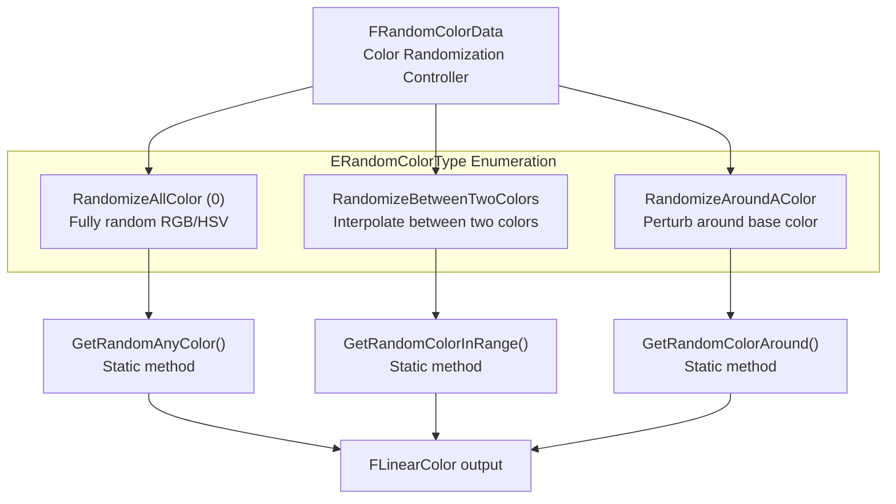
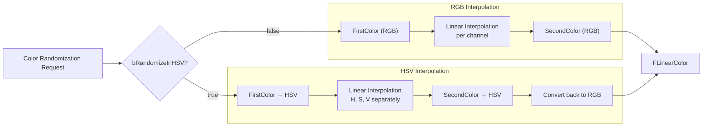
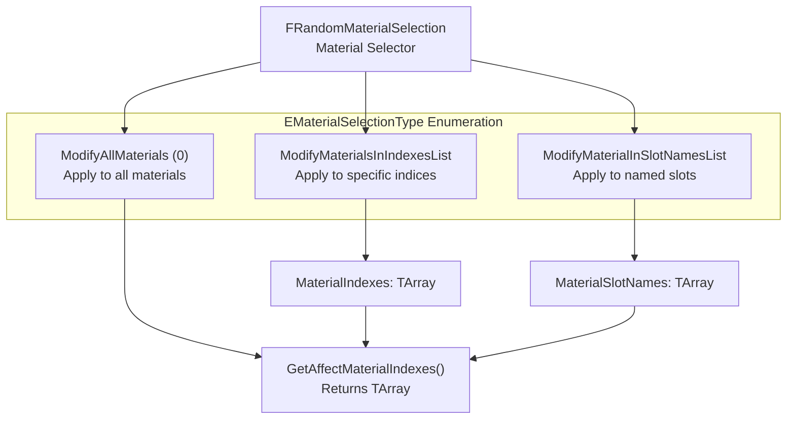
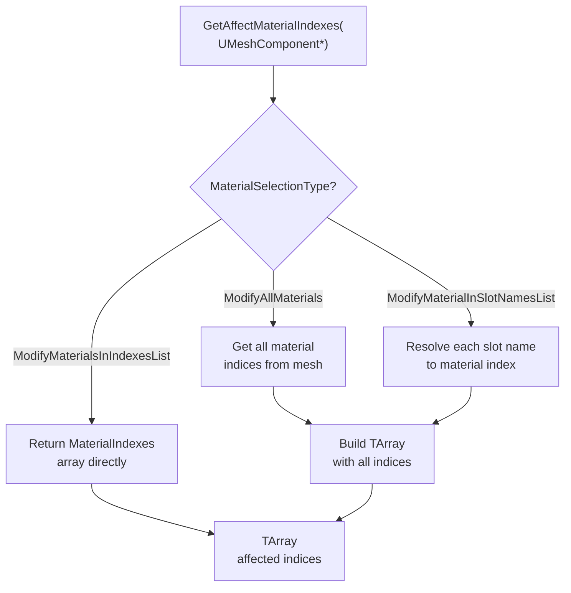
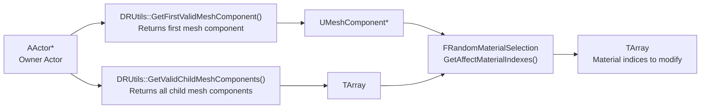

<!-- source: DeepWiki mcp.deepwiki.com · repo NVIDIA/Dataset_Synthesizer · extra page Appearance Randomization · fetched 2026-10-26 -->

# Appearance Randomization

Relevant source files

The following files were used as context for generating this wiki page:

- [Documentation/ClassDetails/_d_r_utils_8h_source.html](Documentation/ClassDetails/_d_r_utils_8h_source.html)

## Purpose and Scope

This page documents the appearance randomization subsystem within the Domain Randomization utilities, specifically covering color randomization and material selection mechanisms. These systems enable realistic visual variation in synthetic datasets by randomizing object colors and material assignments.

For transform-based randomization (position, rotation, scale), see [Transform Randomization](#4.3.1). For managing large asset libraries, see [Asset Streaming](#4.3.3).

The appearance randomization system provides two primary capabilities:
- **Color Randomization**: Generating varied colors using multiple strategies (fully random, interpolation, perturbation)
- **Material Selection**: Selecting specific materials on mesh components for modification

**Sources:** [Documentation/ClassDetails/_d_r_utils_8h_source.html:169-278]()

---

## Color Randomization System

### Overview

The `FRandomColorData` structure provides three distinct color randomization strategies, controlled by the `ERandomColorType` enumeration. This enables flexible color variation suitable for different training scenarios.

**Sources:** [Documentation/ClassDetails/_d_r_utils_8h_source.html:169-227]()

### Color Randomization Modes

**Sources:** [Documentation/ClassDetails/_d_r_utils_8h_source.html:170-176, 190-194]()

### FRandomColorData Structure

| Property | Type | Description | Applicable Mode |
|----------|------|-------------|----------------|
| `RandomizationType` | `ERandomColorType` | Determines which randomization strategy to use | All |
| `FirstColor` | `FLinearColor` | First boundary color for interpolation | `RandomizeBetweenTwoColors` |
| `SecondColor` | `FLinearColor` | Second boundary color for interpolation | `RandomizeBetweenTwoColors` |
| `bRandomizeInHSV` | `bool` | If true, interpolate in HSV space instead of RGB | `RandomizeBetweenTwoColors` |
| `MainColor` | `FLinearColor` | Base color to perturb around | `RandomizeAroundAColor` |
| `MaxHueChange` | `float` | Maximum hue delta in HSV space | `RandomizeAroundAColor` |
| `MaxSaturationChange` | `float` | Maximum saturation delta in HSV space | `RandomizeAroundAColor` |
| `MaxValueChange` | `float` | Maximum value delta in HSV space | `RandomizeAroundAColor` |

**Sources:** [Documentation/ClassDetails/_d_r_utils_8h_source.html:197-226]()

### Color Generation Methods

The `FRandomColorData` class provides both instance and static methods for color generation:

**Instance Method:**
- `GetRandomColor()` - Returns a random color based on the configured `RandomizationType` and parameters

**Static Methods:**
- `GetRandomAnyColor()` - Generates a completely random color across the full RGB spectrum
- `GetRandomColorInRange(Color1, Color2, bRandomizeInHSV)` - Interpolates randomly between two colors, optionally in HSV space
- `GetRandomColorAround(BaseColor, HueDelta, SaturationDelta, ValueDelta)` - Generates a color within specified HSV deltas from a base color

**Sources:** [Documentation/ClassDetails/_d_r_utils_8h_source.html:190-194]()

### Color Space Considerations

**Note:** HSV interpolation produces more perceptually uniform color transitions, particularly useful when randomizing similar hues (e.g., different shades of blue). RGB interpolation may produce unexpected intermediate colors when interpolating across distant hues.

**Sources:** [Documentation/ClassDetails/_d_r_utils_8h_source.html:209-211]()

---

## Material Selection System

### Overview

The `FRandomMaterialSelection` structure defines which materials on a mesh component should be modified during randomization. This allows selective application of color or material property changes to specific parts of an object.

**Sources:** [Documentation/ClassDetails/_d_r_utils_8h_source.html:244-278]()

### Material Selection Modes

**Sources:** [Documentation/ClassDetails/_d_r_utils_8h_source.html:230-242, 257-278]()

### FRandomMaterialSelection Structure

| Property | Type | Description |
|----------|------|-------------|
| `MaterialSelectionType` | `EMaterialSelectionType` | Determines which selection strategy to use |
| `bSelectMaterialByIndexes` | `bool` | Toggle for index-based selection (editor UI) |
| `bSelectMaterialBySlotNames` | `bool` | Toggle for slot name-based selection (editor UI) |
| `MaterialIndexes` | `TArray<int32>` | List of material indices to modify (0-based) |
| `MaterialSlotNames` | `TArray<FName>` | List of material slot names to modify |

**Sources:** [Documentation/ClassDetails/_d_r_utils_8h_source.html:260-277]()

### Material Index Resolution

The `GetAffectMaterialIndexes()` method resolves the configured selection strategy into a concrete list of material indices for a given mesh component:

**Sources:** [Documentation/ClassDetails/_d_r_utils_8h_source.html:257-258]()

---

## Component Type Filtering

### EAffectedMaterialOwnerComponentType

The `EAffectedMaterialOwnerComponentType` enumeration specifies which types of components should have their materials modified. This is used by randomization components to filter which components they affect.

| Enum Value | Description |
|------------|-------------|
| `OnlyAffectMeshComponents` | Modify materials only on `UMeshComponent` instances (static/skeletal meshes) |
| `OnlyAffectDecalComponents` | Modify materials only on `UDecalComponent` instances (projected decals) |
| `AffectBothMeshAndDecalComponents` | Modify materials on both mesh and decal components |

**Sources:** [Documentation/ClassDetails/_d_r_utils_8h_source.html:387-395]()

---

## Integration with Mesh Components

### DRUtils Namespace

The `DRUtils` namespace provides utility functions for accessing mesh components on actors, which are used in conjunction with `FRandomMaterialSelection`:

**Sources:** [Documentation/ClassDetails/_d_r_utils_8h_source.html:292-299]()

**Key Functions:**
- `DRUtils::GetFirstValidMeshComponent(AActor*)` - Retrieves the first valid mesh component from an actor
- `DRUtils::GetValidChildMeshComponents(AActor*)` - Retrieves all valid child mesh components from an actor

These functions are used to obtain the mesh components on which material and color randomization will be applied.

**Sources:** [Documentation/ClassDetails/_d_r_utils_8h_source.html:294-298]()

---

## Editor Integration

Both `FRandomColorData` and `FRandomMaterialSelection` include `PostEditChangeProperty()` methods for Unreal Editor integration. This enables:

- Real-time validation of property changes in the editor
- Automatic updates to dependent properties
- Conditional visibility of properties based on selected modes (via `EditCondition` UPROPERTY meta tags)

**Sources:** [Documentation/ClassDetails/_d_r_utils_8h_source.html:186-188, 253-255]()

---

## Usage Pattern

The typical workflow for applying appearance randomization is:

1. **Configure** `FRandomColorData` or `FRandomMaterialSelection` on a randomization component
2. **Obtain** mesh components using `DRUtils::GetFirstValidMeshComponent()` or `DRUtils::GetValidChildMeshComponents()`
3. **Resolve** material indices using `FRandomMaterialSelection::GetAffectMaterialIndexes()`
4. **Generate** random color using `FRandomColorData::GetRandomColor()`
5. **Apply** color/material changes to the selected material indices on the mesh component

This pattern is used throughout the Domain Randomization system to create visual diversity in synthetic datasets.

**Sources:** [Documentation/ClassDetails/_d_r_utils_8h_source.html:169-299]()

---

