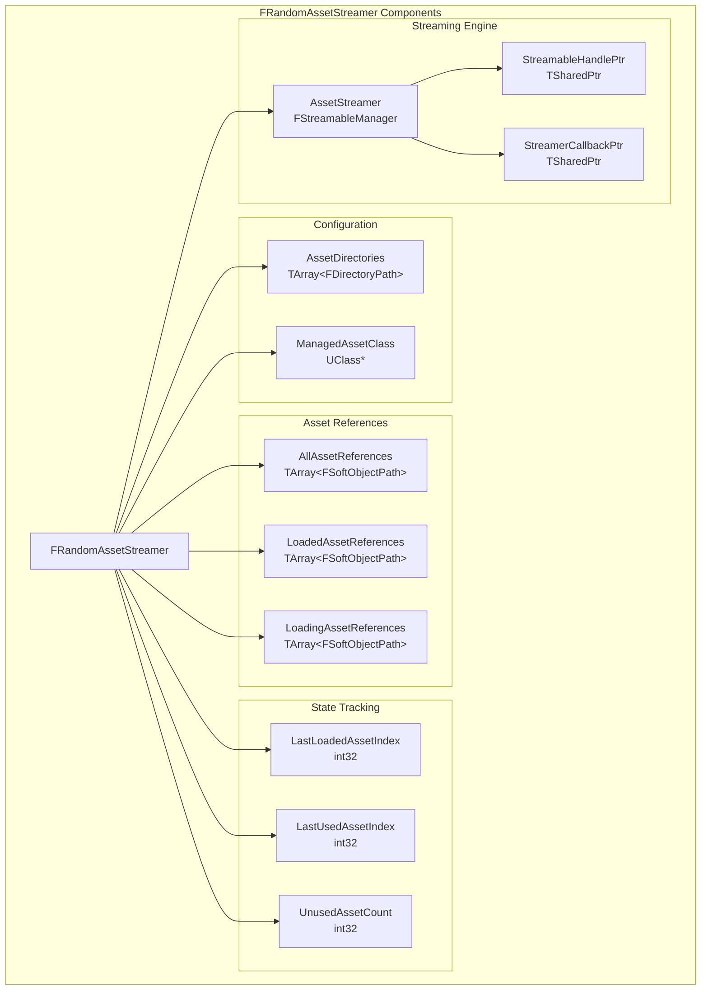
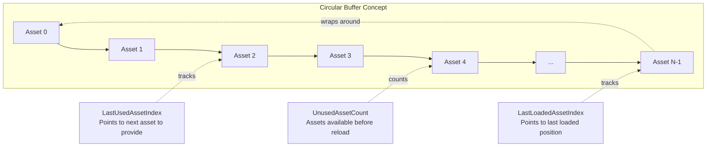
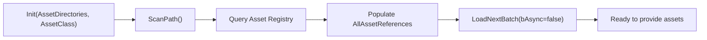
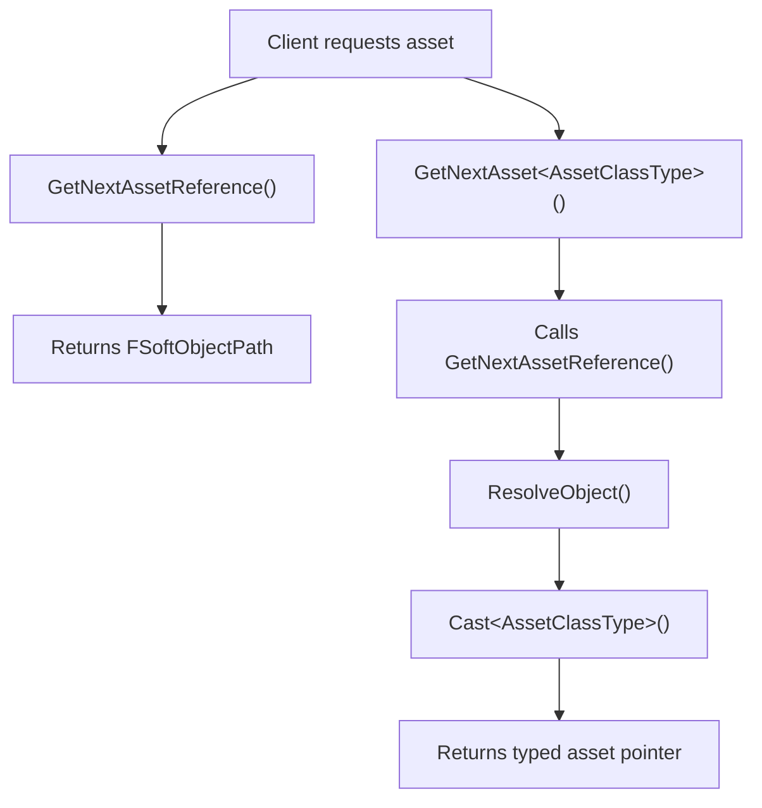
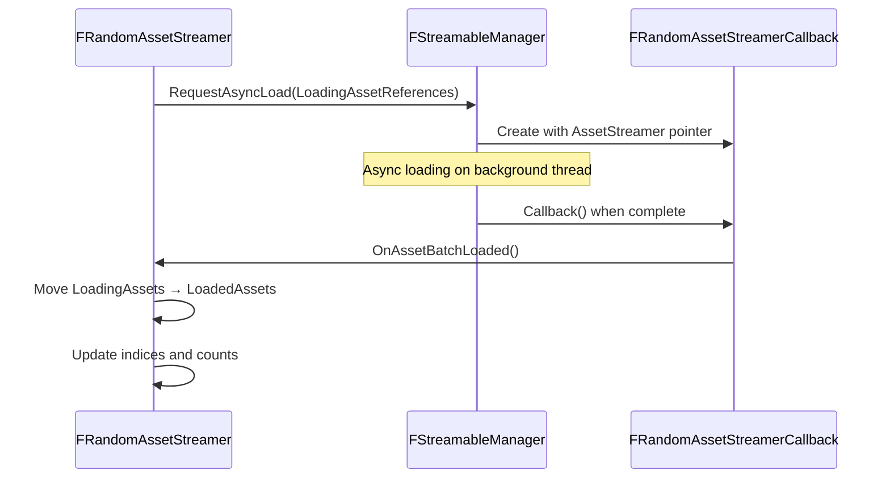
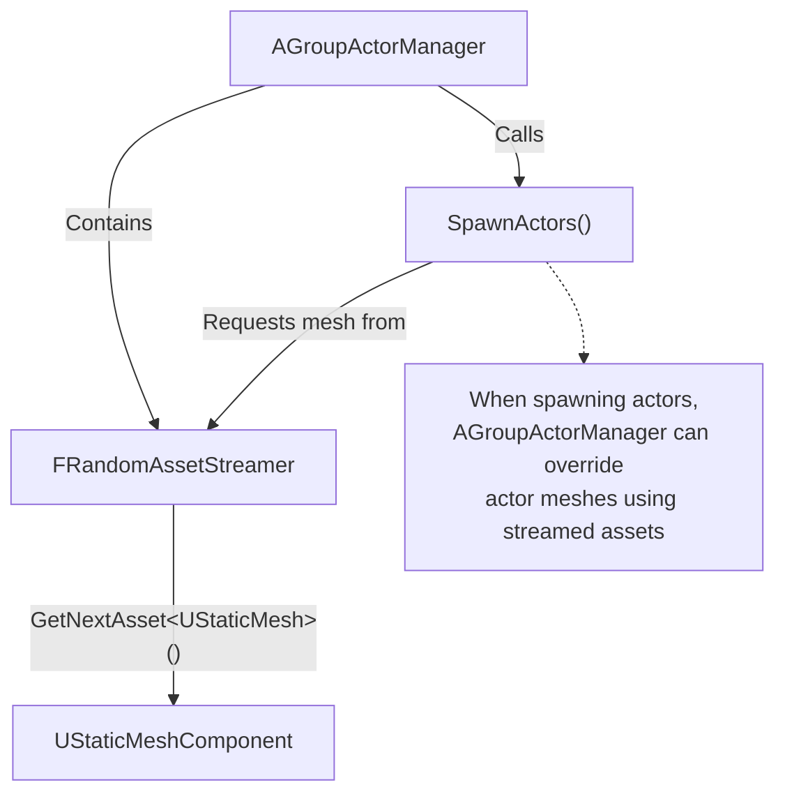
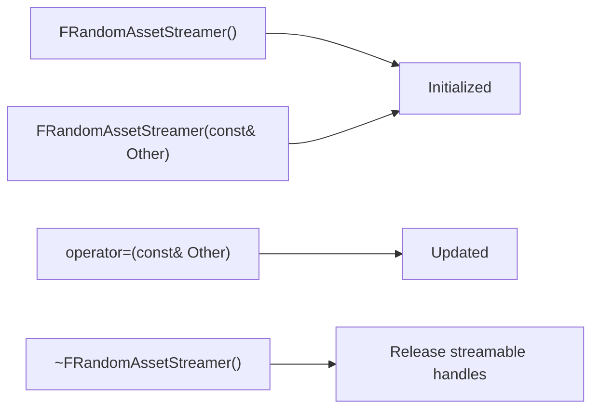
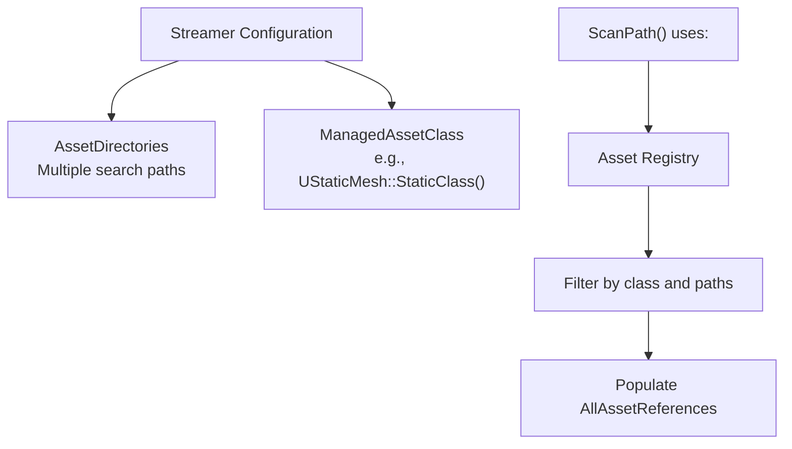

<!-- source: DeepWiki mcp.deepwiki.com · repo NVIDIA/Dataset_Synthesizer · extra page Asset Streaming · fetched 2026-10-26 -->

# Asset Streaming

<details>
<summary>Relevant source files</summary>

The following files were used as context for generating this wiki page:

- [Documentation/ClassDetails/_d_r_utils_8h_source.html](Documentation/ClassDetails/_d_r_utils_8h_source.html)

</details>


## Purpose and Scope

This page documents the `FRandomAssetStreamer` system, which manages large asset libraries that exceed available memory capacity. The streamer implements a circular buffer pattern to load, provide, and unload assets asynchronously during domain randomization.

For other randomization utilities, see [Transform Randomization](#4.3.1) and [Appearance Randomization](#4.3.2). For the broader context of how asset streaming fits into the spawning workflow, see [Actor Spawning](#4.2).

**Sources:** [Documentation/ClassDetails/_d_r_utils_8h_source.html:301-385]()

---

## Overview

The `FRandomAssetStreamer` struct addresses a fundamental constraint in synthetic dataset generation: when randomizing object meshes across thousands of variations, loading all assets simultaneously would exhaust memory. The streamer solves this by:

1. **Scanning** asset directories to build a complete asset reference list without loading them
2. **Streaming** assets in batches using Unreal's `FStreamableManager`
3. **Providing** assets sequentially from a circular buffer
4. **Preloading** the next batch asynchronously when the current batch nears depletion

This enables domain randomization workflows to access asset libraries containing thousands of meshes while maintaining a small memory footprint.

**Sources:** [Documentation/ClassDetails/_d_r_utils_8h_source.html:301-303]()

---

## Architecture



**Data Flow:** The streamer maintains three separate lists of asset references. `AllAssetReferences` contains soft object paths discovered during directory scanning. `LoadedAssetReferences` holds the circular buffer of currently available assets. `LoadingAssetReferences` tracks assets being asynchronously loaded by the `FStreamableManager`.

**Sources:** [Documentation/ClassDetails/_d_r_utils_8h_source.html:351-384]()

---

## Circular Buffer Pattern

The streamer implements a circular buffer to efficiently reuse memory while providing continuous access to a large asset library.



**Buffer Management:**

| Index Variable | Purpose | Update Trigger |
|---------------|---------|----------------|
| `LastUsedAssetIndex` | Tracks the next asset to be provided via `GetNextAsset()` | Incremented on each `GetNextAssetReference()` call |
| `LastLoadedAssetIndex` | Tracks the position where the last batch finished loading | Updated when `OnAssetBatchLoaded()` completes |
| `UnusedAssetCount` | Number of assets available before triggering next batch load | Decremented on use, reset on batch load |

**Sources:** [Documentation/ClassDetails/_d_r_utils_8h_source.html:373-379]()

---

## Asset Loading Workflow

The following diagram shows the state transitions and method calls during the asset streaming lifecycle.

```mermaid
stateDiagram-v2
    [*] --> Uninitialized
    
    Uninitialized --> Initialized: Init(AssetDirectories, AssetClass)
    Initialized --> Scanning: ScanPath()
    Scanning --> Ready: AllAssetReferences populated
    
    Ready --> ProvidingAssets: GetNextAssetReference()
    ProvidingAssets --> ProvidingAssets: GetNextAsset&lt;T&gt;()<br/>UnusedAssetCount--
    
    ProvidingAssets --> Loading: UnusedAssetCount low<br/>LoadNextBatch(bAsync=true)
    Loading --> Loading: IsLoadingAssets() == true
    Loading --> ProvidingAssets: OnAssetBatchLoaded()<br/>LoadingAssets → LoadedAssets
    
    ProvidingAssets --> Ready: Buffer wraps around
```

**Asynchronous Loading:** When `UnusedAssetCount` falls below a threshold, `LoadNextBatch()` is called with `bAsyncLoad = true`. This uses Unreal's `FStreamableManager` to load assets on background threads without blocking the game thread.

**Sources:** [Documentation/ClassDetails/_d_r_utils_8h_source.html:314-333]()

---

## Key Methods

### Initialization



**Method Signatures:**

| Method | Purpose | Synchronous |
|--------|---------|-------------|
| `Init(const TArray<FDirectoryPath>&, UClass*)` | Configure directories and asset class | Yes |
| `ScanPath()` | Query asset registry to populate `AllAssetReferences` | Yes |
| `LoadNextBatch(bool bAsyncLoad)` | Load the next batch into `LoadedAssetReferences` | Configurable |

**Sources:** [Documentation/ClassDetails/_d_r_utils_8h_source.html:314-315](), [Documentation/ClassDetails/_d_r_utils_8h_source.html:332-333]()

---

### Asset Retrieval

The streamer provides two methods for retrieving assets:



**Template Method:**

The `GetNextAsset<AssetClassType>()` template method (lines 320-327) combines reference retrieval with object resolution and type casting:

```cpp
template <typename AssetClassType>
AssetClassType* GetNextAsset()
{
    FSoftObjectPath NextAssetRef = GetNextAssetReference();
    return (NextAssetRef.IsValid()
            ? Cast<AssetClassType>(NextAssetRef.ResolveObject())
            : nullptr);
}
```

**Sources:** [Documentation/ClassDetails/_d_r_utils_8h_source.html:318-327]()

---

## State Management

### Loading State Callback

The streamer uses an internal callback struct to handle async loading completion:



**Callback Structure:** The nested `FRandomAssetStreamerCallback` struct (lines 337-349) holds a pointer to the parent `FRandomAssetStreamer` and invokes `OnAssetBatchLoaded()` when the `FStreamableManager` completes loading.

**Sources:** [Documentation/ClassDetails/_d_r_utils_8h_source.html:337-349](), [Documentation/ClassDetails/_d_r_utils_8h_source.html:381-384]()

---

## Properties

### Asset References

| Property | Type | Purpose | Lifetime |
|----------|------|---------|----------|
| `AssetDirectories` | `TArray<FDirectoryPath>` | Directories to scan for assets | Set by `Init()`, persists |
| `ManagedAssetClass` | `UClass*` | Filter for asset class type | Set by `Init()`, persists |
| `AllAssetReferences` | `TArray<FSoftObjectPath>` | Complete list of discovered assets | Populated by `ScanPath()` |
| `LoadedAssetReferences` | `TArray<FSoftObjectPath>` | Circular buffer of loaded assets | Updated by `OnAssetBatchLoaded()` |
| `LoadingAssetReferences` | `TArray<FSoftObjectPath>` | Assets currently being streamed in | Set by `LoadNextBatch()` |

All asset reference properties are marked as `UPROPERTY(Transient)` (lines 353-370), indicating they are runtime state that should not be serialized.

**Sources:** [Documentation/ClassDetails/_d_r_utils_8h_source.html:352-370]()

---

### Index Tracking

| Property | Type | Purpose | Range |
|----------|------|---------|-------|
| `LastLoadedAssetIndex` | `int32` | Index in `AllAssetReferences` where last batch ended | `[0, AllAssetReferences.Num())` |
| `LastUsedAssetIndex` | `int32` | Index in `LoadedAssetReferences` for next asset | `[0, LoadedAssetReferences.Num())` |
| `UnusedAssetCount` | `int32` | Remaining assets before reload trigger | `[0, LoadedAssetReferences.Num()]` |

These indices implement the circular buffer logic and determine when to trigger the next batch load.

**Sources:** [Documentation/ClassDetails/_d_r_utils_8h_source.html:372-379]()

---

## Integration with Domain Randomization

The `FRandomAssetStreamer` is used throughout the domain randomization system to provide mesh variation:



**Usage Pattern:** When `AGroupActorManager` spawns actors with `OverrideActorMeshes` enabled, it calls `GetNextAsset<UStaticMesh>()` to retrieve the next mesh from the streamer, providing variation across spawned actors without loading all meshes at once.

**Memory Efficiency:** For a library of 10,000 meshes where each mesh averages 50MB, loading all simultaneously would require 500GB of memory. The streamer might maintain a batch of only 50 meshes (2.5GB) while providing access to the entire library.

**Sources:** [Documentation/ClassDetails/_d_r_utils_8h_source.html:303-385]()

---

## Asset Query Methods

### Availability Checks

| Method | Return Type | Purpose |
|--------|-------------|---------|
| `HasAssets()` | `bool` | Returns true if `AllAssetReferences` is not empty |
| `IsLoadingAssets()` | `bool` | Returns true if async loading is in progress |

These methods allow external systems to check the streamer's state before requesting assets.

**Sources:** [Documentation/ClassDetails/_d_r_utils_8h_source.html:317](), [Documentation/ClassDetails/_d_r_utils_8h_source.html:329]()

---

## Lifecycle Management

The `FRandomAssetStreamer` implements special member functions for proper resource management:



**Resource Management:**
- **Constructor** (line 308): Initializes default state
- **Copy Constructor** (line 309): Duplicates another streamer's configuration
- **Assignment Operator** (line 312): Enables assignment between streamers
- **Destructor** (line 310): Ensures proper cleanup of `FStreamableManager` handles

**Sources:** [Documentation/ClassDetails/_d_r_utils_8h_source.html:308-312]()

---

## Configuration Properties

All configuration properties use Unreal's property system with `UPROPERTY(Transient)` specifiers:



**Directory Scanning:** The `ScanPath()` method queries Unreal's Asset Registry for all assets matching `ManagedAssetClass` within `AssetDirectories`. This avoids loading assets into memory during discovery.

**Sources:** [Documentation/ClassDetails/_d_r_utils_8h_source.html:352-358]()

---

## Summary

The `FRandomAssetStreamer` provides memory-efficient access to large asset libraries through:

1. **Soft References:** Uses `FSoftObjectPath` to reference assets without loading them
2. **Circular Buffer:** Maintains a fixed-size buffer that wraps around the asset library
3. **Asynchronous Loading:** Preloads the next batch on background threads using `FStreamableManager`
4. **Simple Interface:** `GetNextAsset<T>()` provides a straightforward way to retrieve typed assets

This enables domain randomization workflows to achieve high visual variation across thousands of mesh variations while maintaining predictable memory usage.

**Sources:** [Documentation/ClassDetails/_d_r_utils_8h_source.html:301-385]()

---

