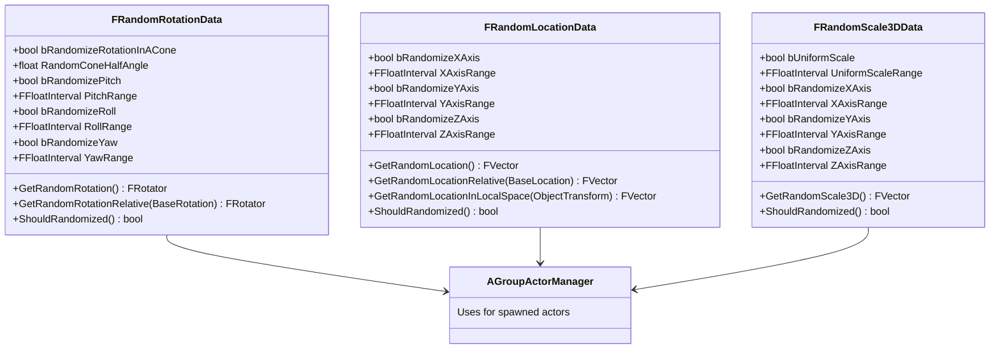
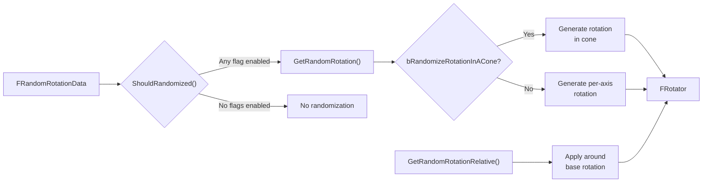
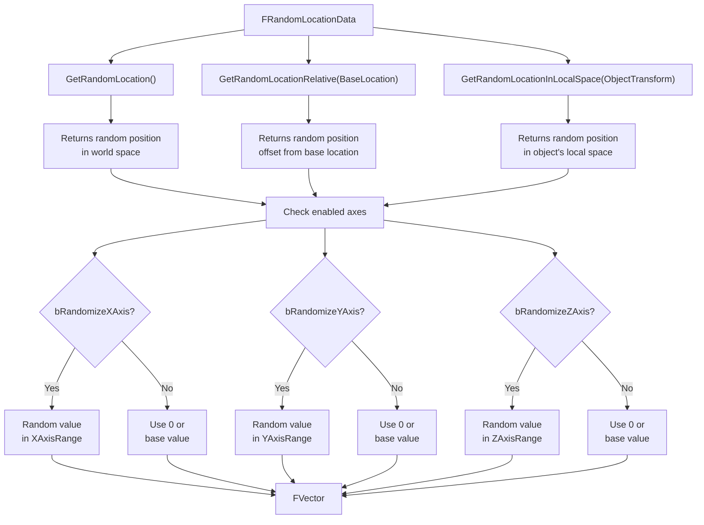
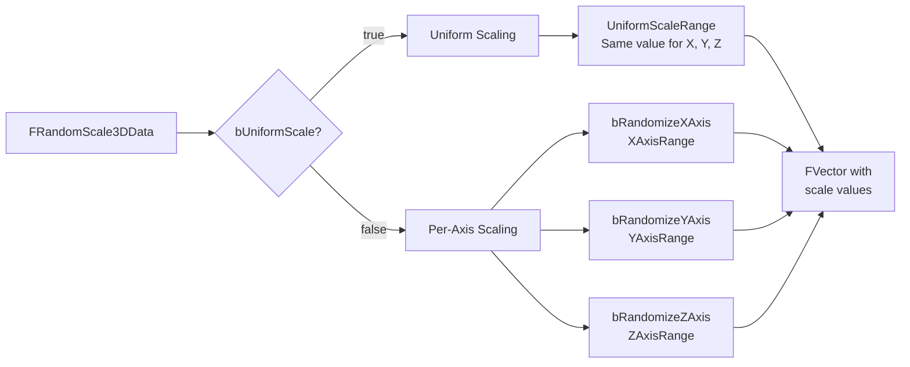
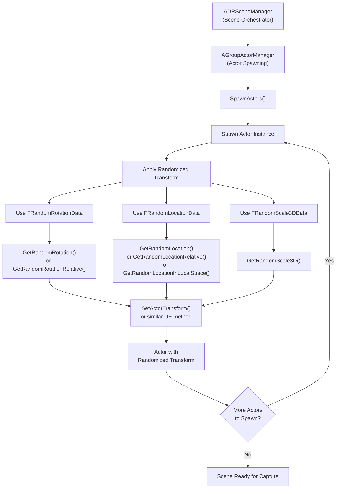

<!-- source: DeepWiki mcp.deepwiki.com · repo NVIDIA/Dataset_Synthesizer · extra page Transform Randomization · fetched 2026-10-26 -->

# Transform Randomization

Relevant source files

The following files were used as context for generating this wiki page:

- [Documentation/ClassDetails/_d_r_utils_8h_source.html](Documentation/ClassDetails/_d_r_utils_8h_source.html)

This page documents the transform randomization data structures used in the domain randomization system to randomize object positions, rotations, and scales in synthetic scenes. Transform randomization is a critical component of dataset generation, enabling the creation of diverse training data by varying object poses and sizes.

For information about appearance randomization (colors and materials), see [Appearance Randomization](#4.3.2). For managing large asset libraries, see [Asset Streaming](#4.3.3).

## Overview

The transform randomization system consists of three primary data structures defined in [DRUtils.h:19-167]():

- `FRandomRotationData` - Controls rotation randomization (cone-based or per-axis)
- `FRandomLocationData` - Controls position randomization (per-axis ranges)
- `FRandomScale3DData` - Controls scale randomization (uniform or per-axis)

These structs are used by `AGroupActorManager` (see [Actor Spawning](#4.2)) to randomize spawned actors' transforms, creating variation in object placement, orientation, and size across synthetic scenes.

**Sources:** [Documentation/ClassDetails/_d_r_utils_8h_source.html:19-167]()

## Transform Randomization Components

The following diagram shows the three transform randomization data structures and their key methods:

**Sources:** [Documentation/ClassDetails/_d_r_utils_8h_source.html:19-167]()

## Rotation Randomization

`FRandomRotationData` provides two distinct randomization strategies defined in [DRUtils.h:19-66]():

### Cone-Based Rotation

When `bRandomizeRotationInACone` is true, rotations are generated inside a cone with half-angle specified by `RandomConeHalfAngle`. This is useful for objects that should maintain approximate upright orientation while allowing some variation.

| Property | Type | Description |
|----------|------|-------------|
| `bRandomizeRotationInACone` | `bool` | Enables cone-based randomization |
| `RandomConeHalfAngle` | `float` | Half-angle of the cone in degrees |

### Per-Axis Rotation

Alternatively, each Euler angle (pitch, roll, yaw) can be independently randomized within specified ranges:

| Axis | Enable Flag | Range Property | Description |
|------|-------------|----------------|-------------|
| Pitch | `bRandomizePitch` | `PitchRange` | Rotation around Y-axis |
| Roll | `bRandomizeRoll` | `RollRange` | Rotation around X-axis |
| Yaw | `bRandomizeYaw` | `YawRange` | Rotation around Z-axis |

### Methods

**Key Methods:**

- `GetRandomRotation()` - Returns a random rotation based on configured constraints (line 27)
- `GetRandomRotationRelative(BaseRotation)` - Returns a random rotation applied around a base rotation (line 30)
- `ShouldRandomized()` - Returns true if any randomization flag is enabled (line 32-35)

**Sources:** [Documentation/ClassDetails/_d_r_utils_8h_source.html:19-66]()

## Location Randomization

`FRandomLocationData` provides per-axis position randomization in world space, defined in [DRUtils.h:69-113]().

### Configuration

Each axis can be independently enabled and configured with a range:

| Axis | Enable Flag | Range Property | Description |
|------|-------------|----------------|-------------|
| X | `bRandomizeXAxis` | `XAxisRange` | Position along world X-axis |
| Y | `bRandomizeYAxis` | `YAxisRange` | Position along world Y-axis |
| Z | `bRandomizeZAxis` | `ZAxisRange` | Position along world Z-axis |

### Methods

The struct provides three location generation methods:

**Key Methods:**

- `GetRandomLocation()` - Returns a random location in world space (line 76)
- `GetRandomLocationRelative(BaseLocation)` - Returns a random location offset from a base position (line 79)
- `GetRandomLocationInLocalSpace(ObjectTransform)` - Returns a random location in an object's local coordinate system (line 82)
- `ShouldRandomized()` - Returns true if any axis randomization is enabled (line 84-87)

**Sources:** [Documentation/ClassDetails/_d_r_utils_8h_source.html:69-113]()

## Scale Randomization

`FRandomScale3DData` provides both uniform and per-axis scale randomization, defined in [DRUtils.h:116-167]().

### Uniform vs. Per-Axis Scaling

The struct supports two mutually exclusive modes:

### Configuration

**Uniform Scaling:**

| Property | Type | Description |
|----------|------|-------------|
| `bUniformScale` | `bool` | When true, all axes use the same scale value |
| `UniformScaleRange` | `FFloatInterval` | Range for uniform scale value |

**Per-Axis Scaling:**

| Axis | Enable Flag | Range Property | Minimum Value |
|------|-------------|----------------|---------------|
| X | `bRandomizeXAxis` | `XAxisRange` | 0.001 (line 146-148) |
| Y | `bRandomizeYAxis` | `YAxisRange` | 0.001 (line 154-157) |
| Z | `bRandomizeZAxis` | `ZAxisRange` | 0.001 (line 163-166) |

**Note:** Minimum scale values are clamped at 0.001 to prevent degenerate geometry.

### Methods

**Key Methods:**

- `GetRandomScale3D()` - Returns a random 3D scale vector based on configuration (line 124)
- `ShouldRandomized()` - Returns true if uniform scale or any axis randomization is enabled (line 126-129)

**Sources:** [Documentation/ClassDetails/_d_r_utils_8h_source.html:116-167]()

## Integration with Domain Randomization Workflow

The following diagram shows how transform randomization structures are used within the broader domain randomization workflow:

The transform randomization structs are typically configured in `AGroupActorManager` (see [Actor Spawning](#4.2)) and applied to each spawned actor. The randomization can be:

- **Absolute:** Using `GetRandomRotation()`, `GetRandomLocation()`, and `GetRandomScale3D()` to generate completely random transforms
- **Relative:** Using `GetRandomRotationRelative()` and `GetRandomLocationRelative()` to apply variations around a base transform
- **Local Space:** Using `GetRandomLocationInLocalSpace()` to randomize position in an object's local coordinate system

**Sources:** [Documentation/ClassDetails/_d_r_utils_8h_source.html:19-167]()

## Usage Example Pattern

While no implementation code is shown here, the typical usage pattern in actor spawning code follows this structure:

1. **Check if randomization is needed** using `ShouldRandomized()` methods
2. **Generate random values** using the appropriate `Get*` methods
3. **Apply to spawned actors** using Unreal Engine's transform methods

Each struct is designed as a `USTRUCT(BlueprintType)` (lines 18, 68, 115), making them:
- Serializable for saving/loading configurations
- Exposable to Blueprint visual scripting
- Editable in the Unreal Editor UI via `UPROPERTY(EditAnywhere)` macros

The `FFloatInterval` type used throughout represents a min/max range for random value generation.

**Sources:** [Documentation/ClassDetails/_d_r_utils_8h_source.html:18-167]()

---

