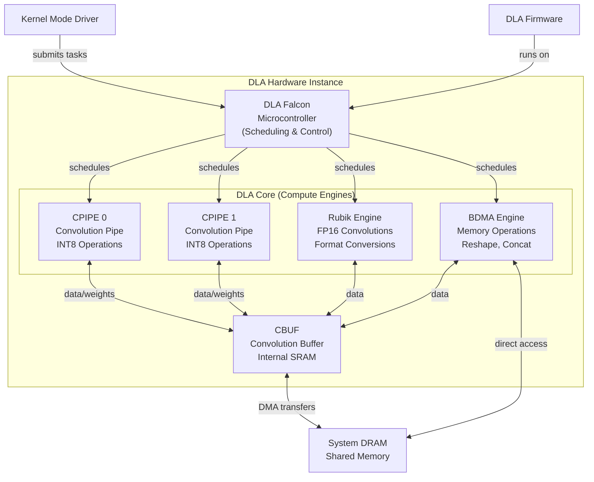
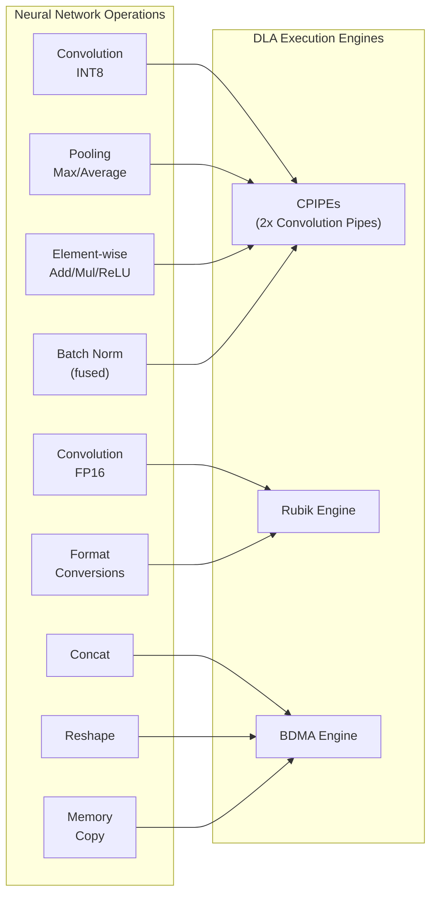
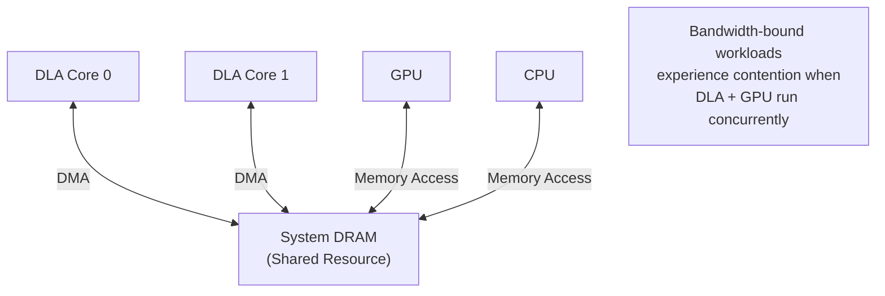
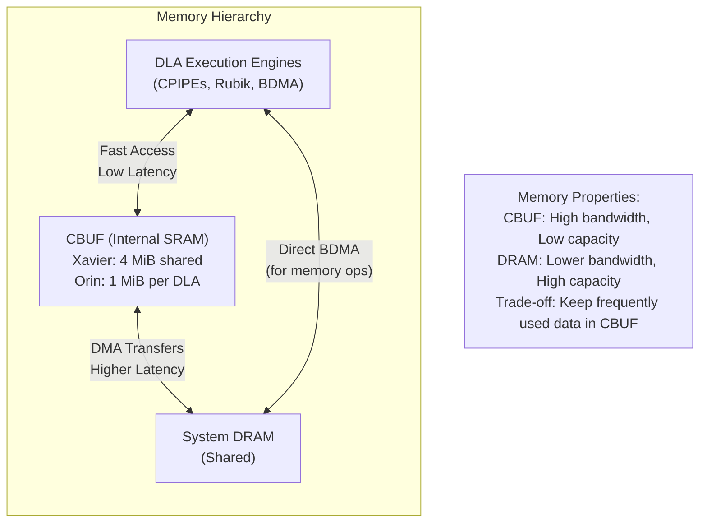
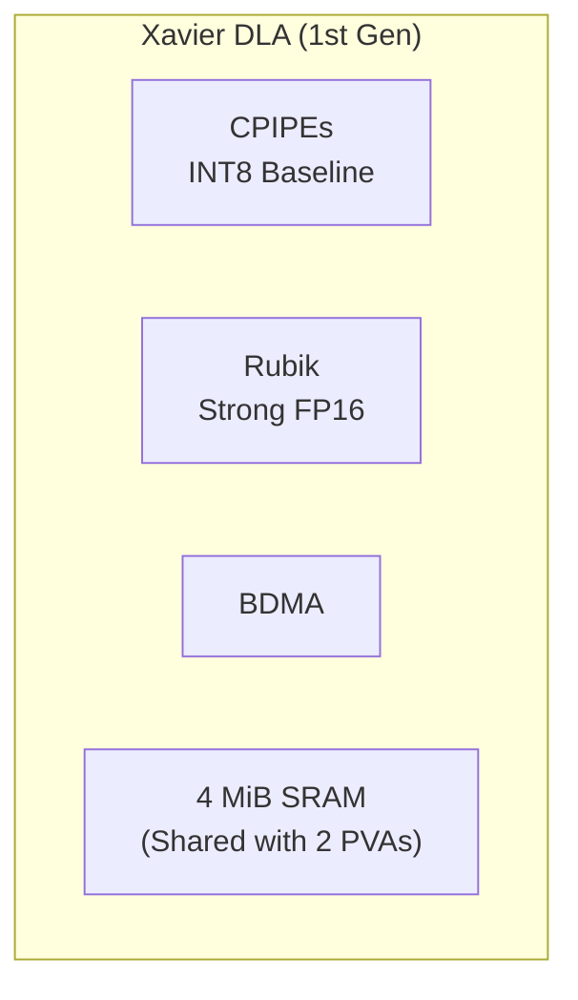
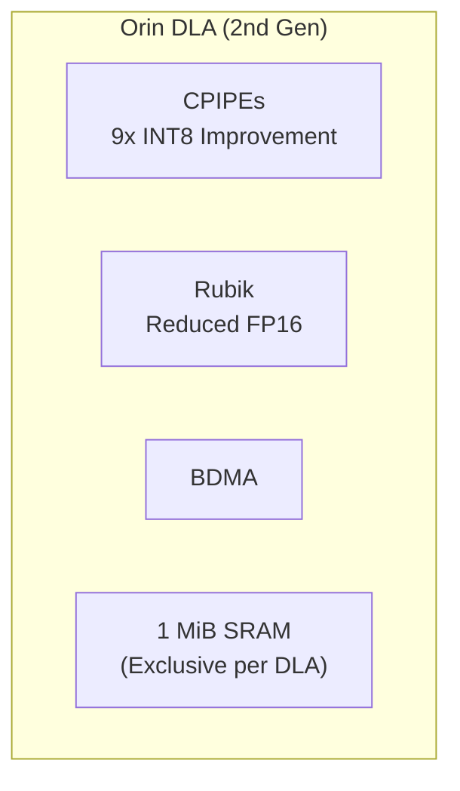

<!-- source: DeepWiki mcp.deepwiki.com · repo NVIDIA/Deep-Learning-Accelerator-SW · page 1.1 DLA Hardware Architecture · fetched 2026-10-26 -->

# DLA Hardware Architecture

Relevant source files

The following files were used as context for generating this wiki page:

- [FAQ/README.md](FAQ/README.md)
- [README.md](README.md)

## Purpose and Scope

This page documents the physical hardware components of the NVIDIA Deep Learning Accelerator (DLA), including its compute engines, memory architecture, and microcontroller. This covers the hardware layer only; for information about the software stack that interfaces with this hardware, see [Software Stack Overview](#1.2). For information about supported platforms and DLA generations, see [Supported Platforms](#1.3).

The DLA is a fixed-function accelerator engine designed for deep learning operations such as convolution, deconvolution, fully connected, activation, pooling, and batch normalization. Each NVIDIA Orin or Xavier SoC contains up to two DLA instances, enabling concurrent execution of multiple deep learning workloads.

**Sources:** [README.md:1-6](), [FAQ/README.md:32-33]()

---

## DLA Hardware Block Diagram

The DLA hardware consists of two primary components: the **DLA Core** (compute engines) and **DLA Falcon** (control microcontroller), along with dedicated SRAM and access to system DRAM.

**Sources:** [README.md:3](), [FAQ/README.md:32-33]()

---

## DLA Core vs DLA Falcon

### DLA Core
The **DLA Core** is responsible for performing all mathematical operations. It contains multiple parallel execution engines that can process different types of operations simultaneously:
- Two Convolution Pipes (CPIPEs) for INT8 convolution operations
- Rubik Engine for FP16 convolutions and data format transformations
- BDMA (Broadcast DMA) Engine for memory operations

### DLA Falcon
The **DLA Falcon** is a microcontroller that orchestrates and schedules workloads on the DLA Core. It executes the DLA firmware and manages:
- Task scheduling across execution engines
- Coordination between CPIPEs, Rubik, and BDMA
- Communication with the kernel mode driver
- Sequencing of operations within a DLA loadable

The Falcon ensures that the DLA Core's execution engines are utilized efficiently and that operations execute in the correct order.

**Sources:** [FAQ/README.md:32-33]()

---

## Execution Engines

### Convolution Pipes (CPIPEs)

The DLA Core contains **two Convolution Pipes** that operate in parallel. These are the primary compute engines optimized for INT8 operations.

**Capabilities:**
- INT8 convolution operations (primary precision)
- Pooling operations (Max, Average)
- Point-wise operations (ReLU, PReLU, element-wise operations)
- Batch normalization (fused with convolution)
- Dense convolutions and 2:4 structured sparse convolutions

**Architecture:**
- Each CPIPE can independently execute convolution operations
- Both CPIPEs can operate concurrently on different layers
- Data and weights are loaded from CBUF (internal SRAM)

**Performance Characteristics:**
- Optimized for high arithmetic intensity workloads
- Peak performance depends on whether operations are math-bound or memory-bound
- Structured sparsity (2:4 pattern) provides 1.24x-1.47x speedup for math-bound layers

**Sources:** [README.md:14-21](), [README.md:84-99]()

### Rubik Engine

The **Rubik Engine** is a specialized execution unit for operations that CPIPEs cannot handle.

**Capabilities:**
- FP16 convolution operations
- Format conversions and data transformations
- Reshape and transpose operations
- Operations requiring flexibility beyond CPIPE capabilities

**Design Trade-offs:**
On Orin (2nd generation DLA), NVIDIA optimized for INT8 performance:
- 9x increase in INT8 compute (CPIPEs)
- Reduced FP16 convolution performance (Rubik) compared to Xavier
- Emphasis on INT8 inference workloads rather than FP16

**Sources:** [FAQ/README.md:65-67]()

### BDMA Engine

The **BDMA (Broadcast DMA) Engine** handles memory operations that do not require computation.

**Capabilities:**
- Memory-to-memory copies
- Concatenation operations
- Reshape operations (data movement only)
- Efficient data transfers between CBUF and DRAM

**Purpose:**
The BDMA offloads non-computational memory operations from the CPIPEs and Rubik, allowing them to focus on mathematical operations while BDMA handles data movement in parallel.

**Sources:** [README.md:3]()

---

## Operation-to-Engine Mapping

The following diagram shows how different neural network operations map to specific DLA execution engines:

**Sources:** [README.md:3](), [FAQ/README.md:60-67]()

---

## Memory Architecture

### Internal SRAM (CBUF)

The DLA contains internal SRAM called **CBUF (Convolution Buffer)** for storing intermediate data and weights during execution.

#### Xavier (1st Generation DLA)
- **Total SRAM:** 4 MiB shared across 2 DLAs and 2 PVAs (Programmable Vision Accelerators)
- **Architecture:** Shared memory pool
- **Implications:** Potential contention between DLA and PVA workloads

#### Orin (2nd Generation DLA)
- **SRAM per DLA:** 1 MiB exclusive per DLA instance
- **Architecture:** Dedicated memory per DLA
- **Implications:** No contention, predictable performance per DLA

**CBUF Validation:**
When TensorRT compiles a model for DLA, it performs CBUF validation to ensure that convolution layers can fit their data and weights into CBUF. If validation fails, the layer may fall back to GPU execution.

**Sources:** [FAQ/README.md:96-98](), [FAQ/README.md:133-134]()

### System DRAM Access

The DLA has direct access to system DRAM, similar to GPU and CPU.

**Characteristics:**
- Shared system memory with GPU, CPU, and other accelerators
- DMA transfers between CBUF and DRAM
- Potential bandwidth contention when DLA and GPU run concurrently

**Memory Bandwidth Considerations:**

When running workloads concurrently on DLA and GPU, both accelerators compete for DRAM bandwidth, which can increase latency for bandwidth-bound operations.

**Sources:** [FAQ/README.md:93-94](), [FAQ/README.md:51-59]()

---

## DLA Memory Hierarchy

**Performance Implications:**
- Math-bound layers benefit from CBUF for weight/activation storage
- Memory-bound layers are limited by DRAM bandwidth
- CBUF size constrains maximum convolution layer dimensions

**Sources:** [FAQ/README.md:96-98](), [FAQ/README.md:133-134]()

---

## DLA Generation Differences: Xavier vs Orin

### Xavier (1st Generation)

**Characteristics:**
- Balanced INT8 and FP16 performance
- 4 MiB SRAM shared between 2 DLAs and 2 PVAs
- Baseline DLA architecture

### Orin (2nd Generation)

**Characteristics:**
- 9x increase in INT8 compute performance
- Reduced FP16 convolution performance (trade-off)
- 1 MiB exclusive SRAM per DLA (no sharing)
- Optimized for inference workloads

### Performance Comparison Table

| Feature | Xavier (1st Gen) | Orin (2nd Gen) |
|---------|-----------------|----------------|
| INT8 Performance | Baseline | 9x improvement |
| FP16 Performance | Strong | Reduced (trade-off) |
| SRAM Architecture | 4 MiB shared (2 DLAs + 2 PVAs) | 1 MiB exclusive per DLA |
| Target Precision | FP16 + INT8 | INT8-optimized |
| Structured Sparsity | Supported | Supported |
| DLA Instances | 2x per SoC | 2x per SoC |

**Sources:** [README.md:3](), [FAQ/README.md:65-67](), [FAQ/README.md:96-98]()

---

## DLA Performance Scaling Across Power Modes

The DLA maintains near-peak performance across different power modes, unlike GPU which scales linearly with power budget:

| Power Mode | GPU INT8 TOPs | 2x DLA INT8 TOPs | DLA % of Total |
|------------|---------------|------------------|----------------|
| MAXN | 171 | 105 | 38% |
| 50W | 109 | 92 | 46% |
| 30W | 41 | 90 | 69% |
| 15W | 14 | 40 | 74% |

**Key Insights:**
- At 15W power mode, DLA contributes 74% of total DL performance
- DLA maintains 40 TOPs even at 15W (only 2.6x reduction from MAXN)
- GPU drops from 171 to 14 TOPs (12.2x reduction)
- DLA becomes increasingly important as power budget decreases

**Hardware Explanation:**
The DLA's fixed-function architecture consumes less power per operation than the programmable GPU architecture, allowing it to maintain higher performance at lower power budgets.

**Sources:** [README.md:14-25](), [README.md:101-122]()

---

## Hardware Clock Frequency

DLA clock frequency can be configured to tune performance and power consumption.

**Configuration Methods:**
- Power mode selection (MAXN, 50W, 30W, 15W) sets default clocks
- Manual clock frequency adjustment possible on Jetson platforms
- DRIVE platforms typically require clock configuration at OS setup/flashing time

**Clock Scaling Behavior:**
- DLA clock frequency directly impacts throughput (TOPs)
- Lower clocks reduce power consumption proportionally
- Deterministic latency when clocks are locked

**Sources:** [FAQ/README.md:90-91](), [FAQ/README.md:114-115]()

---

## Hardware Utilization and Determinism

### Deterministic Execution
DLA provides deterministic inference latency when:
- Clock frequencies are locked
- DRAM bandwidth is not bottlenecked
- No external interference from concurrent workloads

This makes DLA suitable for applications requiring consistent latency, such as automotive and robotics.

### Concurrent Execution Capability
The two DLA instances can execute independently:
- Model A on DLA Core 0, Model B on DLA Core 1
- Same model on both cores for higher throughput
- DLA + GPU hybrid execution for complex pipelines

**Sources:** [FAQ/README.md:107-115]()

---

## Summary

The DLA hardware architecture consists of:

1. **DLA Falcon:** Microcontroller for scheduling and control
2. **DLA Core Execution Engines:**
   - 2x CPIPEs for INT8 convolutions and point-wise operations
   - Rubik Engine for FP16 convolutions and format conversions
   - BDMA Engine for memory operations
3. **Memory Hierarchy:**
   - Internal CBUF (SRAM): 1 MiB per DLA on Orin, 4 MiB shared on Xavier
   - System DRAM: Shared with GPU/CPU
4. **Generation Evolution:**
   - Xavier: Balanced INT8/FP16
   - Orin: 9x INT8 improvement, reduced FP16, exclusive SRAM

The fixed-function architecture provides high power efficiency (3-5x better than GPU) and deterministic latency, making DLA essential for inference workloads, especially at lower power budgets where DLA contributes up to 74% of total DL performance.

**Sources:** [README.md:1-25](), [FAQ/README.md:32-98]()

---

