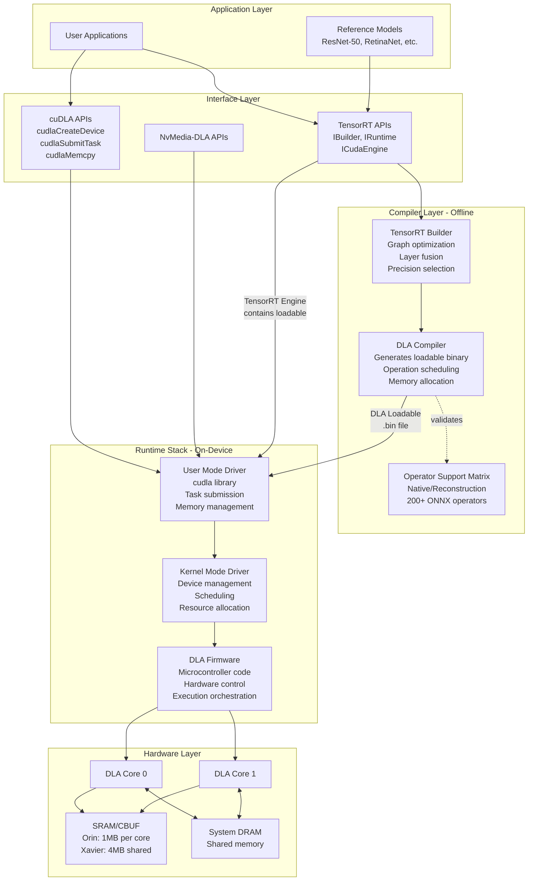
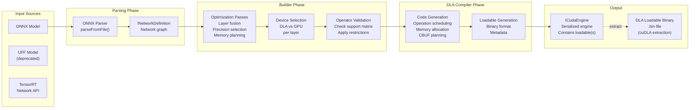
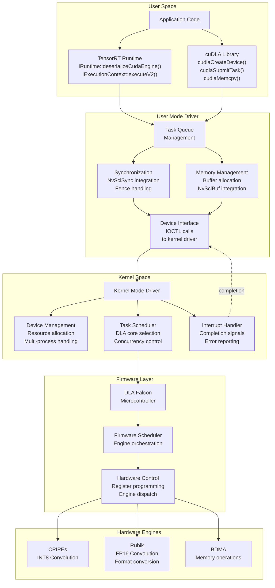
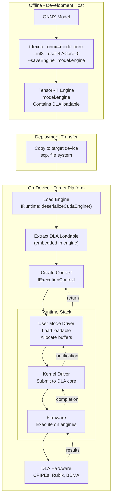
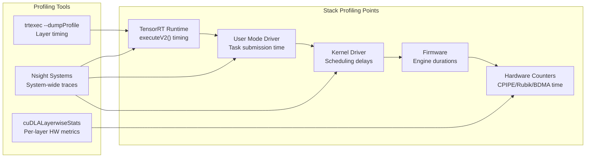

<!-- source: DeepWiki mcp.deepwiki.com · repo NVIDIA/Deep-Learning-Accelerator-SW · page 1.2 Software Stack Overview · fetched 2026-10-26 -->

# Software Stack Overview

<details>
<summary>Relevant source files</summary>

The following files were used as context for generating this wiki page:

- [FAQ/README.md](FAQ/README.md)
- [README.md](README.md)

</details>


## Purpose and Scope

This document describes the DLA software stack architecture, covering the compiler layer, runtime stack components (firmware, kernel driver, user driver), and programming interfaces (TensorRT, NvMedia-DLA, cuDLA). This page provides a technical understanding of how software components translate neural networks into executable DLA loadables and manage their execution on hardware.

For information about DLA hardware architecture, see [DLA Hardware Architecture](#1.1). For details on specific supported platforms and version requirements, see [Supported Platforms](#1.3). For compilation workflows and tools, see [Model Compilation](#5).

---

## Stack Architecture

The DLA software stack implements a layered architecture separating concerns between offline compilation (model translation) and on-device runtime (execution management). The stack consists of three primary layers:

1. **Compiler Layer**: Translates neural network graphs into DLA-executable binary format (DLA loadables)
2. **Runtime Stack**: Three-tier driver model managing loadable execution on hardware
3. **Interface Layer**: Multiple API entry points for different use cases and deployment scenarios



**Diagram: DLA Software Stack Layers**

The diagram illustrates the separation between offline compilation (Compiler Layer) and on-device execution (Runtime Stack). All three interface options (TensorRT, cuDLA, NvMedia-DLA) converge on the same underlying runtime infrastructure. The Runtime Stack implements a classic three-tier driver model providing abstraction, security, and resource management between user applications and hardware.

**Sources:** [README.md:5-5](), [FAQ/README.md:79-81]()

---

## Compiler Layer

### TensorRT Builder as DLA Compiler Interface

TensorRT Builder (`IBuilder`) is the exclusive user-facing interface for invoking the DLA compiler. The builder performs graph-level optimizations before delegating DLA-specific code generation to the DLA compiler component.

**Key Classes and APIs:**
- `IBuilder`: Constructs optimized execution engines from network definitions
- `IBuilderConfig`: Configures build options including DLA core selection via `setDLACore()`
- `INetworkDefinition`: Represents the neural network graph to compile
- `ICudaEngine`: Serialized output containing DLA loadable(s) and metadata

**Compilation Process:**



**Diagram: Compilation Flow Through TensorRT Builder**

**Sources:** [README.md:5](), [FAQ/README.md:79-81]()

### DLA Compiler Internals

The DLA compiler component (invoked internally by TensorRT Builder) performs the following transformations:

| Compilation Phase | Operations |
|-------------------|------------|
| **Layer Mapping** | Maps network layers to DLA hardware engines (CPIPEs, Rubik, BDMA) |
| **Precision Assignment** | Determines INT8/FP16 execution for each layer based on configuration |
| **Memory Planning** | Allocates SRAM (CBUF) and DRAM buffers for intermediate tensors |
| **Operation Scheduling** | Determines execution order respecting data dependencies |
| **Sparsity Handling** | Configures 2:4 structured sparsity for applicable convolution layers |
| **Binary Generation** | Produces DLA loadable in proprietary binary format |

**Key Restrictions Enforced:**
- CBUF validation: Ensures convolution weights and activations fit in SRAM
- Format constraints: Validates tensor formats compatible with DLA engines (e.g., `kDLA_HWC4`, `kCHW32`)
- Dimension limits: Enforces hardware limits on tensor dimensions and channel counts
- Precision rules: Validates precision configurations per layer type

**Sources:** [FAQ/README.md:134-135](), [README.md:5]()

---

## Runtime Stack

The runtime stack implements a three-tier architecture for executing DLA loadables on hardware. Each tier provides specific abstractions and services.

### Three-Tier Driver Model



**Diagram: Runtime Stack Component Interaction**

**Sources:** [README.md:5](), [FAQ/README.md:56-58]()

### User Mode Driver (cudla library)

The user mode driver provides the primary interface between applications and the kernel driver. It implements:

**Core Functions:**
- `cudlaCreateDevice()`: Initializes DLA device context
- `cudlaModuleLoadFromMemory()`: Loads DLA loadable binary into driver
- `cudlaMemcpy()`: Copies data between host and device memory
- `cudlaSubmitTask()`: Submits inference task to DLA core
- `cudlaMemRegister()`: Registers memory buffers with NvSciBuf

**Memory Management:**
The user mode driver handles two memory allocation paths:
1. **CUDA-managed memory**: Used in hybrid mode with GPU interoperation
2. **NvSciBuf allocations**: Used in standalone mode for zero-copy sharing

**Synchronization:**
- **NvSciSync**: Cross-process synchronization primitive
- **Fences**: Signal completion of DLA tasks to waiting processes

**Sources:** [FAQ/README.md:81]()

### Kernel Mode Driver

The kernel mode driver manages DLA hardware resources and provides isolation between processes. Key responsibilities:

| Responsibility | Description |
|----------------|-------------|
| **Device Enumeration** | Discovers and initializes DLA core 0 and core 1 |
| **Resource Allocation** | Manages SRAM, register access, interrupt vectors |
| **Multi-Process Scheduling** | Arbitrates access when multiple processes use DLA |
| **Security** | Enforces permission checks and resource limits |
| **Power Management** | Handles clock gating and power state transitions |
| **Error Handling** | Reports hardware errors and timeout conditions |

**Sources:** [README.md:5]()

### DLA Firmware

The DLA firmware runs on the DLA Falcon microcontroller and provides low-level hardware control. Firmware responsibilities include:

- **Operation Dispatch**: Programs hardware engines (CPIPEs, Rubik, BDMA) with operation parameters
- **Dependency Resolution**: Ensures operations execute in correct order respecting data dependencies
- **Engine Orchestration**: Coordinates parallel execution across multiple engines
- **Error Detection**: Monitors for hardware faults and reports to kernel driver
- **Performance Counters**: Maintains hardware utilization metrics

The firmware operates autonomously after receiving a loaded task from the kernel driver, minimizing CPU involvement during inference.

**Sources:** [README.md:5](), [FAQ/README.md:33]()

---

## Interface Layer

DLA provides three distinct programming interfaces, each optimized for different deployment scenarios.

### Interface Comparison

| Interface | Use Case | API Style | Memory Management | Typical User |
|-----------|----------|-----------|-------------------|--------------|
| **TensorRT Runtime** | General-purpose inference, GPU+DLA hybrid | Object-oriented C++ | CUDA unified memory | Application developers |
| **cuDLA Hybrid** | CUDA-managed DLA with stream integration | C API | CUDA streams | GPU-DLA concurrent workloads |
| **cuDLA Standalone** | Independent DLA operation, minimal GPU dependency | C API | NvSciBuf | Safety-critical, multi-process |

### TensorRT Runtime Interface

TensorRT Runtime has used cuDLA internally as the default DLA execution path since TensorRT 8.5. This provides the simplest interface for most users.

**Key APIs:**
```cpp
// Build phase
IBuilder* builder = createInferBuilder(logger);
IBuilderConfig* config = builder->createBuilderConfig();
config->setFlag(BuilderFlag::kINT8);
config->setDLACore(0);  // Select DLA core 0
ICudaEngine* engine = builder->buildEngineWithConfig(*network, *config);

// Runtime phase
IRuntime* runtime = createInferRuntime(logger);
ICudaEngine* engine = runtime->deserializeCudaEngine(engineData, engineSize);
IExecutionContext* context = engine->createExecutionContext();
context->executeV2(buffers);  // Execute inference
```

**Advantages:**
- Unified API for GPU and DLA
- Automatic memory management
- Integrated profiling with `--dumpProfile`
- Seamless GPU fallback for unsupported layers

**Sources:** [FAQ/README.md:79-81](), [README.md:5]()

### cuDLA Hybrid Mode

cuDLA hybrid mode enables CUDA-managed DLA execution integrated with CUDA streams. This allows fine-grained control over GPU-DLA concurrency.

**Key APIs:**
```cpp
// Device initialization
cudlaDevHandle devHandle;
cudlaCreateDevice(0, &devHandle, CUDLA_CUDA_DLA);  // Core 0, hybrid mode

// Module loading
cudlaModule moduleHandle;
cudlaModuleLoadFromMemory(devHandle, loadableData, &moduleHandle);

// Task submission with CUDA stream
cudlaSubmitTask(devHandle, moduleHandle, inputPtr, outputPtr, 
                numInputs, numOutputs, stream);  // CUDA stream
cudaStreamSynchronize(stream);
```

**Advantages:**
- Integration with existing CUDA pipelines
- Stream-based synchronization
- Shared CUDA memory allocations
- Concurrent GPU kernel and DLA execution

**Use Case Example:** Object detection pipeline where backbone runs on DLA and post-processing (NMS) runs on GPU in parallel with next frame's backbone inference.

**Sources:** [FAQ/README.md:57-58]()

### cuDLA Standalone Mode

cuDLA standalone mode provides independent DLA operation without CUDA runtime dependencies. Memory uses NvSciBuf for zero-copy sharing across processes.

**Key APIs:**
```cpp
// Device initialization (standalone)
cudlaDevHandle devHandle;
cudlaCreateDevice(0, &devHandle, CUDLA_STANDALONE);

// NvSciBuf memory registration
NvSciBufObj bufObj;
cudlaMemRegister(devHandle, bufObj, &registeredPtr);

// Task submission with NvSciSync
NvSciSyncFence preFence, postFence;
cudlaSubmitTask(devHandle, moduleHandle, inputPtr, outputPtr,
                numInputs, numOutputs, &preFence, &postFence);
NvSciSyncFenceWait(&postFence, timeout);
```

**Advantages:**
- No CUDA runtime dependency
- Suitable for safety-critical systems
- Multi-process memory sharing via NvSciBuf
- Explicit synchronization control

**Use Case Example:** Automotive applications where DLA runs in separate process from GPU, with strict memory isolation requirements.

**Sources:** [FAQ/README.md:81]()

### NvMedia-DLA Interface

NvMedia-DLA provides a safety-certified interface for automotive applications on DRIVE platforms. It offers deterministic execution guarantees and is integrated with the DRIVE OS safety framework.

**Sources:** [README.md:5]()

---

## Execution Flow

### Compilation to Execution Data Flow



**Diagram: End-to-End Data Flow from Compilation to Execution**

**Sources:** [FAQ/README.md:118-122]()

### Memory Management Across Stack Layers

The DLA stack manages three distinct memory regions:

| Memory Region | Management Layer | Purpose | Typical Size |
|---------------|------------------|---------|--------------|
| **System DRAM** | User mode driver + Kernel driver | Input/output tensors, intermediate buffers | MBs to GBs |
| **DLA SRAM (CBUF)** | DLA firmware + Compiler | Convolution weights, activations during compute | 1-4 MB |
| **Register Memory** | DLA firmware | Hardware engine configuration | KBs |

**DRAM Access Pattern:**
- User application allocates input/output buffers (CUDA or NvSciBuf)
- User mode driver registers buffers with kernel driver
- Kernel driver programs DMA descriptors
- DLA firmware controls BDMA engine for data transfers
- CPIPEs/Rubik fetch data from DRAM as needed

**SRAM Management:**
- DLA compiler performs static analysis during build to allocate CBUF
- Larger layers split into tiles that fit in SRAM
- Firmware loads tiles on-demand during execution
- CBUF validation during compilation ensures fit

**Sources:** [FAQ/README.md:93-98](), [FAQ/README.md:134-135]()

---

## Version Evolution and Compatibility

### TensorRT 8.5+ Default Behavior

Starting with TensorRT 8.5, DLA inference automatically uses cuDLA as the underlying runtime implementation. Previous versions used a different runtime path. This transition provides:

- Improved latency characteristics
- Better concurrent execution with GPU
- Enhanced profiling capabilities
- Unified synchronization primitives

Users do not need code changes; the cuDLA integration is transparent through TensorRT APIs.

**Sources:** [FAQ/README.md:57]()

### Platform-Specific Considerations

| Platform | DLA Generation | Key Differences |
|----------|----------------|-----------------|
| **Jetson Xavier** | 1st generation | 4MB SRAM shared between 2 DLAs and 2 PVAs |
| **Jetson Orin** | 2nd generation | 1MB SRAM exclusive per DLA, optimized INT8 |
| **DRIVE Xavier** | 1st generation | Similar to Jetson Xavier |
| **DRIVE Orin** | 2nd generation | Similar to Jetson Orin, safety certification |

**Software Version Requirements:**
- Minimum DLA SW version: 3.12.x for base features
- DLA SW 3.14.0+: Advanced math operators (trigonometric, hyperbolic)
- TensorRT 8.6.12+: Increased operator exposure
- JetPack 5.1.1+ or DRIVE OS 6.0.8.0+ recommended

**Sources:** [FAQ/README.md:29-30](), [FAQ/README.md:96-98]()

---

## Debugging and Profiling Integration

### Stack-Level Profiling Points

The DLA stack provides profiling hooks at multiple layers:



**Diagram: Profiling Integration Points Across Stack**

**Available Metrics:**
- **TensorRT level**: End-to-end layer execution time
- **cuDLA level**: Task submission and completion latency
- **Kernel level**: Scheduling and context switch overhead  
- **Firmware level**: Engine dispatch and synchronization
- **Hardware level**: CPIPE duration, Rubik duration, BDMA duration, SRAM usage

**Sources:** [FAQ/README.md:117-125]()

---

## Concurrent Execution and Multi-Core Support

The DLA runtime stack supports multiple execution modes for the two available DLA cores:

### Single-Core Sequential Execution
- One model executes on one DLA core
- Simplest deployment model
- Specify core with `setDLACore(0)` or `setDLACore(1)`

### Multi-Core Parallel Execution
- Different models on each core concurrently
- Maximum throughput for multi-model inference
- Example: `trtexec --useDLACore=0` in one process, `--useDLACore=1` in another

### Hybrid GPU-DLA Execution
- Network partitioned between GPU and DLA
- Backbone on DLA, post-processing on GPU
- Managed automatically by TensorRT or explicitly via cuDLA streams

### Multi-Model Single-Core
- Multiple models execute sequentially on same core
- Runtime multiplexes access to hardware
- Lower throughput than multi-core but simpler resource management

**Scheduling Considerations:**
- Kernel driver arbitrates access when multiple processes submit tasks
- CUDA environment variable `CUDA_DEVICE_MAX_CONNECTIONS=32` can reduce scheduling interference
- cuDLA standalone mode provides more deterministic scheduling than hybrid mode

**Sources:** [FAQ/README.md:107-112](), [FAQ/README.md:51-58]()

---

## Summary

The DLA software stack implements a clear separation between offline compilation (TensorRT Builder → DLA Compiler) and on-device runtime (User Driver → Kernel Driver → Firmware). Three interface options (TensorRT Runtime, cuDLA Hybrid, cuDLA Standalone) provide flexibility for different deployment scenarios while sharing common underlying infrastructure. The three-tier driver model provides abstraction, security, and resource management between applications and hardware.

Key architectural decisions:
- TensorRT Builder as exclusive compiler interface ensures consistent optimization
- Three-tier runtime provides security isolation and multi-process support
- Multiple interface options enable different deployment patterns (safety-critical, CUDA-integrated, etc.)
- cuDLA as default runtime since TensorRT 8.5 improves performance characteristics

For compilation workflows, see [Model Compilation](#5). For runtime programming patterns, see [Runtime and Deployment](#6). For performance analysis, see [Performance Analysis and Optimization](#7).

---

