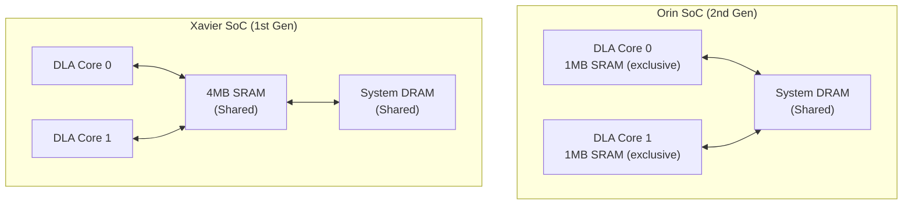
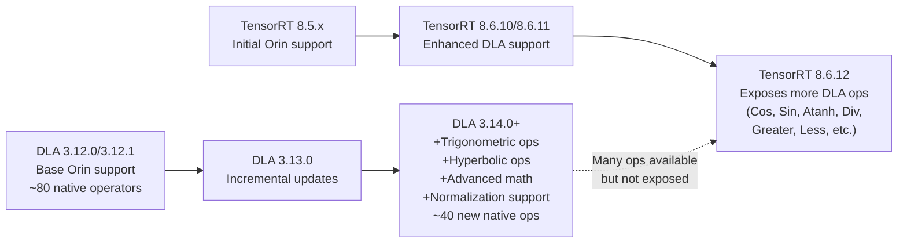
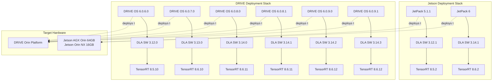

<!-- source: DeepWiki mcp.deepwiki.com · repo NVIDIA/Deep-Learning-Accelerator-SW · page 1.3 Supported Platforms · fetched 2026-10-26 -->

# Supported Platforms

<details>
<summary>Relevant source files</summary>

The following files were used as context for generating this wiki page:

- [README.md](README.md)
- [operators/README.md](operators/README.md)

</details>


## Purpose and Scope

This page documents the hardware platforms and software versions supported by the DLA software stack. It covers the specific combinations of hardware platforms (Jetson Orin, DRIVE Orin, Xavier), operating system releases (JetPack, DRIVE OS), DLA software versions, and TensorRT versions that are compatible with each other. For information about the DLA hardware architecture itself, see [DLA Hardware Architecture](#1.1). For system requirements and minimum versions needed for specific features, see [System Requirements](#2.1).

---

## Hardware Platform Support

The DLA software stack supports NVIDIA platforms with integrated Deep Learning Accelerator hardware across two product lines: **Jetson** (embedded computing) and **DRIVE** (automotive computing).

### Platform Categories

| **Platform Family** | **Target Domain** | **DLA Generation** | **DLA Cores** | **Representative Products** |
|---------------------|-------------------|-------------------|---------------|----------------------------|
| Jetson Orin | Embedded AI | 2nd Generation | 2 | Jetson AGX Orin 64GB, Jetson Orin NX 16GB |
| DRIVE Orin | Automotive AI | 2nd Generation | Up to 2 | DRIVE Orin platform variants |
| Jetson Xavier | Embedded AI | 1st Generation | Up to 2 | Jetson AGX Xavier |
| DRIVE Xavier | Automotive AI | 1st Generation | Up to 2 | DRIVE Xavier platform variants |

**Sources:** [README.md:3-4]()

---

## DLA Hardware Generations

### Second-Generation DLA (Orin)

Second-generation DLA hardware on Orin SoCs features architectural improvements over the first generation:

- **DLA Cores:** Up to 2 independent cores per SoC
- **SRAM Architecture:** 1MB SRAM per DLA core (exclusive, not shared between cores)
- **Peak Performance:** Up to 105 TOPs sparse INT8 on Jetson AGX Orin 64GB (both cores combined)
- **New Capabilities:** Enhanced sparse INT8 support with 2:4 structured sparsity

### First-Generation DLA (Xavier)

First-generation DLA hardware on Xavier SoCs:

- **DLA Cores:** Up to 2 cores per SoC
- **SRAM Architecture:** 4MB SRAM shared between both DLA cores
- **Peak Performance:** Lower than Orin generation
- **Operator Support:** Subset of Orin's operator support (see [Operator Support Matrix](#4.1))



**Key Architectural Difference:** Orin's exclusive SRAM per core eliminates contention between DLA cores, enabling better concurrent execution performance compared to Xavier's shared SRAM architecture.

**Sources:** [README.md:3-4]()

---

## Software Stack Compatibility Matrix

The DLA software stack consists of three key versioned components that must be compatible:

1. **Operating System:** JetPack (Jetson) or DRIVE OS (Automotive)
2. **DLA SW:** The DLA firmware, kernel driver, and compiler libraries
3. **TensorRT:** The inference runtime and builder interface

The following table shows the validated combinations of these components:

| **Hardware Platform** | **Operating System** | **DLA SW Version** | **TensorRT Version** |
|-----------------------|----------------------|-------------------|---------------------|
| DRIVE Orin | DRIVE OS 6.0.6.0 | DLA 3.12.0 | TensorRT 8.5.10 |
| Jetson Orin | JetPack 5.1.1 | DLA 3.12.1 | TensorRT 8.5.2 |
| DRIVE Orin | DRIVE OS 6.0.7.0 | DLA 3.13.0 | TensorRT 8.6.10 |
| DRIVE Orin | DRIVE OS 6.0.8.0 | DLA 3.14.0 | TensorRT 8.6.11 |
| Jetson Orin | JetPack 6 | DLA 3.14.1 | TensorRT 8.6.2 |
| DRIVE Orin | DRIVE OS 6.0.8.1 | DLA 3.14.1 | TensorRT 8.6.11 |
| DRIVE Orin | DRIVE OS 6.0.9.0 | DLA 3.14.2 | TensorRT 8.6.12 |
| DRIVE Orin | DRIVE OS 6.0.9.1 | DLA 3.14.3 | TensorRT 8.6.12 |

**Important Notes:**
- The OS release includes and ships with the specific DLA SW and TensorRT versions shown to its right
- DLA SW and TensorRT versions are tightly coupled and must match the combinations shown above
- Using mismatched versions may result in compilation failures or runtime errors

**Sources:** [operators/README.md:14-26]()

---

## Software Version Evolution and Feature Availability

Different DLA SW versions introduce new operator support and capabilities:



### Key Version Milestones

**DLA 3.12.x (Initial Orin Release):**
- Base operator support (~80 native ONNX operators)
- INT8 and FP16 precision support
- 2:4 structured sparsity support

**DLA 3.14.0+ (Major Expansion):**
- Added ~40 new native operators including:
  - Trigonometric: `Acos`, `Asin`, `Atan`, `Cos`, `Sin`, `Tan`
  - Hyperbolic: `Acosh`, `Asinh`, `Atanh`, `Cosh`, `Sinh`
  - Math operations: `Ceil`, `Exp`, `Floor`, `Log`, `Round`, `Sqrt`
  - Normalization primitives enabling GroupNorm, LayerNorm, InstanceNorm reconstruction

**TensorRT 8.6.12 (Increased Exposure):**
- Exposed several DLA 3.14.0 operators through TensorRT builder:
  - `Cos`, `Sin` (Unary layer)
  - `Atanh` (Unary layer)
  - `Div` (ElementWise layer)
  - `Greater`, `Less` (Comparison operations)
  - `GlobalMaxPool` (Reduce layer)

**Note:** Many operators supported in DLA SW 3.14.0+ are not yet exposed in TensorRT 8.6.12 and require an RFE (Request for Enhancement). See [Operator Support Matrix](#4.1) for details.

**Sources:** [operators/README.md:1-152]()

---

## Jetson Platform Power Modes

Jetson AGX Orin 64GB supports multiple power modes that trade total system power consumption for compute performance. Notably, **DLA performance remains relatively stable across power modes** while GPU performance scales more dramatically.

### Power Mode Specifications

| **Power Mode** | **Total TDP** | **GPU INT8 TOPs** | **2x DLA INT8 TOPs** | **Total INT8 TOPs** | **DLA % of Total** |
|----------------|---------------|-------------------|---------------------|--------------------|--------------------|
| MAXN | ~275W equivalent | 171 | **105** | 275 | **38%** |
| 50W | 50W | 109 | **92** | 200 | **46%** |
| 30W | 30W | 41 | **90** | 131 | **69%** |
| 15W | 15W | 14 | **40** | 54 | **74%** |

**Key Insights:**
- DLA maintains 85-90% of peak performance even at 30W power mode
- At 15W, DLA still provides 40 TOPs (38% of MAXN performance)
- At lower power modes, DLA contributes a higher percentage of total DL performance
- This makes DLA critical for power-constrained edge deployments

**Sources:** [README.md:14-25]()

---

## Platform-Specific Performance Characteristics

### DLA TOPs Equivalence Across Platforms

The following relationships help understand performance equivalence across different platform configurations:

**Jetson AGX Orin 64GB Power Mode Equivalents:**
- **30W & 50W modes:** DLA TOPs comparable to maximum clocks on DRIVE Orin platforms
- This alignment enables consistent performance modeling between Jetson development and DRIVE automotive deployment

**Jetson Orin NX 16GB:**
- Maximum DLA TOPs comparable to **15W power mode** on Jetson AGX Orin 64GB
- Useful for understanding performance expectations on lower-tier Orin variants

**Sources:** [README.md:23-25]()

---

## Platform Performance Example: ResNet-50

The following table illustrates how DLA performance scales across power modes on Jetson AGX Orin 64GB:

| **Network** | **Input Size** | **Batch Size** | **MAXN** | **50W** | **30W** | **15W** |
|-------------|----------------|----------------|----------|---------|---------|---------|
| ResNet-50 | 224x224 | 2 | 2037 img/s | 1948 img/s | 1928 img/s | 1072 img/s |

**Key Observation:** DLA maintains 95% of MAXN throughput at 30W mode (only 11% TDP), demonstrating exceptional power efficiency.

**Sources:** [README.md:74]()

---

## Deployment Environment Requirements

### Jetson Platforms

**Operating System:** JetPack 5.1.1 or later (JetPack 6 recommended)

**Installation:** JetPack includes:
- L4T (Linux for Tegra) kernel with DLA kernel driver
- DLA firmware
- User-mode DLA libraries
- TensorRT with DLA support
- CUDA Toolkit with cuDLA APIs

**Access Methods:**
- TensorRT Builder API with `--useDLACore` flag
- cuDLA Hybrid mode (CUDA-managed DLA execution)
- cuDLA Standalone mode (independent DLA programming)

### DRIVE Platforms

**Operating System:** DRIVE OS 6.0.6.0 or later (6.0.9.0+ recommended)

**Installation:** DRIVE OS includes:
- QNX or Linux kernel with DLA kernel driver
- DLA firmware
- NvMedia-DLA APIs (primary interface for automotive safety applications)
- TensorRT with DLA support
- cuDLA APIs

**Access Methods:**
- TensorRT Builder API with `--useDLACore` flag
- NvMedia-DLA APIs (automotive-grade interface)
- cuDLA Hybrid mode
- cuDLA Standalone mode

**Sources:** [README.md:1-7](), [operators/README.md:14-26]()

---

## Version Compatibility Diagram



**Sources:** [operators/README.md:14-26]()

---

## Minimum Version Requirements for Features

Different features and capabilities require specific minimum software versions:

| **Feature** | **Minimum DLA SW** | **Minimum TensorRT** | **Notes** |
|-------------|-------------------|---------------------|-----------|
| Base INT8/FP16 inference | DLA 3.12.0 | TensorRT 8.5.2 | Available on all supported platforms |
| 2:4 Structured Sparsity | DLA 3.12.0 | TensorRT 8.5.2 | Use `--sparsity=force` flag |
| Trigonometric operators (native in DLA SW) | DLA 3.14.0 | TensorRT 8.6.11 | Some exposed in TRT 8.6.12 |
| `Cos`, `Sin` operators (exposed) | DLA 3.14.0 | TensorRT 8.6.12 | Unary layer support |
| `Div` operator (exposed) | DLA 3.14.0 | TensorRT 8.6.12 | ElementWise layer support |
| `Greater`, `Less` operators (exposed) | DLA 3.14.0 | TensorRT 8.6.12 | Comparison operations |
| Normalization reconstruction | DLA 3.14.0 | TensorRT 8.6.11 | GroupNorm, LayerNorm, InstanceNorm |

**Sources:** [operators/README.md:14-152]()

---

## Verifying Your Platform Configuration

To verify your platform's DLA SW and TensorRT versions:

### Checking TensorRT Version

```bash
dpkg -l | grep tensorrt
```

Or programmatically:
```python
import tensorrt as trt
print(trt.__version__)
```

### Checking DLA SW Version

The DLA SW version is embedded in the OS release and can be inferred from:

**On Jetson:**
```bash
cat /etc/nv_tegra_release
```

**On DRIVE:**
Check DRIVE OS version, which determines DLA SW version (see compatibility matrix above).

### Checking DLA Hardware Availability

```bash
ls -l /dev/nvhost-nvdla*
```

Expected output showing 2 DLA devices:
```
/dev/nvhost-nvdla0
/dev/nvhost-nvdla1
```

**Sources:** Derived from general Linux/Jetson system administration practices

---

## Cross-Platform Development Considerations

### Jetson as Development Platform for DRIVE Deployment

Jetson platforms serve as effective development environments for DRIVE automotive deployments:

1. **Performance Alignment:** Jetson AGX Orin 64GB at 30W/50W provides similar DLA TOPs to DRIVE Orin maximum clocks
2. **Software Stack Similarity:** Both use TensorRT builder with `--useDLACore` flag
3. **Workflow Portability:** Models compiled on Jetson can be validated before DRIVE deployment

**Recommended Workflow:**
- Develop and optimize models on Jetson with JetPack 6 (DLA 3.14.1, TensorRT 8.6.2)
- Validate on Jetson at 30W/50W power modes to simulate DRIVE performance
- Deploy to DRIVE OS 6.0.9.0+ (DLA 3.14.2+, TensorRT 8.6.12) for production

### Platform-Specific API Considerations

| **API** | **Jetson** | **DRIVE** | **Primary Use Case** |
|---------|-----------|----------|---------------------|
| TensorRT Runtime | Supported | Supported | Default runtime since TensorRT 8.5 |
| cuDLA Hybrid | Supported | Supported | CUDA-managed DLA with GPU interop |
| cuDLA Standalone | Supported | Supported | Independent DLA programming |
| NvMedia-DLA | Not available | Supported | Automotive safety-critical applications |

**Sources:** [README.md:5]()

---

## Summary

The DLA software stack supports two hardware generations (Xavier and Orin) across two product families (Jetson and DRIVE). The Orin generation provides significantly enhanced performance and operator support compared to Xavier. Key platform selection considerations include:

- **Jetson Orin:** Ideal for edge AI development, prototyping, and embedded deployments
- **DRIVE Orin:** Designed for automotive-grade production deployments with safety certifications
- **Power Modes:** Jetson provides flexible power/performance tradeoffs (15W to MAXN)
- **Software Coupling:** OS version tightly couples to specific DLA SW and TensorRT versions
- **Version Recommendations:** Use JetPack 6 / DRIVE OS 6.0.9.0+ for latest operator support

For building and running your first DLA workload, proceed to [Quick Start Tutorial](#2.2).

**Sources:** [README.md:1-133](), [operators/README.md:1-152]()

---

