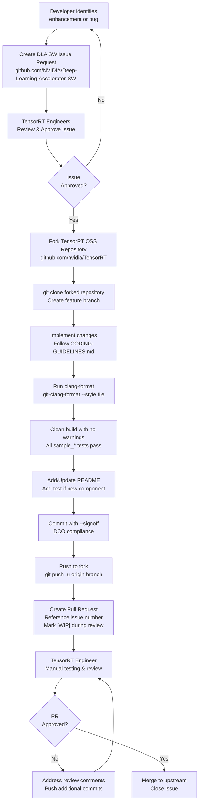
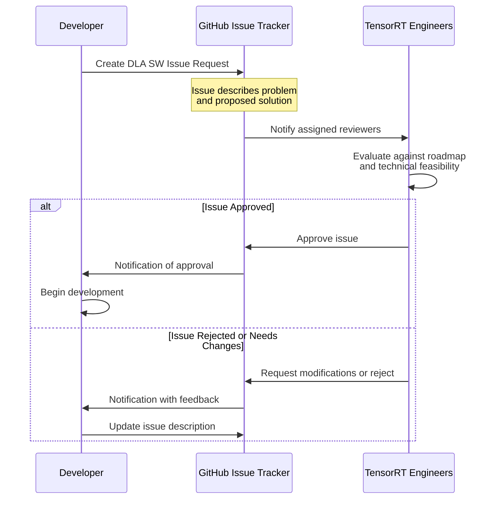
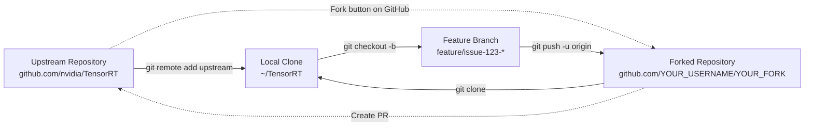
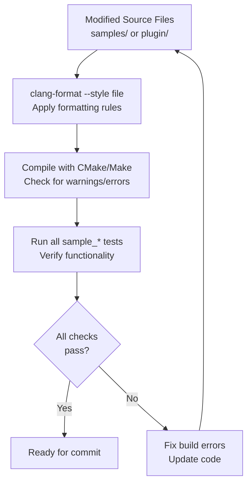
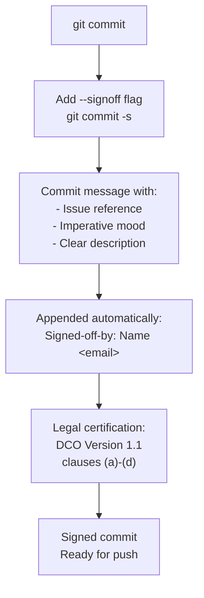
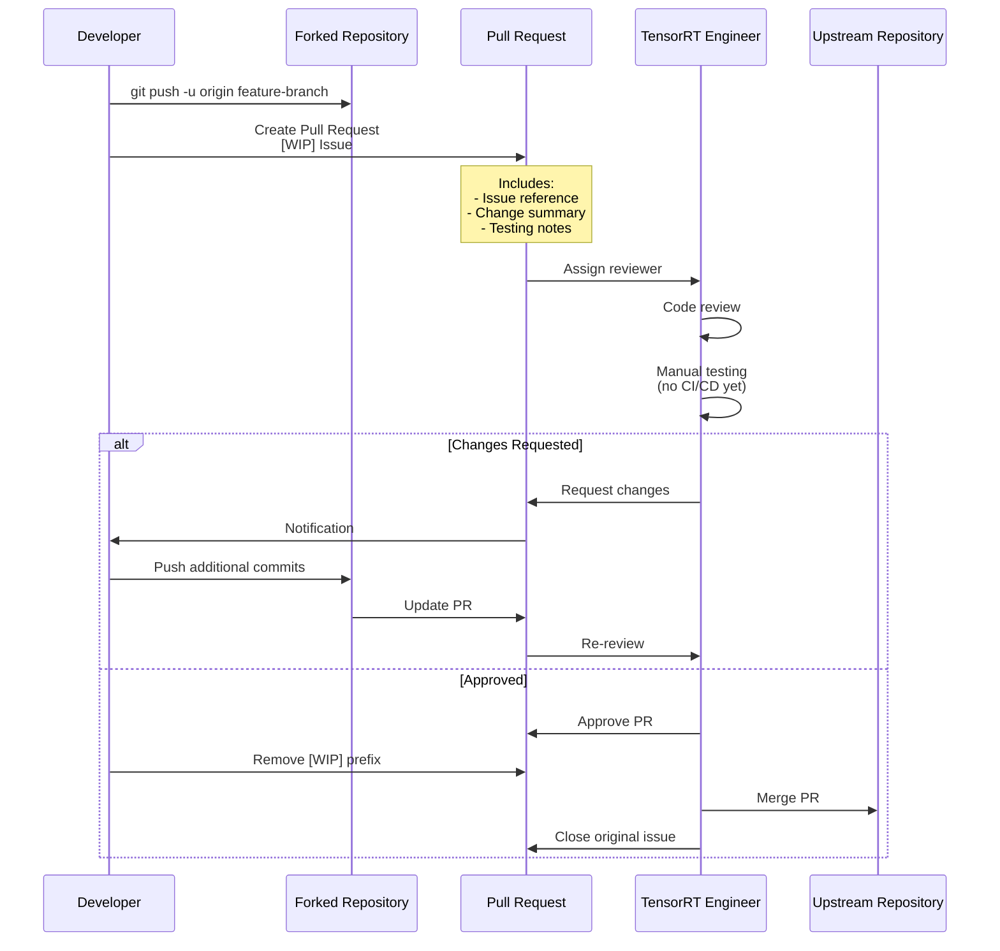
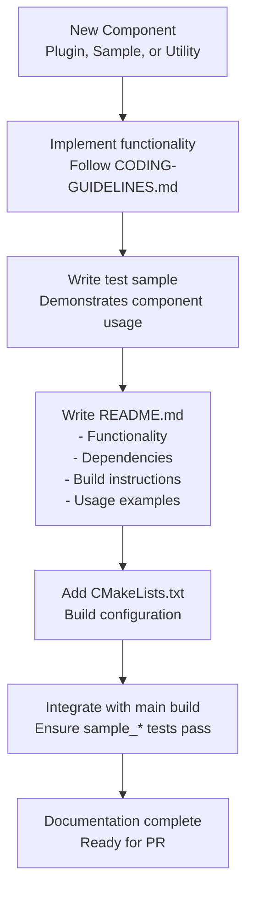
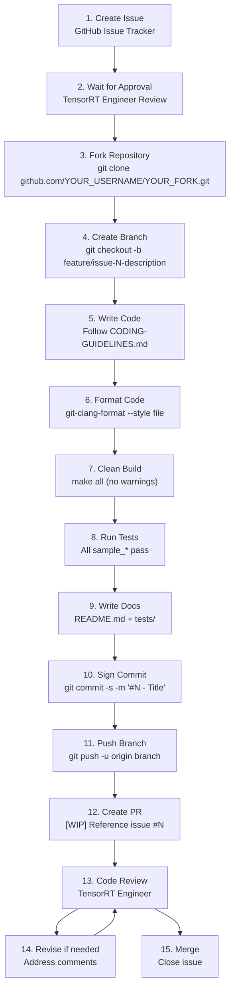

<!-- source: DeepWiki mcp.deepwiki.com · repo NVIDIA/Deep-Learning-Accelerator-SW · page 10.1 Contribution Workflow · fetched 2026-10-26 -->

# Contribution Workflow

<details>
<summary>Relevant source files</summary>

The following files were used as context for generating this wiki page:

- [CONTRIBUTING.md](CONTRIBUTING.md)

</details>


## Purpose and Scope

This document provides the step-by-step process for contributing code, documentation, and enhancements to the Deep Learning Accelerator Software repository. It covers the mandatory workflow from issue creation through pull request approval and merge.

For coding style guidelines and standards, see [Coding Standards](#10.2). For general questions about DLA development, see [FAQ and Troubleshooting](#9).

---

## Overview

All contributions to the DLA SW repository must follow a structured workflow with multiple quality gates. The process enforces:

- **Issue-first development**: All changes require approved issue requests before coding
- **Legal compliance**: Commit signing with Developer Certificate of Origin (DCO)
- **Code quality**: Automated formatting and clean builds
- **Testing**: All samples must pass before submission
- **Documentation**: READMEs required for all OSS components

The workflow prevents wasted effort by requiring TensorRT engineer approval of the proposed change before development begins.



**Sources:** [CONTRIBUTING.md:1-141]()

---

## Issue Tracking Process

### Creating an Issue Request

All enhancement, bugfix, or change requests must begin with issue creation. This prevents contributors from spending time on changes that may not align with project goals or TensorRT's roadmap.

**Process:**

1. Navigate to the [DLA SW repository](https://github.com/NVIDIA/Deep-Learning-Accelerator-SW)
2. Create a new issue describing:
   - Problem statement or enhancement goal
   - Proposed solution approach
   - Expected impact and use cases
   - Any related issues or dependencies
3. Wait for TensorRT engineer review and approval
4. Only proceed with code development after explicit approval

**Key Requirement:** The issue request must be reviewed and approved by TensorRT engineers prior to code review.



**Sources:** [CONTRIBUTING.md:4-8]()

---

## Fork and Development Setup

### Forking the Repository

The DLA SW project follows the standard GitHub fork-and-pull-request model. Contributors must first fork the upstream TensorRT OSS repository.

**Setup Commands:**

```bash
# 1. Fork the upstream repository
# Navigate to https://github.com/nvidia/TensorRT and click "Fork"

# 2. Clone your forked repository
git clone https://github.com/YOUR_USERNAME/YOUR_FORK.git TensorRT
cd TensorRT

# 3. Add upstream remote for syncing
git remote add upstream https://github.com/nvidia/TensorRT.git

# 4. Create a feature branch
git checkout -b feature/issue-123-dla-optimization

# 5. Make changes and commit
# (See following sections for commit requirements)
```

### Branch Strategy

- **Target branch selection**: Exercise caution when selecting the source and target branches for PRs
- **Release branches**: Versioned releases of TensorRT OSS are posted to `release/` branches
- **Feature branches**: Use descriptive names referencing the issue number (e.g., `feature/issue-123-description`)



**Sources:** [CONTRIBUTING.md:78-93]()

---

## Code Quality Requirements

### Formatting with clang-format

All source code must adhere to TensorRT code formatting rules using `clang-format`. The repository provides a `.clang-format` configuration file that enforces:

- Class, function/method, and variable/field naming conventions
- Comment style
- Indentation rules
- Line length limits

**Formatting Commands:**

```bash
# Format git changes (staged or specific commit)
# Commit ID is optional - if unspecified, runs on staged changes
git-clang-format --style file [commit ID/reference]

# Format individual source files
# -style=file: Obtain rules from .clang-format
# -i: In-place modification
clang-format -style=file -i -fallback-style=none <file(s) to process>

# Format entire codebase (project maintainers only)
find samples plugin -iname *.h -o -iname *.c -o -iname *.cpp -o -iname *.hpp \
| xargs clang-format -style=file -i -fallback-style=none
```

### Build Quality Gates

Before submitting code, ensure:

| Requirement | Description | Verification |
|-------------|-------------|--------------|
| **Clean Build** | No warnings or errors during compilation | Run `make` or CMake build |
| **Sample Tests** | All `sample_*` tests pass | Execute test suite before commit |
| **Code Simplicity** | Avoid unnecessary complexity | Manual code review |
| **No Commented Code** | Remove all commented-out code | Visual inspection |



**Sources:** [CONTRIBUTING.md:10-56]()

---

## Commit Signing Requirements

### Developer Certificate of Origin (DCO)

All contributors must "sign-off" on commits to certify that:

- The contribution is your original work, OR
- You have rights to submit it under the same license, OR
- The contribution is based on previous work with an appropriate open source license

**Any contribution containing commits not signed-off will not be accepted.**

### Signing Commits

Use the `--signoff` (or `-s`) option when committing:

```bash
$ git commit -s -m "Add cool feature."
```

This appends to your commit message:

```
Signed-off-by: Your Name <your@email.com>
```

### Commit Message Format

Follow imperative mood and reference the issue number:

```
#<Issue Number> - <Commit Title>

<Commit Body>
```

**Example:**

```
#123 - Add support for GroupNorm operator reconstruction

This commit implements GroupNorm operator reconstruction using
native DLA primitives. The reconstruction decomposes GroupNorm
into a sequence of supported operations following the pattern
described in operator_reconstruction_techniques.md.

Tested with ResNet-50 backbone containing 32 GroupNorm layers.

Signed-off-by: John Developer <john@example.com>
```

### DCO Full Text

The Developer Certificate of Origin 1.1 guarantees legal clarity for all contributions. By signing off, you certify:

- **(a)** The contribution was created in whole or in part by you with the right to submit under the indicated open source license
- **(b)** The contribution is based on previous work with appropriate licensing
- **(c)** The contribution was provided by another person who certified (a), (b), or (c)
- **(d)** You understand the contribution is public and maintained indefinitely



**Sources:** [CONTRIBUTING.md:100-141]()

---

## Pull Request Process

### Creating a Pull Request

After staging commits on your fork, create a Pull Request to merge changes into the upstream repository.

**PR Creation Steps:**

1. Push commits to a branch on your fork:
   ```bash
   git push -u origin <local-branch>:<remote-branch>
   ```

2. Navigate to your fork on GitHub and click "New Pull Request"

3. **Carefully select source and target branches**:
   - Source: Your feature branch
   - Target: Appropriate upstream branch (often `main` or `release/*`)

4. Write a clear PR description:
   - Reference the approved issue number
   - Summarize changes and impact
   - List any dependencies on other PRs

5. **Mark as WIP during review**: Prefix PR title with `[WIP]` while under active review

### Review Process

| Stage | Actor | Actions |
|-------|-------|---------|
| **PR Creation** | Developer | Creates PR referencing issue |
| **Automated Checks** | CI/CD (future) | Currently no automated CI/CD |
| **Manual Review** | TensorRT Engineer | Assigned for code review |
| **Manual Testing** | TensorRT Engineer | Adequate testing completed |
| **Revision Cycle** | Developer | Address review comments |
| **Approval** | TensorRT Engineer | Approve and merge |
| **Issue Closure** | TensorRT Engineer | Close original issue |



### PR Best Practices

- **Keep PRs concise**: Each PR should address a single concern where possible
- **Avoid unnecessary complexity**: Maintain readability and maintainability
- **Clean commit history**: No commented-out code in final commits
- **Document dependencies**: Indicate dependencies on other PRs in description
- **Respond promptly**: Address review comments in a timely manner

**Sources:** [CONTRIBUTING.md:76-98]()

---

## Testing and Documentation Requirements

### Testing Requirements

All OSS components must have accompanying tests to verify functionality.

| Component Type | Testing Requirement |
|----------------|---------------------|
| **New Component** | Provide test sample to verify functionality |
| **Modified Component** | Ensure all existing `sample_*` tests pass |
| **Plugin** | Include test sample demonstrating plugin usage |
| **Utility Script** | Add test covering primary use cases |

**Pre-submission Checklist:**

```bash
# Build all samples
cd samples
make all

# Run sample tests
./sample_cudla
./sample_cudla_hybrid
./sample_cudla_standalone
./sample_cudla_layerwise_stats

# Verify clean output with no errors or warnings
```

### Documentation Requirements

All OSS components must contain accompanying documentation (READMEs) describing:

- **Functionality**: What the component does and its purpose
- **Dependencies**: Required libraries, tools, and versions
- **Known Issues**: Current limitations or bugs
- **Usage Examples**: How to build, run, and integrate

**Documentation Structure:**

```
component_name/
├── README.md           # Primary documentation
├── src/               # Source code
├── include/           # Headers
├── CMakeLists.txt     # Build configuration
└── tests/             # Test samples
```

**Example README sections** (see existing samples for reference):

1. **Overview**: Brief description of component
2. **Prerequisites**: System requirements and dependencies
3. **Building**: Compilation instructions
4. **Running**: Usage examples with command-line options
5. **Expected Output**: Sample outputs and interpretation
6. **Known Issues**: Current limitations



**Sources:** [CONTRIBUTING.md:54-64]()

---

## Adding or Disabling Functionality

When adding optional functionality or features that can be disabled:

### CMake Configuration Approach

1. **Add CMake option** with default value matching existing behavior:
   ```cmake
   option(ENABLE_NEW_FEATURE "Enable new DLA feature" ON)
   ```

2. **File-level inclusion/exclusion**: Modify `CMakeLists.txt` to selectively include/exclude files:
   ```cmake
   if(ENABLE_NEW_FEATURE)
       set(SOURCES ${SOURCES} new_feature.cpp)
   endif()
   ```

3. **Minor changes**: Use `#if` guards for small modifications within existing files:
   ```cpp
   #ifdef ENABLE_NEW_FEATURE
   // Feature-specific code
   #endif
   ```

**Preferred approach**: Where entire files can be included/excluded, prefer modifying `CMakeLists.txt` rather than using `#if` guards around entire file bodies.

**Sources:** [CONTRIBUTING.md:66-69]()

---

## Legal Compliance Checklist

Before submitting any contribution, verify:

- [ ] Issue created and approved by TensorRT engineers
- [ ] All commits signed with `git commit -s`
- [ ] No license conflicts introduced
- [ ] No patent conflicts introduced
- [ ] All code is original work or properly attributed
- [ ] DCO certification understood and agreed to

**Important**: You must be able to contribute your work to open source with no license or patent conflicts. The commit sign-off legally certifies your compliance with the DCO.

**Sources:** [CONTRIBUTING.md:71-72, 100-141]()

---

## Summary Workflow Diagram

This diagram maps the complete contribution workflow to specific commands and files:



**Sources:** [CONTRIBUTING.md:1-141]()

---

## Quick Reference

### Essential Commands

```bash
# Create feature branch
git checkout -b feature/issue-123-description

# Format code
git-clang-format --style file

# Sign commits
git commit -s -m "#123 - Add feature"

# Push to fork
git push -u origin feature-branch
```

### Key Files

| File | Purpose |
|------|---------|
| `CONTRIBUTING.md` | Complete contribution guidelines (this document) |
| `CODING-GUIDELINES.md` | Code style and standards |
| `.clang-format` | Automated formatting configuration |
| `CMakeLists.txt` | Build configuration |
| `README.md` | Component-specific documentation |

### Quality Gates

1. ✅ Issue approved by TensorRT engineer
2. ✅ Code formatted with `clang-format`
3. ✅ Clean build with no warnings
4. ✅ All `sample_*` tests pass
5. ✅ README documentation provided
6. ✅ Test sample included (for new components)
7. ✅ Commits signed with DCO
8. ✅ PR references issue number

**Sources:** [CONTRIBUTING.md:1-141]()

---

