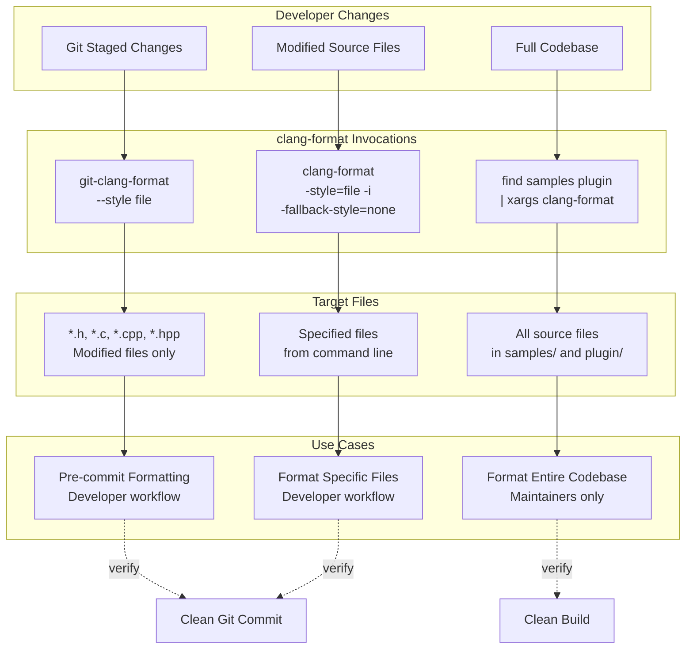
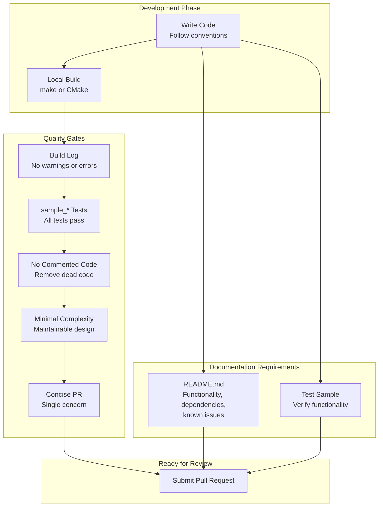
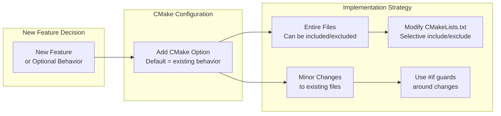
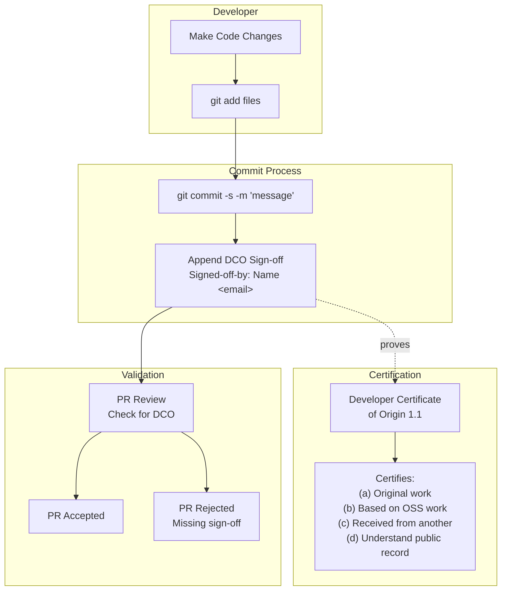
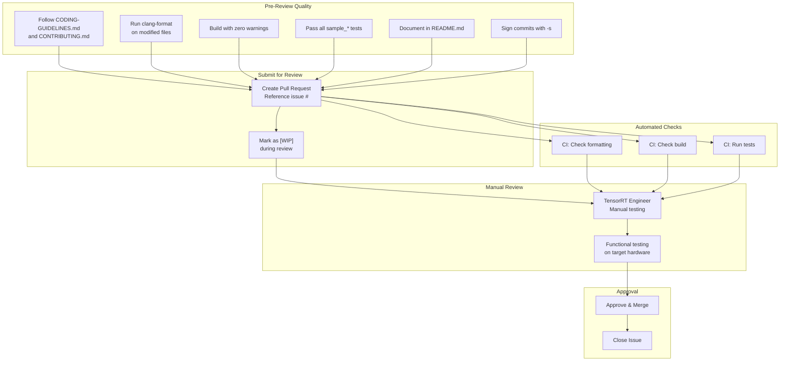

<!-- source: DeepWiki mcp.deepwiki.com · repo NVIDIA/Deep-Learning-Accelerator-SW · page 10.2 Coding Standards · fetched 2026-10-26 -->

# Coding Standards

<details>
<summary>Relevant source files</summary>

The following files were used as context for generating this wiki page:

- [CONTRIBUTING.md](CONTRIBUTING.md)

</details>


## Purpose and Scope

This document defines the mandatory coding standards, formatting rules, testing requirements, and documentation practices for all code contributions to the DLA SW repository. These standards ensure consistency, maintainability, and quality across the codebase.

For information about the contribution workflow (issue creation, pull requests, and review process), see [Contribution Workflow](#10.1).

**Sources:** [CONTRIBUTING.md:10-73]()

---

## Code Formatting Requirements

### clang-format Configuration

All source code must be formatted using `clang-format` with the provided configuration file. This enforces TensorRT's code formatting rules including:

- Class, function/method, and variable/field naming
- Comment style
- Indentation rules
- Line length limits

**Sources:** [CONTRIBUTING.md:16-21]()

### Formatting Workflows

The following diagram shows the three formatting workflows available depending on the scope of changes:



**Sources:** [CONTRIBUTING.md:22-39]()

### Formatting Commands Reference

| Workflow | Command | Description |
|----------|---------|-------------|
| **Format Git Changes** | `git-clang-format --style file [commit ID]` | Formats staged changes or changes since specified commit. Commit ID optional. |
| **Format Individual Files** | `clang-format -style=file -i -fallback-style=none <files>` | In-place formatting (`-i`) of specified source files. |
| **Format Entire Codebase** | `find samples plugin -iname *.h -o -iname *.c -o -iname *.cpp -o -iname *.hpp \| xargs clang-format -style=file -i -fallback-style=none` | For project maintainers only. Formats all source files. |

**Sources:** [CONTRIBUTING.md:22-39]()

---

## Coding Guidelines

### Core Guideline Document

All source code contributions must strictly adhere to the `CODING-GUIDELINES.md` file. This document defines the detailed standards for:

- Code structure and organization
- Naming conventions for classes, functions, and variables
- Comment formatting and documentation
- Error handling patterns
- Memory management practices

**Sources:** [CONTRIBUTING.md:12]()

### Convention Consistency

When extending or fixing existing functionality, developers must follow the existing conventions in:

1. The relevant **file** being modified
2. The containing **submodule**
3. The parent **module**
4. The overall **project**

This hierarchical consistency ensures that new code blends naturally with existing patterns.

**Sources:** [CONTRIBUTING.md:14]()

---

## Code Quality Standards

### Complexity and Readability

The following diagram illustrates the code quality gates that must be satisfied before code review:



**Sources:** [CONTRIBUTING.md:41-65]()

### Specific Requirements

| Category | Requirement | Details |
|----------|-------------|---------|
| **Build Cleanliness** | No warnings or errors | Build log must be completely clean before PR submission |
| **Test Coverage** | All `sample_*` tests pass | Existing tests must continue to pass with changes |
| **Code Removal** | No commented-out code | Remove dead code instead of commenting it out |
| **PR Scope** | Single concern per PR | Complex changes should be split into multiple dependent PRs |
| **Complexity** | Avoid unnecessary complexity | Preserve maintainability and readability |

**Sources:** [CONTRIBUTING.md:41-56]()

---

## Documentation Requirements

### Component Documentation

All OSS components must include:

1. **README.md** containing:
   - Functionality description
   - Dependencies listing
   - Known issues documentation

2. **Reference Examples**: See existing `README.md` files in `samples/` and `plugin/` directories for formatting templates.

**Sources:** [CONTRIBUTING.md:58-60]()

### Test Requirements

Every OSS component must have an accompanying test:

- **New Components**: Provide a test sample to verify functionality (e.g., plugin with corresponding `sample_*` test)
- **Modified Components**: Ensure existing tests continue to pass and add new tests for new functionality

**Sources:** [CONTRIBUTING.md:62-64]()

---

## Feature Addition Guidelines

### CMake-Based Feature Flags

When adding or disabling functionality, follow this pattern:



**Implementation Rules:**

1. **CMake Option**: Add a CMake option with a default value matching existing behavior
2. **File-Level Control**: Where entire files can be included/excluded, modify `CMakeLists.txt` rather than using `#if` guards around file contents
3. **Line-Level Control**: Where functionality involves minor changes to existing files, use `#if` guards

**Sources:** [CONTRIBUTING.md:66-69]()

---

## Commit Standards

### Commit Message Format

All commit messages must follow this format:

```
#<Issue Number> - <Commit Title>

<Commit Body>
```

**Commit Title Requirements:**
- Use **imperative mood** (e.g., "Add feature" not "Added feature")
- Follow the [seven rules of great commit messages](https://chris.beams.io/posts/git-commit/)
- Reference the corresponding Issue number

**Sources:** [CONTRIBUTING.md:47-52]()

### Commit Signing (Developer Certificate of Origin)

All commits must be signed off using the `--signoff` (or `-s`) option:

```bash
git commit -s -m "Add cool feature."
```

This appends:
```
Signed-off-by: Your Name <your@email.com>
```

**Legal Requirement**: This certifies that:
- The contribution is your original work, OR
- You have rights to submit it under the same/compatible license
- You understand the contribution is public and maintained indefinitely

**Critical**: PRs containing unsigned commits will **not be accepted**.

**Sources:** [CONTRIBUTING.md:71-141]()

### Commit Signing Workflow



**Sources:** [CONTRIBUTING.md:100-141]()

---

## Testing and Build Validation

### Pre-Submission Checklist

Before submitting a pull request, verify:

| Check | Command/Action | Success Criteria |
|-------|----------------|------------------|
| **Build Cleanliness** | Run `make` or CMake build | Zero warnings, zero errors |
| **Sample Tests** | Run all `sample_*` executables | All tests pass |
| **Code Formatting** | Run `git-clang-format` | No formatting changes needed |
| **Documentation** | Review README.md changes | Complete and accurate |
| **Test Coverage** | Run new/modified tests | New functionality verified |
| **Commit Signing** | Check `git log` | All commits have `Signed-off-by:` |

**Sources:** [CONTRIBUTING.md:54-56]()

### Sample Test Execution

All samples in the repository (prefixed with `sample_*`) must pass before code submission. These tests verify:

- Core functionality remains intact
- New features work as expected
- No regressions introduced
- Platform compatibility maintained

**Sources:** [CONTRIBUTING.md:56]()

---

## Legal and Licensing Requirements

### Contribution Rights

Developers must ensure:

1. No license conflicts introduced by contributed code
2. No patent conflicts introduced by contributed code
3. Legal right to contribute work to open source
4. Commit signing (`--signoff`) for all commits

**Sources:** [CONTRIBUTING.md:71]()

### Developer Certificate of Origin (DCO)

The full DCO text is available in [CONTRIBUTING.md:115-141](). Key points:

- **Version**: DCO 1.1
- **Copyright**: Linux Foundation and contributors
- **Requirement**: Mandatory for all contributions
- **Effect**: Certifies legal right to contribute under project license

**Sources:** [CONTRIBUTING.md:115-141]()

---

## Code Review Process Integration

The following diagram shows how coding standards integrate with the overall code review workflow:



**Note**: Since there is no CI/CD process fully in place yet, PRs are accepted only after adequate manual testing by the developer and/or TensorRT engineer reviewing the code.

**Sources:** [CONTRIBUTING.md:94-98]()

---

## Summary of Key Files and Tools

| Item | Location/Command | Purpose |
|------|------------------|---------|
| **Main Guidelines** | `CODING-GUIDELINES.md` | Detailed coding standards (not in provided files but referenced) |
| **Contribution Rules** | `CONTRIBUTING.md` | Workflow, formatting, testing, signing requirements |
| **Format Config** | `.clang-format` | Code formatting rules (referenced but not provided) |
| **Format Tool** | `clang-format` | Code formatter (must be installed) |
| **Git Format Tool** | `git-clang-format` | Format staged changes (must be installed) |
| **Sample Tests** | `sample_*` executables | Functional validation tests |
| **Build System** | `CMakeLists.txt` | Build configuration for feature flags |

**Sources:** [CONTRIBUTING.md:12-73]()