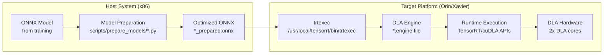
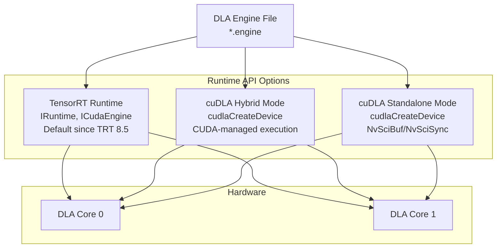
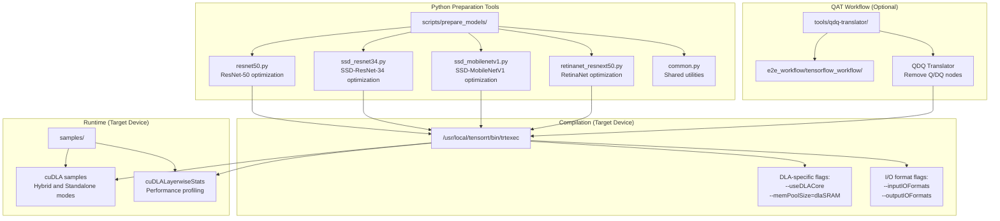
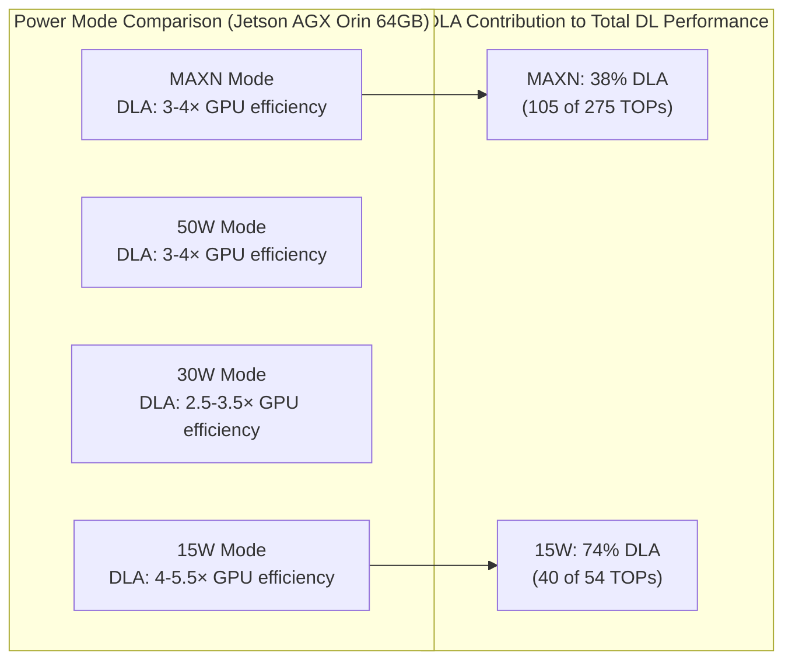

<!-- source: DeepWiki mcp.deepwiki.com · repo NVIDIA/Deep-Learning-Accelerator-SW · page 2 Getting Started · fetched 2026-10-26 -->

# Getting Started

<details>
<summary>Relevant source files</summary>

The following files were used as context for generating this wiki page:

- [README.md](README.md)
- [scripts/prepare_models/README.md](scripts/prepare_models/README.md)

</details>


This page provides a high-level introduction to deploying deep learning models on NVIDIA DLA hardware. It covers the essential workflow from ONNX model input to inference execution on DLA, including the key tools and command-line utilities required for each stage.

For detailed system prerequisites and software version requirements, see [System Requirements](#2.1). For a step-by-step walkthrough of deploying your first model, see [Quick Start Tutorial](#2.2). For performance expectations and reference benchmarks, see [Performance Benchmarks and Reference Models](#2.3).

For comprehensive model preparation techniques, see [Model Preparation](#3). For runtime deployment options, see [Runtime and Deployment](#6).

## Purpose and Scope

This guide assumes you have:
- An ONNX model ready for deployment
- Access to a supported NVIDIA platform (Jetson Orin/Xavier or DRIVE Orin/Xavier)
- Basic familiarity with TensorRT and command-line tools

The workflow covered here applies to standard CNN-based models (ResNet, MobileNet, RetinaNet, etc.). For operator support details and model compatibility, see [ONNX Operator Support](#4).

**Sources**: [README.md:1-7](), [README.md:128-132]()

## DLA Deployment Overview

The DLA deployment workflow consists of three main phases executed on different systems:



**Diagram**: End-to-end DLA deployment workflow showing offline preparation (host) and on-device compilation/execution (target)

**Sources**: [README.md:3-7](), [scripts/prepare_models/README.md:1-6]()

## Prerequisites Overview

### Required Software Components

| Component | Minimum Version | Purpose |
|-----------|----------------|---------|
| **DLA SW** | 3.12.x (3.13.0+ for QAT) | DLA compiler and firmware |
| **TensorRT** | 8.5.x+ (8.6.12+ recommended) | DLA compiler interface |
| **JetPack** (Jetson) | 5.1.1+ | Platform software stack |
| **DRIVE OS** (Automotive) | 6.0.8.0+ | Platform software stack |
| **Python** | 3.8+ | Model preparation scripts |

### Required Python Packages

Install dependencies from [requirements.txt:1-end]():
```bash
python3 -m pip install -r requirements.txt
```

**Note**: Python model preparation scripts are designed for x86 host systems. The `trtexec` compilation and runtime execution occur on the target Orin/Xavier device.

**Sources**: [README.md:128-132](), [scripts/prepare_models/README.md:3-6]()

For complete system requirements including SRAM allocations and platform-specific details, see [System Requirements](#2.1).

## Basic Workflow: Three-Stage Process

### Stage 1: Model Preparation (Host)

Model preparation scripts optimize ONNX graphs for DLA compatibility by performing graph transformations, layer fusion, and format conversions.

**Example**: ResNet-50 preparation using [scripts/prepare_models/resnet50.py:1-end]()
```bash
# On x86 host
python3 scripts/prepare_models/resnet50.py
# Generates: resnet50_v1_prepared.onnx
```

The preparation scripts are model-specific and located in [scripts/prepare_models/]():

| Script | Model | Input | Output |
|--------|-------|-------|--------|
| `resnet50.py` | ResNet-50 | `resnet50_v1.onnx` | `resnet50_v1_prepared.onnx` |
| `ssd_resnet34.py` | SSD-ResNet-34 | `resnet34-ssd1200.onnx` | `resnet34-ssd1200_prepared.onnx` |
| `ssd_mobilenetv1.py` | SSD-MobileNetV1 | `ssd_mobilenet_v1_coco_2018_01_28.onnx` | `ssd_mobilenet_v1_coco_2018_01_28_prepared.onnx` |
| `retinanet_resnext50.py` | RetinaNet ResNeXt-50 | `resnext50_32x4d_fpn_sanitized.onnx` | `resnext50_32x4d_fpn_prepared.onnx` |

**Sources**: [scripts/prepare_models/README.md:8-135]()

### Stage 2: Compilation with trtexec (Target)

The `trtexec` tool invokes TensorRT's builder to compile ONNX models into DLA-executable engine files. This step runs on the target device.

**Example**: Compiling ResNet-50 for DLA
```bash
# On Orin/Xavier target
/usr/local/tensorrt/bin/trtexec \
    --useDLACore=0 \
    --int8 \
    --memPoolSize=dlaSRAM:1 \
    --inputIOFormats=int8:dla_hwc4 \
    --outputIOFormats=int8:chw32 \
    --onnx=resnet50_v1_prepared.onnx \
    --shapes=input_tensor:0:2x3x224x224
```

**Key trtexec Flags for DLA**:

| Flag | Purpose | Typical Value |
|------|---------|---------------|
| `--useDLACore` | Select DLA core (0 or 1) | `0` or `1` |
| `--int8` | Enable INT8 precision | (flag only) |
| `--memPoolSize` | Allocate DLA SRAM | `dlaSRAM:1` (1MB) |
| `--inputIOFormats` | Input tensor format | `int8:dla_hwc4` or `int8:hwc4` |
| `--outputIOFormats` | Output tensor format | `int8:chw32` |
| `--onnx` | Input ONNX file path | `<model>.onnx` |
| `--shapes` | Input tensor shape | `<name>:<batch>x<C>x<H>x<W>` |
| `--sparsity` | Enable sparse inference | `force` (optional) |

**Sources**: [scripts/prepare_models/README.md:24-26](), [scripts/prepare_models/README.md:74-76]()

### Stage 3: Runtime Execution (Target)

After compilation, the resulting `.engine` file can be executed using one of three runtime APIs:



**Diagram**: Runtime API options for executing DLA engines. TensorRT Runtime is the default and recommended path for most applications.

**Runtime Selection Guide**:

| API | Use Case | Memory Management | Synchronization |
|-----|----------|-------------------|-----------------|
| **TensorRT Runtime** | Default for most applications | CUDA unified memory | CUDA streams |
| **cuDLA Hybrid** | CUDA-integrated workflows | `cudaMalloc` | CUDA streams |
| **cuDLA Standalone** | Safety-critical applications | `NvSciBuf` | `NvSciSync` |

For detailed runtime API usage and code examples, see [Runtime and Deployment](#6).

**Sources**: [README.md:5-7]()

## Key Tools and File Paths

This diagram maps the natural language workflow to concrete code entities in the repository:



**Diagram**: Code entity mapping showing file paths and tool locations in the repository

**Sources**: [scripts/prepare_models/README.md:1-135](), [README.md:128-132]()

## Reference Models and Expected Performance

The repository includes preparation scripts and performance data for five reference models validated against MLPerf benchmarks:

### Model Performance Summary (2x DLA, Jetson AGX Orin 64GB)

| Model | Resolution | Batch Size | Dense (img/sec) | Sparse (img/sec) | Power Mode |
|-------|------------|------------|-----------------|------------------|------------|
| **ResNet-50** | 224×224 | 2 | 2037 | N/A | MAXN |
| **SSD-MobileNetV1** | 300×300 | 2 | 2664 | N/A | MAXN |
| **RetinaNet ResNet-34** | 1280×768 | 1 | 108 | 143 (1.32×) | MAXN |
| **SSD-ResNet-34** | 1200×1200 | 1 | 83 | 103 (1.24×) | MAXN |
| **RetinaNet ResNeXt-50** | 800×800 | 1 | 78 | 102 (1.31×) | MAXN |

**Key Observations**:
- Dense performance scales well across power modes (MAXN/50W/30W maintain ~95% throughput)
- Sparse inference (2:4 structured sparsity) provides 1.24× to 1.47× speedup
- Lower power modes (15W) show higher dense→sparse speedup (up to 1.47×)
- DLA maintains 40 TOPs at 15W power mode (74% of total Orin DL performance)

**Sources**: [README.md:27-51](), [README.md:63-99]()

For complete performance data across all power modes and detailed analysis, see [Performance Benchmarks and Reference Models](#2.3).

## Accuracy and Validation

All reference models are validated against MLPerf Inference benchmarks:

| Model | Metric | DLA INT8 | GPU INT8 | FP32 Reference |
|-------|--------|----------|----------|----------------|
| ResNet-50 | Top-1 (ImageNet) | 75.54% | 76.00% | 76.46% |
| SSD-MobileNetV1 | mAP (COCO) | 0.23 | 0.23 | 0.23 |
| SSD-ResNet-34 | mAP (COCO) | 0.21 | 0.21 | 0.20 |
| RetinaNet ResNeXt-50 | mAP (OpenImages) | 0.3741 | 0.3740 | 0.3757 |

**Note**: GPU and DLA do not produce bitwise identical results. Differences are expected due to different arithmetic implementations, but stay within acceptable tolerances of FP32 reference accuracy.

**Sources**: [README.md:32-44]()

## Power Efficiency Advantage

DLA provides 3× to 5× better performance-per-watt compared to GPU for typical CNN workloads:



**Diagram**: DLA power efficiency advantage increases at lower power budgets

At 15W power mode, DLA contributes 74% of total Orin DL performance while maintaining excellent power efficiency, making it ideal for embedded and edge deployments.

**Sources**: [README.md:9-26](), [README.md:101-123]()

## Next Steps

### Quick Start Path
1. **Verify Prerequisites**: Check [System Requirements](#2.1) for software versions
2. **Follow Tutorial**: Complete [Quick Start Tutorial](#2.2) with ResNet-50
3. **Review Benchmarks**: Compare results against [Performance Benchmarks](#2.3)

### Deep Dive Paths
- **Model Optimization**: See [Model Preparation](#3) for graph optimization techniques
- **Operator Support**: Check [ONNX Operator Support](#4) for layer compatibility
- **Advanced Compilation**: Explore [Model Compilation](#5) for precision configuration
- **Runtime Options**: Compare deployment modes in [Runtime and Deployment](#6)
- **Performance Tuning**: Use profiling tools in [Performance Analysis and Optimization](#7)

### Common Workflows
- **QAT Models**: Follow QDQ Translator workflow in [QDQ Translator for Quantized Models](#3.2)
- **Sparse Models**: Enable `--sparsity=force` flag (see [Structured Sparsity](#5.4))
- **Multi-DLA**: Run concurrent models on both cores (see [Concurrent Execution](#6.4))
- **Hybrid GPU-DLA**: Partition backbones to DLA, post-processing to GPU (see [Runtime API Overview](#6.1))

**Sources**: [README.md:1-133](), [scripts/prepare_models/README.md:1-135]()

---

