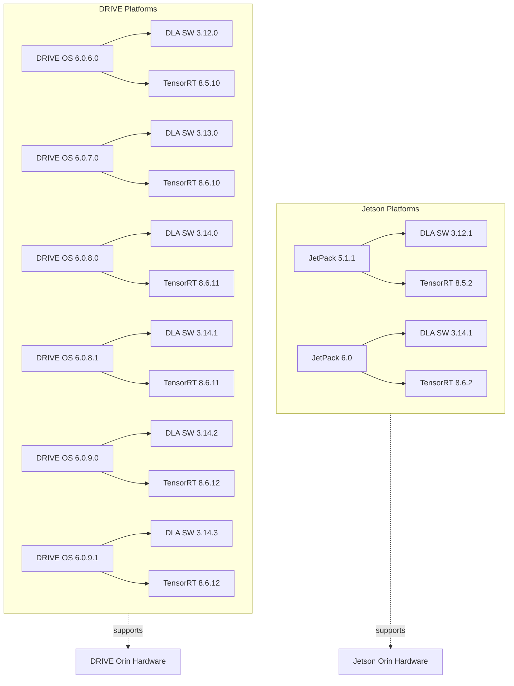
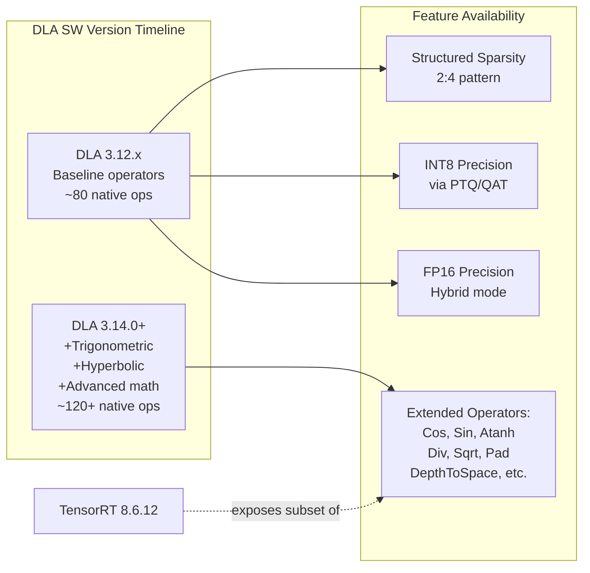
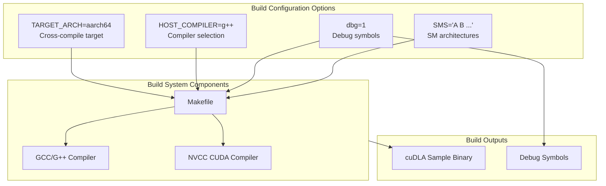
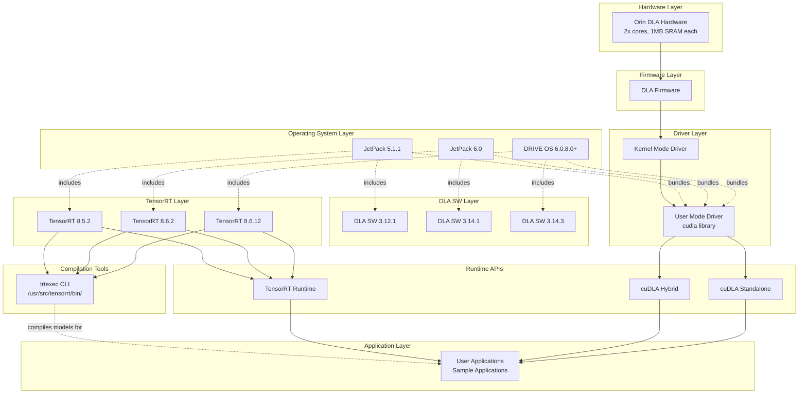

<!-- source: DeepWiki mcp.deepwiki.com · repo NVIDIA/Deep-Learning-Accelerator-SW · page 2.1 System Requirements · fetched 2026-10-26 -->

# System Requirements

<details>
<summary>Relevant source files</summary>

The following files were used as context for generating this wiki page:

- [README.md](README.md)
- [operators/README.md](operators/README.md)
- [samples/cuDLA/cuDLALayerwiseStatsHybrid/README.md](samples/cuDLA/cuDLALayerwiseStatsHybrid/README.md)

</details>


## Purpose and Scope

This page specifies the hardware, software, and toolchain prerequisites required to deploy models on NVIDIA Deep Learning Accelerator (DLA) hardware. It covers minimum version requirements for platforms, operating systems, DLA software, TensorRT, and development tools.

For comprehensive platform details including power modes and performance characteristics, see [Supported Platforms](#1.3). For runtime deployment options, see [Runtime API Overview](#6.1).

---

## Hardware Platform Requirements

DLA is available on NVIDIA embedded and automotive platforms with the following hardware characteristics:

### Supported Platforms

| Platform Category | Specific Platforms | DLA Generation | DLA Cores | SRAM per Core |
|---|---|---|---|---|
| **Jetson Embedded** | Jetson AGX Orin 64GB<br/>Jetson Orin NX 16GB | 2nd generation | 2 | 1 MB |
| **DRIVE Automotive** | DRIVE Orin | 2nd generation | 2 | 1 MB |
| **Jetson Embedded (Legacy)** | Jetson AGX Xavier | 1st generation | 2 | 4 MB (shared) |
| **DRIVE Automotive (Legacy)** | DRIVE Xavier | 1st generation | 2 | 4 MB (shared) |

**Key Hardware Differences:**

- **Orin DLA (2nd generation)**: Exclusive 1 MB SRAM per core, structured sparsity support, enhanced INT8/FP16 precision capabilities
- **Xavier DLA (1st generation)**: Shared 4 MB SRAM, baseline DLA functionality

### CPU Architecture Requirement

All DLA platforms use **aarch64** (ARM64) architecture. Cross-compilation from x86_64 hosts is supported and commonly used for development workflows.

**Sources:** [README.md:3-26](), [operators/README.md:16-26]()

---

## Software Version Requirements

### Operating System and Software Stack Compatibility

The following table shows the minimum system configurations with verified DLA support. Each OS version is packaged with specific DLA SW and TensorRT versions:



**Title:** Operating System and DLA Software Version Relationships

**Sources:** [operators/README.md:14-26]()

### Version Compatibility Matrix

| Hardware Platform | Operating System | DLA SW Version | TensorRT Version | Minimum Requirement |
|---|---|---|---|---|
| **Jetson Orin** | JetPack 5.1.1 | 3.12.1 | 8.5.2 | Baseline |
| **Jetson Orin** | JetPack 6.0 | 3.14.1 | 8.6.2 | Enhanced operator support |
| **DRIVE Orin** | DRIVE OS 6.0.6.0 | 3.12.0 | 8.5.10 | Baseline |
| **DRIVE Orin** | DRIVE OS 6.0.7.0 | 3.13.0 | 8.6.10 | Intermediate |
| **DRIVE Orin** | DRIVE OS 6.0.8.0 | 3.14.0 | 8.6.11 | Enhanced operators |
| **DRIVE Orin** | DRIVE OS 6.0.8.1 | 3.14.1 | 8.6.11 | Enhanced operators |
| **DRIVE Orin** | DRIVE OS 6.0.9.0 | 3.14.2 | 8.6.12 | Latest operators |
| **DRIVE Orin** | DRIVE OS 6.0.9.1 | 3.14.3 | 8.6.12 | Latest operators |

**Important Version Notes:**

- **DLA SW 3.14.0+** introduces significant operator expansion including trigonometric, hyperbolic, and advanced math functions (Sin, Cos, Atanh, Sqrt, etc.)
- **TensorRT 8.6.12** exposes additional operators previously only available in DLA SW (Div, Greater, Less, GlobalMaxPool, etc.)
- **TensorRT 8.5.x** marks the transition to TensorRT Runtime as the default DLA runtime (previously NvMedia-DLA)

**Sources:** [operators/README.md:14-26]()

---

## DLA Feature Support by Version

Different DLA SW versions enable different hardware features and operator support:



**Title:** DLA SW Feature Evolution and TensorRT Exposure

**Sources:** [operators/README.md:34-152]()

---

## Development Environment Requirements

### For Model Preparation and Compilation (x86_64 Host)

| Component | Version | Purpose |
|---|---|---|
| **Python** | 3.6+ | Model preparation scripts |
| **ONNX** | 1.12.0+ | Model format |
| **ONNX Runtime** | Latest | Model validation |
| **TensorRT** | 8.5.2+ | Model compilation (via `trtexec`) |

**Python Dependencies:**

Install via `requirements.txt`:
```bash
python3 -m pip install -r requirements.txt
```

**Key Python packages:**
- `onnx` - ONNX model manipulation
- `onnxruntime` - Model validation
- `numpy` - Numerical operations
- `opencv-python` - Image preprocessing (for samples)

**Sources:** [README.md:128-132]()

### For Runtime Execution and Samples (aarch64 Target)

| Component | Version | Purpose |
|---|---|---|
| **CUDA Toolkit** | 12.2+ | cuDLA runtime samples |
| **GCC/G++** | Platform default | Building cuDLA samples |
| **Make** | GNU Make | Build system |
| **clang-format** | 10.0+ | Code formatting (for contributions) |

**Minimum Configuration for Layerwise Profiling:**

| Hardware Platform | OS | DLA SW Version | Feature |
|---|---|---|---|
| DRIVE Orin | DRIVE OS 6.0.8.0 (not QNX Safety) | DLA 3.14.0 | Layerwise statistics |
| Jetson Orin | JetPack 6.0 | DLA 3.14.1 | Layerwise statistics |

**Note:** Layerwise profiling requires DLA SW 3.14.0+ and is not supported in QNX Safety configurations.

**Sources:** [samples/cuDLA/cuDLALayerwiseStatsHybrid/README.md:31-36](), [samples/cuDLA/cuDLALayerwiseStatsHybrid/README.md:48]()

### Supported Operating Systems for Development

| Target Platform | Supported OS | Notes |
|---|---|---|
| **Jetson Orin** | Linux (L4T) | Native or cross-compiled |
| **DRIVE Orin** | DRIVE OS Linux | Native or cross-compiled |
| **DRIVE Orin** | QNX 7.1+ | Safety-certified configurations |

**Cross-Compilation Support:**

DLA samples can be cross-compiled from x86_64 hosts to aarch64 targets:
```bash
make TARGET_ARCH=aarch64
```

**Sources:** [samples/cuDLA/cuDLALayerwiseStatsHybrid/README.md:28-29](), [samples/cuDLA/cuDLALayerwiseStatsHybrid/README.md:59-62]()

---

## Build Tool Requirements

### Makefile Variables for Cross-Compilation

The cuDLA samples use makefiles with the following configuration options:



**Title:** cuDLA Sample Build System Architecture

**Supported SM Architectures:** SM 6.0, 6.1, 7.0, 7.2, 7.5, 8.0, 8.6, 8.7

**Sources:** [samples/cuDLA/cuDLALayerwiseStatsHybrid/README.md:23-25](), [samples/cuDLA/cuDLALayerwiseStatsHybrid/README.md:58-75]()

---

## TensorRT `trtexec` Tool Requirements

The `trtexec` command-line tool is the primary interface for compiling DLA loadables. It requires:

### Minimum Version Requirements

| TensorRT Version | DLA Features Available |
|---|---|
| 8.5.2+ | Baseline DLA compilation, INT8/FP16 support |
| 8.6.10+ | Expanded operator support |
| 8.6.12+ | Latest operator exposure (Cos, Sin, Div, Greater, Less) |

### Key `trtexec` Flags for DLA

| Flag | Purpose | Example Value |
|---|---|---|
| `--useDLACore` | Target DLA core index | `0` or `1` |
| `--int8` | Enable INT8 precision | N/A (boolean) |
| `--fp16` | Enable FP16 precision | N/A (boolean) |
| `--inputIOFormats` | Input tensor format | `int8:dla_hwc4` |
| `--outputIOFormats` | Output tensor format | `int8:chw32` |
| `--memPoolSize` | DLA SRAM allocation | `dlaSRAM:1` |
| `--buildDLAStandalone` | Generate standalone loadable | N/A (boolean) |
| `--sparsity` | Enable structured sparsity | `force` |
| `--profilingVerbosity` | Profiling detail level | `layer_names_only` |

**Note:** The `--profilingVerbosity` flag supports `layer_names_only` in TensorRT 8.6.12 and earlier. Future versions will support `detailed` and `none` options.

**Sources:** [samples/cuDLA/cuDLALayerwiseStatsHybrid/README.md:76-85]()

---

## Version Dependency Chain

The following diagram illustrates how different software components depend on each other:



**Title:** Complete Software Stack Dependency Chain from Hardware to Application

**Sources:** [README.md:1-7](), [operators/README.md:5-6]()

---

## Verification Steps

### Verify Platform Configuration

After installing the required software, verify your configuration:

**1. Check DLA Hardware Availability:**
```bash
# Query DLA devices
ls -l /dev/nvhost-nvdla*
```

**2. Verify DLA SW Version (if accessible):**
```bash
# Check system logs or package information
dpkg -l | grep dla  # On Jetson
```

**3. Verify TensorRT Installation:**
```bash
# Check TensorRT version
/usr/src/tensorrt/bin/trtexec --version
```

**4. Verify CUDA Toolkit (for cuDLA samples):**
```bash
nvcc --version  # Should show CUDA 12.2+
```

**5. Check DLA Clock Frequency (optional for profiling):**
```bash
# Query DLA core 0 clock
sudo cat /sys/kernel/debug/bpmp/debug/clk/nafll_dla0_core/rate
```
**Note:** On DRIVE OS D6Q Standard, use `/dev/nvbpmpdebugfs/bpmp_debug/clk/nafll_dla0_core/rate`

**Sources:** [samples/cuDLA/cuDLALayerwiseStatsHybrid/README.md:77-95]()

---

## Summary of Minimum Requirements

| Component | Minimum Version | Recommended Version | Notes |
|---|---|---|---|
| **Hardware** | Jetson/DRIVE Orin | Jetson AGX Orin 64GB | 2nd gen DLA required for latest features |
| **OS (Jetson)** | JetPack 5.1.1 | JetPack 6.0 | Determines bundled DLA SW/TensorRT |
| **OS (DRIVE)** | DRIVE OS 6.0.6.0 | DRIVE OS 6.0.9.0+ | Automotive platform |
| **DLA SW** | 3.12.0 | 3.14.1+ | 3.14.0+ for extended operators |
| **TensorRT** | 8.5.2 | 8.6.12 | 8.6.12 for latest operator exposure |
| **CUDA Toolkit** | 12.2 | Latest | For cuDLA sample development |
| **Python** | 3.6 | 3.8+ | Model preparation scripts |
| **CPU Arch** | aarch64 | aarch64 | ARM64 required for all platforms |

**Next Steps:**
- For a hands-on introduction, proceed to [Quick Start Tutorial](#2.2)
- For detailed platform specifications, see [Supported Platforms](#1.3)
- For operator support details, see [Operator Support Matrix](#4.1)

**Sources:** [README.md:1-132](), [operators/README.md:1-152](), [samples/cuDLA/cuDLALayerwiseStatsHybrid/README.md:1-154]()

---

