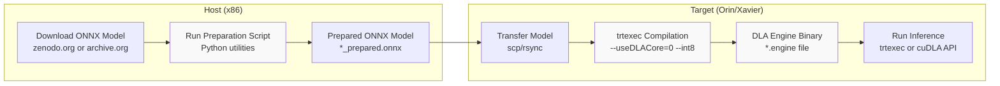
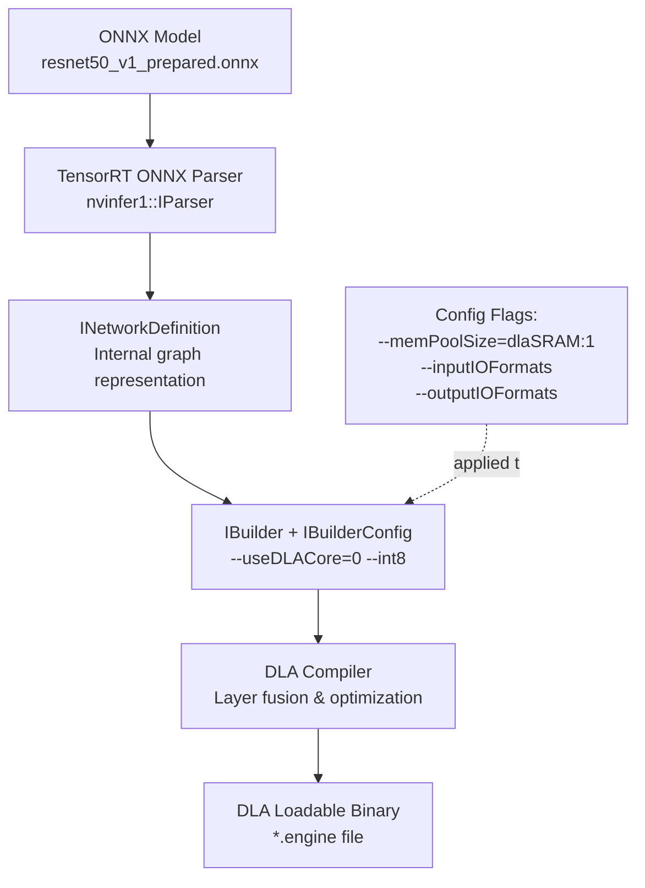
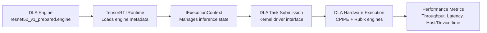
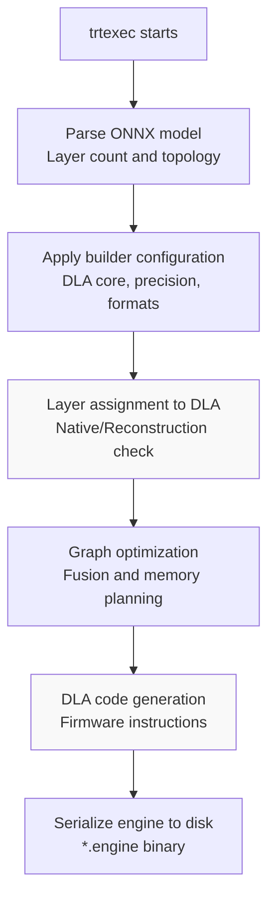

<!-- source: DeepWiki mcp.deepwiki.com · repo NVIDIA/Deep-Learning-Accelerator-SW · page 2.2 Quick Start Tutorial · fetched 2026-10-26 -->

# Quick Start Tutorial

<details>
<summary>Relevant source files</summary>

The following files were used as context for generating this wiki page:

- [README.md](README.md)
- [scripts/prepare_models/README.md](scripts/prepare_models/README.md)

</details>


This tutorial provides a practical walkthrough for deploying your first deep learning model on DLA hardware. You will download an ONNX model, prepare it for DLA execution, compile it into a DLA loadable using `trtexec`, and verify basic inference functionality.

**Scope**: This page covers the minimal end-to-end workflow from ONNX model to DLA execution. For detailed system requirements, see [System Requirements](#2.1). For comprehensive model preparation techniques, see [Model Preparation](#3). For runtime API programming, see [Runtime and Deployment](#6).

**Prerequisites**: You should have completed the setup steps in [System Requirements](#2.1), including installing JetPack/DRIVE OS and verifying DLA availability on your platform.

**Sources**: [README.md:1-133](), [scripts/prepare_models/README.md:1-136]()

---

## Workflow Overview

The DLA deployment workflow consists of three phases executed on different systems:



**Key Steps**:
1. **Host preparation**: Download public ONNX model and run Python optimization scripts
2. **Model transfer**: Copy prepared ONNX to target device
3. **Compilation**: Use `trtexec` to build DLA-optimized engine
4. **Execution**: Run inference and collect performance metrics

**Sources**: [scripts/prepare_models/README.md:1-20](), [README.md:63-96]()

---

## Tutorial: ResNet-50 Deployment

This tutorial uses ResNet-50 as the example model because it has a simple single-input topology and minimal preparation requirements.

### Step 1: Download Model (Host)

Download the MLCommons reference ResNet-50 model:

```bash
# Option 1: Original location
wget https://zenodo.org/record/4735647/files/resnet50_v1.onnx

# Option 2: Mirror (if original unavailable)
wget https://web.archive.org/web/20221201211434/https://zenodo.org/record/4735647/files/resnet50_v1.onnx
```

**Model Details**:
- **Input**: `input_tensor:0` with shape `[batch, 3, 224, 224]`
- **Output**: `softmax_tensor:0` with 1000 class logits
- **Dataset**: ImageNet 2012 validation set
- **Reference Accuracy**: FP32 Top-1 76.46%, INT8 on DLA 75.54%

**Sources**: [scripts/prepare_models/README.md:8-26](), [README.md:36]()

---

### Step 2: Prepare Model (Host)

Install Python dependencies and run the preparation script:

```bash
# Install dependencies (first time only)
python3 -m pip install -r requirements.txt

# Run ResNet-50 preparation script
python3 scripts/prepare_models/resnet50.py
```

The preparation script `resnet50.py` performs these optimizations:
- Simplifies the classification head by removing Top-K operation
- Optimizes Resize operations for DLA compatibility
- Applies constant folding and graph cleanup

**Output**: `resnet50_v1_prepared.onnx` in the current directory

**Sources**: [README.md:128-132](), [scripts/prepare_models/README.md:18-26]()

---

### Step 3: Transfer to Target

Copy the prepared model to your Jetson Orin or DRIVE Orin device:

```bash
# Example using scp
scp resnet50_v1_prepared.onnx nvidia@<target-ip>:~/models/
```

**Sources**: [scripts/prepare_models/README.md:22-23]()

---

### Step 4: Build DLA Engine (Target)

The following `trtexec` command compiles the ONNX model into a DLA loadable binary:

```bash
/usr/local/tensorrt/bin/trtexec \
    --useDLACore=0 \
    --int8 \
    --memPoolSize=dlaSRAM:1 \
    --inputIOFormats=int8:dla_hwc4 \
    --outputIOFormats=int8:chw32 \
    --onnx=resnet50_v1_prepared.onnx \
    --shapes=input_tensor:0:2x3x224x224
```

**Critical Parameters**:

| Parameter | Value | Purpose |
|-----------|-------|---------|
| `--useDLACore=0` | `0` or `1` | Selects which DLA core to compile for (Orin has 2 cores) |
| `--int8` | (flag) | Enables INT8 quantization for DLA acceleration |
| `--memPoolSize=dlaSRAM:1` | `1` MB | Allocates DLA SRAM for intermediate buffers |
| `--inputIOFormats` | `int8:dla_hwc4` | Configures input to use DLA-native HWC4 format |
| `--outputIOFormats` | `int8:chw32` | Configures output format (vectorized INT8) |
| `--shapes` | `2x3x224x224` | Specifies batch size 2 for optimal throughput |

**Compilation Process**:


**Expected Output**:
- Compilation time: 30-120 seconds (depends on host)
- Engine file: `resnet50_v1_prepared.engine` (typically 15-30 MB)
- Console output includes layer-by-layer compilation progress

**Sources**: [scripts/prepare_models/README.md:24-26](), [README.md:5]()

---

### Step 5: Run Inference (Target)

Execute the compiled engine to verify functionality:

```bash
# Basic inference execution
/usr/local/tensorrt/bin/trtexec \
    --loadEngine=resnet50_v1_prepared.engine \
    --iterations=100 \
    --warmUp=200
```

**Performance Metrics Output**:



**Expected Performance** (Jetson AGX Orin 64GB, MAXN mode, batch size 2):
- **Throughput**: ~2037 images/sec on 2x DLA cores combined
- **Latency**: ~0.98 ms per batch (2 images)
- **GPU Time**: Minimal (only for data transfers and Top-K post-processing)
- **DLA Time**: >95% of total execution time

The output will show:

```
Throughput: XXXX qps
Host Latency: min = X.XX ms, max = X.XX ms, mean = X.XX ms
Enqueue Time: min = X.XX ms, max = X.XX ms, mean = X.XX ms
H2D Latency: min = X.XX ms, max = X.XX ms, mean = X.XX ms
GPU Compute Time: min = X.XX ms, max = X.XX ms, mean = X.XX ms
D2H Latency: min = X.XX ms, max = X.XX ms, mean = X.XX ms
```

**Sources**: [README.md:74](), [scripts/prepare_models/README.md:24-26]()

---

## Understanding trtexec Output

When running `trtexec` for compilation, you will see detailed logging:

### Compilation Log Structure



**Key Log Sections**:

1. **Network Definition**: Shows parsed layers and their types
2. **Builder Configuration**: Confirms DLA settings and precision modes
3. **Layer Assignment**: Indicates which layers run on DLA vs GPU fallback
4. **Optimization Pass**: Reports fusion operations and graph transformations
5. **Engine Serialization**: Reports final binary size and memory requirements

**Warning Messages to Expect**:
- `Layer <name> is running on GPU` - Indicates post-processing layers (e.g., Top-K, NMS)
- `Using dynamically generated scales` - Normal when no calibration cache provided
- This is expected for models without explicit quantization metadata

**Sources**: [scripts/prepare_models/README.md:24-26]()

---

## Verifying DLA Execution

To confirm your model is actually running on DLA hardware (not GPU fallback):

### Method 1: Check trtexec Build Log

During compilation, search for:
```
[I] [TRT] DlaLayer: <layer_name> is assigned to DLA
```

If most layers show this message, your model is DLA-compatible.

### Method 2: Monitor with tegrastats

Run in a separate terminal while executing inference:

```bash
# On target device
tegrastats --interval 100
```

Look for `DLA0` and `DLA1` utilization percentages. During ResNet-50 inference at batch size 2, you should see:
- `DLA0: 95-100%` (if using `--useDLACore=0`)
- `GPU: 0-5%` (minimal activity for memory transfers)

### Method 3: Use Layerwise Statistics

For detailed per-layer metrics, see [Layerwise Statistics Collection](#7.1).

**Sources**: [README.md:5](), [scripts/prepare_models/README.md:24-26]()

---

## Command Reference Table

Here is a quick reference for the key `trtexec` parameters used in DLA workflows:

| Parameter | Required | Typical Values | Description |
|-----------|----------|----------------|-------------|
| `--onnx` | Yes | `model.onnx` | Input ONNX model path |
| `--useDLACore` | Yes | `0` or `1` | DLA core selection (Orin has 2 cores) |
| `--int8` | Yes | (flag) | Enable INT8 precision (required for DLA) |
| `--memPoolSize` | Recommended | `dlaSRAM:1` | DLA SRAM allocation in MB |
| `--inputIOFormats` | Recommended | `int8:dla_hwc4` | DLA-native input format |
| `--outputIOFormats` | Recommended | `int8:chw32` | Vectorized INT8 output |
| `--shapes` | If dynamic | `input:BxCxHxW` | Fixed input dimensions |
| `--saveEngine` | Optional | `model.engine` | Output engine file path |
| `--loadEngine` | For inference | `model.engine` | Pre-compiled engine |
| `--iterations` | For benchmarking | `100` | Number of inference iterations |
| `--warmUp` | For benchmarking | `200` | Warmup iterations before timing |

**Sources**: [scripts/prepare_models/README.md:24-26](), [scripts/prepare_models/README.md:36-46]()

---

## Troubleshooting Quick Start

### Issue: "Could not find DLACore 0"

**Cause**: DLA hardware not available on platform or JetPack/DRIVE OS not installed

**Solution**: 
1. Verify platform supports DLA (see [Supported Platforms](#1.3))
2. Check `/sys/devices/platform/13e00000.host1x/15880000.nvdla0/` exists
3. Ensure JetPack ≥5.1.1 or DRIVE OS ≥6.0.8.0

### Issue: "No layers running on DLA"

**Cause**: Model contains unsupported operators or layer configurations

**Solution**:
1. Check operator support in [ONNX Operator Support](#4)
2. Review layer restrictions in [Layer Restrictions and Constraints](#4.3)
3. Use model preparation scripts to optimize graph (see [Model Preparation](#3))

### Issue: "CBUF size validation failed"

**Cause**: Insufficient SRAM allocation for intermediate buffers

**Solution**:
1. Increase `--memPoolSize=dlaSRAM:2` (or higher)
2. Reduce batch size in `--shapes` parameter
3. See [Common Issues and Solutions](#9.2) for detailed troubleshooting

**Sources**: [README.md:1-133]()

---

## Next Steps

After completing this tutorial, explore:

1. **[Performance Benchmarks and Reference Models](#2.3)**: Compare your results against reference performance data
2. **[Model Preparation](#3)**: Learn advanced graph optimization techniques for better DLA utilization
3. **[Precision Configuration](#5.3)**: Use QAT models with calibration caches for optimal accuracy
4. **[Structured Sparsity](#5.4)**: Enable 2:4 sparsity with `--sparsity=force` for 1.24-1.47x speedup
5. **[cuDLA Hybrid Mode](#6.2)**: Program DLA directly using CUDA-managed API for production deployments
6. **[Layerwise Statistics Collection](#7.1)**: Profile per-layer performance to identify bottlenecks

**Sources**: [README.md:1-133](), [scripts/prepare_models/README.md:1-136]()

---

