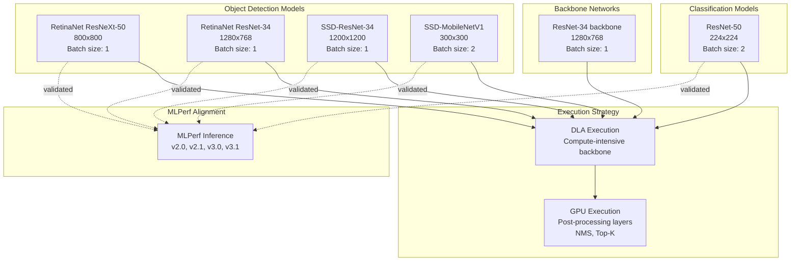
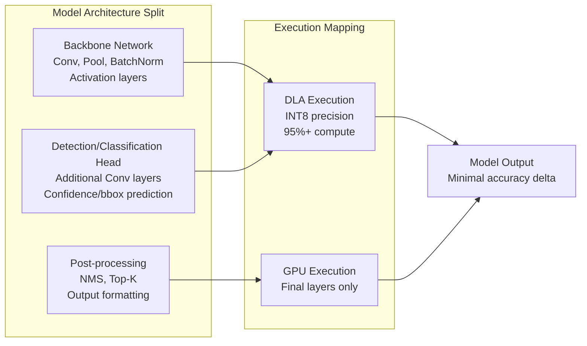
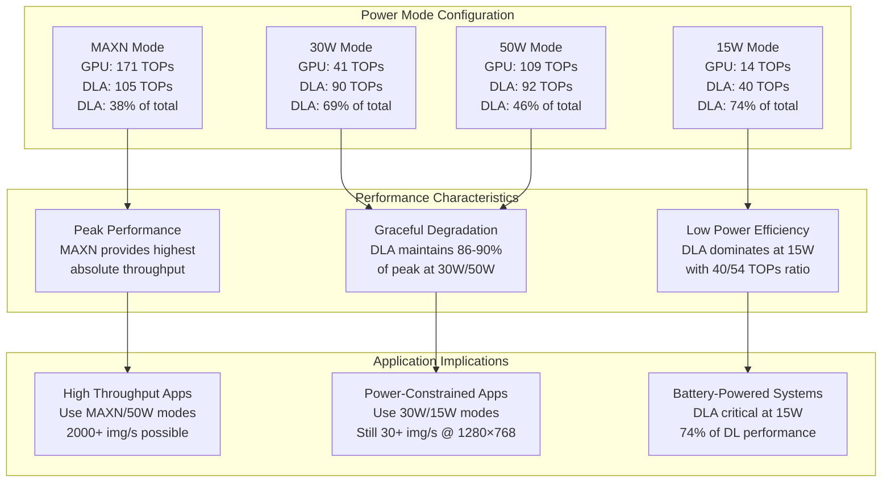
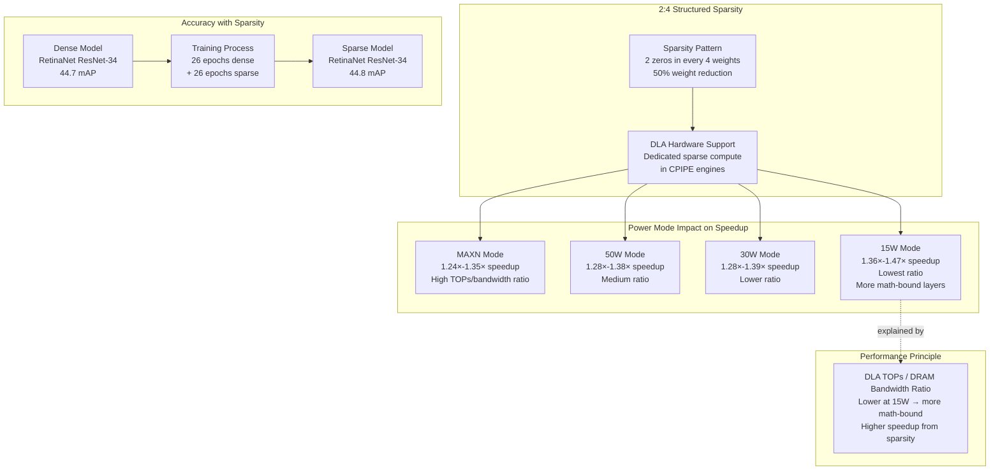
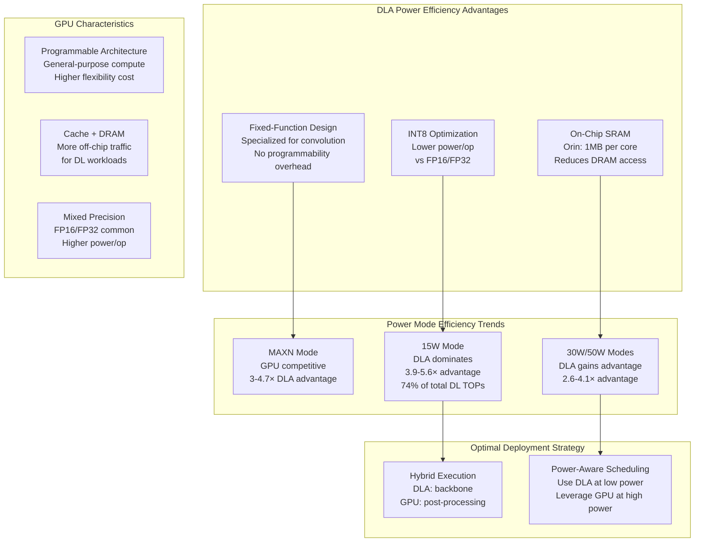
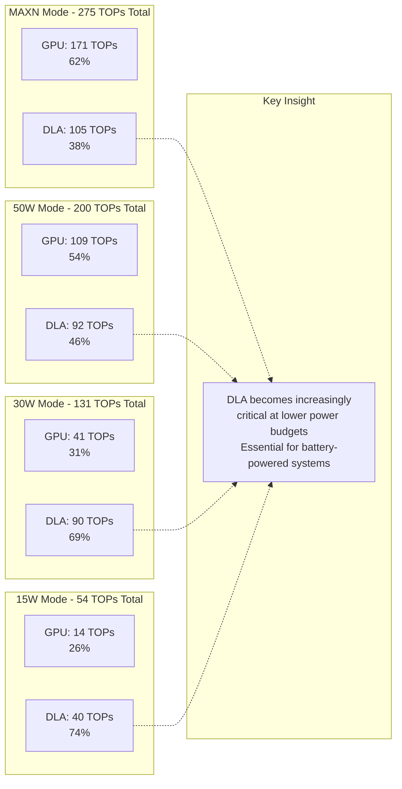

<!-- source: DeepWiki mcp.deepwiki.com · repo NVIDIA/Deep-Learning-Accelerator-SW · page 2.3 Performance Benchmarks and Reference Models · fetched 2026-10-26 -->

# Performance Benchmarks and Reference Models

<details>
<summary>Relevant source files</summary>

The following files were used as context for generating this wiki page:

- [README.md](README.md)

</details>


## Purpose and Scope

This page presents reference performance benchmarks and accuracy metrics for standard deep learning models running on NVIDIA DLA hardware. These benchmarks provide baseline expectations for network architectures, throughput rates across different power modes, and accuracy when using INT8 quantization. The data helps developers understand DLA's performance characteristics and make informed decisions about model deployment.

For instructions on preparing these models for DLA deployment, see [Model Preparation](#3). For detailed performance analysis techniques, see [Performance Analysis and Optimization](#7).

---

## Reference Model Overview

The repository provides performance benchmarks for five standard deep learning architectures aligned with MLPerf Inference standards. These models represent common use cases and network design patterns that map well to DLA hardware capabilities.

### Benchmark Models and Characteristics



**Benchmark Model Characteristics**

| Model | Task | Input Resolution | Batch Size | Backbone Architecture | Key Features |
|-------|------|------------------|------------|----------------------|--------------|
| ResNet-50 | Classification | 224×224 | 2 | ResNet-50 | Standard ImageNet classifier |
| RetinaNet ResNeXt-50 | Object Detection | 800×800 | 1 | ResNeXt-50 | Heavy backbone, high accuracy |
| RetinaNet ResNet-34 | Object Detection | 1280×768 | 1 | ResNet-34 | Moderate complexity |
| SSD-ResNet-34 | Object Detection | 1200×1200 | 1 | ResNet-34 | Large input resolution |
| SSD-MobileNetV1 | Object Detection | 300×300 | 2 | MobileNetV1 | Lightweight, high throughput |

Sources: [README.md:27-80]()

---

## Accuracy Benchmarks

All reference models maintain high accuracy when running in INT8 precision on DLA hardware, with minimal degradation compared to FP32 reference implementations.

### Model Accuracy on DLA vs GPU

| Use Case | Network | INT8 Accuracy on DLA | GPU INT8 Accuracy | FP32 Reference | Dataset | GPU-only Layers |
|----------|---------|---------------------|-------------------|----------------|---------|-----------------|
| Object Detection | RetinaNet ResNeXt-50 | mAP: **0.3741** | 0.3740 | 0.3757 | OpenImages MLPerf | NMS |
| Classification | ResNet-50 | Top-1: **75.54%** | 76.00% | 76.46% | ImageNet 2012 | Top-K |
| Object Detection | SSD-ResNet-34 | mAP: **0.21** | 0.21 | 0.20 | COCO 2017 | NMS |
| Object Detection | SSD-MobileNetV1 | mAP: **0.23** | 0.23 | 0.23 | COCO 2017 | NMS |

### Key Observations

1. **Minimal Accuracy Loss**: DLA INT8 accuracy is within 1% of FP32 reference for all benchmarks
2. **GPU Parity**: DLA and GPU produce nearly identical INT8 results, though not bitwise-identical due to different execution paths
3. **Hybrid Execution**: Final post-processing layers (NMS, Top-K) run on GPU while compute-intensive backbones execute on DLA
4. **MLPerf Validation**: Results align with official MLPerf Inference submissions v2.0, v2.1, v3.0, and v3.1



Sources: [README.md:32-50]()

---

## Dense Performance Benchmarks

The following tables present throughput measurements (images per second) for both DLA cores combined on Jetson AGX Orin 64GB, measured with JetPack 5.1.1 across different power modes.

### Throughput Across Power Modes (Dense INT8)

| Network | MAXN (275W equiv) | 50W Mode | 30W Mode | 15W Mode |
|---------|-------------------|----------|----------|----------|
| RetinaNet ResNeXt-50<br/>(800×800, bs=1) | **78** img/s | 72 img/s | 71 img/s | 36 img/s |
| ResNet-34 backbone<br/>(1280×768, bs=1) | **285** img/s | 260 img/s | 255 img/s | 121 img/s |
| RetinaNet ResNet-34<br/>(1280×768, bs=1) | **108** img/s | 98 img/s | 96 img/s | 45 img/s |
| SSD-ResNet-34<br/>(1200×1200, bs=1) | **83** img/s | 76 img/s | 74 img/s | 36 img/s |
| ResNet-50<br/>(224×224, bs=2) | **2037** img/s | 1948 img/s | 1928 img/s | 1072 img/s |
| SSD-MobileNetV1<br/>(300×300, bs=2) | **2664** img/s | 2506 img/s | 2472 img/s | 1313 img/s |

### DLA Performance Scaling Characteristics



### Performance Analysis

**Power Mode Impact**:
- **MAXN to 50W**: DLA maintains 88-96% of peak performance with 82% power reduction
- **MAXN to 30W**: DLA maintains 86-95% of peak performance with 89% power reduction  
- **MAXN to 15W**: DLA maintains 38-53% of peak performance with 95% power reduction

**Model Complexity Impact**:
- **ResNet-34 backbone**: 285 img/s (compute-intensive backbone only)
- **RetinaNet ResNet-34**: 108 img/s (backbone + detection head, 2.6× slower)
- **ResNet-50**: 2037 img/s (smaller input, higher batch size enables 7× higher throughput than RetinaNet)

**Platform Equivalence**:
- 30W/50W modes on Jetson AGX Orin 64GB ≈ DRIVE Orin maximum clocks
- Jetson Orin NX 16GB performance ≈ Jetson AGX Orin 64GB 15W mode

Sources: [README.md:63-80]()

---

## Sparse Performance Benchmarks (Structured Sparsity)

DLA on Orin supports 2:4 structured sparsity, enabling additional performance gains for math-bound convolution layers. The sparse acceleration increases at lower power modes where more layers become math-bound.

### Throughput with Structured Sparsity (Sparse INT8)

| Network | MAXN | 50W | 30W | 15W |
|---------|------|-----|-----|-----|
| RetinaNet ResNeXt-50<br/>(800×800, bs=1) | **102** img/s<br/>(1.31× speedup) | 96 img/s<br/>(1.34×) | 95 img/s<br/>(1.34×) | 51 img/s<br/>(1.43×) |
| ResNet-34 backbone<br/>(1280×768, bs=1) | **384** img/s<br/>(1.35× speedup) | 360 img/s<br/>(1.38×) | 354 img/s<br/>(1.39×) | 176 img/s<br/>(1.45×) |
| RetinaNet ResNet-34<br/>(1280×768, bs=1) | **143** img/s<br/>(1.32× speedup) | 133 img/s<br/>(1.36×) | 131 img/s<br/>(1.37×) | 66 img/s<br/>(1.47×) |
| SSD-ResNet-34<br/>(1200×1200, bs=1) | **103** img/s<br/>(1.24× speedup) | 97 img/s<br/>(1.28×) | 95 img/s<br/>(1.28×) | 49 img/s<br/>(1.36×) |

### Reproducing Sparse Results

Add `--sparsity=force` flag to the `trtexec` commands provided in [scripts/prepare_models/README.md]():

```bash
trtexec --onnx=model.onnx \
        --int8 \
        --useDLACore=0 \
        --sparsity=force \
        --inputIOFormats=int8:dla_hwc4 \
        --outputIOFormats=int8:chw32
```

### Structured Sparsity Acceleration Analysis



### Sparsity Performance Principles

1. **Math-Bound Acceleration**: Sparse acceleration benefits math-bound dense convolution layers. The more compute-intensive a layer, the higher the expected speedup.

2. **Power Mode Scaling**: Lower power modes reduce DLA TOPs/DRAM bandwidth ratio, making more layers math-bound and increasing sparse acceleration (1.43×-1.47× at 15W vs 1.24×-1.35× at MAXN).

3. **Accuracy Preservation**: Structured sparsity training maintains or slightly improves accuracy (44.7 → 44.8 mAP for RetinaNet ResNet-34 on Waymo Open Dataset).

Sources: [README.md:52-99]()

---

## Power Efficiency Metrics

DLA provides 3× to 5× better power efficiency (performance per watt) compared to GPU for these benchmarks, with highest efficiency at lower power modes.

### DLA vs GPU Power Efficiency Ratio (Perf/W)

| Network | Weight Mode | MAXN | 50W | 30W | 15W |
|---------|-------------|------|-----|-----|-----|
| RetinaNet ResNeXt-50<br/>(800×800, bs=1) | Dense | **3.8×** | 3.1× | 2.8× | 4.2× |
| RetinaNet ResNeXt-50<br/>(800×800, bs=1) | Sparse | **4.7×** | 4.1× | 3.7× | 5.6× |
| ResNet-34 backbone<br/>(1280×768, bs=1) | Dense | **4.3×** | 3.7× | 3.4× | 4.9× |
| ResNet-34 backbone<br/>(1280×768, bs=1) | Sparse | **3.4×** | 3.0× | 2.7× | 4.1× |
| RetinaNet ResNet-34<br/>(1280×768, bs=1) | Dense | **4.2×** | 3.5× | 3.1× | 4.6× |
| RetinaNet ResNet-34<br/>(1280×768, bs=1) | Sparse | **3.5×** | 2.9× | 2.6× | 3.9× |
| SSD-ResNet-34<br/>(1200×1200, bs=1) | Dense | **3.7×** | 3.0× | 2.7× | 4.1× |
| SSD-ResNet-34<br/>(1200×1200, bs=1) | Sparse | **3.5×** | 3.3× | 2.9× | 4.3× |
| ResNet-50<br/>(224×224, bs=2/256) | Dense | **3.5×** | 2.9× | 2.6× | 3.9× |
| SSD-MobileNetV1<br/>(300×300, bs=2/128) | Dense | **4.2×** | 3.6× | 3.2× | 5.0× |

*Note: Ratio compares DLA accelerator power efficiency to GPU accelerator power efficiency (images/sec per watt). GPU batch sizes optimized for GPU (256 for ResNet-50, 128 for SSD-MobileNetV1).*

### Power Efficiency Architecture



### Power Efficiency Key Insights

1. **Consistent Advantage**: DLA is 3-5× more power-efficient than GPU across all benchmarks and power modes
2. **Sparsity Impact**: Structured sparsity generally improves DLA power efficiency (e.g., 3.8× → 4.7× for RetinaNet ResNeXt-50 at MAXN)
3. **Low-Power Dominance**: At 15W mode, DLA provides up to 5.6× better efficiency and contributes 74% of total platform DL performance
4. **Architecture Synergy**: DLA's fixed-function design and on-chip SRAM minimize power consumption for convolution-heavy workloads

Sources: [README.md:101-122]()

---

## DLA Contribution to Total Platform Performance

Understanding DLA's contribution to overall platform performance helps justify its use at different power budgets.

### DLA Percentage of Total Orin DL Performance

| Platform Metric | MAXN | 50W | 30W | 15W |
|-----------------|------|-----|-----|-----|
| GPU Sparse INT8 TOPs | 171 | 109 | 41 | 14 |
| **2× DLA Sparse INT8 TOPs** | **105** | **92** | **90** | **40** |
| Total Platform TOPs | 275 | 200 | 131 | 54 |
| **DLA % of Total** | **38%** | **46%** | **69%** | **74%** |



### Platform Notes

- **DRIVE Orin Equivalence**: The 30W and 50W power modes on Jetson AGX Orin 64GB are comparable to maximum DLA clocks on DRIVE Orin automotive platforms
- **Jetson Orin NX 16GB**: Maximum DLA performance is comparable to Jetson AGX Orin 64GB 15W mode
- **Battery-Powered Systems**: At 15W, DLA provides 74% of platform DL performance, making it essential for mobile and edge applications

Sources: [README.md:9-25]()

---

## Reproducing Benchmark Results

All benchmark results can be reproduced using the model preparation scripts and `trtexec` tool.

### Step-by-Step Reproduction

1. **Prepare the model** using scripts in [scripts/prepare_models/README.md]():
   ```bash
   cd scripts/prepare_models
   python3 prepare_<model_name>.py
   ```

2. **Compile with trtexec**:
   ```bash
   # Dense INT8 compilation
   trtexec --onnx=<model>.onnx \
           --int8 \
           --useDLACore=0 \
           --inputIOFormats=int8:dla_hwc4 \
           --outputIOFormats=int8:chw32 \
           --saveEngine=<model>.engine
   
   # Sparse INT8 compilation (add --sparsity=force)
   trtexec --onnx=<model>.onnx \
           --int8 \
           --sparsity=force \
           --useDLACore=0 \
           --inputIOFormats=int8:dla_hwc4 \
           --outputIOFormats=int8:chw32 \
           --saveEngine=<model>_sparse.engine
   ```

3. **Benchmark performance**:
   ```bash
   trtexec --loadEngine=<model>.engine \
           --useDLACore=0 \
           --iterations=1000 \
           --avgRuns=100
   ```

### Model-Specific Instructions

Each reference model has detailed preparation instructions in the model preparation documentation:

| Model | Documentation Section |
|-------|----------------------|
| ResNet-50 | [scripts/prepare_models/README.md - ResNet-50 section]() |
| RetinaNet ResNeXt-50 | [scripts/prepare_models/README.md - RetinaNet ResNeXt-50 section]() |
| RetinaNet ResNet-34 | [scripts/prepare_models/README.md - RetinaNet ResNet-34 section]() |
| SSD-ResNet-34 | [scripts/prepare_models/README.md - SSD-ResNet-34 section]() |
| SSD-MobileNetV1 | [scripts/prepare_models/README.md - SSD-MobileNetV1 section]() |

Sources: [README.md:33-38](), [README.md:95-96]()

---

## Key Takeaways

### Performance Characteristics

1. **Graceful Power Scaling**: DLA maintains 86-95% of peak performance when scaling from MAXN to 30W/50W modes, enabling high-throughput inference even under power constraints

2. **Low-Power Dominance**: At 15W, DLA provides 74% of total platform DL performance and 3.9-5.6× better power efficiency than GPU, making it essential for battery-powered systems

3. **Sparse Acceleration**: Structured sparsity provides 1.24-1.47× speedup over dense operation, with higher gains at lower power modes where layers become more math-bound

4. **Accuracy Preservation**: INT8 quantization on DLA maintains accuracy within 1% of FP32 reference across all benchmarks, with no accuracy loss from structured sparsity

### Architectural Insights

1. **Hybrid Execution Model**: Compute-intensive backbones run on DLA while post-processing layers (NMS, Top-K) run on GPU, optimizing for both performance and compatibility

2. **Batch Size Strategy**: High-throughput models (ResNet-50, SSD-MobileNetV1) benefit from batch size 2, while detection models with large inputs use batch size 1

3. **Head Complexity Impact**: Attaching detection heads to backbones adds considerable MAC operations (e.g., ResNet-34 backbone: 285 img/s → RetinaNet ResNet-34: 108 img/s)

### Deployment Recommendations

1. **Power-Constrained Applications**: Prioritize DLA at 15W and 30W modes where it provides 69-74% of platform performance
2. **High-Throughput Requirements**: Use MAXN or 50W modes for maximum absolute throughput (2000+ img/s achievable for small models)
3. **Structured Sparsity**: Enable for additional 24-47% performance boost with no accuracy loss, especially valuable at lower power modes
4. **MLPerf Validation**: All benchmarks align with MLPerf Inference standards, ensuring reproducibility and industry comparability

Sources: [README.md:42-122]()

---

