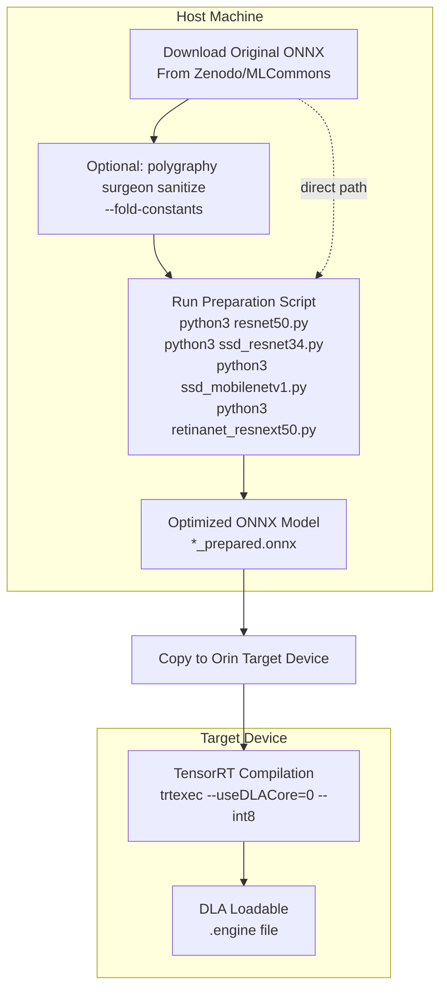
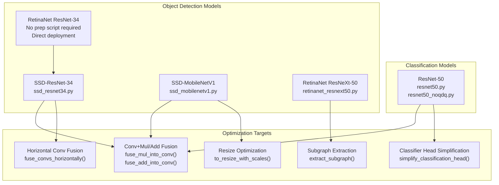
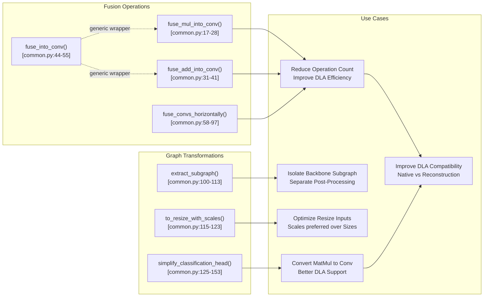
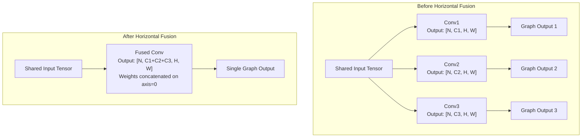
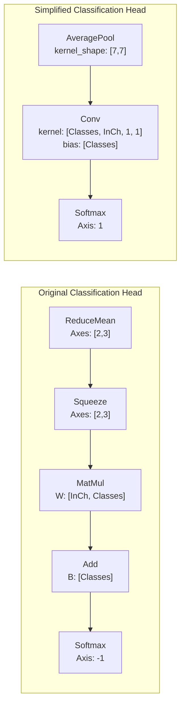
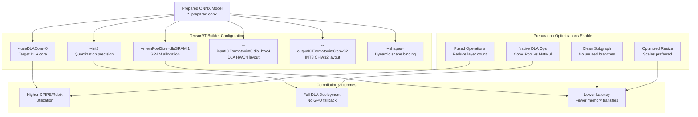

<!-- source: DeepWiki mcp.deepwiki.com · repo NVIDIA/Deep-Learning-Accelerator-SW · page 3.1 ONNX Model Preparation Scripts · fetched 2026-10-26 -->

# ONNX Model Preparation Scripts

<details>
<summary>Relevant source files</summary>

The following files were used as context for generating this wiki page:

- [scripts/prepare_models/README.md](scripts/prepare_models/README.md)
- [scripts/prepare_models/common.py](scripts/prepare_models/common.py)

</details>


## Purpose and Scope

The ONNX Model Preparation Scripts provide Python utilities and reference workflows for optimizing ONNX models before DLA compilation. These scripts perform graph-level transformations including operation fusion, subgraph extraction, resize optimization, and classification head simplification to improve DLA compatibility and performance.

This document covers the preparation scripts located in [scripts/prepare_models/](). For quantized models requiring Q/DQ node removal and scale extraction, see [QDQ Translator for Quantized Models](#3.2). For detailed explanations of the optimization algorithms used in these scripts, see [Graph Optimization Techniques](#3.3). For TensorRT compilation after model preparation, see [Using trtexec for DLA](#5.2).

---

## Model Preparation Workflow

The model preparation workflow transforms public ONNX models into DLA-optimized versions through Python-based graph surgery operations.

### End-to-End Pipeline



**Sources:** [scripts/prepare_models/README.md:1-136]()

### Execution Environment Requirements

The preparation scripts execute on a host machine with Python dependencies, not on the target device. The workflow separates graph optimization (host) from compilation and execution (target).

| Component | Location | Requirements |
|-----------|----------|--------------|
| Model Download | Host | Internet access |
| Preparation Scripts | Host | Python 3, onnx-graphsurgeon, numpy |
| Optimized ONNX | Transfer | File copy to target |
| TensorRT Compilation | Target | TensorRT 8.5+, DLA SW 3.12+ |
| DLA Execution | Target | Jetson/DRIVE Orin platform |

**Sources:** [scripts/prepare_models/README.md:4-6]()

---

## Supported Reference Models

The repository provides preparation scripts for five MLCommons Inference reference models with documented optimization workflows.

### Model Coverage Matrix



**Sources:** [scripts/prepare_models/README.md:8-136](), [scripts/prepare_models/common.py:1-154]()

### Model Download Sources

All reference models originate from MLCommons Inference benchmarks with Zenodo hosting and Archive.org mirrors.

| Model | Original Location | Mirror | Input Shape |
|-------|-------------------|--------|-------------|
| ResNet-50 | zenodo.org/record/4735647 | web.archive.org backup | 2×3×224×224 |
| SSD-ResNet-34 | zenodo.org/record/3228411 | web.archive.org backup | Variable |
| SSD-MobileNetV1 | zenodo.org/record/4735652 | web.archive.org backup | 2×3×300×300 |
| RetinaNet ResNeXt-50 | zenodo.org/record/6617879 | N/A | Variable |
| RetinaNet ResNet-34 | zenodo.org/record/8144349 | N/A | 1×3×1280×768 |

**Sources:** [scripts/prepare_models/README.md:10-124]()

---

## Common Utility Functions

The [scripts/prepare_models/common.py]() module provides reusable graph transformation functions using ONNX GraphSurgeon for model preparation scripts.

### Function-to-Purpose Mapping



**Sources:** [scripts/prepare_models/common.py:1-154]()

### Vertical Fusion: Conv + ElementWise

The vertical fusion functions combine consecutive operations into single convolution nodes by absorbing element-wise operations into convolution weights and biases.

#### fuse_mul_into_conv()

Absorbs a `Mul` node into the preceding `Conv` node by scaling convolution weights:

```python
# Function signature and behavior
def fuse_mul_into_conv(conv_node, mul_node):
    # Requirements:
    # - Conv has no bias (2 inputs only)
    # - Mul has constant factor input
    # - Mul factors shape: [1, C, 1, 1] broadcasting
    
    # Transformation:
    # Conv(x, W) → Mul(·, M) becomes Conv(x, W * M)
```

The multiplication factors are broadcast-multiplied into the convolution kernel weights [common.py:17-28](). This eliminates the separate `Mul` operation from the graph.

**Sources:** [scripts/prepare_models/common.py:17-28]()

#### fuse_add_into_conv()

Absorbs an `Add` node into the preceding `Conv` node by appending the addition constants as convolution bias:

```python
# Function signature and behavior
def fuse_add_into_conv(conv_node, add_node):
    # Requirements:
    # - Conv has no bias (2 inputs only)
    # - Add has constant parameter input
    # - Add params shape: [1, C, 1, 1] broadcasting
    
    # Transformation:
    # Conv(x, W) → Add(·, B) becomes Conv(x, W, B)
```

The addition parameters are flattened and appended as the convolution bias input [common.py:31-41]().

**Sources:** [scripts/prepare_models/common.py:31-41]()

#### fuse_into_conv()

Generic fusion wrapper that applies fusion functions to matching node patterns in topological order:

```python
# Function signature
def fuse_into_conv(graph, fusion_func, node_pattern):
    # fusion_func: fuse_mul_into_conv or fuse_add_into_conv
    # node_pattern: ('Conv', 'Mul') or ('Conv', 'Add')
    
    # Qualification criteria:
    # - Node has single output not in graph outputs
    # - Output has single consumer
    # - Consumer's only variable input is from this node
```

The function iterates through the graph, identifies qualifying consecutive node pairs, and applies the fusion transformation [common.py:44-55]().

**Sources:** [scripts/prepare_models/common.py:44-55]()

### Horizontal Fusion: Multi-Branch Convolutions

The `fuse_convs_horizontally()` function merges parallel convolution branches that share the same input into a single wider convolution.



**Function Requirements:**
- All convolutions must share identical attributes (kernel size, stride, padding, dilation)
- Input channels must match across all convolutions
- Kernel spatial dimensions must match [common.py:58-97]()

**Transformation:**
```python
# Weight concatenation
first_weights.values = np.concatenate([w1, w2, w3, ...], axis=0)

# Bias concatenation
first_bias.values = np.concatenate([b1, b2, b3, ...], axis=0)

# Output removal (except first)
graph.outputs.remove(conv2.outputs[0])
graph.outputs.remove(conv3.outputs[0])
```

**Sources:** [scripts/prepare_models/common.py:58-97]()

### Subgraph Extraction

The `extract_subgraph()` function isolates a portion of the computational graph by redefining inputs and outputs, useful for separating DLA-compatible backbones from GPU-executed post-processing.

```python
# Function signature
def extract_subgraph(graph, input_names, output_names, input_shape):
    # input_names: List of tensor names to become new graph inputs
    # output_names: List of tensor names to become new graph outputs
    # input_shape: Shape for new input tensors [N, C, H, W]
    
    # Transformations:
    # 1. Update batch dimension for all non-constant tensors
    # 2. Redefine graph.inputs to specified tensors
    # 3. Redefine graph.outputs to specified tensors
    # 4. Cleanup unused nodes
    # 5. Clear inferred shapes for easier node transformations
```

This function is particularly useful for RetinaNet models where the detection head contains operators not well-supported on DLA [common.py:100-113]().

**Sources:** [scripts/prepare_models/common.py:100-113]()

### Resize Optimization

The `to_resize_with_scales()` function converts `Resize` nodes from `sizes` specification to `scales` specification, which TensorRT handles more efficiently.

```python
# Transformation
def to_resize_with_scales(graph):
    for node in graph.nodes:
        if node.op == 'Resize' and len(node.inputs) > 3:
            # Convert sizes to scales
            sizes = node.inputs[3].values  # Target output size
            input_shape = node.inputs[0].shape
            scales_vals = sizes / input_shape  # Compute scale factors
            
            # Replace sizes input with scales
            node.inputs = node.inputs[:2] + [scales]
```

**Reason:** DLA compiler optimizes `Resize` operations more effectively when specified as scale factors rather than absolute output dimensions [common.py:115-123]().

**Sources:** [scripts/prepare_models/common.py:115-123]()

### Classification Head Simplification

The `simplify_classification_head()` function converts common classification head patterns (`ReduceMean → Squeeze → MatMul → Add → Softmax`) into DLA-native operations (`AveragePool → Conv`).



**Transformations Applied:**
1. `ReduceMean` → `AveragePool` with explicit kernel size
2. `Squeeze` node removed (output connections transferred)
3. `MatMul` → `Conv` with transposed weights reshaped to 4D [C_out, C_in, 1, 1]
4. `Add` bias absorbed into `Conv` as third input
5. `Softmax` axis updated to channel dimension (axis=1)

**DLA Benefits:** Convolution and pooling have native DLA support, while `MatMul` requires reconstruction [common.py:125-153]().

**Sources:** [scripts/prepare_models/common.py:125-153]()

---

## Model-Specific Preparation Examples

Each reference model requires a specific sequence of optimizations tailored to its architecture.

### ResNet-50 Standard Workflow

```bash
# Download
wget https://zenodo.org/record/4735647/files/resnet50_v1.onnx

# Prepare (on host)
python3 resnet50.py

# Deploy (on target)
trtexec --useDLACore=0 --int8 --memPoolSize=dlaSRAM:1 \
        --inputIOFormats=int8:dla_hwc4 \
        --outputIOFormats=int8:chw32 \
        --onnx=resnet50_v1_prepared.onnx \
        --shapes=input_tensor:0:2x3x224x224
```

**Applied Optimizations:**
- Vertical fusion of `Conv+Mul` and `Conv+Add` patterns
- Classification head simplification (`ReduceMean → MatMul → Add` to `AveragePool → Conv`)

**Sources:** [scripts/prepare_models/README.md:8-26]()

### ResNet-50 QDQ Workflow

For quantization-aware trained models with Q/DQ nodes, see the specialized workflow:

```bash
# 1. Follow QDQ Translator workflow (separate tool)
# 2. Run preparation on translated model
python3 resnet50_noqdq.py

# 3. Deploy with calibration cache
trtexec --onnx=translated/resnet_50v1_noqdq_prepared.onnx \
        --calib=translated/resnet_50v1_precision_config_calib.cache \
        --useDLACore=0 --int8 --fp16 --precisionConstraints=prefer \
        --layerPrecisions=$(cat translated/resnet_50v1_precision_config_layer_arg.txt)
```

**Note:** This workflow requires DLA SW version ≥ 3.13.0 and the `--add_unary_ew_scales_for_dla` flag during QDQ translation [scripts/prepare_models/README.md:28-56]().

**Sources:** [scripts/prepare_models/README.md:28-56]()

### SSD-ResNet-34 Workflow

```bash
# Download
wget https://zenodo.org/record/3228411/files/resnet34-ssd1200.onnx

# Prepare
python3 ssd_resnet34.py

# Deploy
trtexec --useDLACore=0 --int8 --memPoolSize=dlaSRAM:1 \
        --inputIOFormats=int8:dla_hwc4 \
        --outputIOFormats=int8:chw32 \
        --onnx=resnet34-ssd1200_prepared.onnx
```

**Applied Optimizations:**
- Vertical fusion of convolution patterns
- Horizontal fusion of parallel detection head branches

**Sources:** [scripts/prepare_models/README.md:58-76]()

### SSD-MobileNetV1 Workflow

```bash
# Download
wget https://zenodo.org/record/4735652/files/ssd_mobilenet_v1_coco_2018_01_28.onnx

# Prepare
python3 ssd_mobilenetv1.py

# Deploy
trtexec --useDLACore=0 --int8 --memPoolSize=dlaSRAM:1 \
        --inputIOFormats=int8:dla_hwc4 \
        --outputIOFormats=int8:chw32 \
        --onnx=ssd_mobilenet_v1_coco_2018_01_28_prepared.onnx \
        --shapes=Preprocessor/sub:0:2x3x300x300
```

**Applied Optimizations:**
- Resize operation conversion (sizes → scales)
- Vertical fusion of depthwise and pointwise convolutions

**Sources:** [scripts/prepare_models/README.md:78-96]()

### RetinaNet ResNeXt-50 Workflow

```bash
# Download
wget https://zenodo.org/record/6617879/files/resnext50_32x4d_fpn.onnx

# Constant folding (required preprocessing)
polygraphy surgeon sanitize resnext50_32x4d_fpn.onnx \
    -o resnext50_32x4d_fpn_sanitized.onnx \
    --fold-constants

# Prepare
python3 retinanet_resnext50.py

# Deploy
trtexec --useDLACore=0 --int8 --memPoolSize=dlaSRAM:1 \
        --inputIOFormats=int8:dla_hwc4 \
        --outputIOFormats=int8:chw32 \
        --onnx=resnext50_32x4d_fpn_prepared.onnx
```

**Applied Optimizations:**
- Subgraph extraction to isolate DLA-compatible backbone
- Constant folding via Polygraphy surgeon

**Sources:** [scripts/prepare_models/README.md:98-115]()

### RetinaNet ResNet-34 Direct Deployment

Unlike other models, RetinaNet ResNet-34 requires no preparation script as it's already optimized:

```bash
# Download
wget https://zenodo.org/record/8144349/files/retinanet_rn34_1280x768_dummy.onnx
# Or backbone only:
wget https://zenodo.org/record/8144349/files/backbone_rn34_1280x768_dummy.onnx

# Deploy directly (dense)
trtexec --useDLACore=0 --int8 --memPoolSize=dlaSRAM:1 \
        --inputIOFormats=int8:dla_hwc4 \
        --outputIOFormats=int8:chw32 \
        --onnx=retinanet_rn34_1280x768_dummy.onnx

# Deploy with structured sparsity
trtexec --useDLACore=0 --int8 --memPoolSize=dlaSRAM:1 \
        --inputIOFormats=int8:dla_hwc4 \
        --outputIOFormats=int8:chw32 \
        --onnx=retinanet_rn34_1280x768_dummy.onnx \
        --sparsity=force
```

**Note:** These models use dummy random parameters due to dataset licensing restrictions and serve primarily as structural references for sparsity benchmarks [scripts/prepare_models/README.md:117-136]().

**Sources:** [scripts/prepare_models/README.md:117-136]()

---

## Integration with TensorRT Compilation

The preparation scripts produce optimized ONNX models designed for TensorRT's ONNX parser and DLA compiler interface.

### Compilation Parameter Relationships



**Sources:** [scripts/prepare_models/README.md:1-136]()

### Common trtexec Flags After Preparation

| Flag | Purpose | Typical Value |
|------|---------|---------------|
| `--onnx` | Prepared model path | `*_prepared.onnx` |
| `--useDLACore` | Target DLA core | `0` or `1` |
| `--int8` | Enable INT8 precision | Always specified |
| `--memPoolSize` | SRAM allocation | `dlaSRAM:1` (1MB on Orin) |
| `--inputIOFormats` | Input tensor format | `int8:dla_hwc4` or `int8:hwc4` |
| `--outputIOFormats` | Output tensor format | `int8:chw32` |
| `--shapes` | Dynamic shape binding | Model-specific |

The `dla_hwc4` format (DLA hardware-optimized HWC with 4-byte alignment) provides optimal performance for DLA execution [scripts/prepare_models/README.md:24-96]().

**Sources:** [scripts/prepare_models/README.md:24-96]()

### Preparation vs. Compilation Separation

```mermaid
graph LR
    subgraph "Preparation Phase (Host)"
        OrigONNX["Original ONNX<br/>Public model"]
        GSTransform["GraphSurgeon<br/>Transformations"]
        PrepONNX["Prepared ONNX<br/>Optimized graph"]
        
        OrigONNX --> GSTransform
        GSTransform --> PrepONNX
    end
    
    subgraph "Transfer"
        PrepONNX --> CopyOp["File Copy<br/>scp/rsync"]
    end
    
    subgraph "Compilation Phase (Target)"
        CopyOp --> TRT["TensorRT Builder<br/>ONNX Parser"]
        TRT --> DLAComp["DLA Compiler<br/>Loadable generation"]
        DLAComp --> EngineFile["DLA Loadable<br/>.engine binary"]
    end
    
    subgraph "Runtime Phase (Target)"
        EngineFile --> Runtime["Runtime APIs<br/>TensorRT/cuDLA"]
        Runtime --> DLAHardware["DLA Hardware<br/>Execution"]
    end
```



**Rationale:** Separating graph optimization (Python) from compilation (C++/TensorRT) enables:
1. Rapid iteration on graph transformations without rebuilding TensorRT
2. Reusable optimization utilities across models
3. Platform-independent preparation on workstations
4. Smaller code footprint on embedded targets

**Sources:** [scripts/prepare_models/README.md:1-6]()

---

## Extending Preparation Scripts

New models can be integrated by creating model-specific preparation scripts that import and compose utilities from [common.py]().

### Template Structure

```python
#!/usr/bin/env python3
import onnx
import onnx_graphsurgeon as gs
from common import (
    fuse_into_conv,
    fuse_mul_into_conv,
    fuse_add_into_conv,
    extract_subgraph,
    to_resize_with_scales,
    simplify_classification_head
)

# Load model
model = onnx.load('original_model.onnx')
graph = gs.import_onnx(model)

# Apply optimizations
fuse_into_conv(graph, fuse_mul_into_conv, ('Conv', 'Mul'))
fuse_into_conv(graph, fuse_add_into_conv, ('Conv', 'Add'))
to_resize_with_scales(graph)

# Export
graph.cleanup().toposort()
onnx.save(gs.export_onnx(graph), 'model_prepared.onnx')
```

**Key Requirements:**
1. Import `onnx_graphsurgeon` for graph manipulation
2. Call `graph.cleanup()` after transformations to remove dead nodes
3. Call `graph.toposort()` before export for correct execution order
4. Test prepared model with trtexec on target hardware
5. Document required trtexec flags in README

**Sources:** [scripts/prepare_models/common.py:1-14]()

---

