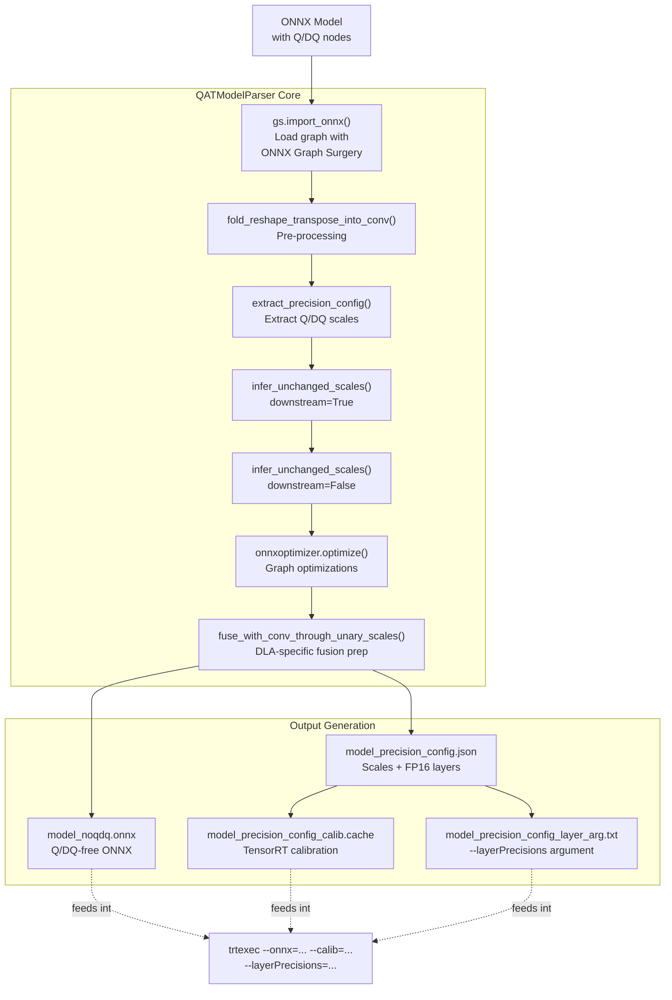
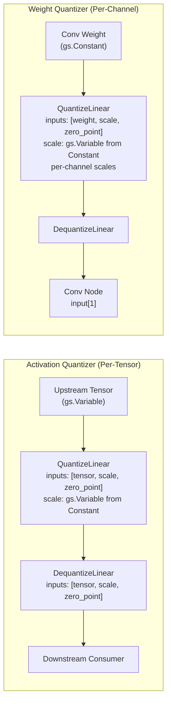
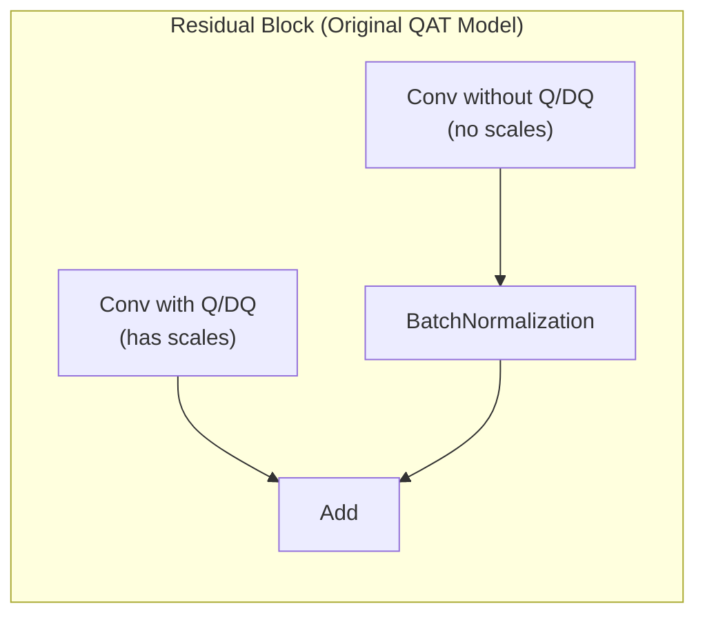
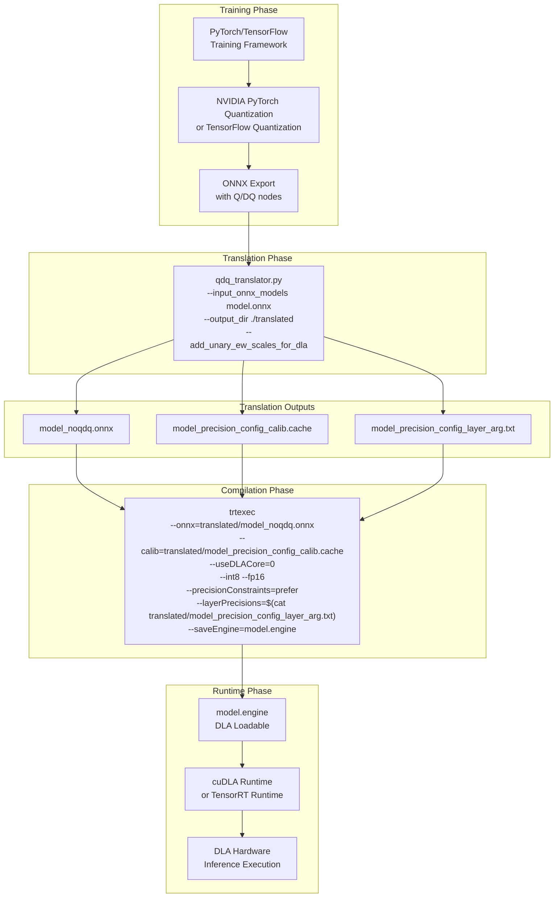

<!-- source: DeepWiki mcp.deepwiki.com · repo NVIDIA/Deep-Learning-Accelerator-SW · page 3.2 QDQ Translator for Quantized Models · fetched 2026-10-26 -->

# QDQ Translator for Quantized Models

<details>
<summary>Relevant source files</summary>

The following files were used as context for generating this wiki page:

- [tools/qdq-translator/README.md](tools/qdq-translator/README.md)
- [tools/qdq-translator/qdq_translator.py](tools/qdq-translator/qdq_translator.py)

</details>


## Purpose and Scope

The QDQ Translator is a tool for converting ONNX models from Quantization-Aware Training (QAT) workflows into DLA-compatible formats. It transforms models containing explicit `QuantizeLinear` and `DequantizeLinear` (Q/DQ) nodes into models without Q/DQ nodes, while extracting quantization scales into TensorRT-compatible calibration metadata.

This tool bridges the gap between QAT frameworks (NVIDIA PyTorch Quantization, NVIDIA TensorFlow Quantization) and DLA's implicit quantization requirements. The translator produces three key artifacts: a Q/DQ-free ONNX model, a TensorRT calibration cache, and layer precision configurations.

**Related Pages**: For general model preparation workflows, see [ONNX Model Preparation Scripts](#3.1). For precision configuration during compilation, see [Precision Configuration](#5.3). For QAT training workflows, refer to the upstream TensorRT quantization tools documentation.

**System Requirements**: Requires DLA SW 3.13.0+ (DRIVE OS 6.0.7.0+ or JetPack 6.0+) for full DLA compatibility with unary scale support.

Sources: [tools/qdq-translator/README.md:1-11]()

---

## QAT vs. Implicit Quantization

### Quantization Representation Models

QAT models explicitly represent quantization operations in the computational graph using `QuantizeLinear` and `DequantizeLinear` nodes. TensorRT and DLA, however, prefer implicit quantization where scales are stored separately as calibration metadata rather than as graph operations.

| Aspect | QAT (Explicit Q/DQ) | Implicit Quantization |
|--------|---------------------|----------------------|
| **Representation** | Q/DQ nodes in graph | Calibration cache metadata |
| **Scale Storage** | Node attributes | Separate calibration file |
| **Graph Size** | Larger (additional nodes) | Smaller (scales removed) |
| **DLA Compilation** | Not directly supported | Native support |
| **Fusion Opportunities** | May block optimizations | Better fusion potential |
| **TensorRT Preference** | Deprecated for DLA | Required since TRT 8.5+ |

The QDQ Translator performs this representation transformation while preserving quantization semantics.

Sources: [tools/qdq-translator/README.md:1-5](), [tools/qdq-translator/qdq_translator.py:105-111]()

---

## Architecture Overview

The QDQ Translator consists of a single-pass parser with multiple processing stages. The `QATModelParser` class orchestrates the entire transformation pipeline.

### System Architecture



**Key Components**:
- **`QATModelParser`**: Main orchestrator class [tools/qdq-translator/qdq_translator.py:105-644]()
- **`parse()` method**: Entry point for transformation [tools/qdq-translator/qdq_translator.py:567-643]()
- **`export_to_trt_calib()`**: Generates TensorRT-compatible calibration [tools/qdq-translator/qdq_translator.py:35]()
- **ONNX Graph Surgery (gs)**: Graph manipulation library used throughout

Sources: [tools/qdq-translator/qdq_translator.py:105-644](), [tools/qdq-translator/README.md:28-105]()

---

## End-to-End Workflow

### Processing Pipeline

```mermaid
graph LR
    subgraph "Input"
        QATModel["QAT ONNX Model<br/>resnet_50v1.onnx<br/><br/>Contains:<br/>- QuantizeLinear nodes<br/>- DequantizeLinear nodes<br/>- BatchNormalization<br/>- Nested Q/DQ pairs"]
    end
    
    subgraph "Translation Stage"
        Script["python3 qdq_translator.py<br/>--input_onnx_models model.onnx<br/>--output_dir ./translated<br/>--add_unary_ew_scales_for_dla"]
        
        Parse["QATModelParser.parse()"]
        
        Script --> Parse
    end
    
    subgraph "Processing Steps"
        S1["1. fold_reshape_transpose_into_conv()<br/>Handle grouped Conv weights"]
        S2["2. extract_precision_config()<br/>Remove Q/DQ, save scales"]
        S3["3. infer_unchanged_scales()<br/>Forward + Backward pass"]
        S4["4. onnxoptimizer.optimize()<br/>fuse_bn_into_conv, etc."]
        S5["5. fuse_with_conv_through_unary_scales()<br/>Add unary scales for DLA"]
        
        Parse --> S1
        S1 --> S2
        S2 --> S3
        S3 --> S4
        S4 --> S5
    end
    
    subgraph "Outputs"
        O1["resnet_50v1_noqdq.onnx<br/>No Q/DQ nodes"]
        O2["resnet_50v1_precision_config.json<br/>int8_tensor_scales dict<br/>fp16_nodes list"]
        O3["resnet_50v1_precision_config_calib.cache<br/>TRT 8.6 format calibration"]
        O4["resnet_50v1_precision_config_layer_arg.txt<br/>layer1:fp16,layer2:fp16,..."]
        
        S5 --> O1
        S5 --> O2
        O2 --> O3
        O2 --> O4
    end
    
    subgraph "TensorRT Compilation"
        TRT["trtexec<br/>--onnx=translated/resnet_50v1_noqdq.onnx<br/>--calib=translated/resnet_50v1_precision_config_calib.cache<br/>--useDLACore=0 --int8 --fp16<br/>--precisionConstraints=prefer<br/>--layerPrecisions=$(cat translated/resnet_50v1_precision_config_layer_arg.txt)"]
        
        O1 --> TRT
        O3 --> TRT
        O4 --> TRT
    end
    
    Engine["DLA Engine<br/>resnet_50v1.engine"]
    TRT --> Engine
    
    QATModel --> Script
```



Sources: [tools/qdq-translator/README.md:12-26](), [tools/qdq-translator/README.md:81-104]()

---

## QATModelParser Class

The `QATModelParser` class provides static methods for all transformation operations. It operates on ONNX models using the ONNX Graph Surgery library.

### Core Methods

| Method | Purpose | Line Reference |
|--------|---------|----------------|
| `parse()` | Main entry point, orchestrates entire pipeline | [tools/qdq-translator/qdq_translator.py:567-643]() |
| `get_quantized_tensor()` | Extract quantized tensor from Q node | [tools/qdq-translator/qdq_translator.py:124-207]() |
| `extract_qdq_scales()` | Get scales from Q/DQ pair | [tools/qdq-translator/qdq_translator.py:269-289]() |
| `extract_precision_config()` | Process all Q/DQ nodes, build config | [tools/qdq-translator/qdq_translator.py:292-353]() |
| `verify_weight_scales()` | Validate per-channel weight scales | [tools/qdq-translator/qdq_translator.py:210-225]() |
| `infer_unchanged_scales()` | Propagate scales through neutral ops | [tools/qdq-translator/qdq_translator.py:385-435]() |
| `fold_reshape_transpose_into_conv()` | Fix grouped Conv weight layout | [tools/qdq-translator/qdq_translator.py:457-543]() |
| `fuse_with_conv_through_unary_scales()` | Add unary scales for DLA fusion | [tools/qdq-translator/qdq_translator.py:546-564]() |

### Static Method Design

All methods are static because the parser maintains no state between operations. Each invocation processes a single model independently. The `main()` function instantiates the parser but calls only the `parse()` method.

Sources: [tools/qdq-translator/qdq_translator.py:105-644]()

---

## Scale Extraction Process

### Q/DQ Node Structure

QAT models represent quantization with pairs of `QuantizeLinear` and `DequantizeLinear` nodes:



### Extraction Algorithm

The `extract_precision_config()` method processes Q/DQ pairs:

1. **Locate Q Nodes**: Iterate all nodes, filter for `op == "QuantizeLinear"` [tools/qdq-translator/qdq_translator.py:297-310]()

2. **Classify Quantizer Type**:
   - **Activation**: `quantize_tensor.inputs` is non-empty (has producer) [tools/qdq-translator/qdq_translator.py:314]()
   - **Input**: `quantize_tensor` in `graph.inputs` [tools/qdq-translator/qdq_translator.py:315-317]()
   - **Weight**: `quantize_tensor` is `gs.Constant` [tools/qdq-translator/qdq_translator.py:170]()

3. **Extract Scale Values**:
   - Activation/Input: `quantize_node.inputs[1].inputs[0].attrs["value"].values` [tools/qdq-translator/qdq_translator.py:322]()
   - Weight: Same structure, but per-channel array [tools/qdq-translator/qdq_translator.py:276]()

4. **Verify Weight Scales**: For per-channel weight quantization, verify scales match TensorRT's calculation [tools/qdq-translator/qdq_translator.py:210-225]():
   ```
   Per output channel K:
     scale[K] = max(|weight[K,:,:]|) / 127.0
   ```

5. **Store in Config**: Map tensor name to scale value [tools/qdq-translator/qdq_translator.py:325]()

6. **Rewire Graph**: Replace DQ output with Q input tensor [tools/qdq-translator/qdq_translator.py:335-339]()

7. **Remove Q/DQ Nodes**: Clear outputs to mark for deletion [tools/qdq-translator/qdq_translator.py:341-342]()

Sources: [tools/qdq-translator/qdq_translator.py:292-353](), [tools/qdq-translator/qdq_translator.py:269-289]()

---

## Scale Inference Mechanisms

Not all tensors have explicit Q/DQ nodes. The translator infers missing scales for operations that don't change data distribution.

### Operations Supporting Scale Inference

**Default Operations** (`DEFAULT_OPS_TO_INFER_ADJACENT_SCALES`):
- `MaxPool`: Max operation preserves scale [tools/qdq-translator/qdq_translator.py:40]()
- `Flatten`, `Reshape`, `Transpose`, `Squeeze`: Layout changes only
- `Relu`: Clips to [0, ∞), preserves positive scale
- `Pad`, `Sigmoid`: Special handling

**Optional Operations** (via command-line flags):
- `AveragePool`, `GlobalAveragePool`, `ReduceMean`: `--infer_average_pool_scales` [tools/qdq-translator/qdq_translator.py:67-72]()
- `Concat`: `--infer_concat_scales`, uses max input scale [tools/qdq-translator/qdq_translator.py:73-77]()
- `Mul`: `--infer_mul_scales`, infers from equation [tools/qdq-translator/qdq_translator.py:78-82]()

### Two-Pass Inference Algorithm

The `infer_unchanged_scales()` method runs twice [tools/qdq-translator/qdq_translator.py:385-435]():

**Forward Pass** (`downstream=True`):
```python
for node in graph.nodes:  # topological order
    if node.op in ops_to_infer_adjacent_scales:
        if in_name has scale and out_name missing:
            precision_config[out_name] = precision_config[in_name]
```

**Backward Pass** (`downstream=False`):
```python
for node in reversed(graph.nodes):  # reverse topological order
    if node.op in ops_to_infer_adjacent_scales:
        if out_name has scale and in_name missing:
            precision_config[in_name] = precision_config[out_name]
```

### Special Case: Concat

When `--infer_concat_scales` is enabled, the output scale is set to the maximum of all existing input scales [tools/qdq-translator/qdq_translator.py:401-407]():

```python
if node.op == "Concat":
    max_input_scale = -np.inf
    for concat_inp in node.inputs:
        if concat_inp.name in precision_config and 
           precision_config[concat_inp.name] >= max_input_scale:
            max_input_scale = precision_config[concat_inp.name]
    if max_input_scale != -np.inf:
        precision_config[out_name] = max_input_scale
```

### Special Case: Sigmoid

Sigmoid has non-linear scale transformation [tools/qdq-translator/qdq_translator.py:408-427]():

**Forward (downstream)**: If feeding into `Mul`, set output to `1/127` for SiLU fusion [tools/qdq-translator/qdq_translator.py:408-411]()

**Backward (upstream)**: Infer input scale from output using inverse sigmoid:
```python
y = output_scale * 127
input_scale = log(y / (1 - y)) / 127
```

### Special Case: Mul

When `--infer_mul_scales` is enabled, uses algebraic relationships [tools/qdq-translator/qdq_translator.py:362-382]():

Given `Z = X * Y` with scales `Sz`, `Sx`, `Sy`:
- If `Sz` and `Sx` known: `Sy = (Sz / Sx) / 127`
- If `Sz` and `Sy` known: `Sx = (Sz / Sy) / 127`

Sources: [tools/qdq-translator/qdq_translator.py:385-435](), [tools/qdq-translator/qdq_translator.py:39-41]()

---

## Graph Transformations

### Pre-Processing: Grouped Convolution Fix

The `fold_reshape_transpose_into_conv()` method handles a pattern that occurs in grouped convolutions and ConvTranspose operations [tools/qdq-translator/qdq_translator.py:457-543]().

**Problem**: QAT frameworks may export grouped Conv weights with intermediate `Reshape` and `Transpose` operations:
```
QuantizeLinear -> DequantizeLinear -> Reshape -> Transpose -> Conv
```

**Solution**: Manually transpose the weight tensor and remove intermediate nodes:
```
QuantizeLinear (transposed weights) -> DequantizeLinear -> Conv
```

**Implementation**:
1. Find all `QuantizeLinear` nodes [tools/qdq-translator/qdq_translator.py:509]()
2. Check for pattern `DequantizeLinear -> Reshape -> Transpose -> Conv` [tools/qdq-translator/qdq_translator.py:512-514]()
3. Transpose weight tensor from `[3,3,960,1]` to `[960,1,3,3]` [tools/qdq-translator/qdq_translator.py:519]()
4. Update Variable shapes [tools/qdq-translator/qdq_translator.py:523-533]()
5. Connect DequantizeLinear output directly to Conv [tools/qdq-translator/qdq_translator.py:537]()

### Post-Processing: ONNX Optimizer Passes

After Q/DQ removal, the translator applies ONNX optimizer passes [tools/qdq-translator/qdq_translator.py:652-655]():

| Pass | Purpose |
|------|---------|
| `extract_constant_to_initializer` | Convert Constant nodes to graph initializers |
| `fuse_bn_into_conv` | Fold BatchNormalization into Conv weights/bias |
| `fuse_pad_into_conv` | Merge Pad operations into Conv padding attribute |
| `fuse_pad_into_pool` | Merge Pad operations into Pooling padding attribute |

**BatchNorm Fusion Preparation**: The `prepare_for_bn_fusion()` method ensures Conv nodes have bias tensors (required for fusion) and preserves tensor names [tools/qdq-translator/qdq_translator.py:438-454]():

```python
if node.op == 'Conv' and len(node.inputs) == 2:
    # Add zero bias if missing
    output_channels = node.inputs[1].shape[0]
    bias = gs.Constant(f'{node.name}_bias', 
                      np.zeros(output_channels))
    node.inputs.append(bias)

if node.op == 'BatchNormalization':
    # Swap input/output names to preserve BN output name
    # which typically has the quantization scale
    orig_in_name = node.inputs[0].name
    orig_out_name = node.outputs[0].name
    node.inputs[0].name = orig_out_name
    node.outputs[0].name = orig_in_name
```

Sources: [tools/qdq-translator/qdq_translator.py:457-543](), [tools/qdq-translator/qdq_translator.py:438-454](), [tools/qdq-translator/qdq_translator.py:652-655]()

---

## DLA-Specific Optimizations

### The `--add_unary_ew_scales_for_dla` Flag

Starting with DLA 3.13.0, the DLA compiler can fuse `Conv + Add` patterns even when the Conv output lacks explicit scales. However, TensorRT may conservatively run both operations in FP16 if scales are missing. The `--add_unary_ew_scales_for_dla` flag addresses this issue.

### Conv-ElementWise Fusion Pattern

**Problem Scenario**:


After Q/DQ removal, `L2 -> BN` path has no scales. TensorRT upgrades both to FP16, causing:
- Performance degradation (FP16 slower than INT8)
- Accuracy mismatch (missing INT8 truncation changes model behavior)

**Solution**: Insert unary scale of `1.0` for Conv output [tools/qdq-translator/qdq_translator.py:111-138]():
```json
{
  "conv_bn_with_int8_scales": 0.12836094200611115,
  "conv_bn_without_int8_scales": 1.0
}
```

### Detection and Insertion Algorithm

The `fuse_with_conv_through_unary_scales()` method checks [tools/qdq-translator/qdq_translator.py:546-564]():

1. **Is Conv?**: `node.op == 'Conv'`
2. **Single Consumer?**: `len(tensor.outputs) == 1`
3. **Consumer is Add?**: `single_downstream_node.op == 'Add'`
4. **Binary Add?**: `len(single_downstream_node.inputs) == 2`
5. **Other Input has Scale?**: Other Add input is not in `unary_scales_tensors` set

If all conditions met:
```python
unary_scales_tensors.add(tensor.name)
precision_config[tensor.name] = 1.0
```

**DLA Compiler Interpretation**: A unary scale of `1.0` signals that Conv accumulated outputs should be scaled only by weight scales before adding the other dequantized input—exactly matching the original Q/DQ graph semantics.

Sources: [tools/qdq-translator/README.md:111-138](), [tools/qdq-translator/qdq_translator.py:546-564]()

---

## Output Artifacts

The translator generates four files per input model:

### 1. Q/DQ-Free ONNX Model

**Filename**: `{model_name}_noqdq.onnx`

Contains the modified graph with:
- All `QuantizeLinear` and `DequantizeLinear` nodes removed
- Weight tensors from DQ nodes directly connected to consumers
- Optimizations applied (BatchNorm fusion, Pad fusion, etc.)
- Validated with `onnx.checker.check_model()` [tools/qdq-translator/qdq_translator.py:616]()

### 2. Precision Configuration JSON

**Filename**: `{model_name}_precision_config.json`

**Structure**:
```json
{
  "int8_tensor_scales": {
    "tensor_name_1": 0.12836094200611115,
    "tensor_name_2": 1.0,
    "input_tensor": 0.0078125,
    ...
  },
  "fp16_nodes": [
    "node_name_1",
    "node_name_2",
    ...
  ]
}
```

**`int8_tensor_scales`**: Maps tensor names to quantization scales extracted from Q/DQ pairs or inferred [tools/qdq-translator/qdq_translator.py:638]()

**`fp16_nodes`**: List of node names that consume tensors without scales, recommended to run in FP16 [tools/qdq-translator/qdq_translator.py:624-637]()

### 3. TensorRT Calibration Cache

**Filename**: `{model_name}_precision_config_calib.cache`

**Format**: TensorRT calibration format (version-specific, default 8600) [tools/qdq-translator/qdq_translator.py:45-46]()

Generated by `export_to_trt_calib()` utility [tools/qdq-translator/qdq_translator.py:643](), imported from `utils.py`.

**Purpose**: Provides INT8 calibration scales to TensorRT builder via `--calib` flag.

### 4. Layer Precision Arguments

**Filename**: `{model_name}_precision_config_layer_arg.txt`

**Format**: Comma-separated `layer:precision` pairs:
```
layer_name_1:fp16,layer_name_2:fp16,layer_name_3:fp16
```

**Purpose**: Direct argument for `trtexec --layerPrecisions` flag to force specific layers to FP16 [tools/qdq-translator/README.md:102]().

Sources: [tools/qdq-translator/qdq_translator.py:618-643](), [tools/qdq-translator/README.md:88-105]()

---

## Command-Line Interface

### Basic Usage

```bash
python3 qdq_translator.py \
    --input_onnx_models model1.onnx model2.onnx \
    --output_dir ./translated \
    --add_unary_ew_scales_for_dla
```

### Key Arguments

| Argument | Type | Default | Description |
|----------|------|---------|-------------|
| `--input_onnx_models` | List[str] | Required | Space-separated ONNX model paths with Q/DQ nodes |
| `--output_dir` | str | `./translated` | Output directory for generated files |
| `--trt_calib_version` | str | `8600` | TensorRT version for calibration cache format |
| `--add_unary_ew_scales_for_dla` | flag | False | Insert unary scales for Conv+ElementWise fusion |
| `--infer_average_pool_scales` | flag | False | Infer scales for AveragePool/ReduceMean |
| `--infer_concat_scales` | flag | False | Infer Concat scales (max of inputs) |
| `--infer_mul_scales` | flag | False | Infer Mul scales algebraically |
| `--calibration_type` | str | `max` | Calibration method: `max` or `histogram` |
| `--addtl_ops_to_infer_adjacent_scales` | List[str] | `[]` | Additional ops for scale inference |
| `--rename_node_outputs` | flag | False | Rename tensors to producer node names |
| `--verbose` | flag | False | Enable debug logging |

### Argument Details

**`--calibration_type`**: Affects weight scale verification [tools/qdq-translator/qdq_translator.py:83-87]():
- `max`: Performs strict scale validation (recommended for PyTorch QAT)
- `histogram`: Skips scale validation (only for TensorFlow QAT with histogram calibration)

**`--addtl_ops_to_infer_adjacent_scales`**: Extends `DEFAULT_OPS_TO_INFER_ADJACENT_SCALES` set [tools/qdq-translator/qdq_translator.py:88-94]():
```bash
--addtl_ops_to_infer_adjacent_scales Split Slice Gather
```

**`--rename_node_outputs`**: Useful for debugging, renames tensors to `{node.name}` or `{node.name}_{idx}` [tools/qdq-translator/qdq_translator.py:95-97]()

Sources: [tools/qdq-translator/qdq_translator.py:43-103](), [tools/qdq-translator/README.md:30-67]()

---

## Integration with TensorRT/DLA Pipeline

### Workflow Integration



### TensorRT Builder Flags

**Required Flags**:
- `--onnx`: Path to `{model}_noqdq.onnx`
- `--calib`: Path to `{model}_precision_config_calib.cache`
- `--useDLACore=0`: Target DLA core 0 (or 1)
- `--int8`: Enable INT8 precision
- `--fp16`: Enable FP16 precision for fallback layers
- `--precisionConstraints=prefer`: Prefer specified layer precisions
- `--layerPrecisions`: Force FP16 for specific layers

**DLA Input/Output Formats** (optional but recommended):
```bash
--inputIOFormats=int8:dla_hwc4     # DLA-native input format
--outputIOFormats=int8:chw32        # DLA-native output format
```

Or enable GPU fallback:
```bash
--allowGPUFallback                  # Allow GPU execution for unsupported ops
```

Sources: [tools/qdq-translator/README.md:92-105]()

---

## Validation and Accuracy

### Supported QAT Configurations

The translator requires specific QAT training configurations [tools/qdq-translator/README.md:76-79]():

| Parameter | Requirement | Notes |
|-----------|-------------|-------|
| **Activation Quantization** | `per_tensor` | Single scale per activation tensor |
| **Weight Quantization** | `per_channel` | Scale per output channel/filter |
| **PyTorch `calib_method`** | `'max'` or `'histogram'` | `'max'` enables strict validation |
| **TensorFlow Quantization** | Any supported method | May use `--calibration_type histogram` |
| **Zero Points** | Must be 0 | Symmetric quantization only |

### Accuracy Results

**COCO 2017 Validation (DRIVE Orin)**:

| Model | FP32 Baseline | INT8 via QDQ Translator |
|-------|---------------|-------------------------|
| YOLOv5s @ 672x672 | 37.4 mAP | 37.3 mAP |

Source: [YOLOv5 cuDLA Sample](https://github.com/NVIDIA-AI-IOT/cuDLA-samples)

**ImageNet Top-1 Accuracy (GeForce RTX 3090)**:

| Model | Original INT8 (with Q/DQ) | Translated INT8 (no Q/DQ) | Notes |
|-------|---------------------------|---------------------------|-------|
| ResNet-50v1 | 75.18% | 75.22% | ✓ Accuracy maintained |
| MobileNet-v1 | 70.45% | 70.41% | ✓ Accuracy maintained |
| MobileNet-v2 | 71.62% | 71.73% | ✓ Accuracy maintained |
| EfficientNet-B0 | 75.83% | 75.79% | ✓ Accuracy maintained |
| Inception-V3 | 78.06% | 78.20% | ✓ With `--infer_concat_scales` |
| ResNet-50v2 | 75.77% | 73.87% | ⚠ Accuracy drop |
| EfficientNet-B3 | 79.02% | 77.96% | ⚠ Accuracy drop |

**Observations**:
- Most models maintain accuracy within 0.1%
- Inception-V3 benefits from `--infer_concat_scales` flag
- Some architectures (ResNet-50v2, EfficientNet-B3) show degradation, may require additional calibration

Sources: [tools/qdq-translator/README.md:153-171]()

---

## Known Limitations

### Model Compatibility

**Not Guaranteed**: The translator may not work for all ONNX models with Q/DQ nodes [tools/qdq-translator/README.md:174](). Community contributions are encouraged for edge cases.

**ONNX Optimizer Version**: Must use `onnxoptimizer==0.3.2` exactly [tools/qdq-translator/README.md:175-176](). Newer versions cause TensorRT engine build failures for EfficientNet models.

### Calibration Method Constraints

**Per-Channel Weight Quantization**: Only supported when using `calib_method='max'` in PyTorch QAT [tools/qdq-translator/README.md:79](). If using `'histogram'` for weights, must pass `--calibration_type histogram` to skip validation (not recommended).

### Scale Inference Accuracy

Using scale inference flags (`--infer_average_pool_scales`, `--infer_mul_scales`) can reduce latency but may also reduce accuracy [tools/qdq-translator/README.md:48-50](). These should be used cautiously and validated on target datasets.

### Operator Coverage

The `ops_to_infer_adjacent_scales` list may need extension for novel architectures [tools/qdq-translator/README.md:147-151]():
- Default set: `{'MaxPool', 'Flatten', 'Relu', 'Pad', 'Transpose', 'Reshape', 'Squeeze', 'Sigmoid'}`
- Extend via `--addtl_ops_to_infer_adjacent_scales` flag
- Incorrect extensions may cause accuracy degradation or kernel fusion issues

Sources: [tools/qdq-translator/README.md:146-176]()

---

## Example: ResNet-50 Translation

### Input Model Inspection

Original QAT model contains Q/DQ pairs around residual connections:


**Key Features**:
- Left path: `Conv` → `BatchNorm` → `Q/DQ` → `Add`
- Right path: `Conv` → `BatchNorm` → (no Q/DQ) → `Add`
- Tensor `"conv_bn_with_int8_scales"` has Q/DQ (has scale)
- Tensor `"conv_bn_without_int8_scales"` lacks Q/DQ (no scale)

### Translation Command

```bash
python3 qdq_translator.py \
    --input_onnx_models resnet_50v1.onnx \
    --output_dir ./translated \
    --add_unary_ew_scales_for_dla
```

### Output Model Inspection

Translated model removes Q/DQ nodes and fuses BatchNorm:


**Transformations Applied**:
1. Q/DQ nodes removed
2. BatchNormalization fused into Conv (via `fuse_bn_into_conv` pass)
3. Unary scale inserted for `"conv_bn_without_int8_scales"`

### Precision Configuration

**JSON Output** (`resnet_50v1_precision_config.json`):
```json
{
  "int8_tensor_scales": {
    "conv_bn_with_int8_scales": 0.12836094200611115,
    "conv_bn_without_int8_scales": 1.0
  },
  "fp16_nodes": []
}
```

**Key Point**: Without `--add_unary_ew_scales_for_dla`, the second tensor would lack a scale, causing TensorRT to run both Conv and Add in FP16 on DLA.

### TensorRT Compilation

```bash
trtexec --onnx=translated/resnet_50v1_noqdq.onnx \
        --calib=translated/resnet_50v1_precision_config_calib.cache \
        --useDLACore=0 \
        --int8 \
        --fp16 \
        --saveEngine=resnet_50v1.engine \
        --precisionConstraints=prefer \
        --layerPrecisions=$(cat translated/resnet_50v1_precision_config_layer_arg.txt) \
        --inputIOFormats=int8:dla_hwc4 \
        --outputIOFormats=fp16:chw16
```

Sources: [tools/qdq-translator/README.md:117-138]()

---

