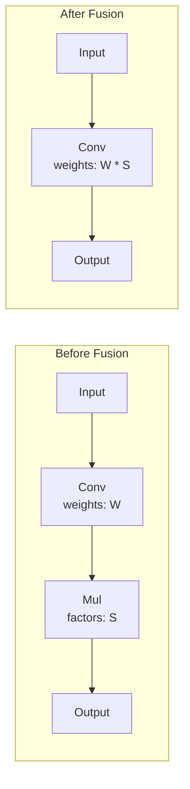
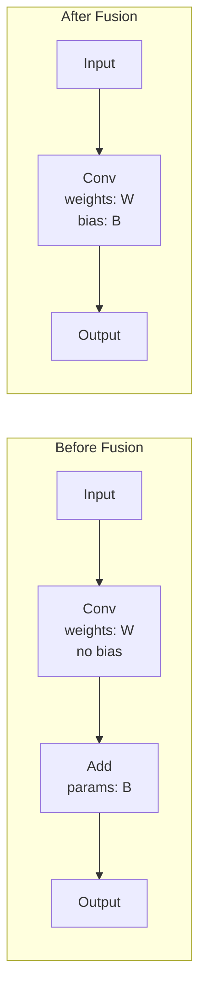
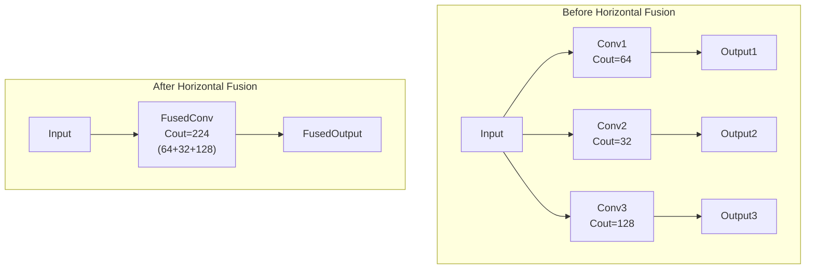
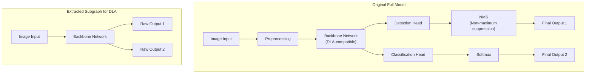
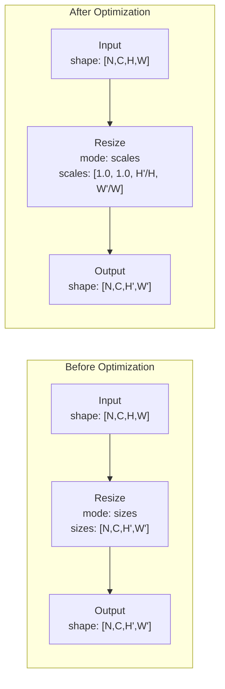
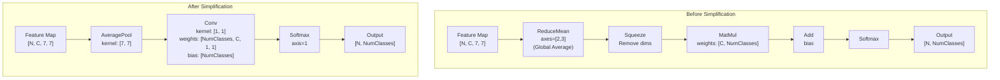
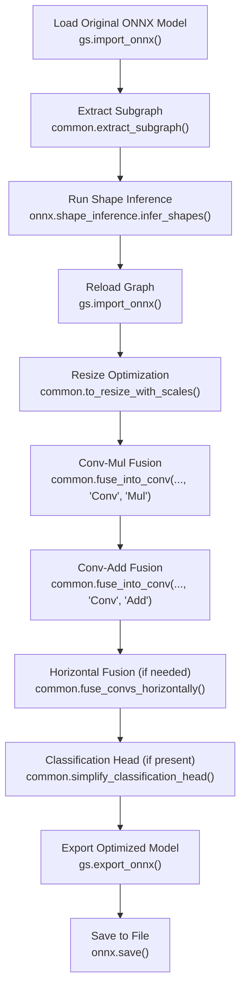
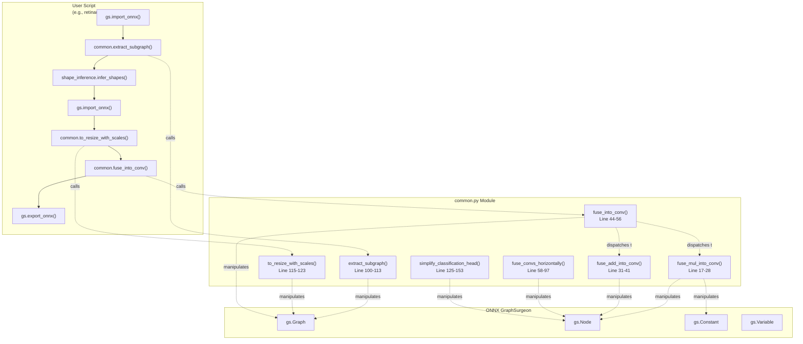
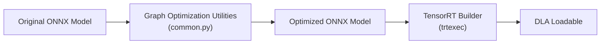

<!-- source: DeepWiki mcp.deepwiki.com · repo NVIDIA/Deep-Learning-Accelerator-SW · page 3.3 Graph Optimization Techniques · fetched 2026-10-26 -->

# Graph Optimization Techniques

<details>
<summary>Relevant source files</summary>

The following files were used as context for generating this wiki page:

- [scripts/prepare_models/common.py](scripts/prepare_models/common.py)
- [scripts/prepare_models/retinanet_resnext50.py](scripts/prepare_models/retinanet_resnext50.py)

</details>


## Purpose and Scope

This page describes the graph optimization utilities provided in the DLA SW repository for transforming ONNX models to improve DLA compatibility and performance. These utilities perform structural transformations on computation graphs, such as layer fusion, subgraph extraction, and operator replacement.

These optimizations are **graph-level transformations** applied before compilation. For the complete model preparation workflow, see [ONNX Model Preparation Scripts](#3.1). For quantization-specific transformations, see [QDQ Translator for Quantized Models](#3.2). For compilation options and precision configuration, see [Model Compilation](#5).

---

## Overview of Optimization Utilities

The DLA SW repository provides a set of graph optimization utilities implemented in [scripts/prepare_models/common.py](). These utilities use the ONNX GraphSurgeon library to manipulate computation graphs at the operator level.

### Available Optimization Functions

| Function | Purpose | Benefit for DLA |
|----------|---------|-----------------|
| `fuse_mul_into_conv` | Fuses `Mul` operation into `Conv` weights | Reduces operator count, eliminates ElementWise layer |
| `fuse_add_into_conv` | Fuses `Add` operation into `Conv` bias | Reduces operator count, eliminates ElementWise layer |
| `fuse_into_conv` | Generic fusion framework | Enables pattern-based graph simplification |
| `fuse_convs_horizontally` | Combines parallel convolutions | Reduces layer count, improves data reuse |
| `extract_subgraph` | Extracts backbone from full model | Isolates DLA-compatible portions |
| `to_resize_with_scales` | Converts Resize to use scales | Ensures DLA-compatible Resize format |
| `simplify_classification_head` | Converts MatMul+Add to Conv | Replaces unsupported ops with supported equivalents |

### Library Dependencies

The optimization utilities depend on:
- **onnx_graphsurgeon**: Graph manipulation library ([scripts/prepare_models/common.py:13]())
- **numpy**: Array operations for weight manipulation ([scripts/prepare_models/common.py:14]())
- **onnx**: Model serialization and shape inference ([scripts/prepare_models/retinanet_resnext50.py:13-15]())

**Sources:** [scripts/prepare_models/common.py:1-14]()

---

## Layer Fusion Techniques

Layer fusion combines multiple operations into a single layer, reducing the number of operators in the graph and eliminating intermediate memory operations. This is particularly beneficial for DLA as it reduces the number of layer submissions and memory transactions.

### Mul-into-Conv Fusion

The `fuse_mul_into_conv` function absorbs a channel-wise multiplication operation into the preceding convolution's weights.



**Implementation Details:**

The function modifies the convolution weights in-place by multiplying them with the multiplication factors [scripts/prepare_models/common.py:17-28]():

1. **Validates constraints**: Conv must have no bias, Mul factors must be constant with shape `(C, 1, 1)` where C is the channel dimension
2. **Reshapes factors**: Broadcasts factors to `(C, 1, 1, 1)` for weight multiplication
3. **Fuses weights**: Multiplies `conv_weights *= mul_factors_data`
4. **Removes Mul node**: Clears Mul inputs/outputs and redirects Conv output

**Constraints:**
- Convolution must have exactly 2 inputs (input tensor + weights, no bias) [scripts/prepare_models/common.py:18]()
- Multiplication factors must be a constant tensor [scripts/prepare_models/common.py:22]()
- Factors shape must be `(1, C, 1, 1)` for channel-wise multiplication [scripts/prepare_models/common.py:23]()

**Sources:** [scripts/prepare_models/common.py:17-28]()

---

### Add-into-Conv Fusion

The `fuse_add_into_conv` function absorbs a channel-wise addition operation into the convolution's bias term.



**Implementation Details:**

The function adds the bias term to the convolution [scripts/prepare_models/common.py:31-41]():

1. **Validates constraints**: Conv must have no bias, Add params must be constant
2. **Flattens bias**: Converts bias from `(1, C, 1, 1)` to `(C,)` shape
3. **Appends bias**: Adds bias as third input to Conv node
4. **Removes Add node**: Clears Add inputs/outputs and redirects Conv output

**Constraints:**
- Convolution must have exactly 2 inputs (no existing bias) [scripts/prepare_models/common.py:32]()
- Addition parameters must be constant [scripts/prepare_models/common.py:35]()
- Parameters shape must be `(1, C, 1, 1)` for channel-wise addition [scripts/prepare_models/common.py:36]()

**Sources:** [scripts/prepare_models/common.py:31-41]()

---

### Generic Fusion Framework

The `fuse_into_conv` function provides a pattern-matching framework for applying fusion operations across the entire graph.

**Implementation:**

The function performs a topological traversal and applies fusion when patterns match [scripts/prepare_models/common.py:44-56]():

```
def fuse_into_conv(graph, fusion_func, node_pattern):
    graph.toposort()  # Ensure topological order
    for node in graph.nodes:
        # Check if node and next_node match pattern
        if qualifies and (node.op, next_node.op) == node_pattern:
            fusion_func(node, next_node)
            graph = graph.cleanup()
```

**Pattern Matching Criteria:**

1. Node must have exactly one output [scripts/prepare_models/common.py:47]()
2. Output must not be a graph output [scripts/prepare_models/common.py:48]()
3. Output must feed exactly one downstream node [scripts/prepare_models/common.py:49]()
4. Downstream node must have only one variable input (the output) [scripts/prepare_models/common.py:52]()
5. Node types must match the specified pattern [scripts/prepare_models/common.py:53]()

**Usage Example:**

From [scripts/prepare_models/retinanet_resnext50.py:42-43]():

```python
common.fuse_into_conv(graph, common.fuse_mul_into_conv, ('Conv', 'Mul'))
common.fuse_into_conv(graph, common.fuse_add_into_conv, ('Conv', 'Add'))
```

**Sources:** [scripts/prepare_models/common.py:44-56](), [scripts/prepare_models/retinanet_resnext50.py:42-43]()

---

### Horizontal Conv Fusion

The `fuse_convs_horizontally` function combines multiple parallel convolution operations that share the same input into a single convolution with concatenated output channels.



**Implementation Details:**

The function concatenates weights and biases along the output channel dimension [scripts/prepare_models/common.py:58-97]():

1. **Validates compatibility**: All convolutions must have identical attributes (kernel, stride, padding, etc.)
2. **Validates input channels**: All convolutions must have the same number of input channels
3. **Concatenates weights**: Stacks weight tensors along axis 0 (output channel dimension)
4. **Concatenates biases**: Stacks bias tensors, creating zero bias if missing
5. **Updates first conv**: First convolution receives concatenated weights/biases
6. **Removes other convs**: Clears inputs/outputs of fused convolutions

**Function Signature:**

```python
def fuse_convs_horizontally(graph, fuse_conv_outputs, new_names=None)
```

- `fuse_conv_outputs`: List of lists, each inner list contains output tensor names to fuse
- `new_names`: Optional list of names for the fused convolutions

**Constraints:**
- All convolutions must share the same input tensor
- Convolution attributes (kernel shape, stride, padding) must match [scripts/prepare_models/common.py:69]()
- Input channel count must match [scripts/prepare_models/common.py:70]()
- Kernel spatial dimensions must match [scripts/prepare_models/common.py:71]()

**Sources:** [scripts/prepare_models/common.py:58-97]()

---

## Subgraph Extraction

The `extract_subgraph` function isolates a portion of the computation graph, creating a new model with specified inputs and outputs. This is commonly used to extract the DLA-compatible backbone from a full model that may contain unsupported post-processing operations.



**Implementation Details:**

The function modifies graph inputs and outputs [scripts/prepare_models/common.py:100-113]():

1. **Updates batch dimension**: Sets all tensor shapes to use specified batch size
2. **Creates new inputs**: Converts specified tensors to graph inputs with defined shapes
3. **Creates new outputs**: Converts specified tensors to graph outputs
4. **Cleans up graph**: Removes unused nodes and tensors
5. **Clears shape information**: Sets output shapes to None for easier downstream manipulation

**Function Signature:**

```python
def extract_subgraph(graph, input_names, output_names, input_shape)
```

**Usage Example:**

From [scripts/prepare_models/retinanet_resnext50.py:29-36]():

```python
input_shape = (-1, 3, 800, 800)
input_names = ['input']
output_names = [
    'onnx::Shape_1640', 'onnx::Shape_1597', 'onnx::Shape_1554',
    'onnx::Shape_1511', 'onnx::Shape_1468', 'onnx::Shape_1856',
    'onnx::Shape_1813', 'onnx::Shape_1770', 'onnx::Shape_1727',
    'onnx::Shape_1684'
]
common.extract_subgraph(graph, input_names, output_names, input_shape)
```

This example extracts the 10 feature pyramid outputs from RetinaNet, removing the NMS and post-processing logic.

**Sources:** [scripts/prepare_models/common.py:100-113](), [scripts/prepare_models/retinanet_resnext50.py:29-36]()

---

## Resize Optimization

The `to_resize_with_scales` function converts `Resize` operations from using explicit output sizes to using scale factors. DLA's Resize implementation prefers scale-based resizing for better compatibility and performance.



**Implementation Details:**

The function computes scale factors from input and output sizes [scripts/prepare_models/common.py:115-123]():

1. **Identifies Resize nodes**: Finds Resize operations with 4 inputs (input, roi, scales, sizes)
2. **Extracts sizes**: Gets the target output sizes from the 4th input
3. **Computes scales**: Divides output sizes by input shape: `scales = sizes / input_shape`
4. **Sets batch scale**: Forces batch dimension scale to 1.0
5. **Creates scale constant**: Replaces sizes input with computed scales constant
6. **Updates inputs**: Sets Resize inputs to [input, roi, scales]

**Why This Matters:**

DLA's Resize operator implementation is optimized for scale-based resizing. Using scales instead of explicit sizes:
- Ensures compatibility with DLA's Resize layer restrictions (see [Layer Restrictions and Constraints](#4.3))
- Provides consistent behavior across different batch sizes
- Avoids potential rounding issues in size computation

**Usage Example:**

From [scripts/prepare_models/retinanet_resnext50.py:41]():

```python
common.to_resize_with_scales(graph)
```

**Sources:** [scripts/prepare_models/common.py:115-123](), [scripts/prepare_models/retinanet_resnext50.py:41]()

---

## Classification Head Simplification

The `simplify_classification_head` function converts a typical PyTorch/TensorFlow classification head (Global Average Pool → Squeeze → FC layer) into DLA-native operations (Average Pool → 1x1 Convolution).



**Implementation Details:**

The function performs three transformations [scripts/prepare_models/common.py:125-153]():

1. **ReduceMean → AveragePool**: Changes op type and adds kernel_shape attribute
2. **MatMul → Conv**: Transposes and reshapes MatMul weights to Conv weights
3. **Removes Squeeze and Add**: Fuses bias into Conv, removes intermediate nodes
4. **Updates Softmax**: Changes axis from -1 to 1 for channel dimension

**Function Signature:**

```python
def simplify_classification_head(graph, mean_name, squeeze_name, 
                                  matmul_name, add_name, softmax_name=None)
```

**Transformation Details:**

**ReduceMean to AveragePool** [scripts/prepare_models/common.py:131-132]():
```python
node_dict[mean_name].op = 'AveragePool'
node_dict[mean_name].attrs = {'kernel_shape': [7, 7]}
```

**MatMul weights to Conv weights** [scripts/prepare_models/common.py:138-140]():
- Transposes weight matrix: `weights.T`
- Adds spatial dimensions: expands to `[NumClasses, C, 1, 1]`
- Creates 1x1 convolution kernel

**Why This Matters:**

- **ReduceMean**: Not natively supported on DLA, requires reconstruction
- **MatMul**: Not natively supported on DLA, requires reconstruction
- **AveragePool**: Natively supported on DLA CPIPE engines
- **1x1 Conv**: Natively supported on DLA CPIPE engines

This transformation replaces unsupported operators with DLA-native equivalents, enabling the entire classification head to run on DLA.

**Sources:** [scripts/prepare_models/common.py:125-153]()

---

## Using the Optimization Utilities

### Integration into Model Preparation Pipeline

The optimization utilities are typically used in a model-specific preparation script. The general workflow is:



**Sources:** [scripts/prepare_models/retinanet_resnext50.py:20-50]()

---

### Example: RetinaNet-ResNeXt-50 Preparation

The complete preparation script for RetinaNet demonstrates best practices for combining multiple optimizations:

**File Structure:**

```python
# scripts/prepare_models/retinanet_resnext50.py

# 1. Load model
graph = gs.import_onnx(onnx.load(onnx_file_orig))

# 2. Extract backbone (remove NMS/post-processing)
input_shape = (-1, 3, 800, 800)
input_names = ['input']
output_names = ['onnx::Shape_1640', ...]  # 10 FPN outputs
common.extract_subgraph(graph, input_names, output_names, input_shape)

# 3. Shape inference (required after subgraph extraction)
onnx_model = gs.export_onnx(graph)
onnx_model = shape_inference.infer_shapes(onnx_model)

# 4. Reload and optimize
graph = gs.import_onnx(onnx_model)
common.to_resize_with_scales(graph)
common.fuse_into_conv(graph, common.fuse_mul_into_conv, ('Conv', 'Mul'))
common.fuse_into_conv(graph, common.fuse_add_into_conv, ('Conv', 'Add'))

# 5. Export
model_opt = gs.export_onnx(graph)
onnx.save(model_opt, onnx_file_chopped)
```

**Sources:** [scripts/prepare_models/retinanet_resnext50.py:20-50]()

---

### Code-Level Optimization Workflow

The following diagram maps the high-level workflow to specific code entities:



**Sources:** [scripts/prepare_models/common.py:1-154](), [scripts/prepare_models/retinanet_resnext50.py:1-51]()

---

## Best Practices

### Optimization Order

Apply optimizations in this recommended order:

1. **Subgraph Extraction First**: Remove unsupported operations before optimization to avoid fusing operators that will be removed
2. **Shape Inference**: Run ONNX shape inference after subgraph extraction to propagate shape information
3. **Resize Optimization**: Apply early as it affects layer count but not layer types
4. **Vertical Fusion (Conv+Mul/Add)**: Apply before horizontal fusion to maximize fusion opportunities
5. **Horizontal Fusion**: Apply after vertical fusion when parallel structure is finalized
6. **Classification Head Simplification**: Apply last as it requires specific node names

### Graph Cleanup

Always call `graph.cleanup()` after modifications to remove dead nodes:
- The `fuse_into_conv` function automatically cleans up after each fusion [scripts/prepare_models/common.py:55]()
- The `extract_subgraph` function includes cleanup [scripts/prepare_models/common.py:109]()
- The `fuse_convs_horizontally` function includes cleanup [scripts/prepare_models/common.py:84]()
- The `simplify_classification_head` function includes cleanup [scripts/prepare_models/common.py:153]()

### Topological Sorting

Graph fusion operations require topological order:
- The `fuse_into_conv` function calls `graph.toposort()` before traversal [scripts/prepare_models/common.py:45]()
- Always sort after major graph modifications

### Preserving Semantics

Ensure mathematical equivalence:
- **Fusion operations**: Only fuse when operations are mathematically equivalent (e.g., Conv→Mul can be fused as weights multiplication)
- **Shape constraints**: Verify tensor shapes match expected patterns before fusion
- **Constant propagation**: Use constants for fusion parameters, not dynamic tensors

**Sources:** [scripts/prepare_models/common.py:44-56](), [scripts/prepare_models/common.py:100-113]()

---

## Common Patterns and Templates

### Pattern 1: Conv + BatchNorm Fusion

While not explicitly provided in the utilities, Conv+BatchNorm fusion follows the same pattern as Conv+Mul+Add:

```
BatchNorm(x) = gamma * (x - mean) / sqrt(var + eps) + beta
             = (gamma / sqrt(var + eps)) * x + (beta - gamma * mean / sqrt(var + eps))
             = scale * x + bias

Conv weights: W_new = W * scale
Conv bias: B_new = bias (computed from BN parameters)
```

This can be implemented using `fuse_mul_into_conv` followed by `fuse_add_into_conv`.

### Pattern 2: Extracting Multiple Outputs

When extracting subgraphs with multiple outputs (e.g., FPN levels):

```python
output_names = [
    'level_p3', 'level_p4', 'level_p5', 'level_p6', 'level_p7'
]
common.extract_subgraph(graph, input_names, output_names, input_shape)
```

### Pattern 3: Finding Node Names

To identify node names for `simplify_classification_head`:

```python
for node in graph.nodes:
    print(f"{node.name}: {node.op}")
    for output in node.outputs:
        print(f"  -> {output.name}")
```

**Sources:** [scripts/prepare_models/common.py:17-153]()

---

## Relationship to TensorRT Compilation

These graph optimizations are **pre-compilation** transformations that prepare the ONNX model before TensorRT processes it. The optimization workflow is:



**Separation of Concerns:**

- **Graph Optimizations (this page)**: Structural transformations at the ONNX level
- **TensorRT Optimizations**: Kernel fusion, precision calibration, memory optimization
- **DLA Compiler**: Hardware-specific code generation

Graph optimizations reduce the work required by TensorRT and increase the percentage of operations that can run natively on DLA. For TensorRT-specific options, see [Using trtexec for DLA](#5.2).

**Sources:** [scripts/prepare_models/common.py:1-154](), [scripts/prepare_models/retinanet_resnext50.py:20-50]()

---

## Summary

The graph optimization utilities in [scripts/prepare_models/common.py]() provide essential transformations for preparing ONNX models for DLA deployment:

| Optimization | Primary Use Case | DLA Benefit |
|--------------|------------------|-------------|
| **Mul/Add Fusion** | Post-training normalization | Eliminates ElementWise ops |
| **Horizontal Fusion** | Parallel convolution branches | Reduces layer count |
| **Subgraph Extraction** | Removing post-processing | Isolates DLA-compatible backbone |
| **Resize Optimization** | Scale vs. size representation | Ensures DLA compatibility |
| **Classification Head** | PyTorch/TF models | Converts to DLA-native ops |

These utilities work at the **graph structure level**, transforming operator topology before TensorRT compilation. Combined with proper quantization (see [QDQ Translator](#3.2)) and compilation flags (see [Using trtexec for DLA](#5.2)), they enable efficient deployment of complex models on DLA hardware.

**Sources:** [scripts/prepare_models/common.py:1-154]()

---

