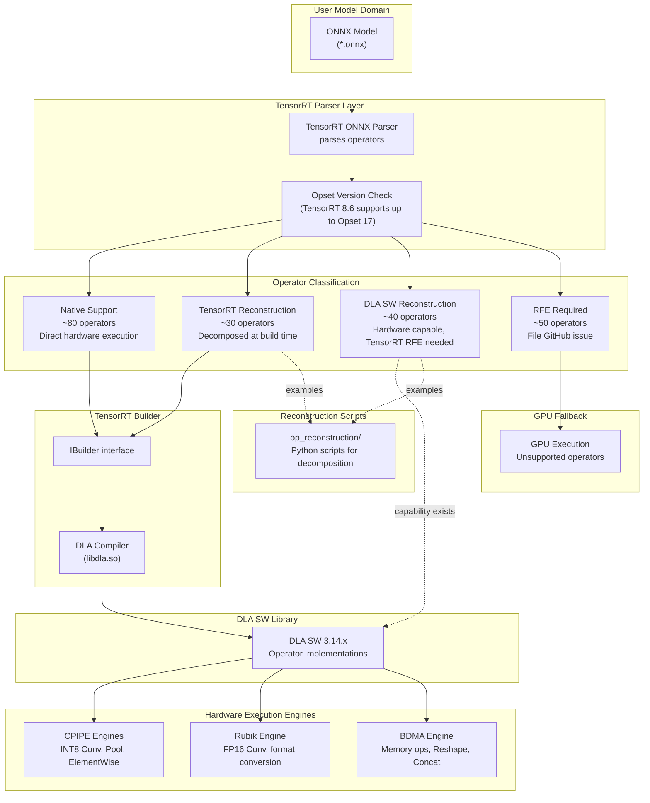
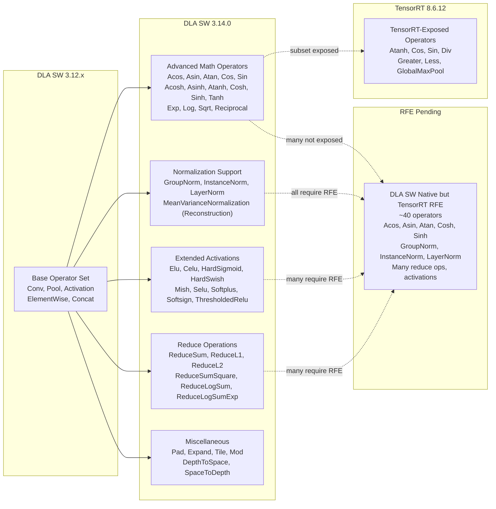
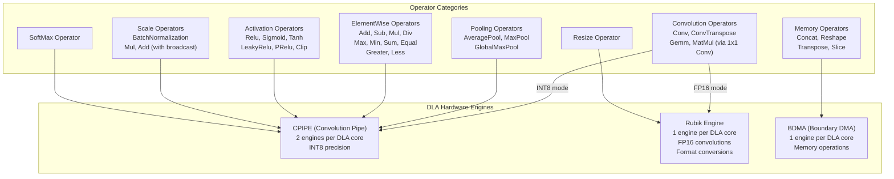
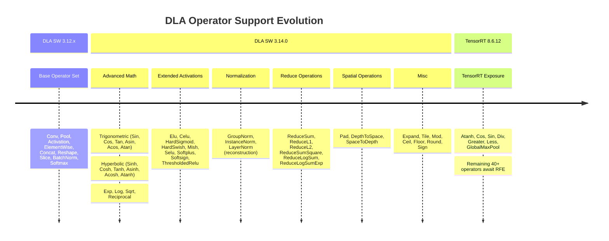

<!-- source: DeepWiki mcp.deepwiki.com · repo NVIDIA/Deep-Learning-Accelerator-SW · page 4 ONNX Operator Support · fetched 2026-10-26 -->

# ONNX Operator Support

<details>
<summary>Relevant source files</summary>

The following files were used as context for generating this wiki page:

- [operators/README.md](operators/README.md)

</details>


This document provides a comprehensive reference for ONNX operator support on NVIDIA Deep Learning Accelerator (DLA) hardware. It covers operator classification, version-specific availability, support status through TensorRT and DLA SW, and reconstruction techniques for unsupported operations.

**Scope**: This page focuses on the overall operator support framework and classification system. For detailed operator-by-operator reference tables, see [Operator Support Matrix](#4.1). For reconstruction implementation details and examples, see [Operator Reconstruction Techniques](#4.2). For layer-specific constraints and restrictions, see [Layer Restrictions and Constraints](#4.3).

**Related pages**: Model preparation workflows are covered in [Model Preparation](#3), compilation options in [Model Compilation](#5), and runtime considerations in [Runtime and Deployment](#6).

## Operator Support Architecture

DLA operator functionality is exposed through TensorRT's builder interface, which internally links to DLA SW libraries. This creates a two-tier support model where operators may be available in DLA SW hardware but not yet exposed through TensorRT APIs.



**Sources**: [operators/README.md:1-152]()

## Version Requirements and Evolution

Operator support varies significantly across DLA SW and TensorRT versions. The minimum system configuration determines which operators are available.

### System Configuration Matrix

| Hardware Platform | Operating System | DLA SW Version | TensorRT Version | Key Features |
|-------------------|------------------|----------------|------------------|--------------|
| DRIVE Orin | DRIVE OS 6.0.6.0 | DLA 3.12.0 | TensorRT 8.5.10 | Base operator set |
| Jetson Orin | JetPack 5.1.1 | DLA 3.12.1 | TensorRT 8.5.2 | Base operator set |
| DRIVE Orin | DRIVE OS 6.0.7.0 | DLA 3.13.0 | TensorRT 8.6.10 | Expanded operators |
| DRIVE Orin | DRIVE OS 6.0.8.0 | DLA 3.14.0 | TensorRT 8.6.11 | Trigonometric, hyperbolic, advanced math |
| Jetson Orin | JetPack 6 | DLA 3.14.1 | TensorRT 8.6.2 | DLA 3.14 features |
| DRIVE Orin | DRIVE OS 6.0.8.1 | DLA 3.14.1 | TensorRT 8.6.11 | DLA 3.14 features |
| DRIVE Orin | DRIVE OS 6.0.9.0 | DLA 3.14.2 | TensorRT 8.6.12 | Latest operators (Atanh, Cos, Sin, Div, Greater, Less, GlobalMaxPool) |
| DRIVE Orin | DRIVE OS 6.0.9.1 | DLA 3.14.3 | TensorRT 8.6.12 | Latest features |



**Sources**: [operators/README.md:14-25](), [operators/README.md:37-44](), [operators/README.md:55-60]()

## Operator Classification System

DLA operators fall into four distinct support categories, each requiring different development approaches and workarounds.

### Category 1: Native Support

Operators with native support execute directly on DLA hardware through TensorRT's standard compilation path. These operators are parsed by TensorRT's ONNX parser and compiled into DLA-executable operations without decomposition.

**Examples**: `Conv`, `AveragePool`, `MaxPool`, `Relu`, `Add`, `Mul`, `Sub`, `BatchNormalization`, `Concat`, `Reshape`, `Transpose`, `Sigmoid`, `Tanh`, `LeakyRelu`, `PRelu`, `Clip`, `Softmax`, `Slice`, `Resize`, `ConvTranspose`

**TensorRT Layer Mapping**:
- `Conv` → TensorRT `IConvolutionLayer`
- `AveragePool`, `MaxPool` → TensorRT `IPoolingLayer`
- `Relu`, `Sigmoid`, `Tanh` → TensorRT `IActivationLayer`
- `Add`, `Mul`, `Sub`, `Div`, `Max`, `Sum` → TensorRT `IElementWiseLayer`
- `BatchNormalization` → TensorRT `IScaleLayer`
- `Concat` → TensorRT `IConcatenationLayer`
- `Reshape`, `Transpose` → TensorRT `IShuffleLayer`

**Sources**: [operators/README.md:36-149]()

### Category 2: TensorRT-Level Reconstruction

These operators are decomposed by TensorRT's ONNX parser into sequences of natively-supported DLA operations during the build phase. The decomposition is automatic and transparent to the user.

**Examples**: `And`, `Or`, `Not`, `Neg`, `Xor`, `Where`, `Gather`, `GatherElements`, `GatherND`, `Scatter`, `ScatterElements`, `GRU`, `LSTM`, `RNN`, `CumSum`, `DequantizeLinear`, `QuantizeLinear`, `DepthToSpace`, `SpaceToDepth`, `Identity`

**Reconstruction Script Location**: [op_reconstruction/]() directory contains reference implementations showing how decomposition works. These scripts are intended as recipes; actual decomposition can occur in ONNX domain post-training or during training in PyTorch/TensorFlow.

**Key Reconstruction Examples**:
- `And` → ElementWise multiplication: [op_reconstruction/And.py]()
- `Not` → ElementWise operations: [op_reconstruction/Not.py]()
- `Neg` → Multiplication by -1: [op_reconstruction/Neg.py]()
- `GRU` → Unrolled gates with Conv/Activation: [op_reconstruction/GRU.py]()
- `Gather` → Decomposition into supported primitives: [op_reconstruction/Gather.py]()
- `Where` → Conditional selection decomposition: [op_reconstruction/Where.py]()

**Sources**: [operators/README.md:12](), [operators/README.md:40-150]()

### Category 3: DLA SW-Level Reconstruction

These operators have native hardware support in DLA SW (version 3.14.0+) but are not yet exposed through TensorRT's API. They can be expressed as sequences of other operators that TensorRT does support.

**Examples**: `GroupNormalization`, `InstanceNormalization`, `LayerNormalization`, `MeanVarianceNormalization`, `LogSoftmax`, `ReduceMean`, `ReduceMin`, `ReduceSum`, `ReduceLogSum`, `ReduceLogSumExp`

**Common Reconstruction Patterns**:
- Normalization layers → `ReduceMean`, `Sub`, `Pow`, `Add`, `Sqrt`, `Div`, `Mul`
- `ReduceSum` → Multiple `AveragePool` nodes with rescaling via `BatchNormalization` (TensorRT `IScaleLayer`)
- `ReduceMean` → Multiple `AveragePool` or `Conv` nodes
- `LogSoftmax` → `Softmax` followed by `Log`

**Sources**: [operators/README.md:77-117]()

### Category 4: RFE Required

These operators require a Request for Enhancement (RFE) to be filed with NVIDIA. They either lack hardware support or the support exists but is not exposed in either DLA SW or TensorRT.

**Examples**: `Acos`, `Asin`, `Atan`, `Acosh`, `Asinh`, `Cosh`, `Sinh`, `Ceil`, `Celu`, `Elu`, `Erf`, `Exp`, `Floor`, `GlobalAveragePool`, `HardSigmoid`, `HardSwish`, `Log`, `Mish`, `Pad`, `Reciprocal`, `Round`, `Selu`, `Shrink`, `Sign`, `Softplus`, `Softsign`, `Sqrt`, `Tan`, `ThresholdedRelu`, `Flatten`, `Squeeze`, `Unsqueeze`

**RFE Process**:
1. File issue at https://github.com/NVIDIA/Deep-Learning-Accelerator-SW/issues
2. For TensorRT-specific operators: https://github.com/NVIDIA/TensorRT/issues
3. NVIDIA DRIVE customers: Contact NVIDIA representative directly

**Sources**: [operators/README.md:28-30](), [operators/README.md:37-148]()

## Operator-to-Hardware Engine Mapping

Understanding which hardware engine executes each operator type is critical for performance optimization and debugging.



**Engine Characteristics**:
- **CPIPE Engines**: Execute INT8 convolutions, pooling, element-wise operations, and activations. Two engines per DLA core enable parallel execution of independent operations.
- **Rubik Engine**: Handles FP16 convolutions and format conversions (e.g., `dla_hwc4` to `chw32`). Critical for hybrid precision workflows.
- **BDMA Engine**: Executes memory operations including tensor reshaping, concatenation, and slicing. Optimized for large data movement.

**Sources**: DLA hardware architecture from [DLA Hardware Architecture](#1.1)

## Important Implementation Notes

### Constant Folding and Build-Time Inference

Certain operators like `Constant`, `ConstantOfShape`, and `Shape` are handled through TensorRT's constant folding optimization rather than runtime execution. TensorRT performs these operations during the build phase, eliminating them from the final DLA loadable.

**Example**: A `Shape` operator followed by `Reshape` is often completely eliminated if the output shape can be inferred statically at build time.

**Sources**: [operators/README.md:51-52](), [operators/README.md:127]()

### Precision-Specific Support

Some operators have precision-dependent support:
- `Gemm` and `MatMul`: Second input must be a constant. TensorRT translates these to 1x1 `Conv` internally.
- FP16 convolutions execute on Rubik engine
- INT8 convolutions execute on CPIPE engines
- Mixed precision models may require GPU fallback for certain layers

**Sources**: [operators/README.md:71](), [operators/README.md:93]()

### GPU Fallback Mechanisms

When an operator is not supported on DLA, TensorRT can automatically fall back to GPU execution if GPU fallback is enabled during compilation. This creates a hybrid execution model where:
1. DLA executes supported operators (typically the backbone)
2. GPU executes unsupported operators (typically post-processing)
3. Data transfers occur automatically between DLA and GPU memory

To enable GPU fallback, do not specify `--useDLACore` or use TensorRT API to allow fallback. For compilation details, see [Using trtexec for DLA](#5.2).

**Sources**: [operators/README.md:51]()

## Operator Support Evolution Timeline



**Key Insight**: DLA 3.14.0 added ~50 new operators, but TensorRT 8.6.12 only exposes ~7 of them. The gap between hardware capability and API exposure means many operators require RFE or reconstruction.

**Sources**: [operators/README.md:37-44](), [operators/README.md:55-60](), [operators/README.md:75-76](), [operators/README.md:85-86]()

## Restrictions and Constraints

All operators, even those with native support, have layer-specific restrictions regarding tensor shapes, data types, and parameter values. These restrictions are documented in TensorRT's official documentation and vary by operator type.

**Common Restriction Categories**:
1. **Tensor dimension constraints**: Minimum/maximum tensor dimensions
2. **Data type constraints**: INT8, FP16 support varies by operator
3. **Parameter constraints**: Stride, padding, dilation restrictions for convolutions
4. **Memory layout constraints**: `dla_hwc4`, `chw32` format requirements

For comprehensive layer-specific restrictions, see [Layer Restrictions and Constraints](#4.3) and the [TensorRT DLA Layer Support and Restrictions](https://docs.nvidia.com/deeplearning/tensorrt/developer-guide/index.html#dla-lay-supp-rest) documentation.

**Sources**: [operators/README.md:8](), [operators/README.md:36-149]()

## Quick Reference: Checking Operator Support

To determine if an operator in your ONNX model will run on DLA:

1. **Identify the operator name and version**: Use `onnx.checker` or Netron to inspect your model
2. **Check the support matrix**: See [Operator Support Matrix](#4.1) for detailed per-operator status
3. **Verify version requirements**: Ensure your DLA SW and TensorRT versions meet the minimum requirements
4. **Check restrictions**: Verify operator parameters meet DLA constraints in [Layer Restrictions and Constraints](#4.3)
5. **Consider reconstruction**: If not natively supported, check [Operator Reconstruction Techniques](#4.2)
6. **File RFE if needed**: For unsupported operators, follow the process in [Category 4: RFE Required](#category-4-rfe-required)

**Build-Time Verification**: Use `trtexec` with verbose logging to see which layers run on DLA vs GPU:
```bash
trtexec --onnx=model.onnx --useDLACore=0 --verbose 2>&1 | grep "DLA"
```

For complete compilation instructions, see [Using trtexec for DLA](#5.2).

**Sources**: [operators/README.md:1-152]()

---

