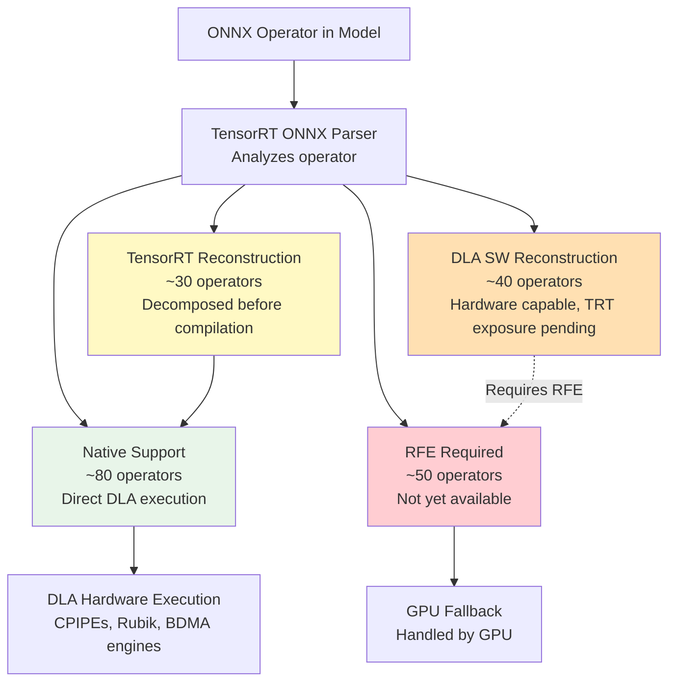
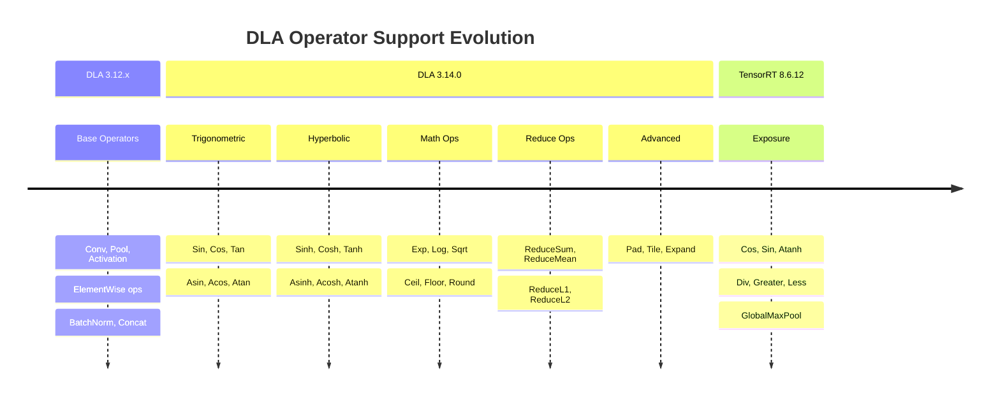
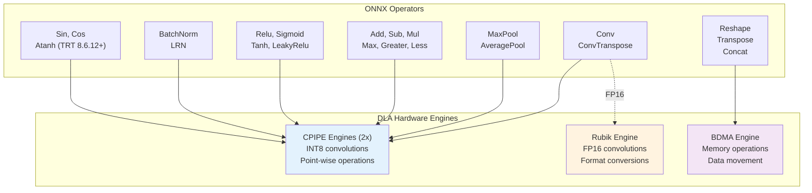
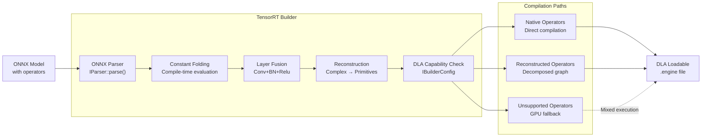

<!-- source: DeepWiki mcp.deepwiki.com · repo NVIDIA/Deep-Learning-Accelerator-SW · page 4.1 Operator Support Matrix · fetched 2026-10-26 -->

# Operator Support Matrix

Relevant source files

The following files were used as context for generating this wiki page:

- [operators/README.md](operators/README.md)

## Purpose and Scope

This document provides a comprehensive reference for ONNX operator support on NVIDIA DLA (Deep Learning Accelerator) hardware. It details which of the ~200 ONNX operators can execute on DLA, their support classification (Native, Reconstruction, or RFE), and version availability across DLA SW and TensorRT releases.

For operator reconstruction techniques and examples, see [Operator Reconstruction Techniques](#4.2). For layer-specific restrictions that apply to supported operators, see [Layer Restrictions and Constraints](#4.3). For compilation workflow using these operators, see [TensorRT and DLA Compiler](#5.1).

---

## Operator Support Classification System

ONNX operators fall into four distinct support categories that determine their execution path on DLA hardware. Understanding this classification is critical for model deployment planning.

### Support Categories

**Native Support**: Operator is directly supported by both DLA SW and exposed through TensorRT. These operators compile to DLA loadables without modification. Examples: `Conv`, `BatchNormalization`, `Relu`, `Add`, `MaxPool`.

**TensorRT Reconstruction**: Operator is not directly supported but TensorRT can automatically decompose it into supported primitives during the build phase. The decomposition happens before DLA compilation. Examples: `And` → elementwise operations, `GRU` → unrolled recurrent cells. See [op_reconstruction/](op_reconstruction/)() for reference implementations.

**DLA SW Reconstruction**: Operator is natively supported in DLA SW (the hardware is capable) but TensorRT does not yet expose this functionality. These operators require decomposition into currently-exposed operations. Examples: `GroupNormalization`, `LayerNormalization`, `InstanceNormalization` (available as of DLA 3.14.0).

**RFE (Request for Enhancement)**: Operator is either not yet implemented in DLA SW or not exposed by TensorRT. These require filing a GitHub issue to request support. Examples: `Acos`, `Flatten`, `Squeeze` in recent versions.

Sources: [operators/README.md:1-152]()

---

## Version Requirements and Evolution

Operator support has expanded significantly across DLA SW and TensorRT releases. The following table shows the minimum system configuration required for the operator support matrix documented below.

### Minimum Platform Requirements

| Hardware Platform | Operating System | DLA SW Version | TensorRT Version |
|-------------------|-----------------|----------------|------------------|
| DRIVE Orin (Automotive) | DRIVE OS 6.0.6.0 | DLA 3.12.0 | TensorRT 8.5.10 |
| Jetson Orin (Embedded) | JetPack 5.1.1 | DLA 3.12.1 | TensorRT 8.5.2 |
| DRIVE Orin (Automotive) | DRIVE OS 6.0.7.0 | DLA 3.13.0 | TensorRT 8.6.10 |
| DRIVE Orin (Automotive) | DRIVE OS 6.0.8.0 | DLA 3.14.0 | TensorRT 8.6.11 |
| Jetson Orin (Embedded) | JetPack 6 | DLA 3.14.1 | TensorRT 8.6.2 |
| DRIVE Orin (Automotive) | DRIVE OS 6.0.8.1 | DLA 3.14.1 | TensorRT 8.6.11 |
| DRIVE Orin (Automotive) | DRIVE OS 6.0.9.0 | DLA 3.14.2 | TensorRT 8.6.12 |
| DRIVE Orin (Automotive) | DRIVE OS 6.0.9.1 | DLA 3.14.3 | TensorRT 8.6.12 |

### Major Release Milestones

**Key Changes**:
- **DLA 3.14.0** introduced ~40 new operators including trigonometric, hyperbolic, and advanced math operations
- **TensorRT 8.6.12** exposed select operators from DLA 3.14.0 including `Cos`, `Sin`, `Atanh`, `Div`, `Greater`, `Less`, and `GlobalMaxPool`
- Many DLA 3.14.0 operators remain unexposed in TensorRT, requiring reconstruction or RFE

Sources: [operators/README.md:14-26](), [operators/README.md:37-148]()

---

## Comprehensive Operator Support Table

The following table documents all ONNX operators up to Opset 17 (supported by TensorRT 8.6). For each operator, we specify:
- **TensorRT Support**: Whether and how TensorRT exposes the operator
- **DLA SW Support**: The underlying DLA hardware capability
- **Restrictions**: Links to layer-specific constraints in TensorRT documentation

### Core Operations

| Operator | TensorRT Support | DLA SW Support | Restrictions/Notes |
|----------|-----------------|----------------|-------------------|
| **Conv** | Native | Native | See Convolution and Fully Connected layers restrictions |
| **ConvTranspose** | Native | Native | See Deconvolution layer restrictions |
| **BatchNormalization** | Native | Native | See Scale layer restrictions |
| **Gemm** | Native | Native | Second input must be constant; translates to 1x1 Conv |
| **MatMul** | Native | RFE | Second input must be constant; translates to 1x1 Conv |

### Activation Functions

| Operator | TensorRT Support | DLA SW Support | Restrictions/Notes |
|----------|-----------------|----------------|-------------------|
| **Relu** | Native | Native | See Activation layer restrictions |
| **LeakyRelu** | Native | Native | See Activation layer restrictions |
| **PRelu** | Native | Native | See Parametric ReLU layer restrictions |
| **Sigmoid** | Native | Native | See Activation layer restrictions |
| **Tanh** | Native | Native | See Activation layer restrictions |
| **Clip** | Native | Native | See Activation layer restrictions |
| **Elu** | RFE | Native (DLA 3.14.0+) | Hardware capable, TRT exposure pending |
| **Selu** | RFE | Native (DLA 3.14.0+) | Hardware capable, TRT exposure pending |
| **Celu** | RFE | Native (DLA 3.14.0+) | Hardware capable, TRT exposure pending |
| **HardSigmoid** | RFE | Native (DLA 3.14.0+) | Hardware capable, TRT exposure pending |
| **HardSwish** | RFE | Native (DLA 3.14.0+) | Hardware capable, TRT exposure pending |
| **Softplus** | RFE | Native (DLA 3.14.0+) | Hardware capable, TRT exposure pending |
| **Softsign** | RFE | Native (DLA 3.14.0+) | Hardware capable, TRT exposure pending |
| **Mish** | RFE | Native (DLA 3.14.0+) | Hardware capable, TRT exposure pending |
| **ThresholdedRelu** | RFE | Native (DLA 3.14.0+) | Hardware capable, TRT exposure pending |

### Pooling Operations

| Operator | TensorRT Support | DLA SW Support | Restrictions/Notes |
|----------|-----------------|----------------|-------------------|
| **MaxPool** | Native | Native | See Pooling layer restrictions |
| **AveragePool** | Native | Native | See Pooling layer restrictions |
| **GlobalMaxPool** | Native (TRT 8.6.12+) | Native | Older releases: decompose into MaxPool nodes |
| **GlobalAveragePool** | RFE | Native | Can be reconstructed with AveragePool nodes |
| **LpPool** | RFE | Native (DLA 3.14.0+) | Hardware capable, TRT exposure pending |
| **GlobalLpPool** | RFE | Native (DLA 3.14.0+) | Hardware capable, TRT exposure pending |

### ElementWise Operations

| Operator | TensorRT Support | DLA SW Support | Restrictions/Notes |
|----------|-----------------|----------------|-------------------|
| **Add** | Native | Native | See Scale layer and ElementWise layer restrictions |
| **Sub** | Native | Native | See ElementWise layer restrictions |
| **Mul** | Native | Native | See Scale layer and ElementWise layer restrictions |
| **Div** | Native (TRT 8.6.12+) | Native (DLA 3.14.0+) | See ElementWise layer restrictions |
| **Max** | Native | Native | See ElementWise layer restrictions |
| **Min** | RFE | Native | Hardware capable, TRT exposure pending |
| **Sum** | Native | Native | See ElementWise layer restrictions |
| **Mean** | RFE | Native (DLA 3.14.0+) | Hardware capable, TRT exposure pending |
| **Pow** | Native | Native | See ElementWise layer restrictions |

### Comparison Operations

| Operator | TensorRT Support | DLA SW Support | Restrictions/Notes |
|----------|-----------------|----------------|-------------------|
| **Equal** | Native | Native | See Comparison operations restrictions |
| **Greater** | Native (TRT 8.6.12+) | Native (DLA 3.14.0+) | See Comparison operations restrictions |
| **Less** | Native (TRT 8.6.12+) | Native (DLA 3.14.0+) | See Comparison operations restrictions |
| **GreaterOrEqual** | RFE | Native (DLA 3.14.0+) | Hardware capable, TRT exposure pending |
| **LessOrEqual** | RFE | Native (DLA 3.14.0+) | Hardware capable, TRT exposure pending |

### Unary Mathematical Operations

| Operator | TensorRT Support | DLA SW Support | Restrictions/Notes |
|----------|-----------------|----------------|-------------------|
| **Abs** | Native | Native | See Unary layer restrictions |
| **Neg** | Reconstruction | Reconstruction | See [op_reconstruction/Neg.py](op_reconstruction/Neg.py)() |
| **Reciprocal** | RFE | Native (DLA 3.14.0+) | Hardware capable, TRT exposure pending |
| **Sqrt** | RFE | Native (DLA 3.14.0+) | Hardware capable, TRT exposure pending |
| **Exp** | RFE | Native (DLA 3.14.0+) | Hardware capable, TRT exposure pending |
| **Log** | RFE | Native (DLA 3.14.0+) | Hardware capable, TRT exposure pending |
| **Ceil** | RFE | Native (DLA 3.14.0+) | Hardware capable, TRT exposure pending |
| **Floor** | RFE | Native (DLA 3.14.0+) | Hardware capable, TRT exposure pending |
| **Round** | RFE | Native (DLA 3.14.0+) | Hardware capable, TRT exposure pending |
| **Sign** | RFE | Native (DLA 3.14.0+) | Hardware capable, TRT exposure pending |
| **Erf** | RFE | Native (DLA 3.14.0+) | Hardware capable, TRT exposure pending |

### Trigonometric Operations

| Operator | TensorRT Support | DLA SW Support | Restrictions/Notes |
|----------|-----------------|----------------|-------------------|
| **Sin** | Native (TRT 8.6.12+) | Native (DLA 3.14.0+) | See Unary layer restrictions |
| **Cos** | Native (TRT 8.6.12+) | Native (DLA 3.14.0+) | See Unary layer restrictions |
| **Tan** | RFE | Native (DLA 3.14.0+) | Hardware capable, TRT exposure pending |
| **Asin** | RFE | Native (DLA 3.14.0+) | Hardware capable, TRT exposure pending |
| **Acos** | RFE | Native (DLA 3.14.0+) | Hardware capable, TRT exposure pending |
| **Atan** | RFE | Native (DLA 3.14.0+) | Hardware capable, TRT exposure pending |

### Hyperbolic Operations

| Operator | TensorRT Support | DLA SW Support | Restrictions/Notes |
|----------|-----------------|----------------|-------------------|
| **Sinh** | RFE | Native (DLA 3.14.0+) | Hardware capable, TRT exposure pending |
| **Cosh** | RFE | Native (DLA 3.14.0+) | Hardware capable, TRT exposure pending |
| **Tanh** | Native | Native | See Activation layer restrictions |
| **Asinh** | RFE | Native (DLA 3.14.0+) | Hardware capable, TRT exposure pending |
| **Acosh** | RFE | Native (DLA 3.14.0+) | Hardware capable, TRT exposure pending |
| **Atanh** | Native (TRT 8.6.12+) | Native (DLA 3.14.0+) | See Unary layer restrictions |

### Reduction Operations

| Operator | TensorRT Support | DLA SW Support | Restrictions/Notes |
|----------|-----------------|----------------|-------------------|
| **ReduceSum** | Reconstruction | Native (DLA 3.14.0+) | Decompose into Conv or AveragePool + rescale |
| **ReduceMean** | RFE | Native | Decompose into AveragePool or Conv nodes |
| **ReduceMin** | RFE | Native | Hardware capable, TRT exposure pending |
| **ReduceL1** | RFE | Native (DLA 3.14.0+) | Hardware capable, TRT exposure pending |
| **ReduceL2** | RFE | Native (DLA 3.14.0+) | Hardware capable, TRT exposure pending |
| **ReduceSumSquare** | RFE | Native (DLA 3.14.0+) | Hardware capable, TRT exposure pending |
| **ReduceLogSum** | RFE | Reconstruction (DLA 3.14.0+) | Can be expressed with Log, ReduceSum, Exp |
| **ReduceLogSumExp** | RFE | Reconstruction (DLA 3.14.0+) | Can be expressed with ReduceSum and Log |

### Normalization Operations

| Operator | TensorRT Support | DLA SW Support | Restrictions/Notes |
|----------|-----------------|----------------|-------------------|
| **BatchNormalization** | Native | Native | See Scale layer restrictions |
| **LRN** | Native | Native | See LRN (Local Response Normalization) restrictions |
| **GroupNormalization** | RFE | Reconstruction (DLA 3.14.0+) | Expressed with ReduceMean, Sub, Pow, Add, Sqrt, Div, Mul |
| **InstanceNormalization** | RFE | Reconstruction (DLA 3.14.0+) | Expressed with ReduceMean, Sub, Pow, Add, Sqrt, Div, Mul |
| **LayerNormalization** | RFE | Reconstruction (DLA 3.14.0+) | Expressed with ReduceMean, Sub, Pow, Add, Sqrt, Div, Mul |
| **MeanVarianceNormalization** | RFE | Reconstruction (DLA 3.14.0+) | Expressed with ReduceMean, Sub, Pow, Add, Sqrt, Div, Mul |
| **LpNormalization** | RFE | Native (DLA 3.14.0+) | Hardware capable, TRT exposure pending |

### Tensor Manipulation

| Operator | TensorRT Support | DLA SW Support | Restrictions/Notes |
|----------|-----------------|----------------|-------------------|
| **Reshape** | Native | Native | See Shuffle layer restrictions |
| **Transpose** | Native | Native | See Shuffle layer restrictions |
| **Concat** | Native | Native | See Concatenation layer restrictions |
| **Split** | Native | Native | Translated to Slice; see Slice layer restrictions |
| **Slice** | Native | Native | See Slice layer restrictions |
| **Expand** | RFE | Native (DLA 3.14.0+) | Hardware capable, TRT exposure pending |
| **Tile** | RFE | Native (DLA 3.14.0+) | Hardware capable, TRT exposure pending |
| **Pad** | RFE | Native (DLA 3.14.0+) | Hardware capable, TRT exposure pending |
| **Squeeze** | RFE | RFE | Not yet available in DLA SW |
| **Unsqueeze** | RFE | RFE | Not yet available in DLA SW |
| **Flatten** | RFE | RFE | Not yet available in DLA SW |

### Spatial Operations

| Operator | TensorRT Support | DLA SW Support | Restrictions/Notes |
|----------|-----------------|----------------|-------------------|
| **Resize** | Native | Native | See Resize layer restrictions |
| **Upsample** | Native | Native | See Resize layer restrictions |
| **DepthToSpace** | Reconstruction | Native (DLA 3.14.0+) | See [op_reconstruction/DepthToSpace.py](op_reconstruction/DepthToSpace.py)() |
| **SpaceToDepth** | Reconstruction | Native (DLA 3.14.0+) | See [op_reconstruction/SpaceToDepth.py](op_reconstruction/SpaceToDepth.py)() |

### Data Selection and Gathering

| Operator | TensorRT Support | DLA SW Support | Restrictions/Notes |
|----------|-----------------|----------------|-------------------|
| **Gather** | Reconstruction | Reconstruction | See [op_reconstruction/Gather.py](op_reconstruction/Gather.py)() |
| **GatherElements** | Reconstruction | Reconstruction | Works similarly to Gather reconstruction |
| **GatherND** | Reconstruction | Reconstruction | Works similarly to Gather reconstruction |
| **Scatter** | Reconstruction | Reconstruction | See [op_reconstruction/ScatterElements.py](op_reconstruction/ScatterElements.py)() |
| **ScatterElements** | Reconstruction | Reconstruction | See [op_reconstruction/ScatterElements.py](op_reconstruction/ScatterElements.py)() |
| **Where** | Reconstruction | Reconstruction | See [op_reconstruction/Where.py](op_reconstruction/Where.py)() |

### Logical Operations

| Operator | TensorRT Support | DLA SW Support | Restrictions/Notes |
|----------|-----------------|----------------|-------------------|
| **And** | Reconstruction | Reconstruction | See [op_reconstruction/And.py](op_reconstruction/And.py)() |
| **Or** | Reconstruction | Reconstruction | See [op_reconstruction/Or.py](op_reconstruction/Or.py)() |
| **Not** | Reconstruction | Reconstruction | See [op_reconstruction/Not.py](op_reconstruction/Not.py)() |
| **Xor** | Reconstruction | Reconstruction | See [op_reconstruction/Xor.py](op_reconstruction/Xor.py)() |

### Recurrent Neural Networks

| Operator | TensorRT Support | DLA SW Support | Restrictions/Notes |
|----------|-----------------|----------------|-------------------|
| **GRU** | Reconstruction | Reconstruction | See [op_reconstruction/GRU.py](op_reconstruction/GRU.py)() |
| **LSTM** | Reconstruction | Reconstruction | Can be unrolled similarly to GRU |
| **RNN** | Reconstruction | Reconstruction | Can be unrolled similarly to GRU |

### Quantization Operations

| Operator | TensorRT Support | DLA SW Support | Restrictions/Notes |
|----------|-----------------|----------------|-------------------|
| **QuantizeLinear** | Reconstruction | Reconstruction | Collapsed to INT8 scaling factor, explicit → implicit quantization |
| **DequantizeLinear** | Reconstruction | Reconstruction | Collapsed to INT8 scaling factor, explicit → implicit quantization |

### Miscellaneous Operations

| Operator | TensorRT Support | DLA SW Support | Restrictions/Notes |
|----------|-----------------|----------------|-------------------|
| **Softmax** | Native | Native | See SoftMax layer restrictions |
| **LogSoftmax** | RFE | Reconstruction (DLA 3.14.0+) | Can be expressed with Log and Softmax |
| **Identity** | Reconstruction | Native (DLA 3.14.0+) | Express with identity BatchNormalization or Slice |
| **CumSum** | Reconstruction | Reconstruction | With axis=1, express through 1x1 Conv |
| **Mod** | RFE | Native (DLA 3.14.0+) | Hardware capable, TRT exposure pending |
| **Shrink** | RFE | Native (DLA 3.14.0+) | Hardware capable, TRT exposure pending |
| **Constant** | Native | RFE | TensorRT performs constant folding into supported DLA ops |
| **ConstantOfShape** | Inferred at build time | Inferred at build time | Compile-time constant |
| **Shape** | Inferred at build time | Inferred at build time | Compile-time constant |

Sources: [operators/README.md:32-152]()

---

## Operator to Hardware Engine Mapping

Understanding how operators map to DLA hardware engines is crucial for performance optimization and debugging.

**CPIPE Engines**: Execute INT8 convolutions, pooling, elementwise operations, and activations. Orin has two CPIPE engines that can execute in parallel for different layers.

**Rubik Engine**: Handles FP16 convolutions when INT8 precision is insufficient. Also performs format conversions between memory layouts.

**BDMA Engine**: Manages memory operations including reshape, transpose, and concatenation. Operates concurrently with computation engines.

Sources: [operators/README.md:1-152]()

---

## TensorRT Build-Time Processing

The following diagram illustrates how TensorRT processes ONNX operators during the build phase before generating DLA loadables.

**Constant Folding**: TensorRT evaluates operations with constant inputs at build time. This is why `Constant` operator is marked as "Native" despite not running on DLA at inference time.

**Layer Fusion**: Common patterns like Conv+BatchNorm+Relu are fused into single DLA operations, reducing memory bandwidth and improving performance.

**Reconstruction**: Operators marked as "Reconstruction" in TensorRT support are automatically decomposed during this phase. Manual reconstruction (via scripts in [op_reconstruction/](op_reconstruction/)()) should be done before TensorRT if automatic decomposition is insufficient.

Sources: [operators/README.md:10-13]()

---

## Requesting New Operator Support

### RFE (Request for Enhancement) Process

When you need an operator that is not exposed through TensorRT:

1. **Identify the gap**: Check the operator support table above to determine if the operator is:
   - Supported in DLA SW but not exposed in TensorRT (RFE for TensorRT)
   - Not yet implemented in DLA SW (RFE for DLA SW)

2. **File GitHub issues**:
   - For TensorRT exposure: [TensorRT Issues](https://github.com/NVIDIA/TensorRT/issues)
   - For DLA SW support: [DLA SW Issues](https://github.com/NVIDIA/Deep-Learning-Accelerator-SW/issues)

3. **Provide context**:
   - Model architecture requiring the operator
   - Expected performance impact
   - Use case (especially for automotive customers)
   - Timeline requirements

4. **Contact NVIDIA representative**: For NVIDIA DRIVE customers, inform your technical account manager for prioritization.

### Workarounds While Waiting

While waiting for operator exposure, consider:

1. **Manual reconstruction**: Use scripts in [op_reconstruction/](op_reconstruction/)() as templates to decompose operators in ONNX domain post-training
2. **Training-time reconstruction**: Modify training code (PyTorch/TensorFlow) to use only supported operators
3. **Hybrid execution**: Allow GPU fallback for unsupported layers using `--allowGPUFallback` flag in trtexec
4. **Alternative formulations**: Replace operator sequences with mathematically equivalent supported operations

Sources: [operators/README.md:28-31](), [operators/README.md:5-6]()

---

## General Restrictions

All operators listed above are subject to layer-specific restrictions documented in the TensorRT Developer Guide. The most common restrictions include:

- **Precision limitations**: Most operations support INT8 and FP16; some operations are precision-specific
- **Tensor format requirements**: DLA prefers CHW4, CHW16, CHW32 formats for optimal performance
- **Batch size constraints**: Some layers have maximum batch size limits
- **Dimension restrictions**: Certain operations have limits on tensor dimensions (e.g., max width/height)
- **Parameter constraints**: Kernel sizes, strides, and padding may have hardware limitations

For comprehensive layer restrictions, see [Layer Restrictions and Constraints](#4.3) and the [TensorRT DLA Layer Support documentation](https://docs.nvidia.com/deeplearning/tensorrt/developer-guide/index.html#dla-lay-supp-rest).

**ONNX Opset Support**: TensorRT 8.6 supports operators up to ONNX Opset 17. For the latest ONNX operator specifications, refer to the [ONNX Operators documentation](https://github.com/onnx/onnx/blob/master/docs/Operators.md).

Sources: [operators/README.md:8-10]()

---

## Practical Usage Notes

### Reconstruction Scripts

The [op_reconstruction/](op_reconstruction/)() directory contains Python scripts demonstrating how to decompose unsupported operators into DLA-supported primitives. These scripts are intended as recipes and can be adapted to your workflow:

- **ONNX domain reconstruction**: Perform decomposition post-training using ONNX Graph Surgery
- **Framework-level reconstruction**: Modify PyTorch/TensorFlow training code to avoid unsupported operators
- **Custom implementations**: Use the scripts as templates for operator-specific requirements

### Native vs Reconstruction Trade-offs

**Native operators** provide:
- Best performance (single operation, optimized execution)
- Lower memory bandwidth usage
- Reduced compilation time

**Reconstructed operators** result in:
- Multiple DLA operations (potential overhead)
- Increased intermediate tensor storage
- More complex debugging (layerwise stats show decomposed operations)

When an operator is marked "Reconstruction" in DLA SW but "RFE" in TensorRT, reconstruction at the ONNX level yields the same performance as future native support, since the hardware already handles the operation efficiently.

### Version Planning

When targeting specific platforms, note:
- **DLA 3.12.x**: Base operator set, sufficient for ResNet, MobileNet, SSD architectures
- **DLA 3.14.0+**: Extended support for modern architectures requiring advanced math operations (ViT, EfficientNet variants)
- **TensorRT 8.6.12**: Latest exposure of DLA 3.14.0 capabilities; earlier TensorRT versions may require manual reconstruction

Sources: [operators/README.md:12-13](), [operators/README.md:37-148]()

---

