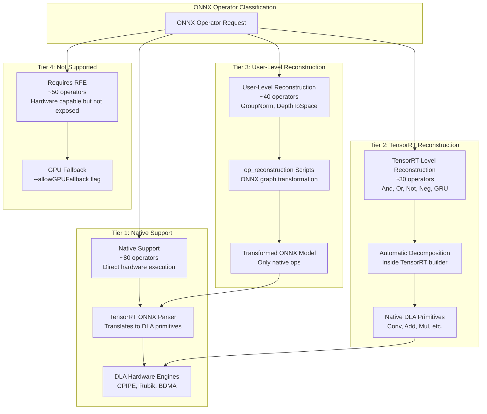
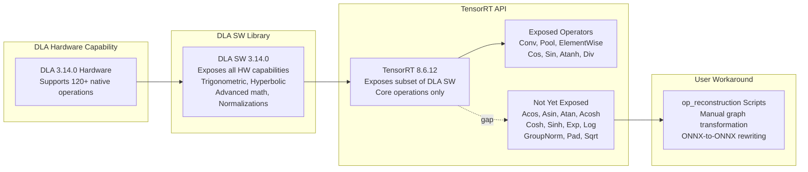
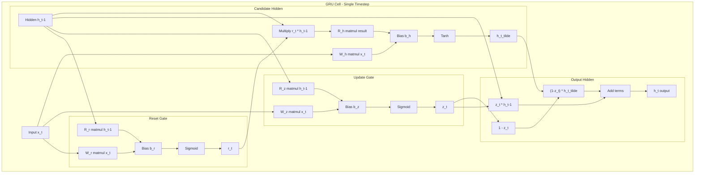
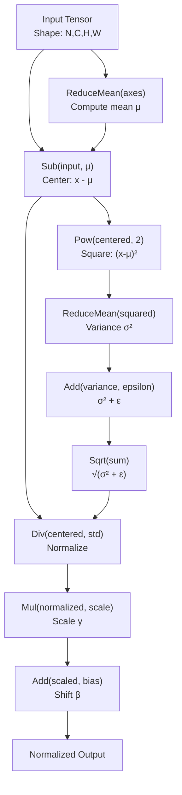
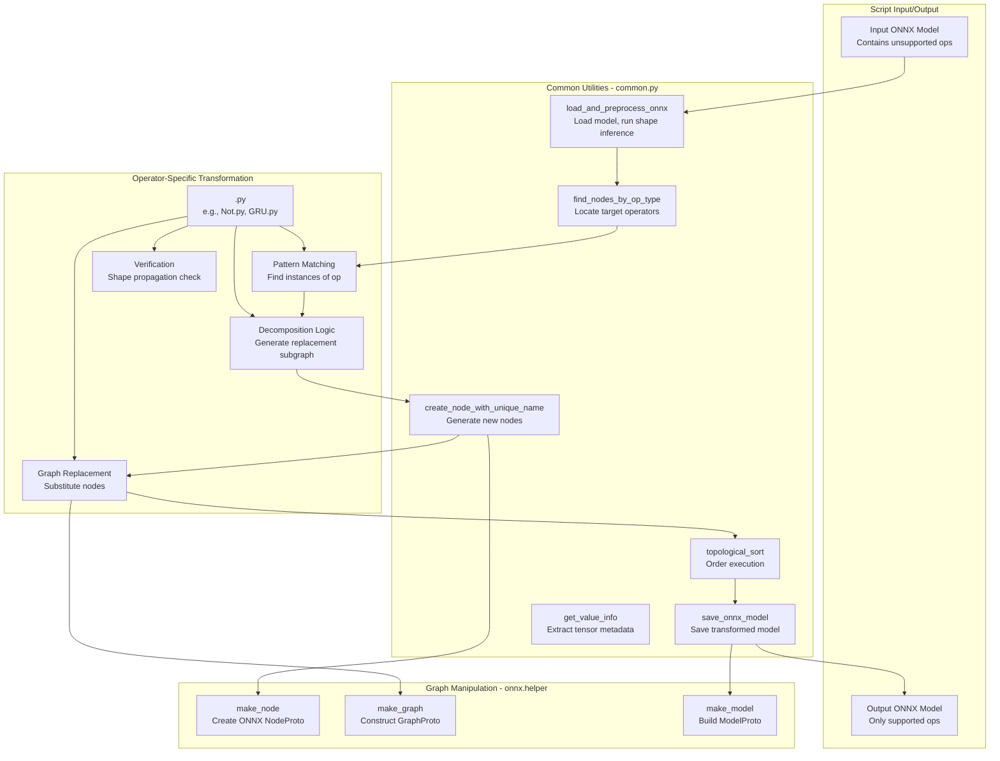
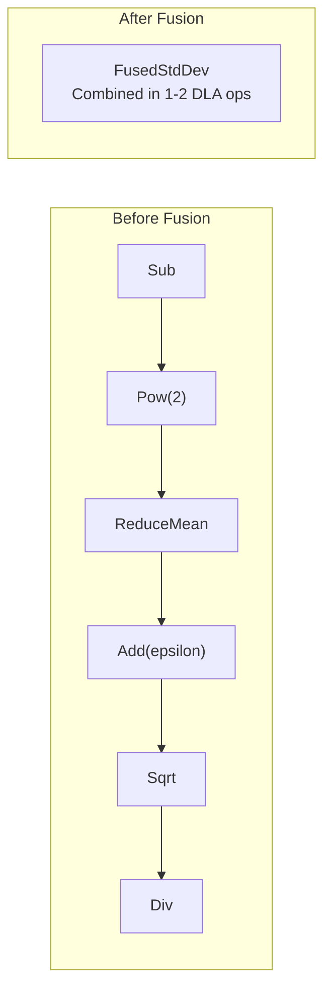
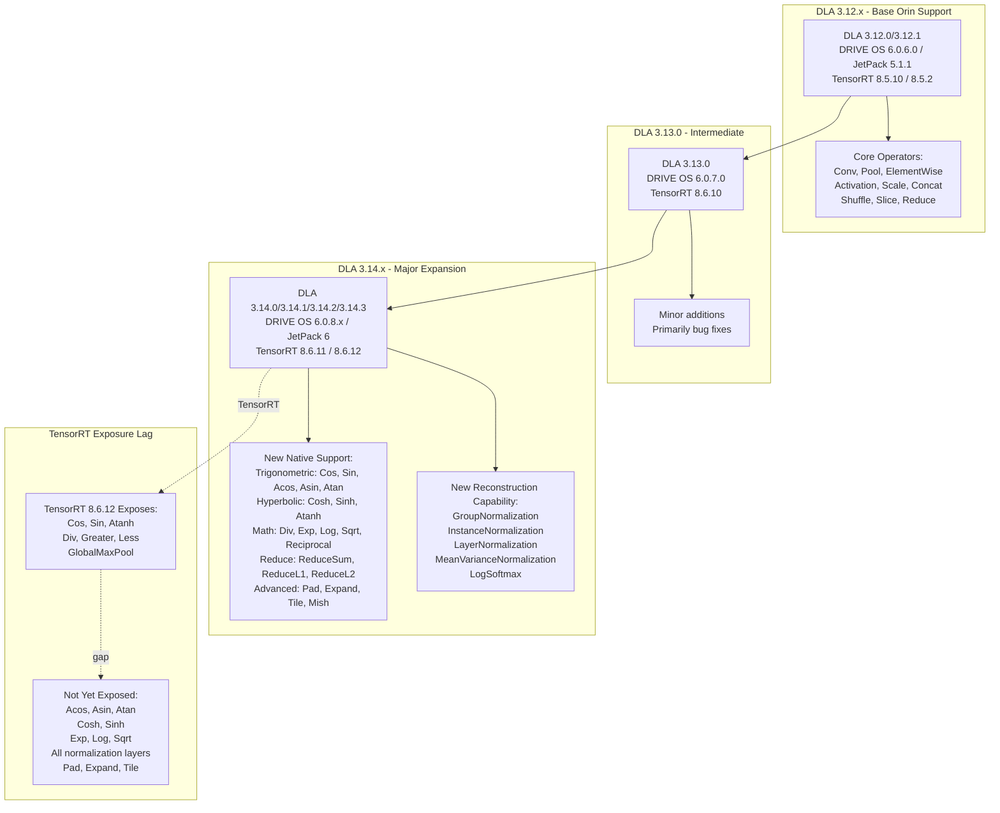

<!-- source: DeepWiki mcp.deepwiki.com · repo NVIDIA/Deep-Learning-Accelerator-SW · page 4.2 Operator Reconstruction Techniques · fetched 2026-10-26 -->

# Operator Reconstruction Techniques

<details>
<summary>Relevant source files</summary>

The following files were used as context for generating this wiki page:

- [FAQ/README.md](FAQ/README.md)
- [operators/README.md](operators/README.md)

</details>


## Purpose and Scope

This document explains techniques for decomposing unsupported ONNX operators into sequences of DLA-supported primitives to enable full network execution on DLA hardware. Operator reconstruction bridges the gap between operators available in DLA SW (the hardware capability) and operators exposed through TensorRT's API. For the complete operator support matrix with version-specific availability, see [Operator Support Matrix](#4.1). For hardware-level restrictions on supported operators, see [Layer Restrictions and Constraints](#4.3).

Sources: [operators/README.md:1-152](), [FAQ/README.md:36-43]()

---

## Overview of Operator Reconstruction

### The Three-Tier Support Hierarchy

DLA operator support follows a three-tier classification model that determines how an ONNX operation is executed:



**Tier 1 - Native Support**: Operators directly mapped to DLA hardware instructions by TensorRT. Examples: `Conv`, `Add`, `Relu`, `MaxPool`. These execute with optimal performance and no overhead.

**Tier 2 - TensorRT Reconstruction**: Operators automatically decomposed by TensorRT into supported primitives during the build phase. The user provides the ONNX model as-is, and TensorRT handles the decomposition internally. Examples: logical operations (`And`, `Or`), recurrent cells (`GRU`), index operations (`Gather`).

**Tier 3 - User-Level Reconstruction**: Operators that DLA SW supports natively (hardware capability exists) but TensorRT does not yet expose. Users must manually transform the ONNX graph before compilation using scripts in `op_reconstruction/`. Examples: `DepthToSpace`, `SpaceToDepth`, normalization layers (`GroupNormalization`, `InstanceNormalization`).

**Tier 4 - Not Supported**: Operators requiring a TensorRT RFE (Request for Enhancement). These either lack hardware support or have not been prioritized for exposure. Networks with these operators must use `--allowGPUFallback` for hybrid execution.

Sources: [operators/README.md:12-13](), [operators/README.md:34-152](), [FAQ/README.md:36-43]()

---

### The DLA SW vs TensorRT Exposure Gap



The distinction between "DLA SW support" and "TensorRT support" in the operator matrix [operators/README.md:34]() reflects this architectural gap. When DLA SW lists "Native (as of DLA 3.14.0)" but TensorRT shows "See RFE", the hardware capability exists but requires user-level reconstruction or waiting for TensorRT API expansion.

Sources: [operators/README.md:5-6](), [operators/README.md:12-13](), [operators/README.md:37-148]()

---

## Common Reconstruction Patterns

### Pattern 1: Logical Operations via Arithmetic Mapping

Boolean operations are reconstructed by mapping logical semantics to arithmetic operations on 0/1 values:

| Logical Operation | Arithmetic Reconstruction | DLA Primitives Used |
|-------------------|---------------------------|---------------------|
| `Not(x)` | `1 - x` | `Sub` (ElementWise) |
| `And(x, y)` | `x * y` | `Mul` (ElementWise) |
| `Or(x, y)` | `x + y - x*y` | `Add`, `Sub`, `Mul` |
| `Xor(x, y)` | `Abs(x - y)` | `Sub`, `Abs` (Unary) |

**Implementation**: [operators/op_reconstruction/Not.py](), [operators/op_reconstruction/And.py](), [operators/op_reconstruction/Or.py](), [operators/op_reconstruction/Xor.py]()

**Prerequisite**: Input tensors must contain only 0 or 1 values (typical output of comparison operations like `Greater`, `Equal`, `Less`).

Sources: [operators/README.md:40](), [operators/README.md:102-104](), [operators/README.md:151]()

---

### Pattern 2: Data Layout Transformations via Reshape-Transpose Sequences

Spatial-to-channel and channel-to-spatial transformations are decomposed into `Reshape` and `Transpose` operations:

```mermaid
graph TB
    subgraph "DepthToSpace Reconstruction"
        DTS_Input["Input: NCHW<br/>C = c * blocksize²"]
        DTS_R1["Reshape<br/>N, blocksize, blocksize, c, H, W"]
        DTS_T["Transpose<br/>N, c, H, blocksize, W, blocksize"]
        DTS_R2["Reshape<br/>N, c, H*blocksize, W*blocksize"]
        
        DTS_Input --> DTS_R1
        DTS_R1 --> DTS_T
        DTS_T --> DTS_R2
    end
    
    subgraph "SpaceToDepth Reconstruction"
        STD_Input["Input: NCHW"]
        STD_R1["Reshape<br/>N, C, H/blocksize, blocksize, W/blocksize, blocksize"]
        STD_T["Transpose<br/>N, C, blocksize, blocksize, H/blocksize, W/blocksize"]
        STD_R2["Reshape<br/>N, C*blocksize², H/blocksize, W/blocksize"]
        
        STD_Input --> STD_R1
        STD_R1 --> STD_T
        STD_T --> STD_R2
    end
```



**Implementation**: [operators/op_reconstruction/DepthToSpace.py](), [operators/op_reconstruction/SpaceToDepth.py]()

**DLA Hardware Mapping**: Both `Reshape` and `Transpose` map to the DLA Shuffle layer with BDMA engine assistance for memory layout transformations.

Sources: [operators/README.md:58](), [operators/README.md:137]()

---

### Pattern 3: Recurrent Operations via Unrolling

Recurrent neural network cells (GRU, LSTM, RNN) are reconstructed by unrolling timesteps into a sequence of feedforward operations:



**Decomposition**: Each GRU timestep becomes:
- 3 matrix multiplications (`MatMul` → DLA 1x1 Conv)
- 2 sigmoid activations (DLA Activation layer)
- 1 tanh activation (DLA Activation layer)
- Multiple elementwise operations (`Add`, `Mul`, `Sub`)

**Implementation**: [operators/op_reconstruction/GRU.py]()

**Performance Consideration**: Unrolling increases graph size linearly with sequence length. For long sequences (>50 timesteps), this may exhaust compilation memory or increase latency significantly.

Sources: [operators/README.md:78](), [operators/README.md:92](), [operators/README.md:122]()

---

### Pattern 4: Normalization Layers via Reduction Decomposition

GroupNormalization, InstanceNormalization, LayerNormalization, and MeanVarianceNormalization share a common reconstruction pattern:

**Standard Normalization Formula**:
```
output = (input - mean) / sqrt(variance + epsilon) * scale + bias
```

**Reconstruction Sequence** (7-step decomposition):



**Layer-Specific Reduction Axes**:

| Normalization Type | Reduction Axes | Shape Preserved |
|--------------------|----------------|-----------------|
| BatchNormalization | `[0,2,3]` | `[1]` (channel dimension) |
| InstanceNormalization | `[2,3]` | `[0,1]` (batch, channel) |
| LayerNormalization | `[1,2,3]` | `[0]` (batch only) |
| GroupNormalization | `[2,3]` within groups | `[0,1]` with reshape |

**DLA SW Status**: All required primitives (`ReduceMean`, `Sub`, `Pow`, `Add`, `Sqrt`, `Div`, `Mul`) are natively supported in DLA 3.14.0, but TensorRT does not yet expose these normalization layers as single operations.

Sources: [operators/README.md:77](), [operators/README.md:82-83](), [operators/README.md:100]()

---

### Pattern 5: Index-Based Operations via Convolution Emulation

`Gather` and `Scatter` operations can be reconstructed using convolution when indices are static or have limited variability:

**Gather Reconstruction Strategy**:
1. Convert indices to one-hot encoded masks
2. Use element-wise multiplication to select elements
3. Use convolution for aggregation along gather axis

**ScatterElements Reconstruction Strategy**:
1. Create identity mapping for non-scattered positions
2. Use element-wise operations to update scattered positions
3. Combine using addition with masked updates

**Implementation**: [operators/op_reconstruction/Gather.py](), [operators/op_reconstruction/ScatterElements.py]()

**Limitation**: Only practical for small index ranges or compile-time-known indices. Dynamic indices with large ranges require GPU fallback.

Sources: [operators/README.md:68-70](), [operators/README.md:124-125]()

---

### Pattern 6: Conditional Operations via Masking

The `Where(condition, x, y)` operation (selecting elements from `x` or `y` based on `condition`) is reconstructed using boolean masking:

**Reconstruction Formula**:
```
Where(condition, x, y) = condition * x + (1 - condition) * y
```

**Decomposition**:
1. Ensure `condition` contains only 0 or 1 values
2. Compute `mask = condition`
3. Compute `inverse_mask = 1 - condition`
4. Compute `term1 = mask * x`
5. Compute `term2 = inverse_mask * y`
6. Compute `result = term1 + term2`

**Implementation**: [operators/op_reconstruction/Where.py]()

**DLA Primitives**: Uses only `Sub`, `Mul`, and `Add` from the ElementWise layer.

Sources: [operators/README.md:150]()

---

## Detailed Reconstruction Code Structure

### op_reconstruction Script Architecture



Each reconstruction script follows a standard pattern:

1. **Load Model**: Use ONNX shape inference to propagate tensor shapes
2. **Locate Operators**: Find all instances of the target operator type
3. **Generate Replacement**: Create subgraph of supported primitives
4. **Wire Connections**: Connect new nodes to preserve data flow
5. **Clean Graph**: Remove original operator nodes
6. **Verify**: Run shape inference to validate correctness
7. **Save Model**: Export transformed ONNX model

Sources: [operators/README.md:12]()

---

## Implementation Guidelines

### Using op_reconstruction Scripts

**Directory Structure**:
```
operators/
├── README.md                    # Operator support matrix
├── op_reconstruction/
│   ├── And.py                  # Logical AND reconstruction
│   ├── DepthToSpace.py         # Spatial transformation
│   ├── Gather.py               # Index-based selection
│   ├── GRU.py                  # Recurrent cell unrolling
│   ├── Neg.py                  # Negation via subtraction
│   ├── Not.py                  # Logical NOT reconstruction
│   ├── Or.py                   # Logical OR reconstruction
│   ├── ScatterElements.py      # Index-based scatter
│   ├── SpaceToDepth.py         # Spatial transformation
│   ├── Where.py                # Conditional selection
│   └── Xor.py                  # Logical XOR reconstruction
```

**Typical Usage Workflow**:

1. **Identify Unsupported Operators**: Compile model with `trtexec --onnx=model.onnx --useDLACore=0` and check build logs for unsupported operators.

2. **Apply Reconstruction Script**: 
   ```bash
   python operators/op_reconstruction/Not.py \
       --input original_model.onnx \
       --output transformed_model.onnx
   ```

3. **Verify Transformation**: Use ONNX tools to validate graph structure:
   ```bash
   python -m onnx.tools.check_model transformed_model.onnx
   python -m onnx.tools.shape_inference transformed_model.onnx
   ```

4. **Recompile**: Build engine with transformed model and verify DLA execution:
   ```bash
   trtexec --onnx=transformed_model.onnx \
           --useDLACore=0 \
           --int8 \
           --dumpLayersInfo=dla_layers.txt
   ```

5. **Validate Accuracy**: Compare outputs between original and transformed models using TensorRT Polygraphy (see [Profiling and Debugging Tools](#7.4)).

Sources: [operators/README.md:12]()

---

### Graph Transformation Best Practices

**Preserve Tensor Metadata**:
- Maintain original tensor names for inputs/outputs to avoid breaking downstream consumers
- Copy `value_info` entries to preserve shape and dtype information
- Propagate quantization metadata (scales, zero points) through reconstruction

**Handle Edge Cases**:
- **Dynamic Shapes**: Ensure reconstruction handles dynamic batch sizes and spatial dimensions
- **Broadcasting**: Account for implicit broadcasting in elementwise operations
- **Data Types**: Verify reconstruction supports both FP16 and INT8 precision paths
- **Constant Folding**: Mark intermediate constants as initializers to enable TensorRT optimization

**Naming Conventions**:
- Use descriptive node names: `<original_op>_recon_<subop>_<index>`
- Example: `Not_123` → `Not_123_recon_sub_0`, `Not_123_recon_const_1`
- Ensures uniqueness and traceability for debugging

**Testing Strategy**:
- Unit test each reconstruction script with synthetic ONNX models
- Compare numerical outputs between original and reconstructed graphs (tolerance: 1e-5 for FP16, 1e-2 for INT8)
- Profile performance to ensure reconstruction doesn't introduce excessive latency

Sources: [operators/README.md:12]()

---

## Performance Considerations

### Latency Impact of Reconstruction

Reconstruction typically increases layer count but maintains similar computational complexity:

| Operator | Native Layers | Reconstructed Layers | Latency Impact |
|----------|---------------|----------------------|----------------|
| `Not` | 1 (unsupported) | 2 (`Constant`, `Sub`) | +2-5% |
| `And` | 1 (unsupported) | 1 (`Mul`) | Negligible |
| `GRU` (10 steps) | 1 (unsupported) | ~60 (`MatMul`, `Sigmoid`, `Tanh`, `Add`, `Mul`, `Sub`) | +10-20% |
| `DepthToSpace` | 1 (unsupported) | 3 (`Reshape`, `Transpose`, `Reshape`) | +1-3% |
| `GroupNorm` | 1 (unsupported) | 9 (`ReduceMean`, `Sub`, `Pow`, `Add`, `Sqrt`, `Div`, `Mul`, `Add`) | +5-10% |

**Key Factors Affecting Performance**:

1. **Operator Fusion**: TensorRT may fuse reconstructed primitives during compilation, recovering some overhead. Enable layer fusion with `--buildOnly` flag during debugging.

2. **Memory Bandwidth**: Reconstruction creates intermediate tensors. If these don't fit in DLA's 1 MiB SRAM, they spill to DRAM, increasing memory traffic.

3. **Precision**: INT8 reconstruction benefits from DLA's optimized INT8 compute (105 TOPs on Orin). FP16 reconstruction may be slower due to Orin's reduced FP16 throughput (5 TOPs).

4. **Instruction Overhead**: Each reconstructed operation incurs DLA Falcon scheduling overhead (~1-2 microseconds per operation).

Sources: [FAQ/README.md:36-43]()

---

### Memory Usage Considerations

Reconstruction generates additional intermediate tensors that consume DLA SRAM:

**SRAM Constraints**:
- Orin: 1 MiB per DLA core (exclusive)
- Xavier: 4 MiB shared between 2 DLAs and 2 PVAs

**Memory Pressure Scenarios**:

1. **Normalization Reconstruction**: Creates 5-7 intermediate tensors (centered, squared, variance, std, etc.). For large feature maps (e.g., 512×64×64), this can exceed SRAM capacity.

2. **Recurrent Unrolling**: Each timestep's hidden state creates persistent tensors. Long sequences (>50 steps) multiply memory requirements.

3. **Gather with One-Hot Encoding**: Converting indices to masks increases memory by factor of `vocabulary_size`.

**Mitigation Strategies**:
- Use `--memPoolSize=dlaSRAM:1` to explicitly allocate DLA SRAM
- Apply graph optimizations to reduce tensor lifetimes (enable with `--tacticSources=-CUDNN,-CUBLAS,+EDGE_MASK_CONVOLUTIONS`)
- Consider batching strategy: smaller batches reduce per-layer memory footprint

Sources: [FAQ/README.md:96-98](), [FAQ/README.md:118-122]()

---

### Optimization Opportunities

**Fusion After Reconstruction**:
TensorRT's graph optimizer can fuse reconstructed primitives:



**Training-Time Reconstruction**:
Instead of post-training ONNX transformation, embed reconstruction in the training framework:

- PyTorch: Define custom `nn.Module` that implements operator using primitives
- TensorFlow: Use `tf.function` to define composite operations
- Advantage: Quantization-aware training can optimize reconstructed path directly

**Operator Substitution**:
Replace unsupported operators with functionally equivalent supported operators:

| Unsupported | Supported Alternative | Condition |
|-------------|----------------------|-----------|
| `Upsample` (bilinear) | `Resize` (nearest) | If accuracy permits |
| `TransposedConv` (stride > kernel) | `Resize` + `Conv` | For upsampling |
| `GlobalAveragePool` | `AveragePool` (kernel=spatial_dims) | For classification heads |

Sources: [FAQ/README.md:37-43]()

---

## Version Evolution and RFE Status

### DLA Software Version Timeline



**Key Milestones**:

- **DLA 3.12.x**: Initial Orin support with core convolution, pooling, and elementwise operations
- **DLA 3.14.0**: Major expansion adding 40+ mathematical operators including trigonometric, hyperbolic, and advanced reduction operations
- **TensorRT 8.6.12**: Exposed subset of DLA 3.14.0 capabilities (trigonometric: `Cos`, `Sin`; comparison: `Greater`, `Less`; reduce: `GlobalMaxPool`)

**Remaining Gap**: Approximately 30-40 operators have native DLA HW support but require user-level reconstruction due to lack of TensorRT exposure.

Sources: [operators/README.md:14-26](), [operators/README.md:37-148]()

---

### Filing Request for Enhancement (RFE)

When an operator is listed as "See RFE" in the support matrix, users can request TensorRT to expose it:

**RFE Process**:

1. **Verify DLA SW Support**: Check if operator shows "Native" in DLA SW column but "See RFE" in TensorRT column in [Operator Support Matrix](#4.1).

2. **File GitHub Issue**: Create issue at https://github.com/NVIDIA/TensorRT/issues with:
   - Operator name and ONNX opset version
   - Use case description (which model requires it)
   - DLA SW version where operator is available
   - Impact assessment (performance, accuracy, deployment timeline)

3. **Notify NVIDIA Representative**: For NVIDIA DRIVE customers, escalate through official support channels to expedite prioritization.

4. **Alternative: Engage with OSS Team**: For DLA SW-specific issues (not TensorRT API), file issue at https://github.com/NVIDIA/Deep-Learning-Accelerator-SW/issues.

**Expected Timeline**:
- Low-complexity operators (single instruction mapping): 1-2 TensorRT releases (~6 months)
- High-complexity operators (multi-instruction sequences): 2-4 releases (~12 months)
- Operators requiring API redesign: 4+ releases (future roadmap)

Sources: [operators/README.md:28-30](), [FAQ/README.md:139-141]()

---

## Summary

Operator reconstruction is a critical technique for maximizing DLA utilization when models contain operators not yet exposed by TensorRT. The three-tier support hierarchy (Native, TensorRT Reconstruction, User Reconstruction) provides a clear framework for understanding which operators require manual intervention. The `op_reconstruction/` scripts demonstrate proven patterns for decomposing complex operations into DLA-supported primitives, with typical latency overhead of 1-20% depending on operator complexity.

For operators requiring reconstruction, evaluate the trade-off between development effort (manual graph transformation), performance impact (additional layers and memory), and maintenance burden (version-specific workarounds). In many cases, filing an RFE and waiting for TensorRT to expose the operator natively provides better long-term support than maintaining custom reconstruction scripts.

Sources: [operators/README.md:1-152](), [FAQ/README.md:36-43]()

---

