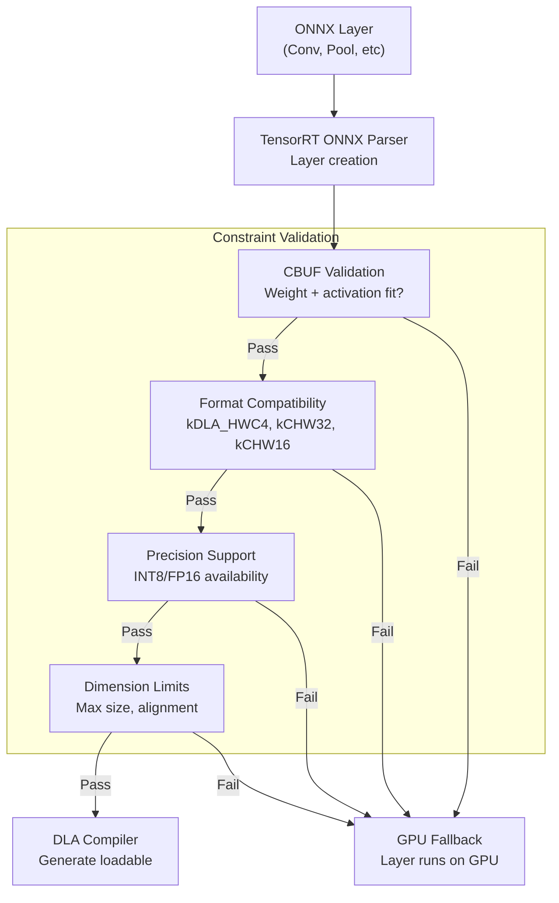
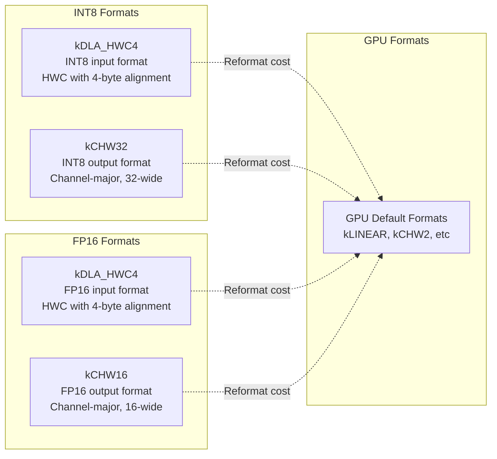
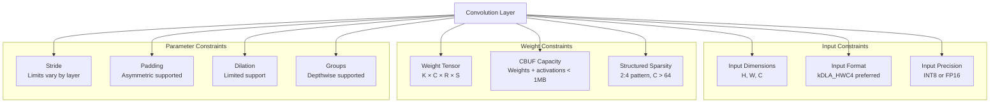
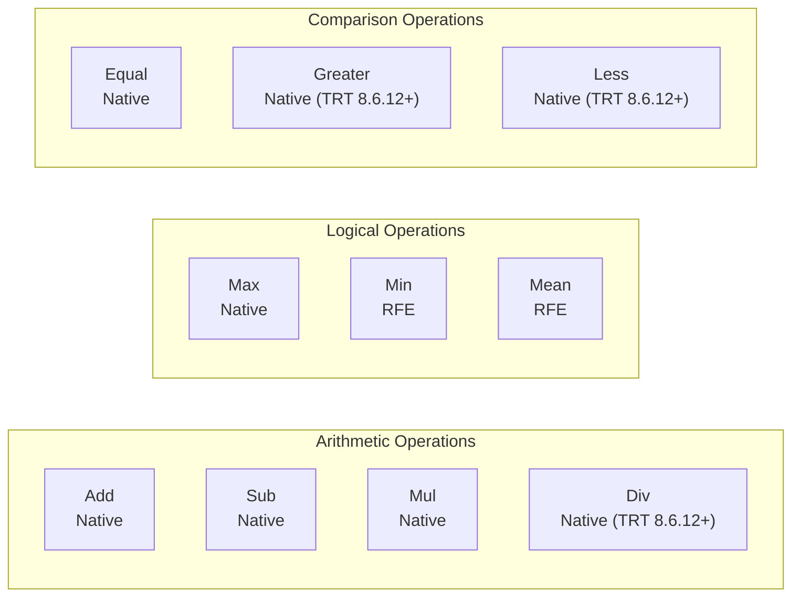
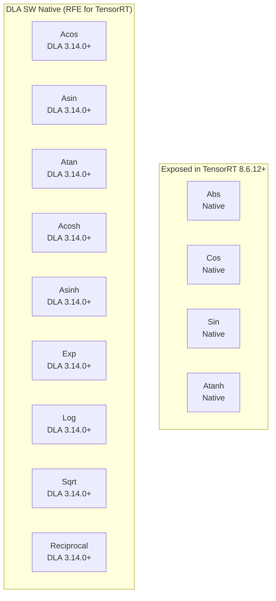
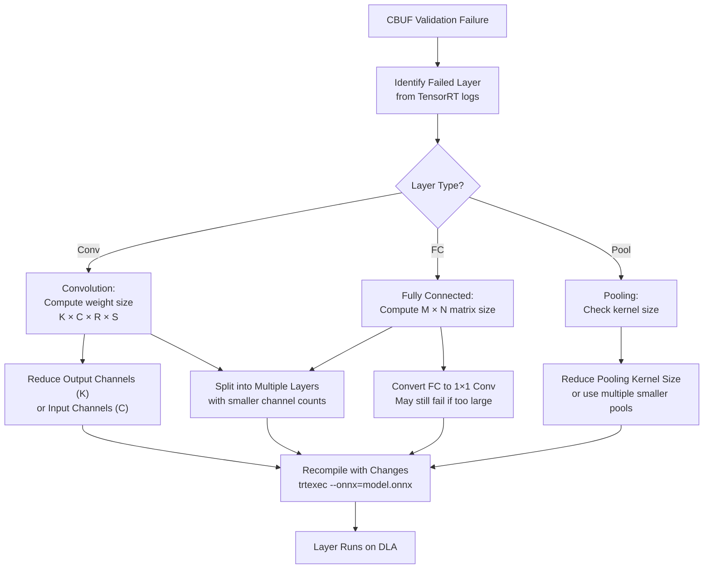
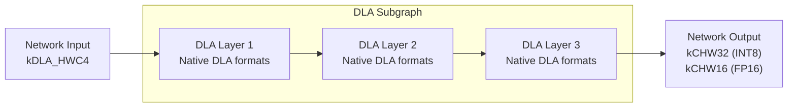

<!-- source: DeepWiki mcp.deepwiki.com · repo NVIDIA/Deep-Learning-Accelerator-SW · page 4.3 Layer Restrictions and Constraints · fetched 2026-10-26 -->

# Layer Restrictions and Constraints

<details>
<summary>Relevant source files</summary>

The following files were used as context for generating this wiki page:

- [FAQ/README.md](FAQ/README.md)
- [operators/README.md](operators/README.md)

</details>


## Purpose and Scope

This page documents layer-specific restrictions and constraints when deploying neural network layers on DLA hardware. These restrictions include dimensional limits, precision requirements, tensor format constraints, and internal memory (CBUF) validation requirements. Understanding these constraints is critical for successfully compiling models to run on DLA.

For information about which ONNX operators are supported and their implementation status, see [Operator Support Matrix](#4.1). For techniques to work around unsupported operators through decomposition, see [Operator Reconstruction Techniques](#4.2). For precision configuration and calibration workflows, see [Precision Configuration](#5.3).

---

## Overview of DLA Layer Constraints

DLA hardware imposes specific restrictions on layers to ensure efficient execution on its specialized engines (CPIPEs for INT8, Rubik for FP16, BDMA for memory operations). These constraints primarily stem from:

1. **Internal SRAM (CBUF) capacity** - Limited buffer size for storing intermediate data and weights
2. **Tensor format requirements** - Specific memory layout expectations for optimal hardware utilization
3. **Precision dependencies** - Certain operations only supported in specific precisions
4. **Dimensional limits** - Hardware pipeline restrictions on tensor dimensions

The following diagram illustrates how layers are validated against these constraints during compilation:



**Sources:** [FAQ/README.md:133-137](), [operators/README.md:8]()

---

## General Restrictions Applicable to All Layers

### CBUF Validation Requirements

The DLA has an internal SRAM called **CBUF** (Convolution Buffer) used to store activations and weights during computation. As of TensorRT 8.6.0, TensorRT performs heuristic-based validation before mapping a layer to DLA to ensure its data fits in CBUF.

**Key Points:**
- **Orin DLA**: Each core has exclusive access to **1 MiB** of internal SRAM
- **Xavier DLA**: 2 DLAs and 2 PVAs share **4 MiB** total SRAM
- CBUF validation failures result in GPU fallback
- Layers with large weight tensors or high channel counts are most susceptible

**Common CBUF Validation Failure Scenarios:**

| Layer Type | Typical Cause | Workaround |
|------------|---------------|------------|
| Convolution | Large kernel size × input channels × output channels | Reduce channels, split into multiple layers |
| Fully Connected | Large weight matrix (M × N) | Convert to 1×1 Conv, split into smaller FCs |
| Deconvolution | Large transposed convolution weights | Reduce stride, use Resize + Conv instead |

**Sources:** [FAQ/README.md:133-137]()

---

### Tensor Format Constraints

DLA requires specific tensor memory layouts for efficient execution. Mismatched formats between GPU and DLA layers trigger expensive reformatting operations.

#### Supported Tensor Formats



**Format Compatibility Rules:**
- `kDLA_HWC4` should be used for **network inputs** when building with `--inputIOFormats=int8:dla_hwc4` or `--inputIOFormats=fp16:dla_hwc4`
- `kCHW32` (INT8) or `kCHW16` (FP16) should be used for **network outputs** with `--outputIOFormats=int8:chw32` or `--outputIOFormats=fp16:chw16`
- **Mixed precision constraint**: FP16 `kDLA_HWC4` inputs consumed by INT8 Conv (or vice versa) are **not supported**. The Conv layer's precision must match the input's precision.

**Sources:** [FAQ/README.md:46-48](), [FAQ/README.md:136-137]()

---

### Precision Constraints

DLA supports **INT8** and **FP16** precisions, with different hardware engines optimized for each:

| Precision | Hardware Engine | Performance Notes |
|-----------|----------------|-------------------|
| INT8 | CPIPE (Convolution Pipes) | Primary mode on Orin, ~9× compute vs Xavier |
| FP16 | Rubik Engine | Reduced throughput on Orin vs Xavier, hybrid precision recommended |

**Mixed Precision Execution:**
- Layers without INT8 quantization scales automatically fall back to FP16
- FP16 fallback requires `--fp16` flag during compilation
- Hybrid INT8/FP16 execution is common for models with unsupported INT8 operations

**Sources:** [FAQ/README.md:60-68]()

---

## Layer-Specific Restrictions

### Convolution and Fully Connected Layers

Convolution is the primary compute layer on DLA, executed on CPIPE engines (INT8) or Rubik engine (FP16).

#### Convolution Layer Constraints



**Key Restrictions:**
- **Weights must be constant**: Dynamic weights not supported, weights must be known at compile time
- **CBUF validation**: Total size of weights + activation tensors must fit in 1 MiB (Orin) or shared 4 MiB (Xavier)
- **Structured sparsity**: 2:4 sparse patterns require **C > 64** (input channels > 64) to enable
- **Compute precision vs input precision**: If input is FP16 `kDLA_HWC4` but Conv is INT8 (or vice versa), **not supported**

**Fully Connected Layer Handling:**
- Internally translated to 1×1 Convolution by TensorRT
- Second input (weight matrix) must be constant
- Same CBUF constraints apply

**Sources:** [operators/README.md:53](), [operators/README.md:71](), [operators/README.md:93](), [FAQ/README.md:88](), [FAQ/README.md:136-137]()

---

### Deconvolution (Transposed Convolution) Layer

Deconvolution layers are supported but subject to similar constraints as standard convolutions.

**Specific Considerations:**
- **Large stride deconvolutions** may fail CBUF validation due to expanded output sizes
- **Alternative approach**: Use `Resize` (nearest-neighbor or bilinear) followed by standard `Conv` for upsampling
- Weight tensors follow same CBUF capacity limits

**Sources:** [operators/README.md:54](), [FAQ/README.md:41]()

---

### Pooling Layer

Pooling operations (AveragePool, MaxPool) are natively supported on DLA with specific dimensional and parameter constraints.

#### Pooling Constraints

| Constraint Type | Limitation |
|----------------|------------|
| **Kernel size** | Specific maximum sizes (refer to TensorRT DLA documentation) |
| **Stride** | Must align with hardware pipeline requirements |
| **Padding** | Symmetric and asymmetric padding supported |
| **Precision** | INT8 and FP16 supported |

**GlobalAveragePool and GlobalMaxPool:**
- `GlobalAveragePool`: Native support in DLA SW, RFE for TensorRT exposure
- `GlobalMaxPool`: Native support as of TensorRT 8.6.12
- **Reconstruction alternative**: Can be decomposed into multiple standard pooling layers for older TensorRT versions

**Sources:** [operators/README.md:45](), [operators/README.md:74](), [operators/README.md:95](), [operators/README.md:110]()

---

### ElementWise Layer

ElementWise operations (Add, Sub, Mul, Div, Max, etc.) are supported with broadcasting semantics.

#### ElementWise Operation Support



**Broadcasting Constraints:**
- Standard NumPy-style broadcasting rules apply
- Both inputs must be on DLA (no cross-device broadcasting)
- Format compatibility required between operands

**Sources:** [operators/README.md:39](), [operators/README.md:60](), [operators/README.md:75](), [operators/README.md:85](), [operators/README.md:94](), [operators/README.md:101]()

---

### Scale Layer

The Scale layer implements BatchNormalization and channel-wise scaling operations.

**Supported Operations:**
- **BatchNormalization**: Full support, fused with convolution when possible
- **Channel-wise scale/bias**: Applied as `y = (x * scale) + bias`
- **Broadcasting**: Scale and bias tensors broadcast to input tensor

**Format Requirements:**
- Scale and bias tensors must be 1D (channel dimension)
- Constant scale/bias values required (dynamic scaling not supported)

**Sources:** [operators/README.md:46](), [operators/README.md:39](), [operators/README.md:101]()

---

### Activation Layer

DLA supports common activation functions natively in hardware.

#### Activation Function Support Matrix

| Activation | Support Status | Notes |
|------------|---------------|-------|
| **ReLU** | Native | Most efficient activation on DLA |
| **Sigmoid** | Native | Piecewise approximation in hardware |
| **Tanh** | Native | Piecewise approximation in hardware |
| **LeakyReLU** | Native | Negative slope parameter supported |
| **Clip** | Native | Min/max clipping bounds |
| **ELU** | RFE | DLA SW native as of 3.14.0 |
| **HardSigmoid** | RFE | DLA SW native as of 3.14.0 |
| **HardSwish** | RFE | DLA SW native as of 3.14.0 |
| **Mish** | RFE | DLA SW native as of 3.14.0 |

**Precision Notes:**
- All supported activations work in both INT8 and FP16
- Piecewise linear approximations used for non-linear functions (Sigmoid, Tanh)

**Sources:** [operators/README.md:49](), [operators/README.md:79](), [operators/README.md:80](), [operators/README.md:84](), [operators/README.md:98](), [operators/README.md:119](), [operators/README.md:129](), [operators/README.md:144]()

---

### Parametric ReLU Layer

Parametric ReLU (PReLU) allows learned negative slopes per channel.

**Constraints:**
- Slope parameters must be constant (per-channel)
- Slope tensor shape must match input channel dimension
- Both INT8 and FP16 supported

**Sources:** [operators/README.md:107]()

---

### LRN (Local Response Normalization) Layer

LRN performs local normalization across channels.

**Support Status:**
- Native support on DLA
- Parameters (local size, alpha, beta, k) must be constant

**Sources:** [operators/README.md:91]()

---

### Concatenation Layer

Concatenation combines multiple tensors along a specified axis.

**Constraints:**
- All input tensors must have matching formats
- Concatenation axis typically the channel dimension (C)
- All inputs must be on DLA (no GPU/DLA mixed concatenation)

**Sources:** [operators/README.md:50]()

---

### Shuffle Layer (Reshape, Transpose)

Shuffle operations include Reshape and Transpose, primarily executed on BDMA engine.

#### Reshape Constraints

**Supported:**
- Arbitrary reshape operations preserving element count
- Shape inference from runtime dimensions (with limitations)

**Restrictions:**
- Dynamic shapes may trigger GPU fallback if not inferrable at compile time
- Format conversions may be implicitly inserted

#### Transpose Constraints

**Supported:**
- Arbitrary axis permutations
- Both INT8 and FP16

**Restrictions:**
- Expensive operations on DLA (prefer avoiding when possible)
- May trigger format conversions

**Sources:** [operators/README.md:120](), [operators/README.md:146]()

---

### Slice Layer

Slice extracts sub-tensors along specified dimensions.

**Supported:**
- Multi-dimensional slicing with start, end, stride parameters
- Dynamic slice parameters (within limits)

**Restrictions:**
- Slice parameters must be inferrable at compile time or within supported dynamic ranges
- Negative indexing support varies

**Sources:** [operators/README.md:133](), [operators/README.md:138]()

---

### SoftMax Layer

SoftMax applies normalization across specified axis.

**Constraints:**
- Axis parameter must be constant
- Typically applied on channel or final dimension
- Both INT8 and FP16 supported

**Sources:** [operators/README.md:134]()

---

### Unary Layer

Unary operations apply element-wise mathematical functions.

#### Unary Operation Support



**Note:** Many unary operations became available in DLA SW 3.14.0 but require TensorRT RFE for exposure. Users can reconstruct these using supported primitives until TensorRT exposes them.

**Sources:** [operators/README.md:36](), [operators/README.md:37-43](), [operators/README.md:55](), [operators/README.md:87](), [operators/README.md:109](), [operators/README.md:131](), [operators/README.md:139]()

---

### Reduce Layer

Reduce operations aggregate tensor values across specified dimensions.

#### Reduce Operation Support

| Reduce Operation | Support Status | Notes |
|------------------|---------------|-------|
| **ReduceMean** | RFE | Can be reconstructed with AveragePool or Conv |
| **ReduceSum** | Reconstruction | Decompose into Conv or AveragePool + rescaling |
| **ReduceMin** | RFE | Native in DLA SW |
| **ReduceMax** | Native (TRT 8.6.12+) | GlobalMaxPool in TensorRT |
| **ReduceL1** | RFE | DLA SW 3.14.0+ |
| **ReduceL2** | RFE | DLA SW 3.14.0+ |
| **ReduceSumSquare** | RFE | DLA SW 3.14.0+ |

**Reconstruction Approach for ReduceMean:**
- Use AveragePool with appropriate kernel size
- Or use 1×1 Conv with equal weights

**Sources:** [operators/README.md:110-118]()

---

### Comparison Operations

Comparison operations produce boolean tensors from element-wise comparisons.

**Supported Operations:**
- **Equal**: Native support
- **Greater**: Native (TensorRT 8.6.12+)
- **Less**: Native (TensorRT 8.6.12+)
- **GreaterOrEqual**: RFE (DLA SW 3.14.0+)
- **LessOrEqual**: RFE (DLA SW 3.14.0+)

**Format Requirements:**
- Output format is typically INT8 (0 or 1 values)
- Broadcasting supported between operands

**Sources:** [operators/README.md:62](), [operators/README.md:75](), [operators/README.md:76](), [operators/README.md:85](), [operators/README.md:86]()

---

### Resize Layer

Resize operations perform spatial upsampling or downsampling.

**Supported Modes:**
- **Nearest Neighbor**: Efficient on DLA
- **Bilinear**: Supported with some restrictions
- **Scales vs Sizes**: Use `scales` parameter preferred over absolute `sizes` for better compatibility

**Common Issue:**
- Using `sizes` instead of `scales` can cause compatibility issues
- Model preparation scripts often convert `sizes` to `scales`

**Sources:** [operators/README.md:121](), [operators/README.md:149]()

---

## CBUF Validation Failure Troubleshooting

CBUF validation failures are among the most common DLA compilation issues. The following flowchart helps diagnose and resolve them:



**Practical Example:**

A Convolution layer with:
- Input channels (C) = 512
- Output channels (K) = 512  
- Kernel size (R × S) = 3 × 3

**Weight size calculation:**
```
Weight tensor size = K × C × R × S × sizeof(type)
                   = 512 × 512 × 3 × 3 × 1 byte (INT8)
                   = 2,359,296 bytes
                   = ~2.25 MiB
```

This **exceeds** the 1 MiB CBUF limit on Orin, causing validation failure.

**Solutions:**
1. Reduce output channels from 512 to 256 → Weight size becomes ~576 KiB
2. Split into two 256-channel convolutions followed by concatenation
3. Allow GPU fallback with `--allowGPUFallback` flag

**Sources:** [FAQ/README.md:133-137]()

---

## Format Mismatch Prevention

Format mismatches between DLA layers and surrounding GPU layers cause expensive reformat operations. The following best practices minimize this overhead:

### Recommended Format Configuration



**trtexec Configuration:**
```bash
# INT8 configuration with reformat-free I/O
trtexec --onnx=model.onnx \
        --int8 \
        --useDLACore=0 \
        --inputIOFormats=int8:dla_hwc4 \
        --outputIOFormats=int8:chw32
        
# FP16 configuration with reformat-free I/O
trtexec --onnx=model.onnx \
        --fp16 \
        --useDLACore=0 \
        --inputIOFormats=fp16:dla_hwc4 \
        --outputIOFormats=fp16:chw16
```

**Sources:** [FAQ/README.md:46-48](), [FAQ/README.md:55]()

---

## Mixed Precision Restrictions

When using hybrid INT8/FP16 precision, certain layer combinations are restricted:

### Unsupported Mixed Precision Scenarios

| Input Format | Layer Precision | Status |
|--------------|----------------|--------|
| FP16 `kDLA_HWC4` | INT8 Conv | ❌ Not Supported |
| INT8 `kDLA_HWC4` | FP16 Conv | ❌ Not Supported |
| FP16 `kCHW16` | INT8 Conv | ✅ Supported (with reformat) |
| INT8 `kCHW32` | FP16 Conv | ✅ Supported (with reformat) |

**Workaround:**
Update the Conv layer's precision to match the input's precision. This typically requires adjusting the per-layer precision configuration in TensorRT builder.

**Sources:** [FAQ/README.md:136-137]()

---

## Structured Sparsity Constraints

DLA on Orin supports 2:4 structured sparsity for accelerated inference, but this requires specific conditions:

**Requirements for Sparse Execution:**
1. **Pattern constraint**: For every 4 consecutive weights along the channel (C) dimension, at least 2 must be zeros
2. **Channel constraint**: Input channels **C > 64** required for sparsity to activate
3. **Compilation flag**: Build with `--sparsity=force` in trtexec

**Performance Impact:**
- Sparse convolutions achieve **1.24×–1.47×** speedup over dense
- Benefits increase at lower power modes (15W, 30W)

For more information on structured sparsity, see [Structured Sparsity](#5.4).

**Sources:** [FAQ/README.md:87-88]()

---

## Summary of Key Restrictions

The following table summarizes the most critical restrictions developers encounter:

| Restriction Category | Key Limitation | Impact | Workaround |
|---------------------|----------------|--------|------------|
| **CBUF Capacity** | 1 MiB per core (Orin) | Large convolutions fail validation | Reduce channels, split layers |
| **Tensor Formats** | `kDLA_HWC4` input mismatch with layer precision | Not supported | Match layer precision to input format |
| **Dynamic Shapes** | Limited runtime shape inference | Some ops fall back to GPU | Use static shapes when possible |
| **Weight Constants** | All weights must be compile-time constants | Dynamic weights unsupported | Convert model to static weights |
| **Sparse Channels** | C > 64 required for 2:4 sparsity | Small networks can't use sparsity | Design networks with wider channels |
| **Format Conversion** | Cross-device data transfer overhead | Increased latency | Use reformat-free I/O options |

**Sources:** [FAQ/README.md:133-137](), [FAQ/README.md:136-137](), [FAQ/README.md:87-88](), [FAQ/README.md:46-48]()

---

## References to TensorRT Documentation

This page provides an overview of DLA layer restrictions specific to the Deep Learning Accelerator SW repository. For comprehensive and authoritative documentation, always refer to the official TensorRT Developer Guide:

- [General DLA Restrictions](https://docs.nvidia.com/deeplearning/tensorrt/developer-guide/index.html#dla-lay-supp-rest)
- [Layer Support and Restrictions](https://docs.nvidia.com/deeplearning/tensorrt/developer-guide/index.html#dla_layers)
- [Reformat-Free Network Tensors](https://docs.nvidia.com/deeplearning/tensorrt/developer-guide/index.html#reformat-free-network-tensors)

For platform-specific DLA characteristics and power modes, see [Supported Platforms](#1.3) and [Power Modes and Efficiency](#7.3).

**Sources:** [operators/README.md:8](), [FAQ/README.md:55]()

---

