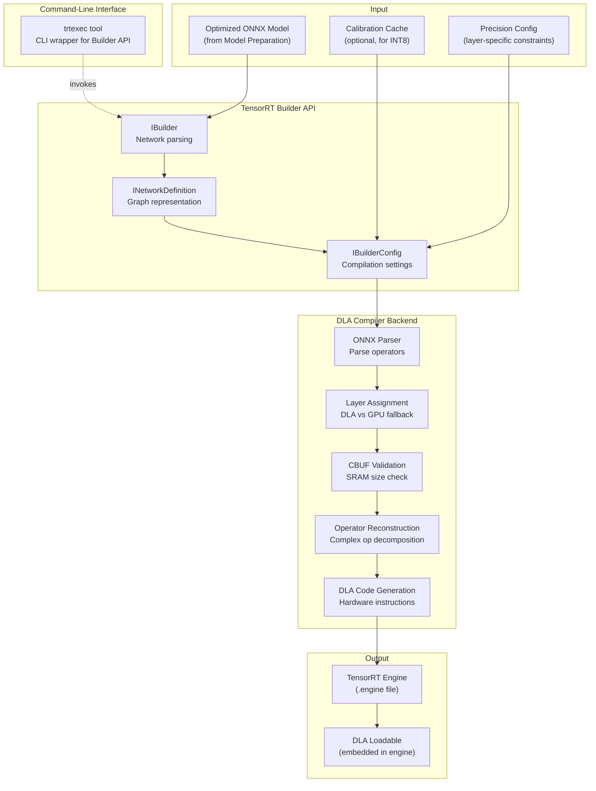
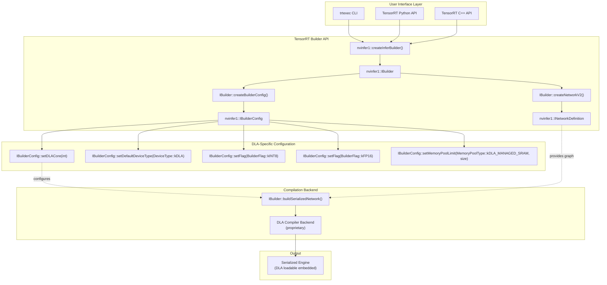
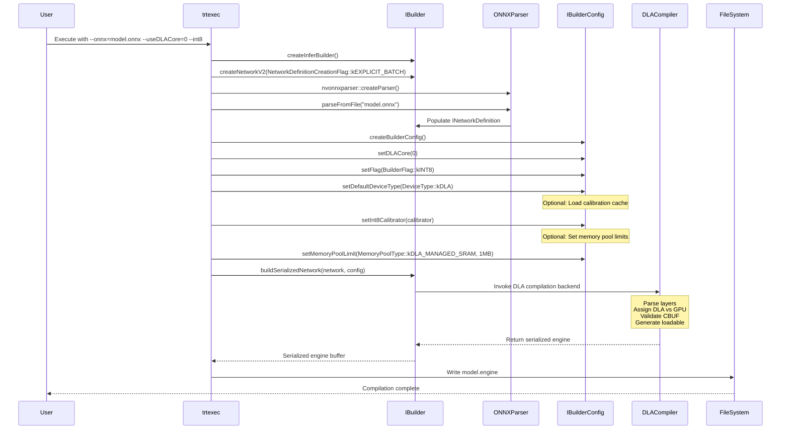
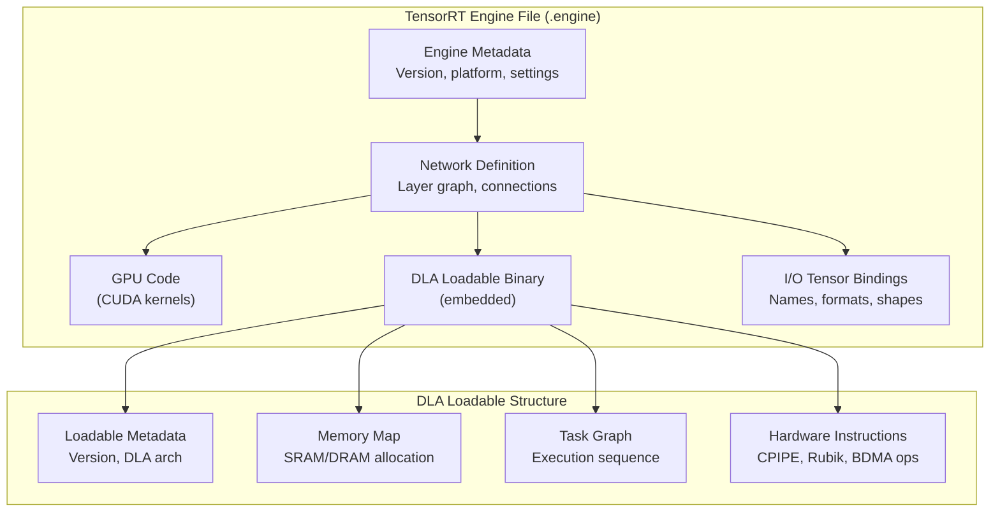

<!-- source: DeepWiki mcp.deepwiki.com · repo NVIDIA/Deep-Learning-Accelerator-SW · page 5 Model Compilation · fetched 2026-10-26 -->

# Model Compilation

<details>
<summary>Relevant source files</summary>

The following files were used as context for generating this wiki page:

- [FAQ/README.md](FAQ/README.md)
- [scripts/prepare_models/README.md](scripts/prepare_models/README.md)

</details>


## Purpose and Scope

This page covers the process of compiling ONNX models into DLA loadables (executable binaries) using TensorRT's compilation tools. Model compilation is the offline phase where network graphs are parsed, optimized, and translated into hardware-specific instruction sequences for DLA execution.

For model preparation steps (graph optimization, quantization, QDQ translation) that occur before compilation, see [Model Preparation](#3). For runtime deployment and execution of compiled loadables, see [Runtime and Deployment](#6).

**Sources:** [FAQ/README.md:78-85]()

---

## Compilation Pipeline Overview

The compilation pipeline transforms an optimized ONNX model into a DLA loadable binary through TensorRT's compilation infrastructure:



**Compilation Phases:**

1. **Network Parsing:** ONNX model is parsed into TensorRT's internal graph representation (`INetworkDefinition`)
2. **Layer Assignment:** Layers are assigned to DLA or GPU based on operator support and constraints
3. **CBUF Validation:** Convolution layers are validated against DLA's internal SRAM (Convolution Buffer) capacity
4. **Operator Reconstruction:** Unsupported operators are decomposed into DLA-compatible primitives where possible
5. **Code Generation:** DLA compiler generates hardware-specific loadable instructions

**Sources:** [FAQ/README.md:78-85](), [scripts/prepare_models/README.md:1-136]()

---

## TensorRT Builder as Compiler Interface

TensorRT Builder is the only supported interface to the DLA compiler. The architecture separates the compilation frontend (TensorRT Builder API) from the backend (DLA compiler):



**Key API Components:**

| Component | Purpose |
|-----------|---------|
| `nvinfer1::IBuilder` | Main builder interface for creating networks and configurations |
| `nvinfer1::INetworkDefinition` | Represents the parsed network graph |
| `nvinfer1::IBuilderConfig` | Compilation settings including DLA core selection, precision, memory limits |
| `nvinfer1::IBuilder::buildSerializedNetwork()` | Invokes compilation and returns serialized engine |

**Sources:** [FAQ/README.md:78-82]()

---

## Compilation Workflow

The typical compilation workflow follows these steps:



**Compilation Steps:**

1. **Initialize Builder:** Create `IBuilder` instance via `createInferBuilder()`
2. **Parse Network:** Use ONNX parser to populate `INetworkDefinition` from ONNX file
3. **Configure Builder:** Create `IBuilderConfig` and set DLA-specific options:
   - `setDLACore(N)`: Select DLA core 0 or 1
   - `setFlag(BuilderFlag::kINT8)`: Enable INT8 precision
   - `setFlag(BuilderFlag::kFP16)`: Enable FP16 precision
   - `setDefaultDeviceType(DeviceType::kDLA)`: Prefer DLA over GPU
   - `setMemoryPoolLimit()`: Configure DLA SRAM usage
4. **Load Calibration (Optional):** For INT8 quantization, provide calibration cache or calibrator
5. **Build Engine:** Call `buildSerializedNetwork()` to invoke DLA compiler
6. **Serialize Output:** Write serialized engine containing DLA loadable to disk

**Sources:** [FAQ/README.md:78-85](), [scripts/prepare_models/README.md:23-26]()

---

## trtexec Command-Line Tool

`trtexec` is the primary command-line interface for DLA compilation. It wraps the TensorRT Builder API and provides flags for all compilation options.

### Basic Compilation Syntax

```bash
trtexec --onnx=<model.onnx> \
        --useDLACore=<0|1> \
        --int8 \
        --saveEngine=<output.engine>
```

### Essential DLA Compilation Flags

| Flag | Purpose | Example |
|------|---------|---------|
| `--onnx=<path>` | Input ONNX model file | `--onnx=resnet50.onnx` |
| `--useDLACore=<N>` | Select DLA core (0 or 1) | `--useDLACore=0` |
| `--int8` | Enable INT8 precision | `--int8` |
| `--fp16` | Enable FP16 precision | `--fp16` |
| `--saveEngine=<path>` | Output engine file path | `--saveEngine=model.engine` |
| `--memPoolSize=dlaSRAM:<N>` | DLA SRAM limit in MB | `--memPoolSize=dlaSRAM:1` |
| `--inputIOFormats=<fmt>` | Input tensor format | `--inputIOFormats=int8:dla_hwc4` |
| `--outputIOFormats=<fmt>` | Output tensor format | `--outputIOFormats=int8:chw32` |
| `--shapes=<spec>` | Dynamic input shape | `--shapes=input:2x3x224x224` |
| `--allowGPUFallback` | Allow GPU fallback for unsupported layers | `--allowGPUFallback` |

### DLA-Specific Format Options

DLA supports native tensor formats that avoid reformatting overhead:

| Format | Description | Typical Use |
|--------|-------------|-------------|
| `int8:dla_hwc4` | INT8 HWC4 (DLA native) | Input tensors for INT8 models |
| `int8:chw32` | INT8 CHW32 | Output tensors for INT8 models |
| `fp16:dla_hwc4` | FP16 HWC4 (DLA native) | Input tensors for FP16 models |
| `fp16:chw16` | FP16 CHW16 | Output tensors for FP16 models |

**Sources:** [scripts/prepare_models/README.md:23-26](), [FAQ/README.md:118-122]()

---

## Precision Configuration

DLA supports INT8 and FP16 precision formats, with INT8 being the optimal inference precision on Orin DLA.

### INT8 Compilation

INT8 requires quantization scales for each layer. Two methods are supported:

#### Method 1: Post-Training Quantization (PTQ) with Calibration

```bash
trtexec --onnx=model.onnx \
        --int8 \
        --useDLACore=0 \
        --calib=<calibration.cache> \
        --memPoolSize=dlaSRAM:1 \
        --inputIOFormats=int8:dla_hwc4 \
        --outputIOFormats=int8:chw32
```

**Calibration cache** contains scaling factors generated from a representative dataset. See [Model Preparation](#3) for calibration workflows.

#### Method 2: Explicit Quantization Scales

For models with QDQ (Quantize-Dequantize) nodes from Quantization-Aware Training:

```bash
trtexec --onnx=model_noqdq.onnx \
        --calib=translated_calibration.cache \
        --useDLACore=0 \
        --int8 \
        --fp16 \
        --precisionConstraints=prefer \
        --layerPrecisions=$(cat precision_config.txt) \
        --memPoolSize=dlaSRAM:1
```

The `--layerPrecisions` flag specifies per-layer precision overrides.

**Sources:** [scripts/prepare_models/README.md:37-47](), [FAQ/README.md:69-76]()

### FP16 Compilation

FP16 provides wider dynamic range but lower throughput on Orin DLA (optimized for INT8):

```bash
trtexec --onnx=model.onnx \
        --fp16 \
        --useDLACore=0 \
        --memPoolSize=dlaSRAM:1 \
        --inputIOFormats=fp16:dla_hwc4 \
        --outputIOFormats=fp16:chw16
```

**Sources:** [FAQ/README.md:60-67]()

### Mixed Precision (INT8 + FP16)

For models where some layers lack INT8 scales or require higher precision:

```bash
trtexec --onnx=model.onnx \
        --int8 \
        --fp16 \
        --useDLACore=0 \
        --allowGPUFallback \
        --memPoolSize=dlaSRAM:1
```

Layers without INT8 scales automatically run in FP16. The `--allowGPUFallback` flag permits GPU execution for unsupported operations.

**Precision Selection Priority:**
1. Explicit `--layerPrecisions` overrides
2. INT8 if scales available and `--int8` enabled
3. FP16 if `--fp16` enabled
4. GPU fallback if `--allowGPUFallback` enabled

**Sources:** [FAQ/README.md:60-76](), [scripts/prepare_models/README.md:37-47]()

---

## Structured Sparsity Support

DLA on Orin supports 2:4 structured sparsity, where convolution weights follow a pattern of at least 2 zeros in every consecutive 4 weights along the channel dimension.

### Enabling Sparse Compilation

```bash
trtexec --onnx=model_sparse.onnx \
        --int8 \
        --useDLACore=0 \
        --sparsity=force \
        --memPoolSize=dlaSRAM:1 \
        --inputIOFormats=int8:dla_hwc4 \
        --outputIOFormats=int8:chw32
```

### Sparsity Flags

| Flag | Behavior |
|------|----------|
| `--sparsity=disable` | Disable structured sparsity (default) |
| `--sparsity=enable` | Enable if sparsity detected in weights |
| `--sparsity=force` | Force sparse execution (error if pattern not found) |

### Sparsity Requirements

- **Weight Pattern:** 2:4 structured sparsity (2 zeros per 4 consecutive weights along C dimension)
- **Channel Constraint:** Convolution input channels C > 64
- **Performance Gain:** 1.24x-1.47x speedup observed on RetinaNet ResNet-34 backbone

### Example: Sparse RetinaNet Compilation

```bash
# Dense baseline
trtexec --onnx=retinanet_rn34_1280x768.onnx \
        --useDLACore=0 \
        --int8 \
        --memPoolSize=dlaSRAM:1 \
        --inputIOFormats=int8:dla_hwc4 \
        --outputIOFormats=int8:chw32

# Sparse optimized (1.24x faster)
trtexec --onnx=backbone_rn34_1280x768_sparse.onnx \
        --useDLACore=0 \
        --int8 \
        --sparsity=force \
        --memPoolSize=dlaSRAM:1 \
        --inputIOFormats=int8:dla_hwc4 \
        --outputIOFormats=int8:chw32
```

**Sources:** [scripts/prepare_models/README.md:117-136](), [FAQ/README.md:87-88]()

---

## Reference Model Compilation Commands

### ResNet-50 (Dense INT8)

```bash
trtexec --useDLACore=0 \
        --int8 \
        --memPoolSize=dlaSRAM:1 \
        --inputIOFormats=int8:dla_hwc4 \
        --outputIOFormats=int8:chw32 \
        --onnx=resnet50_v1_prepared.onnx \
        --shapes=input_tensor:0:2x3x224x224
```

**Performance:** 2037 images/sec on Orin at 15W mode

**Sources:** [scripts/prepare_models/README.md:23-26]()

### ResNet-50 (QAT with Calibration Cache)

```bash
trtexec --onnx=resnet_50v1_noqdq_prepared.onnx \
        --calib=resnet_50v1_precision_config_calib.cache \
        --useDLACore=0 \
        --int8 \
        --fp16 \
        --precisionConstraints=prefer \
        --memPoolSize=dlaSRAM:1 \
        --shapes=StatefulPartitionedCall/resnet50/quant_conv1_bn/FusedBatchNormV3:0:2x3x224x224 \
        --layerPrecisions=$(cat resnet_50v1_precision_config_layer_arg.txt) \
        --inputIOFormats=int8:hwc4 \
        --outputIOFormats=fp16:chw16
```

**Sources:** [scripts/prepare_models/README.md:37-47]()

### SSD-MobileNetV1

```bash
trtexec --useDLACore=0 \
        --int8 \
        --memPoolSize=dlaSRAM:1 \
        --inputIOFormats=int8:dla_hwc4 \
        --outputIOFormats=int8:chw32 \
        --onnx=ssd_mobilenet_v1_coco_2018_01_28_prepared.onnx \
        --shapes=Preprocessor/sub:0:2x3x300x300
```

**Performance:** 2664 images/sec on Orin at 15W mode

**Sources:** [scripts/prepare_models/README.md:89-96]()

### RetinaNet ResNet-34 (Sparse)

```bash
# Dense baseline: 108 imgs/sec
trtexec --useDLACore=0 \
        --int8 \
        --memPoolSize=dlaSRAM:1 \
        --inputIOFormats=int8:dla_hwc4 \
        --outputIOFormats=int8:chw32 \
        --onnx=retinanet_rn34_1280x768_dummy.onnx

# Sparse optimized: 134 imgs/sec (1.24x speedup)
trtexec --useDLACore=0 \
        --int8 \
        --sparsity=force \
        --memPoolSize=dlaSRAM:1 \
        --inputIOFormats=int8:dla_hwc4 \
        --outputIOFormats=int8:chw32 \
        --onnx=backbone_rn34_1280x768_dummy.onnx
```

**Sources:** [scripts/prepare_models/README.md:117-136]()

---

## Compilation Troubleshooting

### CBUF Validation Failure

**Error:** "CBUF validation failed" when compiling Convolution layers

**Cause:** Convolution layer's weights and activations exceed DLA's internal SRAM (CBUF) capacity

**Solution:**
- Reduce batch size
- Split large convolutions into smaller groups
- Enable GPU fallback with `--allowGPUFallback`

**Sources:** [FAQ/README.md:133-134]()

### Mixed Precision Format Mismatch

**Error:** "kDLA_HWC4 format not supported for mixed precision"

**Cause:** Input format precision differs from Convolution compute precision (e.g., FP16 input to INT8 Conv)

**Solution:** Ensure input tensor precision matches first layer precision, or use standard formats (e.g., `int8:chw32`)

**Sources:** [FAQ/README.md:136-137]()

### Layer Fallback to GPU

**Issue:** Some layers execute on GPU instead of DLA

**Diagnosis:** Use `trtexec --dumpProfile` to identify which layers fallback

**Common Causes:**
- Operator not supported on DLA (see [ONNX Operator Support](#4))
- Layer parameters violate DLA constraints (see [Layer Restrictions](#4.3))
- Missing INT8 quantization scales

**Solution:** Review operator support matrix and layer constraints, or optimize graph in model preparation

**Sources:** [FAQ/README.md:35-43]()

---

## Compilation Output

### Engine File Structure

The compiled `.engine` file is a serialized TensorRT engine containing:



**Engine Properties:**
- **Platform-Specific:** Engine compiled on Orin can only run on Orin (not portable to Xavier)
- **TensorRT Version:** Engine tied to specific TensorRT version
- **DLA Core Agnostic:** Engine can run on either DLA core 0 or 1 (selected at runtime)

**Sources:** [FAQ/README.md:78-82]()

---

## Next Steps

- **[Using trtexec for DLA](#5.2):** Comprehensive reference for all trtexec flags and options
- **[Precision Configuration](#5.3):** Deep dive into INT8 calibration and mixed precision
- **[Structured Sparsity](#5.4):** Training sparse models and performance optimization
- **[Runtime and Deployment](#6):** Loading and executing compiled engines

---

