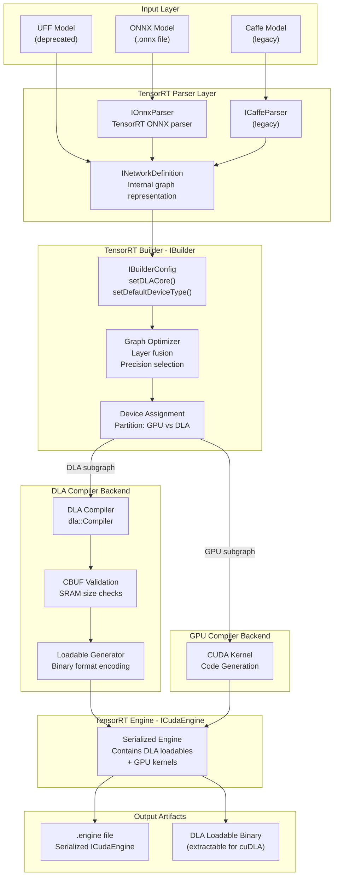
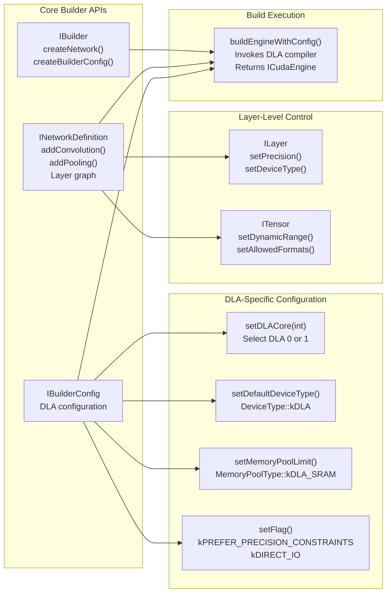
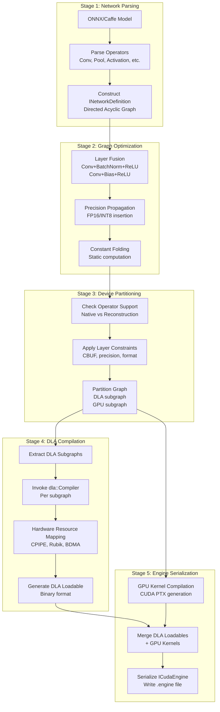
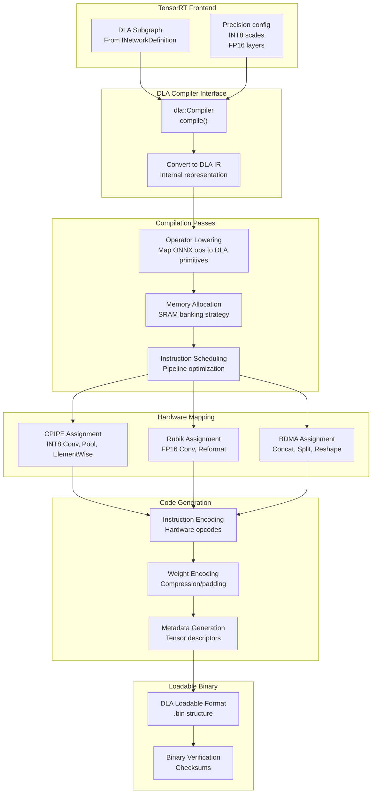
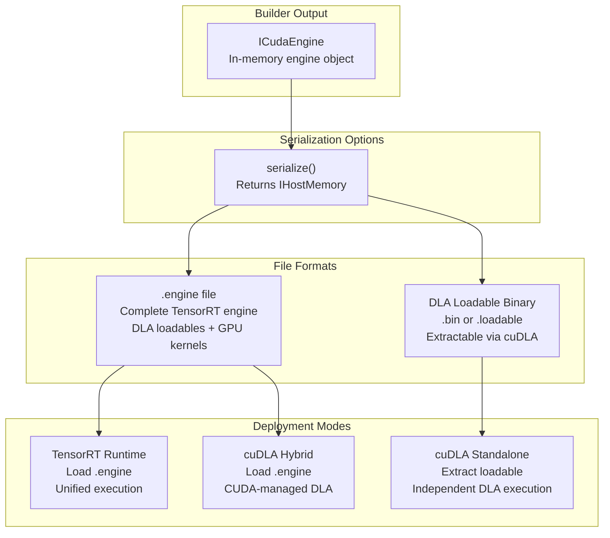

<!-- source: DeepWiki mcp.deepwiki.com · repo NVIDIA/Deep-Learning-Accelerator-SW · page 5.1 TensorRT and DLA Compiler · fetched 2026-10-26 -->

# TensorRT and DLA Compiler

<details>
<summary>Relevant source files</summary>

The following files were used as context for generating this wiki page:

- [FAQ/README.md](FAQ/README.md)
- [README.md](README.md)

</details>


## Purpose and Scope

This page explains the TensorRT Builder's role as the interface to the DLA compiler and describes the compilation process that transforms neural network models into DLA-executable loadables. The compilation phase is an offline process that occurs before runtime deployment.

For command-line usage of TensorRT for DLA compilation, see [Using trtexec for DLA](#5.2). For precision configuration during compilation, see [Precision Configuration](#5.3). For runtime deployment of compiled loadables, see [Runtime and Deployment](#6).

## Compilation Architecture Overview

The DLA compilation stack is a multi-layered system where TensorRT Builder serves as the sole user interface to invoke the DLA compiler. Unlike GPU compilation which is fully integrated within TensorRT, DLA compilation involves a separate compiler backend that generates hardware-specific loadable binaries.



**TensorRT Builder as Compiler Interface**

Sources: [README.md:5](), [FAQ/README.md:79-81]()

## TensorRT Builder Components

The TensorRT Builder provides the compilation interface through several key API classes that control DLA-specific compilation behavior.



**TensorRT Builder API Hierarchy**

The `IBuilderConfig` class exposes DLA-specific methods:
- `setDLACore(int dlaCore)`: Selects which DLA instance (0 or 1) to target
- `setDefaultDeviceType(DeviceType type)`: Sets default device to `DeviceType::kDLA`
- `setMemoryPoolLimit(MemoryPoolType pool, std::size_t size)`: Configures DLA SRAM budget
- Layer-level `setDeviceType()` overrides: Allows per-layer device assignment

Sources: [FAQ/README.md:79-85]()

## Compilation Pipeline Stages

The compilation process consists of distinct stages, each transforming the network representation toward hardware-executable form.



**Compilation Pipeline Stages**

### Stage 1: Network Parsing
TensorRT parses the input model format (ONNX, Caffe, etc.) into an `INetworkDefinition` object, which represents the network as a directed acyclic graph (DAG) of layers and tensors.

### Stage 2: Graph Optimization
TensorRT applies optimization passes including:
- **Layer Fusion**: Combines sequences like Conv→BatchNorm→ReLU into single fused operations
- **Precision Propagation**: Inserts reformat operations to transition between FP16/INT8 precision
- **Constant Folding**: Pre-computes static operations to reduce runtime overhead

### Stage 3: Device Partitioning
The optimizer determines which layers can execute on DLA based on:
- Operator support status (see [Operator Support Matrix](#4.1))
- Layer-specific constraints (see [Layer Restrictions and Constraints](#4.3))
- CBUF validation for convolution weight storage

### Stage 4: DLA Compilation
The DLA compiler (`dla::Compiler`) transforms each DLA subgraph into a loadable binary:
- Maps operations to hardware engines (CPIPEs for INT8 Conv, Rubik for FP16 Conv, BDMA for memory ops)
- Validates SRAM (CBUF) capacity for weights and activations
- Encodes execution schedule into binary loadable format

### Stage 5: Engine Serialization
The final `ICudaEngine` encapsulates:
- DLA loadable binaries for all DLA subgraphs
- GPU kernel code (CUDA PTX) for GPU layers
- Memory allocation metadata
- Execution scheduling information

Sources: [README.md:5](), [FAQ/README.md:134-135]()

## CBUF Validation and SRAM Constraints

CBUF (Convolution Buffer) is the internal SRAM within each DLA core used to store intermediate feature maps and convolution weights. The DLA compiler performs validation to ensure layer configurations fit within CBUF capacity.

| Platform | SRAM Configuration | CBUF Capacity |
|----------|-------------------|---------------|
| Xavier DLA | 4 MiB shared between 2 DLAs and 2 PVAs | ~1 MiB per DLA effective |
| Orin DLA | 1 MiB exclusive per DLA core | 1 MiB per DLA |

**CBUF Validation Failure**: As of TensorRT 8.6.0+, TensorRT performs heuristic-based checks before handing convolution layers to the DLA compiler. If a convolution's weights and activations exceed estimated CBUF capacity, TensorRT may reject the layer or fall back to GPU.

**Memory Pool Configuration**: Users can explicitly set SRAM budget via:
```cpp
config->setMemoryPoolLimit(MemoryPoolType::kDLA_SRAM, 1 * 1024 * 1024); // 1 MiB
```

Sources: [FAQ/README.md:96-99](), [FAQ/README.md:133-135]()

## DLA Compiler Backend Architecture



**DLA Compiler Backend Architecture**

The DLA compiler backend is invoked by TensorRT Builder but operates as a separate compilation pipeline:

1. **IR Conversion**: Translates TensorRT's `INetworkDefinition` into DLA-specific intermediate representation
2. **Operator Lowering**: Maps high-level operations (Conv, Pool, etc.) to DLA hardware primitives
3. **Memory Allocation**: Determines SRAM banking strategy to maximize data reuse and minimize DRAM transfers
4. **Instruction Scheduling**: Optimizes execution order to maximize hardware engine utilization
5. **Hardware Mapping**: Assigns operations to specific engines (CPIPE, Rubik, BDMA)
6. **Code Generation**: Encodes hardware instructions, compresses weights, and generates loadable binary

Sources: [README.md:1-7](), [FAQ/README.md:32-33]()

## Compilation Outputs and Formats

The TensorRT Builder produces different output formats depending on the deployment mode.



**Compilation Output Formats**

### TensorRT Engine (.engine)
The primary output is a serialized `ICudaEngine` containing:
- DLA loadable binaries for all DLA subgraphs
- GPU kernel code for GPU layers
- Execution plan with inter-device synchronization
- Memory allocation descriptors
- Input/output tensor metadata

**Usage**: Load via `IRuntime::deserializeCudaEngine()` for TensorRT-managed execution.

### DLA Loadable Binary (.bin)
A DLA loadable binary is the hardware-specific executable for DLA:
- Self-contained binary format
- Hardware instructions for DLA Falcon microcontroller
- Compressed weight data
- Tensor layout specifications

**Usage**: Extract from TensorRT engine for cuDLA standalone mode (see [cuDLA Standalone Mode](#6.3)).

**Format Note**: The loadable binary format is hardware-specific and not portable across DLA generations (Xavier vs Orin).

Sources: [README.md:5-6](), [FAQ/README.md:79-81]()

## TensorRT API Usage Example

The following illustrates the key TensorRT API calls for DLA compilation:

```cpp
// Conceptual example - actual usage requires complete setup

// 1. Create builder and network
IBuilder* builder = createInferBuilder(logger);
INetworkDefinition* network = builder->createNetworkV2(
    1U << static_cast<uint32_t>(NetworkDefinitionCreationFlag::kEXPLICIT_BATCH)
);

// 2. Parse ONNX model
IParser* parser = createParser(*network, logger);
parser->parseFromFile("model.onnx", ILogger::Severity::kWARNING);

// 3. Configure builder for DLA
IBuilderConfig* config = builder->createBuilderConfig();
config->setDLACore(0);  // Target DLA core 0
config->setDefaultDeviceType(DeviceType::kDLA);
config->setMemoryPoolLimit(MemoryPoolType::kDLA_SRAM, 1 * 1024 * 1024);

// 4. Set INT8 precision
config->setFlag(BuilderFlag::kINT8);
config->setFlag(BuilderFlag::kPREFER_PRECISION_CONSTRAINTS);

// 5. Optional: Set per-layer precision
for (int i = 0; i < network->getNbLayers(); i++) {
    ILayer* layer = network->getLayer(i);
    layer->setPrecision(DataType::kINT8);
    layer->setOutputType(0, DataType::kINT8);
}

// 6. Build engine (invokes DLA compiler)
ICudaEngine* engine = builder->buildEngineWithConfig(*network, *config);

// 7. Serialize engine
IHostMemory* serialized = engine->serialize();
// Write serialized->data() to .engine file
```

**Key API Methods**:
- `setDLACore(int)`: Specifies which DLA instance (0 or 1) to compile for
- `setDefaultDeviceType(DeviceType::kDLA)`: Attempts to place all compatible layers on DLA
- `setMemoryPoolLimit()`: Configures SRAM budget for CBUF validation
- `buildEngineWithConfig()`: Triggers compilation pipeline, invokes DLA compiler

**GPU Fallback**: If `allowGPUFallback` flag is set, layers that fail DLA compilation automatically fall back to GPU without error.

Sources: [FAQ/README.md:109](), [FAQ/README.md:118-122]()

## Relationship to Other Components

The TensorRT Builder interfaces with several upstream and downstream components:

| Component | Relationship | Purpose |
|-----------|-------------|---------|
| ONNX Parser | Upstream | Provides network graph to builder |
| QDQ Translator | Upstream | Provides INT8 calibration scales |
| DLA Compiler | Downstream | Backend compiler invoked by builder |
| TensorRT Runtime | Downstream | Executes compiled engines |
| cuDLA APIs | Downstream | Alternative runtime for DLA loadables |
| trtexec | CLI Wrapper | Command-line interface to builder |

For model preparation before compilation, see [Model Preparation](#3).
For INT8 quantization configuration, see [Precision Configuration](#5.3).
For using the command-line compilation tool, see [Using trtexec for DLA](#5.2).
For runtime deployment, see [Runtime and Deployment](#6).

Sources: [README.md:1-7](), [FAQ/README.md:79-85]()

---

