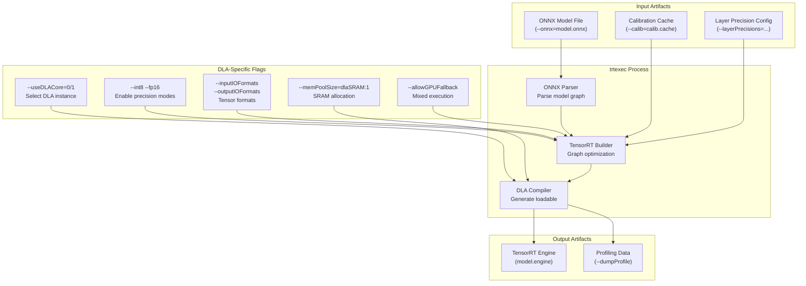
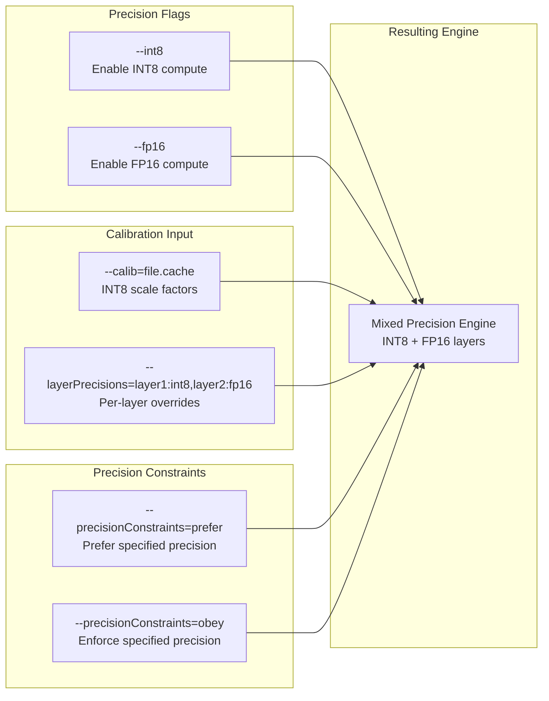
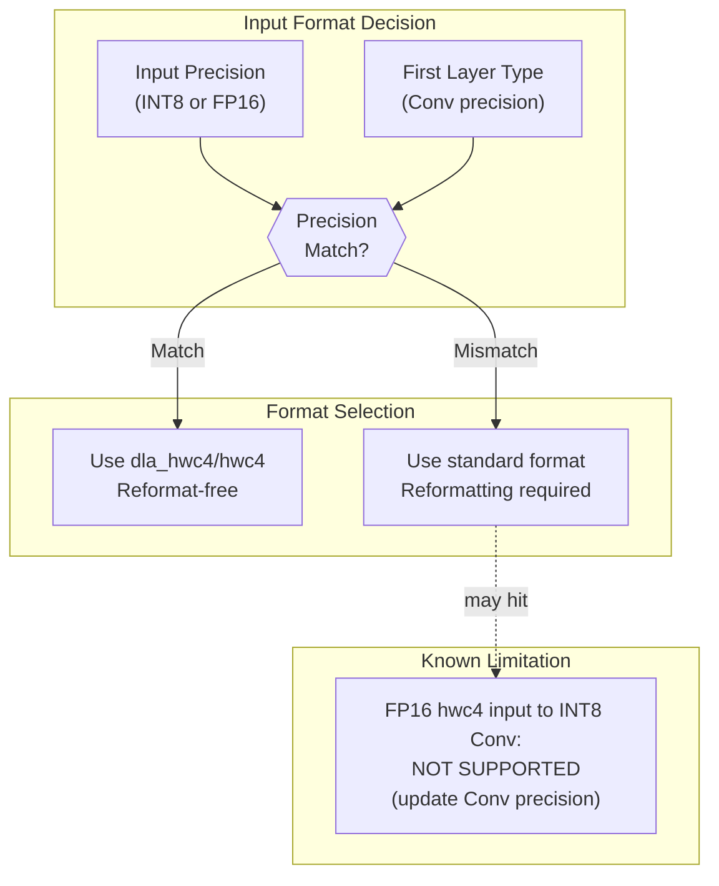
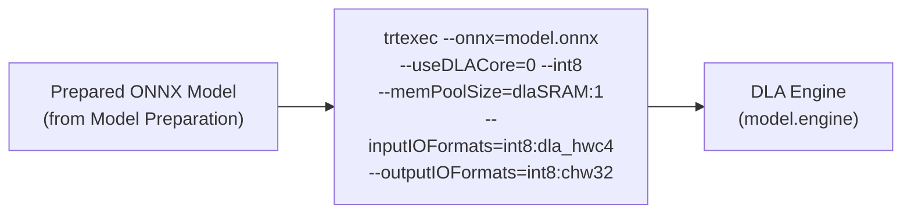
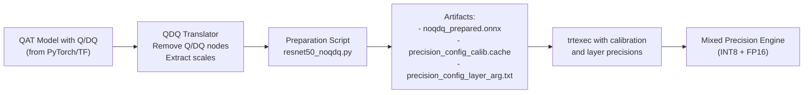
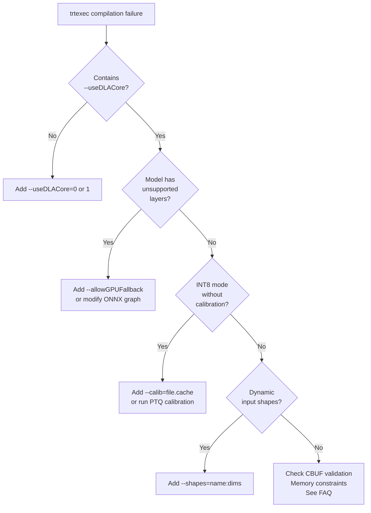

<!-- source: DeepWiki mcp.deepwiki.com · repo NVIDIA/Deep-Learning-Accelerator-SW · page 5.2 Using trtexec for DLA · fetched 2026-10-26 -->

# Using trtexec for DLA

<details>
<summary>Relevant source files</summary>

The following files were used as context for generating this wiki page:

- [FAQ/README.md](FAQ/README.md)
- [scripts/prepare_models/README.md](scripts/prepare_models/README.md)

</details>


## Purpose and Scope

This page provides a comprehensive reference for using the `trtexec` command-line tool to compile ONNX models into DLA-executable TensorRT engines. `trtexec` serves as the primary interface to the TensorRT Builder API and DLA compiler, allowing developers to build and benchmark DLA engines without writing custom application code.

For information about the underlying TensorRT Builder and DLA compiler architecture, see [TensorRT and DLA Compiler](#5.1). For details on precision configuration strategies and calibration workflows, see [Precision Configuration](#5.3). For structured sparsity optimization, see [Structured Sparsity](#5.4).

Sources: [FAQ/README.md:118-122](), [scripts/prepare_models/README.md:1-136]()

---

## trtexec Compilation Workflow

The following diagram illustrates how `trtexec` invokes the TensorRT Builder to compile ONNX models into DLA loadables:



**trtexec DLA Compilation Flow**: `trtexec` reads ONNX models, applies DLA-specific build flags, and invokes the TensorRT Builder to generate a serialized engine containing the DLA loadable. The `--useDLACore` flag determines which DLA instance (0 or 1) the compiled loadable targets.

Sources: [FAQ/README.md:118-122](), [scripts/prepare_models/README.md:24-26]()

---

## Essential DLA Flags

### Core Selection

| Flag | Description | Values |
|------|-------------|--------|
| `--useDLACore=N` | Selects which DLA core to target during compilation | `0` or `1` (Orin/Xavier have 2 cores) |

**Example:**
```bash
trtexec --onnx=model.onnx --useDLACore=0 --int8
```

If `--useDLACore` is not specified, the model will compile for GPU execution only. Each DLA core must be targeted separately at build time.

Sources: [FAQ/README.md:109-110](), [scripts/prepare_models/README.md:25]()

### GPU Fallback Control

| Flag | Description | Impact |
|------|-------------|--------|
| `--allowGPUFallback` | Allows unsupported layers to execute on GPU | Enables partial DLA execution for models with unsupported operators |

Without `--allowGPUFallback`, compilation will fail if the model contains layers unsupported by DLA. With this flag, TensorRT partitions the graph into DLA and GPU subgraphs, though this may introduce reformatting overhead.

**Example:**
```bash
trtexec --onnx=model.onnx --useDLACore=0 --int8 --allowGPUFallback
```

Sources: [FAQ/README.md:122](), [FAQ/README.md:45-49]()

---

## Precision Configuration

### Basic Precision Flags



**Precision Configuration Flow**: The `--int8` and `--fp16` flags enable respective precision modes. The `--calib` file provides INT8 scale factors, while `--layerPrecisions` allows per-layer overrides. Precision constraints control how strictly TensorRT adheres to the requested precisions.

### INT8 Configuration

For INT8 execution on DLA, you must provide quantization scales either through:

1. **Calibration cache** (Post-Training Quantization):
```bash
trtexec --onnx=model.onnx --useDLACore=0 --int8 \
        --calib=calibration.cache
```

2. **Per-layer precision configuration** (from QDQ Translator workflow):
```bash
trtexec --onnx=model_noqdq.onnx --useDLACore=0 --int8 --fp16 \
        --calib=precision_config_calib.cache \
        --precisionConstraints=prefer \
        --layerPrecisions=$(cat layer_precisions.txt)
```

Sources: [FAQ/README.md:69-76](), [scripts/prepare_models/README.md:37-46]()

### Mixed Precision Execution

When both `--int8` and `--fp16` are specified, TensorRT creates a hybrid precision engine:

- Layers with calibration scales execute in INT8
- Layers without scales or with explicit FP16 constraints execute in FP16
- DLA on Orin is optimized for INT8; FP16 performance is lower than Xavier

**Example (QDQ Translator workflow):**
```bash
trtexec --onnx=model_noqdq_prepared.onnx \
        --calib=precision_config_calib.cache \
        --useDLACore=0 \
        --int8 \
        --fp16 \
        --precisionConstraints=prefer \
        --layerPrecisions=$(cat layer_precisions_arg.txt) \
        --memPoolSize=dlaSRAM:1 \
        --inputIOFormats=int8:hwc4 \
        --outputIOFormats=fp16:chw16
```

Sources: [scripts/prepare_models/README.md:37-46](), [FAQ/README.md:60-67]()

---

## I/O Format Configuration

### DLA-Optimized Tensor Formats

DLA hardware uses specific tensor memory layouts optimized for its execution engines. Reformat-free I/O eliminates GPU reformatting kernels and reduces latency overhead.

| Precision | Recommended Input Format | Recommended Output Format | Description |
|-----------|-------------------------|--------------------------|-------------|
| INT8 | `int8:dla_hwc4` or `int8:hwc4` | `int8:chw32` | Channel-interleaved input, channel-blocked output |
| FP16 | `fp16:dla_hwc4` or `fp16:hwc4` | `fp16:chw16` | FP16 variants for mixed precision |

**Note:** The `dla_hwc4` format is specific to DLA; `hwc4` is the TensorRT equivalent that works across GPU and DLA.

### Format Configuration Syntax

```bash
--inputIOFormats=<precision>:<layout>[,<precision>:<layout>...]
--outputIOFormats=<precision>:<layout>[,<precision>:<layout>...]
```

**Single-input, single-output example:**
```bash
trtexec --onnx=resnet50.onnx --useDLACore=0 --int8 \
        --inputIOFormats=int8:dla_hwc4 \
        --outputIOFormats=int8:chw32
```

**Multi-input example:**
```bash
trtexec --onnx=model.onnx --useDLACore=0 --int8 \
        --inputIOFormats=int8:dla_hwc4,fp16:chw16 \
        --outputIOFormats=int8:chw32
```

Sources: [FAQ/README.md:118-122](), [scripts/prepare_models/README.md:24-26](), [FAQ/README.md:47-56]()

### Format Compatibility Constraints



**Format Compatibility**: The input tensor format must match the precision of the first consuming layer. FP16 `hwc4` inputs consumed by INT8 Convolutions are not supported as of TensorRT 8.6.

Sources: [FAQ/README.md:136-137]()

---

## Memory Pool Configuration

### DLA SRAM Allocation

DLA has internal SRAM used for weight and activation storage. The `--memPoolSize` flag controls SRAM allocation strategy:

```bash
--memPoolSize=dlaSRAM:<size_in_MB>
```

**Recommended value:**
```bash
--memPoolSize=dlaSRAM:1
```

This sets the DLA SRAM pool to 1 MB. On Orin, each DLA has 1 MB of exclusive SRAM; on Xavier, 2 DLAs share 4 MB (with 2 PVAs).

**Complete example:**
```bash
trtexec --onnx=model.onnx --useDLACore=0 --int8 \
        --memPoolSize=dlaSRAM:1 \
        --inputIOFormats=int8:dla_hwc4 \
        --outputIOFormats=int8:chw32
```

Sources: [FAQ/README.md:96-98](), [scripts/prepare_models/README.md:25]()

---

## Shape Configuration

### Static Shape Specification

For models with dynamic input shapes, you must specify concrete shapes at build time:

```bash
--shapes=<tensor_name>:<dimensions>
```

**Example with ResNet-50:**
```bash
trtexec --onnx=resnet50_v1_prepared.onnx --useDLACore=0 --int8 \
        --shapes=input_tensor:0:2x3x224x224 \
        --memPoolSize=dlaSRAM:1 \
        --inputIOFormats=int8:dla_hwc4 \
        --outputIOFormats=int8:chw32
```

**Example with QDQ model (long tensor name):**
```bash
trtexec --onnx=resnet_50v1_noqdq_prepared.onnx --useDLACore=0 --int8 \
        --shapes=StatefulPartitionedCall/resnet50/quant_conv1_bn/FusedBatchNormV3:0:2x3x224x224 \
        --memPoolSize=dlaSRAM:1
```

**Multiple inputs:**
```bash
--shapes=input1:1x3x224x224,input2:1x100
```

Sources: [scripts/prepare_models/README.md:24-26](), [scripts/prepare_models/README.md:44]()

---

## Build and Profiling Flags

### Engine Serialization

| Flag | Description |
|------|-------------|
| `--saveEngine=<file>` | Save compiled engine to disk (default: generated from model name) |
| `--loadEngine=<file>` | Load pre-built engine for inference benchmarking |

**Build and save:**
```bash
trtexec --onnx=model.onnx --useDLACore=0 --int8 \
        --saveEngine=model_dla0_int8.engine
```

**Load and benchmark:**
```bash
trtexec --loadEngine=model_dla0_int8.engine
```

### Profiling Flags

| Flag | Description | Output |
|------|-------------|--------|
| `--dumpProfile` | Print per-layer profiling information | Console output with layer timings |
| `--exportProfile=<file>` | Export profiling data to JSON | JSON file for post-processing |
| `--warmUp=<ms>` | Warm-up time before benchmarking | Default: 200ms |
| `--iterations=<N>` | Number of inference iterations | Default: 10 (average of iterations) |
| `--duration=<seconds>` | Run for specified duration | Alternative to `--iterations` |

**Profiling example:**
```bash
trtexec --onnx=model.onnx --useDLACore=0 --int8 \
        --memPoolSize=dlaSRAM:1 \
        --inputIOFormats=int8:dla_hwc4 \
        --outputIOFormats=int8:chw32 \
        --dumpProfile \
        --exportProfile=profile.json \
        --warmUp=1000 \
        --duration=60
```

Sources: [FAQ/README.md:118-122]()

---

## Structured Sparsity

For models with 2:4 structured sparse weights (at least 50% zeros in a specific pattern), enable sparsity acceleration:

```bash
--sparsity=force
```

**Complete example:**
```bash
trtexec --onnx=retinanet_rn34_sparse.onnx --useDLACore=0 --int8 \
        --memPoolSize=dlaSRAM:1 \
        --inputIOFormats=int8:dla_hwc4 \
        --outputIOFormats=int8:chw32 \
        --sparsity=force
```

**Performance impact:** 1.24x-1.47x speedup for sparse models on DLA (requires C > 64 for convolution channels).

Sources: [scripts/prepare_models/README.md:135](), [FAQ/README.md:87-88]()

---

## Complete Example Workflows

### Basic INT8 Compilation

The following diagram shows the minimal workflow for compiling a prepared ONNX model to DLA:



**ResNet-50 Example:**
```bash
trtexec --useDLACore=0 \
        --int8 \
        --memPoolSize=dlaSRAM:1 \
        --inputIOFormats=int8:dla_hwc4 \
        --outputIOFormats=int8:chw32 \
        --onnx=resnet50_v1_prepared.onnx \
        --shapes=input_tensor:0:2x3x224x224
```

Sources: [scripts/prepare_models/README.md:24-26]()

### QDQ Translator Workflow



**Complete QDQ Workflow Command:**
```bash
# After running QDQ Translator and preparation script
trtexec --onnx=translated/resnet_50v1_noqdq_prepared.onnx \
        --calib=translated/resnet_50v1_precision_config_calib.cache \
        --useDLACore=0 \
        --int8 \
        --fp16 \
        --precisionConstraints=prefer \
        --memPoolSize=dlaSRAM:1 \
        --shapes=StatefulPartitionedCall/resnet50/quant_conv1_bn/FusedBatchNormV3:0:2x3x224x224 \
        --layerPrecisions=$(cat translated/resnet_50v1_precision_config_layer_arg.txt) \
        --inputIOFormats=int8:hwc4 \
        --outputIOFormats=fp16:chw16
```

Sources: [scripts/prepare_models/README.md:32-46]()

### SSD-MobileNetV1 Example

```bash
trtexec --useDLACore=0 \
        --int8 \
        --memPoolSize=dlaSRAM:1 \
        --inputIOFormats=int8:dla_hwc4 \
        --outputIOFormats=int8:chw32 \
        --onnx=ssd_mobilenet_v1_coco_2018_01_28_prepared.onnx \
        --shapes=Preprocessor/sub:0:2x3x300x300
```

Sources: [scripts/prepare_models/README.md:94-96]()

### RetinaNet with Sparsity

```bash
# Dense version
trtexec --useDLACore=0 \
        --int8 \
        --memPoolSize=dlaSRAM:1 \
        --inputIOFormats=int8:dla_hwc4 \
        --outputIOFormats=int8:chw32 \
        --onnx=retinanet_rn34_1280x768_dummy.onnx

# Sparse version (1.24x-1.47x faster)
trtexec --useDLACore=0 \
        --int8 \
        --memPoolSize=dlaSRAM:1 \
        --inputIOFormats=int8:dla_hwc4 \
        --outputIOFormats=int8:chw32 \
        --onnx=retinanet_rn34_1280x768_dummy.onnx \
        --sparsity=force
```

Sources: [scripts/prepare_models/README.md:132-135]()

---

## Flag Interaction Reference

The following table summarizes how different flag combinations affect DLA compilation:

| Scenario | Required Flags | Optional Flags | Notes |
|----------|---------------|----------------|-------|
| Pure INT8 DLA | `--onnx`, `--useDLACore=N`, `--int8` | `--memPoolSize=dlaSRAM:1`, `--inputIOFormats`, `--outputIOFormats` | Requires calibration cache or dummy scales |
| Mixed Precision | `--onnx`, `--useDLACore=N`, `--int8`, `--fp16` | `--calib`, `--layerPrecisions`, `--precisionConstraints=prefer` | Layers without scales run in FP16 |
| Partial DLA + GPU | `--onnx`, `--useDLACore=N`, `--int8`, `--allowGPUFallback` | Same as pure INT8 | Unsupported layers run on GPU |
| Sparse Execution | All INT8 flags + `--sparsity=force` | N/A | Model must have 2:4 sparse pattern |
| Dual DLA Cores | Two separate `trtexec` processes with `--useDLACore=0` and `--useDLACore=1` | N/A | Cannot target both cores in single build |

Sources: [FAQ/README.md:109-110](), [scripts/prepare_models/README.md:1-136]()

---

## Common Troubleshooting

### Compilation Failures



**CBUF Validation Errors**: If you encounter "CBUF validation failed", the convolution layer's weights and activations exceed DLA's internal SRAM capacity. Consider:
- Reducing batch size
- Splitting large convolutions
- Using `--allowGPUFallback` for specific layers

Sources: [FAQ/README.md:133-134]()

### Performance Issues

**Symptom: High latency with mixed GPU-DLA execution**

1. Verify reformat-free I/O formats are used:
```bash
# Check if formats match between DLA and GPU subgraphs
--inputIOFormats=int8:dla_hwc4 --outputIOFormats=int8:chw32
```

2. Ensure sufficient DRAM bandwidth (both DLA and GPU compete for memory):
```bash
# Profile with Nsight Systems to identify bandwidth bottlenecks
nsys profile -o profile.nsys-rep ./trtexec --loadEngine=model.engine
```

3. Check for small subgraphs alternating between DLA and GPU:
```bash
# Use --dumpProfile to identify fragmented execution
trtexec --loadEngine=model.engine --dumpProfile
```

Sources: [FAQ/README.md:45-58]()

### Format Mismatch Errors

**Symptom: "FP16 hwc4 input to INT8 Conv not supported"**

**Solution:** Update the first Convolution layer's precision to match the input:
```bash
# If input is FP16 hwc4, first Conv must be FP16
--layerPrecisions=conv1:fp16
```

Or change input format to standard format (with reformatting overhead):
```bash
--inputIOFormats=int8:chw4
```

Sources: [FAQ/README.md:136-137]()

---

## Best Practices Summary

1. **Always specify SRAM pool size**: Use `--memPoolSize=dlaSRAM:1` for predictable memory allocation
2. **Use reformat-free I/O**: Specify `--inputIOFormats` and `--outputIOFormats` to eliminate GPU reformatting overhead
3. **Enable profiling during development**: Use `--dumpProfile` to identify performance bottlenecks
4. **Test GPU fallback incrementally**: Start with `--allowGPUFallback`, then iteratively optimize unsupported layers
5. **Verify INT8 scales**: Ensure calibration cache contains scales for all INT8 layers
6. **Lock clock frequencies**: Set fixed power modes before benchmarking for consistent results
7. **Warm up appropriately**: Use `--warmUp=1000` or higher for stable latency measurements
8. **Consider sparsity**: For sparse models, always add `--sparsity=force` to leverage hardware acceleration

Sources: [FAQ/README.md:118-125](), [scripts/prepare_models/README.md:1-136]()

---

