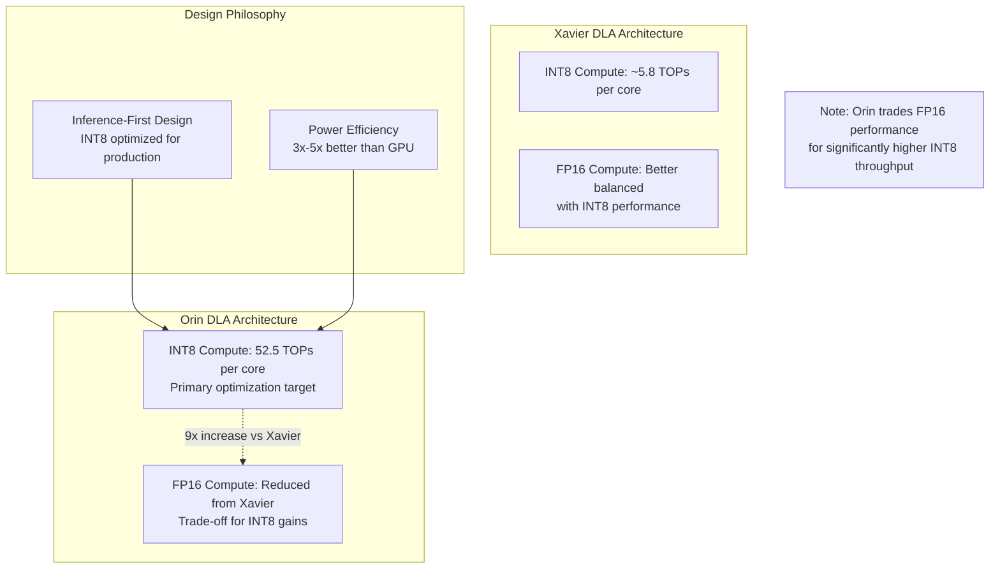
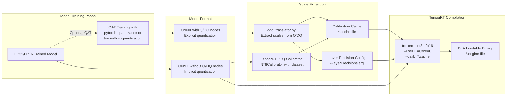
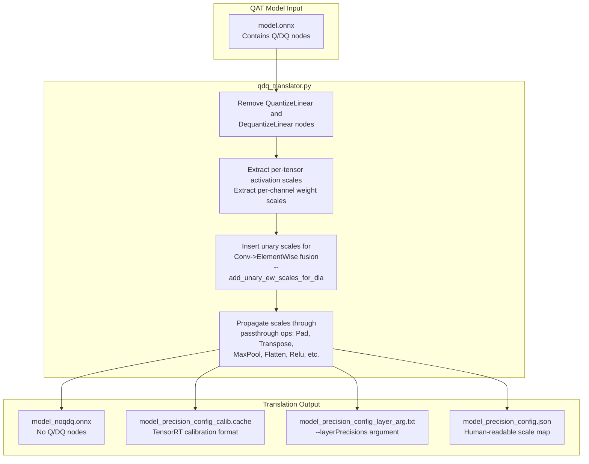
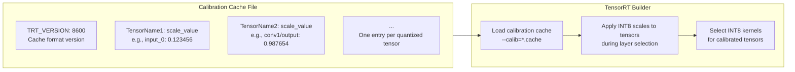
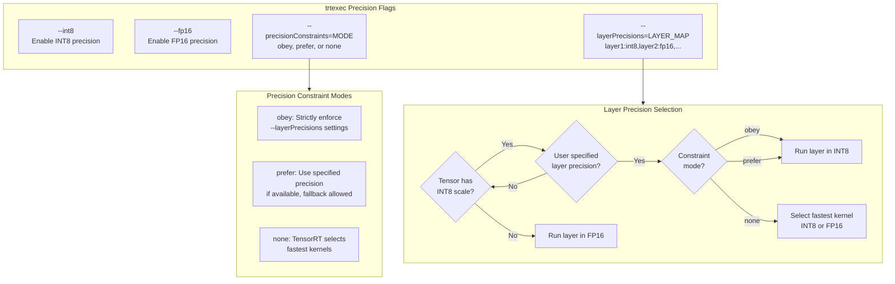
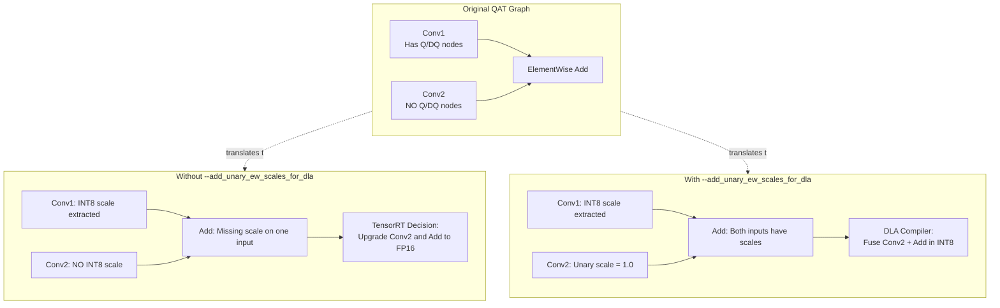
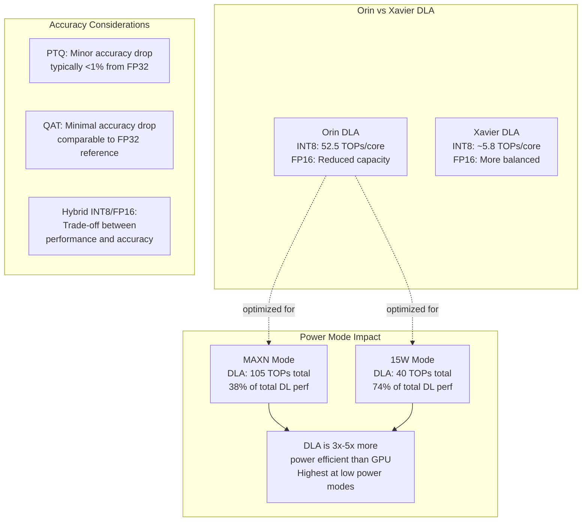

<!-- source: DeepWiki mcp.deepwiki.com · repo NVIDIA/Deep-Learning-Accelerator-SW · page 5.3 Precision Configuration · fetched 2026-10-26 -->

# Precision Configuration

<details>
<summary>Relevant source files</summary>

The following files were used as context for generating this wiki page:

- [FAQ/README.md](FAQ/README.md)
- [README.md](README.md)
- [tools/qdq-translator/README.md](tools/qdq-translator/README.md)

</details>


## Purpose and Scope

This page explains how to configure precision formats (INT8, FP16, and mixed precision) when compiling models for DLA using TensorRT. It covers Post-Training Quantization (PTQ), Quantization-Aware Training (QAT) workflows, calibration processes, and layer-specific precision control. For information about structured sparsity optimization, see [Structured Sparsity](#5.4). For detailed trtexec command-line usage, see [Using trtexec for DLA](#5.2).

## Supported Precision Formats

DLA on both Orin and Xavier platforms supports three precision formats for inference:

| Precision Format | Description | Primary Use Case |
|-----------------|-------------|------------------|
| **INT8** | 8-bit integer quantization | Primary inference format on Orin; optimal performance and power efficiency |
| **FP16** | 16-bit floating point | Hybrid precision for unsupported INT8 operations; primary format on Xavier |
| **Mixed Precision** | Per-layer INT8/FP16 selection | Accuracy-performance trade-off; fallback for unsupported INT8 layers |

### Hardware Architecture Differences



**Sources:** [README.md:10-22](), [FAQ/README.md:60-68]()

## Quantization Methods

DLA supports two primary approaches for obtaining quantized models: Post-Training Quantization (PTQ) and Quantization-Aware Training (QAT).

### Quantization Workflow Overview



**Sources:** [README.md:69-77](), [FAQ/README.md:69-77](), [tools/qdq-translator/README.md:1-27]()

### Post-Training Quantization (PTQ)

PTQ is TensorRT's built-in quantization method that determines INT8 scaling factors by analyzing activation distributions on a calibration dataset.

#### PTQ Workflow with trtexec

```bash
# Basic PTQ workflow for DLA
trtexec --onnx=model.onnx \
        --int8 \
        --calib=calibration.cache \
        --useDLACore=0 \
        --saveEngine=model.engine \
        --inputIOFormats=int8:dla_hwc4 \
        --outputIOFormats=int8:chw32
```

#### Calibration Process

The TensorRT calibrator analyzes a representative dataset to compute dynamic ranges for each tensor:

| Calibration Method | TensorRT Class | Description |
|-------------------|----------------|-------------|
| **Entropy Calibration** | `IInt8EntropyCalibrator2` | Default method; minimizes KL divergence |
| **MinMax Calibration** | `IInt8MinMaxCalibrator` | Uses absolute min/max values; may be less accurate |
| **Legacy Calibration** | `IInt8LegacyCalibrator` | Older method; not recommended |

**Sources:** [FAQ/README.md:69-77]()

### Quantization-Aware Training (QAT)

QAT simulates quantization during training by inserting Quantize/Dequantize (Q/DQ) nodes, allowing the model to learn quantization-robust weights.

#### QAT Tooling Requirements

| Framework | Toolkit | Configuration |
|-----------|---------|---------------|
| PyTorch | `pytorch-quantization` | Activation: per-tensor, Weight: per-channel, calib_method: 'max' or 'histogram' |
| TensorFlow | `tensorflow-quantization` | Activation: per-tensor, Weight: per-channel |

#### QDQ Translation Pipeline



**Sources:** [tools/qdq-translator/README.md:1-90]()

#### Example QDQ Translation Command

```bash
# Translate QAT model to DLA-compatible format
python3 qdq_translator.py \
    --input_onnx_models resnet_50v1.onnx \
    --output_dir ./translated \
    --add_unary_ew_scales_for_dla

# Build DLA engine with translated model
trtexec --onnx=translated/resnet_50v1_noqdq.onnx \
        --calib=translated/resnet_50v1_precision_config_calib.cache \
        --useDLACore=0 \
        --int8 \
        --fp16 \
        --saveEngine=resnet_50v1.engine \
        --precisionConstraints=prefer \
        --layerPrecisions=$(cat translated/resnet_50v1_precision_config_layer_arg.txt)
```

**Sources:** [tools/qdq-translator/README.md:12-26]()

## Calibration Cache Format

The calibration cache stores tensor dynamic ranges in a TensorRT-specific format that maps tensor names to scaling factors.

### Calibration Cache Structure



### Setting Tensor Scales via API

In addition to calibration caches, scales can be set programmatically:

```cpp
// Pseudo-code showing ITensor API for scale configuration
ITensor* tensor = network->getInput(0);
tensor->setDynamicRange(-127.0f, 127.0f);  // Set min/max range
```

**Sources:** [FAQ/README.md:75-77](), [tools/qdq-translator/README.md:90-109]()

## Layer Precision Configuration

TensorRT provides fine-grained control over which layers run in which precision format.

### Precision Configuration Flags



**Sources:** [tools/qdq-translator/README.md:92-109]()

### Layer Precision Argument Format

The `--layerPrecisions` argument uses a comma-separated format:

```bash
# Format: layer_name1:precision1,layer_name2:precision2,...
--layerPrecisions="conv1/Conv:int8,conv2/Conv:fp16,bn1/BatchNormalization:fp16"

# Generated automatically by qdq_translator.py
--layerPrecisions=$(cat translated/model_precision_config_layer_arg.txt)
```

### Precision Constraint Modes

| Mode | Behavior | Use Case |
|------|----------|----------|
| `obey` | Strictly enforce specified layer precisions; build fails if impossible | Debugging; ensure specific precision for accuracy validation |
| `prefer` | Use specified precision if available; silently fallback to alternatives | Production; balance accuracy with flexibility |
| `none` | Ignore `--layerPrecisions`; select fastest available kernels | Performance benchmarking without precision constraints |

**Sources:** [tools/qdq-translator/README.md:107-109]()

## DLA-Specific Precision Considerations

### Unary Scale Insertion for DLA Fusion

DLA's compiler can fuse `Conv + ElementWise` operations when both have INT8 scales. However, TensorRT may conservatively upgrade layers to FP16 when intermediate tensor scales are missing. The QDQ translator addresses this with unary scales:



A unary scale of `1.0` signals to the DLA compiler that the tensor should pass through without quantization, enabling correct INT8 fusion behavior.

**Sources:** [tools/qdq-translator/README.md:111-138]()

### Format Requirements for Precision

Different precision formats require different tensor layouts:

| Precision | Input Format Flag | Output Format Flag | Description |
|-----------|-------------------|-------------------|-------------|
| INT8 | `--inputIOFormats=int8:dla_hwc4` | `--outputIOFormats=int8:chw32` | DLA-native INT8 formats |
| FP16 | `--inputIOFormats=fp16:hwc16` | `--outputIOFormats=fp16:chw16` | DLA-native FP16 formats |
| Mixed | Specify per-tensor | Specify per-tensor | Use compatible formats to avoid reformatting overhead |

**Sources:** [FAQ/README.md:46-48]()

## Performance and Accuracy Trade-offs

### INT8 vs FP16 Performance Characteristics



### Reference Model Accuracy

| Model | Metric | FP32 Reference | INT8 on DLA | Accuracy Delta |
|-------|--------|----------------|-------------|----------------|
| ResNet-50 | Top-1 ImageNet | 76.46% | 75.54% | -0.92% |
| RetinaNet ResNeXt-50 | mAP OpenImages | 0.3757 | 0.3741 | -0.0016 |
| SSD-MobileNetV1 | mAP COCO 2017 | 0.23 | 0.23 | 0.00 |

**Sources:** [README.md:32-44](), [README.md:16-22](), [FAQ/README.md:65-68]()

## Complete Workflow Examples

### PTQ Workflow with trtexec

```bash
# Step 1: Prepare ONNX model (no Q/DQ nodes)
# Assume model.onnx is already optimized

# Step 2: Build engine with INT8 calibration
trtexec --onnx=model.onnx \
        --int8 \
        --calib=calibration.cache \
        --useDLACore=0 \
        --saveEngine=model_int8.engine \
        --inputIOFormats=int8:dla_hwc4 \
        --outputIOFormats=int8:chw32 \
        --memPoolSize=dlaSRAM:1

# Step 3 (if needed): Run with GPU fallback for unsupported layers
trtexec --onnx=model.onnx \
        --int8 \
        --fp16 \
        --calib=calibration.cache \
        --useDLACore=0 \
        --allowGPUFallback \
        --saveEngine=model_hybrid.engine
```

**Sources:** [FAQ/README.md:118-122]()

### QAT Workflow with QDQ Translator

```bash
# Step 1: Train model with pytorch-quantization or tensorflow-quantization
# Output: model_qat.onnx (contains Q/DQ nodes)

# Step 2: Translate QAT model to implicit quantization format
python3 qdq_translator.py \
    --input_onnx_models model_qat.onnx \
    --output_dir ./translated \
    --add_unary_ew_scales_for_dla \
    --trt_calib_version 8600

# Step 3: Build DLA engine with extracted scales
MODEL="model_qat"
trtexec --onnx=translated/${MODEL}_noqdq.onnx \
        --calib=translated/${MODEL}_precision_config_calib.cache \
        --useDLACore=0 \
        --int8 \
        --fp16 \
        --saveEngine=${MODEL}.engine \
        --precisionConstraints=prefer \
        --layerPrecisions=$(cat translated/${MODEL}_precision_config_layer_arg.txt) \
        --inputIOFormats=int8:dla_hwc4 \
        --outputIOFormats=int8:chw32

# Alternative: GPU fallback for unsupported operations
trtexec --onnx=translated/${MODEL}_noqdq.onnx \
        --calib=translated/${MODEL}_precision_config_calib.cache \
        --useDLACore=0 \
        --int8 \
        --fp16 \
        --saveEngine=${MODEL}_hybrid.engine \
        --precisionConstraints=prefer \
        --layerPrecisions=$(cat translated/${MODEL}_precision_config_layer_arg.txt) \
        --allowGPUFallback
```

**Sources:** [tools/qdq-translator/README.md:12-104]()

### Layer Precision Debugging Workflow

```bash
# Step 1: Build with verbose logging to see layer precision selections
trtexec --onnx=model.onnx \
        --int8 \
        --fp16 \
        --calib=calibration.cache \
        --useDLACore=0 \
        --verbose \
        --dumpLayerInfo \
        --exportLayerInfo=layer_info.json

# Step 2: Analyze layer precision assignments
# layer_info.json contains per-layer precision information

# Step 3: Override specific layer precisions
trtexec --onnx=model.onnx \
        --int8 \
        --fp16 \
        --calib=calibration.cache \
        --useDLACore=0 \
        --precisionConstraints=obey \
        --layerPrecisions="problematic_layer:fp16,another_layer:int8" \
        --saveEngine=model_debug.engine
```

## Best Practices

### Calibration Dataset Selection

- Use a representative subset of your production data (100-500 images typically sufficient)
- Ensure calibration dataset covers the expected dynamic range
- Avoid outliers that may skew scale calculations

### Precision Configuration Strategy

1. **Start with full INT8**: Use `--int8 --useDLACore=0` without `--fp16` to identify unsupported operations
2. **Add FP16 fallback**: Enable `--fp16 --allowGPUFallback` for hybrid precision
3. **Fine-tune layer precision**: Use `--layerPrecisions` to optimize accuracy-critical layers
4. **Validate accuracy**: Compare INT8 output against FP32/FP16 reference using Polygraphy (see [Profiling and Debugging Tools](#7.4))

### QAT Configuration Guidelines

- **Activation quantization**: Always use per-tensor quantization
- **Weight quantization**: Use per-channel quantization for Convolution layers
- **Calibration method**: Use 'max' for PyTorch (required for per-channel), 'histogram' optional for activations
- **Scale propagation**: Enable `--add_unary_ew_scales_for_dla` for DLA-optimized fusion

**Sources:** [tools/qdq-translator/README.md:76-80](), [FAQ/README.md:69-77]()

---

