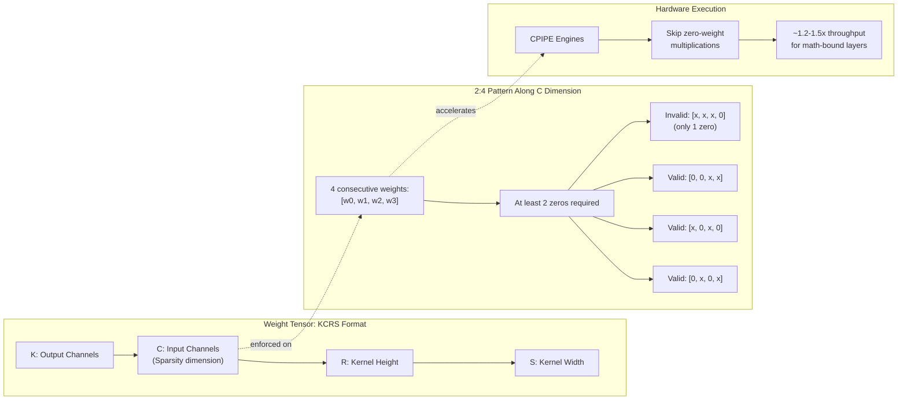
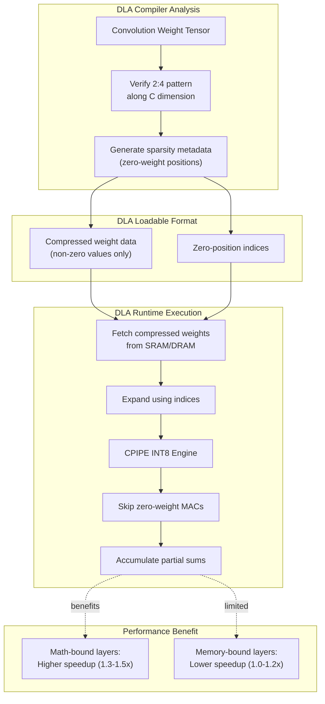
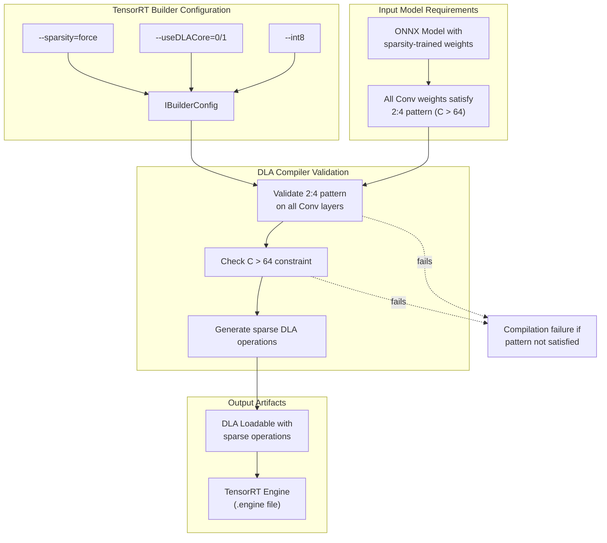
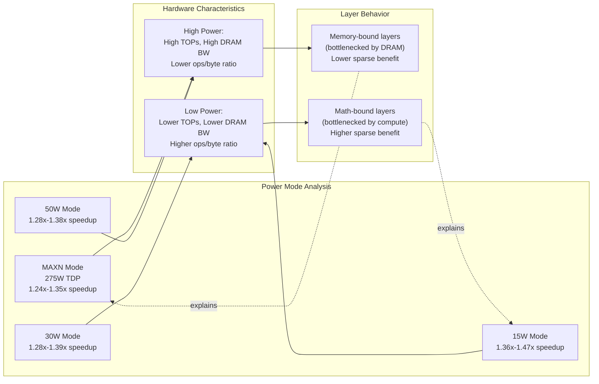
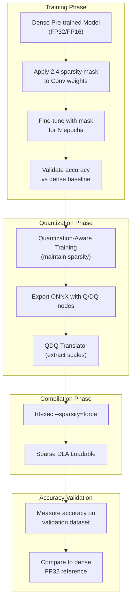
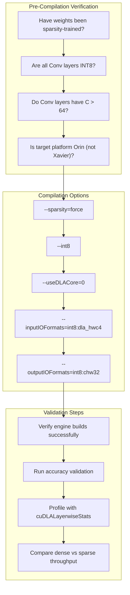

<!-- source: DeepWiki mcp.deepwiki.com · repo NVIDIA/Deep-Learning-Accelerator-SW · page 5.4 Structured Sparsity · fetched 2026-10-26 -->

# Structured Sparsity

<details>
<summary>Relevant source files</summary>

The following files were used as context for generating this wiki page:

- [FAQ/README.md](FAQ/README.md)
- [README.md](README.md)

</details>


## Purpose and Scope

This page describes the 2:4 structured sparsity feature available on DLA hardware in Orin platforms. Structured sparsity is a hardware-accelerated optimization that exploits zero-weight patterns in neural networks to achieve 1.24x-1.47x throughput improvements with minimal accuracy impact. This page covers the sparsity pattern definition, hardware support, compilation configuration, performance characteristics, and training considerations.

For general precision configuration including INT8 and FP16, see [Precision Configuration](#5.3). For overall compilation workflow, see [TensorRT and DLA Compiler](#5.1).

---

## What is 2:4 Structured Sparsity

Structured sparsity is a specific pruning pattern where convolution weights contain a predictable arrangement of zeros that can be exploited by specialized hardware. The 2:4 pattern requires that for every 4 consecutive weights along the channel (C) dimension of a KCRS convolution weight tensor, at least 2 must be zeros.

### Sparsity Pattern Definition



**Sources:** [README.md:87-88](), [FAQ/README.md:87-88]()

---

## Hardware Support and Architecture

### Platform Availability

Structured sparsity is supported exclusively on **NVIDIA Orin DLA hardware** (second-generation DLA). Xavier DLA (first-generation) does not support this feature.

| Platform | DLA Generation | Sparse INT8 Support | Peak Performance (2x DLA) |
|----------|----------------|---------------------|---------------------------|
| Jetson AGX Orin 64GB | 2nd Gen | ✓ Yes | 105 TOPs (sparse) |
| Jetson Orin NX 16GB | 2nd Gen | ✓ Yes | 40 TOPs (sparse) |
| DRIVE Orin | 2nd Gen | ✓ Yes | Platform-dependent |
| Jetson AGX Xavier | 1st Gen | ✗ No | N/A |
| DRIVE Xavier | 1st Gen | ✗ No | N/A |

### Hardware Execution Model



**Sources:** [README.md:83-98](), [FAQ/README.md:87-88]()

---

## Enabling Structured Sparsity in Compilation

### Using trtexec

Structured sparsity is enabled during TensorRT compilation using the `--sparsity=force` flag:

```bash
trtexec --onnx=model.onnx \
        --int8 \
        --useDLACore=0 \
        --sparsity=force \
        --inputIOFormats=int8:dla_hwc4 \
        --outputIOFormats=int8:chw32 \
        --saveEngine=model_sparse.engine
```

The `--sparsity=force` flag instructs TensorRT to:
1. Verify that convolution weights follow the 2:4 pattern
2. Generate sparse DLA operations in the loadable
3. Fail compilation if weights do not satisfy the sparsity pattern

**Sources:** [README.md:95]()

### Compilation Workflow



**Command-line example from repository:**

For RetinaNet ResNet-34 with sparsity:
```bash
# Dense baseline command (see prepare_models/README.md)
trtexec --onnx=retinanet_resnet34.onnx --int8 --useDLACore=0 ...

# Add --sparsity=force for sparse execution
trtexec --onnx=retinanet_resnet34.onnx --int8 --useDLACore=0 --sparsity=force ...
```

**Sources:** [README.md:95](), [README.md:36-37]()

---

## Performance Characteristics

### Throughput Improvements

Structured sparsity provides measurable throughput improvements for math-bound convolution layers. The speedup varies based on network architecture, layer configuration, and power mode.

#### Reference Model Performance

2x DLA images/second on Jetson AGX Orin 64GB with sparse INT8 (JetPack 5.1.1):

| Network | Input Size, Batch | MAXN Mode | 50W Mode | 30W Mode | 15W Mode |
|---------|-------------------|-----------|----------|----------|----------|
| RetinaNet ResNeXt-50 | 800x800, bs=1 | 102 (1.31x) | 96 (1.34x) | 95 (1.34x) | 51 (1.43x) |
| ResNet-34 backbone | 1280x768, bs=1 | 384 (1.35x) | 360 (1.38x) | 354 (1.39x) | 176 (1.45x) |
| RetinaNet ResNet-34 | 1280x768, bs=1 | 143 (1.32x) | 133 (1.36x) | 131 (1.37x) | 66 (1.47x) |
| SSD-ResNet-34 | 1200x1200, bs=1 | 103 (1.24x) | 97 (1.28x) | 95 (1.28x) | 49 (1.36x) |

**Note:** Speedup factors shown in parentheses represent sparse/dense ratio.

**Sources:** [README.md:88-94]()

### Speedup Patterns Across Power Modes



**Key Insight:** Lower power modes reduce the DLA TOPs/DRAM bandwidth ratio, making more layers math-bound. Math-bound layers benefit more from structured sparsity since the bottleneck is computation (which sparsity optimizes), not memory transfers.

**Sources:** [README.md:97-98]()

### Power Efficiency with Sparsity

DLA Perf/Watt ratio relative to GPU (sparse INT8 vs GPU, accelerator power only):

| Network | Configuration | MAXN | 50W | 30W | 15W |
|---------|--------------|------|-----|-----|-----|
| RetinaNet ResNeXt-50 | 800x800, bs=1 | 4.7x | 4.1x | 3.7x | 5.6x |
| ResNet-34 backbone | 1280x768, bs=1 | 3.4x | 3.0x | 2.7x | 4.1x |
| RetinaNet ResNet-34 | 1280x768, bs=1 | 3.5x | 2.9x | 2.6x | 3.9x |
| SSD-ResNet-34 | 1200x1200, bs=1 | 3.5x | 3.3x | 2.9x | 4.3x |

Structured sparsity generally improves DLA's power efficiency, with the highest gains at 15W power mode where DLA contributes 74% of Orin's total DL performance.

**Sources:** [README.md:106-122]()

---

## Training for Structured Sparsity

### Training Workflow

Models must be trained or fine-tuned to satisfy the 2:4 sparsity constraint. Standard dense training does not produce sparse weight patterns.



**Sources:** [README.md:52-61]()

### Sparsity Training Case Study

The repository provides a detailed case study using RetinaNet ResNet-34 on the Waymo Open Dataset:

| Network | Weight Pattern | Waymo 2D Detection IoU=0.50:0.95 | Training Process |
|---------|----------------|-----------------------------------|------------------|
| RetinaNet ResNet-34 | Dense (baseline) | 44.7 | Trained from scratch, 26 epochs |
| RetinaNet ResNet-34 | 2:4 Sparse | 44.8 | Sparsified dense model, fine-tuned 26 epochs |

**Key Takeaway:** Structured sparsity maintains accuracy when models are properly fine-tuned with the 2:4 mask pattern.

**Training methodology reference:** [Accelerating Sparse Deep Neural Networks (arXiv:2104.08378)](https://arxiv.org/abs/2104.08378)

**Sources:** [README.md:52-61]()

---

## Requirements and Constraints

### Channel Dimension Constraint

Structured sparsity on DLA requires:

```
C > 64
```

Where `C` is the number of input channels in the KCRS convolution weight tensor. Convolution layers with C ≤ 64 will not use sparse execution even if weights follow the 2:4 pattern.

### Layer Type Support

Structured sparsity is supported for:
- **Convolution layers** (standard convolution)
- **INT8 precision only** (FP16 does not benefit from sparsity on DLA)

Not supported for:
- Deconvolution / Transposed Convolution
- Fully Connected layers
- Pointwise convolutions with C ≤ 64
- FP16 precision layers

### Weight Pattern Validation

The TensorRT builder performs compile-time validation:

1. **Pattern check:** For each Conv layer with C > 64, verify that every 4 consecutive weights along C have at least 2 zeros
2. **Compilation failure:** If `--sparsity=force` is used and any Conv layer fails validation, compilation terminates with an error
3. **Silent fallback:** Without `--sparsity=force`, TensorRT may silently use dense execution for invalid patterns

**Sources:** [FAQ/README.md:87-88]()

---

## Best Practices

### When to Use Structured Sparsity

Structured sparsity provides the most benefit when:

1. **Math-bound workloads:** Networks with high arithmetic intensity (e.g., ResNet-34, ResNet-50)
2. **Low power modes:** 15W and 30W power profiles maximize math-bound behavior
3. **Large channel dimensions:** Convolutions with C > 64 and preferably C > 128
4. **Backbone networks:** Feature extraction stages with repeated Conv layers

Minimal benefit for:
- Memory-bound networks (e.g., MobileNet variants)
- High power modes (MAXN) where DRAM bandwidth is less constrained
- Shallow networks with few convolution layers

### Compilation Checklist



### Debugging Failed Sparsity Compilation

If compilation fails with `--sparsity=force`:

1. **Verify weight patterns:** Export convolution weights from ONNX and manually check 2:4 pattern
2. **Check channel counts:** Identify Conv layers with C ≤ 64 that may incorrectly have sparse weights
3. **Inspect training logs:** Ensure sparsity mask was applied during training/fine-tuning
4. **Test without flag:** Remove `--sparsity=force` to see if TensorRT can build with dense fallback

**Sources:** [README.md:95]()

---

## Integration with Other Features

### Sparsity and Mixed Precision

Structured sparsity operates in INT8 precision. For models requiring hybrid INT8/FP16 execution:

- Sparse INT8 Conv layers run on CPIPE engines
- FP16 layers (e.g., unsupported operations) run on Rubik engine
- TensorRT automatically inserts precision conversion where needed

See [Precision Configuration](#5.3) for mixed precision details.

### Sparsity and DLA Memory Formats

Sparse execution is compatible with reformat-free I/O:

```bash
trtexec --onnx=model.onnx \
        --int8 \
        --sparsity=force \
        --useDLACore=0 \
        --inputIOFormats=int8:dla_hwc4 \
        --outputIOFormats=int8:chw32
```

The `dla_hwc4` input format and `chw32` output format minimize GPU reformatting overhead, preserving the sparse throughput gains.

See [Using trtexec for DLA](#5.2) for I/O format configuration.

---

## Summary

Structured sparsity is a hardware-accelerated optimization available on Orin DLA that provides 1.24x-1.47x throughput improvements for properly trained models. Key points:

- **Pattern:** 2:4 sparsity (at least 2 zeros per 4 consecutive weights along C dimension)
- **Hardware:** Orin DLA only (not Xavier)
- **Constraints:** INT8 precision, C > 64 input channels
- **Compilation:** Enable with `--sparsity=force` in trtexec
- **Training:** Requires sparsity-aware training/fine-tuning
- **Performance:** Greater speedup at lower power modes (15W-30W) and for math-bound layers
- **Accuracy:** Minimal impact when properly trained (see RetinaNet case study)

For runtime performance analysis of sparse models, see [Layerwise Statistics Collection](#7.1). For power efficiency considerations, see [Power Modes and Efficiency](#7.3).

**Sources:** [README.md:52-122](), [FAQ/README.md:87-88]()

---

