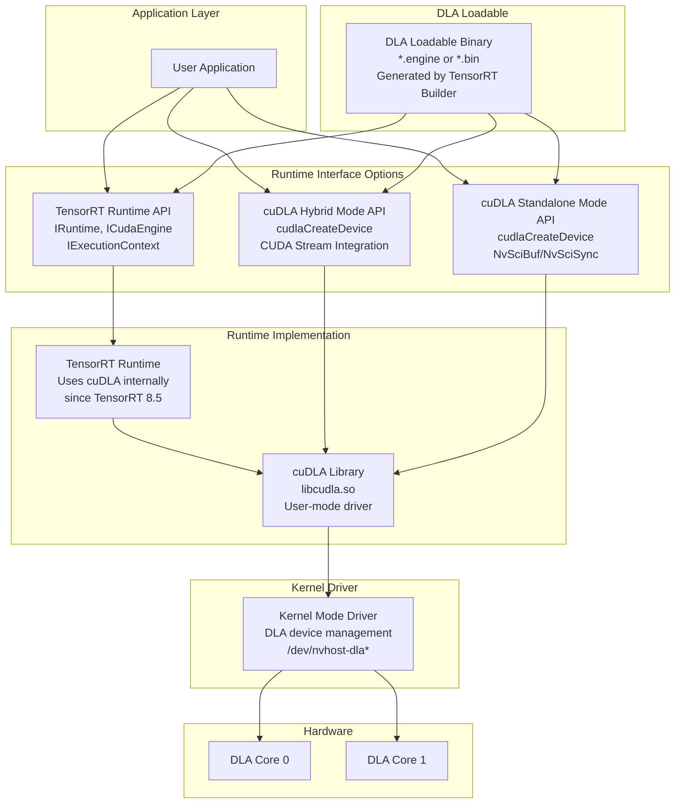
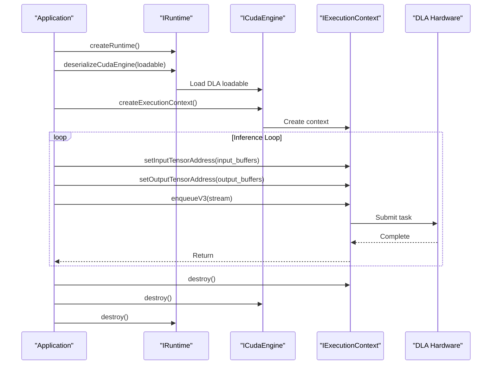
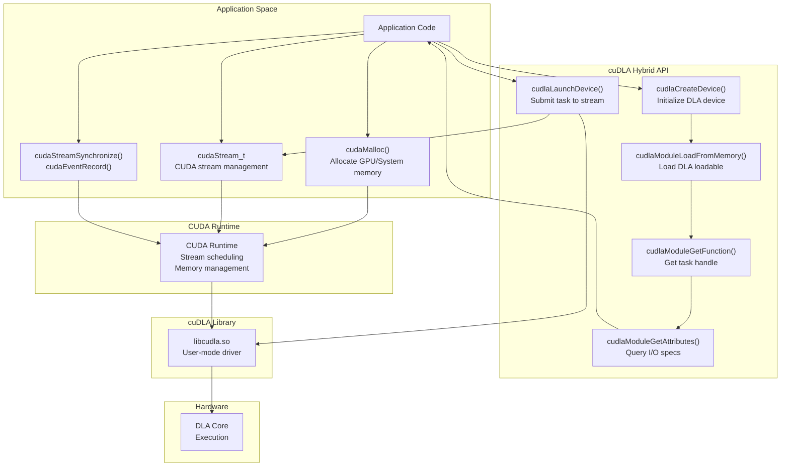
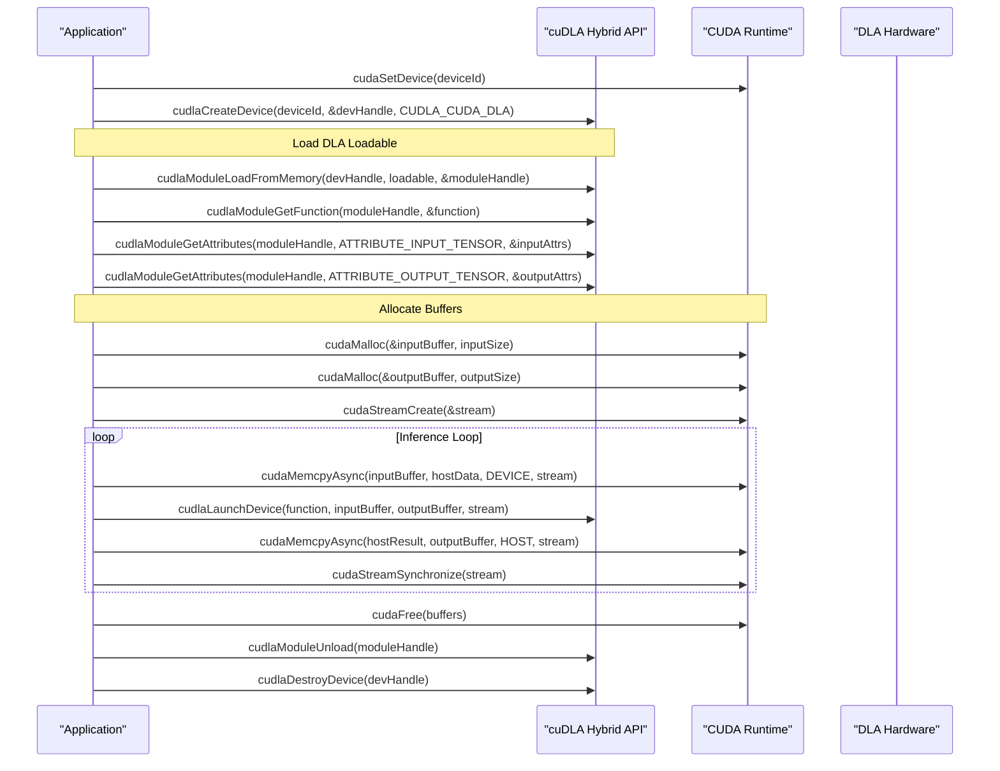
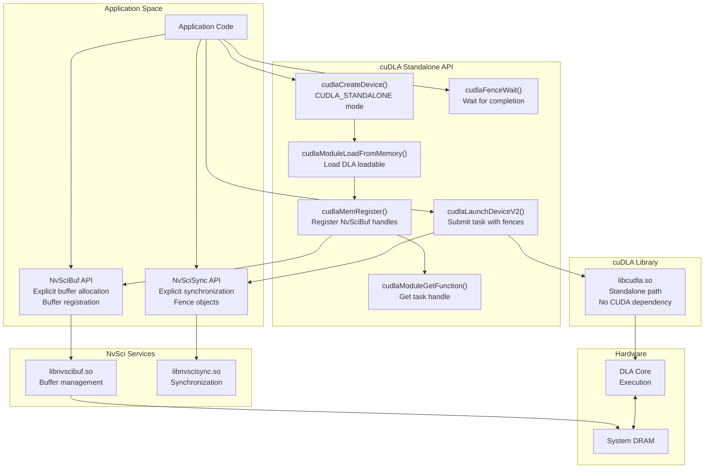
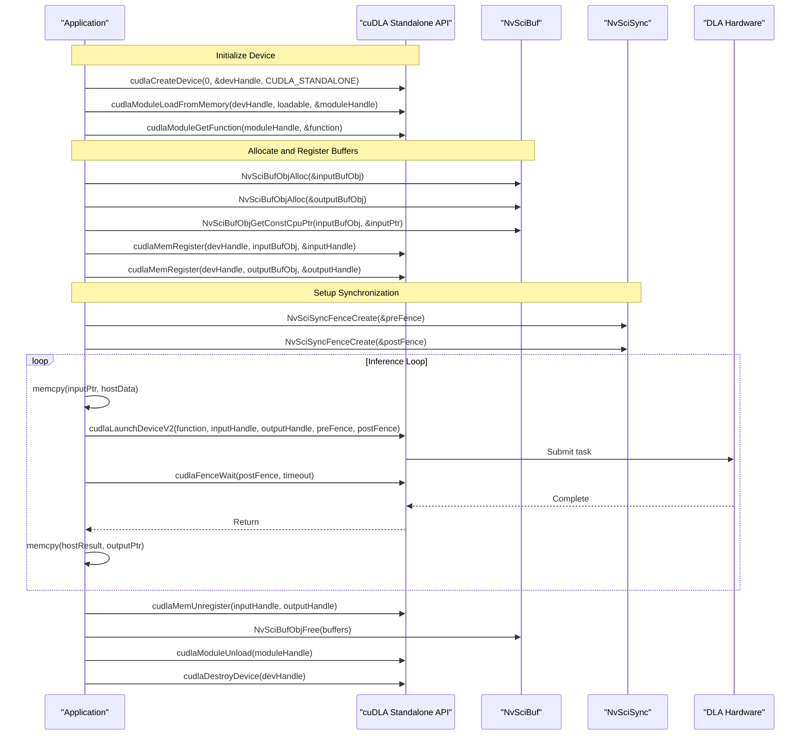

<!-- source: DeepWiki mcp.deepwiki.com · repo NVIDIA/Deep-Learning-Accelerator-SW · page 6 Runtime and Deployment · fetched 2026-10-26 -->

# Runtime and Deployment

<details>
<summary>Relevant source files</summary>

The following files were used as context for generating this wiki page:

- [FAQ/README.md](FAQ/README.md)
- [samples/cuDLA/README.md](samples/cuDLA/README.md)

</details>


This page covers the runtime APIs and deployment options for executing DLA loadables on hardware. After compiling an ONNX model into a DLA loadable using TensorRT (see [Model Compilation](#5)), the loadable must be deployed to the DLA hardware for inference execution. This page describes the three runtime interfaces available, their memory management models, and patterns for concurrent execution.

For information about generating DLA loadables, see [Model Compilation](#5). For performance analysis of runtime execution, see [Performance Analysis and Optimization](#7).

---

## Runtime Architecture Overview

The DLA runtime stack provides three distinct interfaces for executing DLA loadables, each with different trade-offs between ease of use, control, and integration with existing CUDA workflows:



**Runtime Interface Comparison**

| Runtime Interface | Default Since | Memory Management | CUDA Integration | Use Case |
|------------------|---------------|-------------------|------------------|----------|
| **TensorRT Runtime** | Always available | TensorRT managed | Full CUDA support | Easiest approach, recommended for most users |
| **cuDLA Hybrid Mode** | TensorRT 8.5+ | CUDA malloc/streams | Native CUDA integration | Applications with existing CUDA pipelines |
| **cuDLA Standalone Mode** | TensorRT 8.5+ | NvSciBuf explicit | No CUDA dependency | Safety-critical, RTOS, minimal dependencies |

**Sources:** [FAQ/README.md:78-81](), [FAQ/README.md:51-58](), [samples/cuDLA/README.md:1-32]()

---

## TensorRT Runtime API

The TensorRT Runtime API is the default and recommended approach for deploying DLA loadables. Starting from TensorRT 8.5, the TensorRT Runtime internally uses cuDLA for DLA execution while providing a unified interface for both GPU and DLA inference.

### Basic TensorRT Runtime Workflow



### Specifying DLA Core at Build Time

The DLA core is specified during engine compilation using the `--useDLACore` flag in `trtexec`:

```bash
# Build engine for DLA core 0
trtexec --onnx=model.onnx --int8 --useDLACore=0 --saveEngine=model.engine

# Build engine for DLA core 1
trtexec --onnx=model.onnx --int8 --useDLACore=1 --saveEngine=model.engine
```

At runtime, the TensorRT engine is bound to the specified DLA core and cannot be changed. To run the same model on both cores, compile two separate engines.

### Memory Format Considerations

DLA uses specific memory formats for optimal performance. To avoid GPU reformatting overhead when using TensorRT Runtime with DLA:

```bash
# Specify DLA-native formats to avoid reformatting
trtexec --onnx=model.onnx --int8 --useDLACore=0 \
  --inputIOFormats=int8:dla_hwc4 \
  --outputIOFormats=int8:chw32 \
  --saveEngine=model.engine
```

**Common DLA Formats:**
- **INT8**: `dla_hwc4` (input), `chw32` (output)
- **FP16**: `chw16` (compatible with both GPU and DLA)

**Sources:** [FAQ/README.md:78-81](), [FAQ/README.md:45-49](), [FAQ/README.md:118-122]()

---

## cuDLA Hybrid Mode

cuDLA Hybrid Mode integrates DLA execution directly into CUDA programming constructs, allowing DLA tasks to be submitted using CUDA streams and synchronized with CUDA events. This mode is optimal for applications with existing CUDA pipelines that want to incorporate DLA inference.

### cuDLA Hybrid Mode Architecture



### Hybrid Mode Execution Flow

The typical execution flow in cuDLA Hybrid Mode:



### Hybrid Mode Memory Management

In Hybrid Mode, memory is allocated using standard CUDA APIs (`cudaMalloc`, `cudaMallocHost`). DLA can access:
- **GPU device memory** (`cudaMalloc`)
- **Pinned system memory** (`cudaMallocHost`)
- **Unified memory** (`cudaMallocManaged`)

All memory is managed through CUDA, and DLA tasks are submitted to CUDA streams for automatic scheduling and synchronization with GPU kernels.

### Sample Reference

The cuDLA Hybrid Mode sample demonstrates the complete workflow:

```
samples/cuDLA/cuDLALayerwiseStatsHybrid/
```

This sample shows:
- Device initialization with `cudlaCreateDevice`
- Module loading with `cudlaModuleLoadFromMemory`
- CUDA stream integration
- Layerwise performance statistics collection

**Sources:** [samples/cuDLA/README.md:16-17](), [samples/cuDLA/README.md:24-25](), [FAQ/README.md:57]()

---

## cuDLA Standalone Mode

cuDLA Standalone Mode provides a CUDA-independent interface for DLA execution, using explicit memory management with NvSciBuf and synchronization with NvSciSync. This mode is designed for safety-critical applications, RTOS environments, or scenarios where CUDA dependency is undesirable.

### cuDLA Standalone Mode Architecture



### Standalone Mode Execution Flow



### Standalone Mode Memory Requirements

NvSciBuf requires explicit buffer attribute specification:

| Buffer Property | Required Setting |
|----------------|------------------|
| **Access permission** | `NvSciBufAccessPerm_ReadWrite` or `NvSciBufAccessPerm_Readonly` |
| **Memory type** | `NvSciBufType_RawBuffer` |
| **Alignment** | Query from `cudlaModuleGetAttributes` |
| **Size** | Query from `cudlaModuleGetAttributes` for each tensor |

### Sample Reference

The cuDLA Standalone Mode sample demonstrates the complete workflow:

```
samples/cuDLA/cuDLALayerwiseStatsStandalone/
```

This sample shows:
- Device initialization in standalone mode
- NvSciBuf buffer allocation and registration
- NvSciSync fence management
- Standalone execution without CUDA dependency

**Sources:** [samples/cuDLA/README.md:19-20](), [samples/cuDLA/README.md:27-28]()

---

## Extracting DLA Loadables from TensorRT Engines

To use cuDLA (Hybrid or Standalone), the DLA loadable must be extracted from a TensorRT engine. The TensorRT API provides methods to extract the loadable binary:

### Extracting Loadable at Engine Build Time

When building an engine with TensorRT's Python API, enable saveability and extract the loadable:

```python
import tensorrt as trt

# Build configuration
config.set_flag(trt.BuilderFlag.DLA_STANDALONE_MODE)
config.set_flag(trt.BuilderFlag.DEVICE_TYPES, 1 << int(trt.DeviceType.DLA))

# Build engine
engine = builder.build_engine(network, config)

# Extract DLA loadable
dla_core = 0
loadable = engine.get_dla_loadable(dla_core)

# Save to file
with open("model.bin", "wb") as f:
    f.write(loadable)
```

### Using trtexec to Generate Standalone Loadables

The `trtexec` tool does not directly output standalone loadables, but the generated `.engine` file contains the loadable. Applications must deserialize the engine and extract the loadable programmatically, or use the Python API shown above.

**Sources:** [samples/cuDLA/README.md:5](), [FAQ/README.md:78-81]()

---

## Concurrent Execution Patterns

DLA supports multiple concurrent execution patterns to maximize hardware utilization and throughput. With two DLA cores available on Orin and Xavier platforms, applications can achieve significant parallelism.

### Concurrent Execution Topologies

```mermaid
graph TB
    subgraph "Pattern 1: Dual DLA - Different Models"
        Model1["Model A<br/>DLA Core 0"]
        Model2["Model B<br/>DLA Core 1"]
        
        Model1 -.parallel.-> Model2
    end
    
    subgraph "Pattern 2: Dual DLA - Same Model"
        Model3["Model C<br/>Instance 1<br/>DLA Core 0"]
        Model4["Model C<br/>Instance 2<br/>DLA Core 1"]
        
        Model3 -.parallel.-> Model4
    end
    
    subgraph "Pattern 3: Single DLA - Sequential Models"
        Model5["Model D<br/>DLA Core 0"]
        Model6["Model E<br/>DLA Core 0"]
        
        Model5 --> Model6
    end
    
    subgraph "Pattern 4: Hybrid GPU-DLA"
        DLABackbone["DLA Core 0<br/>Backbone network"]
        GPUPostProc["GPU<br/>Post-processing<br/>NMS, decoding"]
        
        DLABackbone --> GPUPostProc
    end
    
    subgraph "Pattern 5: Triple Concurrent"
        DLA0["Model F<br/>DLA Core 0"]
        DLA1["Model G<br/>DLA Core 1"]
        GPU["Model H<br/>GPU"]
        
        DLA0 -.parallel.-> DLA1
        DLA0 -.parallel.-> GPU
        DLA1 -.parallel.-> GPU
    end
```



### Running Multiple Models on Different DLA Cores

Using TensorRT Runtime, run two separate processes or contexts:

```bash
# Terminal 1: Run model on DLA core 0
trtexec --loadEngine=model.engine --useDLACore=0

# Terminal 2: Run model on DLA core 1 (simultaneously)
trtexec --loadEngine=model.engine --useDLACore=1
```

Programmatically in a single application:

```cpp
// Create two execution contexts for different DLA cores
auto engine0 = runtime->deserializeCudaEngine(loadable0); // Built with --useDLACore=0
auto engine1 = runtime->deserializeCudaEngine(loadable1); // Built with --useDLACore=1

auto context0 = engine0->createExecutionContext();
auto context1 = engine1->createExecutionContext();

// Execute concurrently using different streams
cudaStream_t stream0, stream1;
cudaStreamCreate(&stream0);
cudaStreamCreate(&stream1);

context0->enqueueV3(stream0);
context1->enqueueV3(stream1);

cudaStreamSynchronize(stream0);
cudaStreamSynchronize(stream1);
```

### Sequential Execution on Single DLA Core

Multiple models can execute sequentially on the same DLA core:

```cpp
auto context_model_a = engine_a->createExecutionContext();
auto context_model_b = engine_b->createExecutionContext();

// Execute sequentially on same DLA core
context_model_a->enqueueV3(stream);
context_model_b->enqueueV3(stream);
cudaStreamSynchronize(stream);
```

### Concurrent Execution Considerations

**Memory Bandwidth Contention:**
DLA and GPU share system DRAM bandwidth. When running DLA and GPU concurrently, bandwidth-bound workloads may experience reduced performance. Monitor DRAM utilization with Nsight Systems.

**Scheduling Overhead:**
At low batch sizes with high frame rates, inefficient scheduling can increase latency. Mitigation strategies:
- Use cuDLA for direct DLA submission (lower overhead than TensorRT Runtime)
- Increase `CUDA_DEVICE_MAX_CONNECTIONS=32` to allow more concurrent streams
- Ensure DLA uses native formats to avoid GPU reformatting kernels

**GPU Fallback:**
If a model has layers that cannot run on DLA, they automatically fall back to GPU. This creates additional GPU workload and memory transfers that must be accounted for when planning concurrent execution.

**Sources:** [FAQ/README.md:107-109](), [FAQ/README.md:111-112](), [FAQ/README.md:51-58](), [FAQ/README.md:20-21]()

---

## Runtime Configuration and Optimization

### Setting CUDA Device for Multi-GPU Systems

On systems with multiple GPUs, set the CUDA device before initializing DLA:

```cpp
cudaSetDevice(deviceId);  // Set the GPU device that has DLA cores
```

### Increasing Concurrent Work Queues

To reduce scheduling interference, increase the number of CUDA work queues:

```bash
export CUDA_DEVICE_MAX_CONNECTIONS=32
```

This environment variable increases the number of compute and copy engine connections, improving concurrency between DLA tasks and GPU kernels.

### DLA SRAM Memory Pool Configuration

DLA uses internal SRAM for intermediate buffers. Configure the SRAM memory pool size with `trtexec`:

```bash
trtexec --onnx=model.onnx --int8 --useDLACore=0 \
  --memPoolSize=dlaSRAM:1 \
  --saveEngine=model.engine
```

**SRAM Sizes:**
- **Orin:** 1 MB per DLA core (exclusive)
- **Xavier:** 4 MB shared between 2 DLA cores and 2 PVA cores

Insufficient SRAM allocation may cause compilation to fail with layer fusion warnings.

### Deterministic Latency

DLA inference provides deterministic latency when:
1. Clock frequencies are locked (not in dynamic scaling mode)
2. DRAM bandwidth is not saturated
3. No concurrent workloads causing contention

To lock clocks on Jetson:

```bash
sudo nvpmodel -m 0  # MAXN mode
sudo jetson_clocks   # Lock clocks to maximum
```

**Sources:** [FAQ/README.md:114-115](), [FAQ/README.md:90-91](), [FAQ/README.md:96-98](), [FAQ/README.md:57-58]()

---

## Runtime API Selection Guide

| Requirement | Recommended API |
|-------------|----------------|
| **Easiest integration** | TensorRT Runtime |
| **Existing CUDA pipeline** | cuDLA Hybrid Mode |
| **Safety-critical system** | cuDLA Standalone Mode |
| **Mixed GPU-DLA execution** | TensorRT Runtime |
| **Minimal dependencies** | cuDLA Standalone Mode |
| **Maximum control** | cuDLA Standalone Mode |
| **Production deployment (non-safety)** | TensorRT Runtime or cuDLA Hybrid |
| **Real-time OS** | cuDLA Standalone Mode |

### Migration Path

For applications starting with TensorRT Runtime that need more control:

1. **TensorRT Runtime** → Simplest starting point
2. **cuDLA Hybrid Mode** → Add fine-grained control while keeping CUDA integration
3. **cuDLA Standalone Mode** → Remove CUDA dependency for specialized environments

All three APIs execute the same DLA loadable binaries and achieve identical inference results. The choice depends on application requirements and deployment constraints.

**Sources:** [FAQ/README.md:78-81](), [samples/cuDLA/README.md:1-32]()

---

