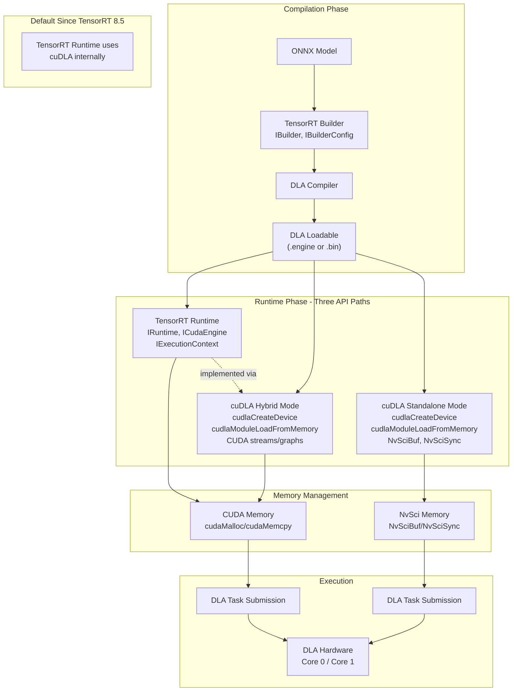
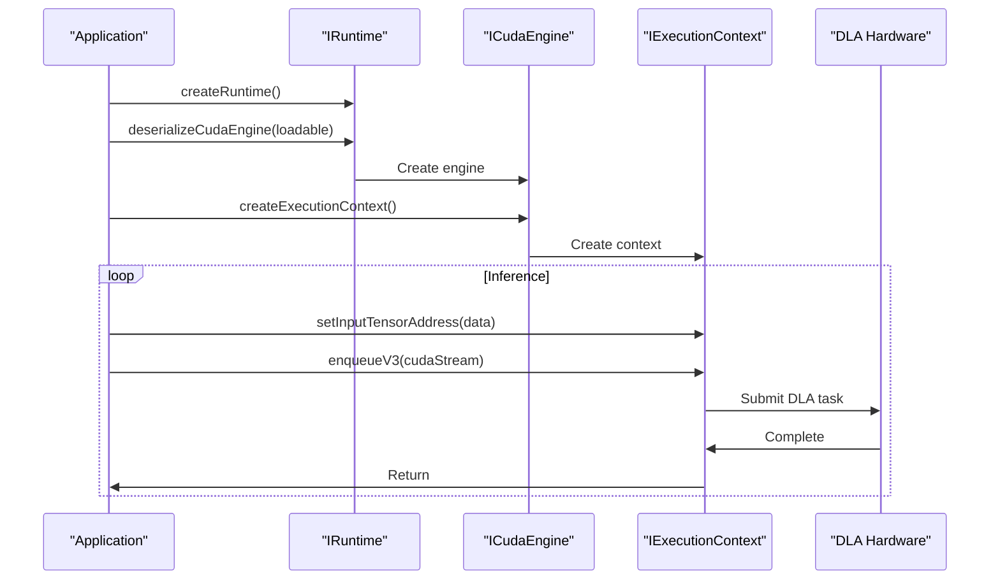
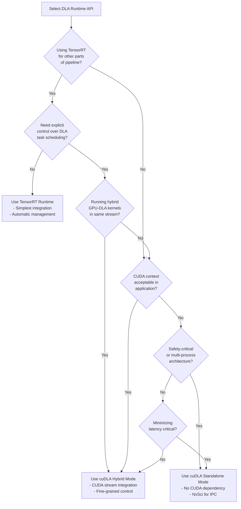
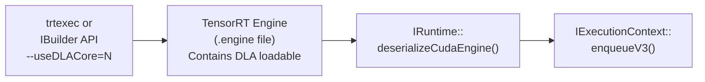
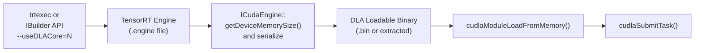
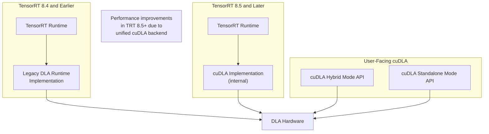

<!-- source: DeepWiki mcp.deepwiki.com · repo NVIDIA/Deep-Learning-Accelerator-SW · page 6.1 Runtime API Overview · fetched 2026-10-26 -->

# Runtime API Overview

<details>
<summary>Relevant source files</summary>

The following files were used as context for generating this wiki page:

- [FAQ/README.md](FAQ/README.md)
- [samples/cuDLA/README.md](samples/cuDLA/README.md)

</details>


## Purpose and Scope

This document provides an overview of the three runtime API options for executing DLA workloads on NVIDIA Jetson and DRIVE platforms. It compares **TensorRT Runtime**, **cuDLA Hybrid Mode**, and **cuDLA Standalone Mode**, explaining their characteristics, use cases, and the decision criteria for selecting the appropriate runtime for your application.

For detailed implementation guidance on each runtime mode, see:
- [cuDLA Hybrid Mode](#6.2) - CUDA-managed DLA execution
- [cuDLA Standalone Mode](#6.3) - Independent DLA programming
- [Concurrent Execution and Multi-Model Deployment](#6.4) - Multi-model and hybrid GPU-DLA execution strategies

For information about compiling models into DLA loadables, see [Model Compilation](#5).

**Sources:** [FAQ/README.md:78-81](), [samples/cuDLA/README.md:1-4]()

## Runtime Architecture Overview

The DLA software stack provides three distinct runtime interfaces for executing DLA loadables on hardware. All three paths ultimately execute the same DLA loadable binary generated by the TensorRT Builder and DLA Compiler.



**Diagram: DLA Runtime API Architecture**

The three runtime paths share the same DLA loadable input but differ in their programming model, memory management approach, and integration with other system components.

**Sources:** [FAQ/README.md:78-81](), [samples/cuDLA/README.md:1-20]()

## TensorRT Runtime

The **TensorRT Runtime** is the default and recommended runtime interface for most DLA applications. It provides a unified API for executing models on both GPU and DLA, with automatic memory management and format handling.

### Key Characteristics

| Aspect | Description |
|--------|-------------|
| **Primary API Classes** | `IRuntime`, `ICudaEngine`, `IExecutionContext` |
| **Memory Management** | Automatic, CUDA-managed |
| **Programming Model** | Standard TensorRT inference workflow |
| **GPU-DLA Hybrid** | Seamless, no explicit management needed |
| **Default Since** | TensorRT 8.5 (uses cuDLA internally) |
| **Best For** | General purpose DLA inference, mixed GPU-DLA workloads |

### When to Use TensorRT Runtime

Use TensorRT Runtime when:
- You want minimal code changes to integrate DLA into existing TensorRT applications
- You need automatic GPU fallback for unsupported layers
- You are running hybrid GPU-DLA models with layers split between accelerators
- You want TensorRT to handle memory format conversions automatically
- You are building applications where CUDA context management is acceptable

### Typical Workflow



**Diagram: TensorRT Runtime Execution Flow**

The TensorRT Runtime handles all DLA task submission, synchronization, and error handling automatically through the standard TensorRT inference API.

**Sources:** [FAQ/README.md:78-81](), [FAQ/README.md:118-123]()

## cuDLA Hybrid Mode

**cuDLA Hybrid Mode** enables DLA programming using standard CUDA constructs such as streams, events, and graphs. This mode provides explicit control over DLA execution while maintaining CUDA context integration.

### Key Characteristics

| Aspect | Description |
|--------|-------------|
| **Primary API Functions** | `cudlaCreateDevice()`, `cudlaModuleLoadFromMemory()`, `cudlaMemcpy()`, `cudlaSubmitTask()` |
| **Memory Management** | CUDA memory (`cudaMalloc`, `cudaMemcpy`) |
| **Programming Model** | CUDA streams and events |
| **Synchronization** | CUDA events and `cudaStreamSynchronize()` |
| **Context** | Requires CUDA context |
| **Best For** | Advanced control with CUDA integration, performance optimization |

### When to Use cuDLA Hybrid Mode

Use cuDLA Hybrid Mode when:
- You need fine-grained control over DLA task scheduling
- You want to integrate DLA with custom CUDA kernels in the same stream
- You are optimizing latency through explicit stream management
- You need to extract DLA loadables from TensorRT engines for standalone execution
- You want to avoid TensorRT Runtime overhead for simple inference loops

### API Structure



```mermaid
graph LR
    subgraph "Initialization"
        CreateDevice["cudlaCreateDevice()"]
        LoadModule["cudlaModuleLoadFromMemory()"]
        GetAttrs["cudlaModuleGetAttributes()"]
    end
    
    subgraph "Memory Setup"
        AllocCUDA["cudaMalloc()"]
        MemcpyH2D["cudaMemcpy(H2D)"]
        SetMem["cudlaMemcpyAsync()"]
    end
    
    subgraph "Execution"
        RegisterTensor["cudlaModuleRegisterTensor()"]
        SubmitTask["cudlaSubmitTask(stream)"]
        Sync["cudaStreamSynchronize()"]
        MemcpyD2H["cudaMemcpy(D2H)"]
    end
    
    CreateDevice --> LoadModule
    LoadModule --> GetAttrs
    GetAttrs --> AllocCUDA
    AllocCUDA --> MemcpyH2D
    MemcpyH2D --> SetMem
    SetMem --> RegisterTensor
    RegisterTensor --> SubmitTask
    SubmitTask --> Sync
    Sync --> MemcpyD2H
```

**Diagram: cuDLA Hybrid Mode API Call Flow**

**Sources:** [samples/cuDLA/README.md:16-17](), [FAQ/README.md:57-58]()

## cuDLA Standalone Mode

**cuDLA Standalone Mode** enables DLA programming without CUDA dependencies. This mode uses NvSciBuf and NvSciSync for memory management and synchronization, making it suitable for safety-critical applications and non-CUDA environments.

### Key Characteristics

| Aspect | Description |
|--------|-------------|
| **Primary API Functions** | `cudlaCreateDevice()`, `cudlaModuleLoadFromMemory()`, `cudlaSubmitTask()` |
| **Memory Management** | NvSciBuf (zero-copy, inter-process capable) |
| **Synchronization** | NvSciSync (fence-based) |
| **Context** | No CUDA context required |
| **Process Model** | Single or multi-process |
| **Best For** | Safety-critical systems, CUDA-free environments, multi-process architectures |

### When to Use cuDLA Standalone Mode

Use cuDLA Standalone Mode when:
- You are developing safety-critical automotive applications (DRIVE OS)
- You need to run DLA without initializing CUDA runtime
- You require inter-process buffer sharing (NvSciBuf)
- You want deterministic execution without CUDA runtime interference
- You are building multi-process pipelines with zero-copy data transfer

### API Structure



```mermaid
graph LR
    subgraph "Initialization"
        CreateDevice["cudlaCreateDevice()"]
        LoadModule["cudlaModuleLoadFromMemory()"]
        GetAttrs["cudlaModuleGetAttributes()"]
    end
    
    subgraph "NvSci Memory Setup"
        CreateBufObj["NvSciBufObjAlloc()"]
        GetBufCPU["NvSciBufObjGetCpuPtr()"]
        FillData["memcpy to buffer"]
        ImportBuf["cudlaImportExternalMemory()"]
    end
    
    subgraph "NvSci Synchronization"
        CreateSyncObj["NvSciSyncObjAlloc()"]
        ImportSync["cudlaImportExternalSemaphore()"]
    end
    
    subgraph "Execution"
        RegisterTensor["cudlaModuleRegisterTensor()"]
        SubmitTask["cudlaSubmitTask(syncObj)"]
        WaitSync["NvSciSyncObjWait()"]
        ReadOutput["Read from NvSciBuf"]
    end
    
    CreateDevice --> LoadModule
    LoadModule --> GetAttrs
    GetAttrs --> CreateBufObj
    CreateBufObj --> GetBufCPU
    GetBufCPU --> FillData
    FillData --> ImportBuf
    GetAttrs --> CreateSyncObj
    CreateSyncObj --> ImportSync
    ImportBuf --> RegisterTensor
    ImportSync --> RegisterTensor
    RegisterTensor --> SubmitTask
    SubmitTask --> WaitSync
    WaitSync --> ReadOutput
```

**Diagram: cuDLA Standalone Mode API Call Flow**

**Sources:** [samples/cuDLA/README.md:19-20](), [FAQ/README.md:57]()

## Runtime Mode Comparison

The following table summarizes the key differences between the three runtime modes to guide selection:

| Feature | TensorRT Runtime | cuDLA Hybrid Mode | cuDLA Standalone Mode |
|---------|-----------------|-------------------|----------------------|
| **CUDA Dependency** | Required | Required | Not required |
| **Memory API** | TensorRT managed | `cudaMalloc` / `cudaMemcpy` | NvSciBuf |
| **Synchronization** | Automatic | CUDA streams/events | NvSciSync |
| **GPU Fallback** | Automatic | Manual integration | Manual integration |
| **Format Conversion** | Automatic | Manual | Manual |
| **Code Complexity** | Low | Medium | High |
| **Control Granularity** | Coarse | Fine | Fine |
| **Inter-Process** | No | Limited | Yes (via NvSciBuf) |
| **Safety Certification** | No | Limited | Yes (DRIVE OS) |
| **Best Latency** | Good | Better | Best (no CUDA overhead) |
| **Loadable Source** | `.engine` file | `.engine` extracted | `.engine` extracted |
| **Multi-Core Support** | Via `useDLACore` | Via device ID | Via device ID |

**Sources:** [samples/cuDLA/README.md:16-20](), [FAQ/README.md:78-81]()

## Runtime Selection Decision Tree



**Diagram: DLA Runtime API Selection Decision Tree**

### Selection Guidelines

**Choose TensorRT Runtime if:**
- You are already using TensorRT for model deployment
- You want the fastest development time with minimal code changes
- You need automatic GPU fallback for unsupported operators
- Mixed-precision models with automatic format conversion are required

**Choose cuDLA Hybrid Mode if:**
- You need explicit control over DLA task submission timing
- You are integrating DLA with custom CUDA preprocessing/postprocessing kernels
- You want to optimize latency through stream-level scheduling
- You are comfortable with CUDA programming model

**Choose cuDLA Standalone Mode if:**
- You are developing for DRIVE OS safety-critical applications
- CUDA context initialization is unacceptable (power, determinism, or safety reasons)
- You need inter-process buffer sharing with zero-copy semantics
- You require the absolute lowest latency without CUDA runtime overhead

**Sources:** [FAQ/README.md:78-81](), [FAQ/README.md:51-58]()

## DLA Loadable Extraction and Usage

All three runtime modes consume the same **DLA loadable** binary format. However, the method of obtaining and loading this binary differs:

### TensorRT Runtime Path



**Diagram: TensorRT Runtime Loadable Path**

The DLA loadable is embedded within the TensorRT engine file and automatically extracted by the runtime.

### cuDLA Hybrid/Standalone Path



**Diagram: cuDLA Loadable Extraction Path**

For cuDLA modes, the DLA loadable must be extracted from the TensorRT engine or obtained through the `trtexec --saveEngine` flow.

### Loadable Extraction Methods

**Method 1: Using trtexec**
```bash
# Build and save engine
trtexec --onnx=model.onnx --int8 --useDLACore=0 \
        --saveEngine=model.engine

# The .engine file contains the DLA loadable
# Can be loaded with cudlaModuleLoadFromMemory()
```

**Method 2: Using TensorRT API**
Extract DLA loadable from an existing engine using `ICudaEngine::getDeviceMemorySize()` and serialization APIs to isolate the DLA-specific binary portion.

**Sources:** [FAQ/README.md:78-81](), [samples/cuDLA/README.md:1-5]()

## Runtime Evolution and Internal Implementation

Starting with **TensorRT 8.5**, the TensorRT Runtime internally uses cuDLA for DLA task submission. This architectural change improves performance and reduces latency compared to earlier TensorRT versions.



**Diagram: TensorRT Runtime Implementation Evolution**

This unification means that the performance characteristics of TensorRT Runtime have improved significantly since TensorRT 8.5, narrowing the performance gap with direct cuDLA usage for many workloads.

**Sources:** [FAQ/README.md:57](), [samples/cuDLA/README.md:1-4]()

## Multi-DLA Core Support

All three runtime modes support targeting specific DLA cores (Core 0 or Core 1) on platforms with multiple DLA instances:

| Runtime Mode | Core Selection Method |
|-------------|----------------------|
| **TensorRT Runtime** | `IBuilderConfig::setDLACore(0 or 1)` at build time |
| **cuDLA Hybrid** | `cudlaCreateDevice(&devHandle, coreId)` where `coreId = 0 or 1` |
| **cuDLA Standalone** | `cudlaCreateDevice(&devHandle, coreId)` where `coreId = 0 or 1` |

For concurrent execution on multiple DLA cores, see [Concurrent Execution and Multi-Model Deployment](#6.4).

**Sources:** [FAQ/README.md:107-112]()

## Code Examples and Samples

Comprehensive code examples for each runtime mode are available:

| Sample | Location | Description |
|--------|----------|-------------|
| **TensorRT Runtime** | TensorRT samples | Standard `IRuntime` and `IExecutionContext` usage |
| **cuDLA Error Reporting** | [cuda-samples/cuDLAErrorReporting](https://github.com/NVIDIA/cuda-samples/tree/master/Samples/4_CUDA_Libraries/cuDLAErrorReporting) | DLA error detection via CUDA |
| **cuDLA Hybrid Mode** | [cuda-samples/cuDLAHybridMode](https://github.com/NVIDIA/cuda-samples/tree/master/Samples/4_CUDA_Libraries/cuDLAHybridMode) | CUDA-managed DLA execution |
| **cuDLA Standalone Mode** | [cuda-samples/cuDLAStandaloneMode](https://github.com/NVIDIA/cuda-samples/tree/master/Samples/4_CUDA_Libraries/cuDLAStandaloneMode) | Independent DLA programming |
| **Layerwise Stats Hybrid** | [samples/cuDLA/cuDLALayerwiseStatsHybrid](samples/cuDLA/cuDLALayerwiseStatsHybrid) | Performance profiling in hybrid mode |
| **Layerwise Stats Standalone** | [samples/cuDLA/cuDLALayerwiseStatsStandalone](samples/cuDLA/cuDLALayerwiseStatsStandalone) | Performance profiling in standalone mode |
| **YOLOv5 cuDLA** | [cuDLA-samples](https://github.com/NVIDIA-AI-IOT/cuDLA-samples) | End-to-end QAT and deployment |

**Sources:** [samples/cuDLA/README.md:9-31]()

## Summary

The DLA runtime ecosystem provides three API options optimized for different use cases:

1. **TensorRT Runtime** - Best for general-purpose DLA inference with minimal code complexity
2. **cuDLA Hybrid Mode** - Best for performance optimization with CUDA integration
3. **cuDLA Standalone Mode** - Best for safety-critical and CUDA-free environments

All three modes execute the same DLA loadable format, allowing flexibility in runtime selection without recompilation. The choice depends on your application architecture, performance requirements, and deployment constraints.

For implementation details, continue to [cuDLA Hybrid Mode](#6.2) or [cuDLA Standalone Mode](#6.3).

---

