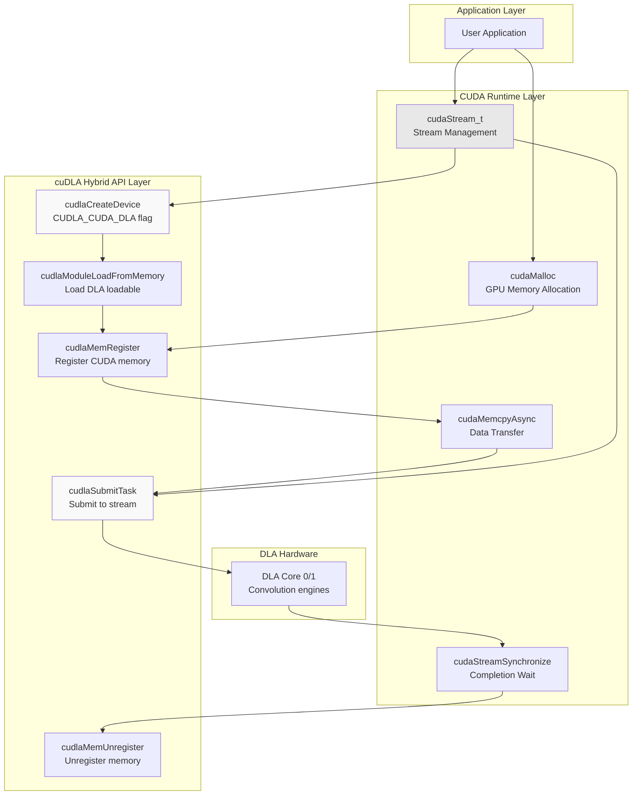
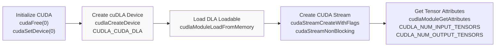
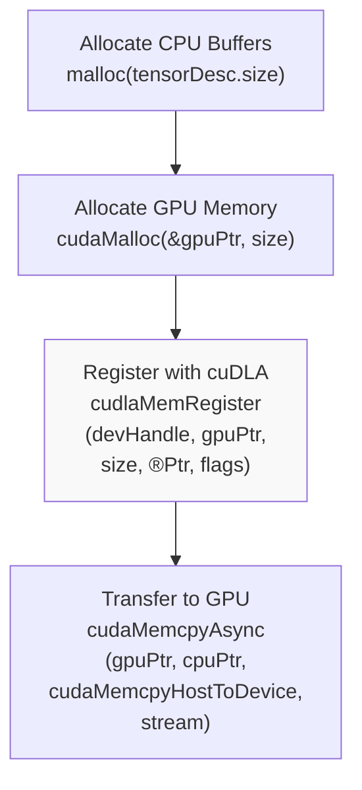
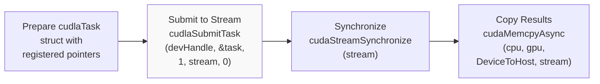
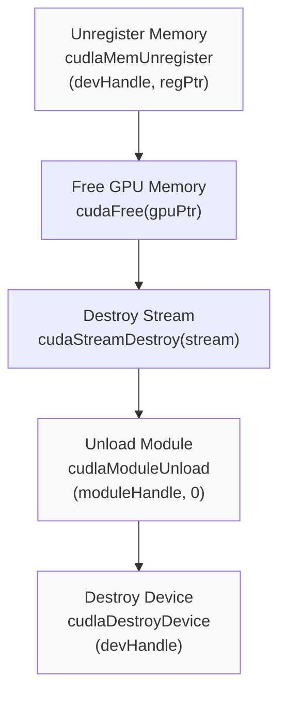
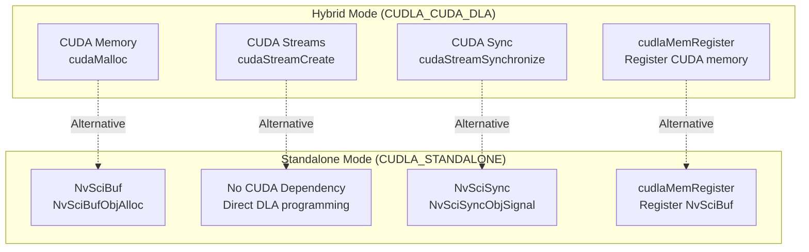

<!-- source: DeepWiki mcp.deepwiki.com · repo NVIDIA/Deep-Learning-Accelerator-SW · page 6.2 cuDLA Hybrid Mode · fetched 2026-10-26 -->

# cuDLA Hybrid Mode

<details>
<summary>Relevant source files</summary>

The following files were used as context for generating this wiki page:

- [samples/cuDLA/README.md](samples/cuDLA/README.md)
- [samples/cuDLA/cuDLALayerwiseStatsHybrid/Makefile](samples/cuDLA/cuDLALayerwiseStatsHybrid/Makefile)
- [samples/cuDLA/cuDLALayerwiseStatsHybrid/README.md](samples/cuDLA/cuDLALayerwiseStatsHybrid/README.md)
- [samples/cuDLA/cuDLALayerwiseStatsHybrid/main.cu](samples/cuDLA/cuDLALayerwiseStatsHybrid/main.cu)
- [samples/cuDLA/cuDLALayerwiseStatsStandalone/Makefile](samples/cuDLA/cuDLALayerwiseStatsStandalone/Makefile)
- [samples/cuDLA/cuDLALayerwiseStatsStandalone/findnvsci.mk](samples/cuDLA/cuDLALayerwiseStatsStandalone/findnvsci.mk)
- [samples/cuDLA/cuDLALayerwiseStatsStandalone/main.cpp](samples/cuDLA/cuDLALayerwiseStatsStandalone/main.cpp)

</details>


## Purpose and Scope

cuDLA Hybrid Mode enables DLA (Deep Learning Accelerator) programming using CUDA constructs such as streams, memory allocation, and synchronization primitives. In this mode, CUDA manages DLA execution as an integrated accelerator, allowing developers to use familiar CUDA APIs for memory management and task scheduling.

This page covers the hybrid mode API workflow, memory model, and integration patterns. For standalone DLA programming without CUDA dependencies, see [cuDLA Standalone Mode](#6.3). For general runtime API comparison, see [Runtime API Overview](#6.1). For performance profiling in hybrid mode, see [Layerwise Statistics Collection](#7.1).

**Sources:** [samples/cuDLA/README.md:1-32](), [samples/cuDLA/cuDLALayerwiseStatsHybrid/README.md:1-5]()

## Architecture and Memory Model

### CUDA-Managed DLA Execution



**Diagram: cuDLA Hybrid Mode Architecture** - Shows CUDA runtime integration where CUDA streams orchestrate DLA task execution and memory management uses standard CUDA allocation APIs.

**Sources:** [samples/cuDLA/cuDLALayerwiseStatsHybrid/main.cu:298-346](), [samples/cuDLA/cuDLALayerwiseStatsHybrid/README.md:5-6]()

### Memory Management Model

In hybrid mode, all memory is allocated using CUDA APIs and then registered with the cuDLA subsystem:

| Aspect | Hybrid Mode Approach |
|--------|---------------------|
| Memory Allocation | `cudaMalloc` for GPU-accessible memory |
| Memory Registration | `cudlaMemRegister` to enable DLA access |
| Data Transfer | `cudaMemcpyAsync` with CUDA streams |
| Synchronization | `cudaStreamSynchronize` on CUDA streams |
| Memory Deallocation | `cudlaMemUnregister` then `cudaFree` |

**Sources:** [samples/cuDLA/cuDLALayerwiseStatsHybrid/main.cu:525-580](), [samples/cuDLA/cuDLALayerwiseStatsHybrid/main.cu:609-647]()

## Complete API Workflow

### Initialization and Module Loading



**Diagram: Initialization Phase** - Device and module setup sequence with CUDA integration.

**Key Code Entities:**
- `cudlaCreateDevice()` at [samples/cuDLA/cuDLALayerwiseStatsHybrid/main.cu:315-320]()
- `cudlaModuleLoadFromMemory()` at [samples/cuDLA/cuDLALayerwiseStatsHybrid/main.cu:325-332]()
- `cudaStreamCreateWithFlags()` at [samples/cuDLA/cuDLALayerwiseStatsHybrid/main.cu:337-344]()
- `cudlaModuleGetAttributes()` at [samples/cuDLA/cuDLALayerwiseStatsHybrid/main.cu:355-393]()

**Sources:** [samples/cuDLA/cuDLALayerwiseStatsHybrid/main.cu:298-393]()

### Memory Allocation and Registration



**Diagram: Memory Setup Flow** - Allocation and registration steps for input/output tensors.

The registration process creates a mapping between CUDA-allocated memory and DLA-accessible memory:

```
For each input tensor:
  1. cudaMalloc(&inputBufferGPU[i], size)
  2. cudlaMemRegister(devHandle, inputBufferGPU[i], size, &inputBufferRegisteredPtr[i], 0)

For each output tensor:
  1. cudaMalloc(&outputBufferGPU[i], size)
  2. cudlaMemRegister(devHandle, outputBufferGPU[i], size, &outputBufferRegisteredPtr[i], 0)

For task statistics (if enabled):
  1. cudaMalloc(&outputTaskStatisticsGPU[i], size)
  2. cudlaMemRegister(devHandle, outputTaskStatisticsGPU[i], size, 
                      &outputTaskStatisticsRegisteredPtr[i], CUDLA_TASK_STATISTICS)
```

**Sources:** [samples/cuDLA/cuDLALayerwiseStatsHybrid/main.cu:525-647](), [samples/cuDLA/cuDLALayerwiseStatsHybrid/main.cu:651-677]()

### Task Submission and Execution



**Diagram: Execution Phase** - Task submission through CUDA stream and result retrieval.

**Key Structure: `cudlaTask`**

```c
cudlaTask task;
task.moduleHandle = moduleHandle;
task.inputTensor = inputBufferRegisteredPtr;  // Array of registered input pointers
task.outputTensor = outputBufferRegisteredPtr; // Array of registered output pointers
task.numInputTensors = numInputTensors;
task.numOutputTensors = numOutputTensors;     // Can include statistics tensors
task.waitEvents = NULL;    // NULL in hybrid mode (uses CUDA stream dependencies)
task.signalEvents = NULL;  // NULL in hybrid mode (uses CUDA stream completion)
```

**Sources:** [samples/cuDLA/cuDLALayerwiseStatsHybrid/main.cu:689-713](), [samples/cuDLA/cuDLALayerwiseStatsHybrid/main.cu:716-740]()

### Cleanup and Resource Release



**Diagram: Cleanup Sequence** - Proper resource deallocation order.

**Sources:** [samples/cuDLA/cuDLALayerwiseStatsHybrid/main.cu:830-892]()

## Core API Functions

### Device Management

| Function | Purpose | Flags |
|----------|---------|-------|
| `cudlaCreateDevice(dlaCore, &devHandle, mode)` | Initialize cuDLA device | `CUDLA_CUDA_DLA` for hybrid mode |
| `cudlaDestroyDevice(devHandle)` | Release device resources | - |

**Sources:** [samples/cuDLA/cuDLALayerwiseStatsHybrid/main.cu:315-320](), [samples/cuDLA/cuDLALayerwiseStatsHybrid/main.cu:884-889]()

### Module Management

| Function | Purpose | Parameters |
|----------|---------|------------|
| `cudlaModuleLoadFromMemory(devHandle, loadableData, size, &moduleHandle, flags)` | Load compiled DLA loadable | `loadableData`: pointer to .bin file contents |
| `cudlaModuleGetAttributes(moduleHandle, attrType, &attribute)` | Query tensor descriptors | `CUDLA_NUM_INPUT_TENSORS`, `CUDLA_NUM_OUTPUT_TENSORS`, `CUDLA_NUM_OUTPUT_TASK_STATISTICS` |
| `cudlaModuleUnload(moduleHandle, flags)` | Unload module | `flags`: typically 0 |

**Sources:** [samples/cuDLA/cuDLALayerwiseStatsHybrid/main.cu:325-332](), [samples/cuDLA/cuDLALayerwiseStatsHybrid/main.cu:355-466]()

### Memory Management

| Function | Purpose | Flags |
|----------|---------|-------|
| `cudlaMemRegister(devHandle, cudaPtr, size, &registeredPtr, flags)` | Register CUDA memory for DLA access | `0` for regular tensors, `CUDLA_TASK_STATISTICS` for statistics buffers |
| `cudlaMemUnregister(devHandle, registeredPtr)` | Unregister DLA access to memory | - |

**Important:** Memory must be allocated with `cudaMalloc` before registration. The `registeredPtr` returned by `cudlaMemRegister` is used in the `cudlaTask` structure, not the original CUDA pointer.

**Sources:** [samples/cuDLA/cuDLALayerwiseStatsHybrid/main.cu:609-647](), [samples/cuDLA/cuDLALayerwiseStatsHybrid/main.cu:831-859]()

### Task Submission

| Function | Purpose | Parameters |
|----------|---------|------------|
| `cudlaSubmitTask(devHandle, &task, numTasks, stream, flags)` | Submit inference task to stream | `task`: configured `cudlaTask` struct<br/>`stream`: CUDA stream for execution<br/>`numTasks`: typically 1 |

The task executes asynchronously on the DLA core, with completion tracked through the CUDA stream.

**Sources:** [samples/cuDLA/cuDLALayerwiseStatsHybrid/main.cu:707-713]()

## Hybrid vs Standalone Mode Comparison



**Diagram: Mode Comparison** - Key API differences between hybrid and standalone modes.

| Aspect | Hybrid Mode | Standalone Mode |
|--------|-------------|-----------------|
| **Device Flag** | `CUDLA_CUDA_DLA` | `CUDLA_STANDALONE` |
| **Memory API** | `cudaMalloc` / `cudaFree` | `NvSciBufObjAlloc` / `NvSciBufObjFree` |
| **Scheduling** | CUDA streams (`cudaStream_t`) | Manual submission with DLA-specific fences |
| **Synchronization** | `cudaStreamSynchronize` | `NvSciSyncFenceWait` with CPU wait context |
| **Data Transfer** | `cudaMemcpyAsync` | Direct CPU pointer access to NvSciBuf |
| **CUDA Dependency** | Required | None (can run without CUDA runtime) |
| **Use Case** | Applications already using CUDA | Safety-critical systems, non-CUDA environments |
| **Signal Events** | `NULL` (stream handles dependencies) | `cudlaSignalEvents` with NvSciSync fences |

**Sources:** [samples/cuDLA/cuDLALayerwiseStatsHybrid/main.cu:315-320](), [samples/cuDLA/cuDLALayerwiseStatsStandalone/main.cpp:536-541]()

## Layerwise Statistics in Hybrid Mode

### Enabling Statistics Collection

To collect per-layer performance metrics in hybrid mode:

1. **Query statistics tensor count:**
```c
cudlaModuleAttribute attribute;
err = cudlaModuleGetAttributes(moduleHandle, CUDLA_NUM_OUTPUT_TASK_STATISTICS, &attribute);
numOutputTaskStatistics = attribute.numOutputTensors;
```

2. **Allocate and register statistics buffers:**
```c
for (uint32_t i = 0; i < numOutputTaskStatistics; i++) {
    cudaMalloc(&outputTaskStatisticsGPU[i], outputTaskStatisticsDesc[i].size);
    cudlaMemRegister(devHandle, outputTaskStatisticsGPU[i], 
                     outputTaskStatisticsDesc[i].size,
                     &outputTaskStatisticsRegisteredPtr[i], 
                     CUDLA_TASK_STATISTICS);  // Special flag
}
```

3. **Include statistics in task submission:**
```c
// Combine regular outputs and statistics outputs
task.numOutputTensors = numOutputTensors + numOutputTaskStatistics;
task.outputTensor = outputStatisticsBufferRegisteredPtr;  // Array containing both
```

**Sources:** [samples/cuDLA/cuDLALayerwiseStatsHybrid/main.cu:376-389](), [samples/cuDLA/cuDLALayerwiseStatsHybrid/main.cu:636-647](), [samples/cuDLA/cuDLALayerwiseStatsHybrid/main.cu:679-700]()

### Statistics Translation and Output

After task completion, translate binary statistics to CSV format:

```c
// Get export table for statistics translation
const cudlaExternalEtbl* etbl = NULL;
cudlaGetExternalExportTable(&etbl, 0);

// Get CSV length first
cudlaTranslateCsvAttribute csvAttribute;
etbl->etiTranslateStats(devHandle, statisticsOutputBuffer[i], 
                        dlaFreqInMHz, i, CUDLA_GET_CSV_LENGTH, &csvAttribute);

// Allocate and retrieve CSV data
void* csv = malloc(csvAttribute.csvStreamLength);
csvAttribute.csvStreamStats = csv;
etbl->etiTranslateStats(devHandle, statisticsOutputBuffer[i],
                        dlaFreqInMHz, i, CUDLA_GET_CSV_STATS, &csvAttribute);
```

**CSV Output Format:**
```
layer_name,start_ms,end_ms
'Conv_219 + BatchNormalization_220+Relu_221+MaxPool_222',0.004556,0.708967
'MaxPool_222',0.709676,1.290478
'Conv_223 + BatchNormalization_224+Relu_225',1.291201,1.692339
```

**Sources:** [samples/cuDLA/cuDLALayerwiseStatsHybrid/main.cu:768-827](), [samples/cuDLA/cuDLALayerwiseStatsHybrid/README.md:7-18]()

### DLA Frequency Configuration

The `dlaFreqInMHz` parameter is critical for accurate timestamp conversion:

```bash
# Query current DLA clock frequency (Orin platform)
sudo cat /sys/kernel/debug/bpmp/debug/clk/nafll_dla0_core/rate

# Set DLA clock frequency (optional)
echo ${DLA_CLK} > /sys/kernel/debug/bpmp/debug/clk/nafll_dla0_core/rate
```

**Note:** For D6Q Standard platform, path is `/dev/nvbpmpdebugfs/bpmp_debug/clk/nafll_dla0_core/rate`

**Sources:** [samples/cuDLA/cuDLALayerwiseStatsHybrid/README.md:92-95]()

## Sample Application Reference

### Building the Sample

```bash
cd samples/cuDLA/cuDLALayerwiseStatsHybrid
make

# Cross-compilation for aarch64
make TARGET_ARCH=aarch64
```

**Sources:** [samples/cuDLA/cuDLALayerwiseStatsHybrid/README.md:52-71]()

### Running the Sample

```bash
./cuDLALayerwiseStatsHybrid <loadable> <freqMHZ> <statSupport> <filenamePrefix>
```

**Parameters:**
- `loadable`: Path to DLA loadable binary (`.bin` file)
- `freqMHZ`: DLA clock frequency in MHz (e.g., `1152`)
- `statSupport`: `1` to enable layerwise profiling, `0` to disable
- `filenamePrefix`: Optional prefix for output CSV files

**Example with RetinaNet-ResNet-34:**
```bash
# Generate loadable
trtexec --useDLACore=0 --int8 --memPoolSize=dlaSRAM:1 \
        --inputIOFormats=int8:dla_hwc4 --outputIOFormats=int8:chw32 \
        --onnx=backbone_rn34_1280x768_dummy.onnx \
        --saveEngine=model_loadable.bin --buildDLAStandalone

# Run with statistics
./cuDLALayerwiseStatsHybrid model_loadable.bin 1152 1 hybrid1
# Outputs: hybrid11.csv, hybrid12.csv (if multiple statistics tensors)
```

**Sources:** [samples/cuDLA/cuDLALayerwiseStatsHybrid/README.md:86-112]()

## Code Walkthrough: ResourceList Structure

The `ResourceList` structure manages all resources in the hybrid mode sample:

```c
typedef struct {
    cudlaDevHandle devHandle;                      // cuDLA device handle
    cudlaModule moduleHandle;                       // Loaded module handle
    unsigned char* loadableData;                    // Loadable file data
    cudaStream_t stream;                            // CUDA stream for execution
    
    uint32_t numInputTensors;                       // Number of inputs
    uint32_t numOutputTensors;                      // Number of outputs
    uint32_t numOutputTaskStatistics;               // Number of statistics tensors
    
    unsigned char** inputBuffer;                    // CPU input buffers
    unsigned char** outputBuffer;                   // CPU output buffers
    unsigned char** statisticsOutputBuffer;         // CPU statistics buffers
    
    void** inputBufferGPU;                         // GPU input buffers (cudaMalloc)
    void** outputBufferGPU;                        // GPU output buffers (cudaMalloc)
    void** outputTaskStatisticsGPU;                // GPU statistics buffers
    
    cudlaModuleTensorDescriptor* inputTensorDesc;   // Input tensor descriptors
    cudlaModuleTensorDescriptor* outputTensorDesc;  // Output tensor descriptors
    cudlaModuleTensorDescriptor* outputTaskStatisticsDesc; // Statistics descriptors
    
    uint64_t** inputBufferRegisteredPtr;            // Registered input pointers
    uint64_t** outputBufferRegisteredPtr;           // Registered output pointers
    uint64_t** outputTaskStatisticsRegisteredPtr;   // Registered statistics pointers
    
    void **csv;                                     // Translated CSV data
} ResourceList;
```

The `cleanUp()` function at [samples/cuDLA/cuDLALayerwiseStatsHybrid/main.cu:88-227]() demonstrates proper resource deallocation order, which is critical to avoid leaks or crashes.

**Sources:** [samples/cuDLA/cuDLALayerwiseStatsHybrid/main.cu:62-84]()

## System Requirements

| Hardware Platform | OS | DLA SW Version | CUDA Version |
|-------------------|----|----|--------------|
| DRIVE Orin (Automotive) | DRIVE OS 6.0.8.0+ | DLA 3.14.0+ | CUDA 12.2+ |
| Jetson Orin (Embedded) | JetPack 6.0+ | DLA 3.14.1+ | CUDA 12.2+ |

**Not Supported:**
- Linux x86_64 (DLA hardware unavailable)
- ARMv7 platforms
- macOS

**Sources:** [samples/cuDLA/cuDLALayerwiseStatsHybrid/README.md:31-40]()

## CUDA APIs Used in Hybrid Mode

The following CUDA Runtime APIs are essential for hybrid mode operation:

| CUDA API | Purpose in Hybrid Mode |
|----------|------------------------|
| `cudaSetDevice` | Select GPU/DLA device |
| `cudaStreamCreateWithFlags` | Create non-blocking stream for DLA tasks |
| `cudaStreamSynchronize` | Wait for DLA task completion |
| `cudaStreamDestroy` | Release stream resources |
| `cudaMalloc` | Allocate GPU-accessible memory |
| `cudaFree` | Deallocate GPU memory |
| `cudaMemcpyAsync` | Asynchronous data transfer to/from DLA |
| `cudaMemsetAsync` | Clear output buffers before inference |

**Sources:** [samples/cuDLA/cuDLALayerwiseStatsHybrid/README.md:42-45](), [samples/cuDLA/cuDLALayerwiseStatsHybrid/main.cu:29-30]()

---

