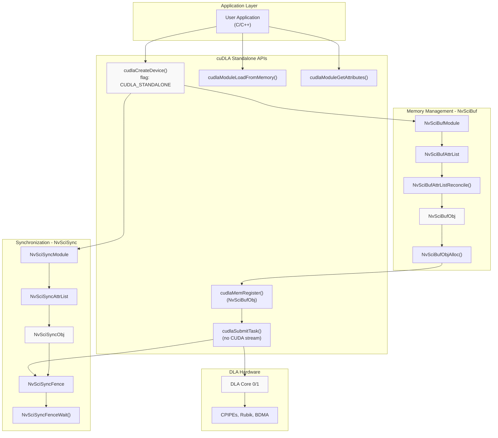
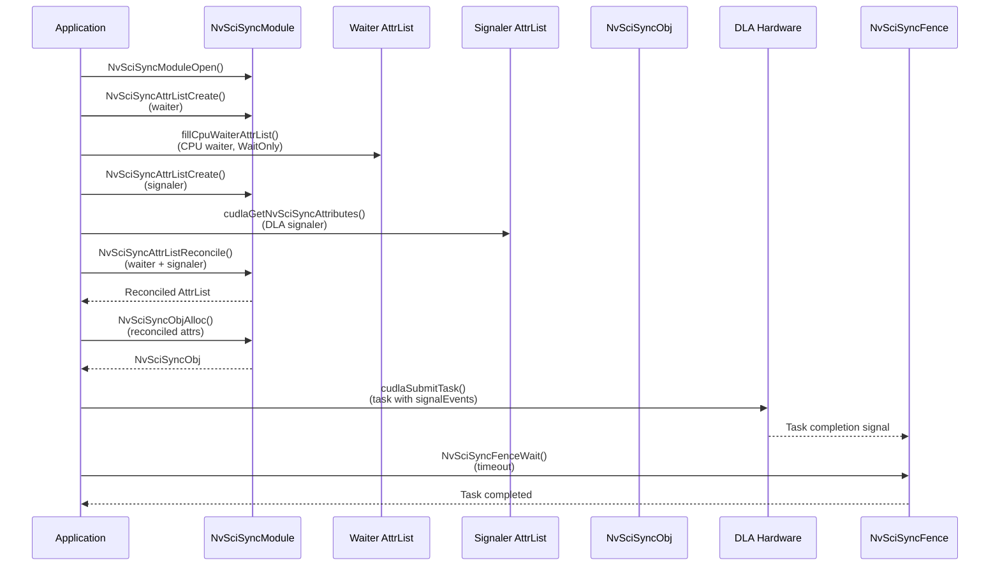
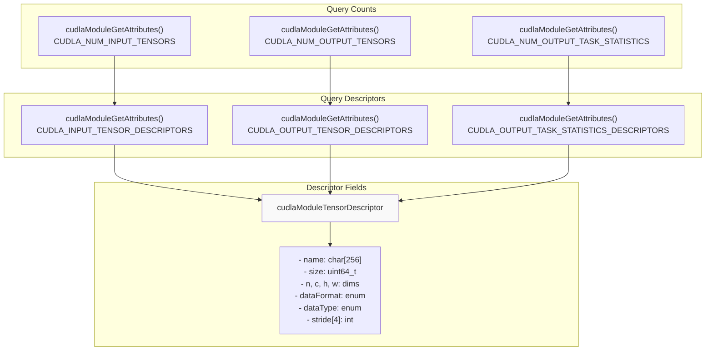
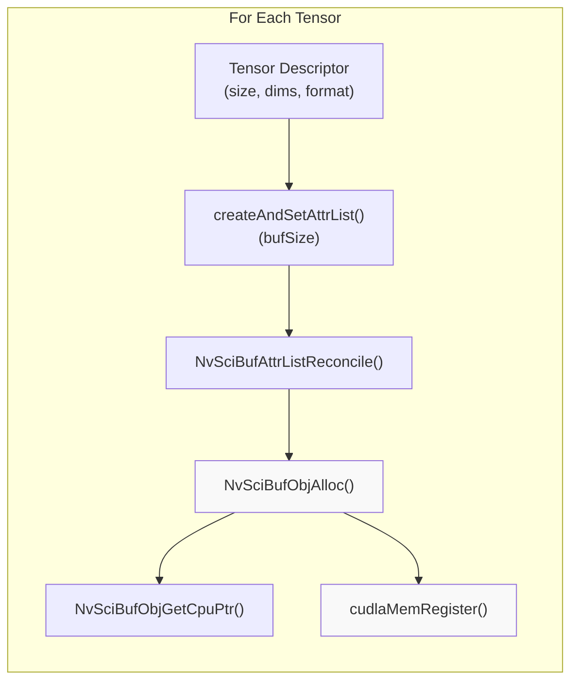
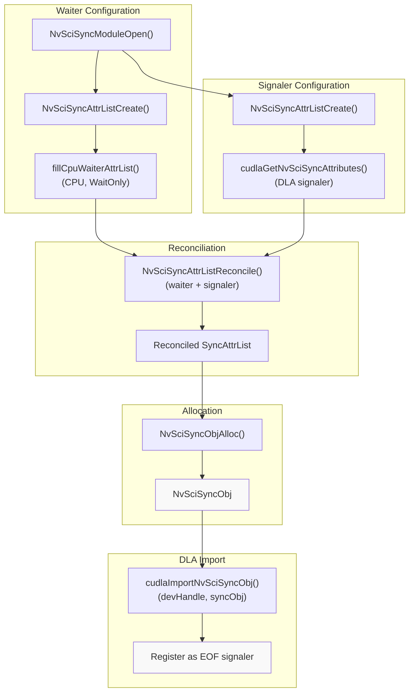
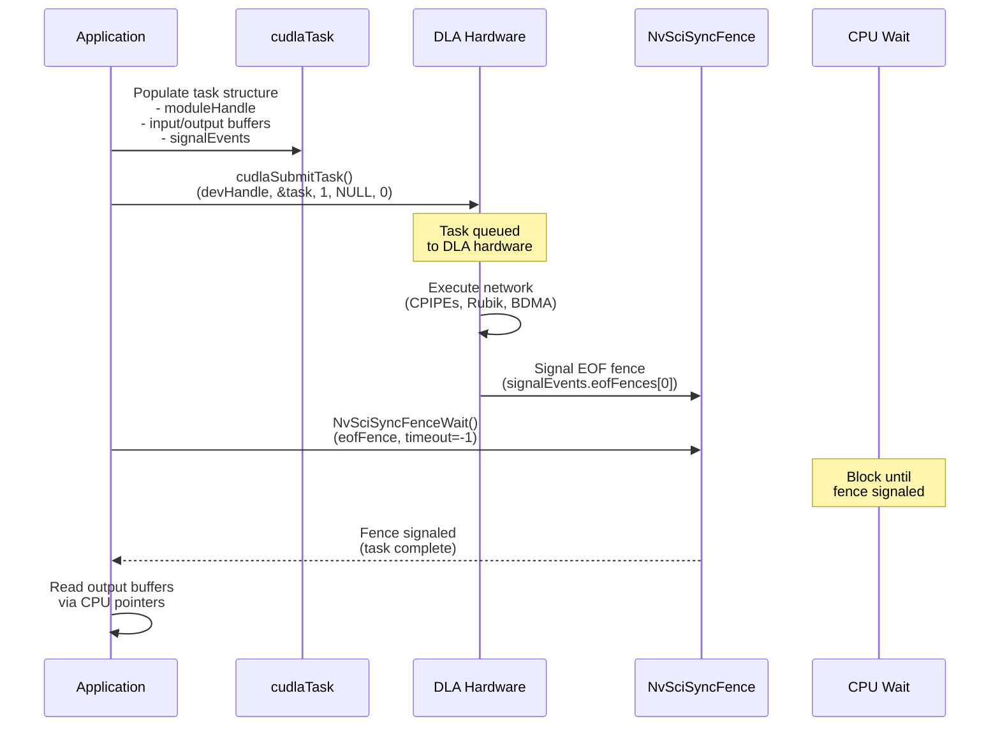
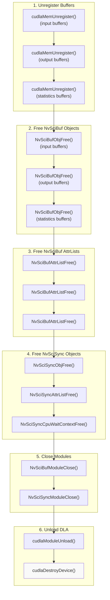

<!-- source: DeepWiki mcp.deepwiki.com · repo NVIDIA/Deep-Learning-Accelerator-SW · page 6.3 cuDLA Standalone Mode · fetched 2026-10-26 -->

# cuDLA Standalone Mode

<details>
<summary>Relevant source files</summary>

The following files were used as context for generating this wiki page:

- [samples/cuDLA/README.md](samples/cuDLA/README.md)
- [samples/cuDLA/cuDLALayerwiseStatsHybrid/Makefile](samples/cuDLA/cuDLALayerwiseStatsHybrid/Makefile)
- [samples/cuDLA/cuDLALayerwiseStatsHybrid/main.cu](samples/cuDLA/cuDLALayerwiseStatsHybrid/main.cu)
- [samples/cuDLA/cuDLALayerwiseStatsStandalone/Makefile](samples/cuDLA/cuDLALayerwiseStatsStandalone/Makefile)
- [samples/cuDLA/cuDLALayerwiseStatsStandalone/README.md](samples/cuDLA/cuDLALayerwiseStatsStandalone/README.md)
- [samples/cuDLA/cuDLALayerwiseStatsStandalone/findnvsci.mk](samples/cuDLA/cuDLALayerwiseStatsStandalone/findnvsci.mk)
- [samples/cuDLA/cuDLALayerwiseStatsStandalone/main.cpp](samples/cuDLA/cuDLALayerwiseStatsStandalone/main.cpp)

</details>


## Purpose and Scope

This document describes cuDLA Standalone Mode, a programming model for executing DLA loadables without CUDA runtime involvement. In standalone mode, DLA operates independently using NvSciBuf for memory management and NvSciSync for synchronization, enabling DLA execution in environments where CUDA is unavailable or undesirable.

For CUDA-integrated DLA programming, see [cuDLA Hybrid Mode](#6.2). For general runtime API comparison, see [Runtime API Overview](#6.1). For generating standalone-compatible loadables, see [Using trtexec for DLA](#5.2).

---

## Standalone Mode Architecture

cuDLA Standalone Mode provides direct DLA programming capabilities without requiring CUDA context or GPU involvement. This mode is essential for safety-critical applications, real-time systems, or deployments where GPU resources are unavailable.

### System Architecture



**Sources:** [samples/cuDLA/cuDLALayerwiseStatsStandalone/main.cpp:536-541](), [samples/cuDLA/cuDLALayerwiseStatsStandalone/main.cpp:748-754](), [samples/cuDLA/cuDLALayerwiseStatsStandalone/main.cpp:906-1024]()

---

## Standalone vs Hybrid Mode Comparison

The following table highlights the key differences between standalone and hybrid modes:

| Aspect | Standalone Mode | Hybrid Mode (see [6.2](#6.2)) |
|--------|----------------|-------------------------------|
| **CUDA Dependency** | No CUDA runtime required | Requires CUDA context and GPU |
| **Device Creation Flag** | `CUDLA_STANDALONE` | `CUDLA_CUDA_DLA` |
| **Memory Management** | NvSciBuf (NvSciBufObj) | CUDA (cudaMalloc) |
| **Memory Registration** | `cudlaMemRegister()` with NvSciBufObj | `cudlaMemRegister()` with CUDA pointers |
| **Synchronization** | NvSciSync (NvSciSyncFence) | CUDA streams and events |
| **Task Submission** | `cudlaSubmitTask()` without stream | `cudlaSubmitTask()` with CUDA stream |
| **Completion Wait** | `NvSciSyncFenceWait()` | `cudaStreamSynchronize()` |
| **Use Case** | Safety-critical, real-time, no-GPU | GPU-DLA hybrid workloads |

**Sources:** [samples/cuDLA/cuDLALayerwiseStatsStandalone/main.cpp:536](), [samples/cuDLA/cuDLALayerwiseStatsHybrid/main.cu:315](), [samples/cuDLA/README.md:17-20]()

---

## Memory Model with NvSciBuf

Standalone mode uses NvSciBuf for cross-process, cross-hardware buffer management. NvSciBuf provides attribute-based buffer allocation that ensures memory compatibility across different hardware components.

### NvSciBuf Memory Workflow

```mermaid
graph LR
    subgraph "1. Module Initialization"
        Init["NvSciBufModuleOpen()"]
    end
    
    subgraph "2. Attribute List Creation"
        CreateAttr["NvSciBufAttrListCreate()"]
        SetAttrs["NvSciBufAttrListSetAttrs()<br/>- Type: Tensor<br/>- Size: bufSize<br/>- Alignment: 512 bytes<br/>- CPU Access: true"]
    end
    
    subgraph "3. Reconciliation"
        Reconcile["NvSciBufAttrListReconcile()<br/>Resolves conflicts"]
        ReconciledList["Reconciled AttrList"]
        ConflictList["Conflict AttrList"]
    end
    
    subgraph "4. Buffer Allocation"
        Alloc["NvSciBufObjAlloc()"]
        BufObj["NvSciBufObj<br/>(Physical buffer)"]
    end
    
    subgraph "5. CPU Mapping"
        GetCpu["NvSciBufObjGetCpuPtr()"]
        CpuPtr["CPU-accessible pointer"]
    end
    
    subgraph "6. DLA Registration"
        RegDLA["cudlaMemRegister()<br/>(devHandle, bufObj)"]
        RegPtr["Registered pointer<br/>(uint64_t*)"]
    end
    
    Init --> CreateAttr
    CreateAttr --> SetAttrs
    SetAttrs --> Reconcile
    Reconcile --> ReconciledList
    Reconcile --> ConflictList
    ReconciledList --> Alloc
    Alloc --> BufObj
    BufObj --> GetCpu
    BufObj --> RegDLA
    GetCpu --> CpuPtr
    RegDLA --> RegPtr
    
    style BufObj fill:#f9f9f9
    style RegPtr fill:#f9f9f9
```



**Sources:** [samples/cuDLA/cuDLALayerwiseStatsStandalone/main.cpp:748-754](), [samples/cuDLA/cuDLALayerwiseStatsStandalone/main.cpp:394-453](), [samples/cuDLA/cuDLALayerwiseStatsStandalone/main.cpp:906-1024]()

### NvSciBuf Attribute Configuration

The `createAndSetAttrList()` function demonstrates buffer attribute specification:

```cpp
// Key attributes for DLA-compatible buffers
NvSciBufType type = NvSciBufType_Tensor;
uint32_t dataType = NvSciDataType_Int8;
uint64_t sizes[] = {bufSize};
uint32_t alignment[] = {1};
uint64_t baseAddrAlign = 512;  // DLA alignment requirement
bool needCpuAccess = true;
NvSciBufAttrValAccessPerm perm = NvSciBufAccessPerm_ReadWrite;
```

**Sources:** [samples/cuDLA/cuDLALayerwiseStatsStandalone/main.cpp:407-441]()

---

## Synchronization with NvSciSync

NvSciSync provides hardware-level synchronization primitives for coordinating DLA task completion without CPU polling.

### NvSciSync Synchronization Flow



**Sources:** [samples/cuDLA/cuDLALayerwiseStatsStandalone/main.cpp:1026-1110](), [samples/cuDLA/cuDLALayerwiseStatsStandalone/main.cpp:455-469](), [samples/cuDLA/cuDLALayerwiseStatsStandalone/main.cpp:1187-1193]()

### CPU Waiter Attribute Setup

The `fillCpuWaiterAttrList()` function configures CPU-side fence waiting:

```cpp
bool cpuWaiter = true;
NvSciSyncAccessPerm cpuPerm = NvSciSyncAccessPerm_WaitOnly;

NvSciSyncAttrKeyValuePair keyValue[2];
keyValue[0].attrKey = NvSciSyncAttrKey_NeedCpuAccess;
keyValue[0].value = (void*)&cpuWaiter;
keyValue[1].attrKey = NvSciSyncAttrKey_RequiredPerm;
keyValue[1].value = (void*)&cpuPerm;
```

**Sources:** [samples/cuDLA/cuDLALayerwiseStatsStandalone/main.cpp:457-468]()

---

## API Workflow

The complete standalone mode workflow involves device initialization, buffer setup, synchronization configuration, and task execution.

### End-to-End Execution Flow

```mermaid
graph TB
    subgraph "Phase 1: Initialization"
        LoadFile["Read DLA loadable<br/>from file"]
        CreateDevice["cudlaCreateDevice()<br/>(core=0, CUDLA_STANDALONE)"]
        LoadModule["cudlaModuleLoadFromMemory()<br/>(loadable data)"]
    end
    
    subgraph "Phase 2: Query Attributes"
        GetNumIn["CUDLA_NUM_INPUT_TENSORS"]
        GetNumOut["CUDLA_NUM_OUTPUT_TENSORS"]
        GetNumStats["CUDLA_NUM_OUTPUT_TASK_STATISTICS"]
        GetInDesc["CUDLA_INPUT_TENSOR_DESCRIPTORS"]
        GetOutDesc["CUDLA_OUTPUT_TENSOR_DESCRIPTORS"]
        GetStatsDesc["CUDLA_OUTPUT_TASK_STATISTICS_DESCRIPTORS"]
    end
    
    subgraph "Phase 3: Buffer Setup"
        InitNvSciBuf["NvSciBufModuleOpen()"]
        CreateBufAttr["Create & set AttrLists<br/>(input/output/statistics)"]
        ReconcileBuf["NvSciBufAttrListReconcile()"]
        AllocBuf["NvSciBufObjAlloc()"]
        GetCpuPtr["NvSciBufObjGetCpuPtr()"]
        RegBuf["cudlaMemRegister()<br/>(all buffers)"]
    end
    
    subgraph "Phase 4: Sync Setup"
        InitNvSciSync["NvSciSyncModuleOpen()"]
        CreateSyncAttr["Create waiter/signaler<br/>AttrLists"]
        ReconcileSync["NvSciSyncAttrListReconcile()"]
        AllocSync["NvSciSyncObjAlloc()"]
        RegSync["cudlaImportNvSciSyncObj()"]
    end
    
    subgraph "Phase 5: Execution"
        FillInput["Fill input buffers<br/>via CPU pointer"]
        SubmitTask["cudlaSubmitTask()<br/>(task with signalEvents)"]
        WaitFence["NvSciSyncFenceWait()<br/>(eofFence, timeout)"]
        ReadOutput["Read output buffers<br/>via CPU pointer"]
    end
    
    subgraph "Phase 6: Cleanup"
        UnregBuf["cudlaMemUnregister()<br/>(all buffers)"]
        FreeBuf["NvSciBufObjFree()"]
        FreeSync["NvSciSyncObjFree()"]
        UnloadMod["cudlaModuleUnload()"]
        DestroyDev["cudlaDestroyDevice()"]
    end
    
    LoadFile --> CreateDevice
    CreateDevice --> LoadModule
    
    LoadModule --> GetNumIn
    GetNumIn --> GetNumOut
    GetNumOut --> GetNumStats
    GetNumStats --> GetInDesc
    GetInDesc --> GetOutDesc
    GetOutDesc --> GetStatsDesc
    
    GetStatsDesc --> InitNvSciBuf
    InitNvSciBuf --> CreateBufAttr
    CreateBufAttr --> ReconcileBuf
    ReconcileBuf --> AllocBuf
    AllocBuf --> GetCpuPtr
    GetCpuPtr --> RegBuf
    
    RegBuf --> InitNvSciSync
    InitNvSciSync --> CreateSyncAttr
    CreateSyncAttr --> ReconcileSync
    ReconcileSync --> AllocSync
    AllocSync --> RegSync
    
    RegSync --> FillInput
    FillInput --> SubmitTask
    SubmitTask --> WaitFence
    WaitFence --> ReadOutput
    
    ReadOutput --> UnregBuf
    UnregBuf --> FreeBuf
    FreeBuf --> FreeSync
    FreeSync --> UnloadMod
    UnloadMod --> DestroyDev
    
    style SubmitTask fill:#f9f9f9
    style WaitFence fill:#f9f9f9
```



**Sources:** [samples/cuDLA/cuDLALayerwiseStatsStandalone/main.cpp:471-1261]()

---

## Device Creation and Module Loading

### Creating Standalone Device

Device creation with `CUDLA_STANDALONE` flag initializes DLA without CUDA dependency:

```cpp
cudlaDevHandle devHandle;
cudlaStatus err;

err = cudlaCreateDevice(0, &devHandle, CUDLA_STANDALONE);
if (err != cudlaSuccess) {
    // Handle error
}
```

The first parameter (`0`) specifies the DLA core index (0 or 1 on Orin/Xavier).

**Sources:** [samples/cuDLA/cuDLALayerwiseStatsStandalone/main.cpp:536-544]()

### Loading DLA Loadable

Loadables are loaded identically to hybrid mode:

```cpp
cudlaModule moduleHandle;
unsigned char* loadableData; // Read from file
size_t file_size;

err = cudlaModuleLoadFromMemory(devHandle, loadableData, 
                                 file_size, &moduleHandle, 0);
```

**Sources:** [samples/cuDLA/cuDLALayerwiseStatsStandalone/main.cpp:546-555]()

---

## Tensor Descriptor Queries

Query tensor information to determine buffer requirements:



**Sources:** [samples/cuDLA/cuDLALayerwiseStatsStandalone/main.cpp:558-676](), [samples/cuDLA/cuDLALayerwiseStatsStandalone/main.cpp:47-66]()

### Example Query Code

```cpp
uint32_t numInputTensors = 0;
uint32_t numOutputTensors = 0;
cudlaModuleAttribute attribute;

// Query counts
err = cudlaModuleGetAttributes(moduleHandle, CUDLA_NUM_INPUT_TENSORS, &attribute);
numInputTensors = attribute.numInputTensors;

err = cudlaModuleGetAttributes(moduleHandle, CUDLA_NUM_OUTPUT_TENSORS, &attribute);
numOutputTensors = attribute.numOutputTensors;

// Allocate descriptor arrays
cudlaModuleTensorDescriptor* inputTensorDesc = 
    (cudlaModuleTensorDescriptor*)malloc(sizeof(cudlaModuleTensorDescriptor) * numInputTensors);

// Query descriptors
attribute.inputTensorDesc = inputTensorDesc;
err = cudlaModuleGetAttributes(moduleHandle, CUDLA_INPUT_TENSOR_DESCRIPTORS, &attribute);
```

**Sources:** [samples/cuDLA/cuDLALayerwiseStatsStandalone/main.cpp:564-651]()

---

## Buffer Allocation with NvSciBuf

### Per-Tensor Buffer Creation

Each tensor requires separate NvSciBuf object creation:



**Sources:** [samples/cuDLA/cuDLALayerwiseStatsStandalone/main.cpp:756-904]()

### Complete Buffer Setup Example

```cpp
// For input tensors
NvSciBufObj* inputBufObj = (NvSciBufObj*)malloc(sizeof(NvSciBufObj) * numInputTensors);
uint64_t** inputBufObjRegPtr = (uint64_t**)malloc(sizeof(uint64_t*) * numInputTensors);

for (uint32_t ii = 0; ii < numInputTensors; ii++) {
    // Create attribute list
    NvSciBufAttrList inputAttrList;
    createAndSetAttrList(bufModule, inputTensorDesc[ii].size, &inputAttrList);
    
    // Reconcile
    NvSciBufAttrList reconciledInputAttrList;
    NvSciBufAttrList inputConflictList;
    NvSciBufAttrListReconcile(&inputAttrList, 1, 
                               &reconciledInputAttrList, &inputConflictList);
    
    // Allocate buffer object
    NvSciBufObjAlloc(reconciledInputAttrList, &inputBufObj[ii]);
    
    // Get CPU pointer for data access
    void* cpuPtr;
    NvSciBufObjGetCpuPtr(inputBufObj[ii], &cpuPtr);
    
    // Register with cuDLA
    cudlaMemRegister(devHandle, (uint64_t*)inputBufObj[ii], 
                     inputTensorDesc[ii].size, &inputBufObjRegPtr[ii], 0);
}
```

**Sources:** [samples/cuDLA/cuDLALayerwiseStatsStandalone/main.cpp:906-1024](), [samples/cuDLA/cuDLALayerwiseStatsStandalone/main.cpp:1026-1085]()

---

## Synchronization Setup

### NvSciSync Object Creation



**Sources:** [samples/cuDLA/cuDLALayerwiseStatsStandalone/main.cpp:1026-1110]()

### Sync Object Setup Code

```cpp
// Initialize NvSciSync
NvSciSyncModule syncModule;
NvSciSyncModuleOpen(&syncModule);

// Create CPU waiter attributes
NvSciSyncAttrList waiterAttrListObj;
NvSciSyncAttrListCreate(syncModule, &waiterAttrListObj);
fillCpuWaiterAttrList(waiterAttrListObj);

// Create DLA signaler attributes
NvSciSyncAttrList signalerAttrListObj;
NvSciSyncAttrListCreate(syncModule, &signalerAttrListObj);
cudlaGetNvSciSyncAttributes((uint64_t*)signalerAttrListObj, 
                             CUDLA_NVSCISYNC_ATTR_SIGNAL);

// Reconcile
NvSciSyncAttrList nvSciSyncReconciledListObj;
NvSciSyncAttrList nvSciSyncConflictListObj;
NvSciSyncAttrList unreconciledList[2] = {waiterAttrListObj, signalerAttrListObj};
NvSciSyncAttrListReconcile(unreconciledList, 2, 
                            &nvSciSyncReconciledListObj, &nvSciSyncConflictListObj);

// Allocate sync object
NvSciSyncObj syncObj;
NvSciSyncObjAlloc(nvSciSyncReconciledListObj, &syncObj);

// Import to DLA
cudlaImportNvSciSyncObj(devHandle, (uint64_t)syncObj, CUDLA_NVSCISYNC_OBJ_TYPE_SIGNAL);
```

**Sources:** [samples/cuDLA/cuDLALayerwiseStatsStandalone/main.cpp:1026-1110]()

---

## Task Submission and Execution

### cudlaTask Structure

The `cudlaTask` structure packages all execution parameters:

```cpp
typedef struct {
    cudlaModule moduleHandle;        // Loaded module
    uint32_t numInputTensors;        // Number of inputs
    uint64_t* const* inputTensor;    // Registered input pointers
    uint32_t numOutputTensors;       // Number of outputs (+ statistics)
    uint64_t* const* outputTensor;   // Registered output pointers
    cudlaWaitEvents* waitEvents;     // Pre-task sync (can be NULL)
    cudlaSignalEvents* signalEvents; // Post-task sync (EOF fence)
} cudlaTask;
```

**Sources:** [samples/cuDLA/cuDLALayerwiseStatsStandalone/main.cpp:1142-1155]()

### Task Submission Workflow



**Sources:** [samples/cuDLA/cuDLALayerwiseStatsStandalone/main.cpp:1142-1193]()

### Complete Execution Example

```cpp
// Prepare signal events for EOF notification
cudlaSignalEvents* signalEvents = (cudlaSignalEvents*)malloc(sizeof(cudlaSignalEvents));
signalEvents->numEvents = 1;
signalEvents->eofFences = (NvSciSyncFence*)malloc(sizeof(NvSciSyncFence));
signalEvents->eofFences[0] = NvSciSyncFenceInitializer;

// Build devPtrs array (all registered pointers)
uint64_t** devPtrs = (uint64_t**)malloc(sizeof(uint64_t*) * 
                                          (numInputTensors + numOutputTensors + numOutputTaskStatistics));
uint32_t index = 0;
for (uint32_t ii = 0; ii < numInputTensors; ii++) {
    devPtrs[index++] = inputBufObjRegPtr[ii];
}
for (uint32_t ii = 0; ii < numOutputTensors; ii++) {
    devPtrs[index++] = outputBufObjRegPtr[ii];
}
for (uint32_t ii = 0; ii < numOutputTaskStatistics; ii++) {
    devPtrs[index++] = statisticsBufObjRegPtr[ii];
}

// Setup task
cudlaTask task;
task.moduleHandle = moduleHandle;
task.numInputTensors = numInputTensors;
task.inputTensor = &(devPtrs[0]);
task.numOutputTensors = numOutputTensors + numOutputTaskStatistics;
task.outputTensor = &(devPtrs[numInputTensors]);
task.waitEvents = NULL;  // No pre-task sync needed
task.signalEvents = signalEvents;

// Submit task (stream parameter is NULL for standalone)
err = cudlaSubmitTask(devHandle, &task, 1, NULL, 0);

// Wait for completion
NvSciSyncFenceWait(&(signalEvents->eofFences[0]), 
                    nvSciCtx, -1);  // -1 = infinite timeout
```

**Sources:** [samples/cuDLA/cuDLALayerwiseStatsStandalone/main.cpp:1112-1193]()

---

## Layerwise Statistics in Standalone Mode

Standalone mode supports layerwise profiling identical to hybrid mode, with statistics output tensors treated as additional outputs.

### Statistics Buffer Setup

```cpp
// Query statistics tensor count
uint32_t numOutputTaskStatistics = 0;
attribute.numOutputTensors = 0;
err = cudlaModuleGetAttributes(moduleHandle, CUDLA_NUM_OUTPUT_TASK_STATISTICS, &attribute);
numOutputTaskStatistics = attribute.numOutputTensors;

if (numOutputTaskStatistics == 0) {
    // Layerwise stats not supported for this loadable
}

// Get statistics descriptors
cudlaModuleTensorDescriptor* outputTaskStatisticsDesc = 
    (cudlaModuleTensorDescriptor*)malloc(sizeof(cudlaModuleTensorDescriptor) * numOutputTaskStatistics);
attribute.outputTensorDesc = outputTaskStatisticsDesc;
err = cudlaModuleGetAttributes(moduleHandle, CUDLA_OUTPUT_TASK_STATISTICS_DESCRIPTORS, &attribute);
```

**Sources:** [samples/cuDLA/cuDLALayerwiseStatsStandalone/main.cpp:582-676]()

### Registering Statistics Buffers

Statistics buffers require the `CUDLA_TASK_STATISTICS` flag during registration:

```cpp
// Allocate and register statistics buffers
for (uint32_t ii = 0; ii < numOutputTaskStatistics; ii++) {
    // Allocate NvSciBufObj (same as output tensors)
    NvSciBufObjAlloc(reconciledStatisticsOutputAttrList[ii], &statisticsBufObj[ii]);
    
    // Register with CUDLA_TASK_STATISTICS flag
    cudlaMemRegister(devHandle, (uint64_t*)statisticsBufObj[ii],
                     outputTaskStatisticsDesc[ii].size,
                     &statisticsBufObjRegPtr[ii],
                     CUDLA_TASK_STATISTICS);  // Special flag
}
```

**Sources:** [samples/cuDLA/cuDLALayerwiseStatsStandalone/main.cpp:1068-1085]()

### Task Submission with Statistics

When requesting statistics, include statistics tensors in output count:

```cpp
cudlaTask task;
task.moduleHandle = moduleHandle;
task.numInputTensors = numInputTensors;
task.inputTensor = inputBuffers;

// Include statistics in output tensor count
if (statSupport == 1) {
    task.numOutputTensors = numOutputTensors + numOutputTaskStatistics;
} else {
    task.numOutputTensors = numOutputTensors;
}

// outputTensor must point to all outputs + statistics buffers
task.outputTensor = allOutputBuffers;  // Combined array
```

**Sources:** [samples/cuDLA/cuDLALayerwiseStatsStandalone/main.cpp:1142-1173]()

### Translating Statistics to CSV

After task completion, use `cudlaExternalEtbl` to convert binary statistics to CSV:

```cpp
#include "cudlaExternalEtbl.hpp"

// Get export table
const cudlaExternalEtbl* etbl = NULL;
cudlaGetExternalExportTable(&etbl, 0);

// Translate statistics for each output
for (uint32_t ii = 0; ii < numOutputTaskStatistics; ii++) {
    cudlaTranslateCsvAttribute csvAttribute;
    
    // Get CSV length
    etbl->etiTranslateStats(devHandle, statisticsOutputBuffer[ii], 
                            dlaFreqInMHz, ii, CUDLA_GET_CSV_LENGTH, &csvAttribute);
    
    // Allocate CSV buffer
    void* csvStream = malloc(csvAttribute.csvStreamLength);
    csvAttribute.csvStreamStats = csvStream;
    
    // Translate to CSV
    etbl->etiTranslateStats(devHandle, statisticsOutputBuffer[ii], 
                            dlaFreqInMHz, ii, CUDLA_GET_CSV_STATS, &csvAttribute);
    
    // Write to file
    FILE* fp = fopen(filename, "w+");
    fwrite(csvStream, sizeof(char), csvAttribute.csvStreamLength, fp);
    fclose(fp);
}
```

**Sources:** [samples/cuDLA/cuDLALayerwiseStatsStandalone/main.cpp:1195-1241]()

---

## Building DLA Loadables for Standalone Mode

DLA loadables for standalone mode must be built with the `--buildDLAStandalone` flag in trtexec. This generates loadables compatible with direct DLA execution.

### trtexec Command for Standalone Loadable

```bash
./trtexec \
  --useDLACore=0 \
  --int8 \
  --memPoolSize=dlaSRAM:1 \
  --inputIOFormats=int8:dla_hwc4 \
  --outputIOFormats=int8:chw32 \
  --onnx=model.onnx \
  --saveEngine=model_loadable.bin \
  --buildDLAStandalone
```

The `--buildDLAStandalone` flag ensures the loadable is self-contained and doesn't require GPU resources.

**Sources:** [samples/cuDLA/cuDLALayerwiseStatsStandalone/README.md:78-83](), [samples/cuDLA/cuDLALayerwiseStatsStandalone/README.md:97-104]()

---

## Resource Management and Cleanup

Proper cleanup is critical to avoid resource leaks. The cleanup order is the reverse of allocation.

### Cleanup Sequence



**Sources:** [samples/cuDLA/cuDLALayerwiseStatsStandalone/main.cpp:112-387]()

### Cleanup Function Structure

The `cleanUp()` function demonstrates systematic resource deallocation:

```cpp
void cleanUp(ResourceList* resourceList) {
    // 1. Free CPU-side buffers
    if (resourceList->inputBuffer != NULL) {
        for (uint32_t ii = 0; ii < resourceList->numInputTensors; ii++) {
            if (resourceList->inputBuffer[ii] != NULL) {
                free(resourceList->inputBuffer[ii]);
            }
        }
        free(resourceList->inputBuffer);
    }
    
    // 2. Free NvSciBuf objects
    if (resourceList->inputBufObj != NULL) {
        for (uint32_t ii = 0; ii < resourceList->numInputTensors; ii++) {
            if (resourceList->inputBufObj[ii] != NULL) {
                NvSciBufObjFree(resourceList->inputBufObj[ii]);
            }
        }
    }
    
    // 3. Free NvSciBuf attribute lists
    if (resourceList->inputAttrList != NULL) {
        for (uint32_t ii = 0; ii < resourceList->numInputTensors; ii++) {
            if (resourceList->inputAttrList[ii] != NULL) {
                NvSciBufAttrListFree(resourceList->inputAttrList[ii]);
            }
        }
    }
    
    // 4. Free NvSciSync objects
    NvSciSyncFenceClear(&resourceList->eofFence);
    if (resourceList->syncObj != NULL) {
        NvSciSyncObjFree(resourceList->syncObj);
    }
    
    // 5. Close modules
    if (resourceList->bufModule != NULL) {
        NvSciBufModuleClose(resourceList->bufModule);
    }
    if (resourceList->syncModule != NULL) {
        NvSciSyncModuleClose(resourceList->syncModule);
    }
    
    // 6. Unload module and destroy device
    if (resourceList->moduleHandle != NULL) {
        cudlaModuleUnload(resourceList->moduleHandle, 0);
    }
    if (resourceList->devHandle != NULL) {
        cudlaDestroyDevice(resourceList->devHandle);
    }
}
```

**Sources:** [samples/cuDLA/cuDLALayerwiseStatsStandalone/main.cpp:112-387]()

---

## Sample Application Structure

The cuDLALayerwiseStatsStandalone sample demonstrates the complete workflow.

### Main Function Flow

```mermaid
graph TB
    ParseArgs["Parse arguments<br/>(loadable, freqMHz, statSupport, filename)"]
    InitResources["Initialize ResourceList<br/>structure"]
    LoadFile["Read loadable file<br/>to memory"]
    CreateDev["cudlaCreateDevice()<br/>CUDLA_STANDALONE"]
    LoadMod["cudlaModuleLoadFromMemory()"]
    
    QueryTensors["Query tensor attributes<br/>(input/output/statistics)"]
    AllocCpuBuf["Allocate CPU buffers"]
    SetupNvSciBuf["Setup NvSciBuf<br/>(create, reconcile, alloc)"]
    RegisterBuf["cudlaMemRegister()<br/>all buffers"]
    
    SetupNvSciSync["Setup NvSciSync<br/>(waiter + signaler)"]
    FillInput["Fill input buffers<br/>(memset to 0x01)"]
    
    BuildTask["Build cudlaTask<br/>structure"]
    SubmitTask["cudlaSubmitTask()"]
    WaitFence["NvSciSyncFenceWait()"]
    
    ProcessStats["Translate statistics<br/>to CSV if requested"]
    WriteCSV["Write CSV files"]
    
    Cleanup["cleanUp()<br/>all resources"]
    
    ParseArgs --> InitResources
    InitResources --> LoadFile
    LoadFile --> CreateDev
    CreateDev --> LoadMod
    
    LoadMod --> QueryTensors
    QueryTensors --> AllocCpuBuf
    AllocCpuBuf --> SetupNvSciBuf
    SetupNvSciBuf --> RegisterBuf
    
    RegisterBuf --> SetupNvSciSync
    SetupNvSciSync --> FillInput
    
    FillInput --> BuildTask
    BuildTask --> SubmitTask
    SubmitTask --> WaitFence
    
    WaitFence --> ProcessStats
    ProcessStats --> WriteCSV
    
    WriteCSV --> Cleanup
    
    style SubmitTask fill:#f9f9f9
    style WaitFence fill:#f9f9f9
```



**Sources:** [samples/cuDLA/cuDLALayerwiseStatsStandalone/main.cpp:471-1261]()

### ResourceList Structure

The sample uses a `ResourceList` structure to track all allocated resources:

```cpp
typedef struct {
    cudlaDevHandle devHandle;
    cudlaModule moduleHandle;
    unsigned char* loadableData;
    
    uint32_t numInputTensors;
    uint32_t numOutputTensors;
    uint32_t numOutputTaskStatistics;
    
    unsigned char** inputBuffer;
    unsigned char** outputBuffer;
    unsigned char** statisticsOutputBuffer;
    
    cudlaModuleTensorDescriptor* inputTensorDesc;
    cudlaModuleTensorDescriptor* outputTensorDesc;
    cudlaModuleTensorDescriptor* outputTaskStatisticsDesc;
    
    NvSciBufObj* inputBufObj;
    NvSciBufObj* outputBufObj;
    NvSciBufObj* statisticsBufObj;
    NvSciBufModule bufModule;
    
    NvSciBufAttrList* inputAttrList;
    NvSciBufAttrList* reconciledInputAttrList;
    // ... (more attr lists)
    
    NvSciSyncObj syncObj;
    NvSciSyncModule syncModule;
    NvSciSyncCpuWaitContext nvSciCtx;
    // ... (more sync objects)
    
    uint64_t** inputBufObjRegPtr;
    uint64_t** outputBufObjRegPtr;
    uint64_t** statisticsBufObjRegPtr;
    
    cudlaSignalEvents* signalEvents;
    NvSciSyncFence eofFence;
    void** csv;
} ResourceList;
```

**Sources:** [samples/cuDLA/cuDLALayerwiseStatsStandalone/main.cpp:68-108]()

---

## Building the Sample

### Makefile Configuration

The sample uses a standard CUDA makefile with additional NvSci library dependencies:

```makefile
# Link against cuDLA and NvSci libraries
LIBRARIES += -lcudla -lnvscibuf -lnvscisync

# Ensure NvSci libraries are available
include ./findnvsci.mk

# Build target
cuDLALayerwiseStatsStandalone: main.o
	$(EXEC) $(NVCC) $(ALL_LDFLAGS) $(GENCODE_FLAGS) -o $@ $+ $(LIBRARIES)
```

**Sources:** [samples/cuDLA/cuDLALayerwiseStatsStandalone/Makefile:359-394](), [samples/cuDLA/cuDLALayerwiseStatsStandalone/findnvsci.mk:111-123]()

### Build and Run Commands

```bash
# Native build on target
cd samples/cuDLA/cuDLALayerwiseStatsStandalone
make

# Cross-compilation from x86_64
make TARGET_ARCH=aarch64

# Run sample
./cuDLALayerwiseStatsStandalone model_loadable.bin 1152 1 standalone1
```

**Sources:** [samples/cuDLA/cuDLALayerwiseStatsStandalone/README.md:50-110]()

### Command-Line Arguments

| Argument | Description | Example |
|----------|-------------|---------|
| `loadable` | Path to DLA loadable binary | `model_loadable.bin` |
| `freqMHz` | DLA clock frequency in MHz | `1152` |
| `statSupport` | Enable layerwise profiling (0 or 1) | `1` |
| `filenamePrefix` | Output CSV filename prefix | `standalone1` |

**Sources:** [samples/cuDLA/cuDLALayerwiseStatsStandalone/README.md:86-95]()

---

## Platform Requirements

### Minimum System Configuration

| Platform | OS | DLA SW Version | Support |
|----------|-----|----------------|---------|
| Jetson Orin | JetPack 6.0+ | DLA 3.14.1+ | Yes |
| DRIVE Orin | DRIVE OS 6.0.8.0+ | DLA 3.14.0+ | Yes (not QNX Safety) |
| Xavier | JetPack 5.x | DLA 3.12.x+ | Yes |
| x86_64 | N/A | N/A | No (DLA unavailable) |

**Sources:** [samples/cuDLA/cuDLALayerwiseStatsStandalone/README.md:33-38](), [samples/cuDLA/cuDLALayerwiseStatsStandalone/Makefile:269-293]()

### Required Software

- **CUDA Toolkit:** 12.2 or later
- **NvSciBuf/NvSciSync:** Included with JetPack/DRIVE OS
- **cuDLA library:** `libcudla.so`
- **GCC:** 4.7.0 or later (for C++11 support)

**Sources:** [samples/cuDLA/cuDLALayerwiseStatsStandalone/README.md:44-46](), [samples/cuDLA/cuDLALayerwiseStatsStandalone/Makefile:323-331]()

---

## Use Cases for Standalone Mode

### When to Use Standalone Mode

- **Safety-critical systems:** Automotive ASIL-D applications requiring deterministic behavior
- **Real-time constraints:** Hard real-time systems where GPU scheduling introduces jitter
- **GPU unavailability:** Embedded systems without GPU or with GPU dedicated to display
- **Power optimization:** DLA-only execution consumes significantly less power than GPU
- **Multi-process DLA sharing:** NvSciBuf enables zero-copy buffer sharing between processes

**Sources:** [samples/cuDLA/README.md:19-20](), [samples/cuDLA/cuDLALayerwiseStatsStandalone/README.md:5]()

### When to Use Hybrid Mode Instead

- **Pre/post-processing on GPU:** Workloads requiring GPU for non-DLA operations
- **Simplified memory management:** CUDA's unified memory and automatic allocation
- **Existing CUDA codebase:** Integration with CUDA streams and graphs
- **Development/debugging:** CUDA provides richer tooling (nsight, cuda-gdb)

See [cuDLA Hybrid Mode](#6.2) for hybrid mode details.

**Sources:** [samples/cuDLA/README.md:16-17]()

---

## Error Handling

All cuDLA functions return `cudlaStatus` enumeration values. Always check return values:

```cpp
cudlaStatus err;

err = cudlaCreateDevice(0, &devHandle, CUDLA_STANDALONE);
if (err != cudlaSuccess) {
    DPRINTF("Error in cuDLA create device = %d\n", err);
    cleanUp(&resourceList);
    return 1;
}
```

Common error codes:
- `cudlaSuccess`: Operation succeeded
- `cudlaErrorNvSci`: NvSciBuf/NvSciSync operation failed
- `cudlaErrorInvalidInput`: Invalid parameter passed
- `cudlaErrorNotSupported`: Operation not supported in current mode

**Sources:** [samples/cuDLA/cuDLALayerwiseStatsStandalone/main.cpp:536-541]()

---

## Performance Considerations

### DLA Clock Frequency

DLA performance scales linearly with clock frequency. Query and set DLA clock:

```bash
# Query current DLA clock (Hz)
sudo cat /sys/kernel/debug/bpmp/debug/clk/nafll_dla0_core/rate

# Set DLA clock (example: 1.152 GHz)
echo 1152000000 > /sys/kernel/debug/bpmp/debug/clk/nafll_dla0_core/rate
```

The `freqMHz` parameter to the sample must match the actual DLA clock for accurate timing statistics.

**Sources:** [samples/cuDLA/cuDLALayerwiseStatsStandalone/README.md:90-93](), [samples/cuDLA/cuDLALayerwiseStatsStandalone/README.md:105-109]()

### Buffer Alignment

NvSciBuf buffers must meet DLA alignment requirements:
- **Base address alignment:** 512 bytes (set via `NvSciBufTensorAttrKey_BaseAddrAlign`)
- **Per-dimension alignment:** Typically 1 byte for tensor type

**Sources:** [samples/cuDLA/cuDLALayerwiseStatsStandalone/main.cpp:415]()

### Zero-Copy Considerations

NvSciBufObj buffers support zero-copy access across:
- CPU and DLA (via `NvSciBufObjGetCpuPtr()`)
- Multiple DLA cores (via separate `cudlaMemRegister()` calls)
- Multiple processes (via NvSciBuf IPC mechanisms, not demonstrated in sample)

**Sources:** [samples/cuDLA/cuDLALayerwiseStatsStandalone/main.cpp:1114-1122]()

---

## Summary

cuDLA Standalone Mode provides direct DLA programming without CUDA dependencies, using:

- **Device Creation:** `cudlaCreateDevice()` with `CUDLA_STANDALONE` flag
- **Memory Management:** NvSciBuf for buffer allocation and attribute reconciliation
- **Synchronization:** NvSciSync for hardware-level fence signaling
- **Task Execution:** `cudlaSubmitTask()` without CUDA streams
- **Completion Waiting:** `NvSciSyncFenceWait()` for CPU-side blocking

This mode is essential for safety-critical, real-time, and power-constrained applications where GPU involvement is undesirable or unavailable. For integrated GPU-DLA workflows, see [cuDLA Hybrid Mode](#6.2).

**Sources:** [samples/cuDLA/cuDLALayerwiseStatsStandalone/main.cpp:1-1261](), [samples/cuDLA/README.md:19-28]()

---

