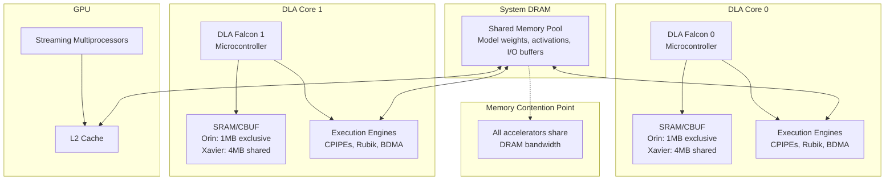
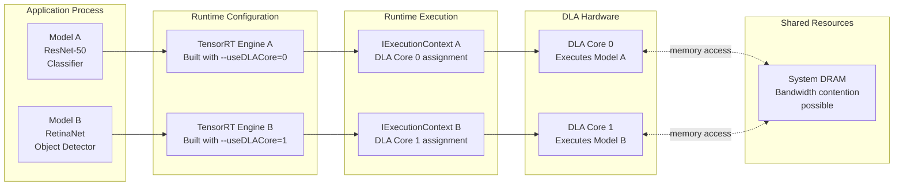
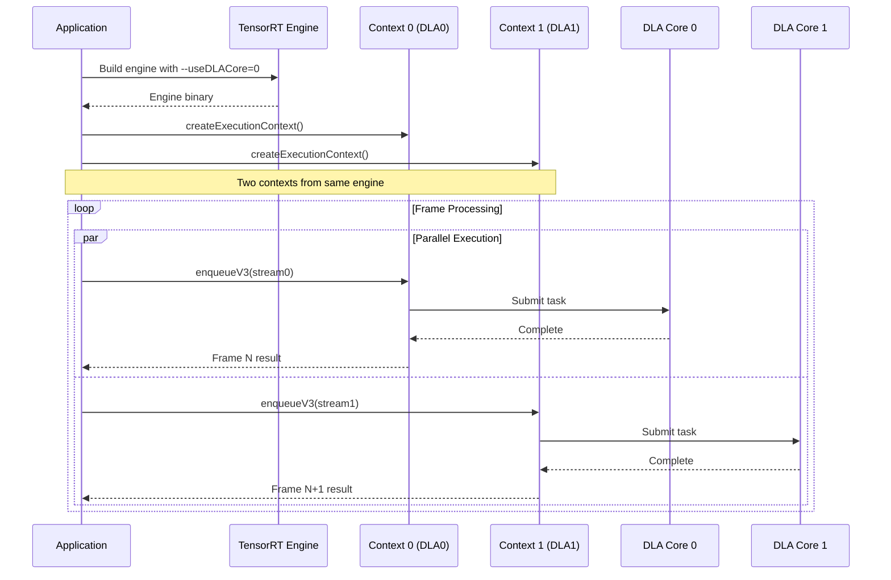
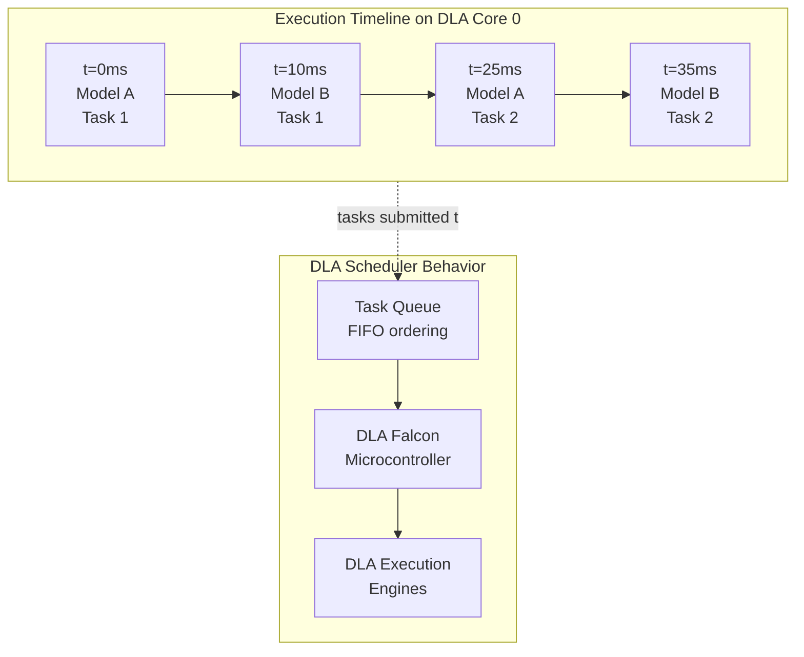
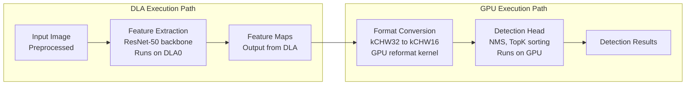
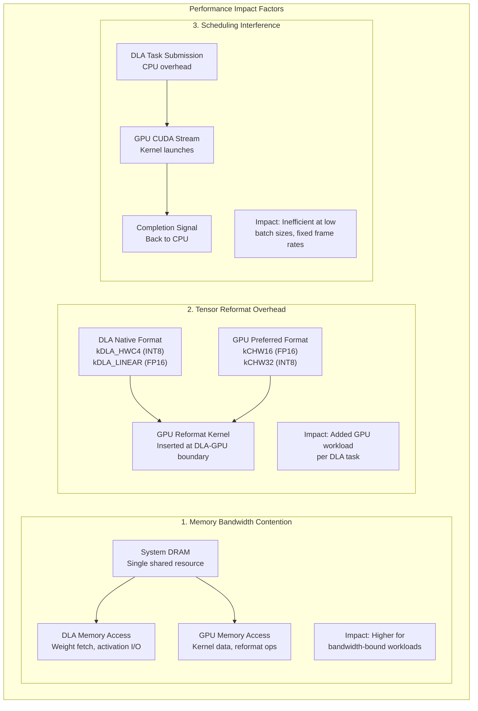
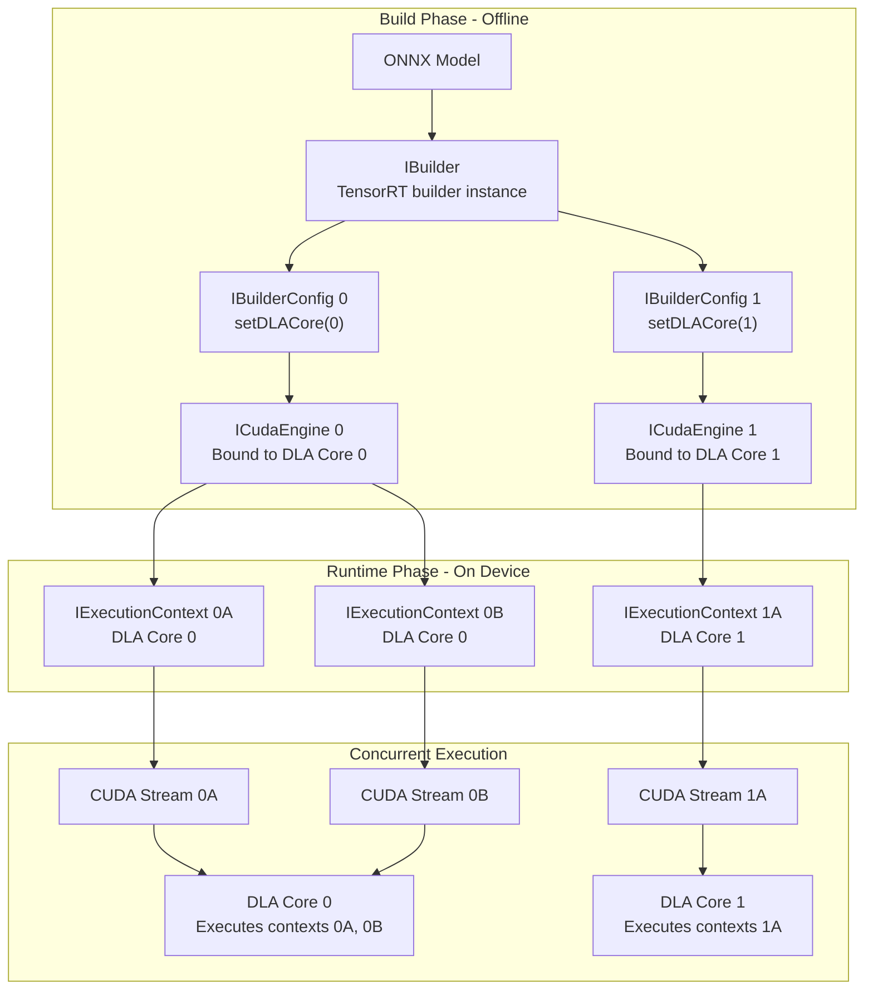
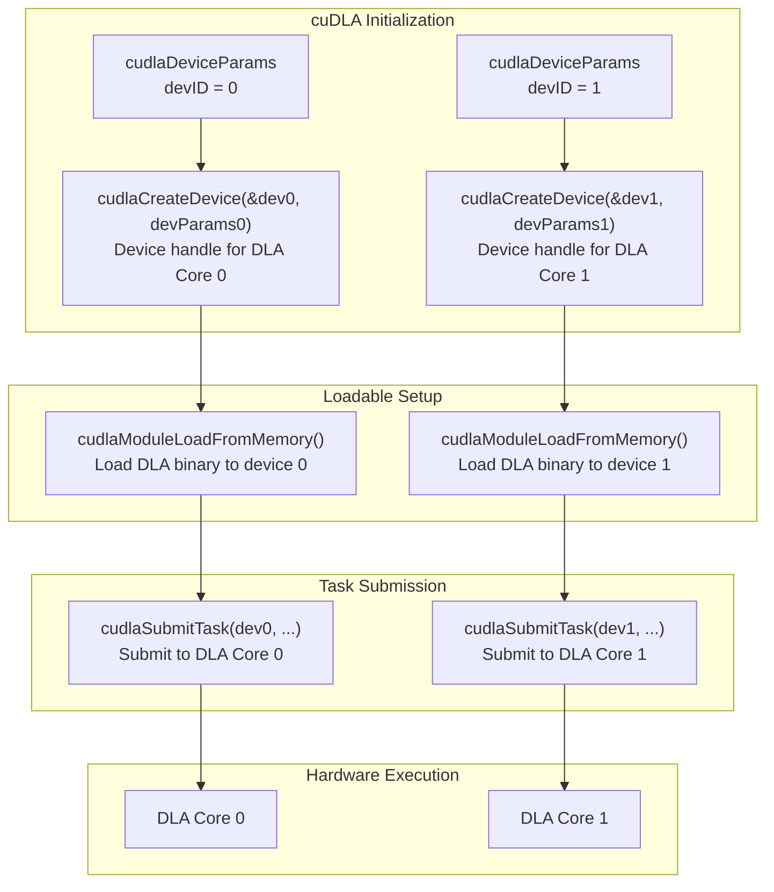
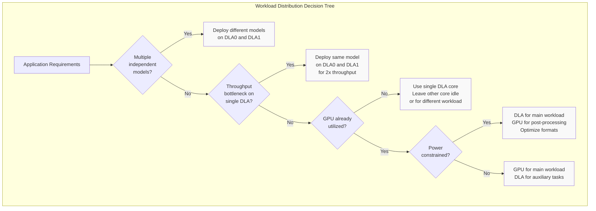
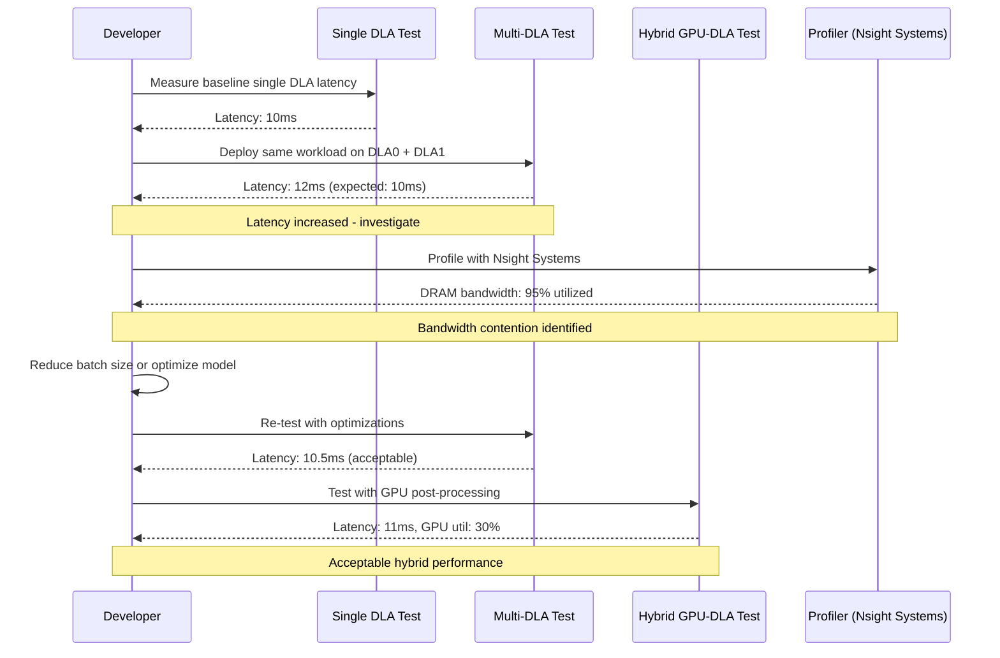

<!-- source: DeepWiki mcp.deepwiki.com · repo NVIDIA/Deep-Learning-Accelerator-SW · page 6.4 Concurrent Execution and Multi-Model Deployment · fetched 2026-10-26 -->

# Concurrent Execution and Multi-Model Deployment

<details>
<summary>Relevant source files</summary>

The following files were used as context for generating this wiki page:

- [FAQ/README.md](FAQ/README.md)

</details>


## Purpose and Scope

This page explains how to deploy and execute multiple neural network models concurrently on DLA hardware, including multi-core deployment strategies, hybrid GPU-DLA execution patterns, and concurrency management techniques. Topics covered include running different models on DLA0 and DLA1 simultaneously, sequential execution on a single DLA core, and managing the performance implications of concurrent execution.

For information about the runtime APIs themselves, see [Runtime API Overview](#6.1). For cuDLA-specific execution modes, see [cuDLA Hybrid Mode](#6.2) and [cuDLA Standalone Mode](#6.3). For performance analysis of concurrent workloads, see [Performance Analysis and Optimization](#7).

---

## DLA Hardware Concurrency Capabilities

NVIDIA Jetson Orin, Jetson Xavier, DRIVE Orin, and DRIVE Xavier platforms feature **two independent DLA cores** (DLA0 and DLA1) that can execute workloads simultaneously. Each DLA core operates as a separate hardware execution unit with its own set of execution engines (CPIPEs, Rubik, BDMA) and can process different models or the same model independently.

**Hardware Architecture:**



**Key architectural characteristics:**
- **Independent operation**: Each DLA core has its own Falcon microcontroller for independent task scheduling
- **Orin SRAM isolation**: Each DLA has exclusive 1MB SRAM, eliminating inter-core contention
- **Xavier SRAM sharing**: 2 DLAs and 2 PVAs share 4MB SRAM pool
- **DRAM sharing**: All cores (DLA0, DLA1, GPU, CPU) share system DRAM bandwidth

Sources: [FAQ/README.md:97-98](), [FAQ/README.md:107-108]()

---

## Multi-Model Deployment on Two DLA Cores

### Concurrent Execution of Different Models

The most common concurrent deployment pattern assigns different models to each DLA core. For example, a perception pipeline might run an object detector on DLA0 while running a segmentation model on DLA1.



**Deployment methods:**

| Method | Use Case | Configuration |
|--------|----------|---------------|
| **Separate processes** | Quick testing, isolation | Run two `trtexec` processes with `--useDLACore=0` and `--useDLACore=1` |
| **Single process** | Production, resource sharing | Use `IBuilderConfig::setDLACore(int)` API to assign engines to cores |
| **cuDLA standalone** | Advanced control, no TensorRT | Use `cudlaCreateDevice()` with separate device handles per core |

Sources: [FAQ/README.md:107-109]()

### Concurrent Execution of Identical Models

Running the same model on both DLA cores effectively doubles throughput for batch-oriented workloads. This pattern is useful for high-throughput scenarios where a single DLA cannot meet the required frames-per-second target.

**Implementation approach:**



**Key considerations:**
- Build engine once with either `--useDLACore=0` or `--useDLACore=1`
- Create multiple execution contexts from the same engine
- Use different CUDA streams for each context to enable parallel execution
- Manually distribute input frames across contexts for load balancing

Sources: [FAQ/README.md:107-109]()

---

## Sequential Execution on Single DLA Core

Multiple models can execute sequentially on a single DLA core by submitting tasks in order. This pattern is appropriate when:
- Only one DLA core is needed (workload fits within single core capacity)
- Models have temporal dependencies (output of Model A feeds into Model B)
- Hardware has only one available DLA core



**Execution guarantees:**
- Tasks submitted to the same DLA core execute in **submission order** (FIFO)
- No preemption: once a task starts, it runs to completion
- Latency is **deterministic** assuming locked clocks and stable DRAM bandwidth

Sources: [FAQ/README.md:111-112](), [FAQ/README.md:114-115]()

---

## Hybrid GPU-DLA Execution

Hybrid execution leverages both GPU and DLA accelerators within the same application, distributing workloads based on each accelerator's strengths. Common patterns include:

**Pattern 1: DLA for backbone, GPU for post-processing**



**Pattern 2: Parallel independent models**

| Model | Accelerator | Rationale |
|-------|-------------|-----------|
| Object Detection | DLA0 | High arithmetic intensity, INT8 optimized |
| Lane Segmentation | DLA1 | Convolutional backbone, power efficient |
| Tracking & Fusion | GPU | Dynamic branching, unsupported ops |
| Post-processing | GPU | Non-DL operations, CPU-style logic |

Sources: [FAQ/README.md:35-37]()

### Performance Considerations in Hybrid Execution

Hybrid GPU-DLA execution introduces several performance considerations related to memory bandwidth contention, format conversion overhead, and scheduling interference.



Sources: [FAQ/README.md:45-49](), [FAQ/README.md:51-58]()

### Mitigation Strategies

**Strategy 1: Use reformat-free I/O formats**

Configure TensorRT to use formats supported natively by both DLA and GPU to eliminate reformat kernels:

| Precision | Recommended Format | trtexec Flag |
|-----------|-------------------|--------------|
| INT8 | `kCHW32` | `--inputIOFormats=int8:chw32 --outputIOFormats=int8:chw32` |
| FP16 | `kCHW16` | `--inputIOFormats=fp16:chw16 --outputIOFormats=fp16:chw16` |

For DLA-only models, use DLA-native formats for optimal performance:

| Precision | DLA Native Format | trtexec Flag |
|-----------|------------------|--------------|
| INT8 | `kDLA_HWC4` | `--inputIOFormats=int8:dla_hwc4 --outputIOFormats=int8:chw32` |
| FP16 | `kDLA_LINEAR` | `--inputIOFormats=fp16:dla_linear` |

Sources: [FAQ/README.md:47](), [FAQ/README.md:55-56]()

**Strategy 2: Increase CUDA work queue connections**

Set the `CUDA_DEVICE_MAX_CONNECTIONS` environment variable to increase concurrent CUDA stream execution capacity:

```bash
export CUDA_DEVICE_MAX_CONNECTIONS=32
./your_application
```

This reduces scheduling interference by allowing more DLA tasks and GPU kernels to be queued and executed concurrently without blocking.

Sources: [FAQ/README.md:58]()

**Strategy 3: Use cuDLA runtime for lower overhead**

For applications requiring minimal CPU overhead and maximum control over DLA task submission, use cuDLA instead of TensorRT Runtime. cuDLA provides:
- Direct DLA task submission without TensorRT overhead
- CUDA stream integration for efficient synchronization
- Lower latency for task-to-task transitions

Note: TensorRT 8.5+ uses cuDLA by default for DLA inference, improving performance for hybrid execution scenarios.

Sources: [FAQ/README.md:56-57]()

---

## API-Level Concurrency Management

### TensorRT Approach

TensorRT manages DLA core assignment at **engine build time** using the `IBuilderConfig::setDLACore()` API. Each engine is bound to a specific DLA core, and execution contexts inherit this assignment.



**Key API methods:**

| Class | Method | Purpose |
|-------|--------|---------|
| `IBuilderConfig` | `setDLACore(int dlaCore)` | Assign engine to DLA core (0 or 1) during build |
| `IBuilderConfig` | `getDLACore()` | Query which core the engine will use |
| `ICudaEngine` | `createExecutionContext()` | Create context inheriting DLA core assignment |
| `IExecutionContext` | `enqueueV3(cudaStream_t stream)` | Submit inference task to assigned DLA core |

Sources: [FAQ/README.md:109]()

### cuDLA Approach

cuDLA provides more explicit control over DLA core selection through device handles and task submission APIs. This approach is suitable for advanced users requiring fine-grained control or deployment without TensorRT Runtime.



**Key cuDLA API functions:**

| Function | Purpose |
|----------|---------|
| `cudlaCreateDevice(cudlaDevHandle* handle, cudlaDeviceParams* params)` | Initialize device handle for specific DLA core |
| `cudlaModuleLoadFromMemory(cudlaModule* module, void* binary, size_t size)` | Load DLA loadable binary to device |
| `cudlaSubmitTask(cudlaDevHandle device, cudlaTask* task, ...)` | Submit inference task to specific DLA core |
| `cudlaDeviceParams::devID` | Specify which DLA core (0 or 1) |

Sources: [FAQ/README.md:56-57]()

---

## Concurrency Best Practices

### Workload Distribution Guidelines



### Optimization Checklist

| Optimization Area | Recommendation | Expected Benefit |
|------------------|----------------|------------------|
| **Memory Formats** | Use `kCHW32` (INT8) or `kCHW16` (FP16) for GPU-DLA interchange | Eliminate reformat overhead |
| **CUDA Streams** | Use separate streams per execution context | Enable true parallel execution |
| **Work Queues** | Set `CUDA_DEVICE_MAX_CONNECTIONS=32` | Reduce scheduling latency |
| **Clock Locking** | Lock DLA and GPU clocks via platform tools | Ensure deterministic latency |
| **Batch Size** | Test batch size impact on memory bandwidth | Identify optimal operating point |
| **Runtime Mode** | Use TensorRT 8.5+ (cuDLA-based) or explicit cuDLA | Lower CPU overhead |
| **Model Grouping** | Group backbone layers for DLA, keep post-processing on GPU | Minimize DLA-GPU transitions |

### Performance Validation Workflow



Sources: [FAQ/README.md:51-58](), [FAQ/README.md:107-115]()

---

## Summary

DLA's dual-core architecture and hardware independence enable flexible concurrent execution strategies for multi-model deployment scenarios. The choice between deploying models on separate DLA cores, sequentially on a single core, or in hybrid GPU-DLA configurations depends on application requirements for throughput, latency, and power efficiency.

**Key takeaways:**
- Two independent DLA cores support true parallel execution of different or identical models
- Hybrid GPU-DLA execution benefits from format optimization and increased CUDA work queue capacity
- Memory bandwidth contention is the primary limiting factor for concurrent execution
- TensorRT and cuDLA provide complementary approaches to concurrency management
- Systematic profiling with tools like Nsight Systems is essential for identifying bottlenecks

For detailed performance analysis of concurrent workloads, see [Layerwise Statistics Collection](#7.1) and [DLA Hardware Utilization Metrics](#7.2).

Sources: [FAQ/README.md:20-22](), [FAQ/README.md:45-58](), [FAQ/README.md:107-115]()

---

