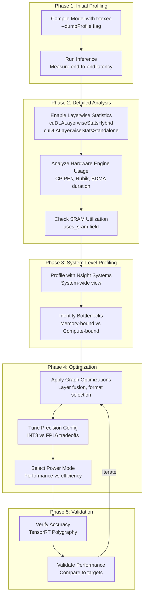
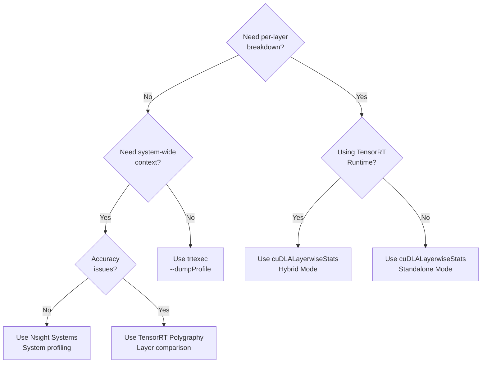
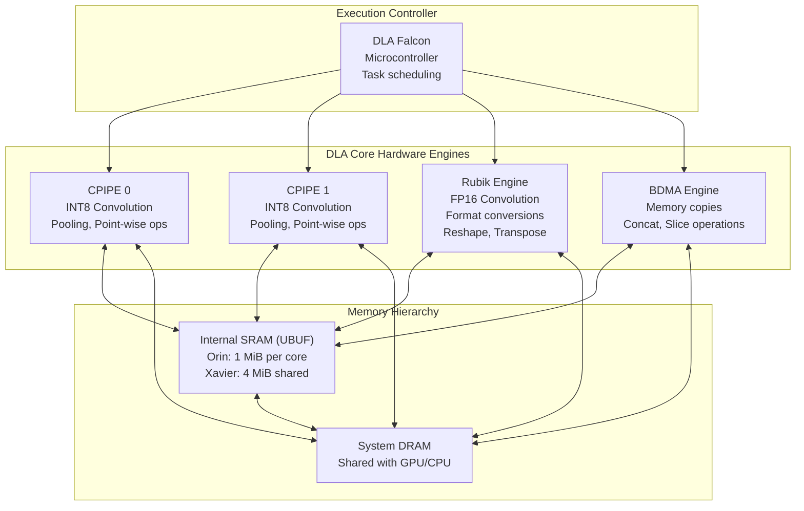
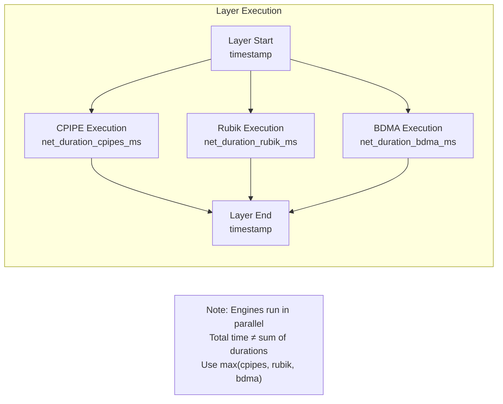
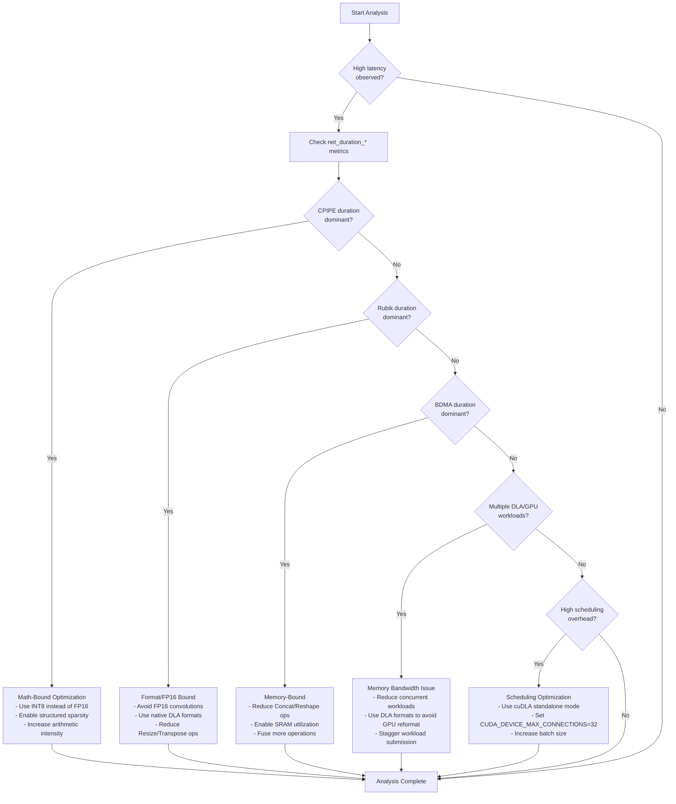
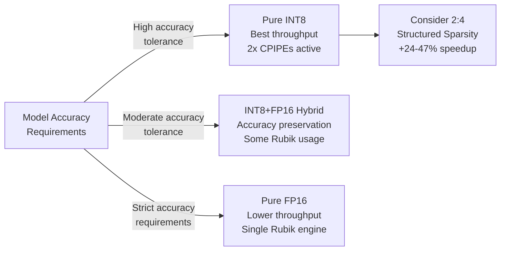
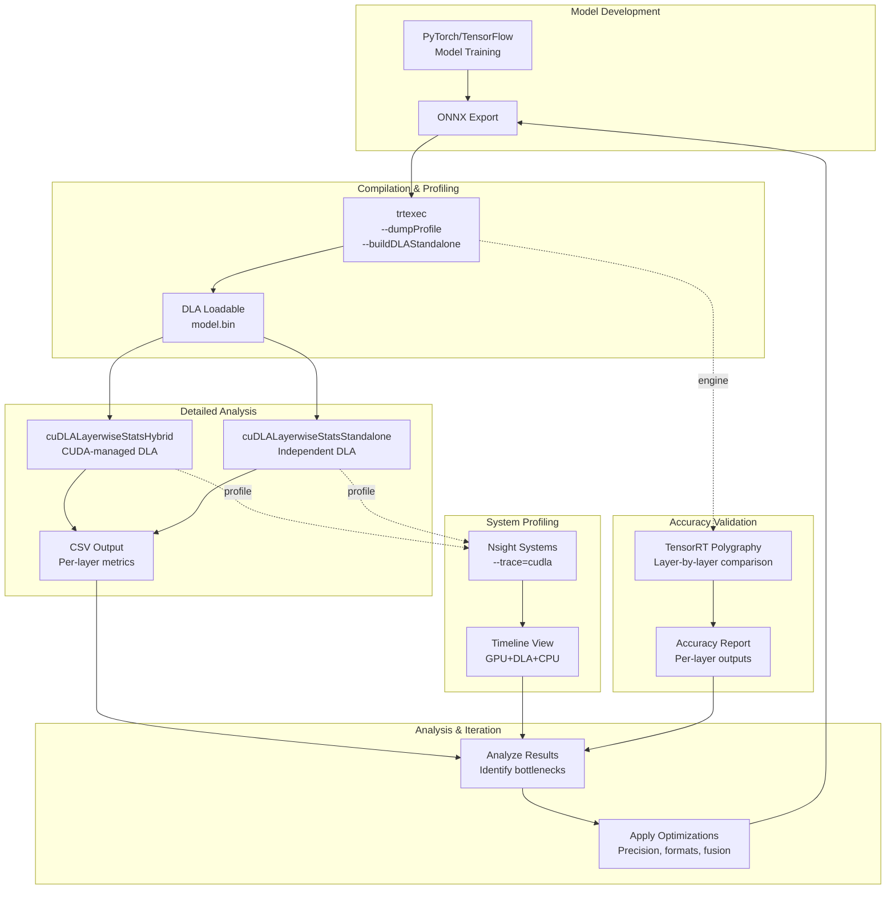

<!-- source: DeepWiki mcp.deepwiki.com · repo NVIDIA/Deep-Learning-Accelerator-SW · page 7 Performance Analysis and Optimization · fetched 2026-10-26 -->

# Performance Analysis and Optimization

<details>
<summary>Relevant source files</summary>

The following files were used as context for generating this wiki page:

- [FAQ/README.md](FAQ/README.md)
- [samples/cuDLA/cuDLALayerwiseStatsHybrid/README.md](samples/cuDLA/cuDLALayerwiseStatsHybrid/README.md)
- [samples/cuDLA/cuDLALayerwiseStatsStandalone/README.md](samples/cuDLA/cuDLALayerwiseStatsStandalone/README.md)

</details>


This page provides a comprehensive guide to profiling, analyzing, and optimizing DLA workload performance. It covers the tools, methodologies, and hardware metrics available for understanding DLA execution characteristics, identifying bottlenecks, and improving throughput and power efficiency.

For model compilation and configuration options that impact performance, see [Model Compilation](#5). For runtime deployment strategies including concurrent execution, see [Runtime and Deployment](#6).

## Purpose and Scope

Performance analysis on DLA involves understanding how neural network workloads utilize the DLA hardware engines, identifying execution bottlenecks, and optimizing for specific metrics (throughput, latency, power consumption). This page introduces:

- The performance analysis workflow and available tools
- Hardware utilization metrics and their interpretation
- Power mode configurations and their impact on DLA performance
- Profiling methodologies for both development and production environments

The sub-pages provide detailed information on:
- [Layerwise Statistics Collection](#7.1) - Using `cuDLALayerwiseStats` tools for per-layer profiling
- [DLA Hardware Utilization Metrics](#7.2) - Understanding CPIPE, Rubik, and BDMA engine metrics
- [Power Modes and Efficiency](#7.3) - Performance characteristics across MAXN, 50W, 30W, and 15W modes
- [Profiling and Debugging Tools](#7.4) - Comprehensive guide to `trtexec`, Nsight Systems, and Polygraphy

## Performance Analysis Workflow

The DLA performance analysis workflow typically follows this sequence:



**Sources:** [FAQ/README.md:117-126](), [samples/cuDLA/cuDLALayerwiseStatsHybrid/README.md:1-154](), [samples/cuDLA/cuDLALayerwiseStatsStandalone/README.md:1-152]()

## Available Profiling Tools

DLA provides multiple profiling tools targeting different analysis needs:

| Tool | Purpose | Granularity | Output Format | Use Case |
|------|---------|-------------|---------------|----------|
| `trtexec --dumpProfile` | Quick performance measurement | Engine-level | Console output | Initial benchmarking |
| `cuDLALayerwiseStatsHybrid` | Per-layer profiling (CUDA-managed) | Layer-level | CSV files | Layer-by-layer optimization |
| `cuDLALayerwiseStatsStandalone` | Per-layer profiling (standalone) | Layer-level | CSV files | Independent DLA analysis |
| Nsight Systems | System-wide profiling | Task/kernel-level | `.qdrep` files | Multi-accelerator analysis |
| TensorRT Polygraphy | Accuracy debugging | Layer outputs | Comparison reports | Precision validation |

**Sources:** [FAQ/README.md:117-126]()

### Tool Selection Matrix



**Sources:** [FAQ/README.md:117-126]()

## Hardware Architecture and Metrics

Understanding DLA's hardware architecture is critical for interpreting performance metrics:



**Key Performance Metrics by Engine:**

| Engine | Metric Name | Description | Optimization Target |
|--------|-------------|-------------|---------------------|
| CPIPEs | `net_duration_cpipes_ms` | Total INT8 compute time | Maximize for math-bound layers |
| Rubik | `net_duration_rubik_ms` | FP16 compute + format conversions | Minimize format conversions |
| BDMA | `net_duration_bdma_ms` | Memory transfer time | Reduce data movement |
| SRAM | `uses_sram` | Whether SRAM was utilized | Enable for small tensors |

**Sources:** [FAQ/README.md:32-33](), [FAQ/README.md:96-98](), [samples/cuDLA/cuDLALayerwiseStatsHybrid/README.md:126-130]()

## Collecting Performance Data

### Using trtexec for Quick Profiling

The `trtexec` tool provides immediate performance feedback during model compilation:

```bash
./trtexec --onnx=model.onnx \
          --int8 \
          --useDLACore=0 \
          --dumpProfile \
          --memPoolSize=dlaSRAM:1 \
          --inputIOFormats=int8:dla_hwc4 \
          --outputIOFormats=int8:chw32
```

**Key Flags:**
- `--dumpProfile`: Enables profiling output
- `--useDLACore=N`: Specifies which DLA core (0 or 1)
- `--memPoolSize=dlaSRAM:1`: Allocates SRAM for better performance
- `--inputIOFormats` / `--outputIOFormats`: Avoids reformat overhead

**Sources:** [FAQ/README.md:118-122]()

### Using cuDLA Layerwise Statistics

For detailed per-layer analysis, use the `cuDLALayerwiseStats` samples:

```bash
# Hybrid mode (TensorRT + CUDA-managed DLA)
./cuDLALayerwiseStatsHybrid model_loadable.bin 1152 1 output_prefix

# Standalone mode (Direct DLA programming)
./cuDLALayerwiseStatsStandalone model_loadable.bin 1152 1 output_prefix
```

**Arguments:**
1. `model_loadable.bin`: DLA loadable file built with `--buildDLAStandalone`
2. `1152`: DLA clock frequency in MHz
3. `1`: Enable statistics collection (set to 1)
4. `output_prefix`: Prefix for output CSV files

**Output Format:** `output_prefix<task_index>.csv`

**Sources:** [samples/cuDLA/cuDLALayerwiseStatsHybrid/README.md:87-112](), [samples/cuDLA/cuDLALayerwiseStatsStandalone/README.md:84-110]()

### Setting DLA Clock Frequency

DLA clock frequency impacts performance and should be known for accurate time measurements:

```bash
# Query current DLA clock (Hz)
sudo cat /sys/kernel/debug/bpmp/debug/clk/nafll_dla0_core/rate

# Set DLA clock to 1152 MHz (1152000000 Hz)
echo 1152000000 > /sys/kernel/debug/bpmp/debug/clk/nafll_dla0_core/rate
```

**Note:** On DRIVE OS D6Q Standard, use `/dev/nvbpmpdebugfs/bpmp_debug/clk/nafll_dla0_core/rate`

**Sources:** [samples/cuDLA/cuDLALayerwiseStatsHybrid/README.md:92-95](), [FAQ/README.md:90-91]()

## Interpreting Layerwise Statistics

The CSV output from `cuDLALayerwiseStats` tools contains critical performance metrics:

### Basic Timing Metrics

```csv
layer_name,start_ms,end_ms
'Conv_219 + BatchNormalization_220+Relu_221+MaxPool_222',0.004556,0.708967
'MaxPool_222',0.709676,1.290478
'Conv_223 + BatchNormalization_224+Relu_225',1.291201,1.692339
```

**Fields:**
- `layer_name`: Fused layer name after DLA Compiler optimization
- `start_ms`: Layer start time in milliseconds
- `end_ms`: Layer end time in milliseconds

**Important:** `end_ms - start_ms` does **not** equal actual layer execution time due to parallel engine execution. Use `net_duration_*` fields instead.

**Sources:** [samples/cuDLA/cuDLALayerwiseStatsHybrid/README.md:117-122]()

### Hardware Engine Duration Metrics



**Engine-Specific Metrics:**

| Metric | Engine | Operations |
|--------|--------|------------|
| `net_duration_cpipes_ms` | CPIPEs (2x) | INT8 Conv, INT8/FP16 Pooling, LRN, Point-wise ops (Scale, Bias, Activation, Precision conversion) |
| `net_duration_rubik_ms` | Rubik | FP16 Conv, Format conversions, Reshape+Slice (channel dim), Transpose, Resize |
| `net_duration_bdma_ms` | BDMA | Data copies, Reshape, Concat, Slice, Transpose |

**Sources:** [samples/cuDLA/cuDLALayerwiseStatsHybrid/README.md:126-130]()

### Precision and Configuration Metrics

Future TensorRT versions (after 8.6.12) will include additional fields:

| Field | Description |
|-------|-------------|
| `src_precisions` | Input tensor precisions |
| `compute_precisions` | Internal compute precisions (CPIPEs use FP19 internally) |
| `dst_precisions` | Output tensor precisions |
| `uses_sram` | Whether internal SRAM (UBUF) is utilized |
| `uses_fp16_conv` | FP16 Convolution engine usage |
| `uses_int8_conv` | INT8 Convolution engine usage |
| `max_num_cpipes` | Number of CPIPEs used (max 2 on Orin) |
| `uses_weight_compression` | Weight compression enabled |
| `uses_structured_sparsity` | 2:4 structured sparsity enabled |
| `uses_sdp` | Single Data Processor (point-wise ops) |
| `uses_pool` | Pooling operations |
| `uses_square_sum_unit` | Square Sum Unit (LRN) |

**Sources:** [samples/cuDLA/cuDLALayerwiseStatsHybrid/README.md:131-154]()

## Performance Bottleneck Analysis



**Sources:** [FAQ/README.md:45-59](), [FAQ/README.md:100-106]()

## Power Modes and Performance Tradeoffs

DLA performance varies significantly across power modes:

| Power Mode | GPU TOPs | DLA TOPs (2x cores) | DLA % of Total | DLA Utilization |
|------------|----------|---------------------|----------------|-----------------|
| MAXN       | 171      | 105                 | 38%            | Baseline        |
| 50W        | 109      | 92                  | 46%            | +8% relative    |
| 30W        | 41       | 90                  | 69%            | +31% relative   |
| 15W        | 14       | 40                  | 74%            | +36% relative   |

**Key Insights:**
- DLA throughput degrades more gracefully than GPU at lower power modes
- At 15W mode, DLA maintains 38% of peak performance (40/105 TOPs)
- GPU at 15W retains only 8% of peak performance (14/171 TOPs)
- **Power efficiency: DLA provides 3-5x better performance per watt than GPU**

**Sources:** [FAQ/README.md:127-128]()

## Performance Optimization Strategies

### 1. Precision Selection



**Sources:** [FAQ/README.md:60-68](), [FAQ/README.md:87-88]()

### 2. Format Optimization

Avoid reformat overhead between GPU and DLA:

| Scenario | Recommended Format | Rationale |
|----------|-------------------|-----------|
| DLA-only inference | `int8:dla_hwc4` input, `int8:chw32` output | Native DLA formats |
| GPU preprocessing → DLA | `int8:chw32` | Shared GPU/DLA format |
| DLA → GPU postprocessing | `int8:chw32` | Shared GPU/DLA format |
| Mixed GPU-DLA graph | `int8:chw32` for all tensors | Minimizes reformats |

**Sources:** [FAQ/README.md:45-49]()

### 3. SRAM Utilization

Enable SRAM for improved performance:

```bash
trtexec --memPoolSize=dlaSRAM:1 ...
```

- Orin: 1 MiB per DLA core (exclusive)
- Xavier: 4 MiB shared across 2 DLAs and 2 PVAs
- Check `uses_sram` field in layerwise stats to verify utilization

**Sources:** [FAQ/README.md:96-98](), [samples/cuDLA/cuDLALayerwiseStatsHybrid/README.md:137]()

### 4. Layer Fusion

DLA Compiler automatically fuses compatible operations:

**Common Fusion Patterns:**
- `Conv + BatchNormalization + ReLU`
- `Conv + BatchNormalization + Add + ReLU` (residual blocks)
- `Conv + Scale + Bias`
- Operations mapped to same hardware engine

Fused layers appear as single entries in profiling output (e.g., `'Conv_219 + BatchNormalization_220+Relu_221+MaxPool_222'`).

**Sources:** [samples/cuDLA/cuDLALayerwiseStatsHybrid/README.md:117]()

## Common Performance Issues

### High GPU-DLA Alternation Overhead

**Problem:** Network alternates between GPU and DLA at high frequency

**Diagnosis:**
```bash
# Check for reformat kernels in Nsight Systems
nsys profile --trace=cuda,nvtx ./application
```

**Solutions:**
1. Use native DLA formats: `--inputIOFormats=int8:dla_hwc4 --outputIOFormats=int8:chw32`
2. Ensure contiguous DLA subgraphs (group DLA-compatible layers)
3. Use `--allowGPUFallback` to let TensorRT decide GPU/DLA mapping

**Sources:** [FAQ/README.md:45-49]()

### High Latency with Multiple DLA Cores

**Problem:** Running workloads on both DLA cores increases latency

**Root Causes:**
1. DRAM bandwidth contention (DLA and GPU share system memory)
2. GPU busy with reformat operations
3. Inefficient task scheduling

**Solutions:**
```bash
# Increase CUDA work queue connections
export CUDA_DEVICE_MAX_CONNECTIONS=32

# Use cuDLA standalone mode for independent DLA control
./cuDLALayerwiseStatsStandalone ...
```

**Sources:** [FAQ/README.md:51-59]()

### Inconsistent Latency

**Problem:** Frame-to-frame latency variance

**Expected Behavior:** DLA provides deterministic latency when clocks are locked

**Verify:**
1. Lock DLA clock frequency
2. Check for DRAM bandwidth contention
3. Ensure no CPU/GPU interference

**Sources:** [FAQ/README.md:114-115]()

## Profiling Workflow Example

Complete example using ResNet-34 backbone:

```bash
# Step 1: Build DLA loadable with profiling support
./trtexec --useDLACore=0 \
          --int8 \
          --memPoolSize=dlaSRAM:1 \
          --inputIOFormats=int8:dla_hwc4 \
          --outputIOFormats=int8:chw32 \
          --onnx=backbone_rn34_1280x768_dummy.onnx \
          --saveEngine=model_loadable.bin \
          --buildDLAStandalone \
          --dumpProfile

# Step 2: Set DLA clock frequency
echo 1152000000 > /sys/kernel/debug/bpmp/debug/clk/nafll_dla0_core/rate

# Step 3: Collect layerwise statistics
./cuDLALayerwiseStatsHybrid model_loadable.bin 1152 1 rn34_profile

# Step 4: Analyze CSV output
cat rn34_profile1.csv

# Step 5: System-wide profiling with Nsight
nsys profile --trace=cuda,nvtx,osrt,cudla \
             --output=rn34_profile \
             ./cuDLALayerwiseStatsHybrid model_loadable.bin 1152 1 rn34

# Step 6: View in Nsight Systems GUI
nsys-ui rn34_profile.qdrep
```

**Sources:** [samples/cuDLA/cuDLALayerwiseStatsHybrid/README.md:99-112](), [FAQ/README.md:118-125]()

## Performance Metrics Reference

### Throughput Calculation

```
Throughput (images/sec) = 1000.0 / latency_ms
```

### Math Utilization

```
Math Utilization = (Achieved TOPs) / (Peak TOPs)

Achieved TOPs = (FLOPs per image × Images per second) / 10^12

Peak TOPs = DLA Clock (GHz) × Theoretical ops per cycle
```

For Orin DLA at 1.152 GHz:
- INT8: ~105 TOPs (both cores, dense)
- INT8: ~130 TOPs (both cores, 2:4 sparse)
- FP16: Lower throughput (optimized for INT8)

**Sources:** [FAQ/README.md:100-106]()

### Power Efficiency

```
Performance per Watt = Throughput / Power Consumption

Example (ResNet-50 @ 15W):
- DLA: ~1000 images/sec / 7W ≈ 143 images/sec/W
- GPU: ~300 images/sec / 14W ≈ 21 images/sec/W
- Efficiency gain: ~6.8x
```

**Sources:** [FAQ/README.md:127-128]()

## Integration with Other Tools



**Sources:** [FAQ/README.md:117-126](), [samples/cuDLA/cuDLALayerwiseStatsHybrid/README.md:1-154]()

## Best Practices Summary

1. **Start Simple:** Use `trtexec --dumpProfile` for initial benchmarking
2. **Enable SRAM:** Always use `--memPoolSize=dlaSRAM:1` for better performance
3. **Use Native Formats:** Specify `--inputIOFormats=int8:dla_hwc4` to avoid reformat overhead
4. **Lock Clocks:** Set DLA clock frequency for reproducible measurements
5. **Collect Layerwise Data:** Use `cuDLALayerwiseStats` tools for bottleneck identification
6. **Profile System-Wide:** Use Nsight Systems for multi-accelerator workloads
7. **Verify Accuracy:** Use Polygraphy after precision/format optimizations
8. **Iterate:** Performance optimization is iterative—measure, optimize, repeat

**Sources:** [FAQ/README.md:117-141]()

---

For detailed information on specific topics, refer to the sub-pages:
- **[Layerwise Statistics Collection](#7.1)** - Detailed usage of `cuDLALayerwiseStats` tools
- **[DLA Hardware Utilization Metrics](#7.2)** - In-depth explanation of hardware engine metrics
- **[Power Modes and Efficiency](#7.3)** - Power mode configurations and benchmarks
- **[Profiling and Debugging Tools](#7.4)** - Comprehensive tool reference and workflows

---

