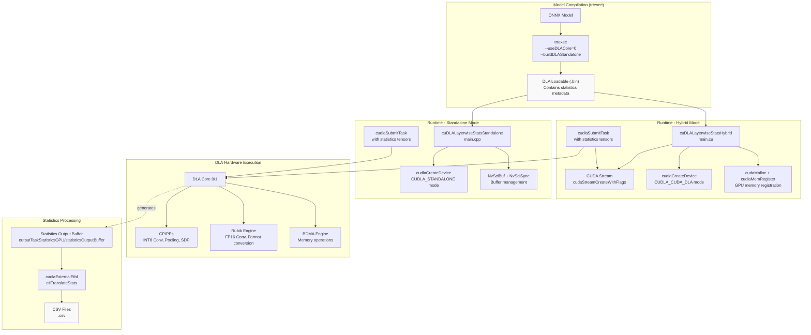
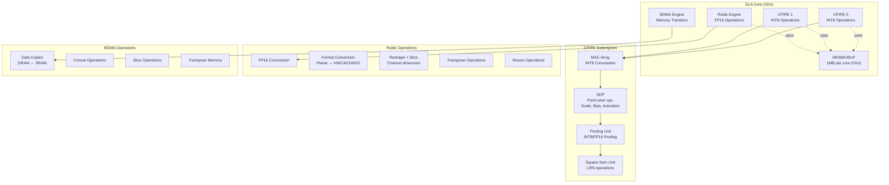

<!-- source: DeepWiki mcp.deepwiki.com · repo NVIDIA/Deep-Learning-Accelerator-SW · page 7.1 Layerwise Statistics Collection · fetched 2026-10-26 -->

# Layerwise Statistics Collection

<details>
<summary>Relevant source files</summary>

The following files were used as context for generating this wiki page:

- [samples/cuDLA/cuDLALayerwiseStatsHybrid/Makefile](samples/cuDLA/cuDLALayerwiseStatsHybrid/Makefile)
- [samples/cuDLA/cuDLALayerwiseStatsHybrid/README.md](samples/cuDLA/cuDLALayerwiseStatsHybrid/README.md)
- [samples/cuDLA/cuDLALayerwiseStatsHybrid/main.cu](samples/cuDLA/cuDLALayerwiseStatsHybrid/main.cu)
- [samples/cuDLA/cuDLALayerwiseStatsStandalone/Makefile](samples/cuDLA/cuDLALayerwiseStatsStandalone/Makefile)
- [samples/cuDLA/cuDLALayerwiseStatsStandalone/README.md](samples/cuDLA/cuDLALayerwiseStatsStandalone/README.md)
- [samples/cuDLA/cuDLALayerwiseStatsStandalone/findnvsci.mk](samples/cuDLA/cuDLALayerwiseStatsStandalone/findnvsci.mk)
- [samples/cuDLA/cuDLALayerwiseStatsStandalone/main.cpp](samples/cuDLA/cuDLALayerwiseStatsStandalone/main.cpp)

</details>


## Purpose and Scope

Layerwise Statistics Collection is a profiling mechanism that provides per-layer performance metrics for DLA (Deep Learning Accelerator) workloads. This system captures detailed execution statistics for each fused layer group, including hardware engine utilization, timing information, and precision details. The data is exported in CSV format for analysis and optimization.

This page covers the cuDLA layerwise statistics tools and their usage. For general DLA performance analysis and power efficiency metrics, see [Performance Analysis and Optimization](#7). For broader profiling tools like Nsight Systems, see [Profiling and Debugging Tools](#7.4).

**Sources:** [samples/cuDLA/cuDLALayerwiseStatsHybrid/README.md:1-5](), [samples/cuDLA/cuDLALayerwiseStatsStandalone/README.md:1-5]()

## System Requirements

Layerwise profiling support requires:

| Component | Minimum Version |
|-----------|----------------|
| **DLA SW** | 3.14.0 (DRIVE Orin), 3.14.1 (Jetson Orin) |
| **Platform** | DRIVE OS 6.0.8.0+ or JetPack 6.0+ |
| **TensorRT** | 8.6.12+ (limited to `layer_names_only` verbosity) |
| **Architecture** | aarch64 only |
| **OS** | Linux, QNX (not QNX Safety) |

**Note:** Layerwise statistics are not supported on x86_64, ARMv7, or sbsa architectures. Future TensorRT versions will support `detailed` and `none` profiling verbosity options via the `--profilingVerbosity` flag.

**Sources:** [samples/cuDLA/cuDLALayerwiseStatsHybrid/README.md:31-36](), [samples/cuDLA/cuDLALayerwiseStatsStandalone/README.md:33-38]()

## Architecture Overview



**Layerwise Statistics Collection Architecture**

The system consists of two execution modes (Hybrid and Standalone) that collect identical profiling data but use different memory management approaches. Both modes rely on special statistics output tensors that the DLA hardware populates during execution.

**Sources:** [samples/cuDLA/cuDLALayerwiseStatsHybrid/main.cu:62-84](), [samples/cuDLA/cuDLALayerwiseStatsStandalone/main.cpp:68-108]()

## Execution Modes

### Hybrid Mode (CUDA-Managed)

In hybrid mode, CUDA manages DLA execution through `CUDLA_CUDA_DLA` mode. This approach uses CUDA streams and GPU memory allocation:

```mermaid
graph LR
    App["Application<br/>main.cu"]
    Device["cudlaCreateDevice<br/>CUDLA_CUDA_DLA"]
    Module["cudlaModuleLoadFromMemory"]
    Attrs["cudlaModuleGetAttributes<br/>CUDLA_NUM_OUTPUT_TASK_STATISTICS"]
    
    subgraph "Memory Setup"
        HostBuf["Host Buffers<br/>statisticsOutputBuffer"]
        GPUAlloc["cudaMalloc<br/>outputTaskStatisticsGPU"]
        Register["cudlaMemRegister<br/>CUDLA_TASK_STATISTICS flag"]
    end
    
    Stream["cudaStreamCreateWithFlags<br/>cudaStreamNonBlocking"]
    Submit["cudlaSubmitTask<br/>numOutputTensors += numStats"]
    Sync["cudaStreamSynchronize"]
    CopyBack["cudaMemcpyAsync<br/>DeviceToHost"]
    
    Translate["etiTranslateStats<br/>CUDLA_GET_CSV_STATS"]
    CSV["Write CSV<br/><prefix><index>.csv"]
    
    App --> Device --> Module --> Attrs
    Attrs --> HostBuf --> GPUAlloc --> Register
    App --> Stream
    Register --> Submit
    Submit --> Sync --> CopyBack --> Translate --> CSV
```



**Hybrid Mode Execution Flow**

**Sources:** [samples/cuDLA/cuDLALayerwiseStatsHybrid/main.cu:229-898]()

### Standalone Mode (Independent DLA)

Standalone mode uses `CUDLA_STANDALONE` with NvSciBuf/NvSciSync for independent DLA operation:

```mermaid
graph LR
    App["Application<br/>main.cpp"]
    Device["cudlaCreateDevice<br/>CUDLA_STANDALONE"]
    Module["cudlaModuleLoadFromMemory"]
    Attrs["cudlaModuleGetAttributes<br/>CUDLA_NUM_OUTPUT_TASK_STATISTICS"]
    
    subgraph "NvSci Memory Setup"
        BufModule["NvSciBufModuleOpen"]
        AttrList["createAndSetAttrList<br/>NvSciBufAttrList"]
        Reconcile["NvSciBufAttrListReconcile"]
        BufObj["NvSciBufObjAlloc<br/>statisticsBufObj"]
    end
    
    subgraph "NvSci Synchronization"
        SyncModule["NvSciSyncModuleOpen"]
        WaiterAttr["fillCpuWaiterAttrList"]
        SyncObj["NvSciSyncObjAlloc"]
    end
    
    Submit["cudlaSubmitTask<br/>with signalEvents"]
    Wait["NvSciSyncFenceWait<br/>eofFence"]
    
    Translate["etiTranslateStats<br/>CUDLA_GET_CSV_STATS"]
    CSV["Write CSV<br/><prefix><index>.csv"]
    
    App --> Device --> Module --> Attrs
    Attrs --> BufModule --> AttrList --> Reconcile --> BufObj
    Attrs --> SyncModule --> WaiterAttr --> SyncObj
    BufObj --> Submit
    SyncObj --> Submit
    Submit --> Wait --> Translate --> CSV
```



**Standalone Mode Execution Flow**

**Sources:** [samples/cuDLA/cuDLALayerwiseStatsStandalone/main.cpp:471-1250]()

## Enabling Statistics Collection

### Building DLA Loadables

DLA loadables must be built with `--buildDLAStandalone` to support statistics collection. The compilation process automatically includes statistics metadata:

```bash
./trtexec \
  --useDLACore=0 \
  --int8 \
  --memPoolSize=dlaSRAM:1 \
  --inputIOFormats=int8:dla_hwc4 \
  --outputIOFormats=int8:chw32 \
  --onnx=model.onnx \
  --saveEngine=model_loadable.bin \
  --buildDLAStandalone
```

The `--profilingVerbosity` flag controls the level of detail in the statistics metadata:
- `layer_names_only`: Default in TRT 8.6.12 and earlier (only option available)
- `detailed`: Future support for full layer parameters
- `none`: Future support for disabling profiling data

**Sources:** [samples/cuDLA/cuDLALayerwiseStatsHybrid/README.md:76-85](), [samples/cuDLA/cuDLALayerwiseStatsStandalone/README.md:74-83]()

### Requesting Statistics at Runtime

Statistics collection is enabled by:

1. **Querying statistics tensor count:**
```cpp
cudlaModuleGetAttributes(moduleHandle, CUDLA_NUM_OUTPUT_TASK_STATISTICS, &attribute);
uint32_t numOutputTaskStatistics = attribute.numOutputTensors;
```

2. **Allocating statistics buffers** (one per task/layer group):
```cpp
cudlaModuleTensorDescriptor* outputTaskStatisticsDesc = 
    (cudlaModuleTensorDescriptor*)malloc(sizeof(cudlaModuleTensorDescriptor)*numOutputTaskStatistics);
cudlaModuleGetAttributes(moduleHandle, CUDLA_OUTPUT_TASK_STATISTICS_DESCRIPTORS, &attribute);
```

3. **Registering statistics buffers** with `CUDLA_TASK_STATISTICS` flag (Hybrid mode):
```cpp
cudlaMemRegister(devHandle,
                 (uint64_t*)(outputTaskStatisticsGPU[ii]),
                 outputTaskStatisticsDesc[ii].size,
                 &(outputTaskStatisticsRegisteredPtr[ii]),
                 CUDLA_TASK_STATISTICS);
```

4. **Submitting task with expanded output count:**
```cpp
task.numOutputTensors = numOutputTensors + numOutputTaskStatistics;
task.outputTensor = outputStatisticsBufferRegisteredPtr;  // Regular outputs + statistics
cudlaSubmitTask(devHandle, &task, 1, stream, 0);
```

**Sources:** [samples/cuDLA/cuDLALayerwiseStatsHybrid/main.cu:373-707](), [samples/cuDLA/cuDLALayerwiseStatsStandalone/main.cpp:582-1034]()

### DLA Clock Frequency Configuration

Accurate timing requires matching the DLA clock frequency parameter to the actual hardware clock:

```bash
# Query current DLA clock (Hz)
sudo cat /sys/kernel/debug/bpmp/debug/clk/nafll_dla0_core/rate

# Set DLA clock to 1152 MHz (optional)
echo 1152000000 > /sys/kernel/debug/bpmp/debug/clk/nafll_dla0_core/rate

# Note: D6Q Standard platform uses different path
# /dev/nvbpmpdebugfs/bpmp_debug/clk/nafll_dla0_core/rate
```

The frequency must be passed in MHz to the sample applications:
```bash
./cuDLALayerwiseStatsHybrid model_loadable.bin 1152 1 output_prefix
#                                              ^^^^ MHz
```

**Sources:** [samples/cuDLA/cuDLALayerwiseStatsHybrid/README.md:92-111](), [samples/cuDLA/cuDLALayerwiseStatsStandalone/README.md:90-109]()

## CSV Output Format

### Data Translation Pipeline

```mermaid
graph LR
    RawStats["Raw Statistics Buffer<br/>statisticsOutputBuffer[ii]"]
    GetLength["etiTranslateStats<br/>CUDLA_GET_CSV_LENGTH"]
    LenAttr["csvAttribute.csvStreamLength"]
    
    AllocCSV["Allocate CSV Buffer<br/>csv[ii]"]
    GetStats["etiTranslateStats<br/>CUDLA_GET_CSV_STATS"]
    CSVAttr["csvAttribute.csvStreamStats"]
    
    WriteFile["fwrite to file<br/><prefix><ii+1>.csv"]
    
    RawStats --> GetLength --> LenAttr --> AllocCSV
    AllocCSV --> GetStats --> CSVAttr --> WriteFile
```



**CSV Translation Process**

The `cudlaExternalEtbl` export table provides the `etiTranslateStats` function to convert raw binary statistics into CSV format. This is a two-step process:

1. Query the CSV stream length
2. Allocate buffer and retrieve formatted CSV data

**Sources:** [samples/cuDLA/cuDLALayerwiseStatsHybrid/main.cu:768-827](), [samples/cuDLA/cuDLALayerwiseStatsStandalone/main.cpp:1100-1220]()

### CSV Column Definitions

The CSV output contains the following columns (TensorRT 8.6.12 and earlier):

| Column Name | Description | Unit | Notes |
|-------------|-------------|------|-------|
| `layer_name` | Fused layer name after DLA compilation | - | Post-fusion layer identifier |
| `start_ms` | Layer execution start time | milliseconds | May overlap with other layers |
| `end_ms` | Layer execution end time | milliseconds | May overlap with other layers |

**Important:** The delta `end_ms - start_ms` does **not** accurately represent total layer time due to parallel execution of DLA engines. Use the sum of engine-specific durations instead.

**Future columns** (TensorRT versions after 8.6.12 with `--profilingVerbosity=detailed`):

| Column Name | Description | Unit | Notes |
|-------------|-------------|------|-------|
| `latency_ms` | Computed wall clock latency | milliseconds | Post-processing metric |
| `net_duration_cpipes_ms` | Total CPIPEs execution time | milliseconds | INT8 Conv, Pooling, SDP ops |
| `net_duration_rubik_ms` | Total Rubik execution time | milliseconds | FP16 Conv, format conversions |
| `net_duration_bdma_ms` | Total BDMA execution time | milliseconds | Memory operations |
| `src_precisions` | Input tensor precisions | - | Per-tensor precision list |
| `compute_precisions` | Internal compute precisions | - | FP19 for CPIPEs internally |
| `dst_precisions` | Output tensor precisions | - | Per-tensor precision list |
| `uses_sram` | SRAM/UBUF utilization flag | boolean | Internal SRAM usage |
| `uses_fp16_conv` | FP16 convolution engine flag | boolean | Rubik FP16 Conv usage |
| `uses_int8_conv` | INT8 convolution engine flag | boolean | CPIPE INT8 Conv usage |
| `max_num_cpipes` | Maximum CPIPE count used | integer | 0-2 on Orin |
| `uses_weight_compression` | Weight compression flag | boolean | INT8 Conv compression |
| `uses_structured_sparsity` | 2:4 structured sparsity flag | boolean | Sparse INT8 Conv |
| `uses_sdp` | Single Data Processor usage | boolean | Point-wise ops on CPIPEs |
| `uses_pool` | Pooling operation usage | boolean | Pooling on SDP engine |
| `uses_square_sum_unit` | Square sum unit usage | boolean | LRN operations |

**Note:** In current releases, BDMA and non-Conv Rubik operations report "BYTE" for all precisions.

**Sources:** [samples/cuDLA/cuDLALayerwiseStatsHybrid/README.md:114-154](), [samples/cuDLA/cuDLALayerwiseStatsStandalone/README.md:112-152]()

### Sample CSV Output

```csv
layer_name,start_ms,end_ms
'Conv_219 + BatchNormalization_220+Relu_221+MaxPool_222',0.004556,0.708967
'MaxPool_222',0.709676,1.290478
'Conv_223 + BatchNormalization_224+Relu_225',1.291201,1.692339
'Conv_226 + BatchNormalization_227+Add_228+Relu_229',1.693057,2.109201
'Conv_230 + BatchNormalization_231+Relu_232',2.109914,2.513233
'Conv_233 + BatchNormalization_234+Add_235+Relu_236',2.513964,2.930510
'Conv_237 + BatchNormalization_238+Relu_239',2.931229,3.328956
'Conv_240 + BatchNormalization_241+Add_242+Relu_243',3.329661,3.745779
'Conv_244 + BatchNormalization_245+Relu_246',3.746490,4.018651
```

**Sources:** [samples/cuDLA/cuDLALayerwiseStatsHybrid/README.md:7-18]()

## DLA Hardware Engine Metrics

### Hardware Engine Architecture



**DLA Hardware Execution Engines**

The three fundamental hardware engines operate in parallel, enabling pipelined execution:

1. **CPIPEs (Convolution Pipes)**: Two parallel engines on Orin for INT8 operations
   - MAC arrays for INT8 convolution
   - SDP (Single Data Processor) for point-wise operations
   - Pooling units for INT8/FP16 pooling
   - Square Sum Unit for LRN operations
   - Internal precision: FP19

2. **Rubik Engine**: Specialized for FP16 and format operations
   - FP16 convolution (distinct from CPIPE INT8)
   - Format conversions (planar ↔ DLA-specific formats)
   - Reshape/Slice on channel dimension
   - Transpose and Resize operations

3. **BDMA (Bulk Data Movement Accelerator)**: Memory transfer engine
   - Data copies between DRAM and SRAM
   - Triggered by Reshape, Concat, Slice, Transpose operations

**Sources:** [samples/cuDLA/cuDLALayerwiseStatsHybrid/README.md:126-154]()

### Calculating True Layer Latency

Due to parallel engine execution, overlapping layer execution is common in models with independent branches:

```
Correct layer latency = net_duration_cpipes_ms + net_duration_rubik_ms + net_duration_bdma_ms
```

**Do not use:** `latency = end_ms - start_ms` as this does not account for parallelism.

Example overlap scenario:
```
Layer A: start=0.0ms, end=5.0ms, cpipes=3.0ms, rubik=0ms, bdma=2.0ms
Layer B: start=1.0ms, end=6.0ms, cpipes=4.0ms, rubik=0ms, bdma=1.0ms

Layer A runs on CPIPE 0 + BDMA
Layer B runs on CPIPE 1 + BDMA (overlapping)

True latencies:
  Layer A = 3.0 + 0 + 2.0 = 5.0ms
  Layer B = 4.0 + 0 + 1.0 = 5.0ms
```

**Sources:** [samples/cuDLA/cuDLALayerwiseStatsHybrid/README.md:122-123]()

## Sample Applications

### cuDLALayerwiseStatsHybrid

**Purpose:** Collect layerwise statistics in CUDA-managed DLA mode (hybrid execution).

**Command-line interface:**
```bash
./cuDLALayerwiseStatsHybrid <loadable> <freqMHZ> <statSupport> <filenamePrefix>
```

**Arguments:**
- `loadable`: Path to DLA loadable binary (.bin)
- `freqMHZ`: DLA clock frequency in MHz (must match hardware clock)
- `statSupport`: Set to `1` to enable statistics collection, `0` to disable
- `filenamePrefix`: Prefix for output CSV files (optional)

**Output files:** `<filenamePrefix><taskIndex>.csv` where taskIndex is 1-based.

**Key code entities:**
- Device creation: `cudlaCreateDevice(0, &devHandle, CUDLA_CUDA_DLA)` [samples/cuDLA/cuDLALayerwiseStatsHybrid/main.cu:315]()
- Module loading: `cudlaModuleLoadFromMemory(devHandle, loadableData, file_size, &moduleHandle, 0)` [samples/cuDLA/cuDLALayerwiseStatsHybrid/main.cu:325]()
- Statistics registration: `cudlaMemRegister(..., CUDLA_TASK_STATISTICS)` [samples/cuDLA/cuDLALayerwiseStatsHybrid/main.cu:636-647]()
- Task submission: `cudlaSubmitTask(devHandle, &task, 1, stream, 0)` [samples/cuDLA/cuDLALayerwiseStatsHybrid/main.cu:707]()
- CSV translation: `etbl->etiTranslateStats(devHandle, statisticsOutputBuffer[ii], dlaFreqInMHz, ii, ...)` [samples/cuDLA/cuDLALayerwiseStatsHybrid/main.cu:788-801]()

**Sources:** [samples/cuDLA/cuDLALayerwiseStatsHybrid/README.md:1-113](), [samples/cuDLA/cuDLALayerwiseStatsHybrid/main.cu:1-898]()

### cuDLALayerwiseStatsStandalone

**Purpose:** Collect layerwise statistics in standalone DLA mode (independent execution with NvSciBuf/NvSciSync).

**Command-line interface:**
```bash
./cuDLALayerwiseStatsStandalone <loadable> <freqMHZ> <statSupport> <filenamePrefix>
```

**Arguments:** Same as hybrid mode.

**Key code entities:**
- Device creation: `cudlaCreateDevice(0, &devHandle, CUDLA_STANDALONE)` [samples/cuDLA/cuDLALayerwiseStatsStandalone/main.cpp:536]()
- NvSciBuf setup: `createAndSetAttrList(bufModule, bufSize, &attrList)` [samples/cuDLA/cuDLALayerwiseStatsStandalone/main.cpp:389-453]()
- NvSciSync setup: `fillCpuWaiterAttrList(list)` [samples/cuDLA/cuDLALayerwiseStatsStandalone/main.cpp:455-469]()
- Task submission: `cudlaSubmitTask(devHandle, &task, 1, &waitEvents, 1)` [samples/cuDLA/cuDLALayerwiseStatsStandalone/main.cpp:1018]()
- Fence waiting: `NvSciSyncFenceWait(&(resourceList.eofFence), ...)` [samples/cuDLA/cuDLALayerwiseStatsStandalone/main.cpp:1035-1047]()

**Sources:** [samples/cuDLA/cuDLALayerwiseStatsStandalone/README.md:1-111](), [samples/cuDLA/cuDLALayerwiseStatsStandalone/main.cpp:1-1250]()

## Building the Samples

### Prerequisites

- CUDA Toolkit 12.2 or later
- DLA SW 3.14.0+ (DRIVE Orin) or 3.14.1+ (Jetson Orin)
- aarch64 architecture (x86_64, ARMv7, sbsa not supported)
- GCC 4.7.0+ for C++11 support
- NvSciBuf and NvSciSync libraries (Standalone mode only)

### Build Commands

**Hybrid mode:**
```bash
cd samples/cuDLA/cuDLALayerwiseStatsHybrid
make
# Cross-compilation for aarch64:
make TARGET_ARCH=aarch64
# Debug build:
make dbg=1
```

**Standalone mode:**
```bash
cd samples/cuDLA/cuDLALayerwiseStatsStandalone
make
# Cross-compilation for aarch64:
make TARGET_ARCH=aarch64
```

The compiled binaries are placed in `bin/<arch>/<os>/<build_type>/`.

**Sources:** [samples/cuDLA/cuDLALayerwiseStatsHybrid/README.md:50-75](), [samples/cuDLA/cuDLALayerwiseStatsStandalone/README.md:50-73](), [samples/cuDLA/cuDLALayerwiseStatsHybrid/Makefile:1-394](), [samples/cuDLA/cuDLALayerwiseStatsStandalone/Makefile:1-397]()

## End-to-End Example: RetinaNet ResNet-34

### Step 1: Download Model

Download the RetinaNet ResNet-34 backbone ONNX model:
```bash
# See scripts/prepare_models documentation for model URLs
# Model: backbone_rn34_1280x768_dummy.onnx
```

**Sources:** [samples/cuDLA/cuDLALayerwiseStatsHybrid/README.md:99-101]()

### Step 2: Build DLA Loadable

```bash
./trtexec \
  --useDLACore=0 \
  --int8 \
  --memPoolSize=dlaSRAM:1 \
  --inputIOFormats=int8:dla_hwc4 \
  --outputIOFormats=int8:chw32 \
  --onnx=backbone_rn34_1280x768_dummy.onnx \
  --saveEngine=model_loadable.bin \
  --buildDLAStandalone

# Expected output:
# [I] Engine built in 28.6839 sec.
# &&&& PASSED TensorRT.trtexec
```

**Sources:** [samples/cuDLA/cuDLALayerwiseStatsHybrid/README.md:102-106]()

### Step 3: Configure DLA Clock (Optional)

```bash
# Set DLA clock to 1152 MHz
DLA_CLK=1152000000
echo ${DLA_CLK} > /sys/kernel/debug/bpmp/debug/clk/nafll_dla0_core/rate

# Verify setting
cat /sys/kernel/debug/bpmp/debug/clk/nafll_dla0_core/rate
```

**Sources:** [samples/cuDLA/cuDLALayerwiseStatsHybrid/README.md:107-111]()

### Step 4: Run Layerwise Profiling

**Hybrid mode:**
```bash
./cuDLALayerwiseStatsHybrid model_loadable.bin 1152 1 hybrid1
# Output: hybrid11.csv (1-based index)
```

**Standalone mode:**
```bash
./cuDLALayerwiseStatsStandalone model_loadable.bin 1152 1 standalone1
# Output: standalone11.csv
```

**Sources:** [samples/cuDLA/cuDLALayerwiseStatsHybrid/README.md:112](), [samples/cuDLA/cuDLALayerwiseStatsStandalone/README.md:110]()

## Interpreting Results

### Layer Fusion Analysis

The `layer_name` column shows post-compilation fused layer groups:

```csv
layer_name,start_ms,end_ms
'Conv_219 + BatchNormalization_220+Relu_221+MaxPool_222',0.004556,0.708967
```

This indicates that:
- Original ONNX layers: `Conv_219`, `BatchNormalization_220`, `Relu_221`, `MaxPool_222`
- DLA compiler fused these into a single executable unit
- The fusion reduces memory traffic and improves performance

### Temporal Overlap Detection

Analyze timing overlaps to identify parallel execution:

```csv
'MaxPool_222',0.709676,1.290478
'Conv_223 + BatchNormalization_224+Relu_225',1.291201,1.692339
```

- `MaxPool_222` ends at 1.290478ms
- `Conv_223` group starts at 1.291201ms (gap: 0.723μs)
- Minimal gap indicates sequential execution with no parallelism

In contrast, overlapping layers indicate parallel branches:
```
LayerA: start=0.0, end=5.0
LayerB: start=1.0, end=6.0
Overlap: 1.0ms - 5.0ms (4ms of parallel execution)
```

**Sources:** [samples/cuDLA/cuDLALayerwiseStatsHybrid/README.md:122]()

### Performance Bottleneck Identification

With future TensorRT versions supporting detailed metrics:

1. **CPIPE-bound layers:** `net_duration_cpipes_ms` dominates
   - Heavy INT8 convolution workloads
   - Many point-wise operations (SDP)

2. **Rubik-bound layers:** `net_duration_rubik_ms` dominates
   - FP16 convolution layers
   - Format conversion operations

3. **BDMA-bound layers:** `net_duration_bdma_ms` dominates
   - Memory-intensive operations
   - Large Reshape/Concat/Slice operations

4. **SRAM utilization:** `uses_sram=true`
   - Indicates efficient use of on-chip memory
   - Reduces DRAM bandwidth pressure

**Sources:** [samples/cuDLA/cuDLALayerwiseStatsHybrid/README.md:126-154]()

## Limitations and Future Enhancements

### Current Limitations (TensorRT 8.6.12)

1. **Limited CSV columns:** Only `layer_name`, `start_ms`, `end_ms` available
2. **Fixed verbosity:** `--profilingVerbosity` locked to `layer_names_only`
3. **Precision reporting:** BDMA and non-Conv Rubik report "BYTE" for all precisions
4. **No post-processing latency:** `latency_ms` must be computed manually

### Future Enhancements (TensorRT 8.6.13+)

1. **Detailed profiling:** `--profilingVerbosity=detailed` for all CSV columns
2. **Verbosity control:** `--profilingVerbosity=none` to disable profiling
3. **Enhanced precision reporting:** Accurate precision data for all operations
4. **Automatic latency calculation:** Pre-computed `latency_ms` field

**Sources:** [samples/cuDLA/cuDLALayerwiseStatsHybrid/README.md:81-84,114-124]()

---

