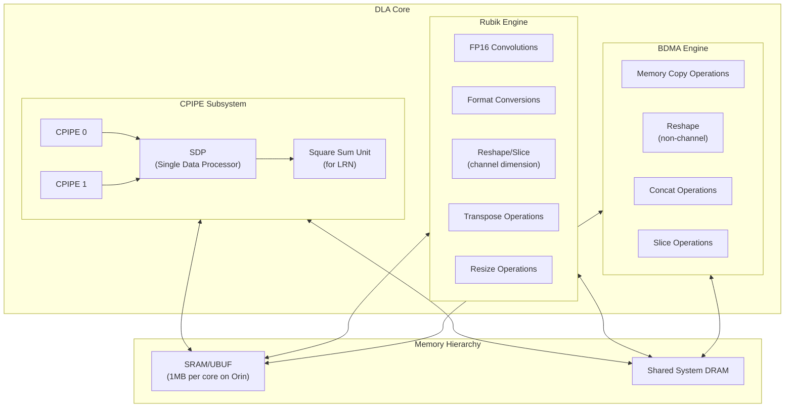
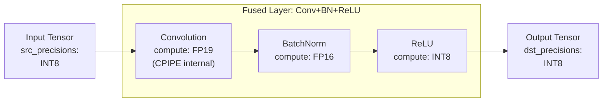
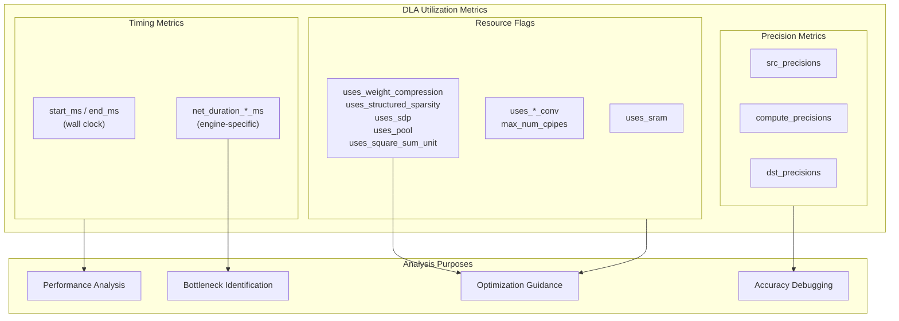
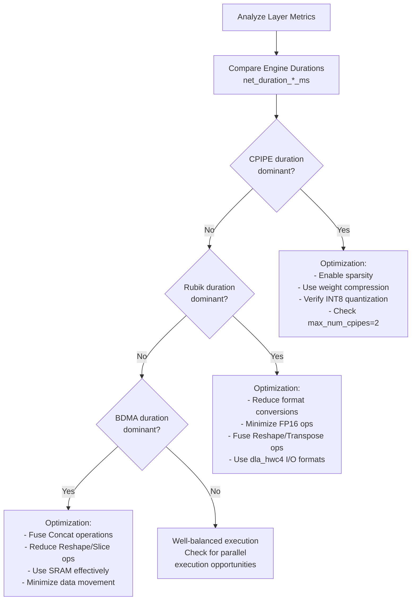

<!-- source: DeepWiki mcp.deepwiki.com · repo NVIDIA/Deep-Learning-Accelerator-SW · page 7.2 DLA Hardware Utilization Metrics · fetched 2026-10-26 -->

# DLA Hardware Utilization Metrics

<details>
<summary>Relevant source files</summary>

The following files were used as context for generating this wiki page:

- [samples/cuDLA/cuDLALayerwiseStatsHybrid/README.md](samples/cuDLA/cuDLALayerwiseStatsHybrid/README.md)
- [samples/cuDLA/cuDLALayerwiseStatsStandalone/README.md](samples/cuDLA/cuDLALayerwiseStatsStandalone/README.md)

</details>


## Purpose and Scope

This document explains the hardware utilization metrics collected from DLA execution during layerwise profiling. These metrics provide insight into how DLA hardware engines (CPIPEs, Rubik, BDMA) are utilized, what precision operations are executed, and what resources are consumed during layer execution.

For information on how to collect these metrics, see [Layerwise Statistics Collection](#7.1). For power consumption analysis, see [Power Modes and Efficiency](#7.3). For the complete set of profiling and debugging tools, see [Profiling and Debugging Tools](#7.4).

## Overview of DLA Hardware Engines

The DLA hardware on NVIDIA Orin consists of three fundamental execution engines that can operate in parallel. Understanding these engines is critical for interpreting utilization metrics.

### DLA Hardware Engine Architecture



**Sources:** [samples/cuDLA/cuDLALayerwiseStatsHybrid/README.md:126-130](), [samples/cuDLA/cuDLALayerwiseStatsStandalone/README.md:124-128]()

### Engine Capabilities

| Engine | Primary Operations | Precision Support | Parallelism |
|--------|-------------------|-------------------|-------------|
| CPIPEs (x2) | INT8 Convolution, Pooling (INT8/FP16), LRN (INT8/FP16), Point-wise operations (Scale, Bias, Activations, precision conversion) | INT8, FP16 | 2 parallel pipes on Orin |
| Rubik | FP16 Convolution, Format conversions (to/from planar), Reshape+Slice (channel dimension), Transpose, Resize | FP16 | Single engine |
| BDMA | Memory copies, Reshape, Concat, Slice, Transpose | Byte-level operations | Single engine |

**Sources:** [samples/cuDLA/cuDLALayerwiseStatsHybrid/README.md:126-130](), [samples/cuDLA/cuDLALayerwiseStatsStandalone/README.md:124-128]()

## Timing Metrics

Timing metrics capture the temporal execution behavior of layers and their utilization of hardware engines.

### Basic Timing Columns

The following timing metrics are available in TensorRT 8.6.12 and earlier:

| Metric | Description | Unit |
|--------|-------------|------|
| `layer_name` | Layer name after all fusions inside the DLA Compiler | String |
| `start_ms` | The beginning of the fused layers execution | Milliseconds |
| `end_ms` | The end of the fused layers execution | Milliseconds |

**Important Note:** The delta between `end_ms` and `start_ms` does **not** accurately reflect the total layer processing time due to parallel engine execution and layer overlap.

**Sources:** [samples/cuDLA/cuDLALayerwiseStatsHybrid/README.md:115-122](), [samples/cuDLA/cuDLALayerwiseStatsStandalone/README.md:115-122]()

### Engine-Specific Duration Metrics

These metrics provide the accurate total latency for each hardware engine:

| Metric | Description | Calculation |
|--------|-------------|-------------|
| `net_duration_cpipes_ms` | Total CPIPE engine latency | Sum of execution time on both CPIPE units |
| `net_duration_rubik_ms` | Total Rubik engine latency | Rubik engine execution time |
| `net_duration_bdma_ms` | Total BDMA engine latency | BDMA engine execution time |

**Correct Layer Latency Calculation:**
```
Total Layer Time = net_duration_cpipes_ms + net_duration_rubik_ms + net_duration_bdma_ms
```

**Sources:** [samples/cuDLA/cuDLALayerwiseStatsHybrid/README.md:126-130](), [samples/cuDLA/cuDLALayerwiseStatsStandalone/README.md:124-128]()

### Parallel Execution Model

```mermaid
gantt
    title DLA Engine Parallel Execution Example
    dateFormat X
    axisFormat %L ms
    
    section CPIPEs
    "Conv INT8" :0, 50
    "Point-wise ops" :50, 70
    
    section Rubik
    "Format conversion" :10, 40
    "FP16 Conv" :40, 80
    
    section BDMA
    "Memory copy" :0, 20
    "Concat" :60, 85
```



In this example:
- Wall clock time (start_ms to end_ms): 85 ms
- Actual compute time: CPIPE (70ms) + Rubik (40ms) + BDMA (25ms) = 135 ms
- The engines execute in parallel, so wall clock time < sum of engine times

**Sources:** [samples/cuDLA/cuDLALayerwiseStatsHybrid/README.md:122-123](), [samples/cuDLA/cuDLALayerwiseStatsStandalone/README.md:120-121]()

## Precision Metrics

Precision metrics track the data types used for input, computation, and output at each layer. These metrics are critical for understanding numerical accuracy and performance characteristics.

### Precision Tracking Columns

| Metric | Description | Common Values |
|--------|-------------|---------------|
| `src_precisions` | Input tensor precisions to the fused layers | INT8, FP16, BYTE |
| `compute_precisions` | Internal compute precisions of the fused layers | INT8, FP16, FP19 (CPIPE internal), BYTE |
| `dst_precisions` | Output tensor precisions from the fused layers | INT8, FP16, BYTE |

**Special Cases:**
- CPIPE internal precision is **FP19** for accumulation, regardless of INT8 or FP16 input
- BDMA operations and non-Conv Rubik operations report **BYTE** for all precision fields
- A single layer may contain multiple internal nodes with different precisions

**Sources:** [samples/cuDLA/cuDLALayerwiseStatsHybrid/README.md:131-136](), [samples/cuDLA/cuDLALayerwiseStatsStandalone/README.md:129-134]()

### Precision Flow Through Fused Layers



**Sources:** [samples/cuDLA/cuDLALayerwiseStatsHybrid/README.md:131-136](), [samples/cuDLA/cuDLALayerwiseStatsStandalone/README.md:129-134]()

## Resource Utilization Flags

Resource utilization flags are boolean indicators that reveal which hardware features and resources are used by each layer. These metrics help identify optimization opportunities and understand hardware behavior.

### Memory and Engine Utilization

| Flag | Description | Significance |
|------|-------------|--------------|
| `uses_sram` | Whether internal SRAM (UBUF on Orin) is used | Indicates on-chip memory usage; SRAM access is faster than DRAM |
| `uses_fp16_conv` | Whether FP16 Convolution engine (Rubik) is used | Identifies Rubik engine convolution operations |
| `uses_int8_conv` | Whether INT8 Convolution engine (CPIPE) is used | Identifies CPIPE convolution operations |
| `max_num_cpipes` | Maximum number of CPIPEs used | Range: 0-2; higher values indicate better parallelism |

**Sources:** [samples/cuDLA/cuDLALayerwiseStatsHybrid/README.md:137-144](), [samples/cuDLA/cuDLALayerwiseStatsStandalone/README.md:135-142]()

### Optimization Feature Flags

| Flag | Description | Performance Impact |
|------|-------------|-------------------|
| `uses_weight_compression` | Weight compression used in INT8 Convolutions | Reduces memory bandwidth, may improve performance |
| `uses_structured_sparsity` | Structured sparsity (2:4) used in INT8 Convolutions | 1.24x-1.47x speedup for sparse INT8 convolutions |
| `uses_sdp` | Single Data Processor (point-wise ops) used | Indicates element-wise operations on CPIPE |
| `uses_pool` | Pooling operations used | Pooling performed on CPIPE SDP engine |
| `uses_square_sum_unit` | Square Sum Unit ops used (e.g., LRN) | Indicates LRN operations on CPIPE SSU |

**Sources:** [samples/cuDLA/cuDLALayerwiseStatsHybrid/README.md:145-154](), [samples/cuDLA/cuDLALayerwiseStatsStandalone/README.md:143-152]()

## Metric Categories and Relationships



**Sources:** [samples/cuDLA/cuDLALayerwiseStatsHybrid/README.md:114-154](), [samples/cuDLA/cuDLALayerwiseStatsStandalone/README.md:112-152]()

## Engine-Specific Operation Mapping

Understanding which operations execute on which engine helps interpret the utilization metrics correctly.

### CPIPE Engine Operations

The CPIPE engines handle the majority of compute-intensive operations in typical deep learning workloads:

**Convolution Operations:**
- INT8 Convolutions (primary compute workload)
- Structured sparse INT8 Convolutions (2:4 sparsity pattern)
- Weight-compressed INT8 Convolutions

**Pooling Operations:**
- INT8 Pooling (MaxPool, AvgPool)
- FP16 Pooling

**Point-wise Operations (SDP):**
- Scale, Bias operations
- Activation functions (ReLU, Sigmoid, Tanh, etc.)
- Element-wise operations (Add, Mul, etc.)
- Precision conversion operations

**Specialized Operations:**
- Local Response Normalization (LRN) via Square Sum Unit
- INT8/FP16 mixed operations

**Internal Precision:** FP19 accumulation for all convolution operations

**Sources:** [samples/cuDLA/cuDLALayerwiseStatsHybrid/README.md:126-130, 147-154](), [samples/cuDLA/cuDLALayerwiseStatsStandalone/README.md:124-128, 145-152]()

### Rubik Engine Operations

The Rubik engine handles data reorganization and FP16 convolutions:

**Convolution Operations:**
- FP16 Convolutions (when FP16 precision is required)

**Format Conversion Operations:**
- Conversions to/from planar format
- Input/output format transformations
- DLA-specific format handling (e.g., dla_hwc4)

**Tensor Manipulation Operations:**
- Reshape operations (when involving channel dimension)
- Slice operations (when involving channel dimension)
- Transpose operations
- Resize operations (nearest, bilinear)

**Sources:** [samples/cuDLA/cuDLALayerwiseStatsHybrid/README.md:126-130](), [samples/cuDLA/cuDLALayerwiseStatsStandalone/README.md:124-128]()

### BDMA Engine Operations

The BDMA engine handles memory movement and data reorganization that doesn't require compute:

**Memory Operations:**
- Direct memory copies (DMA transfers)
- DRAM to SRAM transfers
- SRAM to DRAM transfers

**Tensor Manipulation Operations:**
- Reshape operations (non-channel dimensions)
- Concat operations
- Slice operations (non-channel dimensions)
- Transpose operations (data movement aspect)

**Precision Reporting:** BDMA operations report **BYTE** for all precision fields since they operate at the byte level without understanding the data semantics.

**Sources:** [samples/cuDLA/cuDLALayerwiseStatsHybrid/README.md:126-136](), [samples/cuDLA/cuDLALayerwiseStatsStandalone/README.md:124-134]()

## Practical Interpretation Guidelines

### Identifying Performance Bottlenecks



**Sources:** [samples/cuDLA/cuDLALayerwiseStatsHybrid/README.md:126-154](), [samples/cuDLA/cuDLALayerwiseStatsStandalone/README.md:124-152]()

### Understanding Overlapping Execution

Layers can execute concurrently when they operate on independent data paths. This is common in models with:
- Residual connections
- Multi-branch architectures (e.g., Inception modules)
- Split-process-merge patterns

**Example Overlap Pattern:**
```
Layer A: start_ms=0.0, end_ms=5.0, CPIPE=3.0ms, Rubik=0ms, BDMA=0ms
Layer B: start_ms=1.0, end_ms=4.0, CPIPE=0ms, Rubik=2.0ms, BDMA=0ms
```

In this example:
- Layers A and B overlap from 1.0ms to 4.0ms
- Layer A uses CPIPE, Layer B uses Rubik (different engines)
- Total wall clock time: 5.0ms (not 3.0ms + 2.0ms = 5.0ms)
- Parallel execution efficiency enables this overlap

**Sources:** [samples/cuDLA/cuDLALayerwiseStatsHybrid/README.md:122-123](), [samples/cuDLA/cuDLALayerwiseStatsStandalone/README.md:120-121]()

### Analyzing SRAM Utilization

The `uses_sram` flag indicates whether a layer's data fits in the on-chip SRAM (1MB per core on Orin):

**SRAM Usage Patterns:**

| uses_sram | Interpretation | Performance Impact |
|-----------|----------------|-------------------|
| True | Data fits in SRAM/UBUF | Faster access, reduced DRAM bandwidth |
| False | Data exceeds SRAM capacity | DRAM access required, potential bottleneck |

**Optimization Strategy:**
1. Identify layers with `uses_sram=False` and high duration
2. Consider layer fusion to keep intermediate data in SRAM
3. Reduce activation tensor sizes through quantization or channel pruning
4. Use `--memPoolSize=dlaSRAM:1` during compilation to enable SRAM usage

**Sources:** [samples/cuDLA/cuDLALayerwiseStatsHybrid/README.md:137-138](), [samples/cuDLA/cuDLALayerwiseStatsStandalone/README.md:135-136]()

### Interpreting CPIPE Parallelism

The `max_num_cpipes` metric indicates how many of the two available CPIPE units are utilized:

| max_num_cpipes | Utilization | Optimization Opportunities |
|----------------|-------------|---------------------------|
| 0 | No CPIPE usage | Layer uses Rubik or BDMA only |
| 1 | Single CPIPE | Check if layer can be split or if input channels limit parallelism |
| 2 | Both CPIPEs | Optimal parallelism achieved |

**Factors Limiting CPIPE Parallelism:**
- Small input channel count (< threshold for dual-pipe execution)
- Memory bandwidth constraints
- Dependency chains in fused operations
- SRAM capacity limitations

**Sources:** [samples/cuDLA/cuDLALayerwiseStatsHybrid/README.md:143-144](), [samples/cuDLA/cuDLALayerwiseStatsStandalone/README.md:141-142]()

### Structured Sparsity Impact Analysis

When `uses_structured_sparsity=True`, the layer leverages 2:4 structured sparsity:

**Expected Performance Gains:**
- Typical speedup: 1.24x - 1.47x for INT8 convolutions
- Greater benefits at lower power modes (15W, 30W)
- Speedup applies to CPIPE duration (`net_duration_cpipes_ms`)

**Verification Steps:**
1. Check `uses_structured_sparsity=True` for sparse layers
2. Compare `net_duration_cpipes_ms` with and without sparsity
3. Verify model was compiled with `--sparsity=force` flag
4. Confirm INT8 precision (`uses_int8_conv=True`)

**Sources:** [samples/cuDLA/cuDLALayerwiseStatsHybrid/README.md:147-148](), [samples/cuDLA/cuDLALayerwiseStatsStandalone/README.md:145-146]()

## Version-Specific Considerations

### TensorRT 8.6.12 and Earlier

**Available Metrics:**
- `layer_name`, `start_ms`, `end_ms` (always available)
- `--profilingVerbosity` flag not supported (always `layer_names_only`)

**Limitations:**
- Detailed engine metrics (`net_duration_*_ms`) may not be populated
- Resource utilization flags may not be fully populated
- Precision metrics may have limited availability

**Sources:** [samples/cuDLA/cuDLALayerwiseStatsHybrid/README.md:81-84, 115-116](), [samples/cuDLA/cuDLALayerwiseStatsStandalone/README.md:79-82, 113-114]()

### Future TensorRT Versions

**Enhanced Capabilities:**
- `--profilingVerbosity=detailed`: Full layer parameters and metrics
- `--profilingVerbosity=none`: Disable profiling overhead
- Complete population of all metric columns
- Additional engine-specific metrics
- Improved precision tracking for BDMA and Rubik operations

**Migration Path:**
Applications should be designed to handle missing columns gracefully for forward compatibility.

**Sources:** [samples/cuDLA/cuDLALayerwiseStatsHybrid/README.md:81-85](), [samples/cuDLA/cuDLALayerwiseStatsStandalone/README.md:79-83]()

## Relationship to Clock Frequency

All timing metrics are dependent on the DLA clock frequency. The layerwise statistics samples require the clock frequency as an input parameter for accurate cycle-to-time conversion:

**Clock Frequency Configuration:**
```bash
# Query current DLA clock frequency (Hz)
sudo cat /sys/kernel/debug/bpmp/debug/clk/nafll_dla0_core/rate

# Set DLA clock frequency (Hz)
echo ${DLA_CLK} > /sys/kernel/debug/bpmp/debug/clk/nafll_dla0_core/rate

# Example: Set to 1152 MHz (1152000000 Hz)
echo 1152000000 > /sys/kernel/debug/bpmp/debug/clk/nafll_dla0_core/rate
```

**Important:** The `freqMHZ` parameter passed to layerwise stats samples must match the actual DLA clock frequency, otherwise the cycle-to-millisecond conversion will be incorrect.

**Sources:** [samples/cuDLA/cuDLALayerwiseStatsHybrid/README.md:92-95](), [samples/cuDLA/cuDLALayerwiseStatsStandalone/README.md:91-93]()

## Summary

DLA hardware utilization metrics provide detailed visibility into:

1. **Timing Behavior**: Wall clock execution time and per-engine duration
2. **Precision Usage**: Data type flow through layers
3. **Resource Utilization**: SRAM usage, engine selection, and parallelism
4. **Optimization Features**: Sparsity, compression, and specialized units

**Key Principles for Interpretation:**
- Use engine-specific durations (`net_duration_*_ms`) for accurate layer time calculation
- Account for parallel engine execution when analyzing overlap
- Correlate resource flags with performance characteristics
- Consider precision flow for accuracy debugging
- Validate clock frequency for accurate timing metrics

These metrics are collected via the cuDLALayerwiseStats tools (see [Layerwise Statistics Collection](#7.1)) and can be used with profiling tools like Nsight Systems (see [Profiling and Debugging Tools](#7.4)) for comprehensive performance analysis.

**Sources:** [samples/cuDLA/cuDLALayerwiseStatsHybrid/README.md:1-154](), [samples/cuDLA/cuDLALayerwiseStatsStandalone/README.md:1-152]()

---

