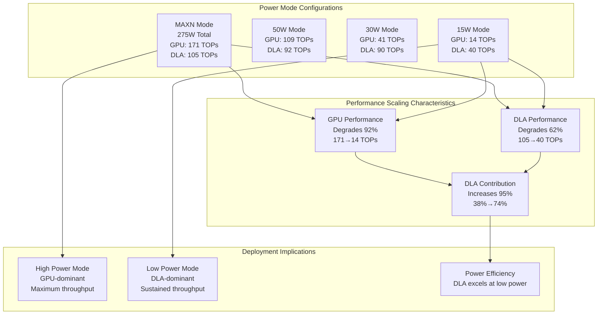
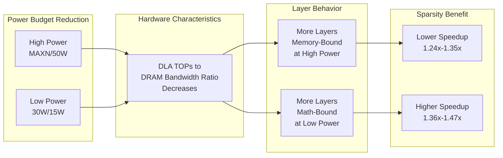
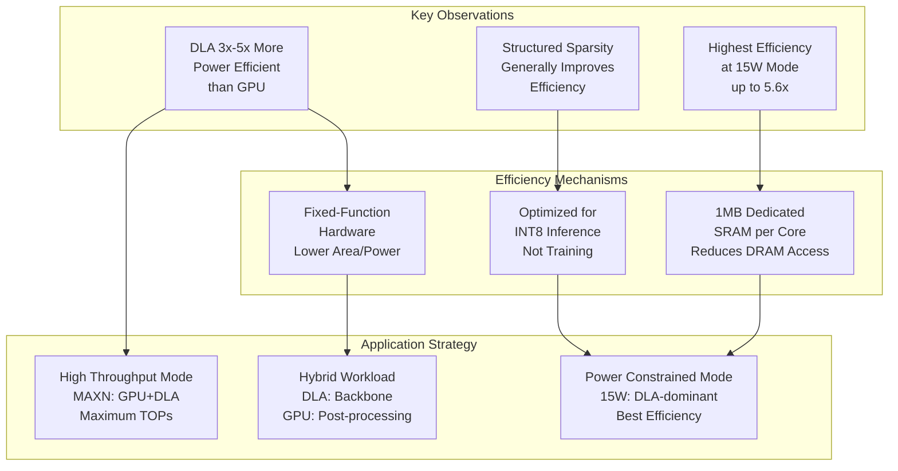
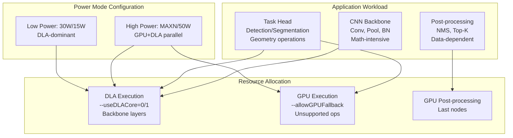

<!-- source: DeepWiki mcp.deepwiki.com · repo NVIDIA/Deep-Learning-Accelerator-SW · page 7.3 Power Modes and Efficiency · fetched 2026-10-26 -->

# Power Modes and Efficiency

<details>
<summary>Relevant source files</summary>

The following files were used as context for generating this wiki page:

- [FAQ/README.md](FAQ/README.md)
- [README.md](README.md)

</details>


This page details the power consumption characteristics and efficiency of DLA across different power modes on Jetson and DRIVE platforms. It explains how DLA's contribution to overall system Deep Learning performance varies with power budget, and how power efficiency compares between DLA and GPU. For information about profiling DLA performance metrics, see [DLA Hardware Utilization Metrics](#7.2). For general performance analysis techniques, see [Performance Analysis and Optimization](#7).

---

## Overview

DLA demonstrates significantly different scaling characteristics compared to GPU as system power budget decreases. While GPU performance degrades dramatically with reduced power, DLA maintains near-peak throughput, resulting in increasing power efficiency at lower power modes. This makes DLA essential for power-constrained deployments where maintaining inference throughput is critical.

Key characteristics:
- DLA contributes 38% to 74% of total Orin DL performance depending on power mode
- DLA is 3x to 5x more power-efficient than GPU for typical workloads
- Power efficiency increases at lower power modes
- Structured sparsity further improves power efficiency

Sources: [README.md:9-22](), [README.md:101-123]()

---

## Power Mode Performance Distribution

The following table shows the distribution of Deep Learning TOPs between GPU and DLA on Jetson AGX Orin 64GB across supported power modes:

| Component | MAXN Mode | 50W Mode | 30W Mode | 15W Mode |
|-----------|-----------|----------|----------|----------|
| **GPU Sparse INT8 Peak** | 171 TOPs | 109 TOPs | 41 TOPs | 14 TOPs |
| **2x DLA Sparse INT8 Peak** | 105 TOPs | 92 TOPs | 90 TOPs | 40 TOPs |
| **Total Peak INT8** | 275 TOPs | 200 TOPs | 131 TOPs | 54 TOPs |
| **DLA Percentage of Total** | **38%** | **46%** | **69%** | **74%** |

### Performance Scaling Diagram



**Key Observation:** DLA maintains 38% of peak performance (40 TOPs at 15W vs 105 TOPs at MAXN) while GPU drops to 8% of peak performance (14 TOPs at 15W vs 171 TOPs at MAXN). This asymmetric scaling makes DLA increasingly critical as power budget decreases.

Sources: [README.md:14-22](), [README.md:66-81]()

---

## Platform Comparisons

Different platforms exhibit comparable DLA performance at specific power modes:

- **DRIVE Orin Automotive**: DLA TOPs at maximum clocks comparable to 30W/50W modes on Jetson AGX Orin 64GB
- **Jetson Orin NX 16GB**: Maximum DLA TOPs comparable to 15W mode on Jetson AGX Orin 64GB

These equivalences allow performance expectations to be extrapolated across platforms based on power mode configurations.

Sources: [README.md:23-25]()

---

## Dense and Sparse Performance

### Dense INT8 Performance

The following table shows 2x DLA throughput (images per second) in dense operation across power modes, measured with JetPack 5.1.1:

| Network | Input Size | Batch | MAXN | 50W | 30W | 15W |
|---------|-----------|-------|------|-----|-----|-----|
| RetinaNet ResNeXt-50 | 800x800 | 1 | 78 | 72 | 71 | 36 |
| ResNet-34 backbone | 1280x768 | 1 | 285 | 260 | 255 | 121 |
| RetinaNet ResNet-34 | 1280x768 | 1 | 108 | 98 | 96 | 45 |
| SSD-ResNet-34 | 1200x1200 | 1 | 83 | 76 | 74 | 36 |
| ResNet-50 | 224x224 | 2 | 2037 | 1948 | 1928 | 1072 |
| SSD-MobileNetV1 | 300x300 | 2 | 2664 | 2506 | 2472 | 1313 |

**Observations:**
- Peak performance in MAXN mode is close to 50W and 30W modes
- Even at 15W, high-resolution models sustain >30 images/second on 2 DLAs combined
- DLA-based pipelines maintain high throughput despite reduced power budget

Sources: [README.md:65-81]()

### Sparse INT8 Performance

With 2:4 structured sparsity enabled via `--sparsity=force` flag:

| Network | Input Size | Batch | MAXN | 50W | 30W | 15W |
|---------|-----------|-------|------|-----|-----|-----|
| RetinaNet ResNeXt-50 | 800x800 | 1 | 102 (1.31x) | 96 (1.34x) | 95 (1.34x) | 51 (1.43x) |
| ResNet-34 backbone | 1280x768 | 1 | 384 (1.35x) | 360 (1.38x) | 354 (1.39x) | 176 (1.45x) |
| RetinaNet ResNet-34 | 1280x768 | 1 | 143 (1.32x) | 133 (1.36x) | 131 (1.37x) | 66 (1.47x) |
| SSD-ResNet-34 | 1200x1200 | 1 | 103 (1.24x) | 97 (1.28x) | 95 (1.28x) | 49 (1.36x) |

**Dense→Sparse Speedup Analysis:**
- Speedup ranges from 1.24x to 1.47x
- Higher speedups observed at lower power modes (15W shows best speedup)
- Speedup increases with reduced power because more layers become math-bound



**Mechanism:** Reducing power budget decreases the ratio of DLA TOPs to DRAM bandwidth (hardware's operations per byte ratio). Lower ops/byte ratio causes more layers to transition from memory-bound to math-bound behavior. Since structured sparsity primarily accelerates math-bound layers, higher speedups are observed at lower power modes.

Sources: [README.md:82-99]()

---

## Power Efficiency Analysis

### Performance Per Watt Comparison

The following table shows DLA's performance per watt ratio relative to GPU (accelerator power only, measured in images per second per watt) on Jetson AGX Orin 64GB with JetPack 5.1.1:

| Network | Input Size | Weight Mode | MAXN | 50W | 30W | 15W |
|---------|-----------|-------------|------|-----|-----|-----|
| RetinaNet ResNeXt-50 | 800x800 | Dense | 3.8x | 3.1x | 2.8x | 4.2x |
| RetinaNet ResNeXt-50 | 800x800 | Sparse | 4.7x | 4.1x | 3.7x | 5.6x |
| ResNet-34 backbone | 1280x768 | Dense | 4.3x | 3.7x | 3.4x | 4.9x |
| ResNet-34 backbone | 1280x768 | Sparse | 3.4x | 3.0x | 2.7x | 4.1x |
| RetinaNet ResNet-34 | 1280x768 | Dense | 4.2x | 3.5x | 3.1x | 4.6x |
| RetinaNet ResNet-34 | 1280x768 | Sparse | 3.5x | 2.9x | 2.6x | 3.9x |
| SSD-ResNet-34 | 1200x1200 | Dense | 3.7x | 3.0x | 2.7x | 4.1x |
| SSD-ResNet-34 | 1200x1200 | Sparse | 3.5x | 3.3x | 2.9x | 4.3x |
| ResNet-50 | 224x224 | Dense | 3.5x | 2.9x | 2.6x | 3.9x |
| SSD-MobileNetV1 | 300x300 | Dense | 4.2x | 3.6x | 3.2x | 5.0x |

### Power Efficiency Characteristics



**Design Rationale:** DLA achieves higher power efficiency through fixed-function hardware design optimized specifically for INT8 inference operations. The 9x INT8 compute increase on Orin DLA (compared to Xavier) came at the expense of reduced FP16 convolution performance, reflecting the architecture's inference-focused optimization.

Sources: [README.md:101-123](), [FAQ/README.md:65-67]()

---

## Clock Frequency Configuration

DLA clock frequency can be scaled to balance performance and power consumption. The configuration method depends on the platform:

### Jetson Platforms

Clock and power profiles can be configured using platform-specific tools. Detailed steps are documented in the [Jetson Power Mode documentation](https://docs.nvidia.com/jetson/archives/r35.1/DeveloperGuide/text/SD/PlatformPowerAndPerformance/JetsonOrinNxSeriesAndJetsonAgxOrinSeries.html#supported-modes-and-power-efficiency).

Key power modes and their DLA clock configurations:
- **MAXN**: Maximum DLA clock frequency for peak performance
- **50W**: Balanced mode maintaining high DLA throughput
- **30W**: Power-optimized mode with minimal DLA clock reduction
- **15W**: Minimum power mode with DLA maintaining 38% of MAXN throughput

### DRIVE Platforms

On DRIVE Orin and Xavier automotive platforms, clock configuration typically occurs at flashing/OS setup time rather than runtime adjustment. This ensures deterministic performance for safety-critical automotive workloads.

Sources: [FAQ/README.md:90-91]()

---

## Deployment Strategies

### Power Mode Selection Matrix

The following table guides power mode selection based on deployment constraints:

| Constraint | Recommended Mode | Rationale |
|------------|------------------|-----------|
| Maximum throughput, power unconstrained | MAXN | Full GPU+DLA capacity (275 TOPs) |
| Balanced performance and power | 50W | Minimal DLA degradation (92 TOPs vs 105 TOPs) |
| Power-constrained mobile | 30W | DLA contributes 69% of total performance |
| Battery-powered edge device | 15W | DLA provides 74% of performance at highest efficiency |
| Sustained high throughput | 30W/50W | DLA maintains near-peak with reduced system power |

### Workload Distribution Strategy



**Best Practices:**
1. Map compute-intensive backbones to DLA (Conv, Pool, BN, Activation)
2. Allow GPU fallback for post-processing (NMS, Top-K)
3. Use native DLA I/O formats to minimize GPU reformat overhead
4. At low power modes, maximize DLA utilization for sustained throughput
5. Enable structured sparsity at 15W mode for maximum efficiency gains

Sources: [README.md:42-44](), [FAQ/README.md:127-129]()

---

## Memory System Impact

### DRAM Bandwidth Considerations

Both DLA and GPU share system DRAM, creating potential bandwidth contention:

**Bandwidth-Bound Workloads:** When running DLA and GPU concurrently, bandwidth-bound workloads may bottleneck both accelerators. This effect is more pronounced at higher power modes where both accelerators have maximum compute capability but compete for the same DRAM bandwidth.

**Mitigation Strategies:**
1. Use native DLA I/O formats (`kDLA_HWC4` for INT8, `kDLA_LINEAR` for FP16) to avoid GPU reformat overhead
2. Increase CUDA concurrent connections: `export CUDA_DEVICE_MAX_CONNECTIONS=32`
3. Profile with Nsight Systems to identify memory bottlenecks
4. Consider workload partitioning to reduce concurrent DRAM access

### SRAM Architecture Differences

| Platform | SRAM Configuration | Implication |
|----------|-------------------|-------------|
| Xavier | 4 MiB shared between 2 DLAs + 2 PVAs | Potential resource contention |
| Orin | 1 MiB dedicated per DLA core | Exclusive access, no contention |

The dedicated SRAM on Orin reduces DRAM access frequency, contributing to improved power efficiency compared to Xavier's shared architecture.

Sources: [FAQ/README.md:51-58](), [FAQ/README.md:96-98]()

---

## Latency and Determinism

### Single Workload Latency

DLA exhibits higher single-workload latency compared to GPU due to lower theoretical TOPs per instance. However, at application level, total latency can be reduced by distributing workloads across DLA and GPU concurrently.

### Deterministic Behavior

DLA inference demonstrates minimal variance from inference to inference when:
- Clock frequencies are locked to specific power mode
- Workload is not bottlenecked by DRAM bandwidth
- No concurrent workloads causing resource contention

This deterministic behavior makes DLA particularly suitable for applications requiring consistent latency guarantees, such as automotive safety systems.

Sources: [FAQ/README.md:100-106](), [FAQ/README.md:114-115]()

---

## Performance Measurement

### Using trtexec for Power Mode Testing

Example command for measuring performance at a specific power mode:

```bash
# First, set the power mode on Jetson
sudo nvpmodel -m <mode_number>

# Then run trtexec with DLA
./trtexec --onnx=model.onnx \
    --int8 \
    --useDLACore=0 \
    --memPoolSize=dlaSRAM:1 \
    --inputIOFormats=int8:dla_hwc4 \
    --outputIOFormats=int8:chw32 \
    --dumpProfile
```

For sparse model testing, add:
```bash
--sparsity=force
```

### Calculating Power Efficiency

Power efficiency (performance per watt) requires measuring:
1. **Throughput**: Images per second from trtexec output
2. **Accelerator Power**: DLA or GPU power consumption in watts
3. **Ratio**: (DLA imgs/sec / DLA watts) / (GPU imgs/sec / GPU watts)

For detailed profiling across the entire SoC, use Nsight Systems. See [Profiling and Debugging Tools](#7.4) for comprehensive profiling workflows.

Sources: [FAQ/README.md:118-122]()

---

## Summary

DLA's power efficiency characteristics make it essential for power-constrained deployments:

| Metric | Key Finding |
|--------|-------------|
| **Power Contribution** | 38% (MAXN) to 74% (15W) of total DL performance |
| **Power Efficiency** | 3x-5x better than GPU, up to 5.6x at 15W with sparsity |
| **Performance Scaling** | Maintains 38% of peak at 15W vs GPU's 8% |
| **Sparse Speedup** | 1.24x-1.47x, higher at lower power modes |
| **Determinism** | Minimal variance with locked clocks |

**Deployment Recommendation:** For power budgets ≤30W, prioritize DLA utilization to maximize inference throughput while minimizing power consumption. At 15W, DLA provides nearly 3x the throughput of GPU while consuming significantly less power.

Sources: [README.md:9-123](), [FAQ/README.md:24-141]()

---

