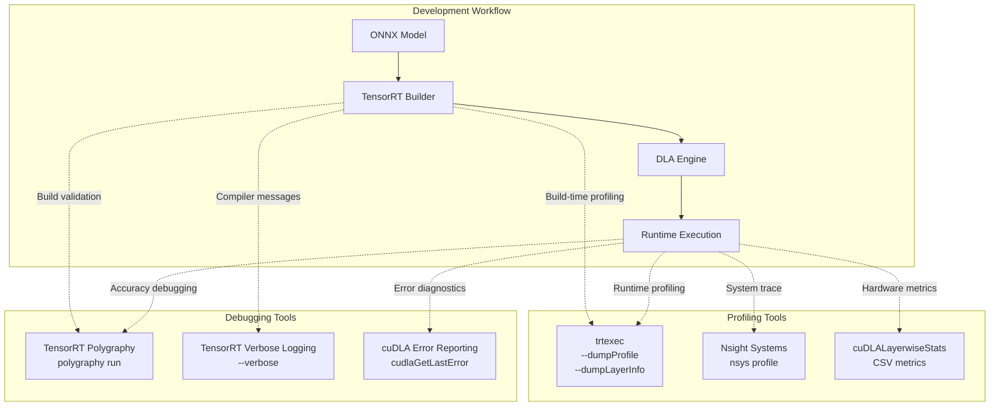
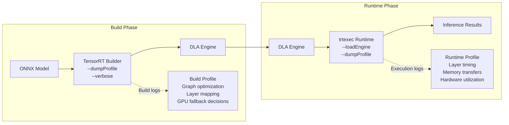
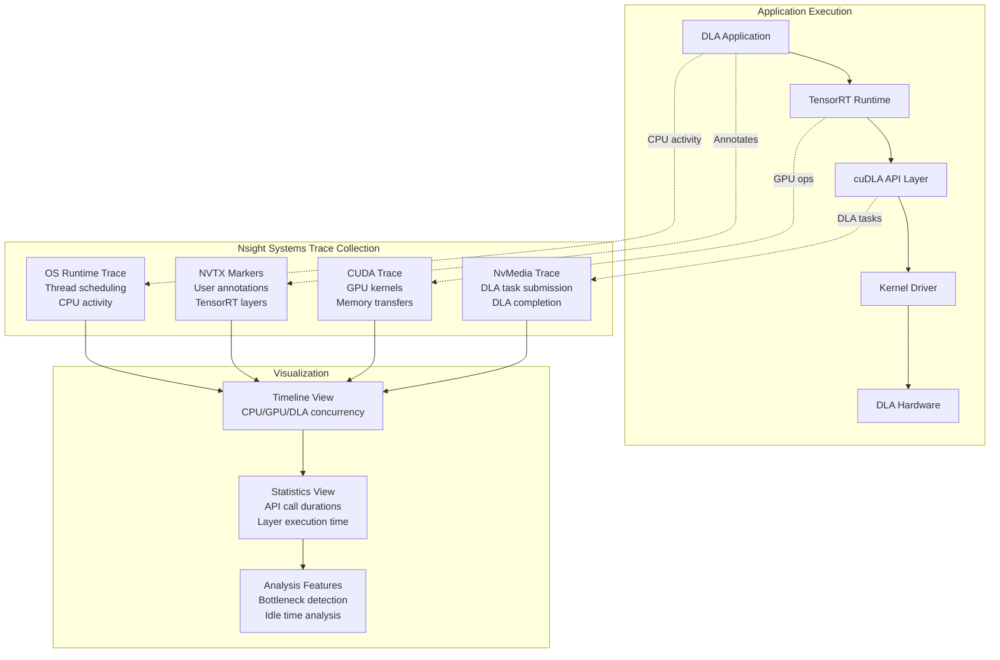
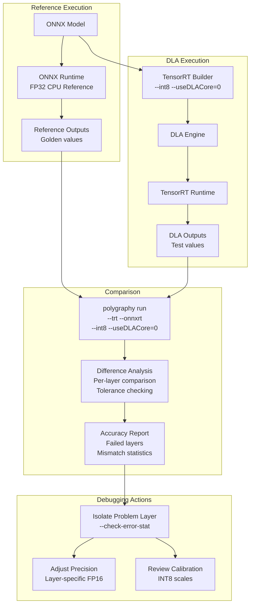
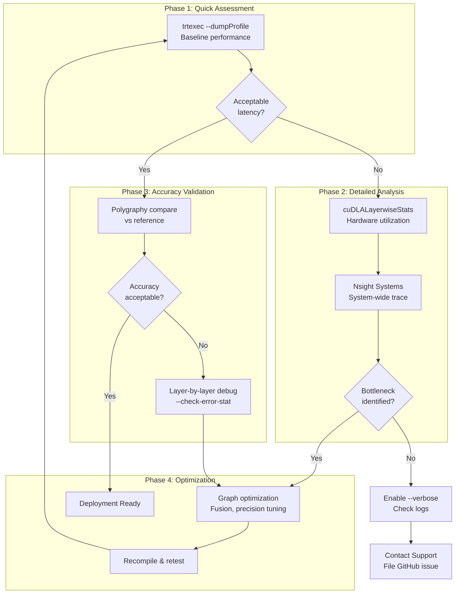

<!-- source: DeepWiki mcp.deepwiki.com · repo NVIDIA/Deep-Learning-Accelerator-SW · page 7.4 Profiling and Debugging Tools · fetched 2026-10-26 -->

# Profiling and Debugging Tools

<details>
<summary>Relevant source files</summary>

The following files were used as context for generating this wiki page:

- [FAQ/README.md](FAQ/README.md)

</details>


This page covers the profiling and debugging tools available for analyzing DLA workload performance, identifying bottlenecks, and troubleshooting accuracy issues. These tools complement the layerwise statistics collection covered in [7.1](#7.1) and provide system-wide visibility into DLA execution.

For detailed interpretation of DLA hardware utilization metrics (CPIPEs, Rubik, BDMA), see [7.2](#7.2). For power efficiency analysis, see [7.3](#7.3).

---

## Overview of Available Tools

The DLA software ecosystem provides three primary categories of profiling and debugging tools:

| Tool | Purpose | Scope | Best For |
|------|---------|-------|----------|
| `trtexec` | Command-line profiling and benchmarking | Single model execution | Quick performance measurements, layer timing |
| Nsight Systems | System-wide profiling and trace visualization | Multi-process, full SoC | Understanding CPU-GPU-DLA interactions, concurrency analysis |
| TensorRT Polygraphy | Accuracy debugging and validation | Layer-by-layer comparison | Identifying numerical accuracy issues, golden reference validation |
| `cuDLALayerwiseStats` | Per-layer hardware metrics | DLA-specific performance | Detailed hardware engine utilization (see [7.1](#7.1)) |



**Diagram: Profiling and Debugging Tools in DLA Development Workflow**

Sources: [FAQ/README.md:117-126]()

---

## trtexec Profiling

The `trtexec` command-line tool provides built-in profiling capabilities for measuring DLA performance and analyzing layer-level execution times.

### Basic Profiling Command Structure

```bash
trtexec \
  --onnx=model.onnx \
  --int8 \
  --useDLACore=0 \
  --dumpProfile \
  --dumpLayerInfo \
  --memPoolSize=dlaSRAM:1 \
  --inputIOFormats=int8:dla_hwc4 \
  --outputIOFormats=int8:chw32
```

### Key Profiling Flags

| Flag | Purpose | Output |
|------|---------|--------|
| `--dumpProfile` | Enable per-layer timing information | Console output with layer execution times |
| `--dumpLayerInfo` | Print detailed layer configuration | Layer type, precision, dimensions, formats |
| `--verbose` | Enable TensorRT verbose logging | Detailed compiler and runtime messages |
| `--exportProfile=profile.json` | Export timing data to JSON | Machine-readable profiling results |
| `--exportLayerInfo=layers.json` | Export layer info to JSON | Complete layer configuration details |
| `--avgRuns=N` | Number of iterations for averaging | More stable timing measurements |
| `--warmUp=N` | Number of warmup iterations | Exclude cold-start overhead |
| `--duration=N` | Run for N seconds | Continuous profiling |

### Profile Output Interpretation

When `--dumpProfile` is enabled, `trtexec` outputs timing information for each layer:

```
Layer Time Insights
Layer Name: conv1, Type: Convolution
    Input 0: float32[1,3,224,224]
    Output 0: float32[1,64,112,112]
    Time: 1.234ms (5.2% of total)
    Precision: INT8
    Device: DLA Core 0
```

**Key Metrics to Examine:**
- **Time (ms)**: Absolute execution time per layer
- **Percentage**: Relative contribution to total inference time
- **Device**: Confirms DLA vs GPU execution
- **Precision**: Verifies INT8/FP16 as expected

### Build vs Runtime Profiling



**Diagram: Build-Time vs Runtime Profiling with trtexec**

Sources: [FAQ/README.md:118-123]()

### Advanced trtexec Profiling Options

**Separating Build and Inference Profiling:**

```bash
# Build phase with profiling
trtexec --onnx=model.onnx --saveEngine=model.engine --int8 --useDLACore=0 --verbose

# Runtime phase with profiling
trtexec --loadEngine=model.engine --dumpProfile --exportProfile=profile.json --avgRuns=100
```

**Profiling with Synthetic Input Data:**

```bash
# Random input generation
trtexec --loadEngine=model.engine --shapes=input:1x3x224x224 --dumpProfile

# Specific input values
trtexec --loadEngine=model.engine --loadInputs=input:input.bin --dumpProfile
```

**Concurrent DLA Core Profiling:**

```bash
# Profile both DLA cores simultaneously (in separate terminals)
trtexec --loadEngine=model0.engine --useDLACore=0 --dumpProfile &
trtexec --loadEngine=model1.engine --useDLACore=1 --dumpProfile &
```

Sources: [FAQ/README.md:118-123]()

---

## Nsight Systems System-Wide Profiling

Nsight Systems provides comprehensive system-level profiling with visibility into CPU, GPU, and DLA execution, including concurrency analysis and memory transfer tracking.

### Basic Nsight Systems Workflow

```bash
# Capture trace with DLA profiling enabled
nsys profile \
  --trace=cuda,nvtx,osrt,nvmedia \
  --sample=cpu \
  --output=dla_trace \
  --force-overwrite=true \
  ./trtexec --loadEngine=model.engine --useDLACore=0
```

### Nsight Systems DLA-Specific Features



**Diagram: Nsight Systems Profiling Architecture for DLA**

### Key Trace Categories for DLA Analysis

| Trace Option | Purpose | Use Case |
|--------------|---------|----------|
| `cuda` | GPU kernel execution and memory transfers | Hybrid GPU-DLA workloads |
| `nvtx` | User-defined markers and TensorRT layer names | Correlating layers with execution |
| `osrt` | CPU thread scheduling and system calls | Understanding host overhead |
| `nvmedia` | DLA task submission and completion events | DLA-specific profiling |

### Interpreting DLA Traces in Nsight Systems

**Timeline Features:**
- **DLA Task Rows**: Separate row per DLA core showing task execution
- **NVTX Ranges**: Color-coded regions showing TensorRT layer boundaries
- **CPU Thread Activity**: Host API calls and synchronization points
- **Memory Transfer Events**: Data movement between CPU/GPU/DLA

**Common Analysis Patterns:**

1. **DLA Idle Time**: Gaps between DLA tasks indicate scheduling inefficiencies
2. **GPU-DLA Overlap**: Simultaneous GPU and DLA execution shows effective concurrency
3. **Memory Transfer Bottlenecks**: Large cudaMemcpy durations indicate bandwidth limits
4. **Host Overhead**: CPU spikes during task submission indicate API overhead

### Advanced Nsight Systems Configuration

```bash
# Extended profiling with all DLA-relevant traces
nsys profile \
  --trace=cuda,nvtx,osrt,nvmedia,cudnn,cublas \
  --cuda-memory-usage=true \
  --sample=cpu \
  --cpuctxsw=process-tree \
  --backtrace=dwarf \
  --output=dla_detailed_trace \
  --export=sqlite \
  ./my_dla_application

# Multi-process profiling (concurrent DLA cores)
nsys profile \
  --trace=cuda,nvtx,nvmedia \
  --show-output=true \
  --trace-fork-before-exec=true \
  --output=multi_dla_trace \
  bash -c './app_dla0 & ./app_dla1 & wait'
```

Sources: [FAQ/README.md:124-125]()

---

## TensorRT Polygraphy Accuracy Debugging

TensorRT Polygraphy is a comprehensive toolkit for debugging model accuracy issues, particularly useful when DLA produces different results than GPU or CPU reference implementations.

### Polygraphy Workflow for DLA Debugging



**Diagram: Polygraphy Accuracy Debugging Workflow**

### Basic Polygraphy Commands

**Compare DLA vs ONNX Runtime:**

```bash
polygraphy run model.onnx \
  --trt --onnxrt \
  --trt-outputs mark all \
  --onnxrt-outputs mark all \
  --int8 \
  --trt-config-script config.py \
  --verbose
```

Where `config.py` contains DLA-specific configuration:

```python
from polygraphy.backend.trt import CreateConfig

def load_config(config):
    config.int8 = True
    config.DLA_core = 0
    config.gpu_fallback = True
```

**Layer-by-Layer Comparison:**

```bash
polygraphy run model.onnx \
  --trt --onnxrt \
  --val-range [0,1] \
  --atol 1e-3 --rtol 1e-3 \
  --check-error-stat median
```

### Polygraphy Inspection Tools

| Command | Purpose | Example |
|---------|---------|---------|
| `polygraphy inspect model` | Examine model structure | `polygraphy inspect model model.onnx` |
| `polygraphy inspect data` | View tensor data | `polygraphy inspect data outputs.json` |
| `polygraphy surgeon extract` | Extract subgraph | `polygraphy surgeon extract model.onnx -o subgraph.onnx --inputs conv1` |
| `polygraphy surgeon sanitize` | Clean/optimize model | `polygraphy surgeon sanitize model.onnx -o clean.onnx` |

### Common DLA Accuracy Issues and Debugging Strategies

**Issue 1: INT8 Quantization Mismatch**

```bash
# Compare per-layer outputs with tolerance
polygraphy run model.onnx \
  --trt --onnxrt \
  --int8 \
  --trt-config-script dla_config.py \
  --atol 1e-2 \
  --check-error-stat max \
  --validate
```

**Issue 2: GPU Fallback Layers**

```bash
# Identify which layers run on GPU vs DLA
polygraphy run model.onnx \
  --trt \
  --int8 \
  --trt-config-script dla_config.py \
  --verbose \
  2>&1 | grep -E "DLA|GPU"
```

**Issue 3: Format Conversion Issues**

```bash
# Test with explicit I/O formats
polygraphy run model.onnx \
  --trt --onnxrt \
  --int8 \
  --trt-outputs mark all \
  --input-shapes input:1,3,224,224 \
  --trt-config-script dla_config.py \
  --save-inputs inputs.json \
  --save-outputs outputs.json
```

Sources: [FAQ/README.md:125-126]()

---

## Verbose Logging and Diagnostics

### TensorRT Verbose Logging

TensorRT provides multiple logging levels for diagnosing compilation and runtime issues:

```bash
# Build-time verbose logging
trtexec --onnx=model.onnx \
  --saveEngine=model.engine \
  --int8 --useDLACore=0 \
  --verbose \
  2>&1 | tee build.log

# Search for specific issues
grep -i "dla" build.log
grep -i "fallback" build.log
grep -i "unsupported" build.log
```

**Key Log Messages:**

| Pattern | Meaning | Action |
|---------|---------|--------|
| `[DLA] Layer X is mapped to DLA` | Layer assigned to DLA | Expected behavior |
| `[DLA] Layer X falls back to GPU` | Layer not DLA-compatible | Check operator support in [4.1](#4.1) |
| `[DLA] CBUF validation failed` | SRAM constraint violation | Reduce batch size or layer channels |
| `[DLA] Precision mismatch` | Inconsistent precision config | Review precision settings |

### cuDLA Error Reporting API

The cuDLA runtime provides error reporting APIs for debugging runtime issues:

```c
// Check for errors after task submission
cudlaStatus status = cudlaSubmitTask(devHandle, taskHandle, 1, NULL, 0);
if (status != cudlaSuccess) {
    const char* errMsg;
    cudlaGetLastError(devHandle, &errMsg);
    fprintf(stderr, "DLA Error: %s\n", errMsg);
}

// Enable verbose error logging
cudlaSetDeviceFlags(devHandle, CUDLA_DEVICE_VERBOSE_ERRORS);
```

Sources: [FAQ/README.md:118-126]()

---

## Debugging Tools Integration

### Combined Profiling Workflow



**Diagram: Integrated Debugging Workflow for DLA Applications**

### Environment Configuration for Debugging

```bash
# Enable maximum verbosity for all tools
export CUDA_DEVICE_MAX_CONNECTIONS=32  # Improve scheduling
export TRT_LOGGER_VERBOSITY=VERBOSE    # TensorRT verbose logging
export CUDLA_VERBOSE=1                 # cuDLA verbose logging

# Run with comprehensive profiling
nsys profile \
  --trace=cuda,nvtx,osrt,nvmedia \
  --output=debug_trace \
  trtexec --loadEngine=model.engine \
         --dumpProfile \
         --dumpLayerInfo \
         --verbose
```

Sources: [FAQ/README.md:56-59](), [FAQ/README.md:117-126]()

---

## Profiling Best Practices

### Performance Measurement Guidelines

1. **Use Sufficient Warmup Iterations**: First inference includes initialization overhead
   ```bash
   trtexec --loadEngine=model.engine --warmUp=10 --avgRuns=100
   ```

2. **Lock Clock Frequencies**: Prevent dynamic frequency scaling during profiling
   ```bash
   sudo jetson_clocks  # On Jetson platforms
   ```

3. **Minimize Background Processes**: Ensure consistent system state
   ```bash
   # Stop unnecessary services before profiling
   systemctl stop display-manager
   ```

4. **Profile at Target Power Mode**: Performance varies significantly across modes (see [7.3](#7.3))

### Accuracy Debugging Guidelines

1. **Start with FP32 ONNX Reference**: Establish golden outputs
2. **Compare TensorRT FP16 on GPU**: Isolate TensorRT-specific issues
3. **Compare TensorRT INT8 on GPU**: Isolate quantization issues
4. **Finally Compare DLA INT8**: Isolate DLA-specific issues
5. **Use Appropriate Tolerances**: INT8 inherently has lower precision than FP32

### Common Pitfalls

| Issue | Symptom | Solution |
|-------|---------|----------|
| Cold-start bias | First run much slower | Use `--warmUp` iterations |
| Clock throttling | Inconsistent timing | Lock clocks with `jetson_clocks` |
| Wrong tolerance | False positives in comparison | Adjust `--atol` and `--rtol` |
| Missing GPU fallback | Build failures | Add `--allowGPUFallback` |
| Format mismatch overhead | Unexpectedly slow | Use native DLA formats (see [5.2](#5.2)) |

Sources: [FAQ/README.md:117-126]()

---

## Summary

The DLA software stack provides comprehensive profiling and debugging tools at multiple abstraction levels:

- **trtexec**: Quick command-line profiling for layer-level timing analysis
- **Nsight Systems**: System-wide visualization of CPU-GPU-DLA concurrency
- **Polygraphy**: Accuracy validation and layer-by-layer comparison
- **cuDLALayerwiseStats**: Hardware-level performance metrics (see [7.1](#7.1))
- **Verbose Logging**: Detailed diagnostics for build and runtime issues

Effective DLA development requires combining these tools in a structured workflow: start with quick profiling using `trtexec`, identify bottlenecks with Nsight Systems, validate accuracy with Polygraphy, and optimize based on hardware metrics from `cuDLALayerwiseStats`.

Sources: [FAQ/README.md:117-126]()

---

