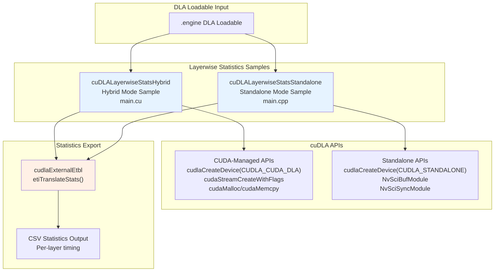
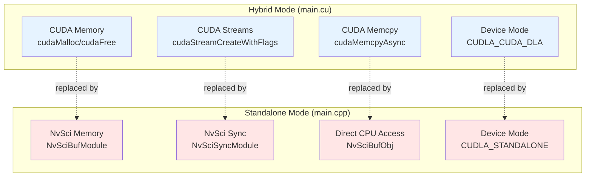
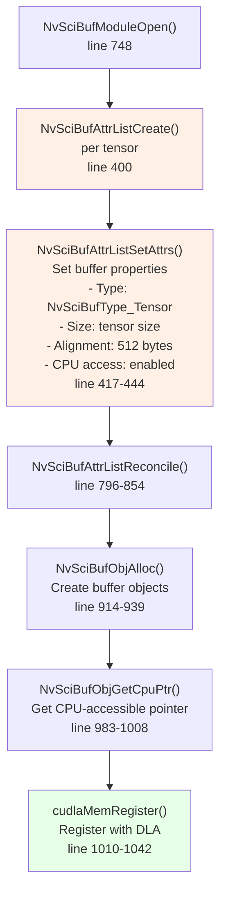
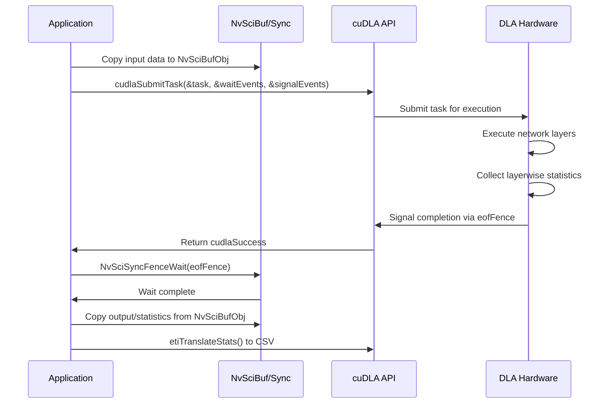
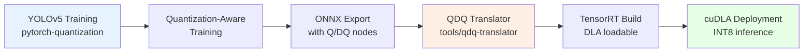
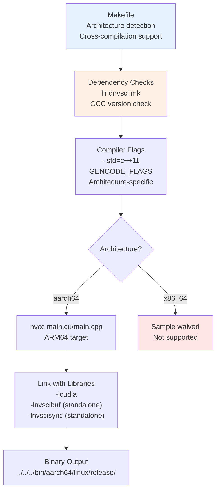

<!-- source: DeepWiki mcp.deepwiki.com · repo NVIDIA/Deep-Learning-Accelerator-SW · page 8 Sample Applications · fetched 2026-10-26 -->

# Sample Applications

<details>
<summary>Relevant source files</summary>

The following files were used as context for generating this wiki page:

- [samples/cuDLA/README.md](samples/cuDLA/README.md)
- [samples/cuDLA/cuDLALayerwiseStatsHybrid/Makefile](samples/cuDLA/cuDLALayerwiseStatsHybrid/Makefile)
- [samples/cuDLA/cuDLALayerwiseStatsHybrid/main.cu](samples/cuDLA/cuDLALayerwiseStatsHybrid/main.cu)
- [samples/cuDLA/cuDLALayerwiseStatsStandalone/Makefile](samples/cuDLA/cuDLALayerwiseStatsStandalone/Makefile)
- [samples/cuDLA/cuDLALayerwiseStatsStandalone/findnvsci.mk](samples/cuDLA/cuDLALayerwiseStatsStandalone/findnvsci.mk)
- [samples/cuDLA/cuDLALayerwiseStatsStandalone/main.cpp](samples/cuDLA/cuDLALayerwiseStatsStandalone/main.cpp)

</details>


This document describes the sample applications provided in the repository that demonstrate how to use the cuDLA APIs to execute DLA loadables and collect performance statistics. These samples serve as reference implementations for developers integrating DLA into their applications.

For information about generating DLA loadables, see [Model Compilation](#5). For details on the cuDLA runtime APIs, see [Runtime and Deployment](#6). For layerwise performance analysis concepts, see [Layerwise Statistics Collection](#7.1).

---

## Sample Overview

The repository provides sample applications demonstrating two primary cuDLA execution modes:

| Sample Category | Description | Location |
|----------------|-------------|----------|
| **Layerwise Statistics Samples** | Collect per-layer performance metrics from DLA execution | This repository |
| **Basic cuDLA Samples** | Demonstrate fundamental cuDLA API usage and error handling | [NVIDIA/cuda-samples](https://github.com/NVIDIA/cuda-samples) |
| **End-to-End Deployment** | Complete workflow from training to deployment | External repository |

The samples in this repository focus on **layerwise statistics collection**, which enables detailed performance profiling of DLA workloads. The basic cuDLA API samples are maintained in the official CUDA samples repository, while an end-to-end YOLOv5 deployment example is provided in a separate repository.

**Sources:** [samples/cuDLA/README.md:1-32]()

---

## cuDLA Layerwise Statistics Samples

The repository provides two samples demonstrating layerwise statistics collection in different execution modes:



**Diagram: Layerwise Statistics Sample Architecture**

Both samples demonstrate:
- Loading DLA loadables from binary files
- Configuring input/output tensors and statistics buffers
- Submitting tasks to DLA for execution
- Extracting layerwise statistics and translating to CSV format

**Sources:** [samples/cuDLA/README.md:22-28](), [samples/cuDLA/cuDLALayerwiseStatsHybrid/main.cu:229-240](), [samples/cuDLA/cuDLALayerwiseStatsStandalone/main.cpp:471-493]()

---

### cuDLALayerwiseStatsHybrid - Hybrid Mode Sample

The hybrid mode sample demonstrates layerwise statistics collection when DLA is managed through CUDA programming constructs.

#### Sample Execution Flow

```mermaid
graph TD
    Start["main()"] --> ReadLoadable["Read DLA Loadable<br/>fopen/fread<br/>line 265-294"]
    
    ReadLoadable --> InitCUDA["Initialize CUDA<br/>cudaFree(0)<br/>cudaSetDevice(0)<br/>line 299-313"]
    
    InitCUDA --> CreateDevice["cudlaCreateDevice()<br/>CUDLA_CUDA_DLA mode<br/>line 315"]
    
    CreateDevice --> LoadModule["cudlaModuleLoadFromMemory()<br/>line 325"]
    
    LoadModule --> CreateStream["cudaStreamCreateWithFlags()<br/>cudaStreamNonBlocking<br/>line 337"]
    
    CreateStream --> GetTensorInfo["Get Tensor Descriptors<br/>CUDLA_NUM_INPUT_TENSORS<br/>CUDLA_NUM_OUTPUT_TENSORS<br/>CUDLA_NUM_OUTPUT_TASK_STATISTICS<br/>line 355-393"]
    
    GetTensorInfo --> AllocateMemory["Allocate GPU Memory<br/>cudaMalloc for inputs<br/>cudaMalloc for outputs<br/>cudaMalloc for statistics<br/>line 526-579"]
    
    AllocateMemory --> RegisterMemory["cudlaMemRegister()<br/>Register all buffers<br/>CUDLA_TASK_STATISTICS flag<br/>line 610-647"]
    
    RegisterMemory --> CopyInputs["cudaMemcpyAsync()<br/>Host to Device<br/>line 652-677"]
    
    CopyInputs --> SubmitTask["cudlaSubmitTask()<br/>numOutputTensors includes stats<br/>line 690-713"]
    
    SubmitTask --> Synchronize["cudaStreamSynchronize()<br/>line 716"]
    
    Synchronize --> CopyResults["cudaMemcpyAsync()<br/>Device to Host<br/>line 724-758"]
    
    CopyResults --> TranslateStats["cudlaGetExternalExportTable()<br/>etiTranslateStats()<br/>CUDLA_GET_CSV_STATS<br/>line 768-827"]
    
    TranslateStats --> WriteCSV["fwrite CSV files<br/>line 809-823"]
    
    WriteCSV --> Cleanup["Cleanup<br/>cudlaMemUnregister<br/>cudlaModuleUnload<br/>cudlaDestroyDevice<br/>line 830-893"]
    
    style CreateDevice fill:#e6f3ff
    style RegisterMemory fill:#fff0e6
    style SubmitTask fill:#e6ffe6
    style TranslateStats fill:#fff0e6
```



**Diagram: cuDLALayerwiseStatsHybrid Execution Flow**

**Sources:** [samples/cuDLA/cuDLALayerwiseStatsHybrid/main.cu:229-898]()

#### Key Data Structures

The `ResourceList` structure manages all resources for the sample:

```cpp
typedef struct {
    cudlaDevHandle devHandle;                          // DLA device handle
    cudlaModule moduleHandle;                          // Loaded DLA module
    cudaStream_t stream;                               // CUDA stream for operations
    uint32_t numInputTensors;                          // Number of input tensors
    uint32_t numOutputTensors;                         // Number of output tensors
    uint32_t numOutputTaskStatistics;                  // Number of statistics buffers
    void** inputBufferGPU;                             // GPU input buffers
    void** outputBufferGPU;                            // GPU output buffers
    void** outputTaskStatisticsGPU;                    // GPU statistics buffers
    uint64_t** inputBufferRegisteredPtr;               // Registered input pointers
    uint64_t** outputBufferRegisteredPtr;              // Registered output pointers
    uint64_t** outputTaskStatisticsRegisteredPtr;      // Registered statistics pointers
    void **csv;                                        // CSV output buffers
    // ... additional fields
} ResourceList;
```

**Sources:** [samples/cuDLA/cuDLALayerwiseStatsHybrid/main.cu:62-84]()

#### Memory Management Pattern

The hybrid mode sample uses CUDA memory management:

1. **Allocate GPU memory** using `cudaMalloc()` for all input, output, and statistics buffers [samples/cuDLA/cuDLALayerwiseStatsHybrid/main.cu:526-579]()
2. **Register with cuDLA** using `cudlaMemRegister()` to enable DLA access, with `CUDLA_TASK_STATISTICS` flag for statistics buffers [samples/cuDLA/cuDLALayerwiseStatsHybrid/main.cu:610-647]()
3. **Transfer data** using `cudaMemcpyAsync()` with CUDA streams [samples/cuDLA/cuDLALayerwiseStatsHybrid/main.cu:652-677]()
4. **Unregister and free** using `cudlaMemUnregister()` and `cudaFree()` during cleanup [samples/cuDLA/cuDLALayerwiseStatsHybrid/main.cu:830-859]()

#### Statistics Collection Process

```mermaid
graph LR
    Task["cudlaTask<br/>numOutputTensors includes<br/>output + statistics"] --> Submit["cudlaSubmitTask()<br/>with stream"]
    
    Submit --> Execute["DLA Hardware Execution<br/>Populates statistics buffers"]
    
    Execute --> GetTable["cudlaGetExternalExportTable()<br/>etbl pointer"]
    
    GetTable --> GetLength["etiTranslateStats()<br/>CUDLA_GET_CSV_LENGTH<br/>csvStreamLength"]
    
    GetLength --> AllocCSV["malloc(csvStreamLength)"]
    
    AllocCSV --> GetStats["etiTranslateStats()<br/>CUDLA_GET_CSV_STATS<br/>csvStreamStats"]
    
    GetStats --> WriteFile["fwrite to .csv file"]
    
    style Task fill:#e6ffe6
    style GetTable fill:#fff0e6
    style GetStats fill:#fff0e6
```



**Diagram: Statistics Translation Flow**

The sample uses the external export table (`cudlaExternalEtbl`) to translate binary statistics data into CSV format:

- First call: `CUDLA_GET_CSV_LENGTH` retrieves required buffer size
- Second call: `CUDLA_GET_CSV_STATS` populates buffer with CSV data
- Frequency parameter (`dlaFreqInMHz`) converts hardware cycles to time

**Sources:** [samples/cuDLA/cuDLALayerwiseStatsHybrid/main.cu:768-827]()

#### Command-Line Usage

```bash
./cuDLALayerwiseStatsHybrid <loadable> <freqMHz> <statSupport> [filenamePrefix]
```

| Parameter | Description |
|-----------|-------------|
| `<loadable>` | Path to DLA loadable `.engine` file |
| `<freqMHz>` | DLA frequency in MHz for timing calculations |
| `<statSupport>` | Enable statistics collection: 1=enabled, 0=disabled |
| `[filenamePrefix]` | Optional prefix for CSV output files (max 190 chars) |

**Sources:** [samples/cuDLA/cuDLALayerwiseStatsHybrid/main.cu:251-262]()

---

### cuDLALayerwiseStatsStandalone - Standalone Mode Sample

The standalone mode sample demonstrates layerwise statistics collection when DLA is programmed independently without CUDA.

#### Standalone vs Hybrid Mode Differences



**Diagram: Hybrid vs Standalone Mode Comparison**

**Sources:** [samples/cuDLA/cuDLALayerwiseStatsStandalone/main.cpp:536](), [samples/cuDLA/cuDLALayerwiseStatsHybrid/main.cu:315]()

#### NvSciBuf Memory Management

The standalone sample uses NvSciBuf for buffer management:



**Diagram: NvSciBuf Memory Setup Flow**

**Sources:** [samples/cuDLA/cuDLALayerwiseStatsStandalone/main.cpp:389-453](), [samples/cuDLA/cuDLALayerwiseStatsStandalone/main.cpp:748-939](), [samples/cuDLA/cuDLALayerwiseStatsStandalone/main.cpp:983-1042]()

#### NvSciSync Synchronization

The standalone sample uses NvSciSync for synchronization between CPU and DLA:

| NvSciSync Component | Purpose |
|---------------------|---------|
| `NvSciSyncModule` | Module handle for sync operations |
| `NvSciSyncAttrList` (waiter) | CPU waiter attributes - `NvSciSyncAccessPerm_WaitOnly` |
| `NvSciSyncAttrList` (signaler) | DLA signaler attributes from `cudlaGetNvSciSyncAttributes()` |
| `NvSciSyncObj` | Reconciled synchronization object |
| `NvSciSyncFence` | Fence for waiting on task completion |
| `NvSciSyncCpuWaitContext` | CPU wait context for fence operations |

**Sources:** [samples/cuDLA/cuDLALayerwiseStatsStandalone/main.cpp:455-469](), [samples/cuDLA/cuDLALayerwiseStatsStandalone/main.cpp:1044-1114]()

#### Task Submission Flow



**Diagram: Standalone Mode Task Execution Sequence**

**Sources:** [samples/cuDLA/cuDLALayerwiseStatsStandalone/main.cpp:1164-1198]()

#### createAndSetAttrList Helper Function

The `createAndSetAttrList()` helper function encapsulates NvSciBuf attribute configuration:

```cpp
cudlaStatus createAndSetAttrList(NvSciBufModule module,
                                 uint64_t bufSize,
                                 NvSciBufAttrList *attrList) {
    // Creates attribute list with:
    // - Type: NvSciBufType_Tensor
    // - DataType: NvSciDataType_Int8
    // - Dimensions: 1D with size=bufSize
    // - Alignment: 512 bytes
    // - CPU access: enabled
    // - Permissions: ReadWrite
}
```

**Sources:** [samples/cuDLA/cuDLALayerwiseStatsStandalone/main.cpp:389-453]()

---

## External cuDLA Samples

The following samples are maintained in external repositories and demonstrate fundamental cuDLA API usage:

### NVIDIA/cuda-samples Repository

| Sample | Description | Location |
|--------|-------------|----------|
| **cuDLAErrorReporting** | Demonstrates DLA error detection through CUDA | [cuda-samples/Samples/4_CUDA_Libraries/cuDLAErrorReporting](https://github.com/NVIDIA/cuda-samples/tree/master/Samples/4_CUDA_Libraries/cuDLAErrorReporting) |
| **cuDLAHybridMode** | Basic hybrid mode example with CUDA stream integration | [cuda-samples/Samples/4_CUDA_Libraries/cuDLAHybridMode](https://github.com/NVIDIA/cuda-samples/tree/master/Samples/4_CUDA_Libraries/cuDLAHybridMode) |
| **cuDLAStandaloneMode** | Basic standalone mode example with NvSciBuf/NvSciSync | [cuda-samples/Samples/4_CUDA_Libraries/cuDLAStandaloneMode](https://github.com/NVIDIA/cuda-samples/tree/master/Samples/4_CUDA_Libraries/cuDLAStandaloneMode) |

These samples provide minimal implementations focusing on:
- Device creation and module loading
- Memory registration and buffer management
- Task submission and synchronization
- Error handling patterns

**Sources:** [samples/cuDLA/README.md:9-20]()

### YOLOv5 cuDLA Sample

The YOLOv5 cuDLA sample demonstrates an end-to-end workflow from training to deployment:



**Diagram: YOLOv5 cuDLA Deployment Workflow**

Repository: [NVIDIA-AI-IOT/cuDLA-samples](https://github.com/NVIDIA-AI-IOT/cuDLA-samples)

The sample demonstrates:
- Training YOLOv5s with NVIDIA's pytorch-quantization toolkit
- Converting QAT models using QDQ Translator (see [QDQ Translator for Quantized Models](#3.2))
- Deploying INT8 models on DLA using cuDLA APIs

**Sources:** [samples/cuDLA/README.md:30-32]()

---

## Building cuDLA Samples

### Build System Overview



**Diagram: Sample Build Flow**

**Sources:** [samples/cuDLA/cuDLALayerwiseStatsHybrid/Makefile:1-394](), [samples/cuDLA/cuDLALayerwiseStatsStandalone/Makefile:1-397]()

### Building Layerwise Statistics Samples

#### Prerequisites

| Requirement | Hybrid Mode | Standalone Mode |
|-------------|-------------|-----------------|
| **Architecture** | aarch64 only | aarch64 only |
| **GCC Version** | ≥ 4.7.0 | ≥ 4.7.0 |
| **CUDA Toolkit** | Required | Required (for nvcc) |
| **cuDLA Library** | libcudla | libcudla |
| **NvSciBuf** | Not required | Required |
| **NvSciSync** | Not required | Required |

**Sources:** [samples/cuDLA/cuDLALayerwiseStatsHybrid/Makefile:269-293](), [samples/cuDLA/cuDLALayerwiseStatsStandalone/Makefile:269-293](), [samples/cuDLA/cuDLALayerwiseStatsStandalone/Makefile:306-332]()

#### Build Commands

**Hybrid Mode:**
```bash
cd samples/cuDLA/cuDLALayerwiseStatsHybrid
make
```

Output: `../../../bin/aarch64/linux/release/cuDLALayerwiseStatsHybrid`

**Standalone Mode:**
```bash
cd samples/cuDLA/cuDLALayerwiseStatsStandalone
make
```

Output: `../../../bin/aarch64/linux/release/cuDLALayerwiseStatsStandalone`

**Sources:** [samples/cuDLA/cuDLALayerwiseStatsHybrid/Makefile:365-385](), [samples/cuDLA/cuDLALayerwiseStatsStandalone/Makefile:368-388]()

#### Cross-Compilation

For cross-compilation from x86_64 host to aarch64 target:

```bash
# Set cross-compiler
export HOST_COMPILER=aarch64-linux-gnu-g++

# Set target filesystem (optional)
export TARGET_FS=/path/to/target/rootfs

# Build
make TARGET_ARCH=aarch64
```

The Makefile automatically:
- Adds `--sysroot=$(TARGET_FS)` flags
- Configures rpath-link for target libraries
- Sets appropriate include paths

**Sources:** [samples/cuDLA/cuDLALayerwiseStatsHybrid/Makefile:192-207](), [samples/cuDLA/cuDLALayerwiseStatsStandalone/Makefile:192-207]()

#### NvSci Library Detection

The standalone mode sample uses `findnvsci.mk` to locate NvSciBuf and NvSciSync libraries:

```makefile
include ./findnvsci.mk

LIBRARIES += -lcudla -lnvscibuf -lnvscisync
```

The script searches common library paths and waives the sample if libraries are not found.

**Sources:** [samples/cuDLA/cuDLALayerwiseStatsStandalone/Makefile:306-307](), [samples/cuDLA/cuDLALayerwiseStatsStandalone/findnvsci.mk:111-142]()

---

## Running cuDLA Samples

### Execution Requirements

| Requirement | Description |
|-------------|-------------|
| **Platform** | Jetson AGX Orin or Xavier (aarch64) |
| **DLA Loadable** | Pre-compiled `.engine` file with DLA core selected |
| **DLA Frequency** | System DLA clock frequency in MHz |
| **Permissions** | Access to `/dev/nvhost-nvdla*` devices |

### Layerwise Statistics Sample Execution

#### Hybrid Mode Example

```bash
# Run with statistics enabled, output to console
./cuDLALayerwiseStatsHybrid model.engine 1408 1

# Run with statistics saved to files
./cuDLALayerwiseStatsHybrid model.engine 1408 1 output_prefix
# Creates: output_prefix1.csv, output_prefix2.csv, ...
```

#### Standalone Mode Example

```bash
# Run with statistics enabled, output to console
./cuDLALayerwiseStatsStandalone model.engine 1408 1

# Run with statistics saved to files
./cuDLALayerwiseStatsStandalone model.engine 1408 1 stats_
# Creates: stats_1.csv, stats_2.csv, ...
```

### Sample Output Format

The samples generate console output during execution:

```
The file size = 1234567
Device created successfully
Successfully loaded module
numInputTensors = 1
numOutputTensors = 1
numOutputTaskStatistics = 2
Printing input tensor descriptor
	TENSOR NAME : input
	size: 602112
	dims: [1, 3, 224, 224]
	...
ALL MEMORY REGISTERED SUCCESSFULLY
SUBMIT IS DONE !!!
```

If statistics are enabled and a filename prefix is provided, CSV files are generated with layerwise performance data. The CSV format is described in [DLA Hardware Utilization Metrics](#7.2).

**Sources:** [samples/cuDLA/cuDLALayerwiseStatsHybrid/main.cu:42-60](), [samples/cuDLA/cuDLALayerwiseStatsStandalone/main.cpp:44-66]()

---

## Sample Code Organization

### Common Patterns Across Samples

Both layerwise statistics samples follow a consistent structure:

| Phase | Hybrid Implementation | Standalone Implementation |
|-------|----------------------|--------------------------|
| **Initialization** | CUDA device + `cudlaCreateDevice(CUDLA_CUDA_DLA)` | `cudlaCreateDevice(CUDLA_STANDALONE)` only |
| **Module Loading** | `cudlaModuleLoadFromMemory()` | `cudlaModuleLoadFromMemory()` |
| **Tensor Querying** | `cudlaModuleGetAttributes()` | `cudlaModuleGetAttributes()` |
| **Memory Allocation** | `cudaMalloc()` | `NvSciBufObjAlloc()` |
| **Memory Registration** | `cudlaMemRegister()` | `cudlaMemRegister()` |
| **Data Transfer** | `cudaMemcpyAsync()` | Direct CPU access via `NvSciBufObjGetCpuPtr()` |
| **Task Submission** | `cudlaSubmitTask()` with stream | `cudlaSubmitTask()` with NvSciSync events |
| **Synchronization** | `cudaStreamSynchronize()` | `NvSciSyncFenceWait()` |
| **Statistics Translation** | `etiTranslateStats()` | `etiTranslateStats()` |
| **Cleanup** | `cudlaMemUnregister()` + `cudaFree()` | `cudlaMemUnregister()` + `NvSciBufObjFree()` |

### ResourceList Cleanup Pattern

Both samples implement a `cleanUp()` function that systematically frees all allocated resources in reverse order of allocation:

```cpp
void cleanUp(ResourceList* resourceList) {
    // Free tensor descriptors
    // Free loadable data
    // Unload module
    // Destroy device
    // Free buffer objects
    // Free attribute lists
    // Close modules
    // Reset counters
}
```

This pattern ensures proper resource cleanup even in error paths.

**Sources:** [samples/cuDLA/cuDLALayerwiseStatsHybrid/main.cu:86-227](), [samples/cuDLA/cuDLALayerwiseStatsStandalone/main.cpp:110-387]()

### Error Handling Pattern

Both samples use a consistent error handling pattern:

```cpp
err = cudla_function(...);
if (err != cudlaSuccess) {
    DPRINTF("Error in operation = %d\n", err);
    cleanUp(&resourceList);
    return 1;
}
```

For CUDA operations in hybrid mode:

```cpp
result = cuda_function(...);
if (result != cudaSuccess) {
    errPtr = cudaGetErrorName(result);
    DPRINTF("Error = %s\n", errPtr);
    cleanUp(&resourceList);
    return 1;
}
```

This ensures that all resources are properly freed on any error condition.

**Sources:** [samples/cuDLA/cuDLALayerwiseStatsHybrid/main.cu:299-320](), [samples/cuDLA/cuDLALayerwiseStatsStandalone/main.cpp:536-550]()

---

**Sources:** [samples/cuDLA/README.md:1-32](), [samples/cuDLA/cuDLALayerwiseStatsHybrid/main.cu:1-899](), [samples/cuDLA/cuDLALayerwiseStatsStandalone/main.cpp:1-1369](), [samples/cuDLA/cuDLALayerwiseStatsHybrid/Makefile:1-394](), [samples/cuDLA/cuDLALayerwiseStatsStandalone/Makefile:1-397]()

---

