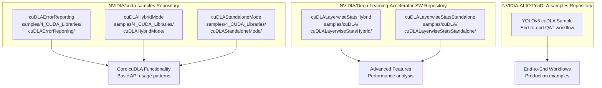
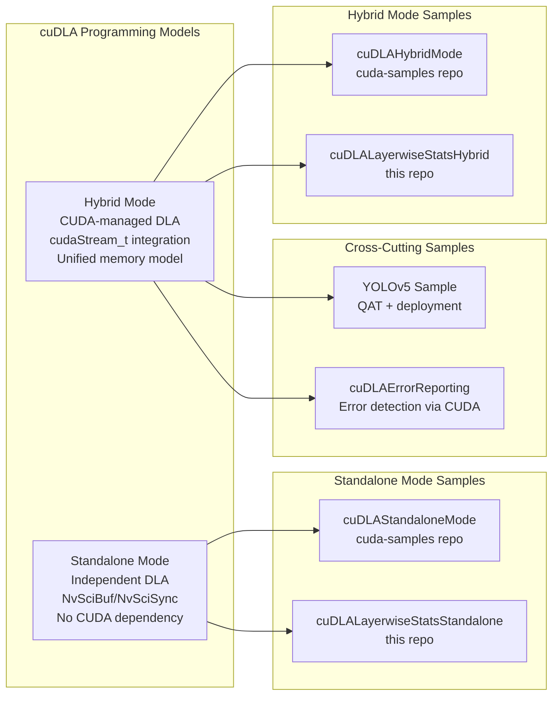
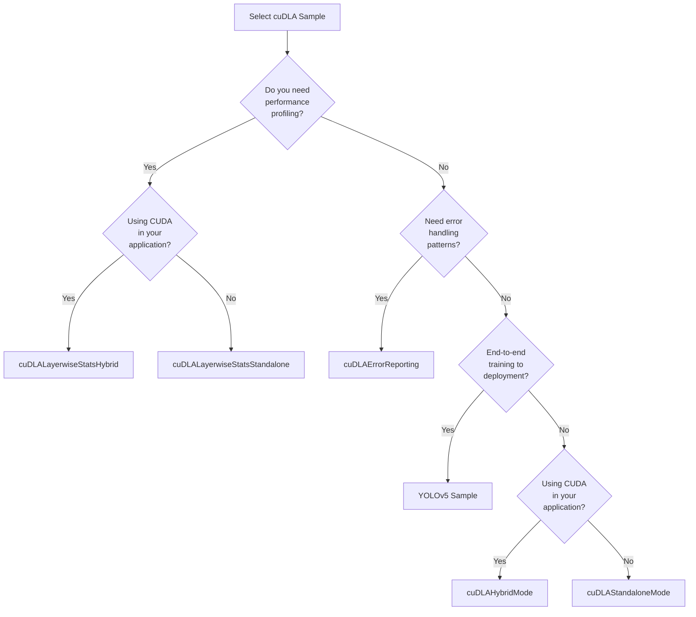

<!-- source: DeepWiki mcp.deepwiki.com · repo NVIDIA/Deep-Learning-Accelerator-SW · page 8.1 cuDLA Sample Overview · fetched 2026-10-26 -->

# cuDLA Sample Overview

Relevant source files

The following files were used as context for generating this wiki page:

- [samples/cuDLA/README.md](samples/cuDLA/README.md)

This document provides an overview of the cuDLA sample applications available for demonstrating DLA (Deep Learning Accelerator) programming using the cuDLA API. These samples illustrate different runtime modes, error handling mechanisms, and performance analysis capabilities.

For instructions on building and running these samples, see [Building and Running Samples](#8.2). For an in-depth example of end-to-end model deployment, see [YOLOv5 cuDLA Sample](#8.3). For general runtime API concepts, see [Runtime API Overview](#6.1).

**Sources:** [samples/cuDLA/README.md:1-32]()

## Sample Organization and Repository Structure

The cuDLA samples are distributed across multiple repositories to separate reference implementations from the core CUDA sample collection:

**Sources:** [samples/cuDLA/README.md:9-32]()

## Sample Categories by Runtime Mode

cuDLA supports two distinct programming models: **Hybrid Mode** (CUDA-managed DLA execution) and **Standalone Mode** (independent DLA programming). The samples are organized to demonstrate both approaches:

**Sources:** [samples/cuDLA/README.md:16-28]()

## Complete Sample Matrix

The following table summarizes all available cuDLA samples, their locations, and primary purposes:

| Sample Name | Repository | Runtime Mode | Primary Purpose | Key APIs Demonstrated |
|------------|------------|--------------|-----------------|----------------------|
| `cuDLAErrorReporting` | cuda-samples | Hybrid | Error detection and handling | Error propagation to CUDA |
| `cuDLAHybridMode` | cuda-samples | Hybrid | Basic CUDA-managed DLA execution | `cudlaModuleLoadFromMemory`, `cudlaModuleGetFunction`, CUDA streams |
| `cuDLAStandaloneMode` | cuda-samples | Standalone | Independent DLA programming | `cudlaCreateDevice`, `cudlaSubmitTask`, NvSciBuf/NvSciSync |
| `cuDLALayerwiseStatsHybrid` | DLA SW | Hybrid | Per-layer performance profiling | `cudlaModuleEnableLayerwiseStats`, `cudlaModuleDumpLayerwiseStats` |
| `cuDLALayerwiseStatsStandalone` | DLA SW | Standalone | Per-layer performance profiling | `cudlaDeviceEnableLayerwiseStats`, `cudlaDeviceDumpLayerwiseStats` |
| `YOLOv5` | cuDLA-samples | Hybrid | End-to-end QAT deployment | Full workflow from training to inference |

**Sources:** [samples/cuDLA/README.md:13-31]()

## Samples in NVIDIA/cuda-samples Repository

The core cuDLA samples reside in the official CUDA samples repository under `Samples/4_CUDA_Libraries/`. These samples demonstrate fundamental cuDLA API usage patterns:

### cuDLAErrorReporting

**Location:** `github.com/NVIDIA/cuda-samples/tree/master/Samples/4_CUDA_Libraries/cuDLAErrorReporting`

Demonstrates error detection and propagation from DLA hardware to CUDA runtime. This sample shows how DLA execution errors surface through standard CUDA error checking mechanisms, enabling unified error handling in hybrid applications.

**Key Concepts:**
- DLA error detection via CUDA API
- Error synchronization between DLA and CUDA contexts
- Graceful error recovery patterns

**Sources:** [samples/cuDLA/README.md:13-14]()

### cuDLAHybridMode

**Location:** `github.com/NVIDIA/cuda-samples/tree/master/Samples/4_CUDA_Libraries/cuDLAHybridMode`

Demonstrates the cuDLA hybrid mode memory model where DLA tasks are managed through CUDA streams. This is the recommended mode for applications already using CUDA, as it provides seamless integration with existing CUDA workflows.

**Key Features:**
- Loading DLA loadables via `cudlaModuleLoadFromMemory`
- Submitting tasks to CUDA streams
- Synchronization using standard CUDA stream primitives
- Unified virtual addressing for memory management

**Sources:** [samples/cuDLA/README.md:16-17]()

### cuDLAStandaloneMode

**Location:** `github.com/NVIDIA/cuda-samples/tree/master/Samples/4_CUDA_Libraries/cuDLAStandaloneMode`

Demonstrates the cuDLA standalone mode where DLA operates independently without CUDA involvement. This mode is suitable for applications that want to minimize dependencies or integrate DLA with non-CUDA code paths.

**Key Features:**
- Direct DLA device creation via `cudlaCreateDevice`
- Task submission using `cudlaSubmitTask`
- NvSciBuf for buffer management
- NvSciSync for synchronization primitives
- Zero CUDA runtime dependency

**Sources:** [samples/cuDLA/README.md:19-20]()

## Samples in This Repository

The DLA SW repository includes advanced samples that focus on performance analysis and optimization:

### cuDLALayerwiseStatsHybrid

**Location:** `samples/cuDLA/cuDLALayerwiseStatsHybrid/`

Provides layerwise performance statistics for DLA execution in hybrid mode. This sample collects per-layer metrics including execution duration, hardware engine utilization, and memory bandwidth consumption.

**Functionality:**
- Enables layerwise statistics collection via `cudlaModuleEnableLayerwiseStats`
- Executes DLA loadable on specified DLA core
- Dumps statistics to CSV format via `cudlaModuleDumpLayerwiseStats`
- Integrates with CUDA stream-based workflows

**Output Metrics:**
- Per-layer execution time
- Hardware engine usage (CPIPEs, Rubik, BDMA)
- SRAM memory utilization
- Precision information (INT8/FP16)

For detailed analysis of these metrics, see [Layerwise Statistics Collection](#7.1) and [DLA Hardware Utilization Metrics](#7.2).

**Sources:** [samples/cuDLA/README.md:24-25]()

### cuDLALayerwiseStatsStandalone

**Location:** `samples/cuDLA/cuDLALayerwiseStatsStandalone/`

Provides the same layerwise performance analysis capabilities as the hybrid version, but operates in standalone mode without CUDA dependencies.

**Functionality:**
- Enables statistics via `cudlaDeviceEnableLayerwiseStats`
- Executes tasks using standalone mode APIs
- Dumps statistics via `cudlaDeviceDumpLayerwiseStats`
- Works with NvSciBuf memory management

**Use Cases:**
- Profiling non-CUDA integrated systems
- Automotive applications using NvMedia pipelines
- Analyzing DLA-only execution paths

**Sources:** [samples/cuDLA/README.md:27-28]()

## cuDLA Sample API Mapping

The following diagram maps sample applications to the specific cuDLA APIs they demonstrate:

```mermaid
graph TB
    subgraph "Module Management APIs"
        ModuleLoad["cudlaModuleLoadFromMemory()<br/>Load DLA loadable into memory"]
        ModuleGetFunc["cudlaModuleGetFunction()<br/>Retrieve executable function"]
        ModuleUnload["cudlaModuleUnload()<br/>Release module resources"]
    end
    
    subgraph "Device Management APIs"
        DeviceCreate["cudlaCreateDevice()<br/>Initialize DLA device"]
        DeviceDestroy["cudlaDeviceDestroy()<br/>Release device resources"]
    end
    
    subgraph "Execution APIs"
        LaunchKernel["cudlaLaunchDevice()<br/>Execute on CUDA stream"]
        SubmitTask["cudlaSubmitTask()<br/>Submit standalone task"]
    end
    
    subgraph "Statistics APIs"
        ModuleEnableStats["cudlaModuleEnableLayerwiseStats()<br/>Enable profiling (hybrid)"]
        ModuleDumpStats["cudlaModuleDumpLayerwiseStats()<br/>Export CSV (hybrid)"]
        DeviceEnableStats["cudlaDeviceEnableLayerwiseStats()<br/>Enable profiling (standalone)"]
        DeviceDumpStats["cudlaDeviceDumpLayerwiseStats()<br/>Export CSV (standalone)"]
    end
    
    HybridSample["cuDLAHybridMode"]
    StandaloneSample["cuDLAStandaloneMode"]
    LayerwiseHybrid["cuDLALayerwiseStatsHybrid"]
    LayerwiseStandalone["cuDLALayerwiseStatsStandalone"]
    ErrorSample["cuDLAErrorReporting"]
    
    HybridSample --> ModuleLoad
    HybridSample --> ModuleGetFunc
    HybridSample --> LaunchKernel
    HybridSample --> ModuleUnload
    
    StandaloneSample --> DeviceCreate
    StandaloneSample --> SubmitTask
    StandaloneSample --> DeviceDestroy
    
    LayerwiseHybrid --> ModuleEnableStats
    LayerwiseHybrid --> LaunchKernel
    LayerwiseHybrid --> ModuleDumpStats
    
    LayerwiseStandalone --> DeviceEnableStats
    LayerwiseStandalone --> SubmitTask
    LayerwiseStandalone --> DeviceDumpStats
    
    ErrorSample --> ModuleLoad
    ErrorSample --> LaunchKernel
```

**Sources:** [samples/cuDLA/README.md:13-28]()

## YOLOv5 cuDLA Sample (External Repository)

**Location:** `github.com/NVIDIA-AI-IOT/cuDLA-samples`

The YOLOv5 sample demonstrates a complete end-to-end workflow from model training to DLA deployment:

**Workflow Stages:**
1. **Quantization-Aware Training** using NVIDIA's pytorch-quantization toolkit
2. **ONNX Export** with Q/DQ nodes
3. **QDQ Translation** to extract calibration scales (see [QDQ Translator](#3.2))
4. **TensorRT Compilation** to generate DLA loadable
5. **cuDLA Deployment** using hybrid mode APIs

**Key Technologies:**
- `pytorch-quantization` for QAT workflow
- QDQ Translator for scale extraction
- cuDLA hybrid mode for inference execution

This sample is particularly valuable for understanding how to deploy custom models with explicit quantization to DLA. For detailed information, see [YOLOv5 cuDLA Sample](#8.3).

**Sources:** [samples/cuDLA/README.md:30-31]()

## Sample Selection Guide

Use this decision tree to select the appropriate sample for your use case:

**Sources:** [samples/cuDLA/README.md:1-32]()

## Next Steps

- To build and run these samples, proceed to [Building and Running Samples](#8.2)
- For detailed performance analysis using layerwise statistics, see [Layerwise Statistics Collection](#7.1)
- To understand the runtime modes in depth, see [cuDLA Hybrid Mode](#6.2) and [cuDLA Standalone Mode](#6.3)
- For a complete deployment example, see [YOLOv5 cuDLA Sample](#8.3)

---

