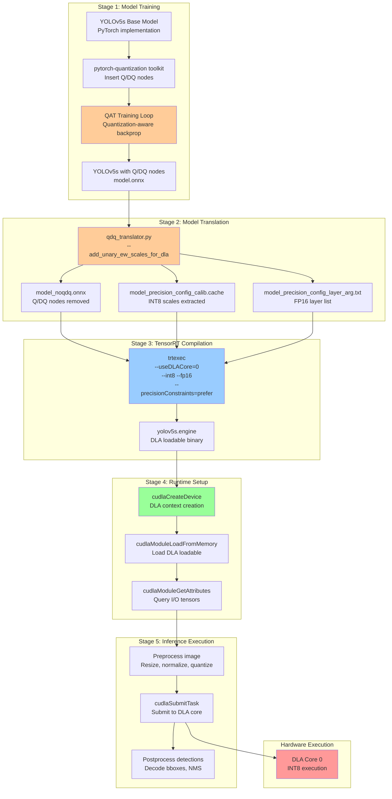
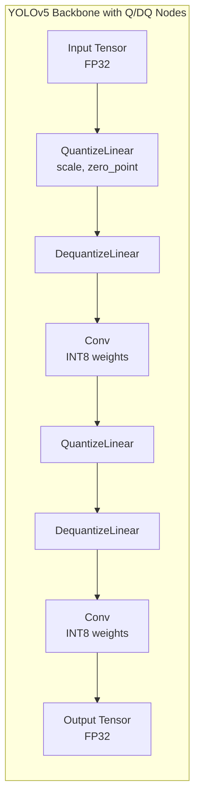
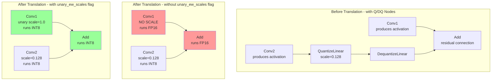
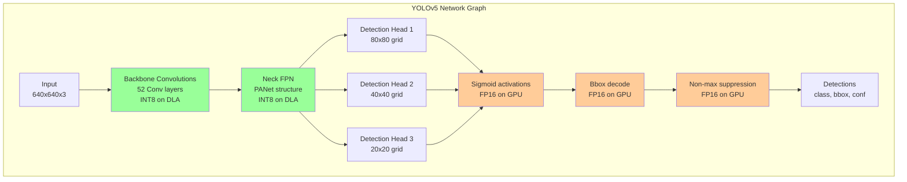
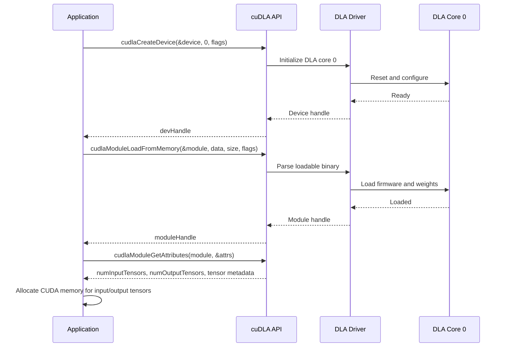
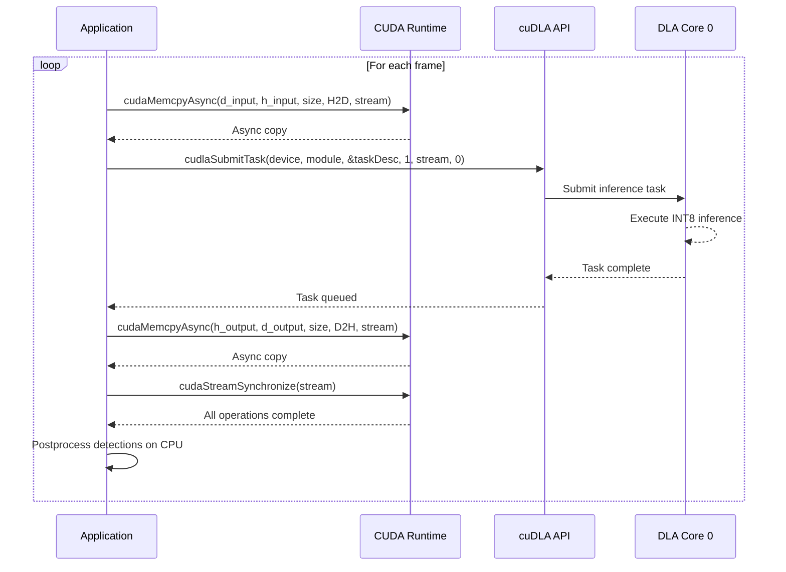
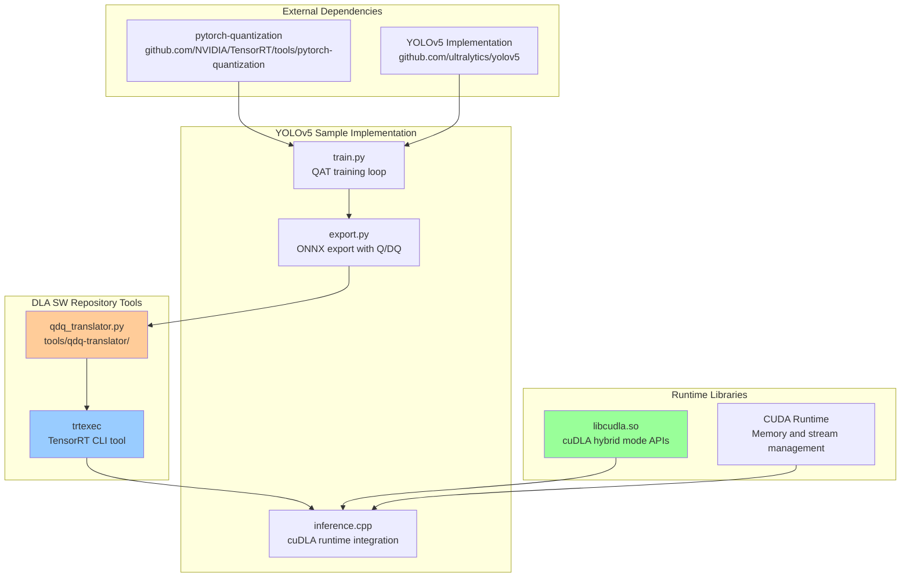

<!-- source: DeepWiki mcp.deepwiki.com · repo NVIDIA/Deep-Learning-Accelerator-SW · page 8.3 YOLOv5 cuDLA Sample · fetched 2026-10-26 -->

# YOLOv5 cuDLA Sample

<details>
<summary>Relevant source files</summary>

The following files were used as context for generating this wiki page:

- [samples/cuDLA/README.md](samples/cuDLA/README.md)
- [tools/qdq-translator/README.md](tools/qdq-translator/README.md)

</details>


## Purpose and Scope

This document describes the YOLOv5 cuDLA sample, an end-to-end reference implementation demonstrating Quantization-Aware Training (QAT) and deployment of YOLOv5s on DLA using cuDLA. The sample showcases the complete workflow from model training with NVIDIA's pytorch-quantization toolkit through INT8 inference on DLA hardware.

The YOLOv5 sample is maintained in a separate repository at [https://github.com/NVIDIA-AI-IOT/cuDLA-samples](https://github.com/NVIDIA-AI-IOT/cuDLA-samples). This page provides an architectural overview of the workflow and integration points with the DLA SW ecosystem. For QDQ Translator details, see [QDQ Translator for Quantized Models](#3.2). For cuDLA runtime API usage, see [cuDLA Hybrid Mode](#6.2).

**Sources:** [samples/cuDLA/README.md:30-31](), [tools/qdq-translator/README.md:143-144]()

---

## Workflow Overview

The YOLOv5 cuDLA sample implements a five-stage pipeline from PyTorch training to DLA inference. Each stage transforms the model representation while preserving accuracy through quantization-aware techniques.

### End-to-End Pipeline Diagram



**Sources:** [tools/qdq-translator/README.md:12-26](), [samples/cuDLA/README.md:30-31]()

---

## Stage 1: Quantization-Aware Training

### QAT Integration with PyTorch

The YOLOv5 sample uses NVIDIA's pytorch-quantization toolkit to insert Quantize/DeQuantize (Q/DQ) node pairs around activations and weights during training. This allows the model to learn quantization-resilient parameters.

**Key Configuration:**
- **Activation quantization:** Per-tensor symmetric quantization
- **Weight quantization:** Per-channel symmetric quantization  
- **Calibration method:** Max or histogram calibration (max recommended for DLA)
- **Target precision:** INT8 for convolutions, FP16 for unsupported operations

The training process modifies the standard YOLOv5 training loop to include fake quantization operators that simulate INT8 precision during forward and backward passes. This results in an ONNX model containing explicit `QuantizeLinear` and `DequantizeLinear` nodes.

### QAT Model Structure



**Quantization Requirements:**
- Per-tensor activation quantization (requirement for DLA)
- Per-channel weight quantization with max calibration
- Q/DQ node placement around all convolution operations
- Preserved Q/DQ nodes around residual connections

**Sources:** [tools/qdq-translator/README.md:76-79](), [tools/qdq-translator/README.md:143-144]()

---

## Stage 2: QDQ Translation for DLA

### Translation Workflow

The QDQ Translator removes explicit Q/DQ nodes and extracts quantization scales into TensorRT-compatible formats. For DLA deployment, the `--add_unary_ew_scales_for_dla` flag is critical to enable INT8 fusion of convolution and element-wise operations.

**Translation Command:**
```bash
python3 qdq_translator.py \
    --input_onnx_models yolov5s.onnx \
    --output_dir ./translated \
    --add_unary_ew_scales_for_dla
```

### Generated Artifacts

| Artifact | Purpose | Format |
|----------|---------|--------|
| `yolov5s_noqdq.onnx` | ONNX model without Q/DQ nodes | ONNX protobuf |
| `yolov5s_precision_config_calib.cache` | INT8 scales per tensor | TensorRT calibration cache |
| `yolov5s_precision_config_layer_arg.txt` | FP16 layer overrides | Comma-separated layer list |
| `yolov5s_precision_config.json` | Human-readable scales | JSON dictionary |

### Unary Scale Insertion for DLA

The `--add_unary_ew_scales_for_dla` flag addresses a critical DLA-specific requirement. When a convolution feeds into an element-wise operation without intermediate Q/DQ nodes, TensorRT may conservatively run both operations in FP16. DLA 3.13.0+ can fuse Conv+Add in INT8 when unary scales (value 1.0) are provided.



**DLA Compiler Behavior:**
- **Unary scale = 1.0:** Accumulator output scaled only by weight scales, matches QAT behavior
- **Missing scale:** TensorRT forces FP16 execution for safety
- **Valid scale:** Normal INT8 execution path

**Sources:** [tools/qdq-translator/README.md:111-137](), [tools/qdq-translator/README.md:64-65]()

---

## Stage 3: TensorRT Engine Building

### Engine Compilation Command

The translated ONNX model and calibration artifacts are compiled into a DLA loadable using `trtexec`:

```bash
trtexec \
    --onnx=translated/yolov5s_noqdq.onnx \
    --calib=translated/yolov5s_precision_config_calib.cache \
    --useDLACore=0 \
    --int8 \
    --fp16 \
    --saveEngine=yolov5s.engine \
    --precisionConstraints=prefer \
    --layerPrecisions=$(cat translated/yolov5s_precision_config_layer_arg.txt)
```

### TensorRT Compilation Flags

| Flag | Purpose | YOLOv5 Usage |
|------|---------|--------------|
| `--useDLACore=0` | Target DLA core 0 | Required for DLA execution |
| `--int8` | Enable INT8 precision | Primary precision for convolutions |
| `--fp16` | Enable FP16 precision | Fallback for unsupported ops |
| `--calib` | Load calibration cache | Provides per-tensor INT8 scales |
| `--precisionConstraints=prefer` | Prefer specified layer precisions | Respects QAT-derived scales |
| `--layerPrecisions` | Force FP16 for specific layers | Non-quantized operations |

### DLA vs GPU Operator Assignment



**Operator Assignment Strategy:**
- **DLA:** Convolution, BatchNormalization (fused), Add, Mul, Pooling operations
- **GPU:** Sigmoid, Resize (bi-linear), post-processing operations
- **Hybrid execution:** TensorRT automatically schedules GPU fallback for unsupported operations

**Sources:** [tools/qdq-translator/README.md:92-104](), [tools/qdq-translator/README.md:17-26]()

---

## Stage 4: cuDLA Runtime Integration

### Device and Module Initialization

The YOLOv5 sample uses cuDLA hybrid mode APIs for DLA task management. The initialization sequence establishes the DLA context and loads the compiled loadable.

**Initialization Flow:**



**API Functions:**
- `cudlaCreateDevice`: Initialize DLA device context on specified core
- `cudlaModuleLoadFromMemory`: Load DLA loadable from memory buffer
- `cudlaModuleGetAttributes`: Query tensor dimensions and count
- Memory allocation: CUDA device memory for tensors (managed by CUDA runtime)

### Task Submission and Execution

Task submission in hybrid mode uses CUDA streams for asynchronous execution and synchronization with GPU operations.

**Execution Flow:**



**Task Descriptor Structure:**
```c
cudlaTask taskDesc;
taskDesc.moduleHandle = moduleHandle;
taskDesc.inputTensor = (uint64_t*)d_input_ptrs;   // Array of device pointers
taskDesc.outputTensor = (uint64_t*)d_output_ptrs; // Array of device pointers
taskDesc.numInputTensors = numInputs;
taskDesc.numOutputTensors = numOutputs;
```

**Stream Synchronization:**
- `cudlaSubmitTask` enqueues DLA work into CUDA stream
- GPU and DLA operations serialize through stream dependencies
- `cudaStreamSynchronize` blocks until DLA completes

**Sources:** [samples/cuDLA/README.md:16-17](), [samples/cuDLA/README.md:30-31]()

---

## Input and Output Tensor Management

### Tensor Format Specifications

The YOLOv5 sample must match TensorRT's chosen I/O formats for the compiled engine. DLA supports specific format combinations for optimal performance.

**Common DLA I/O Formats:**

| Stage | Format | Layout | Description |
|-------|--------|--------|-------------|
| Input (from trtexec) | `int8:dla_hwc4` | HWC4 | 4-channel aligned, INT8 quantized |
| Input (alternative) | `fp16:chw16` | CHW16 | 16-element aligned, FP16 |
| Output (from trtexec) | `int8:chw32` | CHW32 | 32-element aligned, INT8 quantized |
| Output (alternative) | `fp16:chw16` | CHW16 | 16-element aligned, FP16 |

### Preprocessing Pipeline

```mermaid
graph LR
    subgraph "Host Preprocessing"
        RawImage["Raw Image<br/>H x W x 3<br/>uint8 BGR"]
        Resize["Resize to 640x640<br/>Letterbox padding"]
        Normalize["Normalize<br/>divide by 255"]
        Quantize["Quantize to INT8<br/>scale = input_scale"]
        Reformat["Reformat to HWC4<br/>Add padding channel"]
        
        RawImage --> Resize
        Resize --> Normalize
        Normalize --> Quantize
        Quantize --> Reformat
    end
    
    subgraph "Device Memory"
        DeviceInput["d_input<br/>640x640x4 INT8<br/>CUDA memory"]
        
        Reformat --> DeviceInput
    end
    
    subgraph "DLA Execution"
        DLAInference["DLA Inference<br/>INT8 execution"]
        DeviceOutput["d_output<br/>Detection tensors<br/>CUDA memory"]
        
        DeviceInput --> DLAInference
        DLAInference --> DeviceOutput
    end
    
    subgraph "Host Postprocessing"
        Dequantize["Dequantize<br/>scale = output_scale"]
        DecodeBbox["Decode bboxes<br/>Apply anchors"]
        NMS["Non-max suppression<br/>IoU threshold"]
        Detections["Final detections<br/>class, bbox, conf"]
        
        DeviceOutput --> Dequantize
        Dequantize --> DecodeBbox
        DecodeBbox --> NMS
        NMS --> Detections
    end
```



**Quantization Formula:**
```
quantized_value = clip(round(float_value / scale), -128, 127)
```

**Dequantization Formula:**
```
float_value = quantized_value * scale
```

Where `scale` values are extracted from the calibration cache generated by QDQ Translator.

**Sources:** [tools/qdq-translator/README.md:89-90]()

---

## Performance Results

### Accuracy Validation

The YOLOv5 cuDLA sample maintains near-FP32 accuracy after QAT and INT8 deployment on DLA.

**COCO 2017 Validation Set:**

| Model | Precision | Resolution | mAP@0.5:0.95 | Platform |
|-------|-----------|------------|--------------|----------|
| YOLOv5s | FP32 | 672×672 | 37.4% | Baseline |
| YOLOv5s | INT8 (QAT) | 672×672 | 37.3% | NVIDIA DRIVE Orin DLA |

**Accuracy Delta:** -0.1% (within acceptable margin)

The minimal accuracy loss demonstrates effective quantization-aware training and proper scale extraction through the QDQ Translator workflow.

### Performance Characteristics

**Expected Performance Profile:**
- **Backbone execution:** 95%+ of convolutions run on DLA in INT8
- **Detection head:** Sigmoid and decode operations fall back to GPU in FP16
- **Memory bandwidth:** HWC4 format minimizes DRAM transfers
- **Latency:** Dominated by backbone inference on DLA, not post-processing

**Power Efficiency Advantage:**
At lower power modes (15W, 30W), DLA provides superior performance-per-watt compared to GPU execution. YOLOv5s workloads benefit significantly from DLA deployment in power-constrained scenarios.

**Sources:** [tools/qdq-translator/README.md:153-158]()

---

## Key Integration Points

### Workflow Component Interactions



### Cross-Repository Dependencies

**Required Repositories:**
1. **NVIDIA/TensorRT** - pytorch-quantization toolkit for QAT
2. **ultralytics/yolov5** - Base YOLOv5 model architecture
3. **NVIDIA/Deep-Learning-Accelerator-SW** - QDQ Translator tool
4. **NVIDIA-AI-IOT/cuDLA-samples** - YOLOv5 sample implementation

**DLA SW Components Used:**
- QDQ Translator ([tools/qdq-translator/qdq_translator.py]())
- TensorRT Builder (via trtexec)
- cuDLA APIs (libcudla.so)

**Sources:** [samples/cuDLA/README.md:30-31](), [tools/qdq-translator/README.md:143-145]()

---

## Summary

The YOLOv5 cuDLA sample demonstrates a production-ready deployment workflow for object detection models on DLA hardware. The key technical achievements include:

1. **Quantization-aware training** with pytorch-quantization toolkit maintains 37.3% mAP (vs 37.4% FP32 baseline)
2. **QDQ Translation** with `--add_unary_ew_scales_for_dla` enables full INT8 execution of backbone convolutions
3. **Hybrid execution model** leverages DLA for INT8 convolutions and GPU for FP16 post-processing
4. **cuDLA integration** provides CUDA-managed DLA programming with stream-based synchronization

**Production Deployment Considerations:**
- Calibration cache ensures deterministic quantization across builds
- Layer precision configuration allows selective FP16 fallback for accuracy-critical operations
- HWC4 input format optimizes memory bandwidth on DLA
- Multi-model deployment possible using both DLA cores (DLA0 and DLA1)

For additional information:
- Model preparation workflows: [ONNX Model Preparation Scripts](#3.1), [QDQ Translator for Quantized Models](#3.2)
- Compilation options: [Using trtexec for DLA](#5.2), [Precision Configuration](#5.3)
- Runtime APIs: [cuDLA Hybrid Mode](#6.2), [Runtime API Overview](#6.1)
- Performance analysis: [Layerwise Statistics Collection](#7.1), [Power Modes and Efficiency](#7.3)

**Sources:** [samples/cuDLA/README.md:30-31](), [tools/qdq-translator/README.md:143-158]()

---

