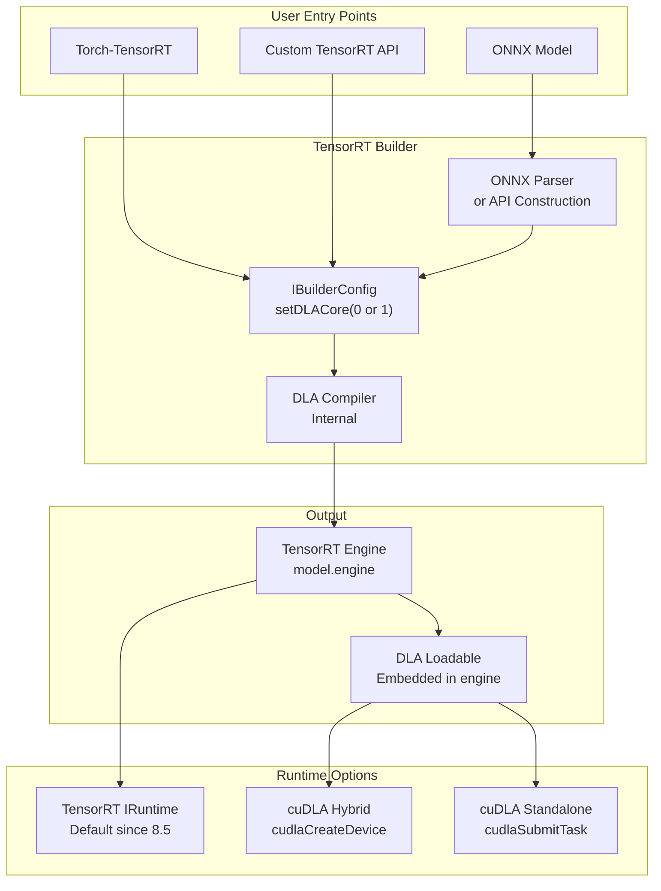
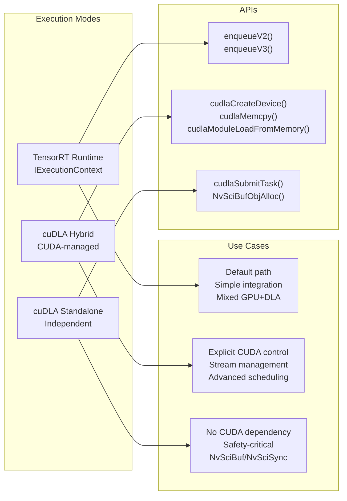
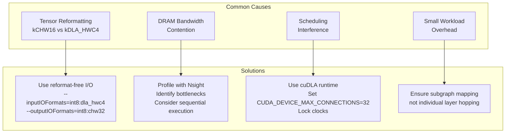
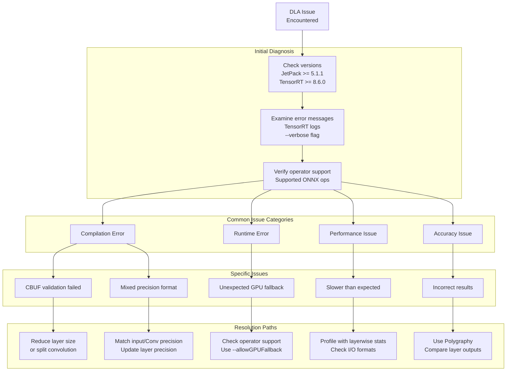
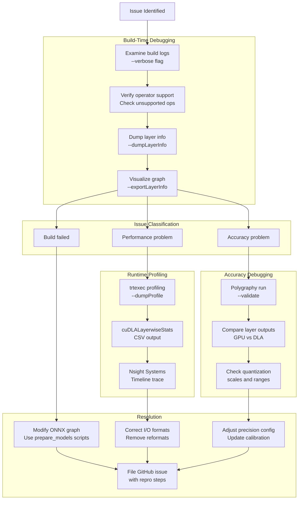

<!-- source: DeepWiki mcp.deepwiki.com · repo NVIDIA/Deep-Learning-Accelerator-SW · page 9 FAQ and Troubleshooting · fetched 2026-10-26 -->

# FAQ and Troubleshooting

<details>
<summary>Relevant source files</summary>

The following files were used as context for generating this wiki page:

- [FAQ/README.md](FAQ/README.md)

</details>


This page provides answers to frequently asked questions about DLA deployment and comprehensive troubleshooting guidance for common issues. For basic setup and prerequisites, see [Getting Started](#2). For detailed performance profiling, see [Performance Analysis and Optimization](#7). For contribution-related questions, see [Contributing to DLA SW](#10).

## Hardware and Platform Questions

### Which Platforms Support DLA?

All Jetson AGX Orin, Orin NX, AGX Xavier, and Xavier NX modules include DLA cores. DRIVE Xavier and DRIVE Orin also have DLA cores. Each platform features two DLA instances (DLA Core 0 and DLA Core 1).

**Platform Support Matrix:**

| Platform | DLA Cores | DLA Generation | SRAM Configuration | JetPack/DRIVE OS |
|----------|-----------|----------------|-------------------|------------------|
| Jetson AGX Orin | 2 | 2nd Gen | 1 MB per core (exclusive) | JetPack 5.1.1+ |
| Jetson Orin NX | 2 | 2nd Gen | 1 MB per core (exclusive) | JetPack 5.1.1+ |
| Jetson AGX Xavier | 2 | 1st Gen | 4 MB shared (with 2 PVAs) | JetPack 4.6+ |
| Jetson Xavier NX | 2 | 1st Gen | 4 MB shared (with 2 PVAs) | JetPack 4.6+ |
| DRIVE Orin | 2 | 2nd Gen | 1 MB per core (exclusive) | DRIVE OS 6.0.8.0+ |
| DRIVE Xavier | 2 | 1st Gen | 4 MB shared (with 2 PVAs) | DRIVE OS 5.2.6.0+ |

### DLA Core vs DLA Falcon

The DLA hardware consists of two main components:
- **DLA Core**: Executes all mathematical operations through specialized engines (CPIPEs for INT8 convolutions, Rubik for FP16 convolutions, BDMA for memory operations)
- **DLA Falcon**: Microcontroller that orchestrates and schedules workloads on the DLA Core, manages task submission, and coordinates memory transfers

### SRAM Architecture

**Xavier (1st Gen):**
- 4 MB total SRAM shared between 2 DLAs and 2 PVAs
- Dynamic allocation based on workload

**Orin (2nd Gen):**
- 1 MB SRAM per DLA core (exclusive access)
- No sharing with PVAs or other accelerators

To specify SRAM allocation in `trtexec`, use:
```bash
--memPoolSize=dlaSRAM:1
```

### Can DLA Access System DRAM?

Yes, DLA can directly access system DRAM, similar to GPU and CPU. All input/output tensors and weights that don't fit in SRAM are stored in system DRAM. Memory bandwidth is shared with other system components, which can impact performance when running concurrent GPU+DLA workloads.

Sources: [FAQ/README.md:29-98]()

## Software Stack and API Questions

### TensorRT as the Compilation Interface

The TensorRT Builder is the only supported interface to invoke the DLA compiler. It provides a consistent API for parsing networks and building inference engines for both GPU and DLA.



Sources: [FAQ/README.md:78-85]()

### Is ONNX the Recommended Path from PyTorch?

Yes, ONNX is the preferred path from PyTorch (and other frameworks) to TensorRT for DLA deployment. Alternatives include:
- **Torch-TensorRT**: Direct PyTorch to TensorRT compilation with DLA support
- **Custom TensorRT API**: Build network programmatically using TensorRT's Network Definition API

For ONNX model preparation, see [Model Preparation](#3).

### cuDLA vs TensorRT Runtime



**Recommendation:**
- Use TensorRT Runtime (default) for most applications
- Use cuDLA Hybrid when you need explicit CUDA stream control
- Use cuDLA Standalone for safety-critical applications without CUDA dependency

For detailed cuDLA usage, see [Runtime and Deployment](#6).

Sources: [FAQ/README.md:78-85]()

## Quantization and Precision Questions

### Supported Precision Formats

DLA on Orin and Xavier supports:
- **INT8**: Primary precision, optimized for highest throughput
- **FP16**: Supported for operations not available in INT8 or for hybrid precision
- **Mixed Precision**: INT8 and FP16 can be used in the same model

**Key Differences Between Generations:**

| Feature | Xavier (1st Gen) | Orin (2nd Gen) |
|---------|------------------|----------------|
| INT8 Compute | Baseline | 9x increase |
| FP16 Convolution | Higher performance | Reduced (optimized for INT8) |
| Primary Use Case | Hybrid precision | INT8-first inference |

### How to Quantize Networks for DLA

Two primary methods:

**1. Post-Training Quantization (PTQ) via TensorRT:**
```bash
# PTQ with calibration dataset
./trtexec --onnx=model.onnx \
  --int8 \
  --useDLACore=0 \
  --calib=calibration.cache \
  --inputIOFormats=int8:dla_hwc4 \
  --outputIOFormats=int8:chw32
```

**2. Quantization-Aware Training (QAT) with Q/DQ Nodes:**
- Train model with `pytorch-quantization` library
- Export to ONNX with explicit Q/DQ nodes
- Use QDQ Translator to convert to TensorRT format

For QDQ translation workflow, see [QDQ Translator for Quantized Models](#3.2).

### Is Calibration Always Necessary?

No. You can provide quantization scales through:
1. **TensorRT Calibration Cache**: Generated by PTQ workflow
2. **ITensor APIs**: Programmatically set scales using `setDynamicRange()` API
3. **QDQ Nodes**: Embedded scales from QAT training (requires QDQ translation)

If no scaling factors are available for a layer, TensorRT will run it in FP16 precision.

### Dense vs Sparse TOPs

**Structured Sparsity (2:4 Pattern):**
- For every 4 consecutive weights along channel dimension (C), at least 2 must be zeros
- Supported on Orin DLA (2nd Gen) and Ampere GPU
- Requires C > 64 for DLA convolutions
- Provides 1.24x-1.47x speedup for sparse models

Enable sparsity in `trtexec`:
```bash
--sparsity=force
```

For sparsity details, see [Structured Sparsity](#5.4).

Sources: [FAQ/README.md:60-89]()

## Performance and Optimization Questions

### Why is Latency Higher with Mixed GPU+DLA Execution?



**Specific Mitigations:**

1. **Avoid Reformatting Overhead:**
   - Use native DLA formats: `kDLA_HWC4` (INT8), `kDLA_LINEAR` (FP16)
   - Specify I/O formats in trtexec: `--inputIOFormats=int8:dla_hwc4 --outputIOFormats=int8:chw32`

2. **Reduce DRAM Bandwidth Contention:**
   - Profile with Nsight Systems to identify bandwidth-bound phases
   - Consider sequential execution for bandwidth-heavy models

3. **Improve Scheduling:**
   - Use cuDLA runtime for explicit control
   - Set `CUDA_DEVICE_MAX_CONNECTIONS=32` environment variable
   - Lock clocks to prevent dynamic frequency scaling

4. **Optimize Graph Partitioning:**
   - Ensure contiguous subgraphs map to DLA, not individual alternating layers
   - Use layer restrictions to guide partitioning

Sources: [FAQ/README.md:45-59]()

### DLA Clock Frequency Scaling

DLA clock frequency can be configured per power mode. Reference documentation for Jetson platforms provides clock settings for each power profile (MAXN, 50W, 30W, 15W).

**Power Mode Performance (Jetson AGX Orin 64GB):**

| Power Mode | GPU TOPs | DLA TOPs | DLA % of Total | Use Case |
|------------|----------|----------|----------------|----------|
| MAXN | 171 | 105 | 38% | Maximum performance |
| 50W | 109 | 92 | 46% | Balanced performance |
| 30W | 41 | 90 | 69% | Power-constrained |
| 15W | 14 | 40 | 74% | Extreme efficiency |

As power budget decreases, DLA's contribution increases because it maintains higher efficiency at lower power levels.

For detailed power efficiency analysis, see [Power Modes and Efficiency](#7.3).

### Running Multiple Models on DLA

**Two DLA Cores (Concurrent):**
```bash
# Terminal 1
./trtexec --onnx=model_a.onnx --useDLACore=0 --int8

# Terminal 2
./trtexec --onnx=model_b.onnx --useDLACore=1 --int8
```

**Programmatic Approach:**
Use `IBuilderConfig::setDLACore()` to assign models to different cores within the same application.

**Single DLA Core (Sequential):**
Multiple models can run sequentially on a single DLA core through task queuing. Each model must be compiled as a separate engine.

For concurrent execution details, see [Concurrent Execution and Multi-Model Deployment](#6.4).

### Latency Determinism

DLA inference exhibits minimal variance when:
- Clocks are locked (no dynamic frequency scaling)
- Not bottlenecked by DRAM bandwidth
- No competing workloads on shared resources

DLA is particularly suitable for real-time applications requiring consistent latency.

Sources: [FAQ/README.md:100-116]()

## Common Issues and Solutions

### Issue Resolution Workflow



Sources: [FAQ/README.md:133-141]()

### CBUF Validation Failure

**Error Message:**
```
[TensorRT] ERROR: CBUF validation failed for Convolution layer
```

**Root Cause:**
DLA's internal SRAM (CBUF - Convolution Buffer) cannot accommodate the layer's data and weights. TensorRT performs a heuristic check before handing convolution nodes to the DLA compiler.

**Solutions:**

1. **Reduce Layer Dimensions:**
   - Decrease input/output channels
   - Reduce spatial dimensions
   - Split large convolution into multiple smaller ones

2. **Adjust SRAM Allocation:**
   ```bash
   --memPoolSize=dlaSRAM:1
   ```

3. **Allow GPU Fallback:**
   ```bash
   --allowGPUFallback
   ```
   The layer will execute on GPU instead.

4. **Modify Graph:**
   - Use graph optimization to fuse preceding layers
   - Consider layer decomposition strategies

Sources: [FAQ/README.md:133-135]()

### Mixed Precision Format Error

**Error Scenario:**
FP16 `kDLA_HWC4` inputs consumed by INT8 Convolution (or vice versa)

**Root Cause:**
DLA does not support format conversions where input precision differs from convolution compute precision.

**Solution:**
Update convolution layer precision to match input precision:

```cpp
// Using TensorRT API
conv_layer->setPrecision(nvinfer1::DataType::kFP16);  // Match input type
```

Or in trtexec, specify consistent I/O formats:
```bash
--inputIOFormats=int8:dla_hwc4 --outputIOFormats=int8:chw32
```

For precision configuration details, see [Precision Configuration](#5.3).

Sources: [FAQ/README.md:136-138]()

### Unexpected GPU Fallback

**Symptoms:**
- Layers run on GPU despite `--useDLACore=0` flag
- Lower than expected DLA utilization

**Diagnosis:**
```bash
./trtexec --onnx=model.onnx \
  --useDLACore=0 \
  --int8 \
  --verbose \
  --dumpLayerInfo
```

Check verbose output for:
- "Could not find any implementation for node" messages
- Layers marked as "GPU" in layer info dump

**Common Causes:**

| Cause | Solution |
|-------|----------|
| Unsupported operator | Check [Operator Support Matrix](#4.1), use reconstruction |
| Layer constraint violation | Review [Layer Restrictions](#4.3), adjust parameters |
| Missing quantization scales | Provide calibration cache or use ITensor APIs |
| CBUF size exceeded | Split layer or allow GPU fallback |

**Enable GPU Fallback Explicitly:**
```bash
--allowGPUFallback
```

Sources: [FAQ/README.md:35-44]()

### Performance Slower Than Expected

**Diagnostic Steps:**

1. **Collect Layerwise Statistics:**
   ```bash
   cuDLALayerwiseStatsStandalone \
     --loadable=model.engine \
     --image=input.bin \
     --stats=output.csv
   ```
   
   See [Layerwise Statistics Collection](#7.1) for CSV format details.

2. **Profile with Nsight Systems:**
   ```bash
   nsys profile -o profile.qdrep \
     ./trtexec --loadEngine=model.engine --iterations=100
   ```

3. **Check I/O Format Overhead:**
   - Look for reformat operations in profile
   - Verify using native DLA formats

4. **Verify Clock Settings:**
   ```bash
   # Check current DLA frequency
   cat /sys/kernel/debug/clk/nafll_dla0_core/clk_rate
   ```

5. **Check DRAM Bandwidth:**
   - Use Nsight Systems to identify memory-bound phases
   - Compare dense vs sparse INT8 performance

**Performance Checklist:**

- [ ] Using INT8 precision (not FP16 for convolutions)
- [ ] Native DLA I/O formats specified
- [ ] No excessive reformatting operations
- [ ] Clocks locked to maximum
- [ ] No concurrent GPU workload causing contention
- [ ] Model benefits from structured sparsity (if applicable)

Sources: [FAQ/README.md:117-126]()

## Debugging Tools and Workflow

### Tool Selection Matrix

| Tool | Use Case | Command/API |
|------|----------|-------------|
| **trtexec** | Quick performance check, engine building | `--dumpProfile --verbose` |
| **cuDLALayerwiseStats** | Per-layer profiling | `cuDLALayerwiseStatsStandalone` |
| **Nsight Systems** | System-wide profiling, multi-accelerator | `nsys profile` |
| **TensorRT Polygraphy** | Accuracy debugging, layer comparison | `polygraphy run` |
| **CUDA_DEVICE_MAX_CONNECTIONS** | Scheduling optimization | `export CUDA_DEVICE_MAX_CONNECTIONS=32` |

### Comprehensive Debugging Workflow



Sources: [FAQ/README.md:117-126]()

### trtexec Diagnostic Flags

```bash
# Comprehensive diagnostic build
./trtexec \
  --onnx=model.onnx \
  --int8 \
  --useDLACore=0 \
  --verbose \
  --dumpProfile \
  --dumpLayerInfo \
  --exportLayerInfo=layer_info.json \
  --profilingVerbosity=detailed \
  --allowGPUFallback \
  --inputIOFormats=int8:dla_hwc4 \
  --outputIOFormats=int8:chw32 \
  --memPoolSize=dlaSRAM:1
```

**Key Flags:**
- `--verbose`: Detailed compilation logs
- `--dumpProfile`: Per-layer timing information
- `--dumpLayerInfo`: Layer configuration details
- `--exportLayerInfo`: JSON export for analysis
- `--profilingVerbosity=detailed`: Maximum profiling detail

For complete trtexec reference, see [Using trtexec for DLA](#5.2).

### Polygraphy for Accuracy Debugging

```bash
# Compare GPU vs DLA outputs
polygraphy run model.onnx \
  --trt \
  --int8 \
  --use-dla \
  --dla-core 0 \
  --validate \
  --atol 1e-2 \
  --rtol 1e-2 \
  --onnxrt
```

Polygraphy compares outputs between different backends to identify accuracy discrepancies.

Sources: [FAQ/README.md:125-126]()

## Network Compatibility Questions

### Recommended Network Architectures

DLA supports a wide range of architectures. Well-suited backbones include:

**Classification Backbones:**
- ResNet family (ResNet-18, ResNet-34, ResNet-50)
- MobileNet variants (MobileNet, MobileNetV2, MobileNet-EdgeTPU)
- EfficientNet family (EfficientNet-Lite, EfficientNet-EdgeTPU)
- Inception family (GoogLeNet, InceptionV3)

**Task-Specific Heads:**
- **Object Detection**: SSD, RetinaNet, YOLO (v3, v4, v5)
- **Segmentation**: FCN, U-Net (with modifications)
- **Classification**: AveragePool + FC or 1x1 convolution

Models with high arithmetic intensity (many FLOPs per memory operation) achieve better DLA utilization. Examples: ResNet-18, ResNet-34, ResNet-50.

### Point-Pillar Network Support

DLA does not natively support Point-Pillar scatter operations, but workarounds exist:

**Modifications:**
1. Replace scatter with Transposed Convolution (stride == kernel size)
2. Use Nearest-Neighbor Resize instead of upsampling
3. Modify ONNX graph to use supported primitives

This is a common pattern: re-express unsupported operations in terms of [supported operations](#4). For graph modification scripts, see [ONNX Model Preparation Scripts](#3.1).

Sources: [FAQ/README.md:35-44]()

## Getting Additional Help

### Update to Latest Release

Always update to the latest JetPack or DRIVE OS release before reporting issues:
- **Jetson**: JetPack 5.1.1 or later
- **DRIVE**: DRIVE OS 6.0.8.0 or later
- **TensorRT**: 8.6.0 or later for latest DLA features

Many known issues are resolved in newer releases.

### Community Resources

1. **NVIDIA Developer Forums**: https://forums.developer.nvidia.com/
   - Search existing threads for similar issues
   - Post questions with detailed reproduction steps

2. **GitHub Issues**: https://github.com/NVIDIA/Deep-Learning-Accelerator-SW/issues
   - File bugs with minimal reproduction case
   - Include TensorRT version, platform, and error logs

3. **ISAAC ROS Examples**: https://github.com/NVIDIA-ISAAC-ROS/
   - Reference applications using DLA
   - Proximity segmentation example

### Issue Reporting Best Practices

When filing a GitHub issue, include:

1. **Environment Details:**
   - Platform (Jetson AGX Orin 64GB, DRIVE Orin, etc.)
   - JetPack/DRIVE OS version
   - TensorRT version
   - DLA SW version

2. **Reproduction Steps:**
   - Complete trtexec command or code snippet
   - ONNX model file (if shareable) or architecture description
   - Full error log with `--verbose` enabled

3. **Expected vs Actual Behavior:**
   - What you expected to happen
   - What actually happened
   - Screenshots of profiling data if relevant

4. **Debugging Attempts:**
   - What troubleshooting steps you've already tried
   - Results from diagnostic tools (layerwise stats, Nsight)

For contribution workflow details, see [Contributing to DLA SW](#10).

Sources: [FAQ/README.md:139-141]()

---

**Related Pages:**
- [Operator Support Matrix](#4.1) - Comprehensive ONNX operator coverage
- [Layer Restrictions and Constraints](#4.3) - Layer-specific limitations
- [Performance Analysis and Optimization](#7) - Profiling and optimization techniques
- [Sample Applications](#8) - Working code examples
- [Contributing to DLA SW](#10) - How to file issues and contribute fixes

---

