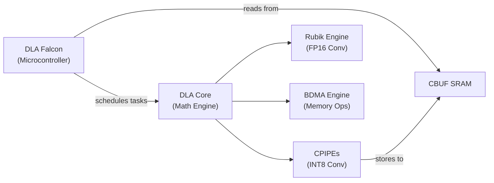
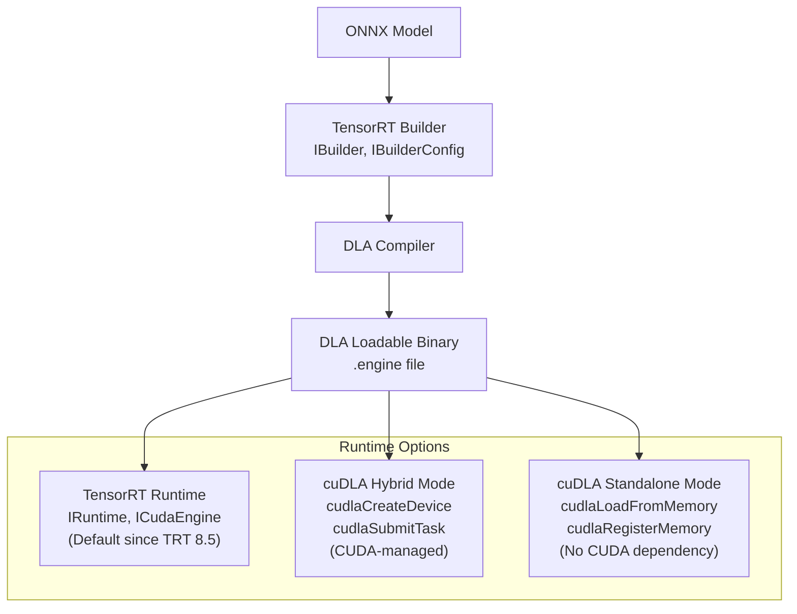
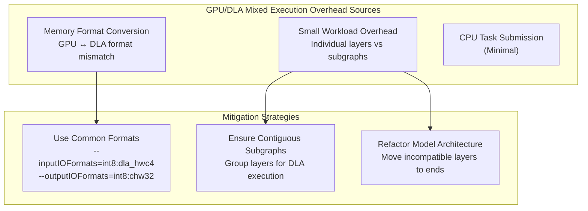
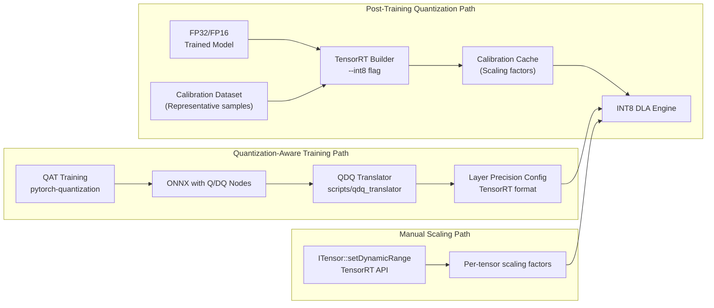
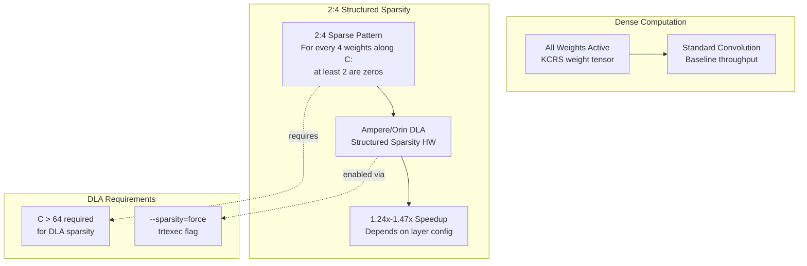
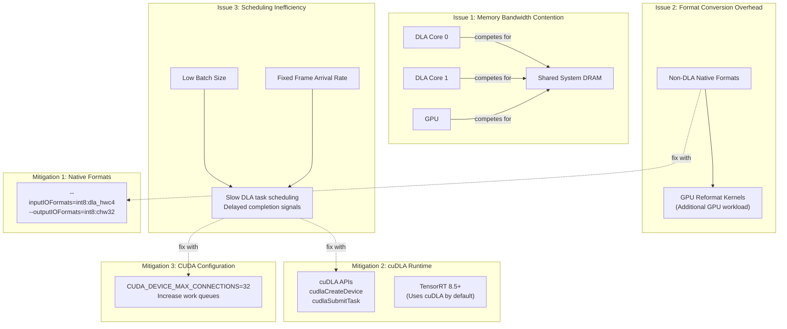
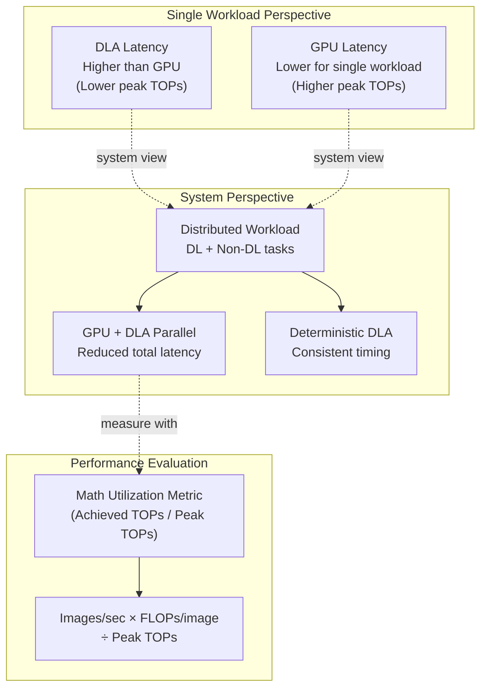
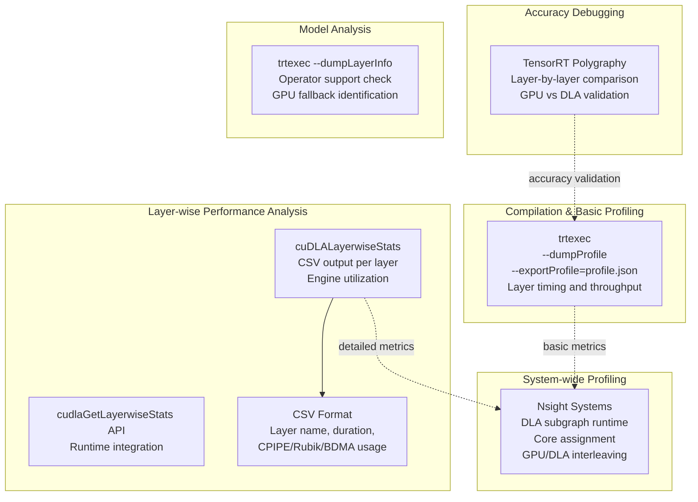
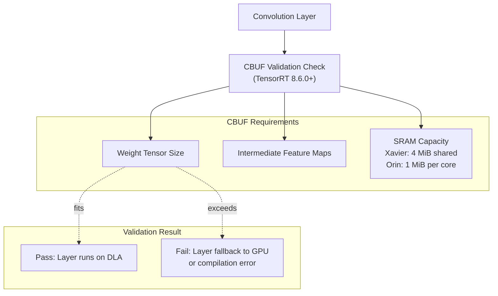

<!-- source: DeepWiki mcp.deepwiki.com · repo NVIDIA/Deep-Learning-Accelerator-SW · page 9.1 Frequently Asked Questions · fetched 2026-10-26 -->

# Frequently Asked Questions

<details>
<summary>Relevant source files</summary>

The following files were used as context for generating this wiki page:

- [FAQ/README.md](FAQ/README.md)

</details>


This page provides answers to commonly asked questions about deploying and optimizing models on NVIDIA's Deep Learning Accelerator (DLA). Questions are organized by topic: hardware architecture, platform support, model preparation, quantization workflows, runtime deployment, performance optimization, and troubleshooting.

For detailed information on specific topics, see:
- Model preparation workflows: [Model Preparation](#3)
- Operator support details: [ONNX Operator Support](#4)
- Runtime API selection: [Runtime API Overview](#6.1)
- Performance analysis tools: [Performance Analysis and Optimization](#7)
- Common error solutions: [Common Issues and Solutions](#9.2)

---

## FAQ Organization Overview

```mermaid
graph TB
    FAQ["Frequently Asked Questions"]
    
    Hardware["Hardware Architecture FAQs"]
    Platforms["Platform & Software Stack FAQs"]
    Models["Model & Operator Support FAQs"]
    Quantization["Quantization & Precision FAQs"]
    Runtime["Runtime & Deployment FAQs"]
    Performance["Performance & Optimization FAQs"]
    Troubleshooting["Troubleshooting FAQs"]
    
    FAQ --> Hardware
    FAQ --> Platforms
    FAQ --> Models
    FAQ --> Quantization
    FAQ --> Runtime
    FAQ --> Performance
    FAQ --> Troubleshooting
    
    Hardware --> Q1["Which platforms have DLA?"]
    Hardware --> Q2["DLA Core vs DLA Falcon?"]
    Hardware --> Q3["SRAM capacity?"]
    Hardware --> Q4["DRAM access?"]
    Hardware --> Q5["Clock frequency scaling?"]
    
    Platforms --> Q6["Supported Jetson/DRIVE modules"]
    Platforms --> Q7["Software version requirements"]
    Platforms --> Q8["TensorRT vs cuDLA?"]
    
    Models --> Q9["Recommended networks?"]
    Models --> Q10["Point-Pillar support?"]
    Models --> Q11["GPU/DLA mixed execution overhead?"]
    Models --> Q12["Full DLA execution?"]
    
    Quantization --> Q13["FP16 vs INT8 performance?"]
    Quantization --> Q14["PTQ workflow"]
    Quantization --> Q15["Calibration file necessity?"]
    Quantization --> Q16["QAT support?"]
    
    Runtime --> Q17["Concurrent multi-model execution?"]
    Runtime --> Q18["Multiple models on single DLA?"]
    Runtime --> Q19["Deterministic latency?"]
    Runtime --> Q20["DLA vs GPU latency?"]
    
    Performance --> Q21["Dense vs Sparse TOPs?"]
    Performance --> Q22["Power consumption reduction?"]
    Performance --> Q23["Profiling tools"]
    Performance --> Q24["Nsight Systems usage"]
    
    Troubleshooting --> Q25["CBUF validation errors"]
    Troubleshooting --> Q26["Mixed precision input format issues"]
    Troubleshooting --> Q27["General issue reporting"]
```



**Sources:** [FAQ/README.md:1-141]()

---

## Hardware Architecture FAQs

### Which NVIDIA Jetson or DRIVE Modules have DLA?

All **Jetson AGX Orin**, **Orin NX**, **AGX Xavier**, and **Xavier NX** modules include DLA cores. Similarly, **DRIVE Xavier** and **DRIVE Orin** platforms include DLA cores.

| Platform Family | DLA Cores | Generation | SRAM Configuration |
|----------------|-----------|------------|-------------------|
| Jetson AGX Orin | 2 | 2nd gen (Ampere-based) | 1 MiB per core (exclusive) |
| Jetson Orin NX | 2 | 2nd gen | 1 MiB per core (exclusive) |
| Jetson AGX Xavier | 2 | 1st gen | 4 MiB shared across 2 DLAs + 2 PVAs |
| Jetson Xavier NX | 2 | 1st gen | 4 MiB shared |
| DRIVE Orin | 2 | 2nd gen | 1 MiB per core (exclusive) |
| DRIVE Xavier | 2 | 1st gen | 4 MiB shared |

Reference documentation for power modes and clock settings is available in the official Jetson Developer Guide.

**Sources:** [FAQ/README.md:29-31]()

---

### What is DLA Core and what is DLA Falcon?

The **DLA Core** performs all mathematical operations (convolutions, pooling, element-wise operations), while **DLA Falcon** is the microcontroller that orchestrates and schedules workloads on the DLA Core.



For details on DLA hardware components, see [DLA Hardware Architecture](#1.1).

**Sources:** [FAQ/README.md:32-33]()

---

### How much internal SRAM does the DLA have?

DLA SRAM capacity differs between generations:

- **Xavier**: 2 DLAs and 2 Programmable Vision Accelerators (PVAs) share a total of **4 MiB** of SRAM
- **Orin**: Each DLA has exclusive access to **1 MiB** of internal SRAM

The internal SRAM is referred to as **CBUF** (Convolution Buffer) and is used to store convolution weights and intermediate feature maps. CBUF size directly impacts which convolution configurations can run on DLA.

**Sources:** [FAQ/README.md:96-98]()

---

### Can the DLA directly access the data in the DRAM system memory?

Yes, DLA is connected to system DRAM, just like GPU or CPU. All three accelerators share the same memory subsystem, which means:
- Concurrent GPU/DLA execution can become DRAM bandwidth-bound
- Memory format conversions between GPU and DLA may require additional DRAM traffic
- Using common memory formats (e.g., `kCHW32` for INT8, `kCHW16` for FP16) reduces reformatting overhead

**Sources:** [FAQ/README.md:93-94]()

---

### Can we scale the clock frequency on DLA?

Yes, DLA clock frequency can be configured. On Jetson platforms, use the power mode APIs to set different clock profiles. The official documentation provides steps for setting power and clock profiles.

For automotive platforms (DRIVE), clock frequencies typically require configuration at flashing/OS setup time.

**Sources:** [FAQ/README.md:90-91]()

---

## Platform and Software Stack FAQs

### What are the minimum software requirements for DLA?

| Component | Minimum Version | Notes |
|-----------|----------------|-------|
| JetPack (Jetson) | 5.1.1+ | Recommended for latest DLA features |
| DRIVE OS (Automotive) | 6.0.8.0+ | Production release baseline |
| TensorRT | 8.5+ | cuDLA used by default for DLA runtime |
| DLA SW | 3.12.x+ | Base operator support |
| DLA SW | 3.14.0+ | Trigonometric, hyperbolic, advanced math ops |

For detailed version compatibility, see [Supported Platforms](#1.3).

**Sources:** [FAQ/README.md:29-31]()

---

### How would I go about using DLA without TensorRT?

The **TensorRT Builder** is the only user interface to invoke the DLA compiler. It provides a consistent interface to parse networks and build inference engines for both GPU and DLA.

However, for runtime execution, advanced users have options:



While TensorRT Builder is required for compilation, the cuDLA runtime APIs (`cudlaCreateDevice`, `cudlaSubmitTask`, etc.) can be used directly without TensorRT Runtime for execution. See the cuDLA samples in [cuDLA Sample Overview](#8.1).

**Sources:** [FAQ/README.md:78-85]()

---

### Is ONNX the recommended way to go from PyTorch to TensorRT?

Yes, **ONNX is the preferred path** from PyTorch (and other frameworks) to TensorRT for DLA workflows. The TensorRT ONNX parser provides robust support for converting models to TensorRT engines.

Alternative approaches include:
- **Torch-TensorRT**: Direct PyTorch to TensorRT compilation with DLA support
- **Custom TensorRT API**: Building networks programmatically using TensorRT's network definition APIs

For ONNX model preparation workflows, see [ONNX Model Preparation Scripts](#3.1).

**Sources:** [FAQ/README.md:83-85]()

---

## Model and Operator Support FAQs

### Are there specific networks or a list of networks recommended for DLA?

Any network can run on DLA with supported layers executing on DLA and unsupported layers falling back to GPU. For **full DLA execution**, the following architectures are well-supported:

**Backbone Networks:**
- EfficientNet-Lite, EfficientNet-EdgeTPU
- MobileNet variants (MobileNet-EdgeTPU, MobileNetV1, MobileNetV2)
- Inception family (GoogLeNet, InceptionV3)
- ResNet family (ResNet-18, ResNet-34, ResNet-50)
- YOLO models (YOLOv3, YOLOv5, etc.)

**Detection/Segmentation Heads Compatible with DLA:**
- SSD (Single Shot Detector)
- FCN (Fully Convolutional Networks) for segmentation
- Simple classification heads (AveragePool + FC or 1x1 convolution)

Models with **high arithmetic intensity** (many math operations per memory operation) achieve highest DLA utilization. Examples: ResNet-18, ResNet-34, ResNet-50. Models with lower arithmetic intensity like MobileNet also achieve low latency on DLA.

**Sources:** [FAQ/README.md:35-38]()

---

### Does DLA support Point-Pillar Networks?

DLA supports **Convolution** and **Transposed Convolution** operations. Point-Pillar networks can be adapted to DLA by:

1. Using **Transposed Convolution** with `stride == kernel_size`
2. Replacing upsampling operations with **Nearest-Neighbor Resize**
3. Modifying the ONNX graph or original model definition

Re-expressing operations not currently supported on DLA in terms of supported operations is a common technique for achieving full DLA execution. See [Operator Support Matrix](#4.1) for the complete list of supported operations.

**Sources:** [FAQ/README.md:40-43]()

---

### What kind of overhead exists when you deploy a network with layers alternating between GPU and DLA?



Three main overhead sources exist:

1. **Tensor Reformatting**: When tensors move between GPU and DLA with different memory formats. Common formats like `kCHW32` (INT8) and `kCHW16` (FP16) are supported by both, reducing overhead.

2. **Small Workload Overhead**: Frequent context switches between GPU and DLA for individual layers create overhead. Ensure contiguous subgraphs map to DLA rather than individual layers alternating.

3. **CPU Task Submission**: Minimal per-task CPU overhead exists for GPU/DLA submission through TensorRT.

Use the `--inputIOFormats` and `--outputIOFormats` flags in `trtexec` to specify reformat-free I/O. See [Restrictions with DLA](https://docs.nvidia.com/deeplearning/tensorrt/developer-guide/index.html#restrictions-with-dla) for details.

**Sources:** [FAQ/README.md:45-49]()

---

## Quantization and Precision FAQs

### What precision formats are supported on DLA?

DLA on Orin and Xavier supports **FP16** and **INT8** precision formats.

| Precision | Orin DLA | Xavier DLA | Optimal Use Case |
|-----------|----------|------------|------------------|
| INT8 | ✓ (Optimized) | ✓ | Primary inference precision, highest throughput |
| FP16 | ✓ (Reduced vs Xavier) | ✓ | Hybrid precision for accuracy, unsupported INT8 ops |
| FP32 | ✗ | ✗ | Not supported (GPU fallback required) |

**Orin-specific design**: DLA on Orin was optimized for 9x increase in INT8 compute and higher power efficiency in exchange for lower FP16 convolution performance compared to Xavier. This design choice reflects the emphasis on INT8 as the optimal inference precision.

**Hybrid Precision**: Mixing FP16 and INT8 layers in the same model allows finding the balance between accuracy and performance.

**Sources:** [FAQ/README.md:60-67]()

---

### How do you quantize the network to INT8 for DLA?



**Post-Training Quantization (PTQ)** is the primary DLA quantization workflow:

1. Use a representative calibration dataset after model training
2. TensorRT PTQ toolchain automatically determines scaling factors for tensor quantization
3. Layers without scaling factors run in FP16

Example command:
```bash
trtexec --onnx=model.onnx --int8 --useDLACore=0 --calib=calibration_cache.txt
```

Reference sample: `samples/sampleINT8` in the TensorRT repository.

**Sources:** [FAQ/README.md:69-73]()

---

### Is a calibration file always necessary to convert a model to INT8?

No. Three methods exist for providing INT8 scaling factors:

1. **TensorRT Calibration File**: Automatically generated via PTQ workflow
2. **ITensor API**: Manually set scaling factors using `ITensor::setDynamicRange()` API
3. **QDQ Translator Output**: Extract scales from QAT models using the QDQ Translator tool

Layers without scaling factors will execute in FP16 precision (hybrid precision mode).

For QAT workflows, see [QDQ Translator for Quantized Models](#3.2).

**Sources:** [FAQ/README.md:75-76]()

---

### How does FP16 performance compare to INT8?

NVIDIA designed DLA with emphasis on **INT8 for AI inference** since inference is the key value proposition of Jetson/DRIVE modules (training happens on larger systems).

**Performance Characteristics:**
- **Orin DLA**: 9x INT8 compute increase vs Xavier, reduced FP16 convolution throughput
- **Design Philosophy**: Optimized for well-understood inference models at lower power and area overhead
- **Primary Use Case**: INT8 provides highest throughput on DLA

**FP16 Usage:**
- Layers that cannot be quantized to INT8 without accuracy loss
- Operations unsupported in INT8 on DLA
- Hybrid precision models (INT8 backbone + FP16 head)

**Sources:** [FAQ/README.md:65-67]()

---

### What's the difference between Dense TOPs and Sparse TOPs?

**Structured Sparsity** (2:4 sparse pattern) is an optimization leveraging zero weights in convolution kernels.



**Key Details:**
- **Pattern**: For KCRS convolution weight tensor, every 4 consecutive weights along the C dimension must have at least 2 zeros
- **Hardware Support**: Ampere GPU and Orin DLA (2nd generation)
- **DLA Constraint**: Input channel count `C > 64` required
- **Performance Gain**: 1.24x-1.47x speedup (see RetinaNet benchmarks)
- **Usage**: Enable with `--sparsity=force` flag in `trtexec`

For detailed structured sparsity implementation, see [Structured Sparsity](#5.4).

**Sources:** [FAQ/README.md:87-88]()

---

## Runtime and Deployment FAQs

### Why is the latency higher when running workloads on two DLA cores and GPU?



Three primary causes:

1. **Memory Bandwidth Contention**: DLA and GPU compete for shared DRAM. Bandwidth-bound workloads bottleneck when running in parallel.

2. **Format Conversion Overhead**: Without native DLA formats, TensorRT inserts GPU reformat kernels around DLA inference, adding GPU workload.

3. **Scheduling Inefficiency**: At low batch sizes with fixed frame rates, DLA tasks may not schedule quickly or signal completion efficiently.

**Mitigations:**
- Use reformat-free I/O: `--inputIOFormats=int8:dla_hwc4 --outputIOFormats=int8:chw32`
- Use cuDLA APIs directly (TensorRT 8.5+ uses cuDLA by default)
- Set `CUDA_DEVICE_MAX_CONNECTIONS=32` environment variable to increase concurrent work queues

**Sources:** [FAQ/README.md:51-58]()

---

### Is it possible to run multiple networks concurrently on two DLA cores?

Yes, multiple concurrent execution scenarios are supported:

| Scenario | Configuration | Example |
|----------|--------------|---------|
| Two different models on two DLA cores | Model A on DLA 0, Model B on DLA 1 | `trtexec` with `--useDLACore=0` and separate process with `--useDLACore=1` |
| Same model on two DLA cores | Model A on DLA 0, Model A on DLA 1 | Parallel inference for higher throughput |
| GPU + DLA concurrent execution | Model A on GPU, Model B on DLA | Hybrid execution for workload distribution |
| Two DLA cores in same process | Use IBuilderConfig API | `IBuilderConfig::setDLACore()` API |

To quickly test concurrent execution, run two `trtexec` processes with different `--useDLACore` values.

For multi-model deployment details, see [Concurrent Execution and Multi-Model Deployment](#6.4).

**Sources:** [FAQ/README.md:107-109]()

---

### Can multiple models run on a single DLA?

Yes, multiple models can run on a single DLA core in **sequential order**. The DLA hardware processes one task at a time per core, so multiple models execute one after another.

For parallel execution, use both DLA cores (`--useDLACore=0` and `--useDLACore=1`).

**Sources:** [FAQ/README.md:111-112]()

---

### Can I expect the latency of my network to be deterministic on DLA?

Yes, **DLA inference has minimal variance** from inference to inference, making it suitable for applications requiring consistent latency.

**Requirements for deterministic latency:**
- Lock clock frequencies (prevent dynamic frequency scaling)
- Avoid DRAM bandwidth bottlenecks (minimize concurrent GPU/DLA execution)
- Use standalone DLA execution mode when possible

This determinism makes DLA particularly suitable for **safety-critical applications** and scenarios requiring predictable timing guarantees.

**Sources:** [FAQ/README.md:114-115]()

---

### How does the inference latency on DLA compare to that of GPU?



**Single Workload:** DLA latency is higher than GPU because each DLA core has lower theoretical math throughput (TOPs) than the GPU.

**System-Level Benefits:**
- **Workload Distribution**: Reduce overall latency by distributing DL and non-DL workloads across DLA and GPU
- **Deterministic Execution**: DLA provides consistent latency for real-time applications
- **Power Efficiency**: 3-5x better power efficiency than GPU

**Performance Evaluation Methodology:**
1. Calculate math utilization: `(Achieved TOPs) / (Peak TOPs)`
2. Achieved TOPs = `(Images/sec) × (FLOPs/image) / 10^12`
3. Compare utilization across DLA and GPU to identify bottlenecks

At lower power modes (15W, 30W), DLA maintains higher utilization than GPU. See [Power Modes and Efficiency](#7.3).

**Sources:** [FAQ/README.md:100-105]()

---

## Performance and Optimization FAQs

### What tools and utilities are available for profiling and debugging DLA workloads?



**Primary Tools:**

1. **trtexec** - First-line profiling tool:
   ```bash
   trtexec --onnx=model.onnx --int8 --useDLACore=0 \
           --dumpProfile --exportProfile=profile.json \
           --inputIOFormats=int8:dla_hwc4 \
           --outputIOFormats=int8:chw32 \
           --memPoolSize=dlaSRAM:1
   ```

2. **cuDLALayerwiseStats** - Per-layer performance:
   - Collects layer name, duration, engine usage (CPIPE/Rubik/BDMA)
   - Outputs CSV format for analysis
   - See [Layerwise Statistics Collection](#7.1)

3. **Nsight Systems** - System-wide profiling:
   - DLA subgraph runtime visualization
   - Core assignment tracking
   - GPU/DLA interleaving analysis
   - Documentation: [DLA Profiling Guide](https://developer.nvidia.com/docs/drive/drive-os/latest/tensorrt/developer-guide/index.html#dla-profiling)

4. **TensorRT Polygraphy** - Accuracy debugging:
   - Layer-by-layer comparison between GPU and DLA
   - Numerical accuracy validation
   - See [Profiling and Debugging Tools](#7.4)

**Sources:** [FAQ/README.md:117-125]()

---

### Will DLA help in reducing power consumption?

Yes, **DLA is optimized for high performance per watt**. Power efficiency is one of DLA's primary value propositions.

**Power Efficiency Characteristics:**

| Power Mode | GPU TOPs | DLA TOPs (2 cores) | DLA % of Total | Notes |
|------------|----------|-------------------|----------------|-------|
| MAXN (275W equiv) | 171 | 105 | 38% | Maximum performance |
| 50W | 109 | 92 | 46% | Balanced mode |
| 30W | 41 | 90 | 69% | Power-constrained |
| 15W | 14 | 40 | 74% | Ultra-low power |

**Key Insights:**
- DLA maintains near-peak performance down to 15W mode (40 TOPs vs 105 TOPs at MAXN)
- GPU performance degrades more dramatically with power reduction
- At 15W, DLA provides 74% of total DL compute capacity
- **3-5x better power efficiency** than GPU for typical inference workloads

**Optimization Strategy**: Map as much of your deep learning workload to DLA as possible to minimize power consumption.

See [Power Modes and Efficiency](#7.3) for detailed performance data.

**Sources:** [FAQ/README.md:127-128]()

---

## Troubleshooting FAQs

### What does "CBUF validation" mean if I try to run a Convolution on DLA through TensorRT?

**CBUF** (Convolution Buffer) is DLA's internal SRAM used to store convolution weights and intermediate feature maps.



**What It Means:**
- TensorRT 8.6.0+ performs a heuristic check before handing convolution nodes to the DLA compiler
- The check validates whether convolution data (weights + intermediate tensors) fits in CBUF SRAM
- If validation fails, the layer either falls back to GPU or compilation fails

**Common Causes:**
- Large convolution kernels (high K, C, R, S dimensions)
- Large feature map sizes
- Insufficient SRAM capacity for layer configuration

**Mitigation:**
- Reduce batch size
- Split large convolutions into smaller operations
- Use depthwise separable convolutions instead of standard convolutions
- Consider model architecture changes

**Sources:** [FAQ/README.md:133-134]()

---

### Are inputs in kDLA_HWC4 format supported if consumed by a Convolution whose compute precision differs from the inputs'?

No, **mixed-precision input format configurations are not currently supported**.

**Unsupported Configurations:**
- FP16 `kDLA_HWC4` inputs consumed by INT8 Convolution
- INT8 `kDLA_HWC4` inputs consumed by FP16 Convolution

**Workaround:**
Update the Convolution layer's precision to match the input tensor's precision. This can be done via:
- TensorRT Builder APIs: `ILayer::setPrecision()`
- Layer-specific precision configuration files
- QDQ Translator output for QAT models

See [Precision Configuration](#5.3) for details on controlling layer precision.

**Sources:** [FAQ/README.md:136-137]()

---

### I am running into an issue on my DLA, what do I do?

**Troubleshooting Steps:**

1. **Update Software:**
   - Upgrade to latest JetPack / DRIVE OS release
   - Check if issue persists on latest software stack

2. **Check Community Resources:**
   - Search [NVIDIA Developer Forums](https://forums.developer.nvidia.com/)
   - Look for similar issues and community solutions

3. **Gather Diagnostic Information:**
   - TensorRT version (`trtexec --version`)
   - DLA SW version
   - Model architecture (ONNX or TensorRT network definition)
   - Build command (`trtexec` flags used)
   - Error messages and logs

4. **Report Issue:**
   - Post on NVIDIA Developer Forums with diagnostic info
   - For repository-specific issues, file a GitHub issue at [NVIDIA/Deep-Learning-Accelerator-SW](https://github.com/NVIDIA/Deep-Learning-Accelerator-SW)

For common errors and solutions, see [Common Issues and Solutions](#9.2).

**Sources:** [FAQ/README.md:139-141]()

---

## Additional Resources

### Code Entity Reference

The following table maps FAQ topics to specific code entities and tools in the repository:

| Topic | Tool/API | File/Location |
|-------|----------|---------------|
| Model Preparation | `prepare_models` scripts | `scripts/prepare_models/` |
| QDQ Translation | `qdq_translator.py` | `scripts/qdq_translator/` |
| Layerwise Statistics | `cuDLALayerwiseStats` | `samples/sample_cudla_layerwise_stats/` |
| Hybrid Mode Runtime | `cudlaCreateDevice`, `cudlaSubmitTask` | `samples/sample_cudla_hybrid_mode/` |
| Standalone Mode Runtime | `cudlaLoadFromMemory`, `cudlaRegisterMemory` | `samples/sample_cudla_standalone_mode/` |
| Error Handling | `cudlaGetLastError` | `samples/sample_cudla_error_reporting/` |
| YOLOv5 Deployment | End-to-end sample | `samples/sample_yolov5_cudla/` |
| Build Configuration | Makefiles | `samples/Makefile.config` |

### Command Reference

Common `trtexec` commands for DLA:

```bash
# Basic INT8 DLA compilation
trtexec --onnx=model.onnx --int8 --useDLACore=0 \
        --inputIOFormats=int8:dla_hwc4 --outputIOFormats=int8:chw32

# With calibration cache
trtexec --onnx=model.onnx --int8 --useDLACore=0 \
        --calib=calibration.cache

# With profiling
trtexec --onnx=model.onnx --int8 --useDLACore=0 \
        --dumpProfile --exportProfile=profile.json

# With structured sparsity
trtexec --onnx=model.onnx --int8 --useDLACore=0 \
        --sparsity=force

# Allow GPU fallback
trtexec --onnx=model.onnx --int8 --useDLACore=0 \
        --allowGPUFallback
```

### Related Documentation

For deeper dives into specific topics:
- Hardware architecture details: [DLA Hardware Architecture](#1.1)
- Software stack layers: [Software Stack Overview](#1.2)
- Complete operator support: [Operator Support Matrix](#4.1)
- Runtime API selection: [Runtime API Overview](#6.1)
- Performance optimization: [Performance Analysis and Optimization](#7)

**Sources:** [FAQ/README.md:1-141]()

---

