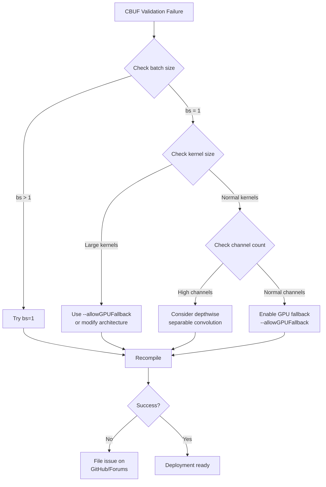
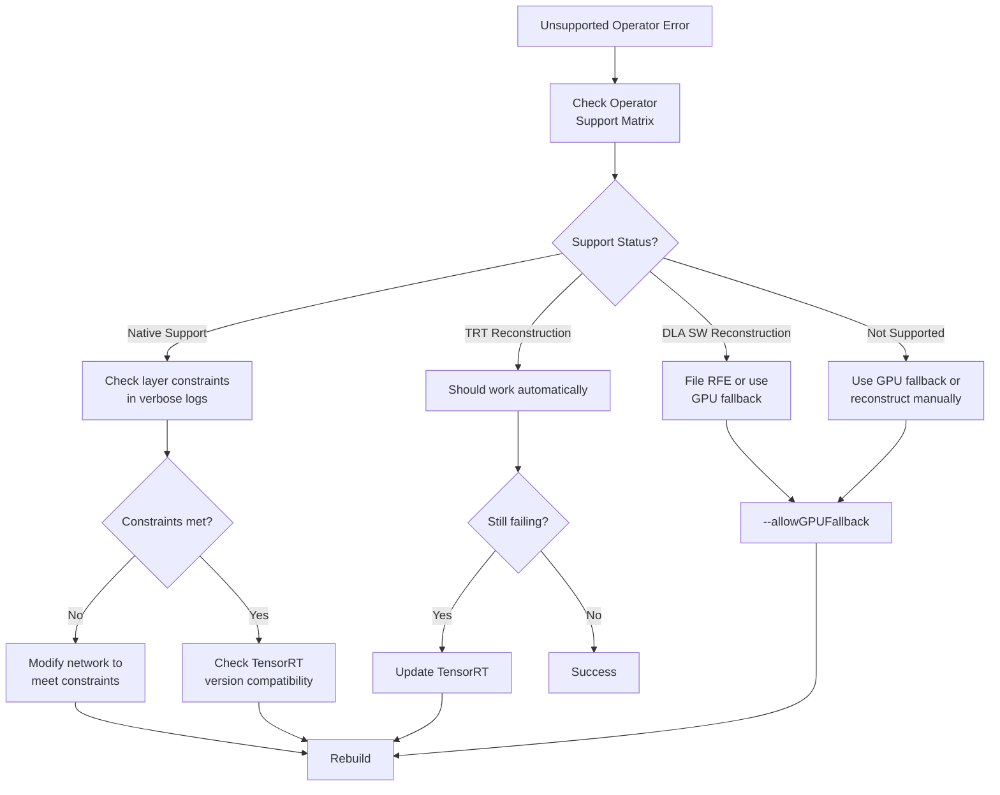
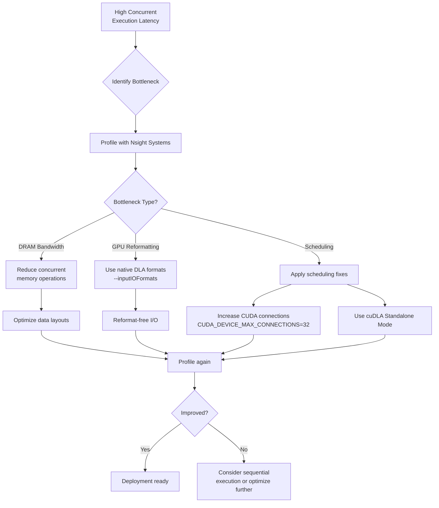
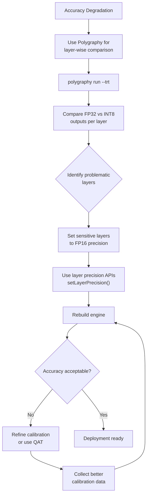
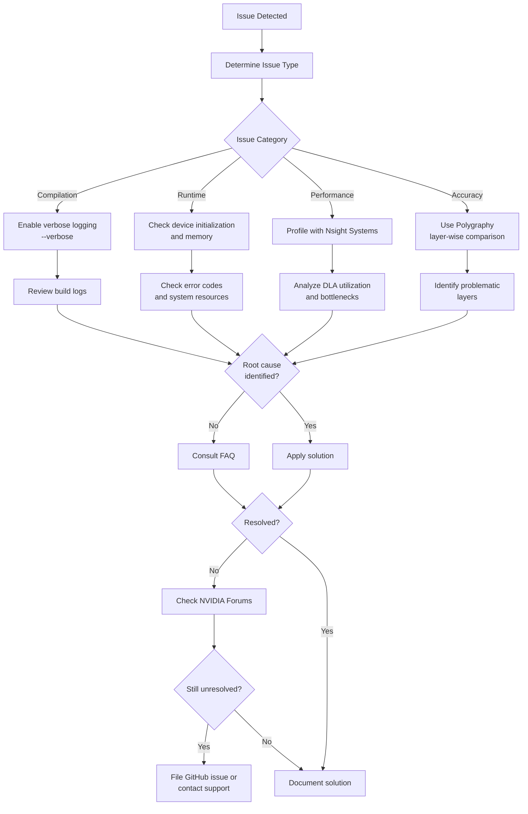

<!-- source: DeepWiki mcp.deepwiki.com · repo NVIDIA/Deep-Learning-Accelerator-SW · page 9.2 Common Issues and Solutions · fetched 2026-10-26 -->

# Common Issues and Solutions

<details>
<summary>Relevant source files</summary>

The following files were used as context for generating this wiki page:

- [FAQ/README.md](FAQ/README.md)

</details>


This page provides a comprehensive troubleshooting guide for common issues encountered when deploying models on DLA. It covers compilation errors, runtime failures, performance problems, precision configuration issues, and provides systematic debugging workflows. For general questions about DLA capabilities and features, see [Frequently Asked Questions](#9.1). For performance optimization techniques, see [Performance Analysis and Optimization](#7).

## Compilation Issues

### CBUF Validation Failures

**Symptom**: TensorRT Builder fails with errors related to "CBUF validation" when attempting to map Convolution layers to DLA.

**Root Cause**: DLA has internal SRAM called CBUF (Convolution Buffer) with limited capacity. Starting from TensorRT 8.6.0, TensorRT performs heuristic-based checks to determine if a Convolution node's data and weights can fit in CBUF before passing it to the DLA Compiler [FAQ/README.md:133-134]().

**Common Scenarios**:
- Large kernel sizes (e.g., 7x7 or larger)
- High input/output channel counts
- Large batch sizes
- Convolution weights that exceed SRAM capacity

**Solutions**:

1. **Reduce batch size**: Compile with batch size 1 and use multiple inferences
   ```bash
   trtexec --onnx=model.onnx --useDLACore=0 --int8 --batch=1
   ```

2. **Allow GPU fallback**: Let affected layers run on GPU
   ```bash
   trtexec --onnx=model.onnx --useDLACore=0 --int8 --allowGPUFallback
   ```

3. **Modify network architecture**: Replace large kernels with multiple smaller kernels (e.g., replace 7x7 with two 3x3 convolutions)

4. **Use depthwise separable convolutions**: Reduces parameter count and CBUF usage

**Diagnostic Command**:
```bash
trtexec --onnx=model.onnx --useDLACore=0 --int8 --verbose --dumpLayerInfo
```



**Sources**: [FAQ/README.md:133-134]()

### Unsupported Operator Errors

**Symptom**: TensorRT reports that certain ONNX operators cannot be mapped to DLA during compilation.

**Root Cause**: The operator either has no native DLA support, requires TensorRT reconstruction (not yet exposed), or violates DLA layer constraints.

**Diagnostic Steps**:

1. **Check operator support status**: Refer to the [Operator Support Matrix](#4.1)
2. **Review layer restrictions**: See [Layer Restrictions and Constraints](#4.3)
3. **Examine verbose build logs**:
   ```bash
   trtexec --onnx=model.onnx --useDLACore=0 --verbose > build.log 2>&1
   ```

**Solutions**:

1. **Enable GPU fallback** for unsupported layers:
   ```bash
   trtexec --onnx=model.onnx --useDLACore=0 --allowGPUFallback
   ```

2. **Use operator reconstruction techniques**: See [Operator Reconstruction Techniques](#4.2) to decompose unsupported operators into supported primitives

3. **Modify ONNX graph**: Use model preparation scripts to replace unsupported operations
   - See [ONNX Model Preparation Scripts](#3.1)
   - Example: Replace `Upsample` with `ConvTranspose` or `Resize` with specific parameters

4. **File an RFE**: If DLA hardware supports the operation but TensorRT doesn't expose it, file a Request for Enhancement



**Sources**: [FAQ/README.md:35-43]()

### Layer Constraint Violations

**Symptom**: TensorRT maps layers to GPU despite requesting DLA execution, with warnings about constraint violations.

**Common Constraint Violations**:

| Layer Type | Common Violations | Solution |
|------------|------------------|----------|
| Convolution | Stride > kernel size | Adjust stride or use transposed conv |
| Convolution | Groups not equal to 1 or input channels | Depthwise: groups = C, Regular: groups = 1 |
| Pooling | Non-square kernels/strides | Use square dimensions |
| ElementWise | Broadcasting not supported | Match tensor dimensions exactly |
| Concat | Axis != channel dimension | Concatenate along channel axis only |

**Diagnostic Workflow**:

1. Enable verbose logging to see constraint violations:
   ```bash
   trtexec --onnx=model.onnx --useDLACore=0 --verbose 2>&1 | grep -i "constraint\|restriction\|unsupported"
   ```

2. Review the [Layer Restrictions and Constraints](#4.3) documentation

3. Modify the ONNX graph using preparation scripts to satisfy constraints

**Sources**: [FAQ/README.md:36-49]()

## Runtime Issues

### Input/Output Format Mismatch Errors

**Symptom**: Runtime errors about incompatible tensor formats, or performance degradation due to excessive reformatting.

**Root Cause**: DLA uses specific memory formats (`dla_hwc4` for INT8, `dla_linear` for FP16) that differ from default GPU formats. When formats don't match, TensorRT inserts reformat layers that execute on GPU.

**Error Example**:
```
[E] Error: Inputs in kDLA_HWC4 format with FP16 consumed by INT8 Conv not supported
```

**Mixed Precision Format Issue**: FP16 `kDLA_HWC4` inputs consumed by an INT8 Convolution (or vice versa) are not supported [FAQ/README.md:136-137]().

**Solutions**:

1. **Specify native DLA formats during compilation**:
   ```bash
   trtexec --onnx=model.onnx --useDLACore=0 --int8 \
     --inputIOFormats=int8:dla_hwc4 \
     --outputIOFormats=int8:chw32
   ```

2. **Match precision between consecutive layers**: If using mixed precision, ensure format transitions occur at precision boundaries
   ```bash
   # Set Conv layer precision to match input precision
   # Use TensorRT APIs: ILayer::setPrecision()
   ```

3. **Use reformat-free network tensors**: Configure I/O formats to avoid GPU reformatting
   - For INT8: Use `dla_hwc4` for inputs, `chw32` for outputs
   - For FP16: Use `dla_linear` or compatible formats

4. **Check actual formats in engine**:
   ```bash
   trtexec --loadEngine=model.engine --dumpLayerInfo 2>&1 | grep -i "format"
   ```

**Sources**: [FAQ/README.md:45-58](), [FAQ/README.md:136-137]()

### Memory Allocation Failures

**Symptom**: Runtime errors related to memory allocation, particularly with large models or high batch sizes.

**Common Error Messages**:
- "Out of memory" during engine deserialization
- "cudaMalloc failed"
- "Failed to allocate DLA SRAM"

**Root Causes**:
- Insufficient system DRAM
- DLA SRAM capacity exceeded (1MB per core on Orin, 4MB shared on Xavier)
- Multiple concurrent models exhausting memory

**Solutions**:

1. **Increase memory pool sizes**:
   ```bash
   trtexec --onnx=model.onnx --useDLACore=0 \
     --memPoolSize=dlaSRAM:1 \
     --workspace=1024
   ```

2. **Reduce batch size**: Compile with smaller batches
   ```bash
   trtexec --onnx=model.onnx --useDLACore=0 --batch=1
   ```

3. **Use model optimization techniques**:
   - Apply graph fusion to reduce intermediate tensor memory
   - Enable structured sparsity to reduce weight memory

4. **Monitor memory usage**:
   ```bash
   # During compilation
   trtexec --onnx=model.onnx --useDLACore=0 --verbose 2>&1 | grep -i "memory"
   
   # During runtime
   nsys profile --trace=cuda,nvtx,cudla ./app
   ```

**Sources**: [FAQ/README.md:96-98]()

### cuDLA Device Initialization Errors

**Symptom**: Runtime fails to initialize DLA device with cuDLA APIs.

**Common Errors**:
- "cudlaCreateDevice failed"
- "Device not found"
- "Invalid DLA core index"

**Solutions**:

1. **Verify DLA availability**:
   ```bash
   # Check if DLA cores are present
   cat /sys/devices/platform/host1x/15880000.nvdla*/hwpm/num_resources
   ```

2. **Check platform compatibility**: Ensure platform has DLA (Orin/Xavier, not Nano)
   - See [Supported Platforms](#1.3)

3. **Verify kernel driver**: Ensure DLA kernel driver is loaded
   ```bash
   lsmod | grep nvdla
   ```

4. **Use correct DLA core index**: Valid indices are 0 and 1
   ```bash
   # Correct
   trtexec --onnx=model.onnx --useDLACore=0
   
   # Incorrect
   trtexec --onnx=model.onnx --useDLACore=2  # Error: only cores 0,1 exist
   ```

5. **Check software versions**: Ensure minimum versions are met
   - JetPack 5.1.1+ or DRIVE OS 6.0.8.0+
   - TensorRT 8.5.0+ (for default cuDLA integration)

**Sources**: [FAQ/README.md:29-30](), [FAQ/README.md:139-140]()

## Performance Issues

### High Latency with Concurrent Execution

**Symptom**: Increased latency when running workloads on multiple DLA cores and GPU concurrently, compared to running them sequentially.

**Root Causes** [FAQ/README.md:51-58]():

1. **DRAM Bandwidth Contention**: DLA and GPU share system DRAM. Bandwidth-bound workloads bottleneck when running in parallel.

2. **GPU Reformat Overhead**: Non-native DLA formats cause GPU reformat kernels to execute around every DLA inference, adding GPU workload.

3. **Inefficient Scheduling**: At low batch sizes or when frames arrive at fixed rates, DLA tasks may not schedule quickly or signal completion efficiently.

**Solutions**:



**Detailed Solutions**:

1. **Use native DLA formats** to eliminate GPU reformat kernels:
   ```bash
   trtexec --onnx=model.onnx --useDLACore=0 --int8 \
     --inputIOFormats=int8:dla_hwc4 \
     --outputIOFormats=int8:chw32
   ```

2. **Increase CUDA concurrent connections** to improve scheduling:
   ```bash
   export CUDA_DEVICE_MAX_CONNECTIONS=32
   ./your_application
   ```

3. **Use cuDLA for DLA inference**: Since TensorRT 8.5, this is default, but for earlier versions:
   - Extract DLA loadable from TensorRT engine
   - Use cuDLA standalone mode for independent scheduling
   - See [cuDLA Standalone Mode](#6.3)

4. **Profile to identify the actual bottleneck**:
   ```bash
   nsys profile --trace=cuda,nvtx,cudla -o profile_output ./app
   # Analyze profile_output.qdrep in Nsight Systems GUI
   ```

5. **Optimize for bandwidth-bound workloads**:
   - Use smaller batch sizes to reduce memory transfers
   - Ensure models have sufficient arithmetic intensity
   - Consider sequential execution for bandwidth-heavy models

**Sources**: [FAQ/README.md:51-58]()

### GPU-DLA Alternating Overhead

**Symptom**: Poor performance when network has layers alternating between GPU and DLA execution.

**Root Causes** [FAQ/README.md:45-49]():

1. **Tensor Reformatting**: Format conversions between GPU and DLA formats
2. **Small Workloads**: Individual layers with minimal compute
3. **Context Switching**: CPU overhead for task submission

**Solutions**:

1. **Use common tensor formats**: Ensure `kCHW16` (FP16) or `kCHW32` (INT8) are used consistently

2. **Ensure contiguous DLA subgraphs**: Avoid single layers going back and forth
   - Use `--allowGPUFallback` to map entire subgraphs to one accelerator
   - Profile with `trtexec --dumpProfile` to see layer assignments

3. **Optimize graph structure**: Use model preparation scripts to:
   - Fuse layers to create larger DLA-compatible subgraphs
   - Move incompatible operations to the beginning or end of the network
   - See [Graph Optimization Techniques](#3.3)

**Diagnostic Steps**:

```bash
# Check layer-to-device mapping
trtexec --onnx=model.onnx --useDLACore=0 --allowGPUFallback \
  --dumpLayerInfo 2>&1 | grep "Device:"

# Profile to measure reformat overhead
trtexec --loadEngine=model.engine --dumpProfile
```

**Sources**: [FAQ/README.md:45-49]()

### Low DLA Utilization

**Symptom**: DLA hardware utilization is low according to profiling metrics, resulting in suboptimal throughput.

**Root Causes**:
- Memory-bound operations dominating execution
- Small batch sizes
- Network architecture with low arithmetic intensity
- Clock frequency not optimized for workload

**Solutions**:

1. **Increase batch size**: Improves compute utilization
   ```bash
   trtexec --onnx=model.onnx --useDLACore=0 --batch=2 --int8
   ```

2. **Use INT8 precision**: DLA is optimized for INT8 operations
   - Orin DLA: 9x better INT8 performance than FP16
   - See [Precision Configuration](#5.3)

3. **Enable structured sparsity** for 1.24-1.47x speedup:
   ```bash
   trtexec --onnx=model.onnx --useDLACore=0 --int8 --sparsity=force
   ```

4. **Choose models with high arithmetic intensity**:
   - ResNet-18, ResNet-34, ResNet-50 (many ops per memory access)
   - These models are better suited for high DLA utilization

5. **Optimize clock frequency**: Set appropriate power mode
   ```bash
   # On Jetson, use nvpmodel
   sudo nvpmodel -m 0  # MAXN mode
   
   # For automotive platforms, configure at flash time
   ```

6. **Collect layerwise statistics** to identify bottlenecks:
   ```bash
   # See which layers are memory-bound vs compute-bound
   # Use cuDLALayerwiseStats tools - see section 7.1
   ```

**Sources**: [FAQ/README.md:38](), [FAQ/README.md:66-67](), [FAQ/README.md:100-105]()

## Precision and Quantization Issues

### Calibration Cache Not Found

**Symptom**: TensorRT reports missing calibration cache when building INT8 engine.

**Error Message**:
```
Calibration file not found. Please provide a calibration cache.
```

**Solutions**:

1. **Provide calibration cache** using `--calib` flag:
   ```bash
   trtexec --onnx=model.onnx --useDLACore=0 --int8 --calib=calibration.cache
   ```

2. **Generate calibration cache** using PTQ:
   - Use TensorRT's INT8 calibration API
   - Reference sample: https://github.com/NVIDIA/TensorRT/tree/main/samples/sampleINT8
   - See [Precision Configuration](#5.3)

3. **Use QDQ models** (Quantization-aware training):
   - Export model with explicit Q/DQ nodes
   - Use QDQ Translator to extract scales
   - See [QDQ Translator for Quantized Models](#3.2)

4. **Set per-tensor scales** using TensorRT APIs instead of calibration file:
   ```cpp
   // ITensor::setDynamicRange() API
   tensor->setDynamicRange(-127.0f, 127.0f);
   ```

5. **Use mixed precision** if calibration is unavailable for specific layers:
   ```bash
   trtexec --onnx=model.onnx --useDLACore=0 --int8 --fp16 --allowGPUFallback
   ```

**Sources**: [FAQ/README.md:75-76]()

### Mixed Precision Accuracy Issues

**Symptom**: Significant accuracy degradation when using INT8 or mixed FP16/INT8 precision.

**Root Causes**:
- Incorrect quantization scales
- Sensitive layers running in INT8
- Activation ranges exceeding INT8 representation

**Diagnostic Workflow**:



**Solutions**:

1. **Use TensorRT Polygraphy** for layer-wise debugging:
   ```bash
   polygraphy run model.onnx --trt --int8 \
     --pool-limit workspace:1G \
     --trt-outputs mark all \
     --onnxrt \
     --atol 0.1 --rtol 0.1
   ```

2. **Set specific layers to FP16** if they're sensitive:
   ```cpp
   // In TensorRT network definition
   layer->setPrecision(nvinfer1::DataType::kHALF);
   layer->setOutputType(0, nvinfer1::DataType::kHALF);
   ```

3. **Use better calibration dataset**: Ensure representative samples
   - Cover full range of input distributions
   - Include edge cases

4. **Consider Quantization-Aware Training (QAT)**:
   - Train with simulated quantization
   - Often achieves better accuracy than PTQ
   - Use pytorch-quantization toolkit
   - See [QDQ Translator for Quantized Models](#3.2)

5. **Verify dynamic ranges**: Check if activation ranges are reasonable
   ```bash
   # Inspect calibration cache
   cat calibration.cache
   ```

**Sources**: [FAQ/README.md:69-76](), [FAQ/README.md:125]()

## Diagnostic Workflow and Best Practices

### Systematic Debugging Approach

When encountering issues with DLA deployment, follow this systematic approach:



**Key Diagnostic Commands**:

```bash
# 1. Compilation diagnostics
trtexec --onnx=model.onnx --useDLACore=0 --verbose --dumpLayerInfo 2>&1 | tee build.log

# 2. Runtime profiling
nsys profile --trace=cuda,nvtx,cudla -o profile ./app

# 3. Layer-wise statistics
# Use cuDLALayerwiseStats - see section 7.1

# 4. Accuracy debugging
polygraphy run model.onnx --trt --int8 --onnxrt --atol 0.1

# 5. Memory usage
trtexec --onnx=model.onnx --useDLACore=0 --dumpProfile --verbose 2>&1 | grep -i "memory\|sram"

# 6. Check DLA availability
cat /sys/devices/platform/host1x/*/hwpm/num_resources
```

**Sources**: [FAQ/README.md:117-125]()

### Update and Version Check

Many issues are resolved in newer releases. Always verify you're using compatible and up-to-date versions:

```bash
# Check TensorRT version
dpkg -l | grep tensorrt

# Check JetPack version (on Jetson)
cat /etc/nv_tegra_release

# Check CUDA version
nvcc --version

# Check DLA kernel driver
dmesg | grep -i dla
```

**Minimum Version Requirements**:
- JetPack 5.1.1+ (Jetson)
- DRIVE OS 6.0.8.0+ (Automotive)
- TensorRT 8.5.0+ (recommended for cuDLA default integration)
- DLA SW 3.14.0+ (for latest operator support)

**Update Steps**:

1. **Update JetPack** (Jetson platforms):
   ```bash
   sudo apt update
   sudo apt upgrade nvidia-jetpack
   ```

2. **Check release notes**: Review what issues were fixed in newer versions

3. **Test with latest version**: Reproduce issue with updated software

**Sources**: [FAQ/README.md:139-140]()

### Community Resources and Support

If the issue persists after following this guide:

1. **Search NVIDIA Forums**: https://forums.developer.nvidia.com/
   - Many common issues have community solutions
   - Search for error messages or symptoms

2. **Check GitHub Issues**: Review existing issues in the DLA SW repository
   - May find workarounds or status updates
   - See if issue is already reported

3. **File a new issue**: If no solution exists
   - Follow [Contribution Workflow](#10.1)
   - Provide complete diagnostic information:
     - Platform and software versions
     - Model architecture and ONNX file
     - Complete build and runtime logs
     - Reproduction steps
   - Tag issue appropriately (bug, enhancement, question)

4. **Contact NVIDIA Support**: For critical production issues
   - Enterprise support channels available for commercial users

**Sources**: [FAQ/README.md:139-140]()

---

## Common Error Reference Table

| Error Message / Symptom | Root Cause | Primary Solution | See Section |
|------------------------|------------|------------------|-------------|
| CBUF validation failure | Weights/data exceed SRAM | Reduce batch size or use --allowGPUFallback | [CBUF Validation](#cbuf-validation-failures) |
| Unsupported operator | Operator not in DLA support matrix | Use --allowGPUFallback or reconstruct | [Unsupported Operators](#unsupported-operator-errors) |
| Format mismatch (kDLA_HWC4 FP16 with INT8 Conv) | Mixed precision format incompatibility | Match Conv precision to input precision | [Format Mismatch](#inputoutput-format-mismatch-errors) |
| High concurrent latency | DRAM contention or scheduling issues | Use native formats, increase CUDA_DEVICE_MAX_CONNECTIONS | [Concurrent Execution](#high-latency-with-concurrent-execution) |
| cudlaCreateDevice failed | DLA not available or driver issue | Check platform compatibility and driver | [Device Initialization](#cudla-device-initialization-errors) |
| Calibration cache not found | Missing INT8 calibration data | Provide --calib or use QDQ models | [Calibration Cache](#calibration-cache-not-found) |
| Low DLA utilization | Memory-bound workload or suboptimal config | Use INT8, increase batch size, enable sparsity | [Low Utilization](#low-dla-utilization) |
| GPU-DLA alternating overhead | Tensor reformatting between accelerators | Use common formats, ensure contiguous subgraphs | [Alternating Overhead](#gpu-dla-alternating-overhead) |
| Out of memory | Insufficient DRAM or SRAM | Reduce batch size, increase memory pools | [Memory Allocation](#memory-allocation-failures) |
| Accuracy degradation | Incorrect quantization or sensitive layers | Use Polygraphy to debug, set layers to FP16 | [Accuracy Issues](#mixed-precision-accuracy-issues) |

**Sources**: [FAQ/README.md:1-141]()

---

