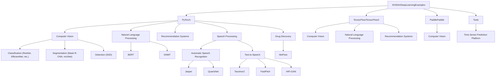
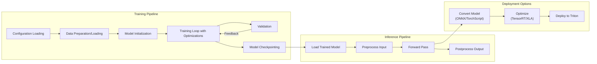
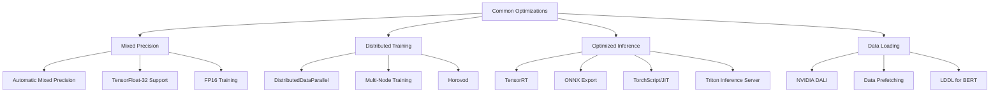
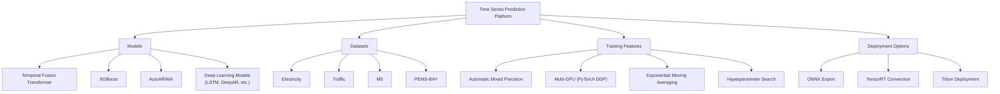
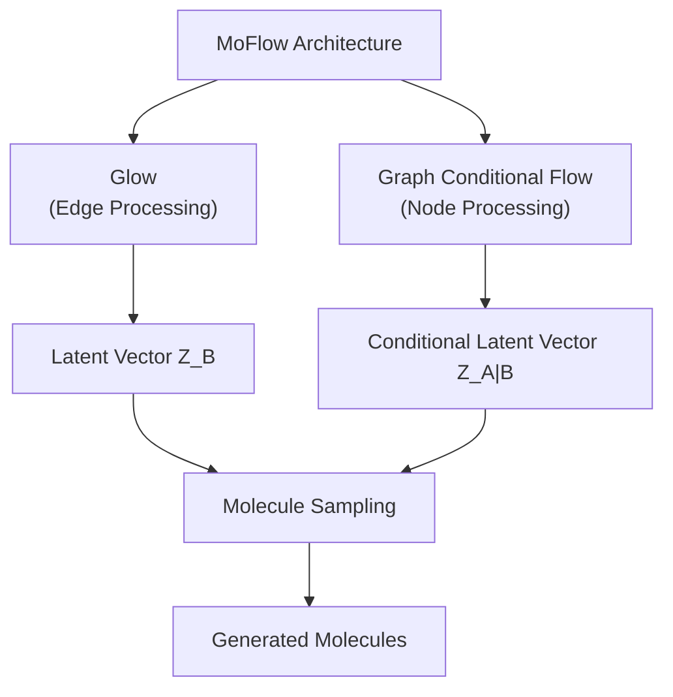

<!-- source: DeepWiki mcp.deepwiki.com · repo NVIDIA/DeepLearningExamples · page 1 Overview · fetched 2026-10-26 -->

# Overview

Relevant source files

The following files were used as context for generating this wiki page:

- [PyTorch/DrugDiscovery/MoFlow/Dockerfile](PyTorch/DrugDiscovery/MoFlow/Dockerfile)
- [PyTorch/DrugDiscovery/MoFlow/LICENSE](PyTorch/DrugDiscovery/MoFlow/LICENSE)
- [PyTorch/DrugDiscovery/MoFlow/NOTICE](PyTorch/DrugDiscovery/MoFlow/NOTICE)
- [PyTorch/DrugDiscovery/MoFlow/README.md](PyTorch/DrugDiscovery/MoFlow/README.md)
- [PyTorch/DrugDiscovery/MoFlow/img/moflow.png](PyTorch/DrugDiscovery/MoFlow/img/moflow.png)
- [PyTorch/DrugDiscovery/MoFlow/moflow/__init__.py](PyTorch/DrugDiscovery/MoFlow/moflow/__init__.py)
- [PyTorch/DrugDiscovery/MoFlow/moflow/config.py](PyTorch/DrugDiscovery/MoFlow/moflow/config.py)
- [PyTorch/DrugDiscovery/MoFlow/moflow/data/__init__.py](PyTorch/DrugDiscovery/MoFlow/moflow/data/__init__.py)
- [PyTorch/DrugDiscovery/MoFlow/moflow/data/data_frame_parser.py](PyTorch/DrugDiscovery/MoFlow/moflow/data/data_frame_parser.py)
- [PyTorch/DrugDiscovery/MoFlow/moflow/data/data_loader.py](PyTorch/DrugDiscovery/MoFlow/moflow/data/data_loader.py)
- [PyTorch/DrugDiscovery/MoFlow/moflow/data/encoding.py](PyTorch/DrugDiscovery/MoFlow/moflow/data/encoding.py)
- [README.md](README.md)
- [Tools/PyTorch/TimeSeriesPredictionPlatform/README.md](Tools/PyTorch/TimeSeriesPredictionPlatform/README.md)
- [Tools/PyTorch/TimeSeriesPredictionPlatform/requirements.txt](Tools/PyTorch/TimeSeriesPredictionPlatform/requirements.txt)
- [Tools/PyTorch/TimeSeriesPredictionPlatform/triton/requirements.txt](Tools/PyTorch/TimeSeriesPredictionPlatform/triton/requirements.txt)

The NVIDIA Deep Learning Examples repository provides state-of-the-art deep learning model implementations that are optimized for NVIDIA GPUs. This repository serves as a comprehensive collection of reference architectures and optimized models across multiple frameworks and application domains. The examples are designed to achieve both high performance and accuracy while taking advantage of NVIDIA's hardware and software stack.

This page provides a high-level overview of the repository structure, common features and optimizations, and the range of models available. For detailed information about specific frameworks, refer to [PyTorch Models](#2), [TensorFlow Models](#3), or [Other Frameworks](#4).

## Repository Structure and Organization

The repository is organized primarily by deep learning framework, then by application domain, and finally by specific model implementations.

Sources: [README.md:3-89](https://github.com/NVIDIA/DeepLearningExamples/blob/master/README.md)

## Supported Models and Domains

The repository contains models across various domains:

### Computer Vision
- **Classification**: ResNet-50, ResNeXt-101, SE-ResNeXt-101, EfficientNet (v1/v2), GPUNet
- **Object Detection**: SSD
- **Segmentation**: Mask R-CNN, U-Net Medical, nnUNet

### Natural Language Processing
- **Language Understanding**: BERT, ELECTRA
- **Translation**: GNMT
- **Optimized Inference**: Faster Transformer

### Recommendation Systems
- DLRM (Deep Learning Recommendation Model)
- Neural Collaborative Filtering (NCF)
- Wide & Deep Learning
- Variational Autoencoder for Collaborative Filtering (VAE-CF)
- Search Interest Map (SIM)

### Speech Technologies
- **Speech Recognition**: Jasper, QuartzNet
- **Text-to-Speech**: Tacotron 2, FastPitch, HiFi-GAN

### Other Applications
- **Time Series Forecasting**: Time Series Prediction Platform (TSPP)
- **Drug Discovery**: MoFlow (molecular flow model)
- **Graph Neural Networks**: SE(3)-Transformer

Sources: [README.md:14-89](https://github.com/NVIDIA/DeepLearningExamples/blob/master/README.md)

## Training and Inference Pipeline

Most examples in the repository follow a common workflow pattern that spans training through inference to deployment:

Sources: [README.md:91-122](https://github.com/NVIDIA/DeepLearningExamples/blob/master/README.md)

## Common Features and Optimizations

The examples in this repository implement various performance optimizations to maximize GPU utilization and minimize training and inference time:

### Mixed Precision Training

Mixed precision combines different numerical precisions in a computational method. This approach:
- Performs operations in half-precision format (FP16) where possible
- Maintains critical information in single-precision (FP32)
- Provides up to 3x overall speedup on architectures with Tensor Cores
- Requires proper loss scaling to preserve small gradient values

### TensorFloat-32 (TF32)

TF32 is a math mode in NVIDIA A100 GPUs for tensor operations that:
- Provides up to 10x speedups compared to FP32 on Volta GPUs
- Is more robust than FP16 for models requiring high dynamic range
- Is enabled by default on Ampere architecture

### Distributed Training

Most examples support:
- Multi-GPU training using PyTorch's DistributedDataParallel or TensorFlow's distribution strategies
- Multi-node training on supported models
- Horovod integration for some models

### Optimized Inference

Inference optimizations include:
- TensorRT integration for faster inference
- ONNX export for framework-agnostic deployment
- TorchScript/JIT compilation for PyTorch models
- Triton Inference Server deployment examples

Sources: [README.md:99-116](https://github.com/NVIDIA/DeepLearningExamples/blob/master/README.md)

## Specialized Platforms

### Time Series Prediction Platform

The Time Series Prediction Platform (TSPP) is a comprehensive framework for time-series forecasting that enables mixing and matching of different datasets and models. This platform:

- Supports multiple models: Temporal Fusion Transformer, XGBoost, AutoARIMA, LSTM, N-BEATS, N-HITS, DeepAR, MTGNN, DCRNN
- Works with various datasets: Electricity, Traffic, M5, PEMS-BAY
- Enables advanced features like mixed precision, multi-GPU training, and deployment via ONNX/TensorRT/Triton
- Provides flexible experiment workflow with easy model and dataset customization

Sources: [Tools/PyTorch/TimeSeriesPredictionPlatform/README.md:1-131](https://github.com/NVIDIA/DeepLearningExamples/blob/master/Tools/PyTorch/TimeSeriesPredictionPlatform/README.md)

### MoFlow for Drug Discovery

MoFlow is a state-of-the-art model for molecule generation that leverages Normalizing Flows to generate novel molecular structures. Key features include:

- Generation of novel molecules with similar properties to training data
- Support for de-novo drug design by navigating chemical space
- Optimized implementation with CUDA parallelism and mixed precision
- Performance enhancements including stream concurrency and memory optimizations

Sources: [PyTorch/DrugDiscovery/MoFlow/README.md:40-83](https://github.com/NVIDIA/DeepLearningExamples/blob/master/PyTorch/DrugDiscovery/MoFlow/README.md)

## NGC Container Support

The examples in this repository are also available through the NVIDIA GPU Cloud (NGC) Container Registry, which provides:

- Monthly updated Docker containers with the latest examples
- Latest NVIDIA contributions to the respective frameworks
- Quality-assured deep learning software libraries (cuDNN, NCCL, cuBLAS, etc.)
- Regular release notes for each optimized container

Sources: [README.md:6-12](https://github.com/NVIDIA/DeepLearningExamples/blob/master/README.md)

## Repository Features at a Glance

| Feature | Description |
|---------|-------------|
| Frameworks | PyTorch, TensorFlow, TensorFlow 2, PaddlePaddle |
| Application Domains | Computer Vision, NLP, Recommendation Systems, Speech, Drug Discovery, Time Series |
| Training Optimizations | Automatic Mixed Precision, Multi-GPU, Multi-Node, Fast Data Loading |
| Inference Optimizations | TensorRT, ONNX Export, TorchScript/JIT, Triton Inference Server |
| Container Support | NGC containers with all dependencies included |
| Documentation | README files with detailed instructions, performance benchmarks, and known issues |

Sources: [README.md:14-89](https://github.com/NVIDIA/DeepLearningExamples/blob/master/README.md)

## Getting Started 

To get started with these examples:

1. Access the NGC container registry
2. Pull the desired container
3. Run the container with appropriate GPU resources
4. Follow the example-specific instructions in the respective README

For detailed instructions, refer to:
- [Getting Started Using NVIDIA GPU Cloud](https://docs.nvidia.com/ngc/ngc-getting-started-guide/index.html)
- [Accessing And Pulling From The NGC Container Registry](https://docs.nvidia.com/deeplearning/frameworks/user-guide/index.html#accessing_registry)

Sources: [README.md:6-12](https://github.com/NVIDIA/DeepLearningExamples/blob/master/README.md)

---

