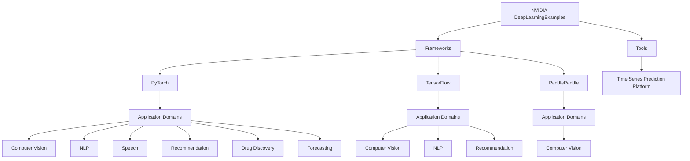
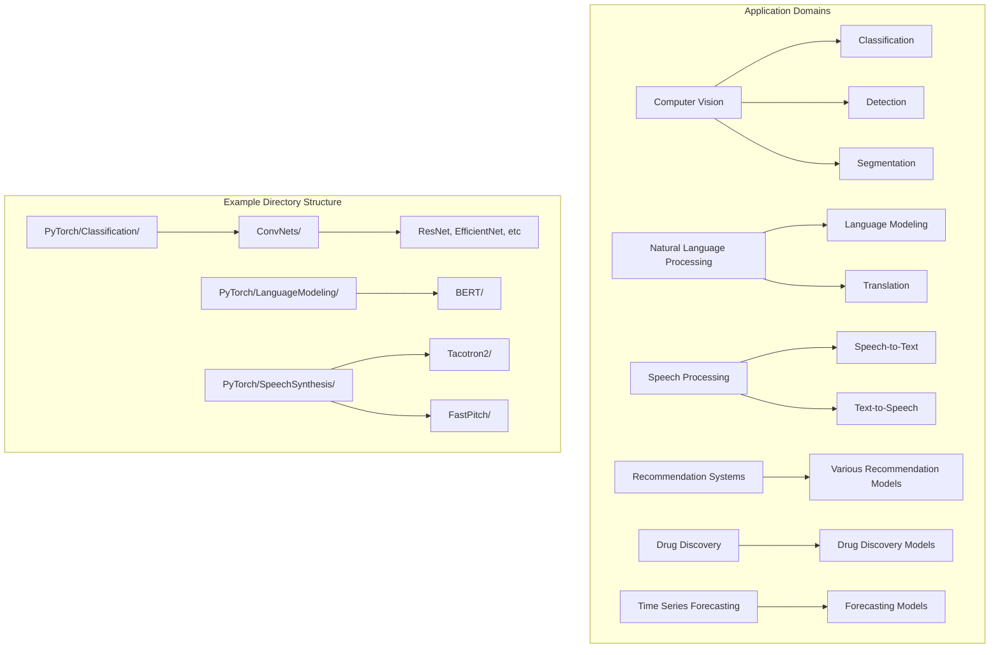
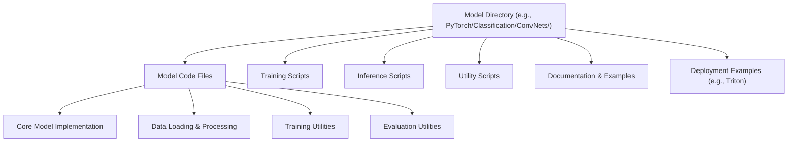
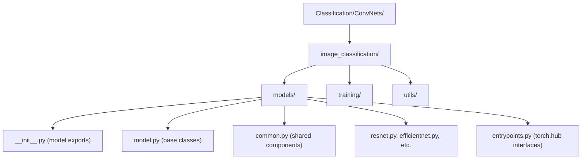
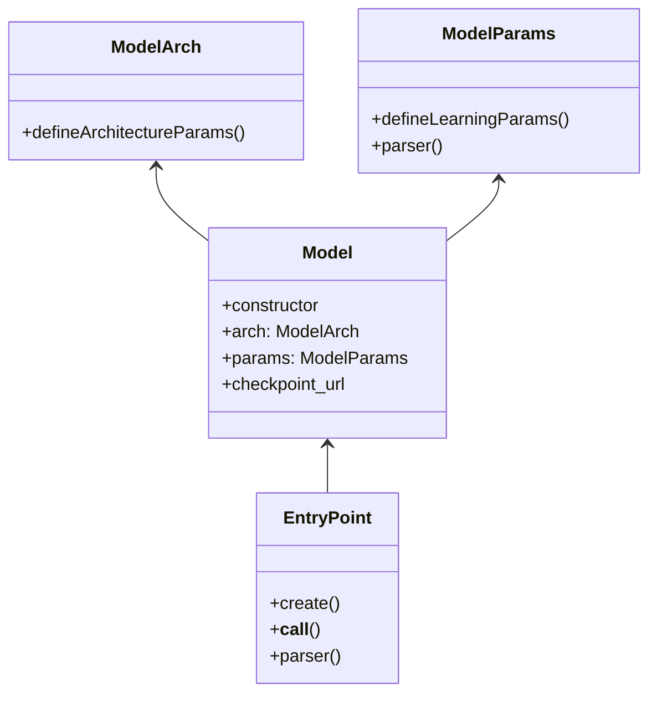
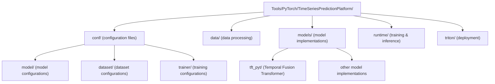
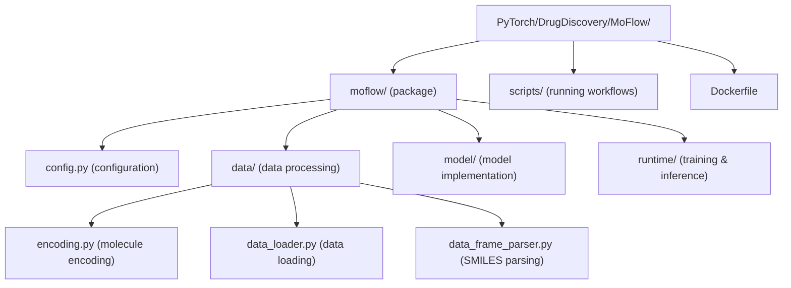
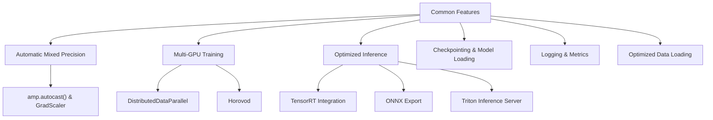
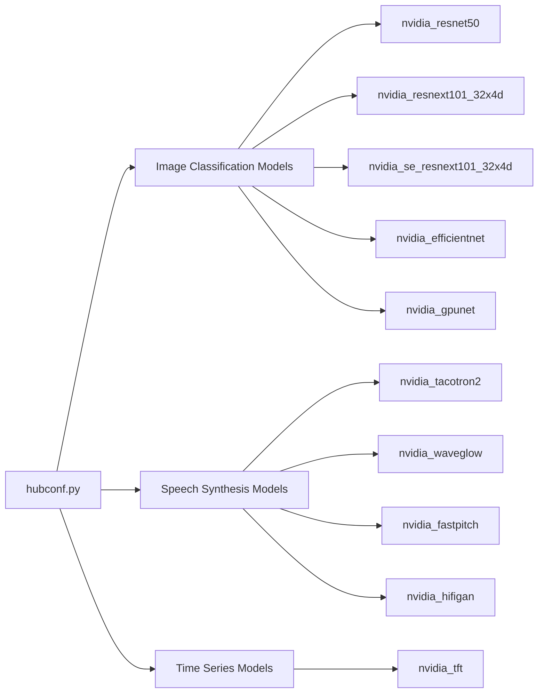

<!-- source: DeepWiki mcp.deepwiki.com · repo NVIDIA/DeepLearningExamples · page 1.1 Repository Structure · fetched 2026-10-26 -->

# Repository Structure

Relevant source files

The following files were used as context for generating this wiki page:

- [PyTorch/Classification/ConvNets/checkpoint2model.py](PyTorch/Classification/ConvNets/checkpoint2model.py)
- [PyTorch/Classification/ConvNets/image_classification/models/__init__.py](PyTorch/Classification/ConvNets/image_classification/models/__init__.py)
- [PyTorch/Classification/ConvNets/image_classification/models/common.py](PyTorch/Classification/ConvNets/image_classification/models/common.py)
- [PyTorch/Classification/ConvNets/image_classification/models/efficientnet.py](PyTorch/Classification/ConvNets/image_classification/models/efficientnet.py)
- [PyTorch/Classification/ConvNets/image_classification/models/entrypoints.py](PyTorch/Classification/ConvNets/image_classification/models/entrypoints.py)
- [PyTorch/Classification/ConvNets/image_classification/models/model.py](PyTorch/Classification/ConvNets/image_classification/models/model.py)
- [PyTorch/Classification/ConvNets/image_classification/models/resnet.py](PyTorch/Classification/ConvNets/image_classification/models/resnet.py)
- [PyTorch/Classification/ConvNets/image_classification/optimizers.py](PyTorch/Classification/ConvNets/image_classification/optimizers.py)
- [PyTorch/Classification/ConvNets/quant_main.py](PyTorch/Classification/ConvNets/quant_main.py)
- [PyTorch/DrugDiscovery/MoFlow/Dockerfile](PyTorch/DrugDiscovery/MoFlow/Dockerfile)
- [PyTorch/DrugDiscovery/MoFlow/LICENSE](PyTorch/DrugDiscovery/MoFlow/LICENSE)
- [PyTorch/DrugDiscovery/MoFlow/NOTICE](PyTorch/DrugDiscovery/MoFlow/NOTICE)
- [PyTorch/DrugDiscovery/MoFlow/README.md](PyTorch/DrugDiscovery/MoFlow/README.md)
- [PyTorch/DrugDiscovery/MoFlow/img/moflow.png](PyTorch/DrugDiscovery/MoFlow/img/moflow.png)
- [PyTorch/DrugDiscovery/MoFlow/moflow/__init__.py](PyTorch/DrugDiscovery/MoFlow/moflow/__init__.py)
- [PyTorch/DrugDiscovery/MoFlow/moflow/config.py](PyTorch/DrugDiscovery/MoFlow/moflow/config.py)
- [PyTorch/DrugDiscovery/MoFlow/moflow/data/__init__.py](PyTorch/DrugDiscovery/MoFlow/moflow/data/__init__.py)
- [PyTorch/DrugDiscovery/MoFlow/moflow/data/data_frame_parser.py](PyTorch/DrugDiscovery/MoFlow/moflow/data/data_frame_parser.py)
- [PyTorch/DrugDiscovery/MoFlow/moflow/data/data_loader.py](PyTorch/DrugDiscovery/MoFlow/moflow/data/data_loader.py)
- [PyTorch/DrugDiscovery/MoFlow/moflow/data/encoding.py](PyTorch/DrugDiscovery/MoFlow/moflow/data/encoding.py)
- [README.md](README.md)
- [Tools/PyTorch/TimeSeriesPredictionPlatform/README.md](Tools/PyTorch/TimeSeriesPredictionPlatform/README.md)
- [Tools/PyTorch/TimeSeriesPredictionPlatform/requirements.txt](Tools/PyTorch/TimeSeriesPredictionPlatform/requirements.txt)
- [Tools/PyTorch/TimeSeriesPredictionPlatform/triton/requirements.txt](Tools/PyTorch/TimeSeriesPredictionPlatform/triton/requirements.txt)
- [hubconf.py](hubconf.py)

This document provides an overview of the structure and organization of the NVIDIA Deep Learning Examples repository. It explains how the codebase is organized by frameworks and application domains, and describes key components and patterns found throughout the repository.

## Overview

The NVIDIA Deep Learning Examples repository contains optimized implementations of deep learning models across various frameworks and application domains. The repository is designed to demonstrate best practices for training and deploying state-of-the-art deep learning models on NVIDIA hardware.

The repository follows a hierarchical organization pattern:

Sources: [README.md:1-123](), [hubconf.py:1-34]()

## Primary Framework Directories

The repository is organized first by framework, with each framework directory containing implementations for various application domains:

| Framework | Directory | Description |
|-----------|-----------|-------------|
| PyTorch | `PyTorch/` | Contains PyTorch implementations for CV, NLP, Speech, Recommendation, Drug Discovery, and Forecasting |
| TensorFlow | `TensorFlow/` | Contains TensorFlow implementations for CV, NLP, and Recommendation |
| PaddlePaddle | `PaddlePaddle/` | Contains PaddlePaddle implementations for CV |
| Tools | `Tools/` | Contains standalone tools like the Time Series Prediction Platform |

Each framework directory follows similar patterns but might have framework-specific organization details based on the framework's conventions.

Sources: [README.md:15-90]()

## Application Domain Organization

Within each framework directory, models are organized by application domain. Below is a breakdown of the main application domains and their subdirectories:

Sources: [README.md:15-90](), [hubconf.py:1-34]()

## Model Implementation Structure

Each model implementation typically follows a consistent structure, with slight variations based on the framework and domain. Here's a general pattern:

Sources: [PyTorch/Classification/ConvNets/image_classification/models/model.py:1-185](), [PyTorch/Classification/ConvNets/image_classification/models/resnet.py:1-459](), [PyTorch/Classification/ConvNets/image_classification/models/efficientnet.py:1-585]()

### PyTorch Models Directory Structure

The PyTorch models follow a particularly consistent structure, which helps with maintainability and code reuse. Let's look at the specific structure of PyTorch classification models:

The key components in the PyTorch models directory are:

- `__init__.py`: Exports model constructors and entry points
- `model.py`: Contains base classes for models like `Model`, `ModelParams`, and `EntryPoint`
- `common.py`: Contains shared components like `LayerBuilder` and common layer definitions
- Model-specific files (e.g., `resnet.py`, `efficientnet.py`): Implement specific architectures
- `entrypoints.py`: Provides torch.hub interfaces for model loading

Sources: [PyTorch/Classification/ConvNets/image_classification/models/__init__.py:1-25](), [PyTorch/Classification/ConvNets/image_classification/models/model.py:1-185](), [PyTorch/Classification/ConvNets/image_classification/models/common.py:1-303](), [PyTorch/Classification/ConvNets/image_classification/models/resnet.py:1-459](), [PyTorch/Classification/ConvNets/image_classification/models/efficientnet.py:1-585](), [PyTorch/Classification/ConvNets/image_classification/models/entrypoints.py:1-116]()

### Model Definition Pattern

The repository uses a consistent pattern for defining models, which facilitates code reuse and maintainability. Here's the common pattern used for PyTorch models:

This pattern allows for:
- Clear separation of architecture parameters and training parameters
- Easy command-line argument parsing through the `parser()` methods
- Consistent model loading and checkpoint handling
- Unified interface for torch.hub

Sources: [PyTorch/Classification/ConvNets/image_classification/models/model.py:15-184](), [PyTorch/Classification/ConvNets/image_classification/models/resnet.py:212-252](), [PyTorch/Classification/ConvNets/image_classification/models/efficientnet.py:52-129]()

## Tools Directory

The `Tools` directory contains standalone utilities and platforms that complement the model implementations:

### Time Series Prediction Platform

The Time Series Prediction Platform (TSPP) is a comprehensive framework for time series forecasting:

The TSPP follows a modular design that allows users to:
- Mix and match different datasets and models
- Configure training parameters
- Deploy models using Triton Inference Server
- Evaluate models using various metrics

The platform supports multiple models such as Temporal Fusion Transformer, XGBoost, AutoARIMA, LSTM, N-BEATS, N-HITS, DeepAR, MTGNN, and DCRNN.

Sources: [Tools/PyTorch/TimeSeriesPredictionPlatform/README.md:1-448](), [Tools/PyTorch/TimeSeriesPredictionPlatform/requirements.txt:1-21](), [Tools/PyTorch/TimeSeriesPredictionPlatform/triton/requirements.txt:1-24]()

## Drug Discovery Models

The repository includes specialized models for drug discovery, such as MoFlow:

MoFlow is a model for molecule generation using normalizing flows, which allows for generating novel molecules with drug-like properties. The implementation includes:
- Molecule encoding and decoding
- Graph and bond processing
- Training and inference scripts
- Deployment examples

Sources: [PyTorch/DrugDiscovery/MoFlow/README.md:1-363](), [PyTorch/DrugDiscovery/MoFlow/moflow/config.py:1-143](), [PyTorch/DrugDiscovery/MoFlow/moflow/data/encoding.py:1-122](), [PyTorch/DrugDiscovery/MoFlow/moflow/data/data_loader.py:1-111](), [PyTorch/DrugDiscovery/MoFlow/moflow/data/data_frame_parser.py:1-110]()

## Common Utilities and Features

Across the repository, there are several common utilities and features that appear in most model implementations:

These common features ensure that all model implementations benefit from NVIDIA's performance optimizations and follow best practices for training and inference on NVIDIA GPUs.

Sources: [README.md:76-116](), [PyTorch/Classification/ConvNets/checkpoint2model.py:1-44](), [PyTorch/Classification/ConvNets/quant_main.py:1-166](), [PyTorch/Classification/ConvNets/image_classification/optimizers.py:1-161]()

## Hub Configuration

The repository includes a `hubconf.py` file that enables PyTorch Hub integration, allowing users to easily load pre-trained models:

The hubconf.py file provides a convenient way to access the pre-trained models through PyTorch's torch.hub API, making it easy for users to incorporate these models into their own projects.

Sources: [hubconf.py:1-35]()

## Summary

The NVIDIA Deep Learning Examples repository is organized in a hierarchical structure, with framework-specific directories at the top level, followed by application domains. Each model implementation follows a consistent pattern that includes model definition, training and inference scripts, and deployment examples.

Key features of the repository structure:
- Organized by framework (PyTorch, TensorFlow, PaddlePaddle)
- Further organized by application domain (CV, NLP, Speech, etc.)
- Consistent model implementation patterns
- Common utilities and optimizations across models
- Standalone tools and platforms for specific use cases
- PyTorch Hub integration for easy model loading

This structure enables users to find and use the models they need efficiently, while also allowing for code reuse and consistent implementation of best practices across different models and domains.

---

