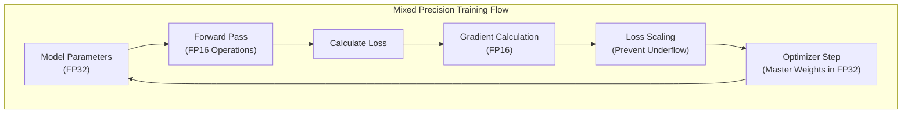
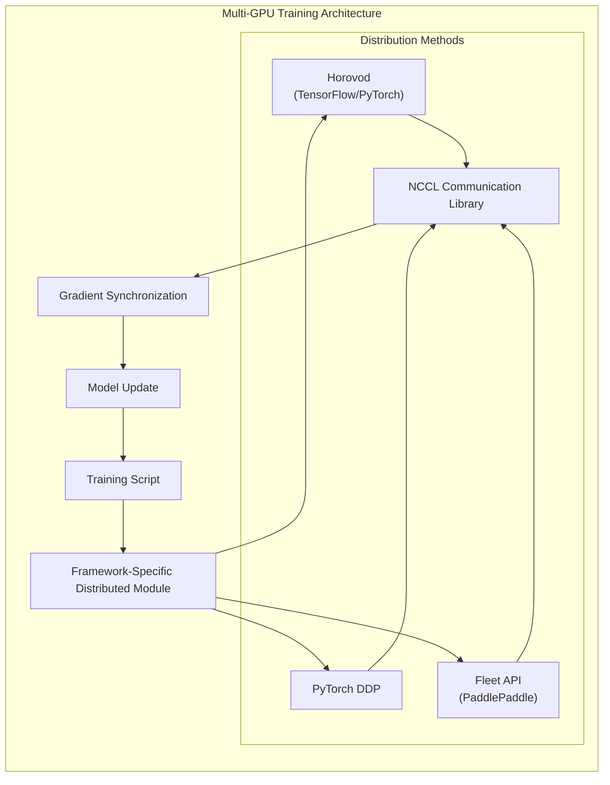
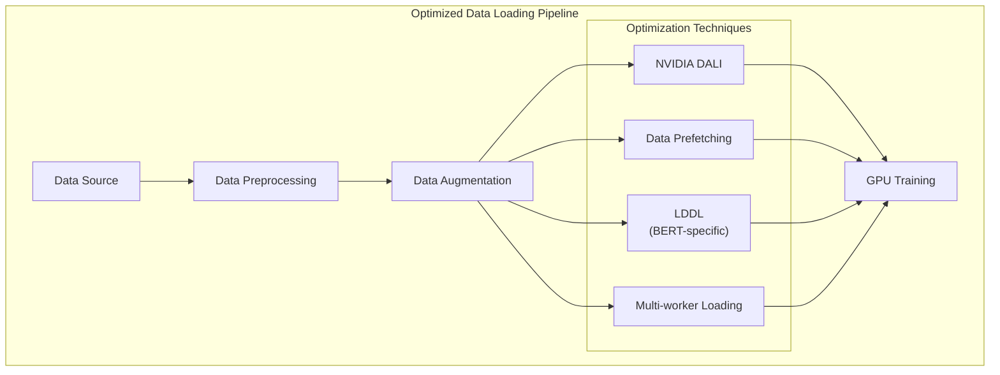
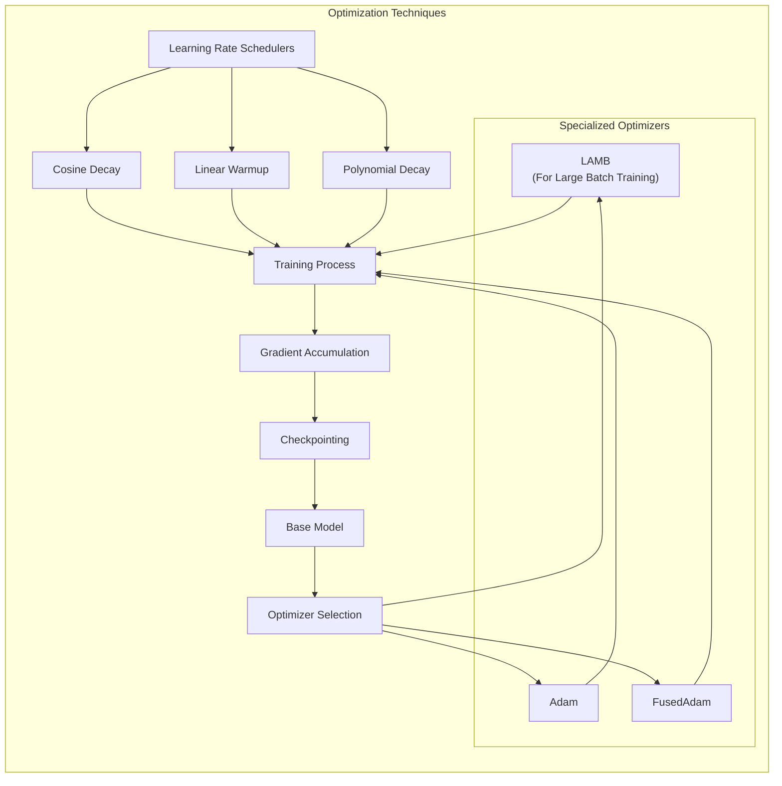
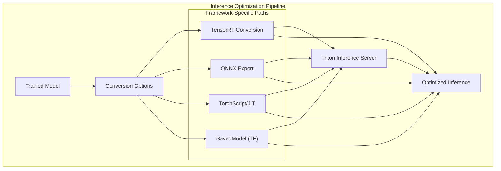

<!-- source: DeepWiki mcp.deepwiki.com · repo NVIDIA/DeepLearningExamples · page 1.2 Common Features and Optimizations · fetched 2026-10-26 -->

# Common Features and Optimizations

<details>
<summary>Relevant source files</summary>

The following files were used as context for generating this wiki page:

- [PyTorch/DrugDiscovery/MoFlow/Dockerfile](PyTorch/DrugDiscovery/MoFlow/Dockerfile)
- [PyTorch/DrugDiscovery/MoFlow/LICENSE](PyTorch/DrugDiscovery/MoFlow/LICENSE)
- [PyTorch/DrugDiscovery/MoFlow/NOTICE](PyTorch/DrugDiscovery/MoFlow/NOTICE)
- [PyTorch/DrugDiscovery/MoFlow/README.md](PyTorch/DrugDiscovery/MoFlow/README.md)
- [PyTorch/DrugDiscovery/MoFlow/img/moflow.png](PyTorch/DrugDiscovery/MoFlow/img/moflow.png)
- [PyTorch/DrugDiscovery/MoFlow/moflow/__init__.py](PyTorch/DrugDiscovery/MoFlow/moflow/__init__.py)
- [PyTorch/DrugDiscovery/MoFlow/moflow/config.py](PyTorch/DrugDiscovery/MoFlow/moflow/config.py)
- [PyTorch/DrugDiscovery/MoFlow/moflow/data/__init__.py](PyTorch/DrugDiscovery/MoFlow/moflow/data/__init__.py)
- [PyTorch/DrugDiscovery/MoFlow/moflow/data/data_frame_parser.py](PyTorch/DrugDiscovery/MoFlow/moflow/data/data_frame_parser.py)
- [PyTorch/DrugDiscovery/MoFlow/moflow/data/data_loader.py](PyTorch/DrugDiscovery/MoFlow/moflow/data/data_loader.py)
- [PyTorch/DrugDiscovery/MoFlow/moflow/data/encoding.py](PyTorch/DrugDiscovery/MoFlow/moflow/data/encoding.py)
- [PyTorch/LanguageModeling/BERT/Dockerfile](PyTorch/LanguageModeling/BERT/Dockerfile)
- [PyTorch/LanguageModeling/BERT/LICENSE](PyTorch/LanguageModeling/BERT/LICENSE)
- [PyTorch/LanguageModeling/BERT/README.md](PyTorch/LanguageModeling/BERT/README.md)
- [PyTorch/LanguageModeling/BERT/data/Downloader.py](PyTorch/LanguageModeling/BERT/data/Downloader.py)
- [PyTorch/LanguageModeling/BERT/data/bertPrep.py](PyTorch/LanguageModeling/BERT/data/bertPrep.py)
- [PyTorch/LanguageModeling/BERT/data/create_datasets_from_start.sh](PyTorch/LanguageModeling/BERT/data/create_datasets_from_start.sh)
- [PyTorch/LanguageModeling/BERT/modeling.py](PyTorch/LanguageModeling/BERT/modeling.py)
- [PyTorch/LanguageModeling/BERT/optimization.py](PyTorch/LanguageModeling/BERT/optimization.py)
- [PyTorch/LanguageModeling/BERT/run.sub](PyTorch/LanguageModeling/BERT/run.sub)
- [PyTorch/LanguageModeling/BERT/run_glue.py](PyTorch/LanguageModeling/BERT/run_glue.py)
- [PyTorch/LanguageModeling/BERT/run_pretraining.py](PyTorch/LanguageModeling/BERT/run_pretraining.py)
- [PyTorch/LanguageModeling/BERT/run_squad.py](PyTorch/LanguageModeling/BERT/run_squad.py)
- [PyTorch/LanguageModeling/BERT/run_swag.py](PyTorch/LanguageModeling/BERT/run_swag.py)
- [PyTorch/LanguageModeling/BERT/scripts/run_glue.sh](PyTorch/LanguageModeling/BERT/scripts/run_glue.sh)
- [PyTorch/LanguageModeling/BERT/scripts/run_pretraining.sh](PyTorch/LanguageModeling/BERT/scripts/run_pretraining.sh)
- [PyTorch/LanguageModeling/BERT/utils.py](PyTorch/LanguageModeling/BERT/utils.py)
- [README.md](README.md)
- [TensorFlow/Classification/ConvNets/README.md](TensorFlow/Classification/ConvNets/README.md)
- [TensorFlow/Classification/ConvNets/resnet50v1.5/README.md](TensorFlow/Classification/ConvNets/resnet50v1.5/README.md)
- [TensorFlow/Classification/ConvNets/resnext101-32x4d/README.md](TensorFlow/Classification/ConvNets/resnext101-32x4d/README.md)
- [TensorFlow/Classification/ConvNets/se-resnext101-32x4d/README.md](TensorFlow/Classification/ConvNets/se-resnext101-32x4d/README.md)
- [TensorFlow/Detection/SSD/README.md](TensorFlow/Detection/SSD/README.md)
- [TensorFlow/LanguageModeling/BERT/README.md](TensorFlow/LanguageModeling/BERT/README.md)
- [TensorFlow/LanguageModeling/Transformer-XL/README.md](TensorFlow/LanguageModeling/Transformer-XL/README.md)
- [TensorFlow/Recommendation/NCF/README.md](TensorFlow/Recommendation/NCF/README.md)
- [TensorFlow/Recommendation/VAE-CF/README.md](TensorFlow/Recommendation/VAE-CF/README.md)
- [TensorFlow/Recommendation/WideAndDeep/README.md](TensorFlow/Recommendation/WideAndDeep/README.md)
- [TensorFlow/Segmentation/MaskRCNN/README.md](TensorFlow/Segmentation/MaskRCNN/README.md)
- [TensorFlow/Segmentation/UNet_3D_Medical/README.md](TensorFlow/Segmentation/UNet_3D_Medical/README.md)
- [TensorFlow/Segmentation/UNet_Industrial/README.md](TensorFlow/Segmentation/UNet_Industrial/README.md)
- [TensorFlow/Segmentation/VNet/README.md](TensorFlow/Segmentation/VNet/README.md)
- [Tools/PyTorch/TimeSeriesPredictionPlatform/README.md](Tools/PyTorch/TimeSeriesPredictionPlatform/README.md)
- [Tools/PyTorch/TimeSeriesPredictionPlatform/requirements.txt](Tools/PyTorch/TimeSeriesPredictionPlatform/requirements.txt)
- [Tools/PyTorch/TimeSeriesPredictionPlatform/triton/requirements.txt](Tools/PyTorch/TimeSeriesPredictionPlatform/triton/requirements.txt)

</details>


This page provides an overview of the key performance optimizations and features that are implemented across models in the NVIDIA Deep Learning Examples repository. These common techniques enable efficient training and inference on NVIDIA GPUs, leveraging hardware capabilities such as Tensor Cores while maintaining accuracy.

## Mixed Precision Training

Mixed precision training combines different numerical precisions in a computational method to achieve significant speedups. By performing operations in half-precision format (FP16) while storing minimal information in single-precision (FP32), models can run much faster on GPUs with Tensor Core support.



Sources: [TensorFlow/LanguageModeling/BERT/README.md:148-163](). [PyTorch/LanguageModeling/BERT/README.md:136-147](). [TensorFlow/Classification/ConvNets/resnet50v1.5/README.md:128-141]().

### Automatic Mixed Precision

Both TensorFlow and PyTorch implementations support automatic mixed precision:

- **TensorFlow AMP**: Uses the TensorFlow Automatic Mixed Precision extension that automatically modifies the computation graph.
  - Enabled via environment variables: `TF_ENABLE_AUTO_MIXED_PRECISION=1`
  - Automatically handles loss scaling to preserve small gradient values
  
- **PyTorch AMP**: Implemented through NVIDIA's Apex library or native PyTorch AMP.
  - PyTorch usage example:
  ```python
  # Using APEX
  from apex import amp
  model, optimizer = amp.initialize(model, optimizer, opt_level="O2")
  
  # Scaling loss
  with amp.scale_loss(loss, optimizer) as scaled_loss:
      scaled_loss.backward()
  ```

The mixed precision training provides performance improvements of 1.5-3x faster training when using the latest NVIDIA architectures with Tensor Cores.

Sources: [TensorFlow/LanguageModeling/BERT/README.md:166-178](). [PyTorch/LanguageModeling/BERT/README.md:148-165](). [PyTorch/LanguageModeling/BERT/run_pretraining.py:519-524]().

### TF32 Precision

TensorFloat-32 (TF32) is a math mode in NVIDIA A100 GPUs for tensor operations.

- Enabled by default on NVIDIA Ampere architecture
- Provides up to 10x speedup compared to FP32 on Volta GPUs
- Maintains similar accuracy levels to FP32
- Requires no code changes - the hardware handles the conversion

TF32 is a good balance for models that require higher precision than FP16 but can benefit from the performance of Tensor Cores.

Sources: [TensorFlow/LanguageModeling/BERT/README.md:179-188](). [PyTorch/LanguageModeling/BERT/README.md:167-176](). [TensorFlow/Classification/ConvNets/resnet50v1.5/README.md:159-167]().

## Multi-GPU and Multi-Node Training

The repository implements efficient scaling across multiple GPUs and nodes using various frameworks.



Sources: [README.md:96-104](). [PyTorch/LanguageModeling/BERT/README.md:119-127](). [TensorFlow/LanguageModeling/BERT/README.md:140-143]().

### Distributed Training Methods

The repository supports multiple methods for distributed training:

1. **Horovod Integration**
   - Framework-agnostic approach for distributed training
   - Efficient implementation with NCCL
   - Supported in TensorFlow, PyTorch models
   - Minimal code changes required to scale from single to multi-GPU

2. **PyTorch DistributedDataParallel (DDP)**
   - Native PyTorch distributed training
   - Implemented with communication hooks for efficiency
   - Can divide gradients by gradient accumulation steps
   - Example from BERT implementation:
   ```python
   model = DDP(model, device_ids=[args.local_rank], 
               output_device=args.local_rank, 
               bucket_cap_mb=torch.cuda.get_device_properties(device).total_memory,
               gradient_as_bucket_view=True)
   ```

3. **Multi-Node Training**
   - Supported through Slurm with Enroot/Pyxis
   - Documentation provided for cluster setups
   - Can scale to hundreds of GPUs for larger models

Sources: [PyTorch/LanguageModeling/BERT/run_pretraining.py:451-476](). [TensorFlow/LanguageModeling/BERT/README.md:225-228](). [PyTorch/LanguageModeling/BERT/README.md:219-221]().

## Optimized Data Loading

Efficient data loading is crucial for GPU utilization, particularly when training on large datasets.



Sources: [README.md:21-39](). [TensorFlow/Classification/ConvNets/resnet50v1.5/README.md:120-126](). [PyTorch/LanguageModeling/BERT/README.md:132-134]().

### NVIDIA DALI

NVIDIA Data Loading Library (DALI) accelerates the input pipeline:

- GPU-accelerated data preprocessing
- Integrated with both TensorFlow and PyTorch models
- Particularly beneficial for image-based models (Classification, Detection)
- Supports various data augmentation operations

### LDDL for BERT

NVIDIA Language Datasets Data Loading Library (LDDL) is specifically designed for BERT pretraining:

- Highly scalable data preprocessing for language datasets
- Optimized for sharding and distributed training
- Uses Dask for parallel processing
- Dynamic vs. static masking options
- Configurable bin sizes for sequences

Sources: [PyTorch/LanguageModeling/BERT/run.sub:27-56](). [PyTorch/LanguageModeling/BERT/README.md:132-134]().

## Specialized Optimizers and Training Techniques

The repository implements various specialized optimization algorithms and training techniques.



Sources: [PyTorch/LanguageModeling/BERT/README.md:125-131](). [TensorFlow/LanguageModeling/BERT/README.md:143-147](). [PyTorch/LanguageModeling/BERT/optimization.py:36-61]().

### LAMB Optimizer

LAMB (Layerwise Adaptive Moments based optimizer) enables training with exceptionally large batch sizes:

- Supports global batch sizes up to 65,536 for sequence length 128
- Uses layerwise learning rate adaptation
- Implemented in both TensorFlow and PyTorch versions
- Required for efficient large-scale pretraining

The NVLAMB implementation adds modifications to ensure correct convergence with large batch sizes.

```python
# NVLAMB Algorithm
# m_t = β_1 * m_{t-1} + (1 - β_1) * g_t
# v_t = β_2 * v_{t-1} + (1 - β_2) * g_t^2
# m̂_t = m_t / (1 - β_1^t)
# v̂_t = v_t / (1 - β_2^t)
# r_t = m̂_t / (√v̂_t + ε)
# φ = ||w_t||
# ŵ_t = w_t - η_t * r_t
# w_{t+1} = ŵ_t * min(max(||r_t||/clamp_value, 1/clamp_value), 1)
```

Sources: [TensorFlow/LanguageModeling/BERT/README.md:143-147](). [PyTorch/LanguageModeling/BERT/README.md:125-131]().

### Gradient Accumulation

Gradient accumulation allows training with effectively larger batch sizes:

- Accumulates gradients over multiple forward/backward passes
- Updates weights only after accumulation is complete
- Enables large batch training on limited GPU memory
- Implemented in both TensorFlow and PyTorch models

Sources: [PyTorch/LanguageModeling/BERT/scripts/run_pretraining.sh:144-146](). [PyTorch/LanguageModeling/BERT/run_pretraining.py:471-475]().

## Inference Optimizations

The repository provides various methods to optimize inference performance.



Sources: [README.md:15-90](). [TensorFlow/Classification/ConvNets/resnet50v1.5/README.md:254-258]().

### TensorRT Integration

TensorRT provides significant inference acceleration:

- Optimizes models for deployment on NVIDIA GPUs
- Supports both TensorFlow and PyTorch models
- Includes layer fusion, precision calibration, and kernel autotuning
- Many models have example TensorRT integration

### ONNX Export

Open Neural Network Exchange (ONNX) provides framework interoperability:

- Supported for select models
- Creates a framework-independent representation
- Can be used with various inference engines

### Triton Inference Server

NVIDIA Triton Inference Server provides a production deployment solution:

- Model-agnostic serving solution
- Supports TensorRT, TensorFlow, PyTorch, ONNX models
- Dynamic batching and concurrent model execution
- Several examples provided in the repository

Sources: [README.md:33](). [PyTorch/LanguageModeling/BERT/README.md:33-33]().

## XLA Compilation Support

XLA (Accelerated Linear Algebra) is a domain-specific compiler for linear algebra:

- Optimizes TensorFlow computation graphs
- Can provide 1.1-1.5x performance improvement
- Supports both training and inference
- Enabled via command-line flags in most models

Sources: [TensorFlow/Classification/ConvNets/resnet50v1.5/README.md:62-64](). [TensorFlow/LanguageModeling/BERT/README.md:123-125]().

## Cross-Framework Feature Support Table

This table summarizes the key optimization features available across different frameworks in the repository:

| Feature | TensorFlow | PyTorch | PaddlePaddle |
|---------|:----------:|:-------:|:------------:|
| Mixed Precision (AMP) | ✓ | ✓ | ✓ |
| TF32 Support | ✓ | ✓ | ✓ |
| Multi-GPU (Horovod) | ✓ | ✓ | - |
| Multi-GPU (Native) | - | ✓ (DDP) | ✓ (Fleet) |
| NVIDIA DALI | ✓ | ✓ | ✓ |
| LDDL | - | ✓ | - |
| TensorRT | ✓ | ✓ | ✓ |
| ONNX Export | Limited | ✓ | - |
| Triton Inference Server | ✓ | ✓ | ✓ |
| XLA Support | ✓ | - | - |
| LAMB Optimizer | ✓ | ✓ | - |
| Gradient Accumulation | ✓ | ✓ | ✓ |

Sources: [README.md:15-90]().

## Framework-Specific Implementation Details

Different frameworks have specific implementations of the common optimizations:

### PyTorch Optimizations

- Uses `DistributedDataParallel` for multi-GPU training
- Apex library for mixed precision (now also native PyTorch AMP)
- LDDL for efficient data loading
- TorchScript/JIT for optimized model deployment
- FusedAdam optimizer implementations
- NVFuser for kernel fusion

### TensorFlow Optimizations

- Horovod for distributed training
- XLA support for compilation
- TF-AMP for mixed precision
- Custom optimizers like LAMB
- SavedModel format for deployment

### PaddlePaddle Optimizations

- Fleet API for distributed training
- Mixed precision support
- Paddle-TRT for TensorRT integration

Sources: [README.md:96-104](). [PyTorch/LanguageModeling/BERT/README.md:119-127](). [TensorFlow/LanguageModeling/BERT/README.md:140-143]().

By leveraging these common features and optimizations, the models in this repository can achieve significantly better performance while maintaining accuracy, enabling researchers and practitioners to efficiently train and deploy state-of-the-art deep learning models on NVIDIA GPUs.

---

