<!-- source: DeepWiki mcp.deepwiki.com · repo NVIDIA/DeepLearningExamples · page 2 PyTorch Models · fetched 2026-10-26 -->

# PyTorch Models

Relevant source files

The following files were used as context for generating this wiki page:

- [PyTorch/Classification/ConvNets/Dockerfile](PyTorch/Classification/ConvNets/Dockerfile)
- [PyTorch/Classification/ConvNets/README.md](PyTorch/Classification/ConvNets/README.md)
- [PyTorch/Classification/ConvNets/checkpoint2model.py](PyTorch/Classification/ConvNets/checkpoint2model.py)
- [PyTorch/Classification/ConvNets/classify.py](PyTorch/Classification/ConvNets/classify.py)
- [PyTorch/Classification/ConvNets/configs.yml](PyTorch/Classification/ConvNets/configs.yml)
- [PyTorch/Classification/ConvNets/efficientnet/README.md](PyTorch/Classification/ConvNets/efficientnet/README.md)
- [PyTorch/Classification/ConvNets/image_classification/dataloaders.py](PyTorch/Classification/ConvNets/image_classification/dataloaders.py)
- [PyTorch/Classification/ConvNets/image_classification/gpu_affinity.py](PyTorch/Classification/ConvNets/image_classification/gpu_affinity.py)
- [PyTorch/Classification/ConvNets/image_classification/logger.py](PyTorch/Classification/ConvNets/image_classification/logger.py)
- [PyTorch/Classification/ConvNets/image_classification/models/__init__.py](PyTorch/Classification/ConvNets/image_classification/models/__init__.py)
- [PyTorch/Classification/ConvNets/image_classification/models/common.py](PyTorch/Classification/ConvNets/image_classification/models/common.py)
- [PyTorch/Classification/ConvNets/image_classification/models/efficientnet.py](PyTorch/Classification/ConvNets/image_classification/models/efficientnet.py)
- [PyTorch/Classification/ConvNets/image_classification/models/entrypoints.py](PyTorch/Classification/ConvNets/image_classification/models/entrypoints.py)
- [PyTorch/Classification/ConvNets/image_classification/models/model.py](PyTorch/Classification/ConvNets/image_classification/models/model.py)
- [PyTorch/Classification/ConvNets/image_classification/models/resnet.py](PyTorch/Classification/ConvNets/image_classification/models/resnet.py)
- [PyTorch/Classification/ConvNets/image_classification/optimizers.py](PyTorch/Classification/ConvNets/image_classification/optimizers.py)
- [PyTorch/Classification/ConvNets/image_classification/training.py](PyTorch/Classification/ConvNets/image_classification/training.py)
- [PyTorch/Classification/ConvNets/image_classification/utils.py](PyTorch/Classification/ConvNets/image_classification/utils.py)
- [PyTorch/Classification/ConvNets/main.py](PyTorch/Classification/ConvNets/main.py)
- [PyTorch/Classification/ConvNets/model2onnx.py](PyTorch/Classification/ConvNets/model2onnx.py)
- [PyTorch/Classification/ConvNets/quant_main.py](PyTorch/Classification/ConvNets/quant_main.py)
- [PyTorch/Classification/ConvNets/requirements.txt](PyTorch/Classification/ConvNets/requirements.txt)
- [PyTorch/Classification/ConvNets/resnet50v1.5/README.md](PyTorch/Classification/ConvNets/resnet50v1.5/README.md)
- [PyTorch/Classification/ConvNets/resnext101-32x4d/README.md](PyTorch/Classification/ConvNets/resnext101-32x4d/README.md)
- [PyTorch/Classification/ConvNets/se-resnext101-32x4d/README.md](PyTorch/Classification/ConvNets/se-resnext101-32x4d/README.md)
- [PyTorch/Classification/ConvNets/triton/deployer.py](PyTorch/Classification/ConvNets/triton/deployer.py)
- [hubconf.py](hubconf.py)

This page provides a technical overview of the PyTorch model implementations in the NVIDIA Deep Learning Examples repository. It covers the common infrastructure, model families, and shared optimizations across these implementations. For information about TensorFlow models, see [TensorFlow Models](#3), and for deployment details, see [Deployment](#5).

## Model Organization

The repository organizes PyTorch models primarily by application domain, with each model family having dedicated directories and shared components.

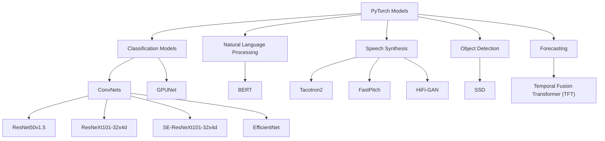

Sources: [hubconf.py:1-35](), [PyTorch/Classification/ConvNets/README.md:1-123]()

## Common Infrastructure

### Model Framework

The repository implements a consistent framework for defining models, with a focus on reusability and configurability. The core components include:

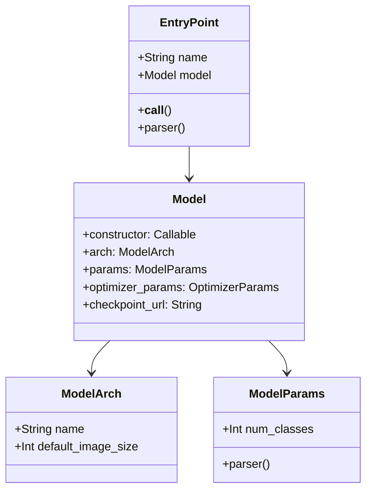

Sources: [PyTorch/Classification/ConvNets/image_classification/models/model.py:14-184]()

The architecture adopts a dataclass-based approach for model configuration:

1. `ModelArch` - Defines the architecture characteristics of a model
2. `ModelParams` - Contains model parameters like number of classes
3. `Model` - Combines architecture, parameters and construction logic
4. `EntryPoint` - Provides a standardized interface for model access

This design allows for:
- Consistent model instantiation across all model types
- Easy parameter configuration through common CLI interfaces
- Standardized checkpoint handling for pretrained weights

### Training Framework

The training infrastructure is designed for performance and flexibility:

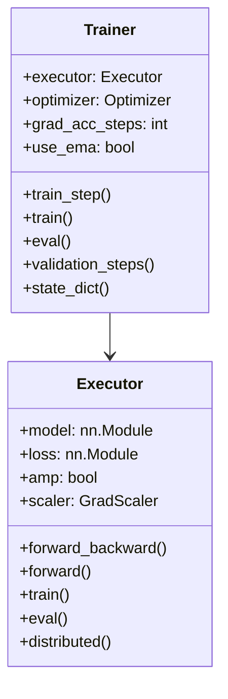

Sources: [PyTorch/Classification/ConvNets/image_classification/training.py:46-202]()

Key components of the training infrastructure:

- `Executor`: Handles model forward/backward passes, loss computation, mixed precision operations, and distributed setup
- `Trainer`: Manages training state, optimization steps, EMA updates, and checkpointing
- Training utilities: Support for gradient accumulation, loss scaling, validation metrics

The training loop function connects these components to provide a complete training pipeline:

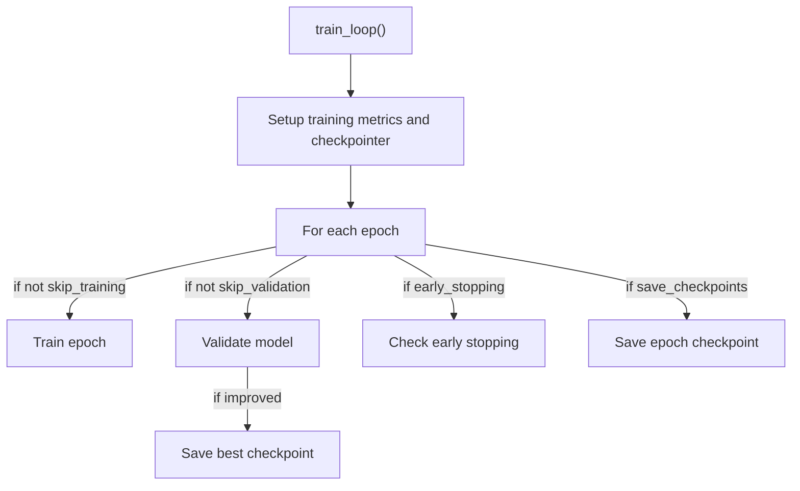

Sources: [PyTorch/Classification/ConvNets/image_classification/training.py:313-435]()

## Data Loading Framework

The repository implements multiple data backends for efficient input processing:

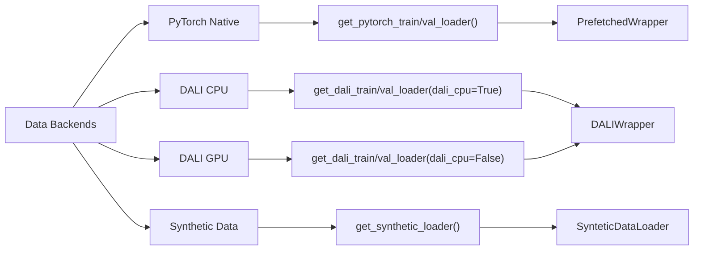

Sources: [PyTorch/Classification/ConvNets/image_classification/dataloaders.py:30-577]()

Key features of the data loading framework:

- Support for multiple data backends (PyTorch, DALI-CPU, DALI-GPU, Synthetic)
- Prefetching and pipelining for maximizing GPU utilization
- Common data augmentation options (random resized crop, horizontal flip, etc.)
- Mixed precision data preprocessing

## Classification Models

### Model Architectures

The repository includes several state-of-the-art ConvNet architectures:

| Model | Description | Top-1 Accuracy | 
|-------|-------------|----------------|
| ResNet50 | ResNet50 v1.5 with bottleneck blocks | 78.6% |
| ResNeXt101-32x4d | ResNeXt with cardinality=32, bottleneck width=4 | 80.4% |
| SE-ResNeXt101-32x4d | ResNeXt with Squeeze-and-Excitation blocks | 81.0% |
| EfficientNet-B0 | EfficientNet baseline model | 77.6% |
| EfficientNet-B4 | EfficientNet wider/deeper variant | 83.0% |
| EfficientNet-WideSE-B0 | EfficientNet with wider SE layers | 77.9% |
| EfficientNet-WideSE-B4 | EfficientNet-B4 with wider SE layers | 83.3% |

Sources: [PyTorch/Classification/ConvNets/README.md:40-50](), [hubconf.py:7-13]()

### ResNet Architecture

The ResNet/ResNeXt family implements residual blocks with skip connections:

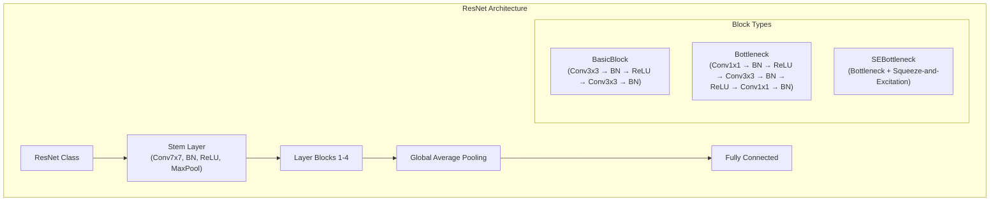

Sources: [PyTorch/Classification/ConvNets/image_classification/models/resnet.py:56-407]()

### EfficientNet Architecture

EfficientNet models use compound scaling and mobile inverted bottleneck blocks:

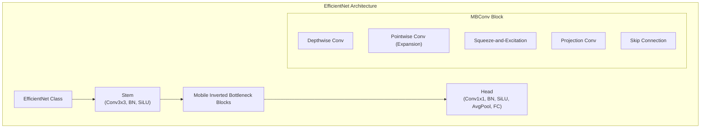

Sources: [PyTorch/Classification/ConvNets/image_classification/models/efficientnet.py:1-100]()

## Speech Synthesis Models

The repository includes state-of-the-art speech synthesis models:

1. **Tacotron2**: Neural text-to-speech model that generates mel-spectrograms from text
2. **WaveGlow**: Flow-based neural vocoder for high-quality audio generation
3. **FastPitch**: Fast, parallel text-to-speech model with explicit pitch control
4. **HiFi-GAN**: GAN-based neural vocoder for efficient, high-fidelity audio synthesis

Sources: [hubconf.py:23-31]()

## Model Optimization Features

### Mixed Precision Training

All models support mixed precision training using Automatic Mixed Precision (AMP):

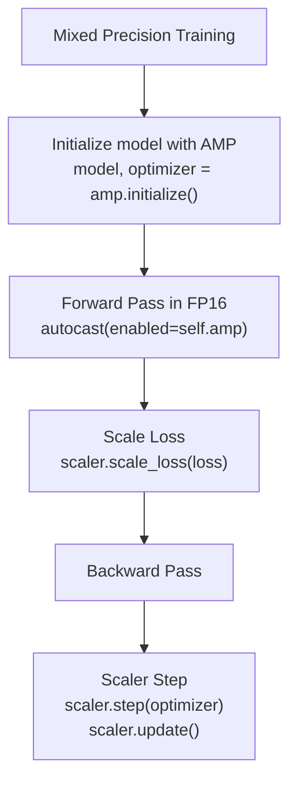

Sources: [PyTorch/Classification/ConvNets/image_classification/training.py:90-105]()

Mixed precision training features:
- Uses `torch.cuda.amp` package for automatic mixed precision
- Implements dynamic loss scaling to prevent underflow
- Optimized NHWC memory format for Tensor Core acceleration
- TF32 precision support for NVIDIA Ampere GPUs

### Distributed Training

The repository provides robust distributed training support:

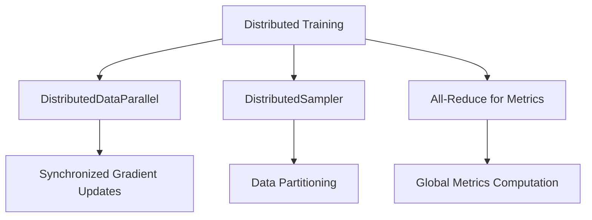

Sources: [PyTorch/Classification/ConvNets/main.py:360-374](), [PyTorch/Classification/ConvNets/image_classification/training.py:230-233]()

Key distributed training features:
- PyTorch DistributedDataParallel for gradient synchronization
- Multi-GPU and multi-node scaling
- Synchronized batch normalization
- Distributed data sampling

### Optimization Techniques

The repository implements numerous optimization techniques for improved performance and accuracy:

| Technique | Description | Implementation |
|-----------|-------------|----------------|
| Automatic Mixed Precision | FP16/FP32 mixed precision | `torch.cuda.amp` |
| DALI Data Loading | GPU-accelerated data loading | `nvidia.dali` integration |
| EMA | Exponential moving average of weights | `EMA` class |
| Label Smoothing | Softens one-hot labels | `LabelSmoothing` class |
| MixUp | Training on convex combinations of samples | `MixUpWrapper` class |
| Learning Rate Scheduling | Cosine, linear, step schedules | `lr_*_policy` functions |
| Weight Decay | Configurable regularization | Optimizer options |

Sources: [PyTorch/Classification/ConvNets/main.py:92-207](), [PyTorch/Classification/ConvNets/image_classification/training.py:137-152]()

## Model Deployment Options

The repository supports multiple deployment paths:

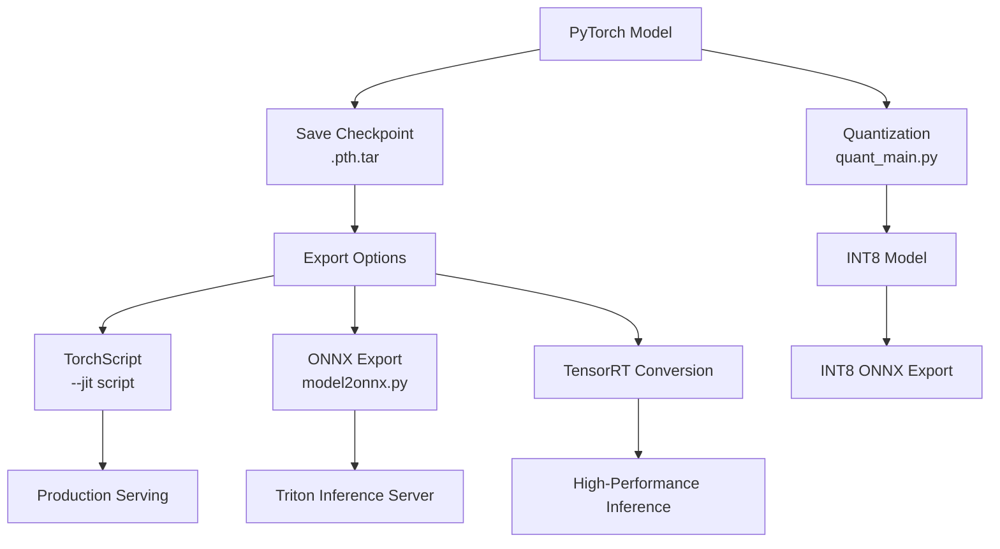

Sources: [PyTorch/Classification/ConvNets/triton/deployer.py:1-106](), [PyTorch/Classification/ConvNets/model2onnx.py:1-45](), [PyTorch/Classification/ConvNets/quant_main.py:1-40]()

Deployment features:
- TorchScript export for production deployment
- ONNX export for cross-platform inference
- Quantization-aware training for INT8 precision
- Triton Inference Server integration
- TensorRT optimization

## Training Process

The standard training flow follows this pattern:

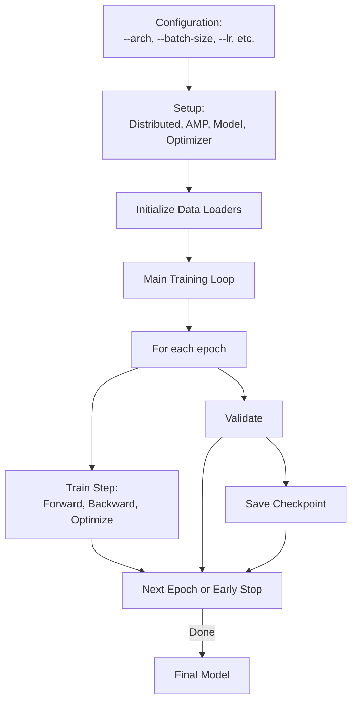

Sources: [PyTorch/Classification/ConvNets/main.py:611-649](), [PyTorch/Classification/ConvNets/image_classification/training.py:313-435]()

## Conclusion

The PyTorch model implementations in this repository provide optimized, production-ready training and inference code for various deep learning tasks. They feature:

1. Common infrastructure for model definition, training, and evaluation
2. State-of-the-art architectures across different domains
3. Optimizations for mixed precision, distributed training, and data loading
4. Multiple deployment paths including TorchScript, ONNX, and TensorRT

Each model family has its own dedicated directory with detailed documentation, training scripts, and performance benchmarks.

---

