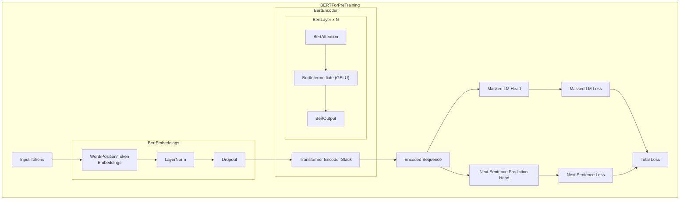
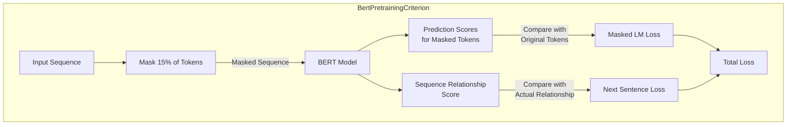
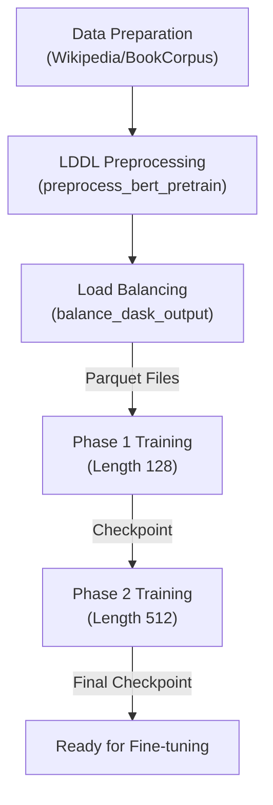
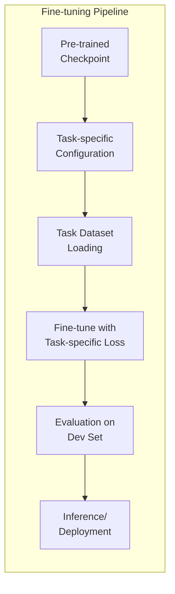
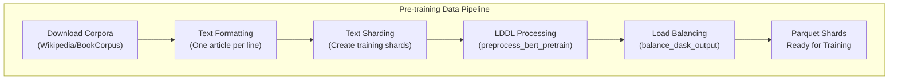
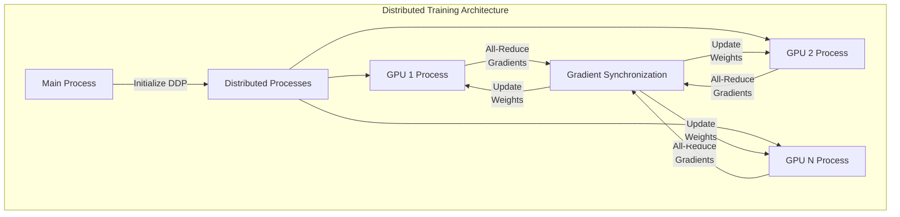

<!-- source: DeepWiki mcp.deepwiki.com · repo NVIDIA/DeepLearningExamples · page 2.1 PyTorch Natural Language Processing · fetched 2026-10-26 -->

# PyTorch Natural Language Processing

<details>
<summary>Relevant source files</summary>

The following files were used as context for generating this wiki page:

- [PyTorch/LanguageModeling/BERT/Dockerfile](PyTorch/LanguageModeling/BERT/Dockerfile)
- [PyTorch/LanguageModeling/BERT/LICENSE](PyTorch/LanguageModeling/BERT/LICENSE)
- [PyTorch/LanguageModeling/BERT/README.md](PyTorch/LanguageModeling/BERT/README.md)
- [PyTorch/LanguageModeling/BERT/data/Downloader.py](PyTorch/LanguageModeling/BERT/data/Downloader.py)
- [PyTorch/LanguageModeling/BERT/data/bertPrep.py](PyTorch/LanguageModeling/BERT/data/bertPrep.py)
- [PyTorch/LanguageModeling/BERT/data/create_datasets_from_start.sh](PyTorch/LanguageModeling/BERT/data/create_datasets_from_start.sh)
- [PyTorch/LanguageModeling/BERT/modeling.py](PyTorch/LanguageModeling/BERT/modeling.py)
- [PyTorch/LanguageModeling/BERT/optimization.py](PyTorch/LanguageModeling/BERT/optimization.py)
- [PyTorch/LanguageModeling/BERT/run.sub](PyTorch/LanguageModeling/BERT/run.sub)
- [PyTorch/LanguageModeling/BERT/run_glue.py](PyTorch/LanguageModeling/BERT/run_glue.py)
- [PyTorch/LanguageModeling/BERT/run_pretraining.py](PyTorch/LanguageModeling/BERT/run_pretraining.py)
- [PyTorch/LanguageModeling/BERT/run_squad.py](PyTorch/LanguageModeling/BERT/run_squad.py)
- [PyTorch/LanguageModeling/BERT/run_swag.py](PyTorch/LanguageModeling/BERT/run_swag.py)
- [PyTorch/LanguageModeling/BERT/scripts/run_glue.sh](PyTorch/LanguageModeling/BERT/scripts/run_glue.sh)
- [PyTorch/LanguageModeling/BERT/scripts/run_pretraining.sh](PyTorch/LanguageModeling/BERT/scripts/run_pretraining.sh)
- [PyTorch/LanguageModeling/BERT/utils.py](PyTorch/LanguageModeling/BERT/utils.py)

</details>


This document provides a technical overview of the PyTorch-based Natural Language Processing (NLP) implementations in the NVIDIA Deep Learning Examples repository. The focus is on the BERT (Bidirectional Encoder Representations from Transformers) model implementation and its applications to various NLP tasks, including pre-training, question answering, paraphrase detection, and sentiment analysis.

For information about TensorFlow NLP implementations, see [TensorFlow Natural Language Processing](#3.1).

## Overview

The PyTorch NLP section of the NVIDIA Deep Learning Examples repository provides highly optimized implementations of BERT and related models for both pre-training and fine-tuning. These implementations leverage NVIDIA's optimizations for training efficiency, including mixed precision training, distributed training across multiple GPUs and nodes, and specialized optimizers like LAMB (Layer-wise Adaptive Moments optimizer for Batch training).

The codebase supports:
- Pre-training BERT models from scratch on large text corpora
- Fine-tuning pre-trained models on specific NLP tasks
- Inference and deployment with NVIDIA Triton Inference Server
- Performance optimizations for NVIDIA GPUs

Sources: [PyTorch/LanguageModeling/BERT/README.md:63-101](). [PyTorch/LanguageModeling/BERT/README.md:217-222]()

## Architecture and Implementation

### BERT Model Architecture

BERT uses the same architecture as the encoder portion of the Transformer. The model processes input text by projecting tokens into an embedding space and adding positional and segment encodings. The core of the model consists of stacked Transformer blocks, each containing multi-head self-attention layers followed by feed-forward networks and layer normalization.

#### BERT Model Architecture Diagram



Sources: [PyTorch/LanguageModeling/BERT/modeling.py:263-301](), [PyTorch/LanguageModeling/BERT/modeling.py:304-376](), [PyTorch/LanguageModeling/BERT/modeling.py:437-463](), [PyTorch/LanguageModeling/BERT/README.md:86-92]()

### BERT Pre-training Objective

BERT is pre-trained using two unsupervised tasks:

1. **Masked Language Modeling (MLM)**: Randomly mask 15% of the input tokens and train the model to predict the original tokens based only on context.

2. **Next Sentence Prediction (NSP)**: Train the model to predict whether two sentences are consecutive in the original text.

The implementation includes a dedicated loss function, `BertPretrainingCriterion`, which combines losses from both tasks:



Sources: [PyTorch/LanguageModeling/BERT/run_pretraining.py:75-95](), [PyTorch/LanguageModeling/BERT/README.md:561-566]()

### Implementation Details

The BERT implementation is structured around several key Python files:

| File | Purpose |
|------|---------|
| `modeling.py` | Contains the BERT model architecture implementation |
| `run_pretraining.py` | Script for pre-training BERT |
| `run_squad.py` | Script for fine-tuning BERT on question answering (SQuAD) |
| `run_glue.py` | Script for fine-tuning BERT on GLUE tasks |
| `optimization.py` | Contains optimizer implementations, including LAMB |
| `tokenization.py` | Contains the WordPiece tokenizer for BERT |
| `utils.py` | Utility functions for distributed training |

The implementation supports both large (24-layer) and base (12-layer) BERT model variants:

| Model | Hidden Layers | Hidden Size | Attention Heads | Parameters |
|-------|---------------|-------------|-----------------|------------|
| BERT-base | 12 | 768 | 12 | 110M |
| BERT-large | 24 | 1024 | 16 | 330M |

Sources: [PyTorch/LanguageModeling/BERT/README.md:355-373](), [PyTorch/LanguageModeling/BERT/README.md:95-104]()

## Training Pipeline

### Pre-training Process

The pre-training process involves two phases:

1. **Phase 1**: Train with sequence length 128 and 20 masked tokens per sequence
2. **Phase 2**: Continue training with sequence length 512 and 80 masked tokens per sequence

This two-phase approach accelerates training while maintaining model quality.



The `run_pretraining.py` script handles:
- Loading pre-processed data with LDDL (NVIDIA's Large-scale Distributed Data Loader)
- Initializing the model and optimizer
- Running the training loop with gradient accumulation and mixed precision
- Saving checkpoints for resuming training or fine-tuning

Sources: [PyTorch/LanguageModeling/BERT/run_pretraining.py:539-571](), [PyTorch/LanguageModeling/BERT/scripts/run_pretraining.sh:170-193](), [PyTorch/LanguageModeling/BERT/README.md:578-595]()

### Fine-tuning Process

Fine-tuning adapts a pre-trained BERT model to specific downstream tasks. The repository supports several important NLP tasks:

1. **Question Answering (SQuAD)**: Fine-tune BERT to extract answer spans from context paragraphs
2. **Paraphrase Detection (MRPC)**: Fine-tune BERT to determine if sentence pairs are paraphrases
3. **Sentiment Analysis (SST-2)**: Fine-tune BERT to classify sentences as positive or negative



The fine-tuning scripts (`run_squad.py`, `run_glue.py`) handle:
- Loading task-specific datasets
- Converting examples to features with appropriate tokenization
- Initializing the model from a pre-trained checkpoint
- Adding task-specific output layers
- Running the fine-tuning loop
- Evaluating on task-specific metrics

Sources: [PyTorch/LanguageModeling/BERT/run_squad.py:246-371](), [PyTorch/LanguageModeling/BERT/run_glue.py:363-454](), [PyTorch/LanguageModeling/BERT/README.md:301-317]()

## Data Processing

### Data Preparation Pipeline

The data preparation process consists of several steps:



For pre-training, the repository uses LDDL (Large-scale Distributed Data Loader) to efficiently preprocess and load Wikipedia and BookCorpus datasets. The data preparation scripts handle:
- Downloading the text corpora
- Extracting and cleaning the text
- Creating appropriate input sequences with masks for pre-training
- Balancing the data across shards

For fine-tuning, task-specific data processing is implemented in the respective scripts.

Sources: [PyTorch/LanguageModeling/BERT/data/create_datasets_from_start.sh:16-22](), [PyTorch/LanguageModeling/BERT/scripts/run_pretraining.sh:82-116](), [PyTorch/LanguageModeling/BERT/run.sub:217-283]()

## Optimization Features

### Mixed Precision Training

The implementation supports mixed precision training using FP16 computations while maintaining FP32 master copies of weights. This provides significant speedup on NVIDIA Volta and Ampere GPUs with Tensor Cores.

Mixed precision is enabled through NVIDIA's Apex library, with AMP (Automatic Mixed Precision) integration. Key components include:
- FP16 storage and computation for most operations
- FP32 storage for model weights
- Dynamic loss scaling to prevent underflow
- Specialized handling for operations sensitive to numerical precision

Sources: [PyTorch/LanguageModeling/BERT/README.md:136-175](), [PyTorch/LanguageModeling/BERT/run_pretraining.py:519-520]()

### Multi-GPU and Multi-Node Training

The codebase supports efficient distributed training across multiple GPUs and nodes:



Key distributed training features include:
- PyTorch's DistributedDataParallel (DDP) for efficient multi-GPU training
- Optional gradient accumulation to handle large batch sizes
- Post-accumulation all-reduce for faster communications
- Multi-node training via SLURM with Enroot/Pyxis

Sources: [PyTorch/LanguageModeling/BERT/run_pretraining.py:451-475](), [PyTorch/LanguageModeling/BERT/run.sub:283-283](), [PyTorch/LanguageModeling/BERT/README.md:120-126]()

### LAMB Optimizer

The implementation uses the Layer-wise Adaptive Moments optimizer for Batch training (LAMB), which enables efficient training with large batch sizes (up to 65536 for sequence length 128 and 32768 for sequence length 512).

LAMB adapts the learning rate for each layer in the network, allowing better convergence with large batches compared to Adam. The implementation is optimized with CUDA kernels for improved performance.

Sources: [PyTorch/LanguageModeling/BERT/README.md:126-135](), [PyTorch/LanguageModeling/BERT/run_pretraining.py:429-435]()

### Advanced Optimizations

Additional optimizations include:
- CUDA Graphs for improved GPU utilization
- Gradient checkpointing to reduce memory usage
- JIT fusions for faster kernel execution
- LDDL (Large-scale Distributed Data Loader) for efficient data loading
- Fused CUDA kernels for LayerNorm and other operations

Sources: [PyTorch/LanguageModeling/BERT/run_pretraining.py:599-641](), [PyTorch/LanguageModeling/BERT/README.md:117-126]()

## Usage Examples

### Pre-training Example

The repository provides a simple script interface for pre-training:

```bash
bash scripts/run_pretraining.sh
```

This script:
1. Downloads and preprocesses the Wikipedia dataset if needed
2. Runs Phase 1 training with sequence length 128
3. Runs Phase 2 training with sequence length 512
4. Saves checkpoints that can be used for fine-tuning

The pre-training script accepts various parameters for batch size, learning rate, precision, etc.:

```bash
bash scripts/run_pretraining.sh <train_batch_size> <learning_rate> <precision> <num_gpus> <warmup_proportion> <train_steps>
```

Sources: [PyTorch/LanguageModeling/BERT/README.md:290-307](), [PyTorch/LanguageModeling/BERT/scripts/run_pretraining.sh:16-31]()

### Fine-tuning Example

For fine-tuning on SQuAD (question answering):

```bash
bash scripts/run_squad.sh /workspace/bert/checkpoints/<pre-trained_checkpoint>
```

For fine-tuning on GLUE tasks (MRPC or SST-2):

```bash
bash scripts/run_glue.sh /workspace/bert/checkpoints/<pre-trained_checkpoint>
```

These scripts handle loading the pre-trained model, fine-tuning on the specific task, and evaluating performance.

Sources: [PyTorch/LanguageModeling/BERT/README.md:301-343](), [PyTorch/LanguageModeling/BERT/scripts/run_glue.sh:19-87]()

## Performance and Results

The implementation achieves state-of-the-art accuracy with significantly reduced training time through various optimizations. On 8x NVIDIA A100 GPUs, the implementation can pre-train BERT-Large in under an hour, compared to days on alternative implementations. 

The repository provides comprehensive performance benchmarks for various hardware configurations, including:
- Pre-training performance on DGX A100 and DGX-1 with V100
- Fine-tuning performance on different tasks
- Inference performance for deployed models

Sources: [PyTorch/LanguageModeling/BERT/README.md:33-57](), [PyTorch/LanguageModeling/BERT/README.md:465-508]()

## Conclusion

The PyTorch NLP implementation in NVIDIA Deep Learning Examples repository provides a high-performance, production-ready implementation of BERT and related models. It offers significant speedups for both pre-training and fine-tuning through various optimizations while maintaining state-of-the-art accuracy on standard benchmarks.

The codebase is designed to be modular and extensible, allowing researchers and practitioners to build upon it for specific NLP applications while leveraging NVIDIA's optimizations for GPU acceleration.

Sources: [PyTorch/LanguageModeling/BERT/README.md:1-61]()

---

