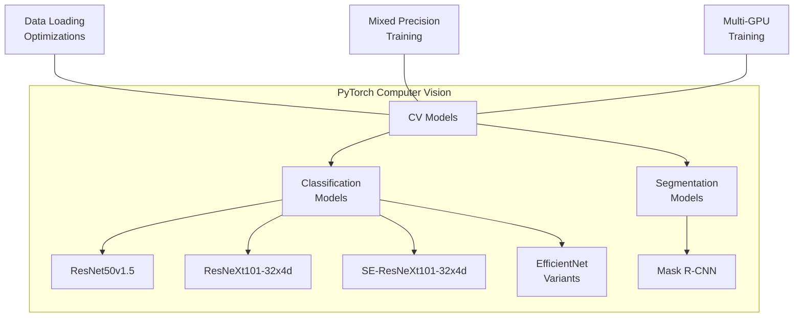
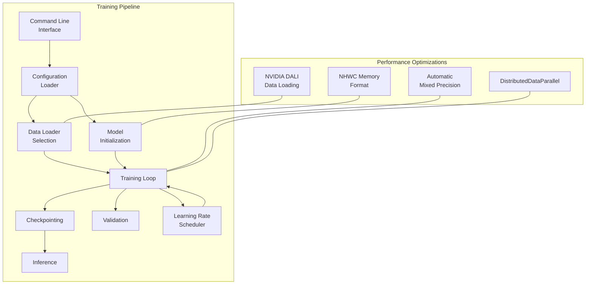
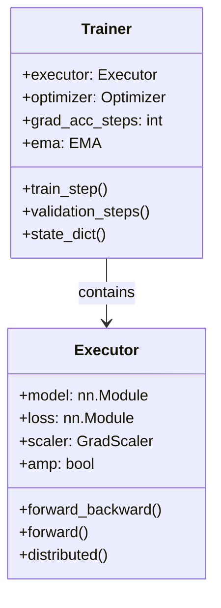
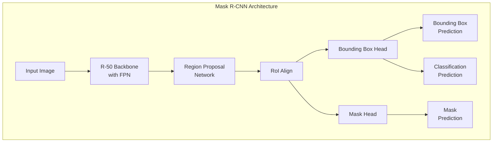
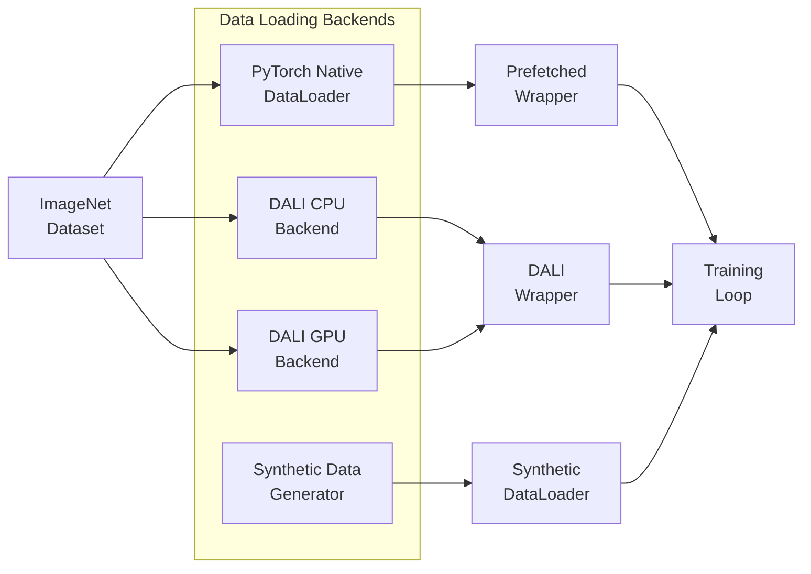

<!-- source: DeepWiki mcp.deepwiki.com · repo NVIDIA/DeepLearningExamples · page 2.2 PyTorch Computer Vision · fetched 2026-10-26 -->

# PyTorch Computer Vision

<details>
<summary>Relevant source files</summary>

The following files were used as context for generating this wiki page:

- [PyTorch/Classification/ConvNets/Dockerfile](PyTorch/Classification/ConvNets/Dockerfile)
- [PyTorch/Classification/ConvNets/README.md](PyTorch/Classification/ConvNets/README.md)
- [PyTorch/Classification/ConvNets/classify.py](PyTorch/Classification/ConvNets/classify.py)
- [PyTorch/Classification/ConvNets/configs.yml](PyTorch/Classification/ConvNets/configs.yml)
- [PyTorch/Classification/ConvNets/efficientnet/README.md](PyTorch/Classification/ConvNets/efficientnet/README.md)
- [PyTorch/Classification/ConvNets/image_classification/dataloaders.py](PyTorch/Classification/ConvNets/image_classification/dataloaders.py)
- [PyTorch/Classification/ConvNets/image_classification/gpu_affinity.py](PyTorch/Classification/ConvNets/image_classification/gpu_affinity.py)
- [PyTorch/Classification/ConvNets/image_classification/logger.py](PyTorch/Classification/ConvNets/image_classification/logger.py)
- [PyTorch/Classification/ConvNets/image_classification/training.py](PyTorch/Classification/ConvNets/image_classification/training.py)
- [PyTorch/Classification/ConvNets/image_classification/utils.py](PyTorch/Classification/ConvNets/image_classification/utils.py)
- [PyTorch/Classification/ConvNets/main.py](PyTorch/Classification/ConvNets/main.py)
- [PyTorch/Classification/ConvNets/model2onnx.py](PyTorch/Classification/ConvNets/model2onnx.py)
- [PyTorch/Classification/ConvNets/requirements.txt](PyTorch/Classification/ConvNets/requirements.txt)
- [PyTorch/Classification/ConvNets/resnet50v1.5/README.md](PyTorch/Classification/ConvNets/resnet50v1.5/README.md)
- [PyTorch/Classification/ConvNets/resnext101-32x4d/README.md](PyTorch/Classification/ConvNets/resnext101-32x4d/README.md)
- [PyTorch/Classification/ConvNets/se-resnext101-32x4d/README.md](PyTorch/Classification/ConvNets/se-resnext101-32x4d/README.md)
- [PyTorch/Classification/ConvNets/triton/deployer.py](PyTorch/Classification/ConvNets/triton/deployer.py)
- [PyTorch/Segmentation/MaskRCNN/Dockerfile](PyTorch/Segmentation/MaskRCNN/Dockerfile)
- [PyTorch/Segmentation/MaskRCNN/README.md](PyTorch/Segmentation/MaskRCNN/README.md)
- [PyTorch/Segmentation/MaskRCNN/download_dataset.sh](PyTorch/Segmentation/MaskRCNN/download_dataset.sh)
- [PyTorch/Segmentation/MaskRCNN/hashes.md5](PyTorch/Segmentation/MaskRCNN/hashes.md5)
- [PyTorch/Segmentation/MaskRCNN/pytorch/Dockerfile](PyTorch/Segmentation/MaskRCNN/pytorch/Dockerfile)
- [PyTorch/Segmentation/MaskRCNN/pytorch/configs/ci/e2e_mask_rcnn_R_50_FPN_1x.yaml](PyTorch/Segmentation/MaskRCNN/pytorch/configs/ci/e2e_mask_rcnn_R_50_FPN_1x.yaml)
- [PyTorch/Segmentation/MaskRCNN/pytorch/configs/e2e_mask_rcnn_R_50_FPN_1x_bs32.yaml](PyTorch/Segmentation/MaskRCNN/pytorch/configs/e2e_mask_rcnn_R_50_FPN_1x_bs32.yaml)
- [PyTorch/Segmentation/MaskRCNN/pytorch/configs/e2e_mask_rcnn_R_50_FPN_1x_bs64.yaml](PyTorch/Segmentation/MaskRCNN/pytorch/configs/e2e_mask_rcnn_R_50_FPN_1x_bs64.yaml)
- [PyTorch/Segmentation/MaskRCNN/pytorch/maskrcnn_benchmark/config/defaults.py](PyTorch/Segmentation/MaskRCNN/pytorch/maskrcnn_benchmark/config/defaults.py)
- [PyTorch/Segmentation/MaskRCNN/pytorch/maskrcnn_benchmark/engine/inference.py](PyTorch/Segmentation/MaskRCNN/pytorch/maskrcnn_benchmark/engine/inference.py)
- [PyTorch/Segmentation/MaskRCNN/pytorch/maskrcnn_benchmark/engine/trainer.py](PyTorch/Segmentation/MaskRCNN/pytorch/maskrcnn_benchmark/engine/trainer.py)
- [PyTorch/Segmentation/MaskRCNN/pytorch/maskrcnn_benchmark/layers/nms.py](PyTorch/Segmentation/MaskRCNN/pytorch/maskrcnn_benchmark/layers/nms.py)
- [PyTorch/Segmentation/MaskRCNN/pytorch/maskrcnn_benchmark/layers/roi_align.py](PyTorch/Segmentation/MaskRCNN/pytorch/maskrcnn_benchmark/layers/roi_align.py)
- [PyTorch/Segmentation/MaskRCNN/pytorch/maskrcnn_benchmark/layers/roi_pool.py](PyTorch/Segmentation/MaskRCNN/pytorch/maskrcnn_benchmark/layers/roi_pool.py)
- [PyTorch/Segmentation/MaskRCNN/pytorch/maskrcnn_benchmark/utils/comm.py](PyTorch/Segmentation/MaskRCNN/pytorch/maskrcnn_benchmark/utils/comm.py)
- [PyTorch/Segmentation/MaskRCNN/pytorch/requirements.txt](PyTorch/Segmentation/MaskRCNN/pytorch/requirements.txt)
- [PyTorch/Segmentation/MaskRCNN/pytorch/scripts/docker/interactive.sh](PyTorch/Segmentation/MaskRCNN/pytorch/scripts/docker/interactive.sh)
- [PyTorch/Segmentation/MaskRCNN/pytorch/scripts/inference.sh](PyTorch/Segmentation/MaskRCNN/pytorch/scripts/inference.sh)
- [PyTorch/Segmentation/MaskRCNN/pytorch/scripts/inference_benchmark.sh](PyTorch/Segmentation/MaskRCNN/pytorch/scripts/inference_benchmark.sh)
- [PyTorch/Segmentation/MaskRCNN/pytorch/tools/test_net.py](PyTorch/Segmentation/MaskRCNN/pytorch/tools/test_net.py)
- [PyTorch/Segmentation/MaskRCNN/pytorch/tools/train_net.py](PyTorch/Segmentation/MaskRCNN/pytorch/tools/train_net.py)

</details>


This document provides an overview of the computer vision models and training infrastructure implemented in PyTorch within the NVIDIA DeepLearningExamples repository. It covers both image classification and segmentation models, with a focus on performance optimizations for NVIDIA GPUs.

For information about PyTorch natural language processing models, see [PyTorch Natural Language Processing](#2.1).

## Model Overview

The PyTorch computer vision section includes implementations of several state-of-the-art models optimized for NVIDIA GPUs:

1. **Classification Models**:
   - ResNet50v1.5
   - ResNeXt101-32x4d
   - SE-ResNeXt101-32x4d
   - EfficientNet (B0, B4, WideSE-B0, WideSE-B4)

2. **Segmentation Models**:
   - Mask R-CNN (with ResNet50 backbone)

All implementations feature performance optimizations including mixed precision training, multi-GPU support, and efficient data loading.



Sources: [PyTorch/Classification/ConvNets/main.py:53-68](), [PyTorch/Segmentation/MaskRCNN/README.md:44-56]()

## Architecture and Training Pipeline

The repository implements a unified training and evaluation framework for computer vision models. The architecture consists of model definitions, data loading utilities, training loops, and performance optimization components.



Sources: [PyTorch/Classification/ConvNets/main.py:205-248](), [PyTorch/Classification/ConvNets/main.py:611-646]()

### Executor and Trainer Classes

At the core of the training framework are the `Executor` and `Trainer` classes which manage model execution and optimization:

1. **Executor**: Handles model forward and backward passes, with support for mixed precision.
2. **Trainer**: Manages the training process, including gradient accumulation and optimizer steps.



Sources: [PyTorch/Classification/ConvNets/image_classification/training.py:46-135](), [PyTorch/Classification/ConvNets/image_classification/training.py:137-202]()

## Classification Models

The classification models are implemented in the `ConvNets` directory and share a common training framework. The main entry point is `main.py` which supports training, validation, and inference for all classification models.

### Supported Architectures

Each model architecture is defined in a separate module and registered in the available models list:

```python
def available_models():
    models = {
        m.name: m
        for m in [
            resnet50,
            resnext101_32x4d,
            se_resnext101_32x4d,
            efficientnet_b0,
            efficientnet_b4,
            efficientnet_widese_b0,
            efficientnet_widese_b4,
        ]
    }
    return models
```

Sources: [PyTorch/Classification/ConvNets/main.py:73-86]()

### Default Configurations

The models use tailored configurations for different hardware platforms and precision modes, defined in `configs.yml`:

| Model | Precision | Batch Size | Learning Rate | Memory Format |
|-------|-----------|------------|---------------|---------------|
| ResNet50 | AMP | 256 | 2.048 | NHWC |
| ResNet50 | FP32/TF32 | 112-256 | 0.896-2.048 | NCHW |
| ResNeXt101-32x4d | AMP | 128 | 1.024 | NHWC |
| SE-ResNeXt101-32x4d | AMP | 112-128 | 0.896-1.024 | NHWC |

Sources: [PyTorch/Classification/ConvNets/configs.yml:128-242]()

## Segmentation Models

The repository includes an implementation of Mask R-CNN for instance segmentation, located in the `Segmentation/MaskRCNN` directory.

### Mask R-CNN Architecture

Mask R-CNN extends Faster R-CNN by adding a mask prediction branch for instance segmentation:



Sources: [PyTorch/Segmentation/MaskRCNN/README.md:65-74](), [PyTorch/Segmentation/MaskRCNN/pytorch/maskrcnn_benchmark/config/defaults.py:1-30]()

### Performance Optimizations

The Mask R-CNN implementation includes several optimizations:

1. **Custom CUDA kernels** for:
   - Box IoU computation
   - Proposal matching
   - Anchor box generation
   - Pre-NMS box selection

2. **Hybrid Data Loading**: CPU for some operations, GPU for others
3. **Native PyTorch DDP**: For multi-GPU training
4. **NHWC Memory Format**: For better performance on NVIDIA GPUs

Sources: [PyTorch/Segmentation/MaskRCNN/README.md:106-114](), [PyTorch/Segmentation/MaskRCNN/README.md:183-196]()

## Data Loading and Preprocessing

The framework supports multiple data loading backends to optimize performance:



Sources: [PyTorch/Classification/ConvNets/image_classification/dataloaders.py:41-54](), [PyTorch/Classification/ConvNets/image_classification/dataloaders.py:354-407](), [PyTorch/Classification/ConvNets/image_classification/dataloaders.py:208-227]()

### Data Augmentation

Classification models use standard ImageNet data augmentation techniques:

- Random resized crop
- Random horizontal flip
- Normalization
- Optional AutoAugment for EfficientNet models

For inference:
- Resize to target size + padding
- Center crop
- Normalization

Sources: [PyTorch/Classification/ConvNets/image_classification/dataloaders.py:431-437](), [PyTorch/Classification/ConvNets/image_classification/dataloaders.py:484-493]()

## Performance Optimizations

The repository includes several key optimizations to maximize performance on NVIDIA GPUs:

### Mixed Precision Training

Mixed precision training (AMP) is supported for all models, providing significant speedups on Volta, Turing, and Ampere GPUs:

```python
# PyTorch native AMP implementation
scaler = torch.cuda.amp.GradScaler(
    init_scale=args.static_loss_scale,
    growth_factor=2,
    backoff_factor=0.5,
    growth_interval=100,
    enabled=args.amp,
)

# Forward pass in mixed precision
with torch.cuda.amp.autocast():
    loss_dict = model(images, targets)

# Backward pass with loss scaling
scaler.scale(losses).backward()
scaler.step(optimizer)
scaler.update()
```

Sources: [PyTorch/Classification/ConvNets/main.py:477-483](), [PyTorch/Segmentation/MaskRCNN/pytorch/maskrcnn_benchmark/engine/trainer.py:109-110](), [PyTorch/Segmentation/MaskRCNN/pytorch/maskrcnn_benchmark/engine/trainer.py:125]()

### Multi-GPU Training

Distributed training is implemented using PyTorch's DistributedDataParallel:

```python
def distributed(self, gpu_id):
    self.is_distributed = True
    s = torch.cuda.Stream()
    s.wait_stream(torch.cuda.current_stream())
    with torch.cuda.stream(s):
        self.model = DDP(self.model, device_ids=[gpu_id], output_device=gpu_id)
    torch.cuda.current_stream().wait_stream(s)
```

Sources: [PyTorch/Classification/ConvNets/image_classification/training.py:78-84](), [PyTorch/Classification/ConvNets/main.py:360-374]()

### Memory Format Optimizations

The models support NHWC (channels last) memory format for better performance on NVIDIA GPUs:

```python
memory_format = (
    torch.channels_last if args.memory_format == "nhwc" else torch.contiguous_format
)
```

Sources: [PyTorch/Classification/ConvNets/main.py:459-461](), [PyTorch/Segmentation/MaskRCNN/README.md:193-194]()

## Usage Examples

### Training a Classification Model

To train a classification model, use the `main.py` script:

```bash
# Single GPU training
python ./main.py --arch resnet50 --label-smoothing 0.1 <path to imagenet>

# Multi-GPU training with mixed precision
python ./multiproc.py --nproc_per_node 8 ./main.py --arch resnet50 --label-smoothing 0.1 --amp --static-loss-scale 256 <path to imagenet>
```

Sources: [PyTorch/Classification/ConvNets/README.md:1-6](), [PyTorch/Classification/ConvNets/resnet50v1.5/README.md:261-268]()

### Training Mask R-CNN

To train Mask R-CNN, use the provided training script:

```bash
bash scripts/train.sh
```

This script runs the following command:

```bash
python -m torch.distributed.launch --nproc_per_node=8 tools/train_net.py --config-file "configs/e2e_mask_rcnn_R_50_FPN_1x.yaml"
```

Sources: [PyTorch/Segmentation/MaskRCNN/README.md:264-278]()

### Inference with Pretrained Models

For classification models:

```bash
python ./main.py --arch resnet50 --evaluate --epochs 1 --pretrained -b <batch size> <path to imagenet>

# For single image inference
python classify.py --arch resnet50 --pretrained --precision AMP|FP32 --image <path to JPEG image>
```

For Mask R-CNN:

```bash
bash scripts/inference.sh configs/e2e_mask_rcnn_R_50_FPN_1x.yaml
```

Sources: [PyTorch/Classification/ConvNets/resnet50v1.5/README.md:296-297](), [PyTorch/Classification/ConvNets/classify.py:118-145](), [PyTorch/Segmentation/MaskRCNN/README.md:296-304]()

## Performance Results

The repository includes performance benchmarks for all models across different hardware platforms, precision modes, and batch sizes. Models are optimized to deliver high throughput during training and low latency during inference.

Training performance varies by model and hardware, with mixed precision (AMP) generally providing 1.3-3x speedup compared to FP32 training. The Ampere architecture also supports TF32 precision for improved performance.

Sources: [PyTorch/Classification/ConvNets/README.md:30-41](), [PyTorch/Segmentation/MaskRCNN/README.md:529-574]()

---

