<!-- source: DeepWiki mcp.deepwiki.com · repo NVIDIA/DeepLearningExamples · page 2.3 PyTorch Speech Processing · fetched 2026-10-26 -->

# PyTorch Speech Processing

Relevant source files

The following files were used as context for generating this wiki page:

- [PyTorch/SpeechRecognition/Jasper/Dockerfile](PyTorch/SpeechRecognition/Jasper/Dockerfile)
- [PyTorch/SpeechRecognition/Jasper/common/audio.py](PyTorch/SpeechRecognition/Jasper/common/audio.py)
- [PyTorch/SpeechRecognition/Jasper/common/features.py](PyTorch/SpeechRecognition/Jasper/common/features.py)
- [PyTorch/SpeechRecognition/Jasper/common/tb_dllogger.py](PyTorch/SpeechRecognition/Jasper/common/tb_dllogger.py)
- [PyTorch/SpeechRecognition/Jasper/requirements.txt](PyTorch/SpeechRecognition/Jasper/requirements.txt)
- [PyTorch/SpeechRecognition/Jasper/train.py](PyTorch/SpeechRecognition/Jasper/train.py)
- [PyTorch/SpeechRecognition/Jasper/utils/preprocessing_utils.py](PyTorch/SpeechRecognition/Jasper/utils/preprocessing_utils.py)
- [PyTorch/SpeechRecognition/QuartzNet/Dockerfile](PyTorch/SpeechRecognition/QuartzNet/Dockerfile)
- [PyTorch/SpeechRecognition/QuartzNet/common/tb_dllogger.py](PyTorch/SpeechRecognition/QuartzNet/common/tb_dllogger.py)
- [PyTorch/SpeechRecognition/QuartzNet/requirements.txt](PyTorch/SpeechRecognition/QuartzNet/requirements.txt)
- [PyTorch/SpeechRecognition/QuartzNet/train.py](PyTorch/SpeechRecognition/QuartzNet/train.py)
- [PyTorch/SpeechSynthesis/FastPitch/Dockerfile](PyTorch/SpeechSynthesis/FastPitch/Dockerfile)
- [PyTorch/SpeechSynthesis/FastPitch/README.md](PyTorch/SpeechSynthesis/FastPitch/README.md)
- [PyTorch/SpeechSynthesis/FastPitch/common/tb_dllogger.py](PyTorch/SpeechSynthesis/FastPitch/common/tb_dllogger.py)
- [PyTorch/SpeechSynthesis/FastPitch/inference.py](PyTorch/SpeechSynthesis/FastPitch/inference.py)
- [PyTorch/SpeechSynthesis/FastPitch/requirements.txt](PyTorch/SpeechSynthesis/FastPitch/requirements.txt)
- [PyTorch/SpeechSynthesis/FastPitch/scripts/inference_benchmark.sh](PyTorch/SpeechSynthesis/FastPitch/scripts/inference_benchmark.sh)
- [PyTorch/SpeechSynthesis/FastPitch/scripts/inference_example.sh](PyTorch/SpeechSynthesis/FastPitch/scripts/inference_example.sh)
- [PyTorch/SpeechSynthesis/FastPitch/train.py](PyTorch/SpeechSynthesis/FastPitch/train.py)
- [PyTorch/SpeechSynthesis/FastPitch/triton/Dockerfile-model](PyTorch/SpeechSynthesis/FastPitch/triton/Dockerfile-model)
- [PyTorch/SpeechSynthesis/FastPitch/triton/calculate_metrics.py](PyTorch/SpeechSynthesis/FastPitch/triton/calculate_metrics.py)
- [PyTorch/SpeechSynthesis/FastPitch/triton/config_model_on_triton.py](PyTorch/SpeechSynthesis/FastPitch/triton/config_model_on_triton.py)
- [PyTorch/SpeechSynthesis/FastPitch/triton/deployment_toolkit/.version](PyTorch/SpeechSynthesis/FastPitch/triton/deployment_toolkit/.version)
- [PyTorch/SpeechSynthesis/FastPitch/triton/deployment_toolkit/args.py](PyTorch/SpeechSynthesis/FastPitch/triton/deployment_toolkit/args.py)
- [PyTorch/SpeechSynthesis/FastPitch/triton/deployment_toolkit/bermuda/tensorrt.py](PyTorch/SpeechSynthesis/FastPitch/triton/deployment_toolkit/bermuda/tensorrt.py)
- [PyTorch/SpeechSynthesis/FastPitch/triton/deployment_toolkit/core.py](PyTorch/SpeechSynthesis/FastPitch/triton/deployment_toolkit/core.py)
- [PyTorch/SpeechSynthesis/FastPitch/triton/deployment_toolkit/dump.py](PyTorch/SpeechSynthesis/FastPitch/triton/deployment_toolkit/dump.py)
- [PyTorch/SpeechSynthesis/FastPitch/triton/requirements.txt](PyTorch/SpeechSynthesis/FastPitch/triton/requirements.txt)
- [PyTorch/SpeechSynthesis/FastPitch/triton/run_inference_on_triton.py](PyTorch/SpeechSynthesis/FastPitch/triton/run_inference_on_triton.py)

This document provides an overview of the speech processing models and systems in the NVIDIA Deep Learning Examples repository. It covers both Automatic Speech Recognition (ASR) and Text-to-Speech (TTS) implementations in PyTorch, focusing on their architecture, training approaches, and inference pipelines.

## Overview

The PyTorch Speech Processing systems include state-of-the-art models for both converting speech to text (ASR) and text to speech (TTS). These implementations are optimized for NVIDIA GPUs, supporting features like mixed precision training, multi-GPU execution, and high-performance inference.

The repository includes:

1. **Speech Recognition (ASR) Models**:
   - Jasper - A deep time delay neural network (TDNN) for end-to-end speech recognition
   - QuartzNet - An evolution of Jasper with improved architecture

2. **Speech Synthesis (TTS) Models**:
   - FastPitch - A transformer-based model that generates mel-spectrograms from text
   - Vocoder models - WaveGlow and HiFi-GAN for converting mel-spectrograms to audio waveforms

## Architecture Overview

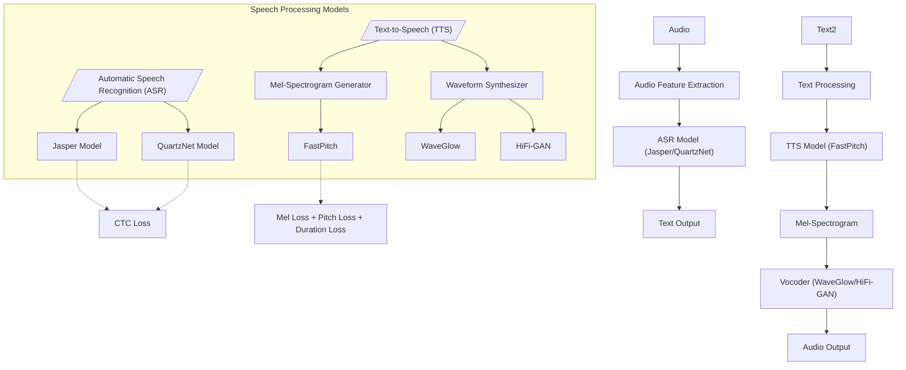

Sources:
- [PyTorch/SpeechRecognition/Jasper/train.py](PyTorch/SpeechRecognition/Jasper/train.py)
- [PyTorch/SpeechRecognition/QuartzNet/train.py](PyTorch/SpeechRecognition/QuartzNet/train.py)
- [PyTorch/SpeechSynthesis/FastPitch/train.py](PyTorch/SpeechSynthesis/FastPitch/train.py)
- [PyTorch/SpeechSynthesis/FastPitch/inference.py](PyTorch/SpeechSynthesis/FastPitch/inference.py)

## Automatic Speech Recognition (ASR)

### Feature Pipeline

The ASR models use audio processing pipelines to convert raw waveforms into features suitable for neural networks:

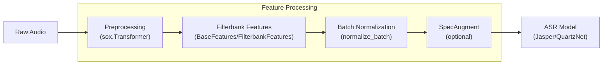

Sources:
- [PyTorch/SpeechRecognition/Jasper/common/features.py](PyTorch/SpeechRecognition/Jasper/common/features.py)
- [PyTorch/SpeechRecognition/Jasper/common/audio.py](PyTorch/SpeechRecognition/Jasper/common/audio.py)
- [PyTorch/SpeechRecognition/Jasper/utils/preprocessing_utils.py](PyTorch/SpeechRecognition/Jasper/utils/preprocessing_utils.py)

Key components of the ASR feature pipeline include:

1. **Audio Loading and Preprocessing**:
   - Sample rate conversion
   - Optional speed perturbation
   - Volume normalization

2. **Feature Extraction**:
   - Filterbank features computed via short-time Fourier transform (STFT)
   - Mel-scale filterbank application
   - Optional feature normalization (per-feature or all-features)

3. **Data Augmentation**:
   - SpecAugment - time and frequency masking
   - CutoutAugment - random rectangular cutouts in the spectrogram

The `FilterbankFeatures` class in [common/features.py](PyTorch/SpeechRecognition/Jasper/common/features.py) is the central component that handles feature extraction, with configurations for:

- FFT size (`n_fft`)
- Window types (hamming, hann, etc.)
- Number of mel filters (`n_filt`)
- Frequency range (`mel_fmin` and `mel_fmax`)

### ASR Models

The repository contains two primary ASR models:

#### 1. Jasper

Jasper is a time-delay neural network composed of blocks of 1D convolutions, batch normalization, ReLU, and dropout. 

#### 2. QuartzNet

QuartzNet is an evolution of Jasper with a more efficient architecture, using separable convolutions for improved performance.

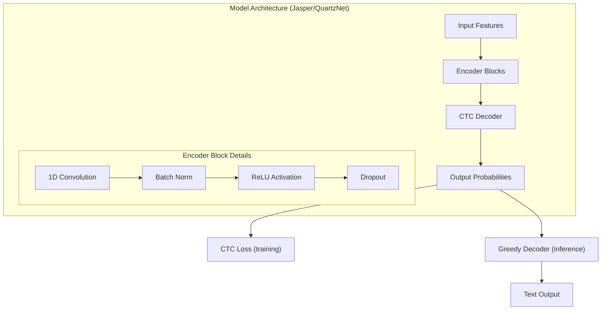

Sources:
- [PyTorch/SpeechRecognition/Jasper/train.py](PyTorch/SpeechRecognition/Jasper/train.py)
- [PyTorch/SpeechRecognition/QuartzNet/train.py](PyTorch/SpeechRecognition/QuartzNet/train.py)

### ASR Training Pipeline

The training pipeline for ASR models involves:

1. **Data Loading**:
   - Support for multiple datasets through JSON manifest files
   - Optional DALI data loader for accelerated loading
   - Dynamic batch bucketing based on sequence length

2. **Training Loop**:
   - Mixed precision training via AMP
   - Gradient accumulation for effective larger batch size
   - Distributed training across multiple GPUs
   - Checkpoint saving and resumption

3. **Optimization**:
   - Support for various optimizers: Novograd, Adam, LAMB
   - Learning rate schedulers (exponential, cosine, etc.)
   - Optional EMA (Exponential Moving Average) of weights

4. **Evaluation**:
   - Word Error Rate (WER) calculation on validation set
   - Regular evaluation during training

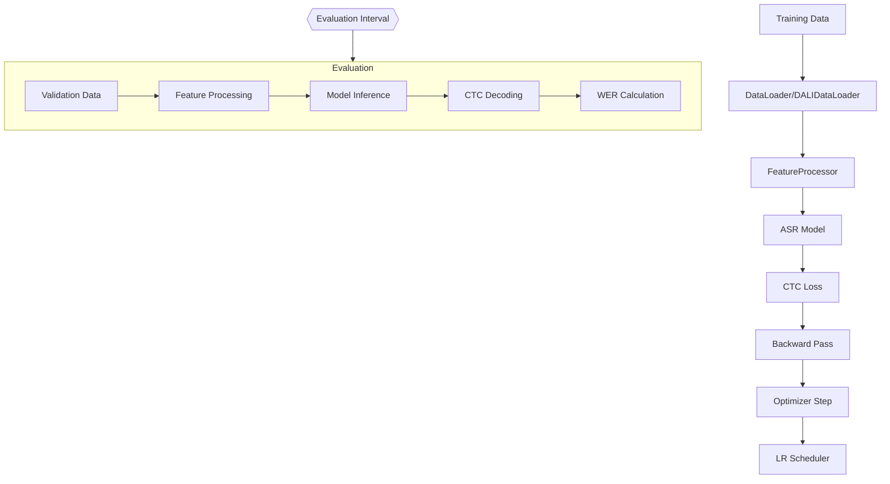

Sources:
- [PyTorch/SpeechRecognition/Jasper/train.py:178-509](PyTorch/SpeechRecognition/Jasper/train.py:178-509)
- [PyTorch/SpeechRecognition/QuartzNet/train.py:199-533](PyTorch/SpeechRecognition/QuartzNet/train.py:199-533)

## Text-to-Speech Synthesis (TTS)

### FastPitch System Overview

The FastPitch model is a Transformer-based neural network that converts text to mel-spectrograms with explicit pitch and duration modeling.

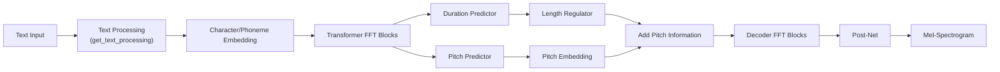

Sources:
- [PyTorch/SpeechSynthesis/FastPitch/README.md:98-111](PyTorch/SpeechSynthesis/FastPitch/README.md:98-111)
- [PyTorch/SpeechSynthesis/FastPitch/train.py](PyTorch/SpeechSynthesis/FastPitch/train.py)

Key components of FastPitch include:

1. **Text Processing**:
   - Support for character or phoneme inputs
   - Optional CMU dictionary for phonetization
   - Text normalization and cleaning

2. **Transformer Encoder**:
   - Transformer blocks with multi-head attention
   - Processes the text sequence

3. **Duration and Pitch Predictors**:
   - Duration predictor estimates how long each character/phoneme should be spoken
   - Pitch predictor models the fundamental frequency contour

4. **Length Regulator**:
   - Expands the sequence based on predicted durations
   - Adds pitch information

5. **Decoder and Post-Net**:
   - Transforms the expanded sequence into mel-spectrograms
   - Post-net refines the output

### Vocoder Systems

The TTS pipeline uses neural vocoders to convert mel-spectrograms to audio:

1. **WaveGlow**: A flow-based generative model for high-quality audio synthesis
2. **HiFi-GAN**: A GAN-based vocoder for efficient, high-fidelity waveform generation

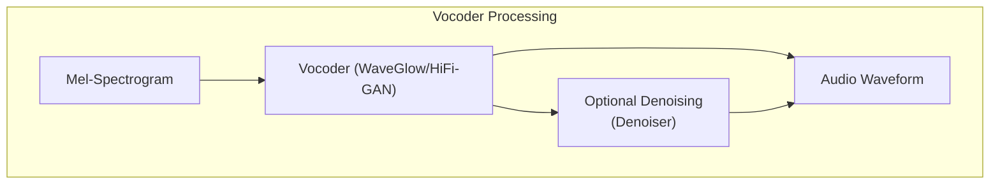

Sources:
- [PyTorch/SpeechSynthesis/FastPitch/inference.py:362-394](PyTorch/SpeechSynthesis/FastPitch/inference.py:362-394)

### TTS Training Pipeline

The training process for FastPitch involves:

1. **Data Preparation**:
   - Audio preprocessing and mel-spectrogram extraction
   - Pitch extraction for ground truth
   - Text normalization

2. **Training Loop**:
   - Multi-loss training (mel reconstruction, duration prediction, pitch prediction)
   - Optional KL loss for attention binarization
   - Gradient clipping
   - Mixed precision training via AMP

3. **Optimization**:
   - Adam or LAMB optimizer
   - Learning rate scheduling
   - Optional EMA model maintenance

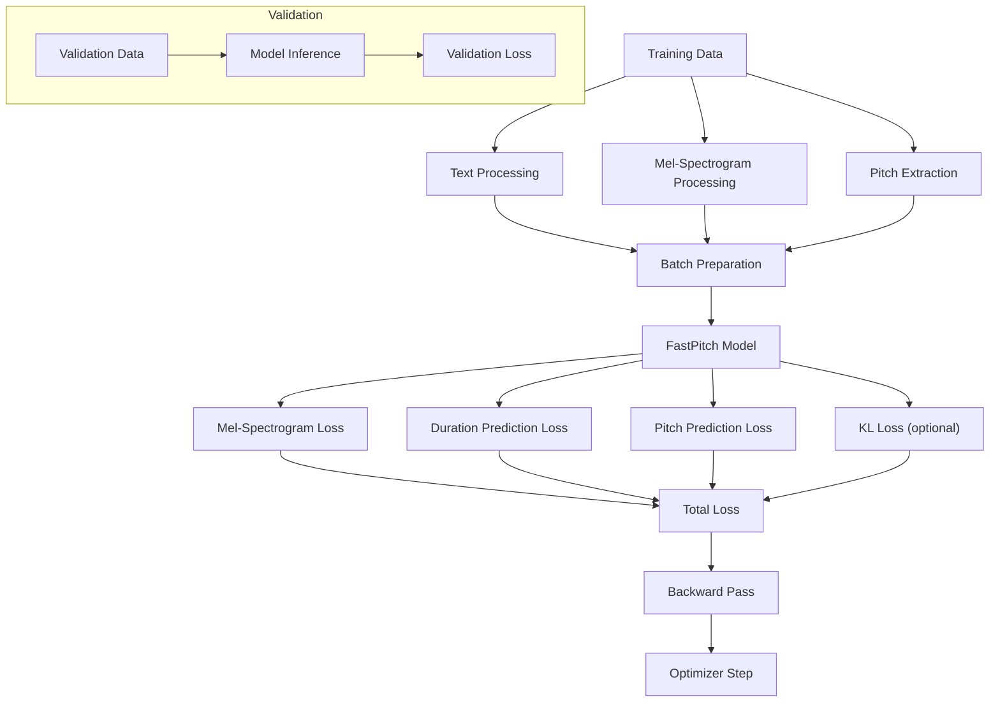

Sources:
- [PyTorch/SpeechSynthesis/FastPitch/train.py:286-566](PyTorch/SpeechSynthesis/FastPitch/train.py:286-566)

### TTS Inference Pipeline

The inference process for TTS involves:

1. **Text Processing**:
   - Conversion of input text to model-compatible format
   - Optional phonetization

2. **Model Forward Pass**:
   - FastPitch generates mel-spectrograms
   - Optional pitch transformations (amplify, shift, invert)
   - Speech rate adjustment via duration scaling

3. **Vocoder Synthesis**:
   - Conversion of mel-spectrograms to audio via WaveGlow or HiFi-GAN
   - Optional audio denoising

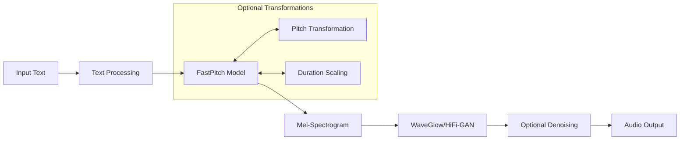

Sources:
- [PyTorch/SpeechSynthesis/FastPitch/inference.py:286-516](PyTorch/SpeechSynthesis/FastPitch/inference.py:286-516)
- [PyTorch/SpeechSynthesis/FastPitch/scripts/inference_example.sh](PyTorch/SpeechSynthesis/FastPitch/scripts/inference_example.sh)

## Common Optimization Techniques

Both ASR and TTS systems employ several optimization techniques for efficient training and inference:

### Training Optimizations

| Optimization Technique | Implementation | Purpose |
|------------------------|----------------|---------|
| Mixed Precision Training | Automatic Mixed Precision (AMP) | Accelerate training with FP16 precision while maintaining FP32 accuracy |
| Multi-GPU Training | DistributedDataParallel (DDP) | Scale training across multiple GPUs |
| Gradient Accumulation | Manual accumulation over steps | Simulate larger batch sizes |
| Fast Data Loading | DALI Data Loader | GPU-accelerated data loading and preprocessing |
| Learning Rate Scheduling | Custom schedulers | Improve convergence and final model quality |

Sources:
- [PyTorch/SpeechRecognition/Jasper/train.py:312-323](PyTorch/SpeechRecognition/Jasper/train.py:312-323)
- [PyTorch/SpeechSynthesis/FastPitch/train.py:350-356](PyTorch/SpeechSynthesis/FastPitch/train.py:350-356)

### Inference Optimizations

| Optimization Technique | Implementation | Purpose |
|------------------------|----------------|---------|
| TorchScript | Model conversion to TorchScript | Optimize model execution |
| CUDA Graph Capture | capture_cuda_graph flag | Reduce CPU overhead by capturing CUDA operations |
| TensorRT Integration | Torch-TensorRT | Accelerate inference with TensorRT optimizations |
| Batching | Dynamic batching | Process multiple requests efficiently |
| Triton Inference Server | Model deployment with Triton | Production-ready inference serving |

Sources:
- [PyTorch/SpeechSynthesis/FastPitch/inference.py:329-343](PyTorch/SpeechSynthesis/FastPitch/inference.py:329-343)
- [PyTorch/SpeechSynthesis/FastPitch/triton/config_model_on_triton.py](PyTorch/SpeechSynthesis/FastPitch/triton/config_model_on_triton.py)

## Code Organization

The speech processing code is organized as follows:

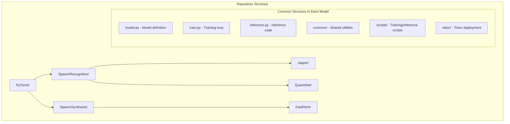

Sources:
- Repository structure from all files

## Deployment with Triton Inference Server

The repository includes support for deploying models with NVIDIA Triton Inference Server:

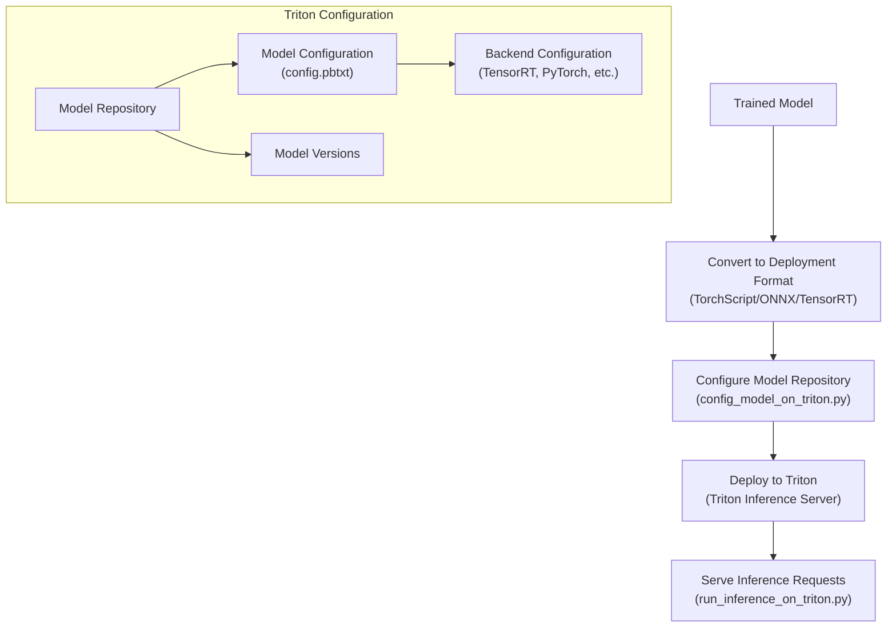

Sources:
- [PyTorch/SpeechSynthesis/FastPitch/triton/config_model_on_triton.py](PyTorch/SpeechSynthesis/FastPitch/triton/config_model_on_triton.py)
- [PyTorch/SpeechSynthesis/FastPitch/triton/run_inference_on_triton.py](PyTorch/SpeechSynthesis/FastPitch/triton/run_inference_on_triton.py)

## Utilities and Logging

Both ASR and TTS systems use common logging and metrics utilities:

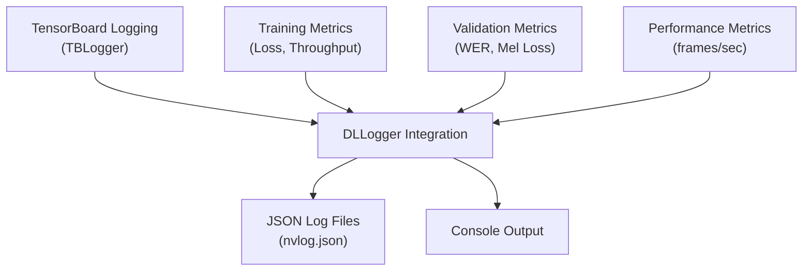

Sources:
- [PyTorch/SpeechRecognition/Jasper/common/tb_dllogger.py](PyTorch/SpeechRecognition/Jasper/common/tb_dllogger.py)
- [PyTorch/SpeechSynthesis/FastPitch/common/tb_dllogger.py](PyTorch/SpeechSynthesis/FastPitch/common/tb_dllogger.py)

## Conclusion

The PyTorch Speech Processing implementation in NVIDIA Deep Learning Examples provides high-performance, GPU-optimized implementations of modern ASR and TTS models. The code is designed for both research and production deployment, with support for the latest optimization techniques and deployment options. The modular design allows for experimentation with different model architectures, training configurations, and inference optimization strategies.

---

