<!-- source: DeepWiki mcp.deepwiki.com · repo NVIDIA/DeepLearningExamples · page 2.4 PyTorch Recommendation Systems · fetched 2026-10-26 -->

# PyTorch Recommendation Systems

Relevant source files

The following files were used as context for generating this wiki page:

- [PyTorch/Recommendation/DLRM/dlrm/cuda_ext/dot_based_interact.py](PyTorch/Recommendation/DLRM/dlrm/cuda_ext/dot_based_interact.py)
- [PyTorch/Recommendation/DLRM/dlrm/cuda_ext/fused_gather_embedding.py](PyTorch/Recommendation/DLRM/dlrm/cuda_ext/fused_gather_embedding.py)
- [PyTorch/Recommendation/DLRM/dlrm/cuda_ext/sparse_embedding.py](PyTorch/Recommendation/DLRM/dlrm/cuda_ext/sparse_embedding.py)
- [PyTorch/Recommendation/DLRM/dlrm/data/data_loader.py](PyTorch/Recommendation/DLRM/dlrm/data/data_loader.py)
- [PyTorch/Recommendation/DLRM/dlrm/data/datasets.py](PyTorch/Recommendation/DLRM/dlrm/data/datasets.py)
- [PyTorch/Recommendation/DLRM/dlrm/data/feature_spec.py](PyTorch/Recommendation/DLRM/dlrm/data/feature_spec.py)
- [PyTorch/Recommendation/DLRM/dlrm/data/utils.py](PyTorch/Recommendation/DLRM/dlrm/data/utils.py)
- [PyTorch/Recommendation/DLRM/dlrm/model/distributed.py](PyTorch/Recommendation/DLRM/dlrm/model/distributed.py)
- [PyTorch/Recommendation/DLRM/dlrm/nn/embeddings.py](PyTorch/Recommendation/DLRM/dlrm/nn/embeddings.py)
- [PyTorch/Recommendation/DLRM/dlrm/scripts/main.py](PyTorch/Recommendation/DLRM/dlrm/scripts/main.py)
- [PyTorch/Recommendation/DLRM/dlrm/scripts/utils.py](PyTorch/Recommendation/DLRM/dlrm/scripts/utils.py)
- [PyTorch/Recommendation/DLRM/preproc/split_dataset.py](PyTorch/Recommendation/DLRM/preproc/split_dataset.py)
- [PyTorch/Recommendation/DLRM/triton/README.md](PyTorch/Recommendation/DLRM/triton/README.md)
- [PyTorch/Recommendation/DLRM/triton/client.py](PyTorch/Recommendation/DLRM/triton/client.py)
- [PyTorch/Recommendation/DLRM/triton/deployer.py](PyTorch/Recommendation/DLRM/triton/deployer.py)

This document provides a comprehensive technical overview of recommendation system implementations in PyTorch within the NVIDIA Deep Learning Examples repository. The focus is on the Deep Learning Recommendation Model (DLRM) implementation, its architecture, optimization features, and deployment capabilities. For TensorFlow-based recommendation systems, see [TF Recommendation Systems](#3.2).

## 1. Overview of Recommendation Systems

Recommendation systems play a crucial role in many online services, including e-commerce platforms, content streaming services, and social media. The PyTorch implementation in this repository focuses on click-through rate (CTR) prediction, which is fundamental to digital advertising and recommendation tasks.

The primary model implemented is DLRM (Deep Learning Recommendation Model), which employs a hybrid architecture combining embedding layers, multilayer perceptrons (MLPs), and feature interaction mechanisms.

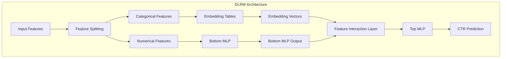

Sources: 
- [PyTorch/Recommendation/DLRM/dlrm/model/distributed.py]()
- [PyTorch/Recommendation/DLRM/dlrm/scripts/main.py]()

## 2. DLRM Architecture and Implementation

The DLRM model consists of four main components:

1. **Bottom MLP**: Processes numerical features
2. **Embedding Tables**: Convert categorical features to dense representations
3. **Feature Interaction**: Combines embeddings and bottom MLP output (typically using dot product)
4. **Top MLP**: Produces final prediction based on interactions

The implementation supports both single-GPU and distributed training across multiple GPUs.

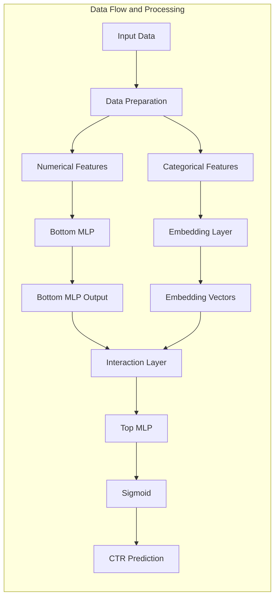

Sources:
- [PyTorch/Recommendation/DLRM/dlrm/model/distributed.py:104-180]()
- [PyTorch/Recommendation/DLRM/dlrm/scripts/main.py:422-439]()

### 2.1 Distributed Implementation

DLRM supports a distributed implementation with a hybrid parallelism strategy:

- **Model Parallelism**: Used for embedding tables, which are distributed across multiple GPUs
- **Data Parallelism**: Used for MLP layers, with each GPU processing a subset of the batch

This hybrid approach addresses the memory constraints of large embedding tables.

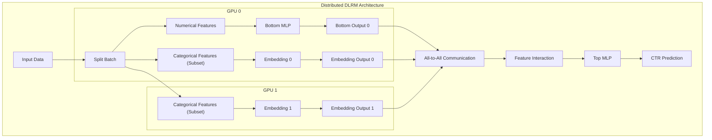

The `BottomToTop` class in the code facilitates the transition from model parallel to data parallel processing:

Sources:
- [PyTorch/Recommendation/DLRM/dlrm/model/distributed.py:25-101]()
- [PyTorch/Recommendation/DLRM/dlrm/scripts/main.py:173-179]()

## 3. Embedding Layer Implementations

The repository provides multiple embedding layer implementations to optimize performance for different use cases:

| Implementation | Description | Best Use Case |
|----------------|-------------|--------------|
| `MultiTableEmbeddings` | Separate embedding tables for each categorical feature | When embedding tables fit in GPU memory |
| `JointEmbedding` | Single embedding table with offsets | Memory-efficient alternative to multi-table |
| `JointSparseEmbedding` | CUDA-optimized sparse implementation | Large-scale sparse inputs |
| `FusedJointEmbedding` | Highly optimized CUDA implementation | Fixed configuration (26 categorical features, 128-dim) |

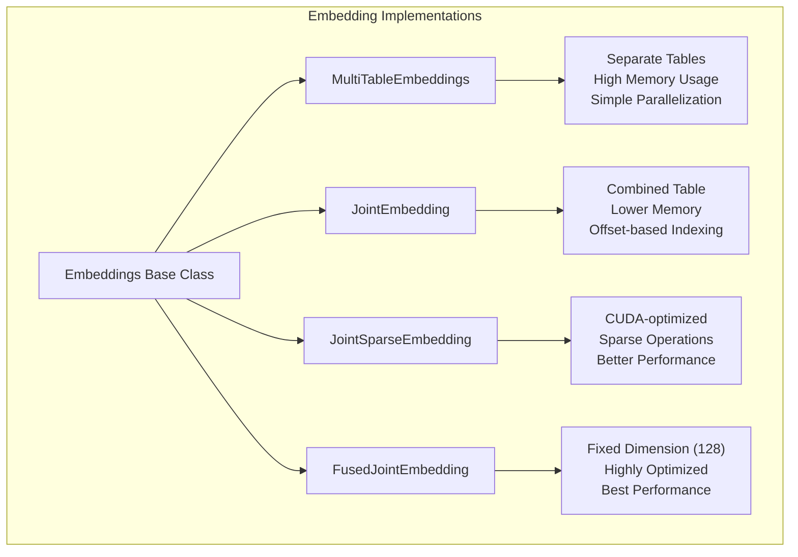

The choice of embedding implementation significantly impacts performance and memory usage. The code allows selecting the embedding type through the `embedding_type` parameter.

Sources:
- [PyTorch/Recommendation/DLRM/dlrm/nn/embeddings.py:26-262]()
- [PyTorch/Recommendation/DLRM/dlrm/cuda_ext/sparse_embedding.py:24-69]()
- [PyTorch/Recommendation/DLRM/dlrm/cuda_ext/fused_gather_embedding.py:26-45]()

## 4. Interaction Layer

The interaction layer combines embedding outputs with the bottom MLP output. Two main implementations are provided:

1. **Dot Interaction**: Computes pairwise dot products between all feature vectors
2. **Concatenation Interaction**: Concatenates all feature vectors

The dot interaction is optimized with CUDA kernels for maximum performance:

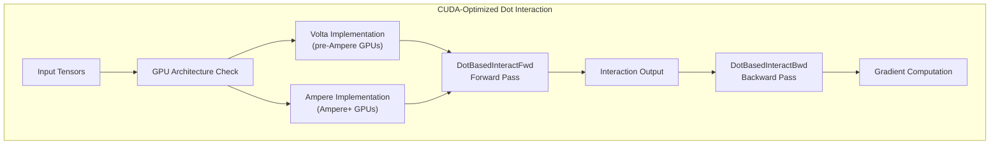

The autograd function `DotBasedInteract` manages both forward and backward passes through the CUDA kernels, with automatic mixed precision support.

Sources:
- [PyTorch/Recommendation/DLRM/dlrm/cuda_ext/dot_based_interact.py:25-43]()

## 5. Data Processing

The repository includes comprehensive data processing components designed to handle large-scale recommendation data efficiently.

### 5.1 Dataset Implementations

Two primary dataset implementations are provided:

1. **ParametricDataset**: For real-world data stored in binary format
2. **SyntheticDataset**: For generating synthetic data for benchmarking

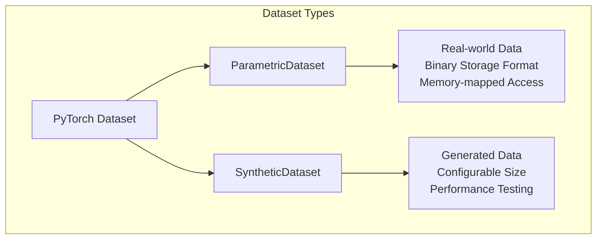

The `ParametricDataset` implementation is optimized for memory efficiency, using memory-mapped file access to handle datasets that may not fit in memory.

Sources:
- [PyTorch/Recommendation/DLRM/dlrm/data/datasets.py:32-224]()

### 5.2 Feature Specification

The `FeatureSpec` class provides a structured way to define and manage feature metadata:

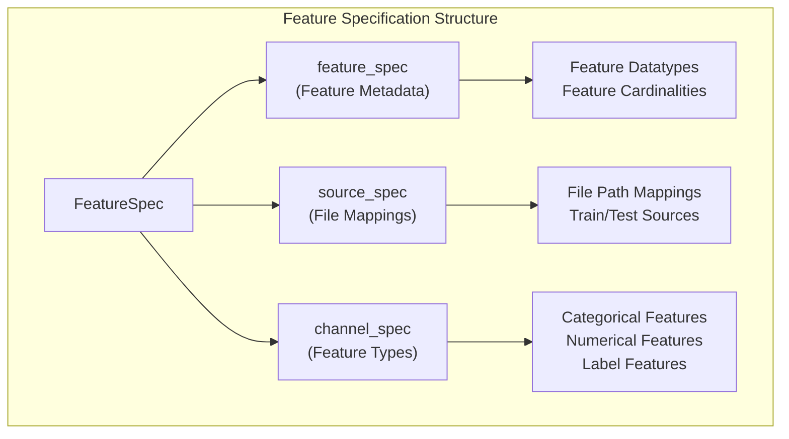

This specification enables consistent handling of features across training, evaluation, and deployment.

Sources:
- [PyTorch/Recommendation/DLRM/dlrm/data/feature_spec.py:31-254]()

### 5.3 Data Preprocessing

The repository includes utilities for preprocessing raw datasets into an optimized binary format:

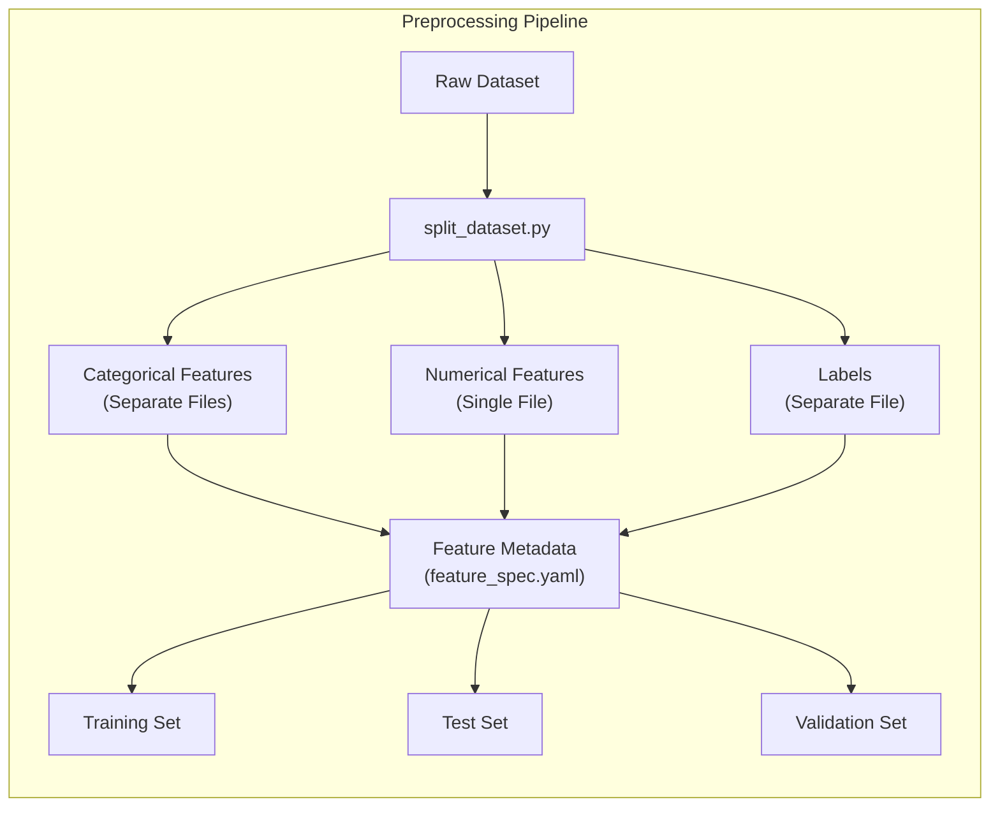

This preprocessing step significantly accelerates data loading during training and evaluation.

Sources:
- [PyTorch/Recommendation/DLRM/preproc/split_dataset.py:31-127]()

## 6. Training Process

The training process is implemented in the `main.py` script, which provides a flexible and optimized training pipeline.

### 6.1 Training Loop

The training loop includes several optimizations:

1. **Mixed Precision Training**: Using automatic mixed precision (AMP) for faster computation
2. **Multi-GPU Training**: Distributed training across multiple GPUs
3. **Gradient Accumulation**: Efficient gradient handling for large models
4. **Learning Rate Scheduling**: Customizable warmup and decay schedules

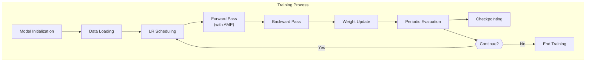

The training process supports various optimization strategies, including different optimizers for embeddings and MLPs.

Sources:
- [PyTorch/Recommendation/DLRM/dlrm/scripts/main.py:387-719]()
- [PyTorch/Recommendation/DLRM/dlrm/scripts/utils.py:224-286]()

### 6.2 Evaluation

The evaluation process calculates ROC AUC (Area Under the Receiver Operating Characteristic Curve), which is the standard metric for CTR prediction:

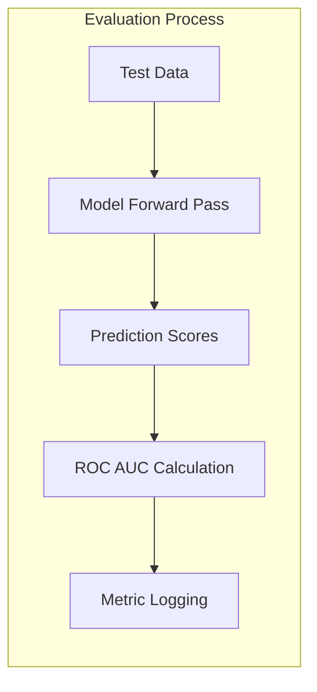

A custom implementation of ROC AUC calculation is provided to enable GPU-based computation of this metric.

Sources:
- [PyTorch/Recommendation/DLRM/dlrm/scripts/main.py:733-835]()
- [PyTorch/Recommendation/DLRM/dlrm/scripts/utils.py:289-320]()

## 7. Inference and Deployment

The repository supports efficient inference and deployment through Triton Inference Server integration.

### 7.1 Inference Benchmarking

Two inference benchmarking methods are provided:

1. **Standard Inference**: Basic inference with synchronization
2. **CUDA Graphs**: Optimized inference using CUDA Graphs for repeatable workloads

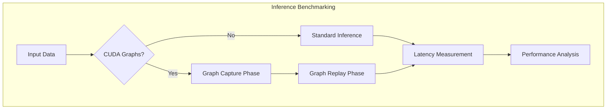

These benchmarking methods provide insights into the model's inference performance across different batch sizes.

Sources:
- [PyTorch/Recommendation/DLRM/dlrm/scripts/main.py:277-384]()

### 7.2 Triton Deployment

The model can be deployed using NVIDIA Triton Inference Server for production environments:

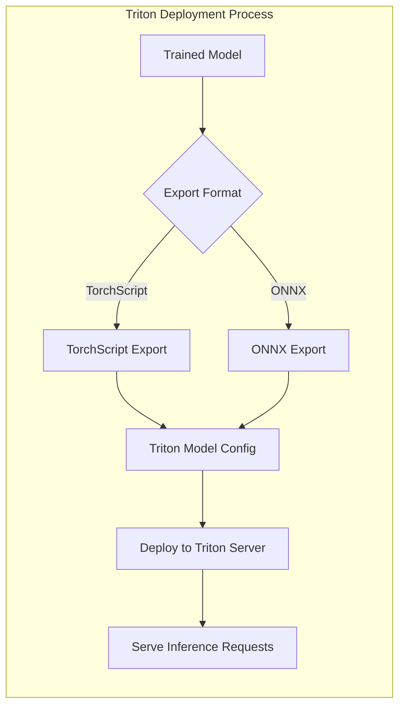

The deployment process supports both TorchScript and ONNX formats, with options for dynamic batching and multiple instance groups.

Sources:
- [PyTorch/Recommendation/DLRM/triton/README.md:1-292]()
- [PyTorch/Recommendation/DLRM/triton/deployer.py:1-146]()
- [PyTorch/Recommendation/DLRM/triton/client.py:1-175]()

## 8. Performance Results

The repository includes comprehensive performance benchmarks for the DLRM model:

### 8.1 Throughput and Latency

The following table shows performance metrics for TorchScript FP16 inference on NVIDIA V100-32G:

| Batch Size | Throughput (samples/s) | Median Latency (ms) | 95% Latency (ms) | 99% Latency (ms) |
|------------|------------------------|---------------------|-----------------|------------------|
| 1          | 1,019                  | 0.966               | 1.027           | 1.082            |
| 64         | 45,000                 | 1.413               | 1.489           | 1.551            |
| 1,024      | 740,000                | 1.379               | 1.463           | 1.536            |
| 16,384     | 1,831,000              | 8.926               | 9.127           | 9.415            |
| 131,072    | 1,547,000              | 86.258              | 90.772          | 92.511           |

Performance scales well with increasing batch size until GPU saturation is reached.

### 8.2 Precision Impact

Comparing FP16 and FP32 performance shows the benefits of mixed precision:

- **FP16 Peak Throughput**: ~1.83M samples/s
- **FP32 Peak Throughput**: ~1.18M samples/s

Mixed precision training provides approximately 1.5x performance improvement.

### 8.3 Dynamic Batching

When deployed with Triton Inference Server's dynamic batching, the model can handle multiple concurrent requests efficiently:

- Single V100-32G with dynamic batching: Up to 1.78M recommendations/s
- 20ms latency bound: Can handle 8 concurrent requests

Sources:
- [PyTorch/Recommendation/DLRM/triton/README.md:195-292]()

## 9. Conclusion

The PyTorch Recommendation Systems implementation in NVIDIA's Deep Learning Examples repository provides a high-performance, scalable foundation for recommendation tasks. The DLRM model offers state-of-the-art accuracy with optimized performance for both training and inference.

Key advantages include:
- Multiple embedding implementations for different use cases
- CUDA-optimized interaction operators
- Efficient distributed training support
- Deployment-ready with Triton Inference Server integration
- Comprehensive performance benchmarks

This implementation serves as an excellent starting point for recommendation system development, providing both high performance and flexibility.

---

